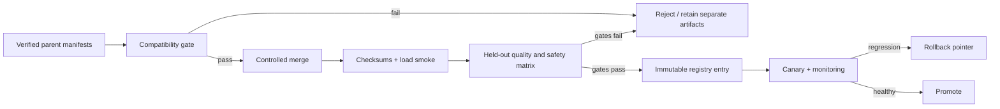

# 8.5 — Model Merging and Weight Averaging

> **Course location:** Module 21, Fine-Tuning, Alignment and Model Customisation. This lesson maps to `finetuning_course/Module_08_PEFT_Model_Merging/8.5_Model_Merging_and_Weight_Averaging.md` in [`Train/Templates/directory.txt`](../../../Templates/directory.txt). The source lesson body was unavailable; this is a new mapped draft, not a reconstruction.
>
> **Status:** Draft. A weighted average is defined only after compatibility and coordinate identity are demonstrated. It is not evidence that two models, adapters or task behaviors can be safely combined.

## Learning outcomes

Learners can distinguish full-weight, delta and adapter merges; state the compatibility contract before any arithmetic; derive a convex coordinate-wise weighted average; calculate a small example; recognize why merge weights are not task-quality weights; construct a bounded merge experiment; and require regression, safety, artifact lineage and rollback evidence before releasing a merged model.

## 1. What a merge does—and does not establish

A merge creates a new parameter artifact from two or more existing artifacts. It is not ensembling: an ensemble retains multiple predictors and combines outputs. It is not a router: a router selects a model/adapter per request. It is not continued training: no optimizer update occurs merely because tensors are averaged.

Three objects are commonly confused:

- **Full weights:** `theta_k` is a complete checkpoint. Averaging changes every included coordinate.
- **Deltas:** `delta_k = theta_k - theta_base` is an update relative to the **same identified base**. Merging deltas and adding them to the base preserves that reference explicitly.
- **Adapters:** artifacts such as LoRA factors or bottleneck weights have method-specific semantics. Averaging factors individually is generally not equal to averaging their induced updates; use the method's compatible representation or evaluate live composition instead.

A model with matching parameter tensor shapes is not necessarily compatible. Architecture/configuration, parameter order/names, tied-weight scheme, tokenizer/vocabulary mapping, positional scheme, base checkpoint lineage, target modules, parameterization, dtype/quantization representation and preprocessing/template can all change the meaning of a coordinate. A permissive loader proves only that a serialization was accepted.

## 2. Compatibility is a release gate

Before constructing a merge candidate, build a manifest for every input and reject the operation if any behavior-relevant identity differs without an explicitly validated conversion:

| Required identity | Why it matters | Minimum check |
|---|---|---|
| Base checkpoint hash/revision | Delta coordinates refer to a particular base | Exact immutable ID, not display name |
| Architecture/config | A coordinate must have the same semantic role and layout | Compare config plus named tensor shape/dtype inventory |
| Parameter names/order and tied storage | Zipped tensors can silently pair different meanings | Compare canonical state-dict keys and alias map |
| Tokenizer/vocabulary/special-token mapping | Same embedding row must denote same token | Hash tokenizer assets and special-token IDs |
| Position/attention conventions | Identical shapes can implement different sequence behavior | Compare relevant config and inference policy |
| Adapter method/target modules/scaling | Adapter tensors have method-specific meanings | Compare method config and target inventory exactly |
| Quantization/dtype conversion policy | Averaging encoded codes is not generally numerical averaging | Dequantize/reconstruct under a pinned, validated method or reject |
| License, data and policy constraints | A technically valid artifact can remain impermissible | Record provenance and release authorization |

Compatibility is necessary, not sufficient. Two compatible fine-tunes may encode conflicting instructions, safety boundaries or task preferences. A merge must earn its quality through held-out evaluation; it cannot inherit acceptance from its parents.

## 3. Coordinate-wise weighted averaging

For compatible parameter vectors/tensors `theta_1 ... theta_K` with scalar weights `w_1 ... w_K`, a basic convex merge is:

```text
FORMULA [MERGE-01]: theta_merge = sum(k=1..K) w_k * theta_k
                    sum(k=1..K) w_k = 1; w_k >= 0
WHERE: each theta_k has the same coordinate system and tensor shape; w_k is
       dimensionless; theta_merge has that shared coordinate system.
CONSTRAINT: apply only to compatible numerical parameters in the same
            representation. This formula does not establish useful behavior.
NUMERICAL EXAMPLE: theta_A=[2,-1,4], theta_B=[6,3,0], w_A=0.25, w_B=0.75.
                   theta_merge=.25*[2,-1,4]+.75*[6,3,0]=[5,2,1].
INTERPRETATION: every coordinate is interpolated. The result is not a 25/75
                request router and does not retain both parent checkpoints.
```

With exactly two compatible inputs, `theta_merge = alpha*theta_A + (1-alpha)*theta_B` for `0<=alpha<=1`. An alpha sweep is an experiment design, not an optimization result. A task mixture ratio is not automatically the correct alpha: gradient geometry, data quality, task difficulty, safety requirements and nonlinear model behavior all matter.

Negative or weights summing other than one define extrapolation/rescaling rather than a convex average. Such methods may be studied deliberately, but they require an explicit method definition, numerical safeguards and stronger regression evidence. Do not label an arbitrary weighted sum “averaging.”

## 4. Delta merging makes the base explicit

When candidates share a verified base `theta_0`, represent each adaptation as `delta_k = theta_k - theta_0`. A weighted delta merge is:

```text
FORMULA [MERGE-02]: theta_merge = theta_0 + sum(k=1..K) w_k * delta_k
WHERE: theta_0 is the identical base artifact; delta_k is computed against it;
       theta_k = theta_0 + delta_k in the same numerical representation.
CONSTRAINT: every delta uses exactly theta_0, with matching parameter key,
            shape, tokenizer/configuration and tied-weight behavior.
NUMERICAL EXAMPLE: theta_0=[10,10], delta_A=[0.4,-0.2], delta_B=[0,0.6],
                   w_A=.25, w_B=.75 gives delta_merge=[.1,.4] and
                   theta_merge=[10.1,10.4].
INTERPRETATION: parent behavior changes are combined relative to the named base.
                Delta provenance remains essential for audit and rollback.
```

For matching arithmetic and identical base, this equals the full-weight average because `sum w_k=1`. Keeping deltas explicit prevents a common provenance error: subtracting different bases yet treating the resulting values as aligned updates. It also supports sparse storage or selective target-module scope, provided omitted tensors are defined as zero deltas rather than silently dropped.

At large parameter scale, execute the merge in a controlled streaming pipeline, checksum input/output shards and prevent partial output from being promoted. Record accumulation dtype. Low-precision accumulation, overflow, quantize/dequantize order and tied parameter handling can make a numerically different artifact despite the same formula.

## 5. Adapters require representation-aware treatment

For a conventional LoRA update to one matrix, `DeltaW = (alpha/r) B*A`. Two adapters can be combined at the induced-update level when—and only when—they reference the same base projection, target location, dimensions and scaling semantics:

```text
FORMULA [MERGE-03]: DeltaW_merge = w_A * (alpha_A/r_A) B_A A_A
                                  + w_B * (alpha_B/r_B) B_B A_B
WHERE: A_i and B_i are adapter factors for the same logical matrix; alpha_i/r_i
       is the declared implementation scaling; w_i are chosen merge weights.
CONSTRAINT: factor-average is not generally equivalent: (w_A B_A+w_B B_B)
            (w_A A_A+w_B A_B) produces cross terms.
```

The cross terms mean independently averaging `A` and `B` can produce an update not equal to the weighted sum of the parent updates. A tool may provide a supported adapter-combination operation, but its documented semantics—not a generic label—must define what it computes. Reconstructing dense deltas may be expensive; keeping adapters separate and routing one at a time can be safer when composition is unvalidated.

Bottleneck adapters, prefixes and soft prompts are likewise not interchangeable arrays. Averaging matching tensors can be numerically possible yet behaviorally unsupported. Use only a method-specific implementation with exact compatibility checks, then test the result as a new candidate.

## 6. Merge experiment and acceptance plan

**Problem:** Two compatible domain fine-tunes are proposed for one serving slot to reduce operational complexity. No measured result exists.

**Decision:** Start with a bounded, reproducible two-parent delta merge. Freeze the model/tokenizer/template/runtime versions, calculate deltas against one hashed base, and test a small predeclared alpha set such as `{0, 0.25, 0.5, 0.75, 1}`. Endpoint values verify the pipeline against the parent artifacts. Do not add a third parent, quantize during merge or alter decoding/data simultaneously; those changes prevent attribution.

**Checks before candidate creation:**

1. Verify input checksums, licenses/policy approvals, canonical key set/order, shapes, dtype policy, tied-weight map, base revision, architecture/config and tokenizer assets.
2. Reject any mismatch rather than padding, truncating or relying on positional tensor zipping.
3. Define merge scope: all compatible model weights, named delta keys, or a method-specific adapter representation. Record omitted keys and rationale.
4. Use a controlled accumulation dtype; record shard/chunk strategy and output checksums. Run a load and single-batch forward smoke check before expensive evaluation.

**Evaluation matrix:** Include parent A, parent B, base, each candidate alpha and any currently deployed model. Keep prompt set, tools, retrieval state, decoding, context length and validators fixed. Score task-specific quality, critical safety/refusal behavior, groundedness, schema validity, multilingual/domain slices, long-context slice, latency, peak memory and model-load behavior. Examine worst-case slices and error categories, not just a pooled average.

**Promotion rule:** Promote only a candidate that meets predeclared gates and has reproducible lineage, no unacceptable regression relative to required parent capabilities, operational fit, signed review and a tested rollback pointer. If none does, retain routing/separate artifacts or choose a simpler control. “One checkpoint instead of two” is not sufficient benefit.

## 7. Failure modes and diagnostics

| Symptom | Likely cause | Discriminating evidence | Safe response |
|---|---|---|---|
| Output artifact will not load | Missing/extra keys, incompatible serialization or partial write | Key/shape diff, shard checksums and controlled loader error | Stop; rebuild from pinned inputs, never fill unknown tensors |
| Loads but behavior is nonsensical | Different base/config/tokenizer or mismatched key semantics | Manifest comparison, tokenizer test IDs and parent-vs-merge layer/output probes | Reject candidate; locate mismatch before any weight sweep |
| Parent capability disappears at alpha .5 | Task interference or nonlinearity | Slice matrix across endpoints and intermediate alphas | Retain parents/router; do not average away critical capability |
| Merge appears good on aggregate only | Population imbalance or metric masking | Worst-slice, safety and task-family reports | Apply per-slice gates; revise scope/data/method |
| Adapter merge differs from expected | Factor scaling/target mismatch or cross-term error | Compare induced delta and method-specific tool output | Use supported representation or do not merge |
| Merge differs after reload | Dtype/quantization conversion, tied-weight divergence or serialization loss | Tensor checksum/statistics and fixed-logit comparison pre/post save | Pin conversion/order and rebuild; separately version output |
| Quantized merge regresses | Averaging codes/metadata rather than reconstructed values | Representation audit and paired unquantized/quantized tests | Reject encoded merge; use validated reconstruction pipeline if justified |
| Compliance or safety policy regresses | Parent policies conflict or one parent lacks a boundary | Adversarial/regression suite and provenance review | Block promotion; keep scoped routing or revise parent training |
| Cannot explain result | Multiple changed axes or missing manifests | Reconstruct run manifest; compare immutable input IDs | Mark result invalid; rerun one controlled comparison |
| No rollback path | Output replaced parent tag or cache points at mutable alias | Release registry, immutable IDs and rollback exercise | Block release; restore immutable artifact/version pointers |

## 8. Operational lifecycle

Treat a merge candidate as a new model release:



The serving registry should resolve immutable base, tokenizer, merge recipe, parent IDs, evaluation report, policy approval and runtime compatibility. Caches must include the merged artifact revision; mutable aliases can otherwise serve a new merge to an old session. Retain parent artifacts through the rollback window subject to policy and storage controls.

Monitor request routing, version, latency, load failures, OOMs, output validators, critical task/safety proxies and population mix. Production telemetry is not a substitute for held-out gating, but it can expose distribution shift or operational failure. Roll back on a predeclared threshold or an integrity/isolation incident, then preserve logs and artifacts for diagnosis.

## 9. Interview and self-check questions

### Q1. What does `theta=.25 theta_A+.75 theta_B` require before calculation?
**Answer:** Same coordinate meaning, architecture/configuration, base lineage/representation and approved provenance.
**Reasoning:** Shape equality alone cannot establish semantic alignment.
**Follow-up:** Is matching tokenizer necessary for every tensor formula?
**Answer:** The numerical arithmetic may run without it, but a deployable model behavior contract requires tokenizer compatibility.

### Q2. Calculate the merge of `[2,-1,4]` and `[6,3,0]` at weights `.25` and `.75`.
**Answer:** `[5,2,1]`.
**Reasoning:** Apply the weights coordinate by coordinate.
**Follow-up:** Does this preserve each parent's output exactly?
**Answer:** No; it creates a new predictor.

### Q3. Why keep deltas explicit?
**Answer:** They name the base that gives update coordinates their meaning.
**Reasoning:** Deltas from different bases cannot be assumed aligned.
**Follow-up:** When does delta merge equal full-weight averaging?
**Answer:** With one identical base and convex weights that sum to one.

### Q4. Why not average LoRA A factors and B factors separately?
**Answer:** Multiplying averaged factors creates cross terms absent from a weighted sum of induced updates.
**Reasoning:** Matrix multiplication is bilinear.
**Follow-up:** What must a tool document?
**Answer:** Its exact representation and merge/composition semantics.

### Q5. What is wrong with averaging quantized code values directly?
**Answer:** Codes and metadata are representation-dependent, not necessarily aligned numerical weights.
**Reasoning:** The averaging formula applies to compatible numerical coordinates.
**Follow-up:** What is the safe default?
**Answer:** Reject unless a validated reconstruction/conversion pipeline is specified.

### Q6. Why test alpha endpoints?
**Answer:** They should reproduce the designated parent artifacts under the same pipeline.
**Reasoning:** Endpoint failures reveal merge/serialization/configuration defects.
**Follow-up:** Is endpoint success sufficient for an intermediate candidate?
**Answer:** No; evaluate every candidate behaviorally.

### Q7. What does a better average score fail to prove?
**Answer:** Safety, worst-slice quality, operational fit, policy compliance and causality.
**Reasoning:** Aggregate metrics can mask critical regressions.
**Follow-up:** What is a bounded response?
**Answer:** Predeclare per-slice gates and retain rollback.

### Q8. How is model merging different from routing?
**Answer:** Merging creates one new parameter artifact; routing selects among retained artifacts at request time.
**Reasoning:** They have different memory, latency and rollback tradeoffs.
**Follow-up:** When might routing be safer?
**Answer:** When task interference or merge quality is unvalidated.

### Q9. What must a released merge record?
**Answer:** Immutable parent/base IDs, recipe/weights, code/runtime/dtype, tokenizer/template, checksums, evaluation and approval/rollback identity.
**Reasoning:** Reproducibility and incident response require lineage.
**Follow-up:** Is a display model name enough?
**Answer:** No; it is mutable and ambiguous.

### Q10. What is the correct result when compatibility is uncertain?
**Answer:** Do not merge.
**Reasoning:** A plausible tensor operation is not evidence of a valid model.
**Follow-up:** What remains available?
**Answer:** Keep parents separate, route deliberately or collect the missing evidence.

## 10. Quick reference

| Decision | Minimum evidence |
|---|---|
| Merge full weights | Exact coordinate/config/tokenizer/provenance compatibility; held-out gates |
| Merge deltas | One identified base for every delta; explicit zero/omitted-key policy |
| Merge adapters | Method-specific target/scaling/representation compatibility and output validation |
| Merge quantized artifacts | Validated numerical reconstruction/conversion; never presume encoded-code arithmetic |
| Promote a merge | Slice/safety/quality/operational gates, immutable lineage and rollback |
| Decline a merge | Any compatibility, policy, critical-regression or rollback gap |

**Draft limitations:** the source lesson body, parent checkpoints, tool semantics, workload and benchmark evidence were unavailable. All examples are derived arithmetic; no merge candidate, quality result or latency result has been measured.
