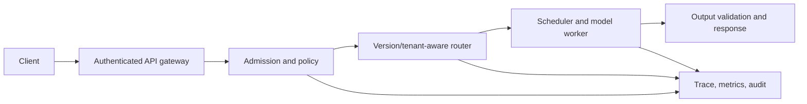

# 10.4 — Serving Architecture and Deployment

> **Course location:** Module 25. This lesson maps to `finetuning_course/Module_10_Inference_Deployment/10.4_Serving_Architecture_and_Deployment.md` in [`Train/Templates/directory.txt`](../../../Templates/directory.txt). The source body was unavailable; this is a new mapped draft.
>
> **Boundary:** An architecture diagram is not availability, privacy, security, cost or quality evidence. Every boundary needs an enforceable contract and test.

## Learning outcomes

Learners can define serving-plane responsibilities, select an admission/routing/fallback policy from declared constraints, protect tenant and model-version isolation, design progressive delivery with rollback, and verify SLO/quality/incident controls before promotion.

## 1. Minimal serving-plane contract

The gateway authenticates and validates request bounds. Admission reserves bounded resources and applies priority/quotas. Router selects an authorized immutable model/adapter/version and fallback. Scheduler owns batching/cache lifecycle. Output validation enforces declared schemas and safety/product constraints without silently changing policy. Telemetry joins request, policy, artifact, routing and outcome signals with privacy controls.

## 2. Required invariants

- A request is bound to an immutable model/tokenizer/template/adapter/policy version for its lifetime.
- Tenant authorization is checked before routing/cache lookup; display IDs are not authority.
- Timeouts, cancellation, retries and idempotency have explicit semantics; retries do not duplicate side effects.
- Resource budgets cover queue, context, generation, tool calls and cache; overload has a deterministic rejection/degradation policy.
- Every response has a traceable release/artifact identity and redacted audit context.
- Fallback is prevalidated for capability, safety, residency and output contract—not merely reachable.

## 3. Delivery controls

Use immutable artifacts and a release manifest containing model, tokenizer, runtime, prompt/template, adapters, route rules, evaluation report, configuration and rollback pointer. A progressive rollout compares baseline/candidate on predeclared quality, safety, error, latency, cost and capacity guardrails; randomization/eligibility must be stable and auditable. Canary traffic is not permission to expose a known critical failure.

Rollback must be executable: immutable previous artifact, tested route/config switch, cache invalidation/session behavior, owner/on-call and decision threshold. A mutable “latest” alias without lineage makes incident recovery ambiguous.

## 4. Failure modes

| Failure | Check | Response |
|---|---|---|
| Wrong model/adapter returned | Request-to-artifact/version/authorization trace | Stop rollout; correct routing/cache key and run isolation tests |
| Retry duplicates tool action | Idempotency key and side-effect ledger | Block automatic retry or make operation idempotent |
| Fallback violates contract | Capability/residency/schema/safety tests | Remove fallback until validated |
| Canary looks healthy but critical slice regresses | Eligibility/slice and guardrail dashboard | Roll back or exclude/fix; do not rely on aggregate |
| Queue overload causes cascading failures | Offered/accepted/rejected/timeout and resource traces | Enforce admission/backpressure and shed deterministically |

## 5. Bounded architecture decision

For a multi-tenant service with model variants, choose a router only after declaring authorization, residency, capability, deadline, cost and fallback rules. Validate cross-tenant negative requests, adapter/model swap races, cancellation, quota exhaustion, rollback and output-schema failures. Promote in stages only if offline quality/safety and live operational gates pass.

## 6. Interview checks

1. **Why pin an artifact per request?** To prevent hot-swap behavior/caching races.
2. **Why is fallback a product decision?** It can change quality, safety, residency and schema.
3. **What prevents retry side effects?** Explicit idempotency and operation semantics.
4. **What proves rollback?** An exercised route/config reversal to immutable artifact.
5. **What is admission control for?** Protecting bounded capacity and tail behavior under overload.

## 7. Quick reference

| Claim | Required evidence |
|---|---|
| Correct routing | Immutable version/authorization traces and negative tests |
| Safe fallback | Capability/policy/schema/residency validation |
| Reliable deployment | Progressive gates, monitoring, incident owner and exercised rollback |
| Tenant isolation | Complete cache/route scope and concurrency/race tests |

**Draft limitations:** no serving stack, traffic data, security review or rollout was observed. This is a control design, not a deployed architecture claim.
