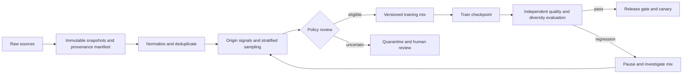

# Interview case: Detecting synthetic-data feedback in a training corpus

## Scenario and source grounding
A model provider sees increasingly repetitive answers and confident errors on obscure topics even though its conventional benchmark scores look healthy. Its web corpus may contain text generated by previous models, creating a feedback loop in which narrow or erroneous outputs become later training examples. Design the data and release controls for the next training run.

The source describes the illustrative Meridian-7B/NeuralFoundry incident, lexical diversity, long-tail factual drift, and the limitations of n-gram deduplication. Treat its incident names, dates, costs and measurements as case-study claims, not independently established facts. See [OCR, model-collapse analysis and alternatives](../../../Case_Studies_agentics_Ai_systems/AI_engg_challenges/AI_engg_challenges_OCR_DOCUMENTATION.md#part_03), and [image 20260819_124126.jpg](../../../Case_Studies_agentics_Ai_systems/AI_engg_challenges/20260819_124126.jpg), which compares classifier filtering with a provenance whitelist.

## Requirements and assumptions
- Track corpus origin and transformations at document and dataset-snapshot level; isolate suspect material without destroying evidence.
- Estimate contamination and uncertainty per language, domain, source and date; preserve coverage and avoid claiming a detector proves authorship.
- Catch generation diversity and factual regressions during training and before rollout, not merely after user complaints.
- **Illustrative assumption:** a run has 10T tokens from web, licensed archives and code, with fixed human-authored evaluation sets collected separately. An example pause rule is a statistically meaningful regression against the previous approved checkpoint, not a universal threshold.
- Out of scope: proving the exact origin of every document or guaranteeing that all synthetic material is harmful.

## Architecture

## Detailed design and tradeoffs
1. Give every source snapshot an immutable ID, acquisition time, license/provenance metadata, transformation versions, document hash and sampling weight. Preserve upstream lineage through each derived training shard. A manifest makes a suspect source removable and a training run reproducible; hashes alone do not establish human authorship.
2. Apply exact and near-duplicate removal to reduce repeated material, then combine provenance, known publisher policies, document metadata and calibrated classifier scores. Classifiers can be wrong, including disproportionately by language or writing style. Use scores as triage evidence; quarantine uncertain material and sample both retained and rejected populations for human review.
3. Estimate the synthetic fraction using stratified sampling with inclusion probabilities and confidence intervals; report the fraction of unreviewable or unknown-origin material rather than labeling it clean. Check language and domain coverage before changing weights. A strict whitelist has stronger provenance but can omit contemporary or informal writing; filtering a broad crawl preserves breadth but introduces classification error.
4. At fixed token intervals evaluate a frozen prompt set with multiple seeded continuations and a stable decoding configuration. Track lexical diversity (including MTLD), semantic diversity using a versioned clustering method, factual accuracy with human-verifiable references, and held-out loss on separately sourced human and synthetic text. Compare by domain and with confidence intervals; lower diversity alone is not proof of contamination.
5. Gate release on a reviewed collection of signals. Compare against the prior approved model and a clean-data reference where feasible. If regressions coincide with a source-mix change, pause, inspect lineage and run controlled ablations. Increasing sampling temperature may superficially diversify output but does not repair learned factual errors; retraining or a carefully validated data intervention addresses the underlying distribution.

## Evaluation, operations and failure modes
- Backtest on intentionally mixed synthetic/human corpora where provenance is known; report precision and recall with uncertainty per slice. Audit privacy and licensing constraints on evaluation data.
- Keep a time-separated, provenance-reviewed holdout inaccessible to training; refresh a second evaluation set to limit benchmark overfitting. Include rare-topic factual checks and human ratings of usefulness, not just a single diversity score.
- Dashboard source mix, unknown-origin proportion, detector calibration, checkpoint metrics and canary complaints; page the training owner on a sustained statistically supported breach. Store immutable manifests and the decision record for rollback or reproduction.
- If a detector is unavailable, hold unverified batches rather than silently accepting them. If metrics disagree, do targeted human adjudication and an ablation; do not infer causality from correlation alone. Quarantine review itself can bottleneck throughput, so budget capacity and review backlog explicitly.

## Interview questions and substantive answers
**Why is MinHash insufficient?** It finds near-identical n-gram sets, but independently generated paraphrases can be lexically different while reflecting the same narrowed distribution. Keep deduplication for duplication, then evaluate source lineage and distributional changes separately.

**How can a quality filter make this worse?** Fluent, highly structured synthetic text may receive high quality scores, so selection can favor it. Compare acceptance rates by provenance and domain using a labeled sample rather than treating quality as evidence of human origin.

**What would convince you the intervention works?** A controlled corpus-mix comparison with identical training and evaluation conditions, improved held-out factuality and diversity across slices, acceptable coverage and no major capability regression. Observational trends alone are weaker evidence.

**Would you ban all synthetic data?** No. Purpose-built synthetic examples can be valuable if their provenance, quality and weighting are known. The risk here is uncontrolled feedback and unmeasured distribution shift, not the mere existence of generated text.
