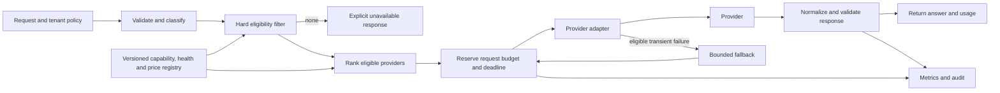

# Interview case: Route reasoning requests across model providers

## Scenario and source grounding
An enterprise assistant sends a mix of simple lookup and difficult reasoning requests to several model providers. Requests have different data-residency, context-size, structured-output, latency and budget constraints. Design a router that reduces cost while preserving capability and preventing an outage or fallback from violating a hard requirement.

The [frontier systems OCR](../../../Case_Studies_agentics_Ai_systems/AI_frontier_sys/AI_frontier_sys_OCR_DOCUMENTATION.md#part_04) describes provider scoring, fallback and budget-aware reasoning. The [provider-routing image](../../../Case_Studies_agentics_Ai_systems/AI_frontier_sys/20260819_132858.jpg) shows hard constraints overriding weighted scores and identifies adapter, health and normalization failures. Provider capabilities, prices and performance change; no source table should be treated as a current service guarantee.

## Requirements and assumptions
- Enforce tenant policy, residency, context and mandatory feature requirements before ranking; no provider is eligible merely because its score is high.
- Bound total request spend and latency, including retries; disclose or reject when the requirements cannot be met.
- Preserve semantic differences between provider APIs instead of silently dropping required capabilities.
- **Illustrative assumption:** 100 requests/s, a 3-second interactive deadline and a $0.05 request cap. Actual throughput, prices, accuracy and deadlines must be measured and negotiated per workload.
- The router cannot force providers to expose internal reasoning tokens or guarantee that extra compute improves every answer.

## Architecture

## Detailed design and tradeoffs
1. Normalize a request into task type, tenant/region, data classification, estimated input and maximum output tokens, required modalities, tool and schema support, deadline and spend cap. Treat user-supplied classifications as untrusted; combine with tenant policy and server-side data handling rules.
2. Filter an explicitly versioned provider registry by contractual region and processing restrictions, provider health, context capacity and required features. Distinguish storage location from processing and subprocessors. Unknown or stale capability or policy status fails closed for the affected requirement. Never treat residency as just a weighted preference.
3. Estimate a conservative price from token rates and output limits; reserve budget atomically before each attempt, account for actual provider usage, and release unused reservation. The classifier may choose a modest or larger reasoning budget where supported, but classify uncertainty conservatively for consequential tasks. Use a bounded reservation rather than trusting estimated spend alone.
4. Rank remaining choices using measured task-specific quality, recent latency distributions and expected cost. For example, a normalized weighted score can prioritize quality and latency; weights and score calibration are **illustrative**, evaluated on held-out traffic and changed via versioned configuration. A single global score can hide poor performance on a small but critical task slice.
5. Each adapter maps only supported fields into the native API and reports unsupported requirements explicitly. Validate the returned structured output and report truncation, provider/model version and actual usage. Distinguish retryable overload or transport errors from policy, input and deterministic validation failures.
6. Fallback must pass the same hard filters and the remaining deadline and budget. Limit attempts with jittered backoff and per-provider circuit breakers. Avoid retrying after partial output or an ambiguous execution with side effects unless a safe idempotency contract exists. If all choices fail, return a clear unavailable response rather than silently switching regions or capabilities.

## Evaluation, operations and failure modes
- Offline replay a representative, privacy-approved labeled set per task and region. Compare answer quality and schema adherence with confidence intervals, alongside cost/request and end-to-end p50/p95/p99 latency. Shadow or canary new router policies before increasing exposure.
- Emit eligible-candidate counts, exclusion reasons, selected provider and policy version, reserved versus actual spend, deadline exhaustion, fallback attempts and per-slice errors. Avoid logging prompts or sensitive data by default.
- Inject stale registry data, provider 429s, slow responses, region restrictions, incompatible schemas and price changes. Verify all fallback candidates remain compliant and accounting includes failed attempts. A circuit breaker reduces cascades but a stale health feed can wrongly exclude all providers; expose freshness and use a controlled recovery probe.
- A provider alias may change behavior without an API failure: pin versions where feasible and compare live sampled outcomes with human-reviewed regression sets. Pricing estimates can miss hidden or provider-specific charges; reconcile billed spend and halt or cap traffic on material disagreement.

## Interview questions and substantive answers
**Why filter before scoring?** A weighted score allows a very cheap but unauthorized provider to win. Residency, context and mandatory capabilities are constraints; only rank among providers that satisfy all of them.

**What happens when no compliant fallback is healthy?** Return a bounded, explicit failure or queue only if the product permits it. Never route to a forbidden region to preserve availability; the tenant can choose a different policy in advance.

**How do you prevent a retry storm?** Share the original deadline and budget across all attempts, cap attempts, use circuit breakers and jitter, and enforce provider concurrency limits. Charge every attempt to the same request.

**How do you assess the difficulty router?** Compare it with fixed-budget baselines using a labeled task set, especially difficult false negatives. Report quality, cost and latency by difficulty slice; do not infer quality from token budget or model self-confidence alone.
