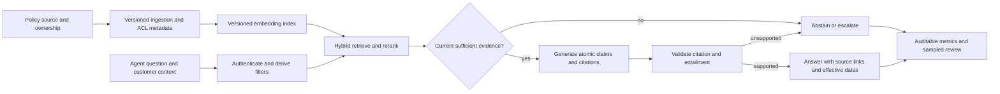

# Interview case: Ground a customer-support policy assistant

## Scenario and source grounding
A support assistant answers refund-policy questions from an internal knowledge base. It returns a plausible refund window that is absent from or contradicts the current policy, and agents act on it. Design an assistant that retrieves the correct authorized policy version, provides verifiable evidence and abstains when support is inadequate.

The [applied engineering OCR](../../../Case_Studies_agentics_Ai_systems/Applied_AI_engineering/Applied_AI_engineering_OCR_DOCUMENTATION.md#part_01) presents an illustrative AskOps incident involving an invented 45-day rather than 14-day refund window, and also describes mixed embedding spaces. The [grounding tradeoff image](../../../Case_Studies_agentics_Ai_systems/Applied_AI_engineering/20260819_142227.jpg) contrasts post-hoc entailment, quote-only output and prompt-only controls. The incident figures are source case-study claims, not verified operational history.

## Requirements and assumptions
- Only retrieve documents the requesting agent may access; use the version effective for the customer, product, jurisdiction and transaction date.
- Each material policy claim needs a verifiable citation; abstain or escalate if evidence is absent, stale, contradictory or unsupported.
- Index updates and embedding-model migrations must not mix incompatible vector spaces.
- **Illustrative assumption:** 10,000 questions/day, policy updates hourly, and a 2-second p95 interactive target. These numbers are design exercises, not source measurements or guarantees.
- A cited passage and an automated entailment score do not prove a policy is legally correct; policy owners remain authoritative.

## Architecture

## Detailed design and tradeoffs
1. Ingest authoritative documents into immutable document versions with effective-from/to timestamps, jurisdiction, product, owner, source URI, access-control labels and deletion state. Split content into chunks retaining stable offsets and version IDs. Reflect revocations in both the source store and every active index; never rely solely on an LLM to respect ACLs.
2. Resolve the user's entitlement and policy applicability before retrieval, filter both keyword and vector search, then rerank. Present applicability metadata to the generator. Treat document text as untrusted data, not instructions. If source versions conflict or customer context is missing, request clarification or escalate instead of guessing.
3. Generate atomic answer claims with cited document-version IDs and spans. Verify that each citation resolves to an authorized, effective document, then evaluate whether cited text entails its claim. A verifier can miss errors or reject valid paraphrases; calibrate it against independently labeled examples and choose a conservative threshold based on the cost of false acceptance. On failure, give a clear uncertainty message and route to a human.
4. The source compares a post-hoc NLI check with quote-only constrained output and prompt-only grounding. Entailment allows readable paraphrases but adds latency and has model error; quote-only is restrictive and can still mislead by omitting surrounding conditions. Prompt-only is cheaper but cannot enforce a reliable boundary. Measure end-to-end latency rather than assuming the source's example timings apply.
5. Maintain separate indexes per embedding model and chunking version. Re-embed the entire corpus into a new index, verify coverage, ACLs and retrieval on a held-out set, then atomically switch the query embedder and index alias together. Continue propagating updates during backfill and retain the old pair for rollback. Similar dimensions do not imply compatible vector spaces.

## Evaluation, operations and failure modes
- Build a time-separated evaluation set from de-identified real support queries, including ambiguous, absent, outdated and conflicting policies. Check retrieval recall at k, correct policy applicability, citation validity, claim entailment, unsupported-answer rate and abstention precision/recall. Report slices and confidence intervals; use human review for material policy decisions.
- Track index freshness lag, source-to-index coverage, ACL leakage tests, embedding version mismatches, verifier acceptance, escalation volume and sampled human disagreement. Inspect p95 latency and component breakdown; a faster answer is not a success if it is unsupported.
- On ingestion lag or missing current policy, fail closed for affected topics and show a support route. On verifier outage, do not silently skip the gate for high-stakes claims. On model/index mismatch, roll back the query embedder and index as one versioned pair.
- An adversarial policy document may try to redirect the assistant or leak data: delimit retrieved content, restrict tools and enforce authorization outside the model. An entailment check is not a prompt-injection defense.

## Interview questions and substantive answers
**Why is a citation not sufficient?** A model can cite a real passage that does not support its claim or applies to another policy version. Validate access, effective date and entailment, then audit the verifier's false-acceptance rate.

**How would you migrate embeddings without a retrieval outage?** Build a complete parallel index, mirror ongoing changes, evaluate it with its matching query embedder and atomically move the pair. Retain the old pair for rollback; never incrementally mix vectors from incompatible models in one search space.

**How should the system answer when evidence is missing?** State that it cannot confirm the policy, ask for the missing context if useful, and provide a human escalation path. Do not fill gaps with a plausible number, even if that improves answer rate.

**How would you choose a verifier threshold?** Measure false acceptance and false rejection on human-adjudicated, representative claims; pick an operating point consistent with the cost of incorrect policy advice and review volume, and re-evaluate after policy or model changes.
