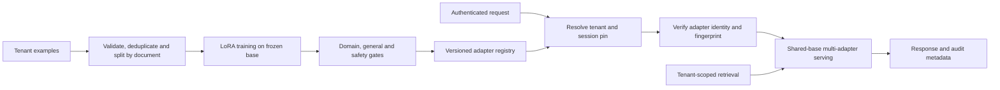

# Interview case: Isolated tenant-specific LoRA assistants

## Problem and contract
A SaaS provider wants each enterprise assistant to follow its own terminology and response style without running a separate base model per customer. The source describes an illustrative adapter-routing incident in which a cache race returned another tenant's adapter, and a second incident in which an adapter changed during active conversations. Design the training and serving platform so customization is cheap **without treating isolation as a model-quality metric**.

**Illustrative assumptions:** 100 tenants, one shared base checkpoint, several thousand labeled examples per tenant, and p95 first-token objective of 1.5 seconds. Tenant data is licensed for training that tenant's adapter only. The product may use tenant-scoped retrieval for changing facts; it must not assume an adapter is a reliable current knowledge store. No measured performance or incident rate is implied.

**Requirements:** authenticate and authorize every request; ensure its adapter and retrieved context belong to that tenant; pin a compatible adapter version to a session; promote only evaluated versions; support audit and rollback; degrade safely when a registry or GPU fails. Define whether tenant policy permits an explicitly disclosed base-only response; otherwise fail closed.

## Detailed design
1. **Data and training.** Ingest consented, tenant-owned examples, strip or restrict sensitive material, keep provenance and document-level splits, and use the exact serving chat template. Train a low-rank update `W' = W + (alpha/r)BA` with base weights frozen. Select rank and target layers by held-out results rather than assuming a fixed rank is universally optimal; quantized-base training can reduce memory but must be validated against an unquantized baseline. A held-out general suite matters: frozen base *weights* do not guarantee unchanged behavior when an adapter is active.
2. **Artifact and promotion.** Store immutable tenant ID, adapter ID/version, content hash, base and tokenizer versions, training dataset snapshot, template and evaluation results. Sign or access-control the manifest. Publish a mutable, tenant-specific active-version pointer only after quality and security gates pass; rollback is a pointer change for new sessions. Existing sessions remain pinned unless explicitly terminated for an urgent security revocation.
3. **Request path.** Derive tenant identity from verified credentials, not a user-supplied adapter ID. Authorize session ownership, resolve the active manifest once, and bind `(tenant, base, adapter version, hash)` to the session. For every request, validate that the executing engine loaded the pinned artifact and that retrieval and prefix/KV caches are scoped to the same authorization domain. Validate hashes when loading from trusted manifests; protect the in-memory identity binding through execution. A hash alone does not prove authorization or integrity of an entire running GPU.
4. **Concurrency.** Use per-request immutable adapter handles and reference counting; don't evict an adapter while a request holds it. A time-based minimum hold alone cannot guarantee this. Cache misses must await the correct tenant/version lookup; never reuse the previous request's result. A registry outage uses a previously verified session pin only if revocation policy permits; otherwise reject. Concurrent batch elements retain distinct adapter handles even while base computation is shared.
5. **Tenant deletion.** Disable routing, terminate affected sessions and purge tenant datasets, adapters, caches, and backups according to retention policy. Document that shared base provenance must separately establish it was not trained on restricted tenant data.

## Tradeoffs and capacity
Shared LoRA saves repeated base weights and supports cheap versioning, but multiplies routing, isolation and cache-eviction risk. Dedicated replicas reduce shared-process exposure but do not eliminate credential, data or operational leaks. Prompt-only customization is simpler for formatting; full fine-tuning provides more capacity but costs more and increases rollback/storage burden. Treat cross-tenant adapter isolation as an explicit adversarial test, not as a feature inferred from a framework name.

The GPU budget includes base weights, adapters, activations/workspace and KV cache; maximum resident adapters cannot be estimated from adapter size alone. Measure cold-load time, residency churn, queue time and p95/p99 first-token latency under the actual tenant distribution.

## Evaluation, operations and failure handling
- Gate per-tenant task accuracy, formatting, refusal on benign requests, safety, and general capability relative to the base; evaluate across held-out documents and tenant groups. Inspect examples and uncertainty intervals, not only an aggregate judge score.
- Stress concurrent alternating tenants while forcing cache misses, eviction and rollout. Assert tenant/version/hash at gateway and worker, including cancellations and retry paths. Send synthetic sentinel content to detect leakage without exposing actual customer data.
- Record immutable artifact IDs, policy decision, load failures and latency without logging prompt content by default. Alert on identity mismatch, which must abort generation, quarantine the artifact and page security. Distinguish an adapter-cache capacity outage from an authorization failure.
- Canary new adapter versions on new sessions; compare with last-good version and roll back on regression. Test base, tokenizer and template upgrades for compatibility before promotion.

## Interview questions
**Why pin an adapter for the whole session?** It makes behavior and audit reproducible across turns and avoids a mid-conversation persona change. Emergency revocation overrides stability: terminate or reauthorize sessions rather than continue serving a compromised artifact.

**Why is hashing insufficient?** A correct hash only says bytes match a manifest; the manifest must be trustworthy and authorized for the authenticated tenant, and the engine must apply the verified handle to that request. Cross-tenant cache keys and retrieval still require isolation.

**Why use retrieval as well as fine-tuning?** Fine-tuning is useful for durable response behavior; retrieval provides replaceable, access-controlled evidence for changing facts. Evaluate citations and prevent retrieval from crossing tenant namespaces.

**What if quality improves for the tenant but safety or general reasoning falls?** Block promotion, inspect data mix and sampling, compare against the active base and prior adapter, and adjust training or rank. Freezing the base does not prevent the activated adapter from causing an effective regression.

## Source traceability
- [Finetuning OCR, incident analysis and multi-tenant design](../../../Case_Studies_agentics_Ai_systems/Finetuning_LLM/Finetuning_LLM_OCR_DOCUMENTATION.md), especially “Multi-Tenant PEFT/LoRA Customization Platform” and the continual-pretraining forgetting discussion.
- [Representative incident image](../../../Case_Studies_agentics_Ai_systems/Finetuning_LLM/20260819_183739.jpg). The scenario and numerical requirements above are illustrative; source claims are design material rather than independently verified production measurements.
