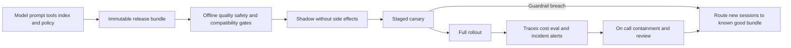

# Operating a high-impact claims agent: release and incident response

## Interview prompt and assumptions
A claims agent combines a language model, prompts, tool schemas and an evolving retrieval index. A prompt rollback alone previously left an incompatible tool schema in service. Design a release and operations process that limits customer impact, preserves auditable evidence and can recover safely. **Illustrative scenario:** a high-impact claims workflow with human approval for irreversible actions; percentages and dwell times below are examples, not observed production results. The INDEX source contains a substantive cross-cutting operations framework, not just a navigation index.

## Design and tradeoffs
A bundle manifest pins model snapshot, prompt, tool schemas, policy, retrieval/index version and relevant runtime configuration. Validate schema compatibility and data permissions together; preserve the previous bundle and index for rollback. Shadow traffic must not perform real writes: use read-only or isolated tools and mark shadow traces. For a high-impact change, an illustrative 1%, 5%, 25%, 100% canary with minimum dwell and enough samples in rare high-risk slices controls blast radius; do not promote merely because an aggregate average looks good. Pin a bundle to each session so a mid-conversation model/tool swap does not corrupt state. Rollback sends new sessions to the prior bundle; existing sessions drain under enhanced monitoring unless an immediate safety risk requires stopping them and human review. A high-severity containment action takes priority over preserving session continuity.

Correlate run ID, trace ID, session ID, bundle and tool call IDs across latency, failure, cost, safety and quality signals. Capture state transitions, tool authorization decisions and actions in access-controlled, redacted traces, not unrestricted raw customer content. Use idempotency keys and reconciliation for side-effecting tools; a retry after timeout cannot assume the original write failed. Keep hard limits on steps, duration and spend to contain loops, and require approval for high-impact actions. If the tool policy or approval service is down, fail closed for writes.

## Evaluation and on-call
Gate on task success, policy and authorization tests, tool/schema compatibility, grounding, human-reviewed high-risk slices, latency, cost and error rates. For each canary stage compare with a contemporaneous control and ensure sample sizes support conclusions; rare failures may require targeted test cases rather than waiting for traffic. Calibrate any model judge against an adjudicated set and rerun calibration on judge changes. Monitor alerts by slice and bundle, not just global averages.

For an incident: halt rollout and side effects, identify affected bundle and sessions, restore the known-good routing pointer, protect evidence, reconcile ambiguous writes and notify owners. Review affected decisions and customers as appropriate; record detection, impact, contributing causes and a testable prevention control. Monitor whether rollback actually reduces the fault signal and whether in-flight sessions remain unsafe. Never call an automatic rollback complete merely because a deployment command succeeded.

## Interview questions
**Why bundle multiple components?** Model, prompt and tool schema are jointly compatible or incompatible. Independently changing one during rollback can recreate the same failure with a different combination of versions.

**What makes shadow safe?** Explicit isolation of side effects and credentials, realistic traffic with privacy controls, and separate accounting. A request labelled shadow that can call a production write tool is not safe shadowing.

**When should a canary halt despite acceptable global success?** On an authorization violation, unsafe action, or meaningful regression in a high-risk slice; aggregate quality can mask a rare but severe failure.

## Sources
[INDEX OCR](../../../Case_Studies_agentics_Ai_systems/INDEX/INDEX_OCR_DOCUMENTATION.md), images beginning 001 and the release/rollback sections; [20260823_004428.jpg](../../../Case_Studies_agentics_Ai_systems/INDEX/20260823_004428.jpg). The source is an operations companion synthesizing other cases; this scenario is an interview application of those practices.
