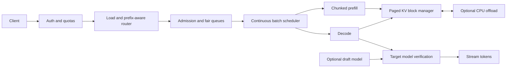

# Interview case: High-throughput interactive LLM serving

## Problem and requirements
A document-assistant API sees a mix of short interactive prompts and long retrieved-context requests. Fixed batches hold short completions behind long ones and waste GPU capacity. Design a service that improves output-token throughput while protecting first-token and inter-token latency, retaining the target model's output distribution and preventing cache leakage.

**Illustrative assumptions:** one model version per worker pool; 8,000 input tokens and 500 output tokens allowed per request; p95 time to first token (TTFT) under 2 seconds and p95 inter-token latency under 100 ms at the chosen load; no numerical throughput is asserted. Requests can be canceled and users are authenticated. Limits must be calibrated with measured workloads.

## Detailed design
1. **Admission and routing.** Enforce prompt/output and tenant token budgets before queueing. Route to a healthy replica using estimated remaining capacity and an authorized prefix hit as a secondary signal; a cache hit is not worth overloading one worker. Per-tenant fair queues plus queue timeouts protect small requests from large bursts. On overload reject with an explicit retry signal rather than accepting unbounded work.
2. **Scheduling.** Continuous batching admits waiting sequences at decode iteration boundaries as others finish. Chunk long prefills into bounded work so they do not indefinitely stall active decodes. Track TTFT separately from inter-token latency: aggressively prioritizing either can damage the other. Scheduler limits include total batch tokens, active sequences, memory headroom, and reserved capacity for long contexts. Cancellation releases the sequence's blocks and stops generation.
3. **Paged KV storage.** Each sequence maps logical token blocks to physical blocks; allocate on demand, reference-count shared prefixes, and reclaim after completion. Copy-on-write before modifying shared blocks. Only share prefixes when token IDs, model/adapter, positional configuration and authorization scope match. A partial block still wastes some memory, and paging adds metadata and lookup work; it reduces fragmentation, not the intrinsic KV size.
4. **Memory sizing.** Full unsharded KV bytes per token are `2 * layers * KV_heads * head_dim * bytes_per_element`, where 2 accounts for keys and values. **Illustrative:** 32 layers, 8 KV heads, dimension 128 and BF16 use 131,072 bytes/token, or 128 KiB; an 8,192-token sequence uses 1 GiB before block rounding and metadata. Per-device memory depends on actual tensor-parallel KV sharding or replication; also reserve weights, activations, workspace, communication buffers and fragmentation. Use KV rather than query head count for grouped-query attention.
5. **Speculative decoding.** A small draft proposes several tokens; the target verifies in a batched pass and accepts/rejects with the appropriate sampling correction, preserving the target distribution when implemented correctly. Stop at the first rejected position and sample the corrected continuation; greedy verification must match greedy target decoding. Measure accepted tokens per target call and end-to-end cost including draft and verification, not an idealized speedup formula. Disable speculation where acceptance or extra memory makes it slower.
6. **Prefix caching and offload.** Keep only authorized reusable prefixes keyed by model, configuration and token sequence. Offloading inactive blocks to CPU can prevent eviction, but PCIe transfer may increase tail latency; compare against recomputation. Never treat KV as public merely because its prompt looks common.

## Tradeoffs and alternatives
Static batching is simpler but wastes slots on heterogeneous lengths. Continuous batching raises utilization at the cost of more scheduling, memory and fairness complexity. Larger token batches improve throughput until queuing and prefill interference harm interactive latency. Quantization can free memory but requires task-specific quality evaluation. Speculation may help memory-bound decoding at light load; at saturated batch sizes or low acceptance, verify-only serving can be faster. Horizontal replicas simplify isolation and availability but duplicate weights.

## Evaluation, operations and failures
- Replay production-like joint distributions of prompt length, output length, arrival bursts and tenant mix; report offered/accepted load, TTFT, inter-token latency, completion latency, output tokens/s, GPU utilization, cache occupancy and cost per completed request. Define SLO compliance at a stated arrival rate, including rejected requests.
- Check deterministic target equivalence for greedy decoding and statistical distribution equivalence for stochastic speculation; compare quality and safety before/after quantization. Test divergent drafts, early EOS, cancellation and context boundaries.
- Instrument queue age, KV allocation failures, prefix hit rate by permitted scope, draft acceptance, preemption and offload bandwidth. Alert on rising p99 and failed allocations rather than utilization alone.
- On KV exhaustion, stop admission or preempt according to policy; avoid evicting in-use blocks. If a GPU dies, fail affected streams explicitly and release reservations; do not silently replay a partially streamed response. A retry needs a new request identifier and clear client semantics. If the draft is unavailable, continue target-only.

## Interview questions
**Why can TTFT rise while tokens per second improves?** Larger batches and long prefills increase GPU utilization but make new requests wait for admission and their prefill. Chunking prefill, fair queues and a token budget trade some peak throughput for latency.

**How many concurrent 8K sequences fit in 24 GiB of KV budget?** In the illustrative geometry, 24 is the mathematical maximum before page rounding, allocator metadata, temporary copies and operational headroom. Determine actual per-rank KV layout and subtract those costs before setting admission limits.

**Does speculative decoding guarantee a speedup?** No. The draft has a cost, target verification still consumes compute, and rejection reduces useful work. Measure with the real scheduler, distribution and batch sizes. Correctness additionally requires target-distribution-preserving acceptance and sampling.

**Why can't any tenant use a prefix cache hit?** A prompt or its derived KV can contain tenant data. Matching token prefixes alone does not establish permission to use the stored state; partition by authorized scope and compatible model configuration.

## Source traceability
- [Inference OCR, “High-Throughput LLM Serving with PagedAttention and Speculative Decoding” and KV cache sections](../../../Case_Studies_agentics_Ai_systems/LLM_Inference/LLM_Inference_OCR_DOCUMENTATION.md).
- [Representative architecture image](../../../Case_Studies_agentics_Ai_systems/LLM_Inference/20260819_210142.jpg). The source's example uses query-head count for a 70B KV calculation and gives idealized speculative speedups; the case instead explicitly sizes KV heads and calls for measured performance.
