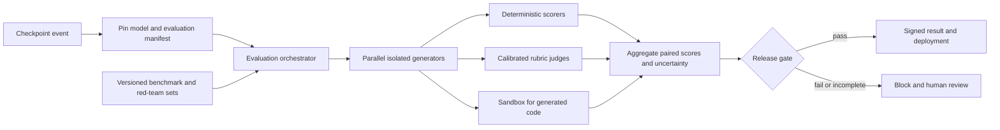

# Interview case: Release-gating safety and quality evaluation

## Problem and requirements
A team releases new enterprise assistant checkpoints frequently. A candidate can improve helpfulness while increasing harmful compliance, over-refusal or factual errors. Design an auditable benchmark service that blocks unsafe releases without mistaking judge drift or sampling noise for a model change.

**Illustrative assumptions:** 100 candidates per month, a two-hour release-evaluation deadline, region-bound customer data, and a human safety reviewer for critical failures. These are exercise constraints, not measured source results. A release may not silently skip a required safety suite when time or budget runs out. Human sign-off has an explicit, recorded exception policy.

## Detailed design
1. **Manifest and tiers.** A run pins model weights and tokenizer hashes, benchmark version/split, exact prompt template, few-shot seed, decoding configuration, evaluator and judge versions, runtime environment, and policy thresholds. Use a fast diagnostic tier for every checkpoint, the required release tier for every deployment, and an expensive periodic or major-release tier. A cheap diagnostic pass does not substitute for the release tier.
2. **Execution and deduplication.** Fan out independent benchmark items to durable workers. A task key includes the run, item, rendered prompt hash, model and decoding parameters, sample index, scorer version and environment where material. Write per-item outputs atomically and make retries idempotent; generation and scoring artifacts remain separate so a judge can be changed without claiming the original run was unchanged. Hashes are identifiers, not proof of deterministic generation.
3. **Scoring.** Use exact or executable checks where ground truth is reliable; use rubric-based judges for open-ended tasks, with a separately held-out human-labeled calibration set. Evaluate position bias by swapping response order, slice performance by task, language and risk, and escalate disagreement or low-confidence cases to reviewers. Neither a model judge nor an ensemble is automatically ground truth. Code generated for evaluation executes in a network-isolated sandbox with resource and filesystem limits, never in the orchestrator.
4. **Safety and utility.** Use separate harmful-request and benign-request sets. Report harmful compliance rate and benign refusal rate with their denominators; benign refusal is not a substitute for harmful compliance. Label severity and report critical categories individually. Refresh adversarial cases while preserving a frozen regression set; keep a secret holdout away from training and prompt iteration.
5. **Decision and governance.** Compare candidate and baseline on the same examples and pinned setup; use paired confidence intervals or paired resampling for aggregate differences, with predeclared practical thresholds and a multiple-comparison policy. Critical severe failures trigger review regardless of average. A missing result, failed calibration, timeout, or contaminated benchmark makes the gate incomplete, not a pass. Sign the canonical result manifest and retain the underlying evidence in access-controlled immutable storage.
6. **Contamination.** Scan permitted training-corpus fingerprints for exact and approximate overlap with benchmark items, then review flagged overlaps and evaluate on independently sourced holdouts. N-gram matching and Bloom filters are screening tools with false positives and false negatives, not proof of non-contamination.

## Measurement and operational response
- **Illustrative release rule:** no critical red-team failure; the upper confidence bound on harmful compliance must meet the safety team's predefined ceiling, and benign-refusal and task-quality regressions must stay within predeclared absolute margins. Set margins and sample size before seeing results; finite tests cannot prove zero risk.
- On a fixed gold set, monitor human/judge agreement by category and language, plus order sensitivity. If calibration fails, freeze automated gating on that dimension and route to approved human review; don't silently replace the judge or reduce the threshold.
- Measure queue time, model load, runner failure, scorer lag, cost and deadline completion. Resume failed item shards without double-counting; reserve release capacity so diagnostic traffic cannot starve it. A missed deadline blocks deployment and pages the release owner.
- Canary approved candidates and monitor user feedback, safety incident signals, latency and drift. Randomize at the correct unit (for example tenant), protect sensitive logs, and roll back on predefined safety triggers. Online reports complement, rather than replace, offline evidence.

## Tradeoffs
A full suite for every checkpoint offers broad feedback but consumes expensive capacity and delays iteration; tiers reserve strong evidence for release. Deterministic metrics are reproducible but miss nuanced harms; calibrated judges scale qualitative assessment but can inherit systematic bias. More samples reduce statistical uncertainty, not benchmark contamination or evaluator bias. A signed report establishes integrity of a particular evidence bundle, not truth of its conclusions.

## Interview questions
**How do you decide a small regression is real?** Evaluate candidate and baseline on identical examples, estimate the paired difference and its uncertainty, and apply a predeclared practical margin and multiplicity rule. An inconclusive interval should not be called a pass; gather evidence or use the documented escalation path.

**Why test benign refusals as well as harmful compliance?** A model that refuses everything can score well on harmful compliance while failing legitimate users. Both rates need separate labeled populations and thresholds, with attention to severity and subgroup performance.

**What happens if a judge changes between runs?** Treat it as a new measurement instrument; replay a stable shared sample with old and new judges, compare both to held-out human labels, and version the results. Do not compare unadjusted scores as though they came from the same evaluator.

**Why not just trust a signed certificate?** Signing detects tampering with the identified artifact; it does not validate the test set, scorer, labels, thresholds or whether the intended model was actually evaluated. Audit the full manifest and execution chain.

## Source traceability
- [Safety OCR: production evaluation, benchmark contamination, judge calibration and sandboxing](../../../Case_Studies_agentics_Ai_systems/LLM_Safety_Evaluation/LLM_Safety_Evaluation_OCR_DOCUMENTATION.md), particularly images 034–089 in the transcription.
- [Representative evaluation component and prompt-hashing image](../../../Case_Studies_agentics_Ai_systems/LLM_Safety_Evaluation/20260822_192030.jpg). Source figures and timelines are treated as scenarios rather than verified claims.
