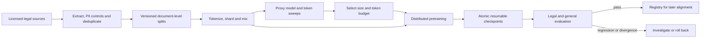

# Interview case: Compute-budgeted legal-domain pretraining

## Problem and scope
A legal technology team has a fixed training compute allocation and wants a domain language model for a later assistant. Design a defensible choice of model size and token budget, a licensed data pipeline and a restartable distributed training system. The checkpoint is for internal evaluation, not a customer-facing legal advisor. Compare from-scratch pretraining with continuing a strong general model; do not presume a domain-only model is best.

**Illustrative assumptions:** training budget `C = 2 × 10^21` FLOPs, 64 GPUs, 80 GB per GPU, and 8 GPUs per fast-interconnect node. Legal documents are licensed for this use and include contracts, opinions and statutes. These numbers are an interview exercise, not verified source performance. Reserve additional budget for data preparation, proxy sweeps, evaluation and restarts, or explicitly subtract their compute from C if C is an all-in limit.

## Capacity and design
1. **Select the model/token pair.** Use the rough dense-transformer training approximation `C ≈ 6ND`, with N parameters and D training tokens, to generate a sweep, not a guaranteed optimum. Under the **illustrative** additional heuristic `D = 20N`, N is about 4.08B parameters and D about 81.6B tokens for 2e21 FLOPs. For comparison, 7B × 140B tokens needs approximately 5.88e21 FLOPs, nearly three times this budget. These estimates omit attention-dependent costs and overhead; actual effective FLOPs, usable token supply and inference cost can alter the optimum. The source contains inconsistent budget and 7B examples; do not combine them as if they were consistent.
2. **Run proxies.** Train multiple smaller N/D combinations on the same deduplicated mixture under comparable tokenization and compute, tracking held-out loss and domain task quality. Fit a scaling curve only if enough points support it; report uncertainty and test sensitivity to data mixture and learning-rate schedules. Compare a continued-pretraining baseline using the same *incremental* compute budget; its existing pretraining compute and license are different and should be disclosed. A lower perplexity alone does not prove legal utility.
3. **Data pipeline.** Snapshot licensed corpora with jurisdiction, date and source metadata; extract clean text, apply PII and privilege rules, remove exact and near duplicates, and separate evaluation by document family and time before tokenization. Use benchmark overlap checks and manual review. Version tokenizer, mixture weights, shard order, seeds and filtering policy; ensure reproducible resumption with data-loader cursor and RNG state. Detect source drift and underrepresented jurisdictions; legal text is not automatically safe or public just because it is available online.
4. **Parallelism and memory.** Start with data parallelism and optimizer/gradient sharding if the model fits, keeping parameters replicated. Tensor parallelism within fast nodes and pipeline parallelism across nodes become candidates when memory or throughput requires them; both introduce communication or pipeline bubbles. Activation recomputation trades FLOPs for memory. Estimate bytes for model parameters, gradients, optimizer/master weights, activations and buffers using the actual optimizer and framework; measure peak memory, since mixed precision and transient gathers invalidate one universal bytes-per-parameter rule.
5. **Checkpoint correctness.** At consistent step boundaries save model, optimizer, scheduler, scaler if used, RNG and data-loader cursor for every shard. Publish a complete manifest only after all shard uploads and checksums succeed; asynchronous upload must use a stable snapshot. Restore-test manifests in a separate job, retain last-good and milestone snapshots, and define recovery point objectives. Avoid treating a model-only artifact as a fully resumable training checkpoint.
6. **Evaluation.** Track held-out domain loss per jurisdiction and time slice, and separate legal reasoning and citation tasks with expert review from generic language/reasoning and safety regressions. A closed-book model cannot guarantee current law or legal advice; a downstream product needs current authoritative retrieval, citations and qualified oversight. Evaluation must use a frozen, independently sourced set not used for proxy selection.

## Tradeoffs and operations
Training from scratch offers tokenizer and corpus control but sacrifices the broad knowledge of an existing model and uses scarce compute to relearn basics. Continued pretraining is often the stronger baseline, but can forget general skills, inherit license restrictions and memorize sensitive domain records. Mix general replay if permitted and gate both general and domain quality. More data can improve a fixed model but a larger-than-compute-optimal model can be economically preferable when inference requirements, available tokens or deployment lifetime differ from the simple training-only optimum.

Monitor loss, gradient norm, non-finite values, tokens/s, data-loader stalls, per-rank memory, network throughput and model FLOPs utilization using a clearly defined denominator. A spike requires capturing diagnostic context, pausing if non-finite or unsafe, checking the batch and hardware, and restoring a known-good checkpoint when necessary. A worker failure must not publish an incomplete checkpoint; restart the distributed job from the last complete manifest and account for repeated work. Alert when throughput drops, but investigate communication, input and hardware separately rather than assuming a single cause.

## Interview questions
**Why is 7B/140B inconsistent with a 2e21-FLOP budget?** Substituting into `6ND` gives `6 × 7e9 × 140e9 = 5.88e21` FLOPs before overhead. Either increase the budget or select a smaller token/model pair; proxies determine whether the simple heuristic fits the domain.

**What is the difference between ZeRO-2 and ZeRO-3?** ZeRO-2 shards optimizer states and gradients across the data-parallel group while keeping parameters replicated; ZeRO-3 also shards parameters and gathers them when needed. Actual peak memory includes transient buffers and implementation-specific details, so benchmark both.

**How do you recover reproducibly after a preemption?** Restore a verified, complete checkpoint with optimizer, scheduler, random state and exact input position, then resume under a compatible software and parallelism configuration. Floating-point nondeterminism may still prevent bitwise equality; record the environment and validate numerical behavior.

**Why doesn't a lower legal validation loss guarantee a better assistant?** Perplexity measures likelihood on a corpus, not correctness of legal reasoning, currency of citations or safe behavior. Use held-out expert tasks, general regression tests and downstream retrieval evaluation, with legal review.

## Source traceability
- [Training/scaling OCR: scaling-law legal model, memory and distributed training](../../../Case_Studies_agentics_Ai_systems/LLM_TrainingSCALING/LLM_TrainingSCALING_OCR_DOCUMENTATION.md), especially images 003–008 and 039–085 in its indexed transcription.
- [Representative scaling and memory image](../../../Case_Studies_agentics_Ai_systems/LLM_TrainingSCALING/20260822_214253.jpg). Source figures are illustrative and internally inconsistent in places; arithmetic and assumptions above are stated independently.
