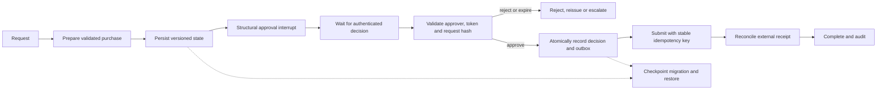

# Interview case: Durable human approval in a LangGraph workflow

## Scenario and source grounding
A procurement agent prepares purchase requests over several days. A human must approve the exact purchase before a tool submits it. The service can restart, approval webhooks can be duplicated, and a framework upgrade can make old checkpoints unreadable. Design a durable workflow in which approval cannot be bypassed or replayed and submission is recoverable.

The [LangGraph OCR](../../../Case_Studies_agentics_Ai_systems/Langraph/Langraph_OCR_DOCUMENTATION.md#part_02) describes illustrative checkpoint incompatibility and approval replay incidents; the [approval image](../../../Case_Studies_agentics_Ai_systems/Langraph/20260819_193704.jpg) shows a structural interrupt, authenticated resume and single-use token approach. Source incident counts and upgrade details are illustrative case material rather than independently verified history.

## Requirements and assumptions
- Persist progress across restarts and require explicit, authorized human approval before a side-effecting purchase.
- Bind approval to the exact purchase, its version and one workflow run; a change requires new approval. Reject unauthorized, expired or replayed approvals.
- Prevent duplicate purchase submission under retries and crashes, to the extent supported by the external purchasing API.
- **Illustrative assumption:** 5,000 concurrent runs, approvals can take 72 hours, and approval links expire after 24 hours and may be reissued. These values are design assumptions, not source facts.
- The graph controls orchestration, but the external authorization service and downstream tool must enforce their own access and idempotency rules.

## Architecture

## Detailed design and tradeoffs
1. Define typed state with run ID, tenant, workflow/schema version, request version, canonical request hash, status, approval reference, budget, deadline and downstream operation ID. Validate node input/output contracts. Persist at state transitions, not just in process memory. Encrypt sensitive fields, restrict tenant access and apply retention rules.
2. The graph enters a durable interrupt after preparing an immutable purchase proposal. No route to submission may bypass the approval gate. A resume endpoint authenticates the approver independently of the model, checks tenant and delegated role, and validates a signed, time-limited token bound to run ID, action, proposal hash and unique nonce. Signing alone does not make a token single-use: atomically consume the nonce and record the decision. A changed purchase invalidates the old approval; rejected or expired decisions do not resume submission.
3. Store approval and a submission intent/outbox record in the same transaction where possible. An outbox worker calls the purchase API with an idempotency key derived from the stable logical operation ID, not an attempt number. Persist the returned receipt and reconcile a timeout with the provider before trying again. Exactly-once external effects cannot be guaranteed merely by a local transaction; if the provider lacks idempotency or a queryable operation ID, suspend ambiguous outcomes for human reconciliation.
4. Record checkpoint schema and graph version independently of framework internals. Before an upgrade, replay representative copies of old paused runs in staging, migrate state using explicit versioned transforms and keep an executable compatible worker or rollback plan for in-flight versions. Never deserialize arbitrary untrusted state. A custom stable envelope reduces framework coupling but adds migration ownership.
5. Keep only relevant recent conversation and versioned summaries in the model context; retain authoritative proposal, approval and audit facts separately. A summary is lossy and must not replace authorization records. Ensure resumed nodes are safe to execute again because interrupt/resume and worker recovery can re-run code depending on implementation.

## Evaluation, operations and failure modes
- Exercise restart at each boundary: before and after interrupt persistence, nonce consumption, outbox creation, external submission and receipt persistence. Deliver approvals twice and concurrently; change the proposal after approval; test expired tokens, wrong tenants and unauthorized approvers. Assert no unauthorized submission and at most one effect when the provider supports idempotency.
- Test migration using actual historical checkpoint fixtures, including paused and mid-flight states, and rehearse rollback. Verify the old and new graph interpret state consistently; cannot migrate safely means hold those runs on compatible workers or escalate, not discard them silently.
- Track pending approval age, expired approvals, resume failures, duplicate token attempts, outbox age, ambiguous submissions, checkpoint restore errors and schema-version distribution. Alert an operator on stuck runs and provide a trace from proposal through human decision to external receipt without logging secrets.
- If the approval service is unavailable, remain interrupted. If a webhook is duplicated, return the recorded outcome without a second effect. If the external API times out after accepting the request, reconcile using the idempotency key rather than assuming either success or failure.

## Interview questions and substantive answers
**Why not just set `approved = true` in graph state?** Any faulty or unauthorized writer might set the flag, and duplicated events can create confusing transitions. A structural pause plus an authenticated, proposal-bound, single-use decision creates an explicit authorization boundary; the tool still verifies its own permissions.

**How do you get exactly-once purchasing?** A local transaction cannot atomically commit an unrelated external API. Use an outbox and a stable idempotency key accepted by the provider, with receipt reconciliation. Without downstream support, ambiguous results require manual resolution rather than an exactly-once claim.

**How do you handle an approval that expires during a long wait?** Keep the run paused, mark the token expired, and issue a fresh token after revalidating the proposal and approver. Bind the new token to the same unchanged request hash or require a new review if the proposal changed.

**What is your upgrade strategy?** Version graph and checkpoint formats, test migrations on representative paused and running states, and retain compatible workers or a rollback route. A deployment is unsafe if existing runs cannot be restored and resumed without losing their approval context.
