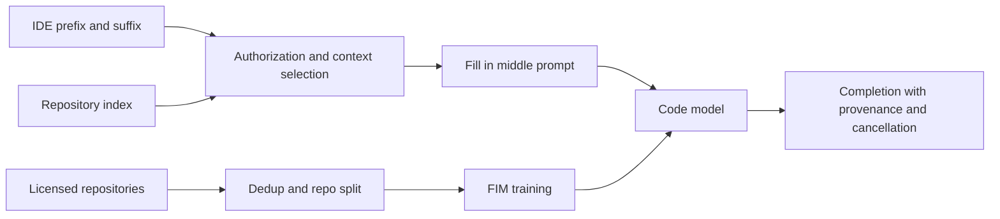
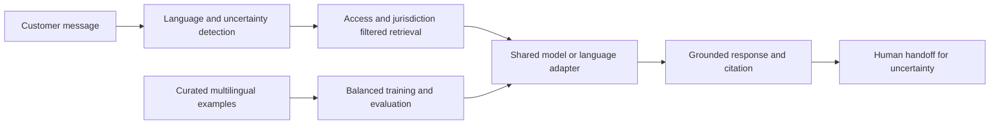

# Specialized models: code completion and multilingual support

## Case A: repository-aware code completion

### Prompt, assumptions and design
Design an IDE completion service that can insert code between a user's prefix and suffix using relevant authorized repository context. **Illustrative assumptions:** an internal code corpus and a latency-sensitive interactive IDE; actual traffic, model size and budgets require measurement. Never train on code without its license and organizational authorization; isolate repositories and prevent cross-tenant leakage.

Construct training examples from repository files with prefix/suffix/middle sentinel tokens, retaining some ordinary causal language modeling to preserve general completion. Split by repository and time before deduplication and evaluate near-duplicate contamination. Build an access-filtered repository index and retrieve surrounding symbols, imports and definitions within the context budget. Guard against stale index versions, secrets in prompts and generated insecure code; the developer reviews every insertion. Cancel superseded keystroke requests and measure latency to first suggestion as well as complete output. Speculative decoding can improve latency only if draft acceptance and target verification are benchmarked on the real workload.

Evaluate functional correctness in isolated sandboxes, exact insertion quality and acceptance rate, plus p95 latency and leakage/security tests. Pass@k uses independent sampled candidates: for n samples with c correct, estimate `1 - C(n-c,k)/C(n,k)` when n ≥ k. Do not treat test-suite passage as proof of security or independence. Compare plain prefix completion and no-retrieval baselines; more context improves relevant grounding only until noise, permission complexity and latency dominate.

**Interview: Why fill-in-the-middle?** Developers often edit existing files; conditioning on both sides lets the model respect the code following the cursor. Training solely left-to-right does not directly teach this task.

**What if repository retrieval fails?** Fall back to authorized local context, label the reduced context, and never broaden access to make retrieval succeed. Record failure and analyze completion quality separately.

## Case B: multilingual insurance support

### Prompt, assumptions and design
Design a support assistant for many languages with uneven training data, language-specific policy content and code-switched requests. **Illustrative assumption:** several high-volume languages justify dedicated adapters; smaller languages use a shared multilingual model. This is a design choice, not evidence of existing deployment.

Route only when language detection is confident; mixed-language or ambiguous messages go through the multilingual path, with customer confirmation where needed. Retrieve current authorized policy passages in the relevant jurisdiction and language, with cross-lingual retrieval as an evaluated fallback. Train adapters on reviewed in-language examples, with temperature sampling to avoid letting high-resource languages dominate. Deduplicate translations and group source/translation families across train and test to prevent leakage. Make adapters and base model versions explicit; avoid promising that an adapter automatically fixes cultural or legal accuracy.

Evaluate task success, grounding and safety per language and code-switch slice, with native-speaker adjudication and confidence intervals. Compare a shared model, language adapters and translated retrieval; report latency and cost as well as worst-language regressions. Monitor routing confidence, handoff and retrieval emptiness; revert a failing adapter without silently changing a customer's jurisdiction or language. Low-confidence or stale policy evidence requires a human rather than an invented answer.

**Interview: Why not train proportional to traffic?** It can starve low-resource languages and mask serious per-language errors in aggregate metrics. Balanced sampling and separately reported evaluation reveal the cost-quality tradeoff.

**How do you evaluate transfer?** Hold out examples in the target language and compare a model trained without that language to one trained with reviewed target-language data, keeping task and split constant; native review distinguishes fluent errors from correct answers.

## Sources
[Multimodal OCR](../../../Case_Studies_agentics_Ai_systems/Multimodal/Multimodal_OCR_DOCUMENTATION.md), images 010–023, especially 20260820_081451.jpg, 20260820_081526.jpg and 20260820_081539.jpg. The original screenshots present illustrative specialized-model designs; numeric OCR is noisy.
