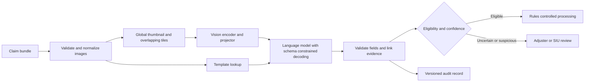

# Insurance claims: vision-language document understanding

## Interview prompt and requirements
An insurer receives claim forms, repair estimates and damage photographs. Design an auditable system that extracts fields, identifies possible inconsistencies and routes claims to adjusters, without turning a model's fraud suspicion into an adverse decision. Preserve evidence across pages and protect policyholder data. **Illustrative assumptions:** 2 million documents/month, 3× peak, p95 target of four seconds per document, and self-hosting because the hypothetical privacy policy forbids external processing. These are planning inputs, not measured results.

## Architecture

## Detailed design and tradeoffs
Keep claim ID, page ID, image hash, capture time and document version through every stage. Correct orientation, measure image quality, retain a global view and bounded overlapping tiles; use the same tiling at training and serving. A vision encoder plus a learned projector feeds visual tokens to a language model; output has typed fields, nullable unknowns and evidence page/region. Detect unsupported or missing fields and route them for review. A template lookup can offer layout hints but must not override the actual image. Exact duplicates within a claim can reuse computation; perceptual matches across claims are only investigation leads, not proof of fraud.

Train the projector on image/text alignment, then adapt the language backbone on human-labelled claims, with claim-level temporal splits to prevent related pages leaking across splits. Keep weak adjuster flags separate from delayed confirmed fraud outcomes. Compare against OCR plus text-only extraction and a pretrained document VLM: the former may be cheaper for clean forms but loses photographic or spatial information; tiling improves small text at substantial token, memory and latency cost. Source image specifies a ViT-H/14 model while also giving a conflicting 16-pixel patch calculation: derive actual token counts from the selected checkpoint rather than trusting that arithmetic.

At 2 million/month the average is about 0.77 documents/s and the assumed 3× peak is 2.31/s; provision from measured batch throughput, bundle fan-out, queueing and headroom, not average GPU service time alone. Pin encoder, projector, tokenizer, template index and schema as one release. Persist the decision audit durably before acknowledging automated actions; restrict logs and retention for PII.

## Evaluation, operations and failure modes
Evaluate field-level precision/recall and exact match for high-stakes dates and amounts, calibration by field, fraud precision/recall on mature confirmed labels, and reviewer workload. Slice by template age, document quality, handwriting, source and claim type; test both cross-page consistency and unseen templates. Run shadow then controlled canary against the current workflow, monitor queue age, p95 latency, invalid outputs, error rates and drift, and roll back the complete version bundle. If a scan is unreadable, the schema is invalid, the model is unavailable or evidence conflicts, preserve the source and send to human review rather than fabricating values. Schema-constrained output cannot guarantee correctness or completion after truncation.

## Interview questions
**Why not use only OCR?** It is a useful cost and latency baseline for clean text, but damage photos, handwriting and visual relationships may contain information OCR discards; decide with slice-level results rather than assuming a VLM wins.

**How do you prevent false fraud accusations?** Separate risk signals from decisions, calibrate against delayed confirmed outcomes, expose the evidence and require qualified investigation; false positives and label selection bias must be monitored.

**How is an automated claim safe?** Explicit business eligibility rules, required evidence, calibrated field-level thresholds and durable audit precede the action; uncertainty or dependency failure routes to an adjuster.

## Sources
[Multimodal OCR](../../../Case_Studies_agentics_Ai_systems/Multimodal/Multimodal_OCR_DOCUMENTATION.md), images 041–088, especially [20260820_082023.jpg](../../../Case_Studies_agentics_Ai_systems/Multimodal/20260820_082023.jpg) and 20260820_081853.jpg. Source material describes a proposed case, not validated production performance.
