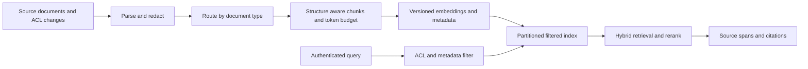

# Enterprise retrieval: structure-aware chunking and filtered vector search

## Prompt and assumptions
An enterprise assistant must answer questions across policy PDFs, tables, code and chat threads for many tenants. Relevant facts are being lost at ingestion and tenant-filtered ANN queries are slow or incomplete. Design a retrieval substrate that preserves source structure and access controls. **Illustrative assumptions:** a 512-token embedding limit, 50 tenants and mixed batch/CDC ingestion; actual scale and quality targets require benchmarking.

## Design and tradeoffs
Redact sensitive content before chunking, because boundaries can split a sensitive string. Preserve tenant, document/version, ACL, section path, offsets and source timestamp in each chunk. Split prose at headings and paragraphs, tables by rows with repeated headers, code at AST boundaries, and chat by coherent thread; recursively split oversized units using the **actual embedding tokenizer**, reserving headroom for metadata. Never silently truncate. Capture parent-child links so adjacent context can be recovered without embedding entire documents. Use checksums and idempotent updates; deletes, revoked permissions and changed ACLs must propagate to every index and cache, with an authorization check at serving time.

Treat the document store as source of truth and the index as a rebuildable materialized view. Pin embedding model and dimension; rebuild a new index on a model change, dual-write or replay deltas, then switch atomically after completeness and recall checks. Partition or dedicate indexes for large/high-isolation tenants and pool smaller tenants only with verified filtering. Compare native pre-filter ANN with exact filtered search at different filter selectivities; post-filtering a global top-k may return few or zero authorized results even if relevant documents exist. HNSW recall improves with search effort at memory and latency cost; compressed indexes reduce memory with a recall penalty.

Evaluate on human-labelled question-to-required-span sets separated by source document and version. Measure recall@k, precision@k, all-required-span success for multi-hop questions, duplicate context fraction, ACL violations, freshness lag and per-tenant p95 latency. For a question requiring two spans, retrieving one is partial evidence, not complete success. Compare fixed-size and structure-aware chunking at a matched retrieval budget; assess table and code slices separately.

## Operations and failures
Monitor indexing lag, truncated chunks, parser failures, index-size drift, denied results and recall against an exact-search sample. Failed parsing or unresolved ACLs go to quarantine; never index them as public. If index freshness or ACL propagation is uncertain, fail closed or use a verified source-of-truth path, not a global unfiltered fallback. Rebuild and rollback by immutable model/index version and replay CDC from a checkpoint.

## Interview questions
**Why count tokens instead of characters?** Token density varies across code, tables and languages; character estimates can exceed the model limit and silently discard the answer.

**Can reranking repair missing evidence?** No: it only orders candidates that retrieval returned. Diagnose chunk-level and filtered retrieval recall before paying for a stronger cross-encoder.

**How do you handle deletion?** Tombstone in the authoritative store, propagate to all shards and caches, enforce authorization at read time while propagation completes, and audit completion.

## Sources
[RAG OCR](../../../Case_Studies_agentics_Ai_systems/RAG_Infra_Research/RAG_Infra_Research_OCR_DOCUMENTATION.md), images 025–032 and 057–089; representative images 20260822_224854.jpg, 20260822_225106.jpg and 20260822_225235.jpg. Screenshots are a design reference, not measured performance.
