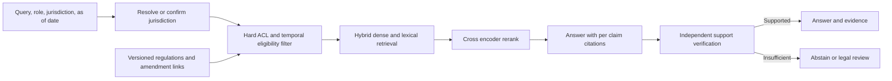

# Regulatory RAG with temporal eligibility and evidence verification

## Problem and requirements
Claims staff need answers grounded in regulations applicable to the claim's jurisdiction and date. A semantically similar but superseded or out-of-state document is unsafe even when the answer sounds plausible. Return cited evidence or an explicit inability to answer; do not provide unreviewed final legal decisions. **Illustrative assumption:** legal owners maintain authoritative jurisdiction and effective-date metadata; the system cannot guarantee correctness if that metadata is wrong.

## Detailed design
At ingestion retain immutable versions, jurisdiction, line of business, valid-from and valid-until, source URL, amendment relationships and review status. Keep superseded text for historical queries. For an as-of date `t`, require `valid_from <= t` and `(valid_until is null or t < valid_until)` plus tenant ACL and applicable jurisdiction; include federal or multi-jurisdiction rules only through explicit applicability rules. If the question is also 'what did we know then?', separately retain transaction/recorded-time intervals: effective/superseded dates alone are not bitemporal history. Unresolved amendments and missing dates go to legal review, not searchable current corpus.

Within the eligible set use lexical and dense retrieval for recall, deduplicate candidates, then rerank a bounded top-k with a domain cross-encoder. Generate atomic claims with document ID, version and quoted span; verify the citation supports each claim and remove or escalate unsupported content. A verifier is fallible and cannot substitute for legal review. Never fall back to a global unfiltered corpus on an empty result; ask for missing jurisdiction/date or abstain.

Compare a bi-encoder-only baseline, general reranker and domain-tuned reranker on the same eligible candidate pool. Reranking trades latency and compute for precision; MMR diversifies but is not a relevance guarantee. **Illustrative budget:** retrieval 30 ms and reranking 150 ms, excluding generation, queueing and network; use actual p95 measurements rather than summing isolated p95s as an end-to-end guarantee.

## Evaluation and operations
Use expert-labelled cases containing near-duplicate rules, amendments at date boundaries, cross-state conflicts, federal/state overlap and unanswerable queries. Measure eligible-span recall, rerank nDCG/precision, unsupported-claim rate, incorrect-jurisdiction or wrong-version citation rate and abstention quality. Test authorization and effective-date filters independently; track results by jurisdiction and time. Shadow new ingestion and models, canary with legal review, monitor source-update lag and unresolved amendments, and retain evidence/version IDs for audit. If the index, metadata feed or verifier is unhealthy, fail closed and route to a human.

## Interview questions
**Why hard-filter before retrieval?** A relevance score cannot enforce legal applicability; pre-filtering limits the candidate set to eligible sources, provided metadata and authorization are correct.

**Is a citation enough?** No. It must be the correct version and jurisdiction and actually entail the associated claim; a relevant-looking document can still contradict or fail to support the answer.

**What happens when an amendment arrives late?** Record when it became effective and when it was learned, correct historical validity with an auditable revision, identify affected answers and notify owners for review.

## Sources
[RAG OCR](../../../Case_Studies_agentics_Ai_systems/RAG_Infra_Research/RAG_Infra_Research_OCR_DOCUMENTATION.md), images 033–035 and 044–048; [20260822_225010.jpg](../../../Case_Studies_agentics_Ai_systems/RAG_Infra_Research/20260822_225010.jpg), 20260822_224923.jpg. Treat source guarantees as design intent, conditional on correct metadata and verification.
