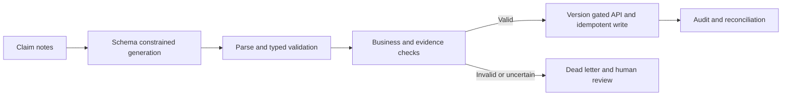
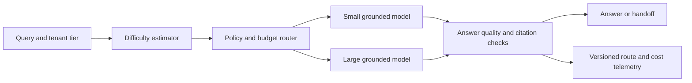

# Reliable structured extraction and cost-aware RAG

## Case A: claim-note extraction into an operational API

### Problem and requirements
A claims service consumes structured fields extracted from adjuster notes. Prompt-only JSON occasionally contains invalid enums or unsupported values, and the downstream API can reject or silently mishandle them. Design an auditable extraction contract. **Illustrative assumption:** consumers support explicit schema-version ranges and all write actions require authorization.

Publish a versioned schema defining enums, nullable fields, units, provenance and consumer compatibility. Constrained decoding helps enforce supported syntax but generation can time out or be truncated, and valid JSON can still be false. Parse and validate again, check cross-field rules and required evidence, and reject unsupported schema versions. Use a stable idempotency key for downstream writes; reconcile acknowledgements with the source to catch silent loss. Retain protected audit records with input hash, model/prompt/schema version and validation result, respecting retention and PII policy. Route malformed, conflicting or low-confidence records to a dead-letter queue with actionable reasons; a reviewer can correct and replay safely.

Measure parse/enum validity, semantic field accuracy against adjudicated gold, unsupported values, dead-letter rate, reconciliation loss and downstream task success separately. Test enum additions, removed fields, nulls, negative amounts, truncation, retries and consumer outages. Shadow a schema version and require consumer contract tests before promotion; rollback producer and consumer compatibility together. Prompt-only formatting is cheaper to start, but does not supply an enforceable type contract; a grammar plus validation costs implementation effort without solving factuality.

**Interview: Is 100% JSON validity enough?** No. A structurally valid wrong amount or invented party can cause real harm. Semantic validation, evidence and independent quality evaluation are separate controls.

**How do you evolve a schema?** Version the contract, negotiate supported versions, run consumer tests and stage migrations; never silently reinterpret an existing field.

## Case B: tiered RAG cost and accuracy

### Problem and requirements
A policy assistant uses a high-cost model for every request. Reduce cost while preserving quality and contractual latency for each customer tier. **Illustrative assumption:** per-tier cost ceilings and quality floors are agreed before experiments, and historical request logs may be sampled under privacy controls.

Build an offline matrix over query category, model, retrieval settings, latency and token cost. Select only routes meeting each tier's validated quality floor; use complexity signals and retrieval confidence rather than assuming short queries are easy. Include model tokens, retrieval, reranking, verification, retries and infrastructure in cost per successful answer. For uncertainty, escalate within the permitted tier or hand off. A small-then-large cascade can recover difficult queries but may add two model latencies and double spend on escalations; a pre-router is faster but classification errors can silently lower quality. Cache only immutable shared prompt prefixes with correct tenant isolation and invalidation.

Use randomized holdouts and blinded human grading on representative, hard and low-frequency queries; measure per-tier grounded accuracy, unsafe answers, abstention, p95 end-to-end latency and cost distribution. Track misroutes specifically where a cheap route fails but a higher tier succeeds; monitor drift by topic and language. Canary router changes, set automatic cost/quality guardrails and restore the last known-good policy if the classifier or verifier is unavailable. Do not degrade a contractual quality floor simply to hit a spend target.

**Interview: How would you estimate savings?** Multiply route mix by observed full-path cost, including escalation and failures; compare randomized control with the same request distribution and quality constraints. Headline token-price ratios are not realized savings.

**What does a confident router prove?** Only that the classifier is confident, not that the answer is correct. Calibrate it against downstream outcomes and maintain human-reviewed samples.

## Sources
[RAG OCR](../../../Case_Studies_agentics_Ai_systems/RAG_Infra_Research/RAG_Infra_Research_OCR_DOCUMENTATION.md), images 008–012 and 036–043, especially 20260822_224935.jpg, 20260822_224959.jpg and 20260822_225006.jpg. Figures in the source are illustrative.
