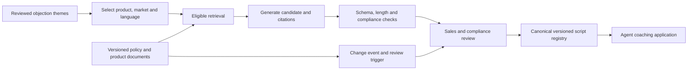

# Grounded and approved objection-response scripts

## Interview prompt
Sales coaches need consistent, concise Spanish-language responses to common auto-insurance objections discovered in call analytics. Policy wording and product features change; generated claims must not invent coverage, pricing or discounts. Design a content workflow, not an autonomous salesperson. **Illustrative assumption:** a qualified sales trainer and compliance reviewer approve scripts and authoritative product documents carry effective dates.

## Design and tradeoffs
Each draft has theme ID, locale, product, effective interval, evidence references and concise empathy, response and next-step fields. Retrieve only documents applicable to that product, market and date; missing or conflicting facts block publication. Generate candidates with a pinned model and prompt; even deterministic settings do not guarantee identical output across model/runtime changes. The approved canonical registry, not repeated generation at serve time, provides consistency. Reviewers inspect source evidence, legal implications, readability and spoken duration before publishing; retain reviewer identities, model/prompt versions and supersession history.

Use a word or read-aloud duration target as a validation criterion; a token limit alone does not guarantee an exact word count or a complete final sentence. An illustrative 30–40-word target may be appropriate for a short call response, subject to user testing. Do not truncate an approved response mechanically. On a policy change identify affected script citations, suspend or mark them for review according to risk, and publish a replacement only after approval. Retrieval plus approval handles changing facts better than fine-tuning facts into weights, while static rules can be cheaper for stable, limited scripts.

## Evaluation and operations
Test factual alignment with authoritative passages, prohibited claims, product and jurisdiction correctness, readability, read-aloud time, language quality and agent usability using native-speaker and compliance review. Compare a fixed registry to prior free generation on consistency and agent adoption, not merely LLM-judge scores. Calibrate any automated judge against reviewers. Audit every publication and monitor expired citations, review queue age, stale scripts and production usage. If the source or approval service is unavailable, serve only a still-valid approved version; otherwise block and route to a person.

## Interview questions
**Why generate offline?** Live generation can vary across calls and bypass legal review. Offline candidate generation plus a canonical approved version allows both speed for agents and traceability.

**How does a policy amendment propagate?** Store citations as versioned dependencies, find impacted scripts, suspend or review based on risk, and release a newly approved version; changing the retrieval index alone does not update already-published text.

**Are short scripts always better?** No. Brevity must not remove required disclosures or distort coverage. Evaluate live readability and compliance together.

## Sources
[Speech OCR](../../../Case_Studies_agentics_Ai_systems/Speech_STT/Speech_STT_OCR_DOCUMENTATION.md), images 009–014 and 038–044; 20260822_232644.jpg, 20260822_232823.jpg and 20260822_232835.jpg. Source examples and figures are illustrative.
