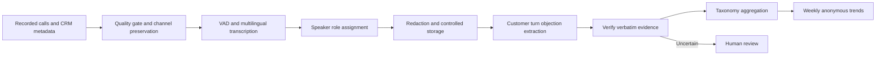

# Multilingual sales-call transcription and objection mining

## Problem and assumptions
A Mexico auto-insurance sales team wants weekly aggregate themes from English, Spanish and code-switched calls, not automated scoring of individual agents. Design a batch pipeline that preserves speaker attribution and extracts auditable customer objections. **Illustrative assumptions:** 15,000 calls/day, next-day delivery, and audio is subject to restricted processing and retention. Actual volume, consent and quality targets require stakeholder validation.

## Design and tradeoffs
Retain each stereo channel when available; map channel to role using trusted call metadata rather than assuming the first speaker is the agent. For mono, use diarization and metadata, flag uncertainty and third-party speakers rather than forcing two roles. Normalize audio to the chosen model's sample rate, use voice activity detection with silence-aligned segments, and preserve timestamps and original channel IDs. Resampling 8 kHz audio cannot restore lost frequencies. Run a multilingual ASR with domain vocabulary hints and evaluate code-switching per utterance rather than assuming one language per call.

Transcripts and authorized audio enter a restricted redaction workflow before downstream access. Extract `{call_id, turn_id, role, category, verbatim_span, timestamps, taxonomy_version}`. Confirm each quote against the customer turn; a matching transcript quote establishes textual grounding, not that ASR faithfully captured the audio. Flag uncertain role, failed matching and sensitive content for human review. Aggregate at call and theme level, deduplicating repeated mentions without merging separate objections; suppress small cohorts to reduce reidentification. Batch processing uses more complete audio context and lower cost than streaming but cannot offer live coaching.

## Evaluation and operations
Build a stratified human-transcribed and adjudicated set spanning accent, language mixture, channel, signal quality and product. Report WER `(S+D+I)/reference words`, domain-term WER and diarization/role error separately. Assess objection span precision and recall on gold transcripts and separately end-to-end on ASR transcripts, plus category accuracy and ungrounded extraction rate; this isolates acoustic from semantic errors. Measure timeliness and coverage of the weekly report. Shadow before rollout; monitor queue age, missing audio, language mix, attribution confidence and redaction failures. If redaction or role assignment fails, quarantine and review, never publish unredacted text or assume agent speech is a customer objection.

## Interview questions
**Why not one end-to-end audio-to-objection model?** Separating ASR, speaker assignment and extraction exposes distinct error surfaces, enables independent gold evaluation and allows a transcription improvement without retraining the entire system.

**How do you measure grounding?** Require a verifiable customer-turn span and timestamp, then audit against audio; transcript match alone cannot detect a transcription error.

**Why avoid full-call language routing?** Language may switch within a turn; fixed per-call routing can suppress words from the other language and distort objections.

## Sources
[Speech OCR](../../../Case_Studies_agentics_Ai_systems/Speech_STT/Speech_STT_OCR_DOCUMENTATION.md), images 031–036 and 063–087; [20260822_232804.jpg](../../../Case_Studies_agentics_Ai_systems/Speech_STT/20260822_232804.jpg), 20260822_232940.jpg. The source describes a proposed batch system and its numeric examples are illustrative.
