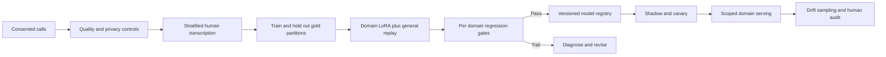

# Domain speech adaptation without cross-domain regression

## Problem and assumptions
A multilingual speech model struggles with Mexican auto-insurance vocabulary and code-switching. Fine-tuning improves this domain but may degrade home and life insurance transcription. Design a repeatable adaptation, evaluation and deployment pipeline. **Illustrative assumptions:** consented labelled audio exists, protected data can be processed in an approved environment, and supported product domains have enough adjudicated reference audio for meaningful comparison.

## Design
Start with a base multilingual ASR and vocabulary hints; measure whether errors are acoustic, lexical, diarization-related or caused by code-switching. If adaptation is justified, fine-tune a low-rank adapter on reviewed domain audio mixed with general-domain replay. Encoder adaptation may address acoustic shifts but increases forgetting risk relative to decoder-only adaptation; compare both against the same baseline. Split by call, speaker where feasible, and time so near-duplicate audio or the same conversation cannot leak into held-out evaluation. Preserve domain, codec, language and label provenance and prevent audio/PII from entering unapproved systems.

Maintain independently human-transcribed frozen gold data; model-generated reference transcripts measure agreement with the model, not true WER. Evaluate `(substitutions + deletions + insertions)/reference words`, domain terms, code-switch slices and all domains on which the candidate might serve. Compare paired call-level results and confidence intervals, apply domain-specific regression tolerances, and seek QA signoff. Use a separately refreshed recent-audio evaluation set to detect drift without repeatedly training on the frozen gold. Registry entries declare base model, adapter, data lineage, intended and evaluated domains and their metrics. Route unsupported domains to the previous evaluated model rather than applying the newest adapter globally.

## Serving, failure modes and evaluation
Separate reserved low-latency streaming capacity from elastic post-call batch capacity if both are needed. Streaming partials use limited look-ahead and may be revised; batch outputs offer fuller context. Benchmark first-partial latency, final WER, real-time factor, GPU utilization and queue age per tier. Shadow new releases without affecting customer outputs; canary only supported domains and roll back on WER proxy, latency or failure guardrails. A shadow model disagreement alert is a drift proxy, not human-grounded WER; trigger independent annotation and investigation. Track acoustic/device and language mix, label lag, privacy incidents and replay data provenance. If a model or feature route is unavailable, fall back only to an approved model for that domain or queue the request.

## Interview questions
**How do you detect catastrophic forgetting?** Evaluate every supported domain against independent human gold before promotion, compare to the current model with uncertainty estimates, and route the adapter only to evaluated domains.

**Why not use the base transcript as gold?** A candidate can appear good by copying base errors. Human references provide an independent target and reveal shared mistakes.

**Does upsampling 8 kHz telephony to 16 kHz improve acoustics?** It satisfies a model input contract but does not recover missing frequencies; include telephony examples in training and evaluation.

## Sources
[Speech OCR](../../../Case_Studies_agentics_Ai_systems/Speech_STT/Speech_STT_OCR_DOCUMENTATION.md), images 015–025 and 045–056; 20260822_232701.jpg, 20260822_232711.jpg and 20260822_232849.jpg. Source values are design examples, not validated results.
