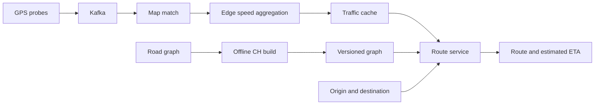
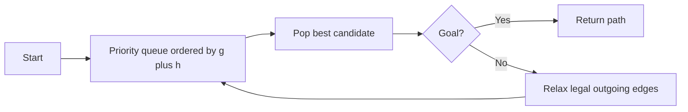
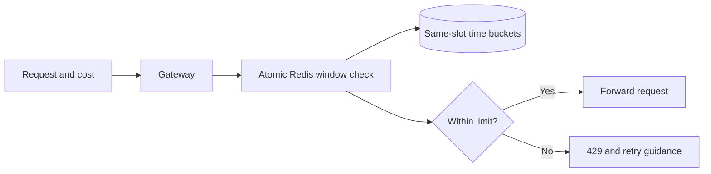
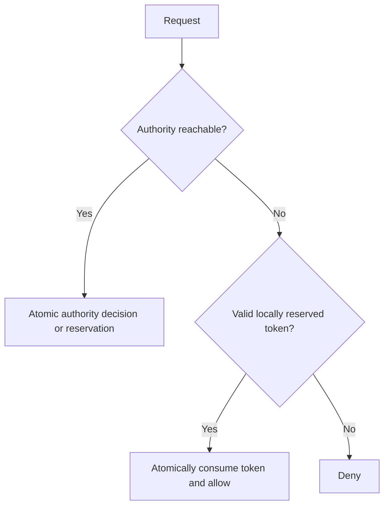
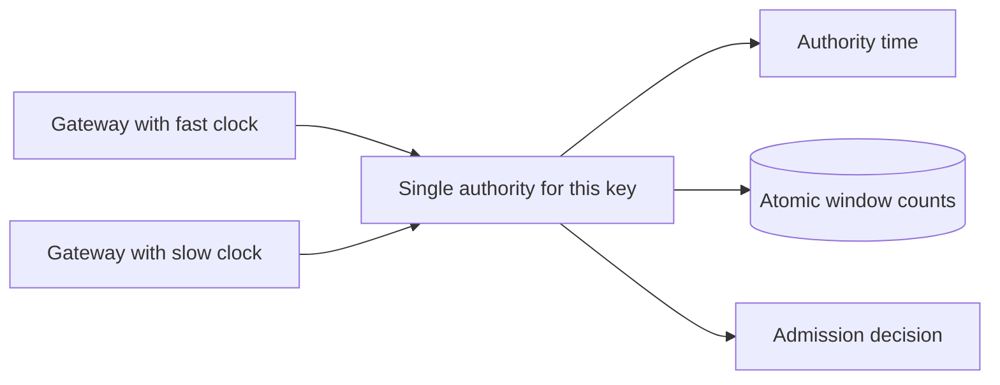
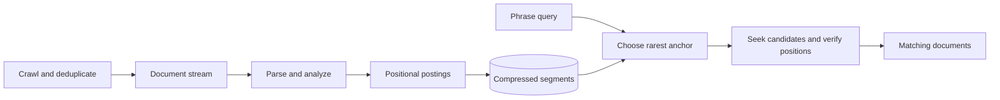
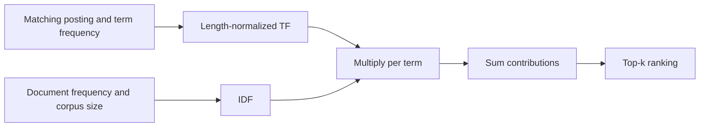

# Algorithm design case studies: images 001–062

**Source images and OCR:** [Algo_Design_Problems](../../../Case_studies_DSA/Algo_Design_Problems/).

These cases consolidate repeated screenshots rather than treating each image as a separate problem. Source: `Algo_Design_Problems_SUPPLEMENTAL_IMAGE_OCR.md`, chronological image index. The source is OCR of screenshots, not a validated production record. Numbers below are source-reported unless identified as an assumption or an arithmetic correction. Examples and additional design requirements are practice assumptions. Contradictory or incomplete OCR is called out rather than silently repaired.

## Topic inventory

| Distinct topic | Case | Image numbers |
|---|---|---|
| Ride-hailing routing, CH build/query, stale shortcuts and road closures | 1 | 001–004, 032–039, 061–062 |
| A* heuristic admissibility | 2 | 020–023 |
| Redis sliding window, hot-key contention and approximate local budgets | 3 | 005–008, 040–047 |
| Rate limiter fail-open outage and cached fallback | 4 | 016–019, 040–045, 058–060 |
| Distributed rate-window clock skew | 5 | 026–031 |
| Search pipeline, positional phrase queries, storage and compression | 6 | 008–012, 023–026, 047–055, 058–060 |
| BM25 scoring and corrupt corpus statistics | 7 | 012–015, 055–058 |
| Shared operational design: metrics, failure handling, capacity | Incorporated in cases 1, 3, 4, 6 and 7 | 058–060 |

Image 001 is also the incident-log contents, image 031 its summary, and image 032 the architecture contents. Adjacent image 063 was consulted for the cut-off rerouting clarification; it is not a new assigned topic.

## 1. Ride-hailing routes under changing road conditions

**Source images:** `20260823_005803.jpg`, `20260823_005809.jpg`, `20260823_005813.jpg`, `20260823_005835.jpg`, `20260823_010022.jpg`, `20260823_010026.jpg`, `20260823_010029.jpg`, `20260823_010033.jpg`, `20260823_010035.jpg`, `20260823_010037.jpg`, `20260823_010041.jpg`, `20260823_010043.jpg`, `20260823_010150.jpg`, `20260823_010155.jpg`; continuity: `20260823_010158.jpg`.

### Context and requirements

Route GPS origin to destination over a directed road network, returning legal turn-by-turn directions and ETA. The ride-hailing source describes 100,000 concurrent rides, a metropolitan graph described as 30 million nodes, a ±15% ETA objective and dynamic rerouting. Its opening says reroute when *any edge* changes by 20%, but the clarification at the image boundary chooses a >20% change in *total route cost* to avoid excessive rerouting. Treat this as a clarified practice requirement, not an equivalence. At eight minutes per ride, 100,000 / 480 is about 208 starts/s, assuming steady state. The source's ROI and cancellation figures are claims, not causally established measurements.

The architecture depicts GPS probes → Kafka → Flink map matching → five-minute per-edge median → graph/traffic cache → route service. It lists 128 Kafka partitions, 200 route pods, a 200K RPS capacity target and p99 <80 ms; these are architecture targets, not the 208/s ride-start estimate. A stale traffic-cache fallback can use prior graph weights while marking ETA as estimated. Legal turns require appropriate turn-state/edge-based modeling, not merely node adjacency. **Assumption:** travel costs are nonnegative and a query uses a coherent graph and traffic snapshot; ETA prediction quality is evaluated separately from shortest-path optimality.



### Worked example and design

**Assumption:** A→B→D costs 2+2 minutes, A→C→D costs 3+3; shortcut A→D encodes A→B→D with cost 4. Close B→D: returning that shortcut would route through a closure. Filter both closed original edges and any shortcut that recursively unpacks to one; run a correct fallback on the live base graph when the restricted overlay no longer contains a valid complete route. Here fallback chooses A→C→D, cost 6.

The incident reports an M25 J12–J15 closure, a stale J10–J16 shortcut, 2,400 affected sessions, 47 minutes duration and a 23-minute filter deployment. The source compares weekly 4.2-hour rebuild, a proposed 3-hop incremental update (8–45 seconds per closure) and a filter adding up to 18 ms; it schedules incremental CH for Q1 2026. The OCR shows a 300-second closed-set refresh, so “immediate” safety depends on actual closure propagation: it is not a zero-staleness guarantee. Merely removing shortcuts can destroy the CH up-down path property; finding some legal path does not prove optimality or even reachability. Rebuild/customize with a proven dynamic CH algorithm or fall back to base-graph Dijkstra until a valid version is published; a fixed three-hop update alone is not a correctness proof.

Offline CH orders nodes by an importance heuristic; for each contracted vertex, inspect incoming/outgoing pairs and insert a shortcut if no avoiding witness path is at most as cheap. Store its via-node for recursive reconstruction. The source describes priority-queue lazy re-evaluation, bounded witness searches, serialized memory-mapped arrays and atomic build-version swaps. A bounded witness search may safely add unnecessary shortcuts when it cannot prove a witness; it must not omit a required one. For static compatible weights, forward search uses upward edges and backward search upward edges in the reversed graph. Live weights cannot simply replace shortcut weights without preserving the CH shortest-path property.

```text
route(s, t, snapshot):
    if snapshot.CH is certified compatible with snapshot.weights and closures:
        candidate = CH_query_and_unpack(s, t, snapshot)
        if candidate exists and every original edge is legal:
            return candidate
    return Dijkstra_on_base_graph(s, t, snapshot)
```

**Correctness and complexity:** Dijkstra settles minimum distance under nonnegative weights; parent edges reconstruct an optimal path in the snapshot. A correctly built and queried CH preserves an optimal up-down representation, with shortcuts expanding into equal-cost original paths. Base Dijkstra with a binary heap is O((V+E) log V) time and O(V+E) graph plus O(V) search state; CH preprocessing cost depends on witness searches and shortcut growth, and query worst case is graph-dependent, not universally logarithmic. Unpacking adds time proportional to the returned path/shortcut expansion.

**Alternatives and tradeoffs:** Plain Dijkstra is simpler but source reports 2–5 seconds on its large graph; bidirectional search, A*, CH and hub labels exchange preprocessing or memory for query speed. The architecture reports roughly 500 CH settled nodes as an empirical example, not a bound. Historical speed if live cache fails preserves availability but degrades ETA; closures must not be treated as stale advisory traffic.

**Failure modes and validation:** Check disconnected pairs, directed edges, turn restrictions, closure changes during a query, snapshot version mismatch, zero/invalid speed, stale map matches, and hot-swap lifetime of old mmap readers. Compare random CH results and unpacked edge legality/cost against base Dijkstra on identical snapshots; replay closures and verify fallback; measure routing p99, map-match lag, stale-data age and ETA error. Source alert thresholds include route p99 >150 ms and map-match lag >30 s; alerts and targets measure different things.

**Interview questions:** Why can a valid shortcut filter still lose the optimum? How do you customize shortcuts for weight changes? What changes if the goal is fastest predicted arrival rather than shortest static distance?

## 2. A* with a provably safe heuristic

**Source images:** `20260823_005937.jpg`, `20260823_005940.jpg`, `20260823_005942.jpg`, `20260823_005946.jpg`.

### Context, assumptions and example

A source incident reports 8–23% longer routes after multiplying straight-line travel time by a 1.35 traffic factor. It compares Dijkstra at 450,000 expansions/180 ms median, admissible A* at 38,000/14 ms, and faster but suboptimal heuristic variants. These are workload observations, not complexity guarantees.

**Practice assumption:** a road path's physical length is at least its haversine endpoint distance and no feasible edge travels faster than a known global maximum. Set `h(v)=haversine(v, goal)/max_speed`. A merely legal speed limit is insufficient if the modeled effective speed can exceed it. Example: straight-line distance 10 km and a true maximum of 100 km/h give `h=6 min`; any physical road journey takes at least six minutes. Multiplying this lower bound by 1.35 gives 8.1 minutes, potentially exceeding a six-minute actual path.



### Algorithm, correctness and tradeoffs

```text
A*(start, goal):
    g[start] = 0; push (h(start), 0, start)
    while heap not empty:
        f, d, u = pop_min(); if d != g[u]: continue
        if u == goal: return d and parent path
        for each legal edge (u,v) with weight w >= 0:
            if d+w < g[v]: update g[v], parent[v]; push (g[v]+h(v), g[v], v)
    return unreachable
```

The distance bound is admissible under the assumptions and consistent if edge costs dominate distance/max-speed and geographic distances obey the triangle inequality. With an admissible but inconsistent heuristic, allow reopening improved nodes; with consistency, a node settled at its best distance need not reopen. Under these conditions popping the goal yields an optimum. Heap-based worst case is graph-dependent; with a consistent heuristic it is O((V+E) log V) time and O(V+E) including graph storage. A weaker zero heuristic is Dijkstra; a weighted heuristic can be faster but needs an explicit approximation contract.

**Failure modes and validation:** Compare `h(v)` and A* route costs to Dijkstra for sampled pairs, including high-speed links, disconnected nodes and `start=goal`; finite samples detect regressions but do not prove the bound. The source reports a 37-case suite and a CI sample of 10,000 pairs. Test traffic multipliers, units, floating-point tolerances and reopening. Monitor optimality gap and expansions.

**Interview questions:** What makes a heuristic consistent? Why does multiplying by typical congestion not establish a lower bound? Can speed constraints change by time or vehicle class?

## 3. Sliding-window admission at high throughput

**Source images:** `20260823_005842.jpg`, `20260823_005853.jpg`, `20260823_005859.jpg`, `20260823_005904.jpg`, `20260823_010046.jpg`, `20260823_010048.jpg`, `20260823_010050.jpg`, `20260823_010053.jpg`, `20260823_010055.jpg`, `20260823_010057.jpg`, `20260823_010059.jpg`, `20260823_010104.jpg`.

### Problem and assumptions

Enforce a per-user, per-endpoint request budget across gateways. The architecture uses 60 one-second buckets, Redis Lua atomicity, a 61-second TTL and tiers including 100/min anonymous, 1,000/min standard and 50,000/min internal. Its separately listed free and premium tiers are 500 and 10,000/min. **Assumption:** requests have positive integer cost; the desired policy is an exact rolling window *at one-second bucket granularity*, not exact per-event timestamps. All bucket keys for one decision must share a Redis Cluster hash slot; choose an unambiguous escaped composite hash tag and explicitly declare/access keys consistently with the Redis deployment's script rules. Do not infer that ordinary colon-separated keys automatically colocate.



**Worked example:** window 3 seconds, limit 5, buckets t=8:2 and t=9:2, now=10, cost=2. Sum 4; deny because 6>5. At t=11, bucket 8 is outside `[9,11]`; if no other traffic, cost 2 is accepted. For a larger cost or multiple occupied buckets, the first bucket's expiry may not free enough capacity; calculate the earliest expiry that makes sufficient room, not merely the oldest bucket's expiry. If cost exceeds limit, no finite retry within an unchanged policy can succeed.

```text
atomic_check(identity, now, W, limit, cost):
    require 0 < cost <= limit
    total = sum(bucket[t] for t in [now-W+1, now])
    if total + cost > limit:
        return deny and earliest future expiry that frees total+cost-limit
    bucket[now] += cost
    set expiry to retain bucket through its last included second
    return allow, limit-(total+cost)
```

Atomic check-and-increment keeps admitted bucket costs ≤ limit at each decision for a single consistent authority and time base. The source OCR code uses `INCR` despite accepting `cost`; that undercounts bulk costs. Use `INCRBY cost`. Integer-second buckets approximate a continuous rolling window near boundaries; choose event timestamps if strict continuous-window semantics are required. O(W) reads and O(1) writes per decision, O(W) active bucket state per identity; return/retry calculation can be O(W). Redis serialization and hot shards limit throughput.

### Contention, alternatives and risks

The 1M ops/s incident reports p99 12→340 ms, 98% primary CPU and 4.2% errors. Its fix describes local token buckets, 500 ms batched reporting, pipelines of 256 and Lua fallback with fewer than three nodes; reported p99 afterward was 11 ms and errors 0.03%. Local admission trades accuracy for fewer network decisions. Reserve disjoint local budgets atomically from a global authority if a hard cap is required; spent-but-unreported counts and node crashes require explicit lease expiry/reconciliation. A pipeline batches network operations but does not itself make a multi-command check atomic.

The source claims `8 × 1,250 × 0.5 = 5,000` excess requests and calls that ~5% of 10,000/min. Even granting the unit assumptions, 5,000 is 50% of 10,000, not 5%; bucket capacity and refill rate are also distinct quantities. A 5% bound requires a separately derived allocation and timing model, not this calculation. The architecture also describes one-second local caching and hot-key sharding; independently accepting on shards and aggregating later cannot guarantee a strict global limit without coordinated reservations.

**Failure modes and validation:** Burst at second boundaries; simultaneous requests; Redis shard failover; inconsistent tier or clock; key expiry and hash slots; retry-after with multiple buckets; invalid/large costs; crashed gateway with unused and used leases. Replay concurrent histories against a reference bucket model and measure overage, p99, Redis CPU, 429s and batch lag. Compare exact centralized admission, allocated quotas and probabilistic/local approximation under explicit error budgets.

**Interview questions:** What is atomicity's scope in Redis Cluster? How would you bound overage with N nodes? How is a token bucket's burst policy different from a sliding-window count?

## 4. Limiting safely when Redis fails

**Source images:** `20260823_005927.jpg`, `20260823_005930.jpg`, `20260823_005931.jpg`, `20260823_005935.jpg`, `20260823_010046.jpg`, `20260823_010048.jpg`, `20260823_010057.jpg`, `20260823_010135.jpg`, `20260823_010140.jpg`, `20260823_010142.jpg`.

### Context and requirements

A 52-minute Redis failure caused fail-open clients to send 10× their allowed rate; the source describes 1,200 clients, an inference service capacity of 8,500 requests/minute and six affected dependent services. The incident chooses fail-closed with a 60-second cached token fallback, whereas the separate HLD explicitly says fail-open after Redis unavailability. These are conflicting policies; choose based on the protected service, not as if both guarantee the same behavior. **Practice requirement:** protect a hard downstream cap even during failure; availability is secondary.



### Example and algorithm

**Assumption:** the authority has previously allocated a non-overlapping, unexpired lease of two tokens to this gateway for a client. During an outage, the first two requests atomically decrement the local balance; the third is denied. An expired or absent lease also denies. A cached copy of a global last-known token balance on multiple nodes is *not* a reservation: each node may spend the same tokens and violate the cap.

```text
admit(client, now):
    if authoritative service available:
        return atomic_authority_check_or_allocate_unique_lease(client)
    lease = local_reserved_lease(client)
    if lease is valid at now and atomic_consume(lease, 1): return allow
    return deny
```

A lease must have an unambiguous owner, limit, lifetime and reconciliation protocol; fail closed if ownership or expiry is uncertain. If a timed-out authority operation may actually have succeeded, do not issue an unreserved fallback token; use idempotent decisions or conservatively deny. Local atomic decrement prevents concurrent double-spend on the same node, while disjoint authoritative reservations bound aggregate spend. A token bucket controls a rate and burst, not necessarily every strict sliding-minute or backend-concurrency constraint; add appropriate downstream admission control if those are the actual requirements.

**Complexity and tradeoffs:** Local lookup and consume are expected O(1) time and O(K) memory for K cached clients. Exact central enforcement is simpler but unavailable during failure; fail-open favors availability but risks overload; reserved leases provide bounded degradation at the cost of stranded capacity and coordination. The source's write-through last-known count is useful as incident history but does not establish disjoint leases or a global safety bound.

**Failure modes and validation:** Partition, node restart, concurrent spend, expired leases, clock discontinuity, timeout after successful decrement, stale local copies, LRU eviction and recovery reconciliation. Fault-inject outages at each decision point; assert total grants never exceed reserved budgets and downstream limits under the modeled policy. Monitor cache fallback, fail-closed denies, Redis errors and backend saturation; test recovery without minting a second copy of tokens.

**Interview questions:** What guarantee does a cached balance provide across nodes? How do you handle a successful operation whose response was lost? When is fail-open a defensible business choice?

## 5. Clock skew in distributed rate windows

**Source images:** `20260823_005954.jpg`, `20260823_005956.jpg`, `20260823_010000.jpg`, `20260823_010009.jpg`, `20260823_010015.jpg`, `20260823_010018.jpg`.

### Context and example

The source reports ten gateway clocks from −380 ms to +420 ms, 800 ms spread, and observed 15% over-rate over six days, with an estimated $8,400/week billing impact. NTP tightening and a Redis `TIME`-based authority allegedly reduced spread below 8 ms and over-rate below 0.01%. Its suggested warning/critical thresholds are 50/200 ms.

**Practice example:** nodes using divergent wall clocks disagree whether the oldest bucket is inside a 60-second window. A fast node may exclude it early while a slow node still includes it. Centralizing both decision time and atomic counts prevents that disagreement for one authority. The simple ratio 800/60,000 ≈ 1.33% is a time fraction, not a general bound on admitted request overage: arbitrary bursts, fixed-window resets, local independent budgets, and repeated boundary behavior matter. It does not by itself explain the reported 15% result. The OCR's reset narrative also resembles a fixed window rather than a true rolling window.



### Design, invariants and analysis

```text
atomic_authority_check(key, cost):
    now = authoritative_clock_for_key()
    read buckets for the chosen window using now
    if sum + cost exceeds limit: deny
    otherwise record cost atomically and allow
```

**Assumptions:** all decisions for a key use the same authoritative clock and shard; failover clock changes and time regressions have a documented policy. Redis `TIME` is server wall time, not a logical monotonic clock, and separate shards can disagree. NTP helps wall-clock alignment but cannot replace atomic admission, and monotonic process clocks cannot be directly compared across machines. A centralized event sequence or carefully managed time authority may be needed for stronger semantics. With W buckets, cost is O(W) per decision and O(W) active storage per identity.

**Correctness:** If a single nondecreasing authoritative time and atomic count update define every window, all decisions agree on membership at the specified bucket granularity; that does not prove correctness across authority changes without preserving state and time semantics. The alternatives are synchronized node clocks with explicit error margins, a central clock, or logical ordering with a well-defined mapping to elapsed time; each sacrifices accuracy, latency or availability differently.

**Failure modes and validation:** Inject ±clock offset, backwards jumps, NTP loss, high-rate bursts at boundaries, shard promotion and time source migration. Compare accepted histories with a reference model using the specified authority's time. Alert on absolute skew, missing time samples, window overage and billing discrepancies.

**Interview questions:** Why is a logical sequence alone insufficient for a real-time window? Why is skew/window not automatically a request-overage bound? What happens when the primary and replica disagree on time?

## 6. Phrase search, positional storage and compressed postings

**Source images:** `20260823_005904.jpg`, `20260823_005908.jpg`, `20260823_005910.jpg`, `20260823_005912.jpg`, `20260823_005914.jpg`, `20260823_005946.jpg`, `20260823_005948.jpg`, `20260823_005951.jpg`, `20260823_005954.jpg`, `20260823_005956.jpg`, `20260823_010104.jpg`, `20260823_010107.jpg`, `20260823_010111.jpg`, `20260823_010113.jpg`, `20260823_010116.jpg`, `20260823_010118.jpg`, `20260823_010120.jpg`, `20260823_010123.jpg`, `20260823_010127.jpg`, `20260823_010135.jpg`, `20260823_010140.jpg`, `20260823_010142.jpg`.

### Context and requirements

Build a searchable index supporting keyword and exact phrase queries without loading huge common-term lists into every query. The source describes crawler/SimHash deduplication → Kafka → parse, language detect, normalize, tokenize, stem and emit postings → Lucene-like segments → query routing and result merging. It lists 100M pages/day, 50 index nodes, 25 TB SSD and search p99 <120 ms as architecture figures. The source says both stopword removal and phrase search: removing words such as “the” loses exact phrase semantics unless position gaps and query analysis preserve them or a separate positional representation is retained. **Practice assumption:** index and query analyzers retain all phrase terms and positions in fields offering exact phrases.

The incident says “the” appeared in 94% of 40M documents: 37.6M entries, approximately 451 MB at 12 bytes each; three concurrent large loads contributed to ~1.4 GB heap and OOM on three of eight replicas. A lazy, rarest-term anchor plus skip pointers reduced reported memory from 454 to 12 MB/query, p99 45→38 ms, at p50 18→22 ms. A diagram labels skip intervals as 128, while the configuration says 4,096 entries; treat the former as illustrative and the latter as the reported setting, not two confirmed deployed configurations. Skip indexes require storage and seeks, not magical O(1) access.



### Worked example and query algorithm

**Assumption:** in document 7, `quick` is at position 4 and `fox` at 5; in document 9, positions are 4 and 6. Query `quick fox` returns document 7, not 9. Anchor on the lower-document-frequency term; seek each other term to that candidate doc and check adjacent ordered positions. Repeated terms require separate positional offsets and cannot simply be deduplicated.

```text
phrase_query(terms):
    anchor = term with smallest document frequency
    for doc in anchor.postings_in_doc_order:
        for each distinct other term: seek posting to doc
        if any term missing: continue
        for each p in positions(doc, terms[0]):
            if every query term i has position p+i: emit doc; break
```

Every output has all required positions, and every matching document appears in the anchor list and passes the check, assuming complete consistent postings. For anchor length A, k distinct lists, list length L, skip interval B and P positions examined, a simple seek implementation costs O(A·k·(log(L/B)+B)+P) worst case, plus I/O; monotone cursors or block indices change this bound. Memory is O(k) cursor state plus loaded blocks and position data, excluding the index and results. Skipping accelerates document candidates; phrase verification still requires positional data.

### Storage and compression

Global positions caused source-reported storage growth from 180 GB projected to 547 GB, and build time 4.1→11.7 hours. The proposed schema keeps positions for title/body, disables them for tags/author/internal notes and excludes internal notes from stored fields. It reports 468 GB after change and projects 198 GB after full reindex. The source's arithmetic cites 13.6 GB, 47.6 GB and ~53 GB of overhead yet does not reconcile these with the 367 GB observed difference; compression, field cardinality, replicas and measurement boundaries need auditing. A per-field policy necessarily gives up phrase queries in fields without positions, unless another verified representation is retained.

Sorted document IDs `[142,145,201,202,350,351,352]` become gaps `[142,3,56,1,148,1,1]`. PForDelta packs blocks of 128 gaps at b bits, with exceptional positions/values in a patch list; term-frequency blocks may use frame-of-reference (subtract block minimum then pack). **Practice correction:** b bits encode 0 through `2^b-1`, so exceptions are values ≥ `2^b` and b must satisfy `2^b > max selected gap`. Include headers and variable-length exception payloads when measuring compression; the source's claimed 8× is empirical, not a guarantee. Store an absolute base or sufficient prior block metadata for random block decoding and maintain aligned doc IDs, TFs and positions offsets.

```text
encode_block(sorted_ids, prior_id):
    gaps = consecutive_differences(sorted_ids, prior_id)
    choose b for desired coverage
    pack low b bits; record every value >= 2^b as (offset, full_value)
    write header, base metadata, packed gaps and patches

decode_block(block):
    unpack gaps; replace exception positions from patches
    prefix_sum from stored prior_id; return document IDs
```

A block takes O(128) encode/decode time and O(128) temporary space, plus output; complete index work is linear in postings and position bytes aside from sorting and merge costs. Merge segments in the background, respecting I/O budgets and atomic reader visibility. The source lists tiered merge max 10 inputs, 5,120 MB max merged size, 512 MB RAM buffer and four concurrent merges; these are tunables, not a hard guarantee of ten total segments per node. Term-based sharding requires collecting candidates and consistent corpus statistics; `CRC32(term) % 50` is modulo hashing, not consistent hashing as the OCR labels it.

**Alternatives, failures and validation:** Preloading trades memory for low latency; Roaring bitmaps may accelerate document intersections but do not replace position lists. Test exact phrases, repeated terms, punctuation/Unicode normalization, deleted documents, empty and dense lists, corrupted/truncated blocks, exception boundaries, seek across blocks and analyzer version changes. Round-trip compression and compare streaming results to a brute-force document scan. Load-test concurrent common-term queries and segment merges; monitor heap, query p99, segment count, disk and merge I/O. The source proposes throttling merge concurrency during I/O storms and smaller RAM buffers during indexing OOM.

**Interview questions:** How do you support phrases with stopwords? What metadata makes compressed blocks seekable? When is rarest-term anchoring inferior to a merge of monotone iterators?

## 7. BM25 relevance under corrupt index statistics

**Source images:** `20260823_005914.jpg`, `20260823_005917.jpg`, `20260823_005920.jpg`, `20260823_005922.jpg`, `20260823_010127.jpg`, `20260823_010129.jpg`, `20260823_010132.jpg`, `20260823_010135.jpg`.

### Context, assumptions and example

Rank matching documents by term rarity and saturated, length-normalized frequency. The source reports shard 3's partial rebuild setting `df=N` for 847 terms, near-zero scores and click-through falling from 34% to 8%. Its mitigation floors IDF at 0.1, uses IDF=1 for `df/N>0.95`, alerts when the median IDF for the top 1,000 query terms is below 0.5, and reindexes the shard. These are source-reported incident actions, not a general proof that common terms are corrupt.

**Practice example:** `N=100`, `df=10`, `tf=2`, document length 100, average length 100, `k1=1.2`, `b=0.75`. IDF = ln(1 + 90.5/10.5) ≈ 2.264; normalized TF = 2×2.2/(2+1.2) = 1.375; contribution ≈ 3.11. If corrupted `df=100`, IDF ≈ 0.00496 and ranking contribution collapses. The source's worked numerical BM25 values and corpus size are OCR-inconsistent, so this example is independently calculated rather than presented as a reconstruction.



### Algorithm and invariants

```text
score(query, document, stats):
    require N > 0, avg_length > 0, k1 >= 0, 0 <= b <= 1
    total = 0
    for term in query:
        tf = document.frequency(term); if tf == 0: continue
        df = stats.doc_frequency(term)
        if df < 0 or df > N: signal corrupt stats; apply explicit fallback policy
        idf = ln(1 + (N - df + 0.5)/(df + 0.5))
        norm = tf*(k1+1)/(tf+k1*(1-b+b*document.length/avg_length))
        total += idf*norm
    return total
```

For valid statistics and positive average length, each contribution is nonnegative; TF saturates as frequency grows, rather than growing without bound for fixed `k1`. Source text saying higher `k1` means “no saturation cap” is misleading: increasing finite `k1` raises the saturation level. `df=N` can be legitimate for a ubiquitous term; replacing its IDF with 1 drastically changes relevance and is a degraded-mode policy, not a repair. Flag invalid `df>N` or statistical anomalies, compare against independently built counts and rebuild a consistent snapshot. Do not combine `N`, `df`, document lengths and postings from mismatched versions or incompatible shard/global scopes.

Per document, scoring takes O(q) posting/statistic lookups for q query terms, plus the lookup cost; auxiliary scoring memory is O(1) excluding query, postings and a top-k heap. Across C candidates, a heap for top k adds O(C log k) and O(k) storage. Alternatives include TF-only fallback, rejecting/quarantining an unhealthy shard or serving the previous known-good index: availability, ranking quality and freshness differ.

**Failure modes and validation:** Empty corpus, zero average length, `df>N`, incomplete rebuild, shard/global statistic mismatch, all-common terms, repeated query terms, tie stability and field-specific parameters. Compare against hand-calculated scores, reference implementation and known-good snapshot; inject corrupt stats and verify alert, explicit degraded-mode labeling, rollback and recovery. Monitor IDF distributions, invalid counts, clamped-score fraction, result overlap and CTR without assuming CTR alone proves ranking correctness.

**Interview questions:** Why can `df=N` be valid? Why is IDF=1 not a neutral choice for full BM25 relevance? How would you coordinate global statistics across independently rebuilt shards?
