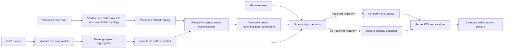

# Case study 02 — Dynamic road routing and ETA

**Source images and OCR:** [Algo_Design_Problems](../../../Case_studies_DSA/Algo_Design_Problems/).

## Source inventory and scope

The assigned index range 063–124 is one continuous substantive problem: ride-hailing route optimization with Dijkstra/contraction hierarchies (CH), real-time traffic, ETA, and the production system around it. Repeated screenshots and interview answers are consolidated rather than turned into separate problems. The stated ending filename `20260823_010434.jpg` is **index 129**, not 124; the indexed range takes precedence, ending at `20260823_010427.jpg`. Adjacent images were consulted for continuity but are not included in the assigned inventory.

Exact source image inventory, grouped by topic (chronological order):

- Problem, constraints, algorithm selection and data assumptions (063–073): `20260823_010158.jpg`, `20260823_010202.jpg`, `20260823_010205.jpg`, `20260823_010208.jpg`, `20260823_010210.jpg`, `20260823_010213.jpg`, `20260823_010217.jpg`, `20260823_010223.jpg`, `20260823_010226.jpg`, `20260823_010230.jpg`, `20260823_010233.jpg`.
- Graph layout, validation, evaluation, snapping, route choice (074–086): `20260823_010236.jpg`, `20260823_010249.jpg`, `20260823_010252.jpg`, `20260823_010254.jpg`, `20260823_010256.jpg`, `20260823_010257.jpg`, `20260823_010259.jpg`, `20260823_010300.jpg`, `20260823_010302.jpg`, `20260823_010305.jpg`, `20260823_010309.jpg`, `20260823_010312.jpg`, `20260823_010313.jpg`.
- CH, sizing, preprocessing and online serving (087–103): `20260823_010316.jpg`, `20260823_010318.jpg`, `20260823_010320.jpg`, `20260823_010322.jpg`, `20260823_010325.jpg`, `20260823_010327.jpg`, `20260823_010329.jpg`, `20260823_010330.jpg`, `20260823_010333.jpg`, `20260823_010335.jpg`, `20260823_010338.jpg`, `20260823_010340.jpg`, `20260823_010341.jpg`, `20260823_010343.jpg`, `20260823_010345.jpg`, `20260823_010350.jpg`, `20260823_010352.jpg`.
- Monitoring, failures, scaling and security (104–119): `20260823_010354.jpg`, `20260823_010355.jpg`, `20260823_010357.jpg`, `20260823_010400.jpg`, `20260823_010401.jpg`, `20260823_010404.jpg`, `20260823_010405.jpg`, `20260823_010407.jpg`, `20260823_010409.jpg`, `20260823_010410.jpg`, `20260823_010411.jpg`, `20260823_010412.jpg`, `20260823_010414.jpg`, `20260823_010416.jpg`, `20260823_010418.jpg`, `20260823_010419.jpg`.
- Interview follow-ups and profiles (120–124): `20260823_010420.jpg`, `20260823_010423.jpg`, `20260823_010424.jpg`, `20260823_010426.jpg`, `20260823_010427.jpg`.

**OCR and interpretation:** These are OCR transcriptions of screenshots; some lines are clipped or garbled. Numeric values below are source claims or explicit practice assumptions, not independently measured results. In particular, the source claims ordinary preprocessed CH remains exact under arbitrary traffic overlays and closures, but also says routing profiles need their own preprocessing. The former claim is not generally true. This case uses a correct snapshot-based design instead of treating that assertion or its 85 ms incident estimate as established fact. Source figures for memory, costs and latency are sizing estimates that must be reconciled with implementation and measurement.

## Context and problem

A ride-hailing service must compute a directed, travel-time-minimizing route and ETA at dispatch, then reroute during trips when traffic materially changes. The source describes one metro with approximately 30 million vertices, 70 million directed edges and 100,000 concurrent rides. Road maps change nightly; probe vehicles feed traffic approximately every 30 seconds. It proposes a p99 server-side route-query target below 50 ms for rerouting and 100 ms for dispatch, and median absolute percentage ETA error (MdAPE) below 12%. It samples CH results against Dijkstra for exactness. These are scenario targets, not guarantees (`20260823_010202.jpg`–`20260823_010210.jpg`, listed individually above).

The key design tension is low latency versus a changing weighted graph. A road closure must not appear in a route, even if a precomputed shortcut used the closed edge. Conversely, if a traffic update makes an alternative cheaper, a shortcut topology built for old costs may have omitted the path now needed for the optimum.

## Requirements and assumptions

**From the source:** Directed road network; free-flow time with a traffic multiplier; live GPS probes; separate routing and traffic pipelines; daily offline build and zero-downtime deployment. Turn penalties, shared rides, accessibility, predictive traffic, and multimodal routing are outside the initial road-routing scope. A route snap beyond 50 m is rejected or requires an explicitly defined fallback; node and component checks reduce obvious map errors. Map providers and road access rules affect topology and update cadence (`20260823_010202.jpg`, `20260823_010223.jpg`, `20260823_010305.jpg`).

**Practice assumptions, not source facts:**

1. All traversable edge costs in a snapshot are finite and nonnegative; a closure removes an edge from that snapshot rather than assigning an arbitrary large finite cost. No valid path returns `NO_ROUTE`, not a path through the closure.
2. Each query pins one immutable `(topology_version, traffic_version, profile)` and answers under that snapshot. The same snapshot is available to the Dijkstra reference and route-cost checker. Staleness is explicit in the response or telemetry.
3. The service uses ordinary static-metric CH only for its matching preprocessed metric. For changed metrics it either publishes a correctly customized hierarchy designed for such updates, or runs Dijkstra on the current base graph until such a hierarchy is available. Merely changing shortcut weights, unpacking shortcuts, or filtering closed shortcuts is not a proof that the remaining CH topology contains every newly optimal path.
4. Baseline model excludes turn restrictions that depend on the incoming edge. If they are required, use an edge-state graph or another correct turn-aware model; rejecting inaccessible edges alone does not encode prohibited turns. An edge-state graph normally has a state per directed incoming road edge, with transitions for legal turns; size depends on junction degrees.
5. This interview exercise optimizes a static snapshot, not a time-dependent shortest-path objective; future traffic and stop delays can be added to ETA separately but are not silently used to claim routing optimality.

## Worked example — why the overlay needs care

**Invented example.** Directed edges are `s→a=1`, `a→t=1`, `s→b=2`, `b→t=2`. Initially the optimal path is `s→a→t`, cost 2. With a new traffic snapshot, `a→t` rises to 10, so the correct path becomes `s→b→t`, cost 4. A preprocessing witness search may have omitted a shortcut representing the `b` path because the `a` path was cheaper at build time. Updating the existing shortcut costs alone cannot restore a missing shortcut. Dijkstra over the new base graph finds cost 4; a hierarchy customized or rebuilt with correctness for that metric can also be used. If `a→t` is closed, it is removed: the answer remains `s→b→t`, never the blocked edge.

For ETA, if the two chosen segments take 2 and 2 minutes in the pinned snapshot, the basic predicted trip duration is 4 minutes. A measured actual trip duration of 5 minutes yields absolute percentage error `|4−5|/5 = 20%`. This single example is not an estimate of fleet-wide MdAPE.

## Design



**Offline:** Parse directed road edges and access flags from the map snapshot. Compute base travel times as length divided by speed, using consistent units. Validate IDs, legal topology, costs and component statistics. Contract nodes in a chosen order using witness searches; preserve shortcut decomposition for unpacking. For a fixed metric, add a shortcut through a contracted node when no avoiding witness of cost at most the candidate path exists. Lazy importance updates and parallel contraction are possible, but overlapping contractions must not invalidate one another's witness assumptions. Store rank, directed adjacency, shortcut children, version and checksums. CSR arrays improve locality; account for offsets, weights, flags, shortcut metadata and temporary build memory separately.

**Online:** Authenticate the request, map-match and snap to traversable road positions, pin a consistent graph and metric, then query the matching CH or the exact base-graph fallback. Unpack shortcuts, verify every returned original edge is traversable under the pinned snapshot, sum its weights and generate directions. If the location is on an edge rather than a node, represent the accessible partial edge and its direction correctly; blindly snapping to the nearest node can place a driver on the wrong carriageway. A 50 m distance test alone cannot establish a legal or accurate match.

**Traffic:** The source proposes ~100,000 GPS pings/s, keyed ingestion, HMM-style map matching, per-edge 30-second aggregation, and in-memory multipliers (`20260823_010230.jpg`, `20260823_010345.jpg`). Validate speed, time and location plausibility, map-match using position accuracy, heading and feasible road transitions, aggregate confidence-weighted observations, and use an explicit stale-data policy. A new multiplier is `free_flow_speed / observed_speed` for positive observed speed, so adjusted travel time is `base_time × multiplier`; handle stationary observations and actual closures separately. Batch and version updates, customize/rebuild correctly, then atomically publish a compatible pair. If the graph and traffic versions do not match, use the base-graph fallback rather than silently claiming exactness. Memory reclamation must wait until in-flight readers release the old version.

## Algorithm and pseudocode

A simple exact reference, also the correctness fallback, is Dijkstra with a min-priority queue. For a fixed correctly built CH, use its proven directed bidirectional upward query and unpack the resulting shortcuts; do not reuse a generic bidirectional stopping rule without proving it for the implementation's graph representation.

```text
route(request):
    snapshot = pin_graph_and_traffic_version(request.profile)
    s, t = map_match_and_snap(request.locations, snapshot.graph)
    if snap is invalid: return SNAP_FAILED
    if snapshot.has_matching_exact_hierarchy:
        edge_path = unpack(ch_query(snapshot.hierarchy, s, t))
    else:
        edge_path = dijkstra(snapshot.base_graph, snapshot.costs, s, t)
    if edge_path == NO_ROUTE: return NO_ROUTE
    assert path_is_contiguous_directed_and_open(edge_path, snapshot)
    return edge_path, sum(snapshot.cost[e] for e in edge_path), snapshot.version

dijkstra(graph, costs, s, t):
    dist[s] = 0; dist[other vertices] = infinity; parent = empty
    pq.push((0, s))
    while pq is not empty:
        d, u = pq.pop_min()
        if d != dist[u]: continue                  # stale heap entry
        if u == t: return reconstruct(parent, s, t)
        for each open outgoing edge e = (u, v):
            candidate = d + costs[e]
            if candidate < dist[v]:
                dist[v] = candidate; parent[v] = e
                pq.push((candidate, v))
    return NO_ROUTE
```

For `s == t`, reconstruct an empty path at zero cost. Reject negative, NaN and malformed weights at ingestion. Saturate or check arithmetic overflow and distinguish infinity from a traversable high-cost edge.

### Correctness and invariants

- With nonnegative weights, when Dijkstra removes a non-stale minimum-distance vertex, no later path can improve that distance; therefore extracting `t` gives its shortest snapshot cost. Parent edges form a directed path, and no path yields `NO_ROUTE` after the queue empties.
- Fixed-metric CH contraction preserves relevant shortest paths via witness searches and shortcuts; an upward/downward path exists under the CH construction's conditions. Recursive shortcut unpacking restores original edges with the same cost. This requires the hierarchy and shortcut weights to correspond to the exact query metric and access profile.
- Pinning versions prevents a route from mixing old and new edge costs mid-search. Validating unpacked edges catches an invalid closure crossing, but it **does not prove optimality**: a route can be legal yet more expensive than a missing alternative.
- A sampled reference comparison must use the identical topology, edge weights, direction, restrictions and snap points. For reachable pairs with positive optimal cost, `route_cost / reference_cost` should be 1 within numeric tolerance. Handle zero-cost and unreachable pairs separately; a ratio below 1 generally signals mismatched versions or a checker bug, not a longer route.

### Complexity and sizing

For `V` vertices and `E` edges, binary-heap Dijkstra takes `O((V+E) log V)` time with a decrease-key heap and `O(V+E)` graph and working space; a lazy duplicate-entry heap can hold `O(E)` entries and has `O(E log E)` worst-case heap work. CH query time depends on ranks and graph structure, with no universal small worst-case bound; preprocessing and shortcut count are likewise data-dependent. Query working memory is proportional to reached nodes and queue entries, besides shared graph storage. HMM map matching depends on the number of candidates per GPS fix and transition-cost evaluation; it is not simply a nearest-node lookup.

The source's illustration computes `100,000 / 30 ≈ 3,333` possible reroutes/s plus roughly `2,000,000 / 86,400 ≈ 23` dispatches/s, or 3,356 QPS before headroom (`20260823_010316.jpg`). The first term assumes every active ride reroutes every 30 seconds, whereas the trigger is conditional; the second is a daily average, not peak dispatch traffic. At 100,000 pings/s × 80 bytes, raw payload is about 8 MB/s before replication and overhead. Measure query distributions, allocations, build duration, broadcast throughput, network and p99 under realistic bursts; theoretical per-core throughput is not a latency guarantee.

## Alternatives and tradeoffs

| Approach | Strength | Limitation / appropriate use |
|---|---|---|
| Base Dijkstra | Exact for any nonnegative snapshot; easy oracle | May be too slow at metro scale; reliable fallback with capacity planning. |
| A* with admissible, consistent lower-bound heuristic | Often explores fewer nodes without full CH | A straight-line/max-speed bound can be weak; landmark bounds must remain valid for the current metric. |
| Static CH | Fast exact queries for the metric used to preprocess | Changes to costs, closures or profiles require a correct rebuild/customization strategy; query correctness is not preserved by arbitrary overlays. |
| Customizable hierarchy | Separate topology/order from metric customization | Requires a correct implementation, complete dependency propagation, and versioned publication; customization has a latency and compute cost. |
| Hub labels | Very fast static queries | Heavy preprocessing/storage and difficult dynamic updates, as noted by the source. |
| Spatial tiles or route cache | Local scaling or repeated popular routes | Cross-tile paths and changes require consistent boundaries; cache keys must include map, metric, profile and endpoints. |

Separate avoid-highway and avoid-toll profiles are possible with separately built or correctly customized metric versions. A hard avoid removes those edges; a large finite penalty is a soft preference and may still use them. Multimodal transit is a later problem involving schedules, transfers, access/egress and time-dependent routing; stitching independently optimal legs without optimizing transfer choices is not generally globally optimal (`20260823_010202.jpg`, `20260823_010427.jpg`).

## Failure modes and operational response

- **Closure or sharp congestion change:** A shortcut may unpack through a closed edge or omit the new optimum. Publish the closure in the base snapshot promptly, use exact fallback until an appropriate hierarchy is ready, and actively invalidate affected route caches. A finite multiplier such as 10,000 is not an absolute closure. A stale snapshot can still recommend an actually closed road; expose freshness and do not describe that result as unconditionally safe.
- **Stale probes or streaming lag:** Monitor per-edge/event freshness and consumer lag; use an explicitly marked historical or external-traffic fallback. The source proposes degraded and critical freshness bands and retaining nodes that can still serve routes, rather than ejecting all nodes for traffic staleness alone (`20260823_010400.jpg`). Freshness is a separate safety decision when closures are involved. Recover with event-time and watermark policy; do not blindly replay obsolete traffic into current windows.
- **Bad GPS, spoofing or disconnected snap:** Apply plausibility checks and temporal map matching; reject low-confidence or far-away matches, and avoid jumping to a nearby but inaccessible parallel road. Re-snapping to a different component is a product policy, not proof the driver can reach it. Track confidence and fail honestly.
- **Invalid graph or hot reload:** Reject invalid weights and malformed shortcut references; retain last known good artifact, alert and roll back. A large strongly connected component is a useful quality signal, not a universal requirement for a directed road network with legal one-way streets. Reserve RAM for both versions and release the old graph only after readers finish.
- **Overload and cascading reroutes:** Bound worker queues, isolate traffic writers, prioritize requests as policy allows, scale out, and return explicit overload errors rather than stale or fabricated routes. Assess the fallback's capacity before relying on it. Trigger hysteresis and minimum improvement reduce noisy route churn.
- **ETA bias and feedback:** Compare morning peak predictions against observed speeds, stratify by road class, region and trip length, and avoid training only on selected planned routes. Simultaneous routing of many drivers toward one road may cause feedback before probes reflect the congestion.
- **Privacy and trust:** GPS plus a driver identifier is sensitive. Pseudonymize, enforce region and retention policies, encrypt data, authenticate clients and internal publishers, and limit access. The source proposes short-lived JWTs, read-only graph artifacts, salted identifiers and audit records (`20260823_010414.jpg`–`20260823_010419.jpg`, inventoried above); actual retention and legal requirements must be verified. Versioned audit metadata must not expose unnecessary raw location history.

## Validation and measurement

1. **Small-graph differential tests:** Generate directed graphs with positive and zero costs, equal-cost witnesses, disconnected vertices, parallel edges and one-way restrictions. For every pair, compare CH results and reconstructed original paths with Dijkstra on exactly the same snapshot. Test `s=t`, no route, nested shortcuts and legal turn transitions where modeled.
2. **Dynamic regression tests:** Use the worked counterexample, closing a shortcut constituent, cost decreases that create a new shortest path, reopened roads and profile changes. Verify no stale shortcut is used as exact; check the base fallback and fully published customizations separately. Exercise queries concurrently with publication and graph retirement to prove each sees one version.
3. **Ingestion tests:** Out-of-order, future and duplicate GPS events, no probes, zero speed, spoofed jumps, nearest-road ambiguity, tunnel gaps, negative/NaN costs, incompatible versions and map corruption. Verify alarms, explicit degradation and last-good behavior.
4. **Offline and online quality:** The source suggests 1,000 random reference pairs per nightly build, shadow comparisons on 0.1% of queries, and canary rollout (`20260823_010249.jpg`, `20260823_010254.jpg`, `20260823_010300.jpg`). These samples detect regressions but do not prove correctness. Stratify by geography, component, road class, profile and recent changes; include targeted closures and difficult cases. Compare path cost, legality and reachability, not merely equal route strings.
5. **ETA and service metrics:** For completed trips with positive actual duration, calculate `median(|predicted − actual| / actual)` and report MdAPE alongside tail error, sample size, road class and time of day. Use a stable historical holdout for repeatability and a rolling window for drift, both against a free-flow baseline. Report separately server-side dispatch/reroute latency histograms, queue depth, p99, snap failures, coverage/freshness, route optimality and canary guardrails. Source thresholds and latency budgets conflict in places between server-only and app-to-app timing; define each boundary before declaring an SLA met.
6. **Reroute efficacy:** Evaluate the proposed route against the remaining old route using the same snapshot. The source discusses a 20% deterioration trigger and a 5% improvement criterion; avoid dividing by zero, and record whether reroutes actually reduce cost. Measure driver-facing churn and false positives separately.

## Interview questions

1. Why does a CH witness search omit some shortcuts, and how can a later weight change invalidate that omission?
2. How would you provide exact closure handling while a new metric is being customized? What latency and capacity tradeoffs does the fallback introduce?
3. Why is checking that every unpacked edge is open necessary but insufficient to prove optimality?
4. What must a shadow Dijkstra comparison pin, and how should zero-cost or unreachable cases be scored?
5. How do turn restrictions and a source partway along a one-way road change the graph model?
6. How would you choose event-time windows and a freshness fallback when probe coverage is sparse or GPS devices have skewed clocks?
7. Which numbers in the source's QPS calculation are peak assumptions versus averages, and how would you load-test the p99 target?
8. How do you update a graph without a mixed-version query, use-after-free, or an out-of-memory failure during hot reload?
9. How do MdAPE, tail ETA error, reroute precision and route optimality measure different kinds of quality?
10. What changes for hard avoid-tolls, scheduled transit, or traffic that depends on future arrival time?
