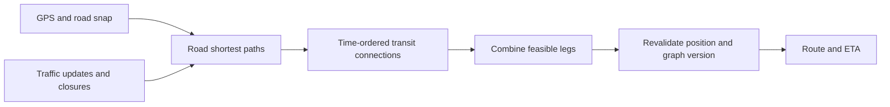
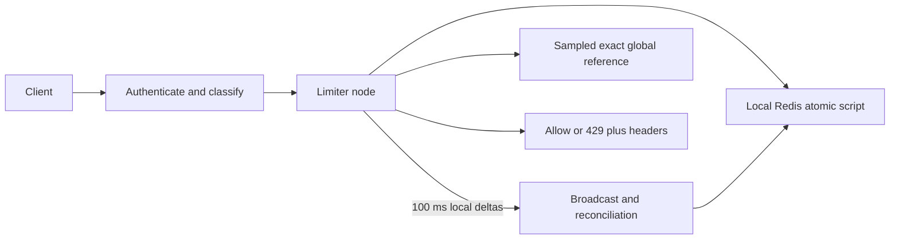
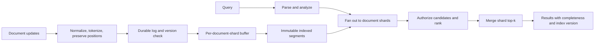

# Algorithm design interview cases — source partition 03

**Source images and OCR:** [Algo_Design_Problems](../../../Case_studies_DSA/Algo_Design_Problems/).

## Source inventory and scope

The requested ordinal range and filename endpoints do not coincide in the supplied OCR index: indexed images **125–186** run from `20260823_010428.jpg` through `20260823_010629.jpg`, while the explicitly named filename interval `20260823_010439.jpg` through `20260823_010707.jpg` is indexed **130–211**. This partition covers indexed images 125–186; the following partition covers the continuation of search. Images 125–129 are also a continuation of the preceding routing case. Consecutive screenshots of the same topic are grouped, not counted as separate problems.

| Source index | Substantive topic | Case |
|---|---|---|
| 125–129 | Routing service continuation: saturation, multimodal routing, stale origins, fleet feedback, and CH components | 1 |
| 130–180 | Distributed per-user rate limiting, rolling windows, token bucket, synchronization, operations and security | 2 |
| 181–186 | Full-text search introduction: positional inverted index, BM25, query types, visibility and scale | 3 |

**Source quality.** This is an OCR transcription of screenshots, not verified measurements or an authoritative specification. Many lines are cut off with an ellipsis, characters and numerals are corrupted, and some claims conflict. Specific uncertain or inconsistent claims are called out below. Source figures are scenario claims, not proven service performance. All worked examples and extra requirements labeled **practice assumption** are invented for interview use.

---

## 1. Navigation routing: production behavior around shortest paths

**Source images:** `20260823_010428.jpg`, `20260823_010430.jpg`, `20260823_010431.jpg`, `20260823_010433.jpg`, `20260823_010434.jpg`. These are the tail of a larger route-optimization case; they describe operational and multimodal extensions rather than a new unrelated routing problem.

### Context and requirements

The source describes contraction-hierarchy (CH) bidirectional shortest-path routing with map matching, a traffic overlay, ETA and turn instructions. It mentions a p99 rising from 8 ms to 45 ms near a 50 ms SLA as load doubles, a 30–60 s traffic feedback loop, 100,000 active trips, and a possible route-concentration trigger of more than 500 drivers heading for one road in two minutes. It also discusses road legs combined with a transit connection-scan algorithm (CSA) and recalculating when a driver moves during routing. **OCR uncertainty:** parts of the multimodal latency arithmetic and the proposed diversion fraction are cut off; do not infer the missing values. Its approximate queueing formula is not a general M/M/c p99 formula.

**Practice assumptions:** road costs are nonnegative; timetables include boarding and transfer constraints; the answer must be valid for the versioned snapshot used, and an updated position or closure may invalidate it before delivery. Provide an explicit partial/unavailable response if no valid itinerary exists.

### Worked example and design

**Practice example:** a driver can walk 4 minutes to stop A, board a departure at minute 6 that reaches B at minute 16, and walk 3 minutes to the destination: arrival is minute 19. If boarding A actually takes 7 minutes, that connection is missed; never combine independently optimal legs without checking their times.



### Algorithm and correctness

```text
snapshot = acquire_consistent_road_and_timetable_versions()
origins = feasible_access_stops_with_earliest_arrival(origin, snapshot)
arrivals, predecessor = connection_scan(origins, ordered_connections, transfers)
best = minimum(arrivals[exit] + final_leg(exit, destination))
route = reconstruct(best, predecessor)
if origin_or_relevant_road_changed(route, snapshot): recompute or reject
return route with snapshot versions and expiry
```

For each scanned connection, CSA's earliest-arrival label is the best feasible arrival using processed connections; chronological processing and legal transfers preserve this invariant. Correct road shortest paths and exhaustive feasible access/exit candidates make the composed minimum optimal over the represented itineraries. Incomplete stop candidates, stale costs or incompatible timestamps weaken that guarantee. A static CH shortcut cannot simply be assumed correct after arbitrary edge-cost changes: use a correctly customized hierarchy, validate affected shortcuts with a correct fallback, or recompute.

### Complexity, tradeoffs and operations

A CSA scan is O(C + T) time for C scanned connections and T transfer relaxations, O(S + C) space with reconstruction for S stops; road-query cost depends on the chosen index and access candidates. Ordinary Dijkstra is O((V+E) log V) with a binary heap. CH trades preprocessing and update complexity for fast queries. Triggering a route census may reduce herd congestion but changes the objective from individual shortest paths to a fleet-level optimization and needs policy and measurement.

Failure modes include stale graph snapshots, closure changes to shortcut weights, missed transfers, snapped origin changing at an intersection, load-induced queues and synchronized reroute surges. A few meters of motion does not guarantee the same snapped edge. Validate with Dijkstra on sampled identical graph snapshots, timetable edge cases, simulated moving drivers and closures, p99/load curves, and fleet-level congestion simulations; monitor freshness and error budgets as well as median latency.

**Interview questions:** Why does saturation disproportionately hurt p99? When does an updated road weight invalidate a CH shortcut? How would you join road and transit legs without missing a connection? How should individual optimality trade off against fleet congestion?

---

## 2. Distributed rate limiting with rolling counters

**Source images:** `20260823_010439.jpg`, `20260823_010443.jpg`, `20260823_010445.jpg`, `20260823_010446.jpg`, `20260823_010447.jpg`, `20260823_010449.jpg`, `20260823_010452.jpg`, `20260823_010455.jpg`, `20260823_010456.jpg`, `20260823_010458.jpg`, `20260823_010501.jpg`, `20260823_010503.jpg`, `20260823_010504.jpg`, `20260823_010506.jpg`, `20260823_010508.jpg`, `20260823_010512.jpg`, `20260823_010514.jpg`, `20260823_010516.jpg`, `20260823_010519.jpg`, `20260823_010521.jpg`, `20260823_010523.jpg`, `20260823_010525.jpg`, `20260823_010526.jpg`, `20260823_010528.jpg`, `20260823_010529.jpg`, `20260823_010531.jpg`, `20260823_010533.jpg`, `20260823_010534.jpg`, `20260823_010535.jpg`, `20260823_010536.jpg`, `20260823_010538.jpg`, `20260823_010539.jpg`, `20260823_010540.jpg`, `20260823_010542.jpg`, `20260823_010544.jpg`, `20260823_010545.jpg`, `20260823_010547.jpg`, `20260823_010548.jpg`, `20260823_010550.jpg`, `20260823_010551.jpg`, `20260823_010557.jpg`, `20260823_010558.jpg`, `20260823_010559.jpg`, `20260823_010601.jpg`, `20260823_010602.jpg`, `20260823_010604.jpg`, `20260823_010606.jpg`, `20260823_010608.jpg`, `20260823_010610.jpg`, `20260823_010614.jpg`, `20260823_010616.jpg`.

### Problem and source constraints

A SaaS gateway decides whether to admit a request by authenticated user and endpoint class, or IP for unauthenticated traffic. The source scenario states 10 million registered users, 500,000 concurrent active users, one million requests/second, ten limiter nodes, a 60-second window and p99 decision latency below 1 ms measured at the limiter boundary. It sets shadow-measured false-positive and false-negative targets of 0.5% and 2%, respectively. Standard endpoints fail open when Redis is unavailable; authentication and payment are described as fail closed. Endpoint classes are derived from a prefix trie; identity comes from verified JWT claims, not user-controlled headers.

The source proposes local Redis sidecars, atomic Lua, a 120-slot second-indexed ring, and asynchronous 100 ms delta broadcasts. Its introductory wording requests exact sliding-window semantics but also permits approximate distributed error. These are incompatible in general: neither second buckets nor asynchronous replicas provide exact global rolling-window decisions. Treat the error thresholds as empirical SLOs, not mathematical guarantees. The claim that a 120-second key TTL prevents stale ring slots is also insufficient for a continuously active key; slots need absolute-second tags. Source cost and throughput values are unverified and Redis hash fields cost more than eight bytes each.

**Practice assumptions:** count admitted requests, not denied attempts; window is `(t - 60 s, t]`; each key has one active policy version; enforce a separate per-second cap if 17 requests/second is a hard requirement. A 1,000/minute window alone does not impose that cap. If a policy instead counts every attempt, increment denied requests too and update both production and reference implementations accordingly.

### Worked example

**Practice example:** with a limit of 3 per 60 seconds, accepted requests at 0.2, 1.1 and 59.9 seconds cause a request at 60.1 to be denied: all three timestamps are still in `(0.1, 60.1]`. At 60.3, the 0.2 request has expired, so one request may be admitted. A fixed minute window could admit three just before 60 and three just after, six in a tiny interval. A token bucket with capacity 3 can intentionally allow three at once, then refills over time; that is different from an exact sliding-window limit.

### Architecture and algorithm



A correct *local* bucket implementation must store `(absolute_second, count)` in every slot. As a simple conservative approximation, include all intersecting whole-second buckets, including the oldest partially overlapping second. It may overcount, but never undercounts locally due solely to bucket boundaries. Keep the key alive through 120 seconds after its most recent write; a shared-key expiry alone does not clear reused fields. Only the node's own accepted increments are published, never increments received from peers.

```text
atomic_local_decide(key, t, limit):
    second = floor(t / 1000 ms)
    sum = 0
    for each tagged slot whose second intersects (t - 60s, t]:
        sum += slot.count
    if sum >= limit: return DENY, sum
    slot = ring[second mod 120]
    if slot.second != second: slot = (second, 0)
    slot.count += 1
    refresh key expiry; enqueue own increment reliably
    return ALLOW, sum + 1
```

The enqueue and decision must be coordinated so an accepted increment cannot disappear before broadcast; persisting a local outbox in the same atomic operation is one approach. Receivers deduplicate sender epoch and sequence, apply only tagged seconds, and recover missed batches from durable replay or a full authoritative reconciliation. Plain Redis pub/sub loses messages on disconnect; sequence numbers detect gaps but do not repair them. Avoid overwriting a newer ring slot with a delayed old delta. Concurrent admissions on separate nodes can still all succeed using stale counts, even with perfect eventual replay. Sticky ownership with fenced failover, or a single atomic authority per key, is needed for a strict global limit; the resulting coordination and failure behavior must be included in the latency budget.

### Correctness and complexity

On one Redis authority, the script serializes check and increment, so no more than the limit can be admitted according to its bucket approximation. The oldest partially overlapping bucket can contain arbitrarily many expired events; hence there is **no universal 2% error bound** without a traffic-distribution or per-second-rate assumption. With independent replicas, even that conservative local guarantee is not global: missed or in-flight deltas create undercounts and over-admission. Clock skew and reordering also need bounded assumptions.

For window W seconds and slot width Δ, a full scan costs O(W/Δ) per decision and O(W/Δ) state per active key; with the source's fixed 60/1 constants this is O(1) asymptotically. Synchronizing a batch of D distinct deltas to N nodes costs O(ND) network deliveries under broadcast. An exact sorted-set log uses O(K) state for K retained requests and typically O(log K) insertion plus expiration work; actual latency depends on traffic, memory and pruning.

### Alternatives and tradeoffs

- **Fixed window:** simplest counter and expiry, but boundary bursts can approach twice the configured limit.
- **Exact global sliding log:** atomic prune, count and conditional insert provides exact admission for a single authority and a trusted clock; memory grows with admitted traffic, and a remote authority may miss the 1 ms target. Unique IDs and explicit retry/idempotency semantics are necessary.
- **Token bucket:** store tokens and last refill, refill by elapsed time up to capacity, admit if at least one token remains. O(1) state, deliberately supports bursts; it does not enforce the same rolling-window rule.
- **Sticky per-user owner:** minimizes cross-node contention but ownership changes require fencing and state recovery; IP and multi-region routing need separate thought.
- **Local counters plus sync:** low-latency availability at the expense of boundedness only when the workload, delay, fan-out and loss recovery are bounded. Broad limits are unsuitable for billing-grade enforcement without stronger guarantees.

### Failure modes, validation and questions

Monitor decision latency, CPU, evictions, 429 rates, sync lag, sequence gaps, clock drift and false decisions versus an exact reference. Redis eviction resets enforcement state; use capacity planning and explicit behavior instead of assuming an evicted key is safe. Define breaker policy separately for sensitive classes. Prevent arbitrary endpoint-class or key cardinality, verify JWT signatures and mask IPs in logs. A hashed user ID is pseudonymous, not anonymous; delete all replicas and derived state when required. Version, validate and atomically swap configuration; retain an audit trail.

Shadow sampling must include **all** requests for selected users across all nodes and serialize the reference decision globally; compare the same admitted-count policy and boundary convention. Test exact second/window boundaries, ring reuse on a long-lived key, skew, out-of-order/duplicate/lost sync batches, simultaneous requests to multiple nodes, failover, expiry, denied retries, hot keys and configuration rollback. Load-test p99 on the actual Lua loop and synchronization workload; a sampling interval alone cannot prove an error bound.

**Interview questions:** Construct an adversarial trace that breaks the 2% target. Why do TTL and pub/sub not ensure correctness? What changes if denials count? How would you deliver strict semantics and explain its availability/latency cost? How does a token bucket differ from a rolling window?

---

## 3. Search over a distributed positional inverted index

**Source images:** `20260823_010620.jpg`, `20260823_010623.jpg`, `20260823_010625.jpg`, `20260823_010626.jpg`, `20260823_010628.jpg`, `20260823_010629.jpg`. This is the opening of the search topic; the following partition covers its continuation.

### Context and requirements

The source's e-commerce search scenario has 10 billion product, support and editorial documents, 50,000 queries/second, 100,000 document updates/second, p99 under 100 ms, and near-real-time indexing within one second. It describes inverted indexes, positional postings, BM25 and recency/CTR signals. Supported queries include single terms, AND, OR and quoted phrases; fuzzy, wildcard, vector search, facets and spell correction are out of scope. Visibility includes public, seller-only and admin-only. The source proposes a post-scoring visibility filter; for correct top-k, it must be applied before final selection or accompanied by sufficient continuation until k authorized hits are found. Seller visibility must include ownership, not just tier.

**OCR uncertainty:** parts of the access-control and index-freshness text are truncated. Treat the subsequent architecture, formulas, validation procedures and complexity analysis as an invented interview design expanding the source's opening requirements, not as verbatim source specifications.

**Practice assumptions:** use 100 primary document shards with replicas; English analyzer and normalization versions are fixed per index version; a document update replaces the old version atomically within its shard; public/seller/admin checks are authoritative before any document content or count is returned. A failed shard yields a clearly marked partial result, never an apparently complete one. No numerical latency or freshness claim below is asserted as measured.

### Worked example

**Practice example:** D1 title is `red running shoes`; D2 title is `running red shoes`; both are public. With lowercase tokenization and stemming, postings for `red` include `(D1, position 0)` and `(D2, position 1)`; postings for `running` include `(D1, 1)` and `(D2, 0)`. The AND query `red running` matches both. The quoted phrase `"red running"` matches D1 only, because its positions are adjacent in order. An inaccessible document is removed before final top-k even if its BM25 score is highest.

### Design



Each shard keeps a term dictionary mapping terms to sorted doc-ID postings. A posting stores term frequency, field identity, document-length information, and a pointer to positions; doc IDs and positions may be delta-compressed. Immutable segments support concurrent reads while in-memory buffers absorb updates; merges remove obsolete versions and tombstones. Publish a consistent searcher snapshot, so updates do not expose both old and new versions. The build pipeline extracts documents, strips HTML, analyzes fields, emits `(document shard, term, docID, field, positions)`, partitions by document shard, sorts by term and docID, builds dictionary/posting files, validates and distributes them. A separate term-partitioned sort is possible only if its output is subsequently repartitioned appropriately.

### Retrieval and ranking algorithm

```text
parse query with quoted phrases preserved
analyze each query clause using the index's compatible analyzer
for each document shard in parallel:
    candidates = intersect sorted lists for AND,
                 union them for OR, or read one term's list
    for a phrase, retain only docs with aligned ordered positions
    discard tombstoned, superseded and unauthorized candidates
    score survivors with field-aware BM25 plus configured boosts
    return local top k and shard/version status
merge local top-k lists by the same deterministic score and tie-breaker
return up to k authorized results and explicit partial/freshness metadata
```

For a term t in document d, a common positive-IDF variant is

`IDF(t) = log(1 + (N - df(t) + 0.5) / (df(t) + 0.5))`

`BM25(t,d) = IDF(t) * tf(t,d) * (k1 + 1) / (tf(t,d) + k1 * (1 - b + b * |d| / avgdl))`.

Sum term and field scores with documented field weights; use consistent corpus statistics across shards or explicitly accept ranking differences. Use bounded recency and click-through-rate boosts and evaluate position bias rather than assuming clicks are relevance labels. Phrase indexing must preserve stopwords and positional gaps if the query analyzer preserves them; stripping stopwords only from the query cannot recover information absent from the index.

### Invariants and complexity

Sorted postings intersections return exactly the document IDs present in every term list; positional alignment enforces order and adjacency within the same field. Version filtering prevents deleted or superseded documents from appearing, and authorization before shard top-k prevents hidden documents from displacing visible results. With globally comparable scores, every globally top-k authorized hit occurs in its own shard's top-k: otherwise that shard alone contains k better hits. The coordinator can therefore merge the local lists exactly, with deterministic tie-breaking. If filtering is postponed until after top-k, that argument no longer holds.

For posting lengths L1…Lm, a basic merge/intersection takes O(sum Li) worst-case plus examined positions P; heap selection over M scored candidates costs O(M log k), with O(k) selection space per shard. More advanced skipping can reduce work but not the worst-case guarantee. Merging S sorted shard lists costs O(k log S) for k outputs after O(S) initialization. Index space is O(number of distinct term-document-field postings + stored positions + dictionary + metadata); compression changes constants, not the count. Broadcast fan-out is S RPCs per query, not S times the number of coordinators per query.

### Alternatives, risks and validation

A database substring scan is simpler for small datasets but scales with scanned data and lacks this index's positional ranking. A single-node index avoids fan-out until capacity fails. Boolean bitmaps accelerate set operations but need extra data for positions and ranking. A managed search service reduces operational build effort but may constrain tuning and cost. Term partitioning makes individual postings local but makes document-level Boolean/ranking combination more complex than document sharding.

Watch ingestion lag, replica freshness, shard timeouts, merge backlog, cache hit rate, p99 and zero-result rate. De-duplicate carefully: identical text may belong to different sellers or have different ACLs and must not automatically collapse across security boundaries. Handle malformed UTF-8, oversized fields, analyzer-version migrations, deletions, stale statistics and hot high-frequency terms. Cache keys must include authorization scope, query/analyzer and index version; never leak restricted snippets or result counts. Replication, WAL replay and idempotent versioned updates protect against failed writers; delayed events must not resurrect a deleted or newer document.

Validate AND/OR and phrase results against a small brute-force reference, including stopwords, punctuation, Unicode normalization, repeated terms and field boundaries. Test ACL ownership and top-k displacement, concurrent replacement/deletion, out-of-order updates and shard failures. Measure freshness with unique canary documents; evaluate nDCG@10 using judged data and track navigational MRR separately. Shadow scores and online experiments need representative traffic, latency and zero-result guardrails, and treatment of click position bias. Capacity-test actual compressed postings, fan-out, replicas, network and merge amplification before promising SLOs.

**Interview questions:** Why does a positional index need original stopword positions? Why can post-filtering a fixed top-k omit valid results? How do you compute globally comparable BM25 scores across shards? What does an update arriving out of order do? Where does a 100-shard fan-out bottleneck first?
