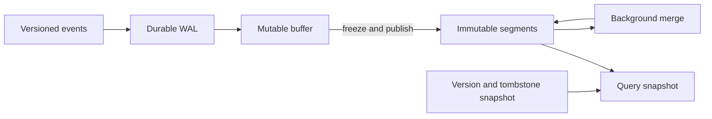
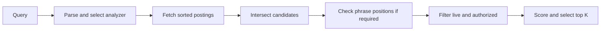
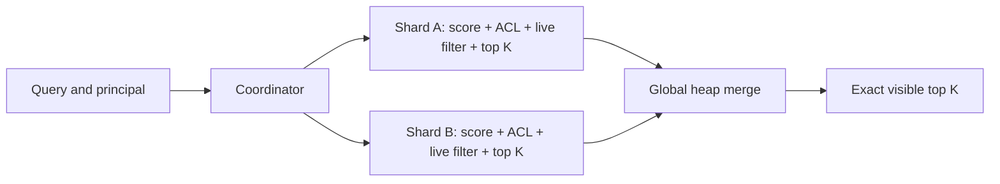
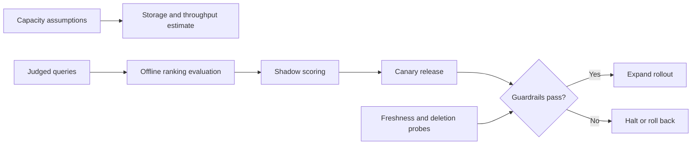

# Algorithm design case studies: search indexing and retrieval

**Source images and OCR:** [Algo_Design_Problems](../../../Case_studies_DSA/Algo_Design_Problems/).

## Source inventory and reading notes

This part covers OCR images 187–248 of `Algo_Design_Problems_SUPPLEMENTAL_IMAGE_OCR.md`, with adjacent pages used for continuity. They form one extended full-text-search design, not 62 independent problems. The distinct challenges are: near-real-time index construction and deletion; Boolean/phrase retrieval and field-aware ranking; exact distributed top-k with visibility controls; and capacity, quality measurement, and operational safety. Relevant illustrations are cited by filename with each case. Figures below are source-scenario claims, not measured results from this exercise; all worked examples and algorithmic contracts are invented practice assumptions. OCR occasionally mangles symbols, numbers and text; where a conclusion depends on an ambiguous or conflicting figure, it is identified rather than silently repaired. The original `.jpg` files are the source of record.

## 1. Build a near-real-time inverted index without blocking readers

**Source images:** `20260823_010635.jpg`, `20260823_010640.jpg`, `20260823_010641.jpg`, `20260823_010642.jpg`, `20260823_010653.jpg`, `20260823_010707.jpg`, `20260823_010708.jpg`, `20260823_010709.jpg`, `20260823_010711.jpg`, `20260823_010713.jpg`, `20260823_010716.jpg`, `20260823_010800.jpg`.

### Context and requirements

The notes describe document ingestion, token-to-document postings, separate positional data, an in-memory buffer, immutable disk segments, a write-ahead log (WAL), tombstones, and background segment merging. The source scenario mentions 100 document shards and 100,000 documents/s; it describes flushing after one second or a 100 MB buffer, whichever comes first. Treat these as proposed design values, not universal guarantees. The OCR also mentions term-hash partitioning during initial build and document-ID partitioning for incremental ingestion; these are different layouts and cannot be combined into one serving topology without an explicit shuffle or re-partitioning step.

**Practice contract:** each document has an ID and monotonically increasing version. Queries see one published index snapshot; a committed update eventually becomes visible, and a delete hides all older versions. At-least-once input delivery is allowed. Tokenization is deterministic; changes to its rules create a new index version. Do not promise exactly-once delivery from the queue alone.

### Worked example and design

For document 7 version 1, `red red fox`, store `red → (7, tf=2, positions=[0,1])` and `fox → (7, tf=1, positions=[2])`. When version 2 is `red cat`, publish version 2 and a tombstone for version 1 together; otherwise queries may see a mixture or both versions. A later replay of version 1 cannot resurrect it.



### Algorithm / pseudocode

```text
ingest(event):
    validate event; append event and version to durable WAL
    if event.version <= latest_version[event.id]: return  # replay or stale
    tokenize document if upsert; add sorted-by-key postings to active buffer
    add version record, including deletion marker when appropriate
    on flush threshold: freeze buffer, persist segment and version changes
    atomically publish manifest referencing segment + version snapshot

merge(segments, snapshot):
    merge sorted (term, doc_id, version) streams
    keep postings only for the live version in the merge snapshot
    persist output; atomically replace input segment references in manifest
    retain old segments until all readers of old manifests finish
```

A real implementation needs a concurrency protocol for updates racing a merge: preserve any versions not covered by the merge snapshot and publish with a manifest compare-and-swap or equivalent. Recovery replays durable WAL records after the manifest checkpoint; records must be idempotent. Do not acknowledge stronger durability than the WAL and checkpoint actually provide.

### Correctness, cost and tradeoffs

**Invariant:** a reader uses one consistent manifest and corresponding live-version view; for each ID only the newest visible, non-deleted version contributes postings. Atomic manifest publication prevents half-built segments from becoming searchable; retaining old segments protects in-flight readers. Replay does not change logical state because version application is idempotent.

For a document with `L` tokens, analysis and posting generation take `O(L)` expected time, plus sorting if the buffer representation is not already ordered. Merging segments totaling `P` postings with an `s`-way heap takes `O(P log s)` time and `O(s)` merge working memory, excluding output and index storage. Repeated tiered merges cause write amplification; a full rebuild is simpler but cannot provide comparable freshness. Inline positions make phrase reads straightforward but enlarge ordinary postings; separate positions reduce non-phrase I/O at the cost of another lookup. Immutable segments make reads simpler but require merging and extra temporary disk.

**Failure modes and validation:** crash before or after manifest publication; replay duplicate and out-of-order updates; concurrent delete/merge; full disk; corrupt segment; lagging consumer; analyzer-version mismatch. Inject crashes at every commit boundary and compare snapshot results with a versioned reference model. Exercise Unicode, repeated tokens and document replacement; monitor freshness, consumer lag, segment count, merge backlog and available disk.

**Interview questions:** What is the linearization point for an update? How are tombstones retained until old readers and replicas no longer need them? What additional step converts a term-partitioned batch build into document-sharded serving?

## 2. Boolean and phrase search with field-weighted BM25

**Source images:** `20260823_010638.jpg`, `20260823_010640.jpg`, `20260823_010649.jpg`, `20260823_010651.jpg`, `20260823_010652.jpg`, `20260823_010718.jpg`, `20260823_010719.jpg`, `20260823_010730.jpg`, `20260823_010731.jpg`, `20260823_010754.jpg`, `20260823_010755.jpg`, `20260823_010759.jpg`.

### Context and requirements

The notes use normalized, stemmed terms, sorted posting lists, positional postings for phrases, per-field length normalization and global term statistics. They discuss removing stopwords for ordinary search but preserving original tokens for quoted phrases and a fallback for queries consisting only of stopwords. A capped click-through-rate (CTR) boost and recency boost are discussed; these are ranking choices, not proofs of relevance. OCR's normalization spelling and some formula symbols are unreliable, so the following specification is an explicit practice design rather than a verbatim transcription.

**Practice contract:** normalize document and query text identically for ordinary terms; retain a separate original-token positional stream, including stopwords, for exact quoted phrases. AND means every query term is present in the same live document; a phrase additionally requires consecutive positions within the same field. Empty input returns an empty result; an all-stopword unquoted query uses the retained original-token stream rather than silently dropping the query. Ties are broken by ascending document ID.

### Worked example

Documents: `d1.title = "to be or not"`, `d2.title = "to be and not"`. The phrase `"to be or"` matches only d1: positions for `to`, `be`, `or` contain 0, 1, 2 in d1. Dropping `or` would falsely admit d2. For AND `red fox`, postings `red=[1,3,5]`, `fox=[2,3,5]` intersect to `[3,5]`.



### Algorithm / pseudocode

```text
search(query, snapshot):
    parse a bounded whitelist grammar; select ordinary or phrase analyzer
    lists = retrieve sorted postings for every required token
    if any list is absent: return []
    candidates = intersect_sorted(lists)  # advance the lowest doc ID
    for d in candidates:
        if phrase and no field contains consecutive token positions: continue
        if not live_and_authorized(d, snapshot): continue
        score = sum over terms and fields of boost[field] * idf(term)
                * tf*(k1+1)/(tf+k1*(1-b[field]+b[field]*len[field]/avglen[field]))
        offer (score, -doc_id) to size-K min-heap
    return heap in descending order
```

A usable IDF is `ln(1 + (N - df + 0.5)/(df + 0.5))`, where `N` and `df` describe the same live corpus snapshot. This field-wise expression is a practice scoring model, not a claim that every BM25F implementation uses the same formula. A term in every document has small **positive**, not exactly zero, IDF under this formula. If recency or CTR multipliers are added, apply a declared cap and evaluate position bias; caps alone do not remove bias.

### Correctness, cost and tradeoffs

In a sorted intersection, advancing the smallest ID cannot discard a match: that ID is absent from any list already beyond it. Emit only when all IDs coincide. For a phrase, intersect positional lists after subtracting each token's phrase offset; a common offset proves consecutive positions in one field. Track repeated terms with their distinct phrase offsets.

For two lists of lengths `a,b`, linear intersection costs `O(a+b)` time and `O(1)` iterator space, excluding output. Multiway heap merging costs `O(P log m)` for `m` lists and `P` visited postings. Phrase checking additionally visits relevant positions; scoring `C` candidates across `m` terms and `f` fields costs up to `O(Cmf + C log K)`, with `O(K)` heap space. Skip pointers can help sparse intersections but do not give a universal `O(sqrt(df))` worst-case bound: adversarial data can require linear work. Hash joins trade sorted traversal for extra memory; exact phrase support costs positional storage. Approximate block-max pruning is safe only when score upper bounds are conservative.

**Failure modes and validation:** lost stopword positions, cross-field phrase matches, repeated words, stale or inconsistent IDF, invalid UTF-8, analyzer-version mismatch, overflow/NaN, and CTR feedback loops. Compare to a brute-force token/phrase evaluator on random small corpora; check phrase order, ties, stemming and all-stopword queries; evaluate ranking with held-out judgments and guardrails, not only click rate.

**Interview questions:** Why must phrase positions retain removed stopwords? When is a skip pointer safe? How do field length distributions affect normalization? Why do clicks at high rank not directly measure unbiased relevance?

## 3. Exact distributed top-k with ACLs and deletes

**Source images:** `20260823_010716.jpg`, `20260823_010721.jpg`, `20260823_010722.jpg`, `20260823_010724.jpg`, `20260823_010725.jpg`, `20260823_010726.jpg`, `20260823_010731.jpg`, `20260823_010738.jpg`, `20260823_010740.jpg`, `20260823_010755.jpg`, `20260823_010756.jpg`, `20260823_010758.jpg`, `20260823_010803.jpg`.

### Context and requirements

The source describes a coordinator querying 100 shards, merging local ranked hits, applying visibility checks, and caching results; it discusses global IDF, replicas, slow-shard tails, deletion invalidation and local top-12 overfetch for global top-10. Fixed overfetch is a useful heuristic but is **not** a guarantee after ACL filtering: an arbitrary number of higher-ranked local hits may be invisible. Nor does a two-second invalidation target alone establish strict deletion safety.

**Practice contract:** return the exact top `K` live documents visible to the requester, using one comparable score definition and deterministic tie order across shards; never return an unauthorized or deleted document. A missing shard is an explicit incomplete/error response, not an exact result. Scores and visibility are evaluated against a consistent declared snapshot. Assume each live document has one logical owner shard and replicas are alternatives, not extra result sources.

### Worked example

For `K=2`, shard A scores `[100 hidden, 99 hidden, 98 visible]`; shard B scores `[97 visible, 96 visible]`. Fetching only two unfiltered hits from each shard and filtering at the coordinator produces `[97,96]`, missing 98. Filtering at each shard before selecting local top-2 produces A `[98]`, B `[97,96]`, so the correct answer is `[98,97]`.



### Algorithm / pseudocode

```text
coordinator(query, principal, K, snapshot):
    send query, principal, K, snapshot to every owner shard
    if any required shard fails or cannot serve snapshot: return INCOMPLETE
    candidates = concatenate each shard's top K live authorized hits
    return best K by (score descending, doc_id ascending)

shard(query, principal, K, snapshot):
    enumerate all matching documents in snapshot
    filter deleted and unauthorized documents before local top-K
    score using snapshot-consistent global statistics
    return local best K with deterministic total ordering
```

If ACL checks must happen only at the coordinator, use an adaptive continuation protocol: obtain ranked pages from each shard and continue until `K` authorized results have been found and every shard's next unseen score bound is below the current Kth result under the same total order. Otherwise keep fetching to exhaustion. Fixed `K+2` is insufficient.

### Correctness, cost and tradeoffs

A globally top-K visible item cannot have local visible rank greater than K: K visible items on its own shard would outrank it globally. Thus local filtering followed by local top-K is sufficient, including skewed shards, provided scoring, snapshot and tie order agree. Global IDF makes one component comparable but is not sufficient if other scoring parameters or snapshots differ. A coordinator heap over `S*K` returned hits takes `O(SK log K)` time and `O(K)` heap space beyond received data; shard scoring costs depend on postings and candidate count. Network is `O(SK)` hits; ACL filtering before ranking may increase shard work. Replica hedging can reduce tails but increases load and requires version/snapshot agreement.

**Failure modes and validation:** split-brain replicas, unauthorized cached results, stale deletes, incomplete fan-out, mismatched stats, score ties, and post-filter underfill. Partition and delay shards, revoke permissions and delete while queries are in flight, compare results against a centralized snapshot oracle, and test thousands of invisible high-score hits. Cache keys must include principal/authorization context and index version; revalidate at serving time or use a coherent invalidation/version protocol for strict revocation. Pub/sub without delivery guarantees cannot establish strict deletion semantics.

**Interview questions:** Prove the local top-K theorem. Why does filtering after overfetch break it? How would you implement pagination and a stable snapshot? What changes if partial answers are allowed?

## 4. Search capacity, observability and safe evolution

**Source images:** `20260823_010632.jpg`, `20260823_010642.jpg`, `20260823_010643.jpg`, `20260823_010645.jpg`, `20260823_010646.jpg`, `20260823_010648.jpg`, `20260823_010657.jpg`, `20260823_010658.jpg`, `20260823_010659.jpg`, `20260823_010701.jpg`, `20260823_010704.jpg`, `20260823_010721.jpg`, `20260823_010733.jpg`, `20260823_010735.jpg`, `20260823_010736.jpg`, `20260823_010737.jpg`, `20260823_010740.jpg`, `20260823_010741.jpg`, `20260823_010745.jpg`, `20260823_010746.jpg`, `20260823_010748.jpg`, `20260823_010749.jpg`, `20260823_010750.jpg`, `20260823_010751.jpg`, `20260823_010753.jpg`.

### Context and requirements

The notes propose a large, sharded search corpus, per-shard caching, canary freshness measurements, latency/lag/segment monitoring, offline nDCG and MRR, shadow scoring, a canary experiment, query limits, and retention/security controls. OCR contains inconsistent capacity numbers (e.g., shard counts and shard sizes in different passages); do not use these figures as a validated deployment budget. The source mentions 10 billion documents, 50,000 queries/s and 100 shards as scenario assumptions, not measurements verified here. Percentile budgets of components cannot simply be added to establish end-to-end P99 without assumptions about joint distributions.

**Practice contract:** estimate storage and query cost from explicit input assumptions; prioritize a bounded-query interface, observable freshness and exact security semantics. Report approximate capacity separately from a measured SLO. Optimize caches using observed access rates and miss costs, not term popularity alone.



### Worked example and algorithm

Invented capacity model: 1 million documents, 100 distinct `(term, doc)` pairs each, 8 bytes per pair after compression gives `1,000,000 * 100 * 8 = 800,000,000` bytes of primary postings before dictionaries, positions, metadata, temporary merges and replication. Two replicas require at least 1.6 billion bytes for postings alone. At 100 docs/s the same assumptions produce 80,000 posting bytes/s before overhead and write amplification.

```text
capacity(documents, unique_pairs_per_doc, bytes_per_pair, replicas):
    postings_primary = documents * unique_pairs_per_doc * bytes_per_pair
    postings_replicated = postings_primary * replicas
    return postings_replicated + separately_estimated_positions_metadata_and_merge_headroom

validate_release(candidate):
    replay judged queries on production and candidate snapshots
    compute nDCG@K; report MRR separately for known-item queries
    shadow-score, then canary with predeclared quality, latency, error and zero-result guardrails
    monitor deletion and freshness canaries; halt/rollback on violated guardrails
```

`DCG@K = Σ(i=1..K) (2^rel_i - 1)/log2(i+1)`; `nDCG@K = DCG@K / ideal_DCG@K` when the ideal is nonzero. MRR averages reciprocal rank of the first relevant result; it does not measure ranking quality of later results. State how zero-ideal queries are handled. Click labels can be biased by result position; randomized/interleaved experiments and human judgments address different limitations, and neither eliminates every bias automatically.

### Correctness, complexity and tradeoffs

Capacity accounting conserves bytes only if units and replication assumptions are consistent; distinct pairs differ from raw token occurrences, and compression is data-dependent. A scan over `Q` judged queries with at most `K` ranked hits costs `O(QK)` evaluation time and `O(K)` per-query working memory, excluding generation and ideal sorting; ideal ranking costs `O(R log R)` per query for `R` judged items if unsorted. Monitor per-shard lag and tail, not just averages; increasing cache size competes with heap and OS page cache, while aggressive merging increases I/O and write amplification. Routing to fewer shards is correct only with a complete routing index proving omitted shards cannot contain qualifying results. Regional asynchronous replicas trade freshness for latency; a synchronous path has higher availability and latency costs.

**Failure modes and validation:** backlog, stalled merge, disk exhaustion, corrupt statistics, stale ACL/delete caches, cache stampede, high-frequency posting OOM, regex denial of service, malformed input, skewed shards and privacy leakage. Load-test realistic Zipf/skew and fan-out; inject consumer, cache, replica and partition faults; check freshness with inserted canaries and deletion probes. Limit query length, token count, result work and expensive operators; test authorization, retention and log redaction explicitly. Tune limits and SLOs with measurements, not the OCR's unverified figures.

**Interview questions:** What dominates storage after adding positions and replication? Why can 100 individually fast shards still have poor aggregate tail latency? How would you distinguish stale IDF from index lag? What evidence would justify caching a giant common-term list?
