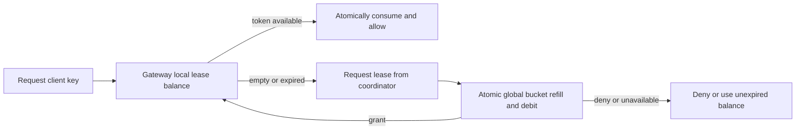

# Interview case: Distributed API rate limiting under contention

## Context and requirements
The source describes a gateway whose per-request Redis Lua limiter became a throughput bottleneck and proposes local buckets with batched synchronization. It also discusses fail-open behavior during Redis failure. See [source OCR, images 005–008 and 016–017](../../../../Case_studies_DSA/Algo_Design_Problems/Algo_Design_Problems_SUPPLEMENTAL_IMAGE_OCR.md), including [20260823_005859.jpg](../../../../Case_studies_DSA/Algo_Design_Problems/20260823_005859.jpg). Source incident numbers are illustrative claims, not general capacity results. Although the source calls its counter a sliding window, an increment with expiry describes a fixed-window-style counter, not an exact rolling window.

**Illustrative contract:** enforce per-client token-bucket policy with capacity B and refill rate r across gateways; bounded bursts are acceptable but unlimited fail-open is not. A token authorizes one request. A strict global limit requires coordinated allocation, not merely periodically reporting consumption. Define whether unavailable coordination denies or permits only already allocated tokens, and expose this policy to clients.

## Algorithm and guarantees
The coordinator keeps `(tokens,last_time)` for each client. Atomically refill to `min(B, tokens + r * max(0, now-last_time))`, then grant at most the requested amount and debit the grant. A gateway atomically decrements its lease for each accepted request; it acquires another when low. Use a monotonic coordinator time source and bounded bucket state lifetime. Global grant accounting prevents issuing more tokens than the configured bucket generates. No global operation is required for each request, but leases move consumption in time: reserve tokens at grant time, so delayed spending can bunch with later grants. If the requirement is a strict arrival-time token-bucket envelope, use per-request central decisions or a protocol that explicitly bounds outstanding leases and their expiration, and account for their burst contribution.

**Example:** B=10, r=2/s, initially full. At time zero gateways acquire leases of 4 and 3, leaving 3 central tokens. Together they cannot spend more than seven leased tokens without another grant. At t=1 the central bucket has up to 5 available; actual arrival bursts can exceed B if old grants are spent late. A local balance must not refill independently as though every node owned the global rate.

Redis scripts give atomic check/refill/debit on one primary, but every call for a hot key is serialized; batching amortizes calls while increasing outstanding capacity and stranded tokens. Count reporting alone observes overage after it happened; it cannot enforce a hard bound. Lease retries need unique grant IDs and idempotent coordinator records, or a timeout followed by a retry may debit twice. A process crash can strand its unused allocation; do not reissue it until expiry is safe. A partitioned node can consume only known, unexpired local grants; after that deny with a retry hint. Coordinate lease expiration using conservative clock-skew bounds or fencing; if these cannot be guaranteed, do not reclaim while a node might still spend.

Per decision is O(1) local work; each lease refresh is O(1) coordinator work, amortized across granted tokens, with O(active client keys + outstanding leases) state. Hot clients, skew, membership changes and rebalancing matter more than asymptotic complexity.

## Evaluation and operations
Use a deterministic model with controlled time to test concurrent grants, refill boundaries, multiple gateways, timeout/retry, duplicate messages, failover, expired leases, node restart, clock skew and bucket exhaustion. Compare permitted traffic and worst-case burst against the declared policy; don't claim zero overshoot for batched asynchronous counters. Load-test hot-key and many-key distributions, measuring coordinator operations, lease utilization, deny rate, p99 latency, stranded tokens and overage. Alert on coordinator unavailability and fallback activation; roll out with shadow accounting before enforcement.

## Interview practice
1. **Why is a Lua script not enough to scale a hot key?** It gives atomicity but serializes operations on the owning Redis execution path; one round trip and script per request can saturate it.
2. **Are pipelining and atomicity the same?** No. Pipelining reduces network overhead; atomic checks and debits still require a transaction or script, and separate pipeline commands may interleave.
3. **What does a lease buy and cost?** It amortizes coordination and remains usable during brief outages; it can strand capacity and shift bursts in time, so its size and expiry must match the actual guarantee.
4. **What is the failure policy?** Spend only safely held, unexpired allocations or deny when exhausted; unlimited fail-open violates the stated safety contract. Product-specific availability tradeoffs must be explicit.
