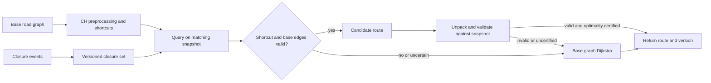

# Interview case: Route around a newly closed road

## Scenario and contract
A navigation service preprocesses a road network into contraction hierarchy (CH) shortcuts. A closure arrives after preprocessing; a shortcut may still hide that edge. The source's incident describes exactly this stale-shortcut failure and a filter that unpacks shortcuts to reject closed edges. See [source OCR, images 002–004](../../../../Case_studies_DSA/Algo_Design_Problems/Algo_Design_Problems_SUPPLEMENTAL_IMAGE_OCR.md) and [20260823_005809.jpg](../../../../Case_studies_DSA/Algo_Design_Problems/20260823_005809.jpg). Incident measurements are source-reported, not independent benchmarks.

**Illustrative requirements:** directed graph, nonnegative travel times; a request uses one consistent graph/closure snapshot; never return a route traversing an edge closed in that snapshot; return an exact shortest feasible route or no route. Traffic changes during the request are reflected in a later version, not halfway through the search. Time-dependent travel times and turn restrictions require richer state and are outside this contract.

## Algorithm and correctness
Baseline Dijkstra on the live base graph ignores closed edges. Set `dist[s]=0`, repeatedly settle the minimum-distance vertex, and relax open outgoing edges; stop when the target is settled. Track predecessor edges and reconstruct the route. With a binary heap it takes O((V+E) log V) time and O(V+E) graph space; an adjacency-list graph and a lazy heap can hold O(E) heap entries. An unreachable target returns no route; source equals target gives the empty route. Reject negative weights because Dijkstra's settled-distance invariant then fails.

CH accelerates queries by using precomputed shortcuts which represent paths of base edges. At query time reject an original closed edge and any shortcut whose recursively unpacked path contains one. However, **filtering alone does not guarantee exact shortest paths or completeness**: the preprocessing may have omitted alternative shortcuts because a now-closed path served as a witness. A valid CH candidate is an upper bound, not proof of optimality. For the stated exact contract, use a correctly updated/certified hierarchy, or fall back to base-graph Dijkstra; merely validating the returned candidate does not fix missed alternatives. A safe first release can always use Dijkstra when closures affect the hierarchy.

**Illustrative example:** A→B→D costs 2+2; A→C→D costs 3+3. A shortcut A→D encodes the first path at cost 4. When B→D closes, accepting that shortcut is unsafe. Filter it, and base Dijkstra returns A→C→D at cost 6; if C→D also closes, return no route.

## Tradeoffs, operations and evaluation
A closure-set membership check is O(1) expected per unpacked base edge but recursively inspecting many shortcuts raises latency. Cache shortcut validity only with a closure-set version and graph version; otherwise reopening a road or changing the hierarchy leaves stale decisions. A reverse dependency index can find affected shortcuts but costs memory and update work. Rebuilding or incremental customization may regain speed; a fixed-radius update alone is not a correctness proof. Publish snapshot versions atomically and retain old versions for in-flight searches. If closure feed freshness falls outside the agreed safety threshold, fail or mark results stale according to product policy rather than silently asserting freshness.

Evaluate against base-graph Dijkstra on random and adversarial closures, including nested shortcuts, directed edges, equal-cost alternatives, disconnected graphs, reopenings and update/query races. Monitor route validation failures, closure propagation lag, fallback rate, p95/p99 latency and unreachable-rate changes; canary graph versions before rollout. Source incident timings and latency figures are workload-specific, and the OCR's incremental-update claims should not be interpreted as a general guarantee.

## Interview practice
1. **Why can an apparently valid shortcut hide a closure?** Its stored weight summarizes an old underlying path; without unpacking or an updated dependency index, the query never examines the changed edge.
2. **Is rejecting all affected shortcuts sufficient for exact routing?** No. The restricted CH graph may no longer contain the true optimum or any valid route; use a correctness-preserving update or search the base graph.
3. **How do you handle a closure arriving during a query?** Pin an immutable version for the whole query and report it; if stronger freshness is required, revalidate against a newer version and rerun on change, with a bounded retry/failure policy.
4. **When is CH worth its preprocessing?** For many queries over a mostly stable graph, where lower query cost repays build/storage/update cost. Rapid graph changes or strict freshness can favor direct search or a dynamic hierarchy.
