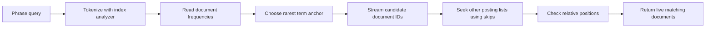

# Interview case: Phrase search without loading common-term postings

## Problem and assumptions
The source describes phrase queries exhausting search-replica memory because the posting list for a very common term was loaded before intersection. Its proposed direction is a rare-term anchor, lazy postings access and skip pointers. See [source OCR, images 009–012](../../../../Case_studies_DSA/Algo_Design_Problems/Algo_Design_Problems_SUPPLEMENTAL_IMAGE_OCR.md) and [20260823_005912.jpg](../../../../Case_studies_DSA/Algo_Design_Problems/20260823_005912.jpg). Reported incident sizes are illustrative source claims, not measured here.

**Illustrative contract:** return document IDs containing an exact token phrase in order, including repeated terms; index and query use the same tokenizer and position increments. Postings are sorted by document ID, with sorted token positions per document, and reflect one index snapshot. Empty queries return no matches; a missing term returns no matches. Deleted documents are filtered using the same snapshot.

## Detailed design
Each term's posting list maps `docID` to positions; skip entries identify a document and an offset in a compressed block. For phrase tokens `t[0..m-1]`, choose an anchor index `a` with minimum document frequency. Stream its document IDs. For each candidate `d`, seek every other distinct term's list to `d`; reject as soon as one is absent. Retrieve position lists only for surviving documents. A match exists when some anchor position `p` has `p + (i-a)` in the positions for every token index `i`. For repeated tokens use the same term's positions for each offset; do not merge duplicate query terms away. Return each document at most once.

**Example:** phrase `to be to`; in document 7, `to` occurs at positions [1,3,8] and `be` at [2]. Anchor `be` at 2 checks `to` at 1 and 3 and matches. Positions [1,4] for `to` do not match even though both terms occur. Stopword removal, synonym graphs and position gaps must have specified semantics; treating all token adjacency as byte adjacency is wrong.

A sequential merge across lists costs O(sum of posting lengths) document comparisons, plus positions inspected. Rare-term seeking can avoid most common-list reads, but its work depends on candidate count, block layout, cache and position frequency; there is no universal O(rarest-list-length) bound. Binary-searchable skip blocks add O(log B) block lookup plus decoding within a block per seek, with B blocks; forward-only iterators can amortize monotonic seeks. Memory is bounded by active posting/position blocks and query buffers rather than all postings, but a single document can have a huge position list: stream it or enforce a resource budget.

## Tradeoffs and operation
Smaller blocks and denser skips improve selective seeks at an index-size and metadata cost; sequential merges can beat random seeks for frequent terms. Choose by estimated document frequency and measured I/O, not a fixed rule. Limit concurrent expensive searches and per-query bytes/CPU, cancel work on deadline, and return an explicit resource error rather than partial results presented as complete. Version analyzer and index snapshots together; mixed versions can silently miss matches. Monitor decoded bytes, block seeks, candidate count, phrase latency, memory and rejected queries.

Evaluate correctness against brute-force token scans on random documents, repeated terms, phrase at boundaries, missing terms, multiple occurrences, deletions and analyzer gaps. Benchmark cold and warm caches with common-only versus selective phrases and concurrency; compare peak resident memory and tail latency against full preloading.

## Interview practice
1. **Why anchor on the rarest term?** Every match must contain it, so it usually minimizes candidate documents; position-check cost and random I/O can still dominate.
2. **Does intersecting document IDs prove a phrase match?** No. It only proves co-occurrence. Relative positions must match every query offset in the same document.
3. **What if the rarest term appears twice in the phrase?** Select one occurrence as anchor and check both required offsets against the same position list; distinct query positions must be satisfied.
4. **Why not store all posting lists in memory?** It can be fast when the working set fits, but high-frequency terms and concurrent queries multiply memory pressure. Streaming and admission control trade I/O and complexity for bounded memory.
