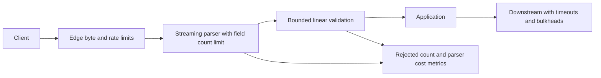

# Case: valid requests saturate application CPU

## Prompt and source

Two photographed incidents show the same operational symptom but different algorithms: crafted form keys caused hash-table collision work in Python 2 services, while a malformed email caused catastrophic regex backtracking. The notes report a 47-minute hash-flood outage and, separately, 34-second p99 during email validation. These are source claims, not independently verified production measurements; the longer hash postmortem describes a different scenario and should not be merged into these figures. See [incident OCR, images 001–011 and 034 onward](../../../../Case_studies_DSA/Production_DSA_Incidents/Production_DSA_Incidents_SUPPLEMENTAL_IMAGE_OCR.md), [20260823_010932.jpg](../../../../Case_studies_DSA/Production_DSA_Incidents/20260823_010932.jpg), and [20260823_010949.jpg](../../../../Case_studies_DSA/Production_DSA_Incidents/20260823_010949.jpg).

**Interview task:** diagnose near-100% CPU without assuming request volume rose; design a fix that prevents both per-request amplification and cascading timeouts.

## Requirements and assumptions

* Parse legitimate forms and validate emails while placing explicit limits on bytes, field count and field length **before expensive processing**. Decide accepted email syntax with product owners; do not equate a simple regex with the full email RFC.
* Illustrative limits for the exercise: 1 MiB body, 100 form fields and 254-byte email input; actual limits must come from observed legitimate use and parser behavior. Give trusted batch/import APIs separately reviewed quotas, not blanket bypasses.
* Low-latency failure and bounded resource use take priority over accepting arbitrary adversarial input. The service and edge must agree on encoding, duplicate fields and transfer limits.

## Mechanism and design

A deterministic, predictable string hash can enable attackers to choose many keys that collide. In a collision-heavy table, a single insertion may require O(N) probes/comparisons, making N insertions O(N²), instead of expected O(N) total. Randomized keyed hashing makes precomputed collision sets much harder to reuse; it is not a guarantee that resource limits are unnecessary. Upgrade unsupported runtimes and confirm runtime hashing configuration. Never use a process-dependent built-in hash as a persistent partition key: pick an explicit stable hash where stable distribution is required.

Separately, nested ambiguous regex quantifiers in a backtracking engine can explore exponentially many paths on a near-match. Bound length, simplify the expression to remove ambiguity, or use a linear-time engine with supported syntax. A length cap alone may still permit expensive inputs, and a timeout around a synchronous operation may not interrupt the actual CPU work. Test the exact engine and expression. Return a clear validation error for invalid inputs without logging email addresses or attack payloads.

The field-count guard must operate within or ahead of parsing. Checking `len(request.form)` after the framework has already constructed a vulnerable hash map is too late. Apply count, per-key and per-value limits to streaming decoding; reject duplicate or excess fields according to a documented API contract. Size limits and per-IP rate limits are defense-in-depth, not substitutes for fixing parser and regex complexity. In the source, a field-count mitigation also disrupted batch tools; measure those clients before rollout and provide a controlled migration.

## Incident response and validation

1. Inspect CPU **per request**, handler and parser stack samples alongside request rate, body size, field count, validation failures and timeouts. Normal requests/sec plus unusually high CPU/request points toward per-request work, not necessarily a volumetric attack.
2. Apply targeted edge limits and admission control; shed load and bound downstream queues. Restrict input at the earliest capable layer. Verify policy against legitimate clients, then deploy runtime/parser and regex fixes through canaries.
3. Load-test realistic traffic and controlled collision/near-match inputs in an isolated environment. Plot CPU and latency against input length and field count; compare scaling curves rather than rely on a single input. Monitor reject rates, p95/p99, CPU/request, connection pools and legitimate-client errors.
4. Alert on sustained CPU per request and unusual parameter counts; redact payloads. Test worker recovery and downstream behavior after bursts. Rate limiting by source IP alone can penalize shared NATs and does not cover distributed sources.

## Interview practice

**Why didn't autoscaling solve it?** Each malicious request can consume disproportionate CPU, so adding workers also adds cost and can simply expose downstream dependencies to more work. Admission limits and improved complexity change that asymmetry.

**Why aren't body size and field count interchangeable?** Many tiny keys can fit into a small body while driving expensive table work; one large value can violate memory constraints with few fields. Both dimensions need limits, and compressed and decoded sizes need separate thought.

**What is the difference between collision resistance here and a cryptographic digest?** A keyed process-randomized hash protects internal table placement from cheap precomputation. A stable digest may be appropriate for persistent keys, but an unkeyed stable digest does not replace adversarial input bounds.

**How do you roll out a stricter validator safely?** Shadow-count would-be rejections without exposing sensitive contents, identify impacted clients, define accepted syntax and quotas, canary enforcement with rollback, and monitor false rejection and per-request CPU. Do not retain vulnerable behavior indefinitely for incompatible clients.
