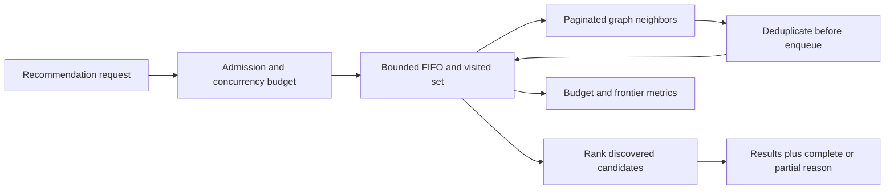

# Case: recommendations crash on a high-degree product

## Prompt and source

A recommendation endpoint traverses a product-similarity graph breadth-first to find related products. A popular product can have many thousands of neighbors. The photographed incident notes describe a queue built before deduplication, ~4.2 GB consumption in a 2 GB pod, and a 22-minute outage. They show a product with 18,000 edges; the image's 18,000² example assumes the same branching at the next level, not that every neighbor actually has that degree. These are source scenario claims, not independently verified events. See [OCR, images 005–008](../../../../Case_studies_DSA/Production_DSA_Incidents/Production_DSA_Incidents_SUPPLEMENTAL_IMAGE_OCR.md) and [20260823_010940.jpg](../../../../Case_studies_DSA/Production_DSA_Incidents/20260823_010940.jpg).

**Interview task:** retain useful near-neighbor recommendations without letting a single request exhaust a pod. Explain what the API can promise when the search is truncated.

## Requirements and assumptions

* Return a deterministic, deduplicated candidate list with hop distances, or explicitly mark it partial; do not claim exhaustive results on a budget hit. Ordering within a level uses a stable neighbor order.
* Illustrative starting budgets, adapted from the source: depth 3 and at most 10,000 discovered nodes. Bound examined edges, adjacency page size, time and concurrent traversals separately; tune against workload and memory measurements.
* Assume a graph snapshot or version for the duration of a traversal. If the backing graph is mutable and cannot provide one, state that candidates represent a best-effort mixed view.
* Fraud investigation is not interchangeable with recommendations: silently sacrificing recall may be unacceptable. Route an incomplete fraud search to an offline or human workflow.

## Design and algorithm

Initialize the FIFO with `(start, 0)` and mark the start visited. Pop FIFO; do not expand nodes at the depth limit. Fetch neighbors in deterministic pages, one page at a time. For each examined edge, increment the edge budget; if its destination is unseen, check the node and memory budgets **before** inserting into the visited set and queue. Record its distance at discovery. Stop the traversal with `partial=true` and the limiting reason as soon as a budget or deadline would be exceeded. A completed bounded-depth search means all eligible edges through the configured depth were examined, not that all nodes in the graph were discovered. Rank discovered products separately and return a stable tie-breaker.

For `Vb` discovered vertices and `Eb` examined edges, the algorithm takes O(Vb + Eb) graph processing plus storage/network costs and O(Vb) queue plus visited memory. Enqueue-time dedup stops repeated vertices occupying the queue, but cannot prevent a huge number of unique neighbors or edges. An output-size limit alone is insufficient if a single expansion enqueues millions before the next pop. Do not use a bounded deque that silently discards entries: the source itself notes silent overflow. Explicit admission preserves the BFS invariant and exposes lost work.

**Illustrative calculation:** even if one lightweight queue record costs 48 bytes, 324 million records would need 15.6 GB decimal before visited-set, object, adjacency and allocator overhead. That is a worst-case hypothetical second frontier, not a measurement of this graph. Measure actual bytes per node and leave headroom for the application, graph pages, garbage collection and concurrent requests.

## Tradeoffs, operations and evaluation

* A lower depth and hard node cap bound memory but bias toward whichever nodes are encountered first. Stable, relevance-aware neighbor ordering improves repeatability but can change fairness and recall. Sampling can reduce bias but requires a specified random seed and evaluation.
* High-degree nodes may spend the entire edge budget on duplicates. Instrument both examined and admitted counts; cap adjacency reads rather than fetching the full list first. Backpressure at request admission avoids `concurrency × per-request budget` exceeding the pod budget.
* On timeout, graph-store failure or OOM warning, return a labeled partial result if allowed, otherwise a controlled error or explicitly stale precomputed recommendation. Alert on partial rate, queue high-water mark, memory and high-degree query cohorts; avoid identifiers as metric labels.
* Compare against an exhaustive offline baseline on representative graphs: recall@K, precision, relevance and tail performance, including high-degree vertices. Exercise cycles, shared neighbors, self-loops, duplicate edges, a single oversized page, depth zero and concurrent peak load. Canary budgets before rollout and inspect impact by graph and user segment.

## Interview practice

**Why mark visited on enqueue rather than dequeue?** Shared neighbors can be queued many times before the first copy is removed; marking at discovery gives each vertex one queue entry. With a FIFO and unit-weight edges, first discovery still gives shortest hop distance.

**Why isn't max depth enough?** A depth-one vertex can itself have millions of neighbors. Time and memory also depend on breadth and the number of edges read; limits must be enforced during adjacency enumeration.

**When is partial output unsafe?** It is unsafe when consumers interpret absence as proof, such as fraud clearance or authorization. The API must propagate incompleteness, and such uses need an exhaustive or separately approved workflow.

**What happens if the graph is directed or weighted?** BFS follows the chosen edge direction and minimizes hop count, not cost. Weighted shortest paths require an appropriate algorithm such as Dijkstra for nonnegative weights, with separate frontier budgets and completeness semantics.
