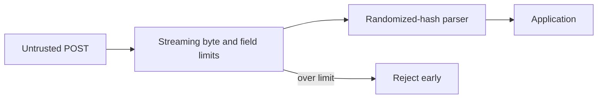
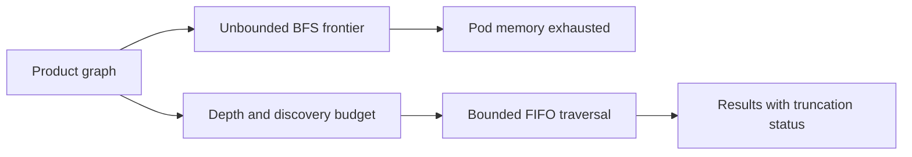
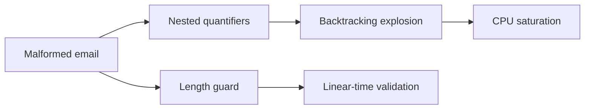
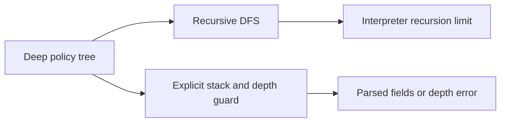
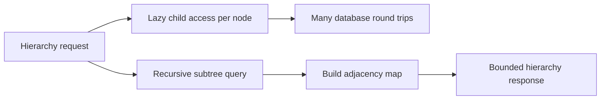
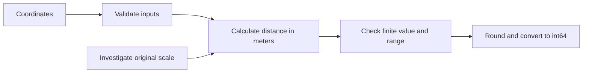
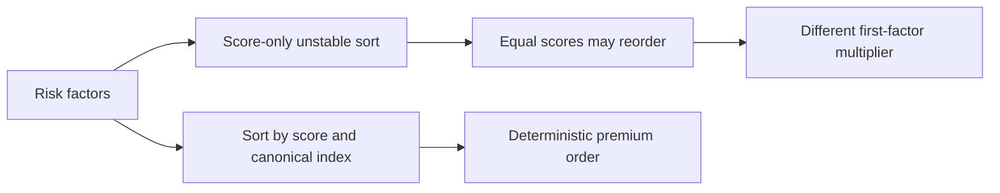
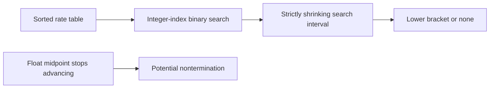
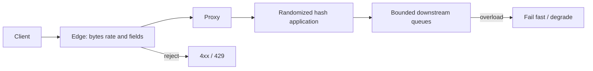
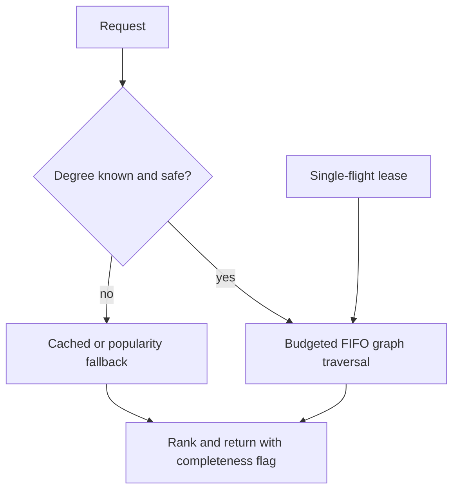

# Production DSA incidents: interview practice casebook

**Source images and OCR:** [Production_DSA_Incidents](../../../Case_studies_DSA/Production_DSA_Incidents/).

## Inventory and reading guide

The source images contain a fixes-and-tradeoffs log with eight numbered incidents, followed by two longer postmortems. The latter have overlapping mechanisms but different service contexts and impact figures; this casebook treats them as separate accounts rather than assuming they describe the same events.

| Case | Source incident or postmortem | Main failure | Source images |
|---|---|---|---|
| 1 | INC-001 | Hash-flooding across Python services | `20260823_010926.jpg`–`20260823_010936.jpg` |
| 2 | INC-002 | Product-graph BFS memory exhaustion | `20260823_010940.jpg`–`20260823_010944.jpg` |
| 3 | INC-003 | Email validation ReDoS | `20260823_010949.jpg`–`20260823_010953.jpg` |
| 4 | INC-004 | Recursive policy-tree parser | `20260823_010954.jpg`–`20260823_011001.jpg` |
| 5 | INC-005 | ORM hierarchy N+1 | `20260823_011004.jpg`–`20260823_011011.jpg` |
| 6 | INC-006 | Distance integer overflow claim | `20260823_011011.jpg`, `20260823_011013.jpg`, `20260823_011017.jpg`, `20260823_011019.jpg` |
| 7 | INC-007 | Unstable equal-priority sort | `20260823_011019.jpg`–`20260823_011025.jpg` |
| 8 | INC-008 | Floating-point search nontermination | `20260823_011026.jpg`–`20260823_011032.jpg` |
| 9 | Hash-collision postmortem | HTTP hash-flooding and cascading failures | `20260823_011036.jpg`–`20260823_011218.jpg` |
| 10 | Social-graph BFS postmortem | Celebrity-degree BFS and repeated OOM | `20260823_011222.jpg`–`20260823_011413.jpg` |

Ranges identify the chronologically named image files in this folder, inclusive, not every possible timestamp. The supplemental OCR is noisy and sometimes contradicts the photographed text or itself. Numbers below are source-reported, not independently verified; calculations and examples labeled **Practice** are invented to teach the method. In particular, several source claims are mathematically or technically inconsistent and are called out instead of repeated as facts. Designs, pseudocode, tests, and interview prompts are practice proposals unless explicitly described as source actions.

## 1. Hash flooding across services (INC-001)

**Sources:** `20260823_010926.jpg`, `20260823_010932.jpg`, `20260823_010935.jpg`, `20260823_010936.jpg`.

**Context and root cause.** The log reports a 47-minute P1 degradation on 2024-03-11 affecting 14 Python 2.7 microservices. Attacker-controlled POST keys were selected to collide under a predictable hash; repeated collisions turn expected constant-time dictionary operations into linear probes, making construction quadratic in the worst case. CPU saturation, not request count alone, explained the damage. The log reports a randomized seed, a WAF key limit, and Python 3 migration/retirement as responses; distinguish listed actions and dates from independently verified deployment status.

**Requirements and assumptions.** Accept legitimate forms, reject pathological input *before* expensive form parsing, and randomize hashes. Practice assumes at most 100 fields and 1 MiB per request; these are not the log's reported 512-key limit. Limits must be agreed with clients. A WAF rule specifically counting duplicate keys does not necessarily bound many distinct colliding keys; verify what it actually counts.

**Worked example.** Practice: if all 4 unique keys collide, inserting them may compare against 0+1+2+3 existing keys; generalizing yields $N(N-1)/2$ comparisons in this simplified model versus expected $O(N)$ total inserts.



**Algorithm / invariant.** Count fields and bytes while parsing the raw stream; reject immediately at either limit; only then admit fields to the application. Hash seed is independently randomized for each process and kept secret. The invariant is that neither unbounded input nor untrusted collision patterns consume unbounded per-request parser work. Limits must precede construction of the vulnerable dictionary: a handler checking `len(request.form)` may already have triggered parsing.

**Complexity and tradeoffs.** Streaming validation is $O(B)$ time for $B$ input bytes and bounded buffering if implemented incrementally; hashing has expected $O(N)$ insert work, with no unconditional worst-case guarantee from randomization alone. Store at most the accepted request. Randomization changes hash values across processes, so do not persist hashes or rely on hash-dependent ordering; WAF limits may reject legitimate bulk clients. Rate limits and IP blocks buy time but do not replace per-request cost controls.

**Failure modes and validation.** Test many distinct adversarial keys, duplicate keys, exact limits and one over, multipart and encoded forms, large values, and legitimate bulk imports; observe parse CPU per request, field-count distribution, reject rates, and backend latency. Verify actual runtime seed configuration after restart. **Interview:** Why can normal traffic volume coexist with CPU exhaustion? Where must the field limit run? What changes if the key cap is enforced after form parsing?

## 2. Product graph traversal exhausts pod memory (INC-002)

**Sources:** `20260823_010940.jpg`, `20260823_010941.jpg`, `20260823_010943.jpg`, `20260823_010944.jpg`.



**Context and root cause.** The 2024-05-02 P1 reports a 22-minute customer-facing outage in a recommendation engine; a product had approximately 18,000 similarity edges, and an unbounded BFS frontier exceeded a 2 GB pod limit. The same pattern existed across six features, including fraud-ring traversal. The log reports depth 3 and 10,000 nodes as limits and an accepted recall tradeoff. Its example checks the result count after dequeueing and uses a bounded deque; neither alone guarantees a bounded, lossless frontier. Python `deque(maxlen=...)` silently discards an item from the opposite end on overflow.

**Requirements and practice assumptions.** Traverse level-first, discover each vertex once, admit at most 10,000 vertices *including the start*, and mark truncated results. Assume graph neighbors can be fetched incrementally; a database client that materializes a huge adjacency list needs its own paging limit. Resource budgets are per request and must be sized for concurrent requests.

**Worked example.** Practice: graph A→B,C and B→D,E with budget 4 discovers A,B,C,D, marks truncation on E, and returns in FIFO order. It does not silently discard B or claim complete traversal.

**Algorithm.**

```text
visited = {start}; queue = [(start, 0)]; results = []; truncated = false
while queue not empty:
    node, depth = pop_front(queue); append node to results
    if depth == max_depth: continue
    for neighbor in stream_neighbors(node):
        if neighbor in visited: continue
        if size(visited) == max_nodes:
            truncated = true; stop all further expansion
        add neighbor to visited; push_back(queue, (neighbor, depth + 1))
drain already-admitted queue into results in FIFO order
return results, truncated
```

**Correctness / complexity.** Mark on enqueue: every admitted vertex appears once, queue and visited each contain at most $K$ vertices, and FIFO preserves nondecreasing discovered depth. Partial traversal does not guarantee all shortest-path candidates were returned. For $K$ admitted vertices and $E_s$ inspected adjacency entries, time is $O(K+E_s)$ and auxiliary memory $O(K)$, excluding graph storage, streaming buffers, and output. A node cap alone does not bound $E_s$: many duplicate edges may be scanned, so add independent edge/time budgets where needed.

**Alternatives and tradeoffs.** Depth-only limits still permit huge frontiers; DFS changes prioritization and its visited set can still be $O(V)$. Sampling or precomputation trades recall/freshness for latency. The source notes a fraud-recall loss; an interview should question whether that loss is acceptable for a safety-sensitive feature rather than assume it is.

**Failure modes / validation.** Exercise dense graphs, cycles, shared neighbors, duplicate edges, a single high-degree start, cap exactly reached and cap exceeded, memory at expected concurrency, and partial-result UX. Alert on discovered/queued/inspected counts, truncations, memory and recall. **Interview:** Why does counting dequeues fail to cap memory? How do you preserve BFS semantics when the budget is hit? How can a small node cap still permit a huge scan?

## 3. Email validation catastrophic backtracking (INC-003)

**Sources:** `20260823_010949.jpg`, `20260823_010950.jpg`, `20260823_010952.jpg`, `20260823_010953.jpg`.



**Context and root cause.** The log reports a 2024-07-19 P2 on the claims submission API with P99 latency of 34 seconds. A malformed string met nested, overlapping quantifiers and caused a backtracking engine to explore exponentially many partitions before failure. Scaling pods did not cure per-request CPU cost. The source reports a rewritten expression, a 254-character guard, and a switch to RE2; the simplified validator rejects some valid quoted addresses.

**Requirements / practice assumption.** Validate a documented, intentionally restricted email format in bounded time, reject oversized inputs before matching, and make unsupported valid addresses a product decision. Do not claim full RFC compliance. Count transport bytes as well as characters where the protocol requires it.

**Worked example.** Practice: on pattern `^(a+)+$`, input `aaaa!` fails after exploring multiple partitions of the `a` prefix; doubling prefix length can multiply work. A deterministic scan accepts or rejects each character once.

**Algorithm.** Reject input beyond policy limit; scan once, ensuring exactly one `@`, a nonempty permitted local portion, and nonempty domain labels separated by dots; enforce the chosen label rules. Alternatively use a linear-time engine and a reviewed anchored expression. Invariant: scan position advances on every iteration; no previously consumed prefix is reconsidered.

**Complexity / alternatives.** A finite-state scan is $O(L)$ time and $O(1)$ extra space for input length $L$; backtracking can be exponential. RE2 avoids backreferences and some lookaround, so expressions may need redesign; a dedicated email library may better cover compatibility but its runtime must also be assessed. A length limit alone is not a cure: the source's short malicious input fits under 254 characters.

**Failure modes / validation.** Test long valid and invalid prefixes, separators, empty labels, Unicode policy, quoted addresses, 254 and 255 boundaries, and normal client compatibility. Benchmark adversarial increasing lengths under a timeout, not just happy-path examples; track CPU per validation and rejected formats. **Interview:** What makes nested quantifiers dangerous? Why does the 254-character guard not fix a 34-character attack? What does RE2 give up?

## 4. Deep policy JSON breaks recursive DFS (INC-004)

**Sources:** `20260823_010954.jpg`, `20260823_010958.jpg`, `20260823_011000.jpg`, `20260823_011001.jpg`.



**Context and root cause.** A 2024-08-30 P2 policy parser incident arose when a carrier export could nest endorsements up to 4,000 levels and recursive Python traversal exhausted the roughly 1,000-frame interpreter limit. Framework frames consume part of that budget. The source says the replacement used an explicit stack and a business-rule depth limit of 500; it also notes sibling order changed and consumers were made order-independent.

**Requirements / practice assumptions.** Process every accepted dictionary node once, preserve original sibling order for this exercise, and reject depth > 500 with a clear error. Assume JSON decoding and schema validation themselves are independently safe for deep input; the DFS fix alone cannot guarantee that.

**Worked example.** Practice: root has ordered children A then B; A has C. Push B then A, then C; output is root, A, C, B. Depth 501 is rejected, not partially returned as a successful complete document.

**Algorithm.** Push `(root, 0)`; while stack is nonempty, pop node and depth, reject if depth exceeds limit, extract fields, then push dictionary children in reverse source order. A fully atomic API can validate first or buffer output until success.

**Correctness / complexity.** Each child is pushed once in a tree and reversal recreates recursive preorder. For $N$ nodes time is $O(N)$; pending siblings can make stack space $O(N)$ in a wide tree, not necessarily $O(depth)$. Output takes $O(N)$. An iterator-frame implementation can reduce traversal stack to $O(depth)$, excluding input and output.

**Alternatives / failure modes.** Raising recursion limits risks native stack exhaustion; streaming parsing avoids loading all JSON but complicates errors and order. Test depth 499/500/501, wide trees, arrays if they are part of the schema, malformed input, sibling order, decoder/schema limits, and no partial success on rejection. **Interview:** Why is iterative DFS not automatically $O(depth)$ space? What breaks if children are pushed in natural order? Which upstream parser still has a depth risk?

## 5. ORM tree walk issues N+1 queries (INC-005)

**Sources:** `20260823_011004.jpg`, `20260823_011005.jpg`, `20260823_011006.jpg`, `20260823_011008.jpg`, `20260823_011011.jpg`.



**Context and root cause.** On 2024-10-14 the policy hierarchy API's lazy ORM child access issued one query per node after the root query: 341 round trips for a 340-node tree. The log reports P99 12.4 s against a 500 ms SLA and a post-fix 310 ms. A recursive CTE fetched descendants in one query, then an in-memory map linked them; a 5,000-node rejection guard was reported.

**Requirements / practice assumptions.** Return the requested subtree with parent-child links and defined sibling order, bound the work, and preserve authorization and snapshot semantics. Practice assumes an indexed `parent_id`, a true tree, and a database supporting recursive CTEs.

**Worked example.** Practice: rows `(1,null),(2,1),(3,1),(4,2)` build map 1→[2,3], 2→[4] in two passes, independent of row arrival order. One root lookup plus four lazy child queries becomes one recursive query.

**Algorithm.** Execute a parameterized recursive CTE rooted at the requested ID, with an appropriate database-side resource guard; construct `id → output_node`; then append each non-root node to its fetched parent's child list. Sort siblings by an explicit stable key if the API promises order. Reject missing root, invalid parent relationships, cycles, or over-limit result rather than silently building a wrong tree.

**Correctness / complexity.** Assuming a finite tree and unique IDs, the CTE visits descendants and the map links each non-root to exactly one parent. With an appropriate parent index, expected app assembly is $O(N)$ time and $O(N)$ memory; DB time depends on its plan, index and row size. One round trip is not constant total database work. Enforce the cap during query execution as feasible; checking only after an unrestricted recursive CTE does not bound DB work.

**Alternatives and tradeoffs.** Breadth-level batches use $O(depth)$ queries and avoid relying on recursive SQL; closure tables/materialized paths accelerate reads at write/storage cost. The OCR claims MySQL 8.0 lacks recursive CTEs; that claim is incorrect—MySQL 8.0 supports `WITH RECURSIVE`, subject to version/configuration and recursion limits. Streaming or pagination complicates consistent hierarchy reconstruction.

**Validation / interview.** Count SQL statements; test leaf, missing root, deep/wide tree, unauthorized descendants, cycle/corrupt data, >5,000 nodes, concurrent changes and sibling order; inspect query plans and pool saturation. **Interview:** How does N+1 differ from $O(N)$ local work? How can one-query SQL still overload the DB? What consistency changes if fetching level by level?

## 6. Distance overflow and unit analysis (INC-006)

**Sources:** `20260823_011011.jpg`, `20260823_011013.jpg`, `20260823_011017.jpg`, `20260823_011019.jpg`.



**Context and root-cause claim.** The 2024-11-27 log attributes incorrect agent routing to a C++ signed 32-bit distance and reports changing calculations to floating-point haversine plus `int64_t` meters, along with range assertions. **The photographed evidence is internally inconsistent:** `20260823_011013.jpg` says 16,993 km equals 16,993,000 m (correct), then uses 16,993,000,000 as meters (1,000 times larger) and asserts overflow above 2,147 km. A signed 32-bit meter value actually reaches 2,147,483,647 m, about 2,147,484 km; Earth-surface distances in meters fit. Therefore the pictured code `distance_km * 1000.0` does not establish the alleged overflow. The real faulty scale, type or path is unconfirmed. Further, C++ out-of-range floating-to-integer conversion is undefined behavior, not guaranteed modular wraparound.

**Requirements / practice assumption.** Return a nonnegative shortest great-circle distance in meters, with an explicitly specified rounding rule; reject invalid coordinates and avoid unsafe narrowing. Practice assumes spherical Earth, not geodesic ellipsoid accuracy. Investigate production units and conversions before declaring the cause fixed.

**Worked example.** Practice: 2,695 km is 2,695,000 m, safely within `int32`; at millimeter scale it is 2,695,000,000 mm and exceeds signed 32-bit. This illustrates how an unrecorded scale changes the conclusion; it does not assert production stored millimeters.

**Algorithm.** Convert validated degrees to radians; compute haversine `a`; clamp roundoff to `[0,1]`; calculate `d = 2*R*atan2(sqrt(a),sqrt(1-a))` in meters; check finite value and range before rounding/casting to `int64`. Invariant: $0 \le d \le \pi R$ for valid coordinates.

**Complexity / tradeoffs.** Each calculation is $O(1)$ time and space. Wider integer types ease unit conversions but do not fix incorrect scales, input NaNs, or loss of precision; fixed point requires documented units and range checks. Spherical vs ellipsoidal distance trades accuracy for speed.

**Validation / interview.** Check identical and antipodal coordinates, near-antipodal roundoff, symmetry, invalid coordinates, local-to-distant ordering, every serialization/type boundary and actual production telemetry. Assert unit-correct physical bounds, not the source's erroneous threshold. **Interview:** How do you disprove the claimed overflow using units? When is signed overflow or a narrowing conversion undefined? What evidence would distinguish a millimeter bug from a meter bug?

## 7. Equal-score sort changes premium (INC-007)

**Sources:** `20260823_011019.jpg`, `20260823_011020.jpg`, `20260823_011022.jpg`, `20260823_011024.jpg`, `20260823_011025.jpg`.



**Context / root cause.** The 2025-01-08 C++ premium engine incident reports cross-region audit discrepancies because `std::sort` does not promise stability and the premium algorithm gave the first ranked factor a multiplier. The reported production choice was an explicit insertion-index tie-break rather than depending on sort stability.

**Requirements / assumptions.** Equal-score factors must follow the same canonical input order across regions. Practice assumes unique, persistent insertion indices and finite scores; different input order or NaNs require a separate canonicalization policy.

**Worked example.** Source example scores A=5, B=5, C=3, D=5. Sorting by descending score and ascending insertion index yields A,B,D,C; an unstable score-only sort could yield D,A,B,C and apply the multiplier to D. The log reports a $58 difference in its example.

**Algorithm / correctness.** Sort by `(score descending, insertion_index ascending)` using a strict weak ordering; apply multipliers afterward. Unique indices give a deterministic total order for equal finite scores, regardless of sort implementation. Never implement a comparator using `>=`; handle floating NaNs explicitly if scores can contain them.

**Complexity / tradeoffs.** `std::sort` guarantees $O(N\log N)$ comparisons; its auxiliary memory is implementation-dependent. `stable_sort` preserves supplied input order but costs additional memory when available and cannot make independently reordered inputs canonical. Persisting a tie-break adds schema and write cost but documents business behavior.

**Validation / interview.** Test all equal keys, duplicate/invalid indices, different permutations with fixed canonical indices, floating special values if permitted, cross-compiler audit replay and representative premiums. **Interview:** Why is stability different from deterministic business ordering? What comparator properties are required? What if two regions assign different indices?

## 8. Float convergence hangs binary search (INC-008)

**Sources:** `20260823_011026.jpg`, `20260823_011028.jpg`, `20260823_011029.jpg`, `20260823_011030.jpg`, `20260823_011032.jpg`.



**Context / root cause.** The 2025-03-22 P2 rate-lookup report describes one CPU-locked pod: floating-point search bounds converged to adjacent representable numbers and a midpoint ceased changing, while termination depended on equality. The source also contains an integer-index example that advances indices and a broken reproducer whose termination claim is not established by the visible pseudocode. Treat those as inconsistent illustrations, not proof that every exact float equality search hangs. The reported fix uses integer-index `bisect`, sorted-table checks, and a watchdog.

**Requirements / practice assumptions.** For a finite, strictly increasing array and finite target, return the greatest index whose value is `<= target`, or `-1` below the first breakpoint. This practice contract uses exact ordering, not fuzzy equality; duplicates and NaNs are rejected. If the business wants tolerance, its tie and boundary policy must be specified separately.

**Worked example.** Practice: `[0.1,0.2,0.4]`, target `0.3` gives index 1; target `0.05` gives -1; target `0.4` gives 2. The floating representation of `0.1+0.2` may differ from the literal `0.3`, which matters if the product expects decimal equivalence.

**Algorithm.**

```text
lo = 0; hi = length(a)             # half-open insertion interval
while lo < hi:
    mid = lo + (hi - lo) // 2
    if a[mid] <= target: lo = mid + 1
    else: hi = mid
return lo - 1
```

**Correctness / complexity.** Values below `lo` are `<= target`, and values at or above `hi` are `> target`; each iteration strictly shrinks integer interval `[lo,hi)`. At termination `lo` is the upper insertion point. Time $O(\log N)$, extra space $O(1)$; table validation is $O(N)$ on load. For tolerance matching, inspect candidates on *both* sides of insertion and define which wins; a single `isclose` check on the right can miss a close left neighbor. Do not use approximate equality as a sorting comparator.

**Alternatives / failure modes / validation.** Decimal/fixed-point rates can express domain rounding exactly but need conversion and overflow policies. For continuous bisection use tolerance, iteration cap, and a check for midpoint equal to an endpoint. Test empty/single arrays, endpoints, adjacent floats, target just below/above each breakpoint, near-zero tolerance, unsorted data, infinities and NaN policy, and watchdog behavior. **Interview:** What invariant proves termination? Why is equality insufficient as a stopping rule for floating bounds? How would decimal business rounding affect bracket semantics?

## 9. HTTP hash-collision postmortem: edge to downstream cascade

**Sources:** `20260823_011036.jpg`, `20260823_011040.jpg`–`20260823_011059.jpg`, `20260823_011101.jpg`–`20260823_011218.jpg`.

**Context / root cause.** This separate postmortem describes a Python 2/Flask e-commerce stack, 20 app servers, a 25-minute incident, and cascading inventory, recommendation and cart failures. It reports 65,536 crafted POST parameter names per malicious request and $420k estimated lost revenue. No parameter count limit, deterministic hash configuration, and expensive parse-before-business-logic created a CPU-amplification attack. The initial volumetric-DDoS hypothesis missed the key signal: high CPU *per request*. Do not merge these figures with INC-001's 47-minute, 14-service log.

**Requirements / practice assumptions.** Keep valid checkouts available, limit per-request parser resources, contain downstream retries and queued work, and instrument rejection before saturation. Practice assumes a streaming edge parser, not that every CDN or nginx installation can count parsed form fields natively.

**Worked example.** Practice: 1,000 requests/s at 2 CPU ms each require roughly 2 cores; at 200 CPU ms each they require 200 cores at the same request rate. A request-rate dashboard alone will miss the 100-fold increase in demand.



**Algorithm / invariant.** Stream body and form fields with byte, field-count and per-field length caps; reject before map creation; use a supported runtime with randomized hashing; route accepted work to bounded downstream queues with deadlines and controlled retry. Per-request work and queued outstanding work must each have explicit budgets. Hash randomization makes precomputed collisions harder, not impossible for every key type or every runtime. Configure and measure the actual stack rather than rely on a particular Python version's hash algorithm.

**Complexity / tradeoffs.** Input validation takes $O(B)$ time with bounded buffer for body length $B$; a cap bounds accepted $B$ and $N$. Without early caps, adversarial map insertion can take $O(N^2)$. Edge rejection saves origin CPU but introduces vendor/parser semantics and false-positive risks; stronger hashing has cost, and circuit breakers trade availability of dependent features for isolation. Postmortem math and version-specific SipHash claims should be treated as estimates rather than universal guarantees.

**Failure modes / validation.** Rehearse attack traffic in an isolated environment; verify edge counts before origin parsing, mixed encodings, legitimate maximum payloads, per-IP evasion, retries and queue growth. Alert on field count, CPU/request, rejection, P99 latency, source concentration and downstream queue depth; distinguish CPU alert detection from diagnosis. Verify no reliance on a Flask hook that forces the dangerous form parse before checking. **Interview:** Why did adding servers not remove the asymmetry? Which control stops a single expensive request before application parsing? How do deadlines and bounded queues prevent cascading failure?

## 10. Social-graph celebrity user triggers recurring BFS OOM

**Sources:** `20260823_011222.jpg`–`20260823_011259.jpg`, `20260823_011300.jpg`–`20260823_011413.jpg`.

**Context / root cause.** A separate social recommendation postmortem reports a 4-hour-12-minute outage and 512 MB pods repeatedly OOM-killed after a cache-bypassing A/B test let a high-degree user reach unbounded depth-3 BFS. A restarted pod received the same request again. Average-degree testing and undocumented protective batch behavior missed the power-law tail. Source estimates use 300 average friends and a 5-million-degree triggering account; expansion counts like $5\text{M}\times300^2$ count possible walks before deduplication, not necessarily distinct graph vertices. They cannot exceed the graph's actual unique vertex count.

The source describes feature-flag disablement, a 10,000-node cap, degree-based fallback and in-flight deduplication as immediate actions; sampled traversal, prioritized work, offline precomputation, and scaling designs also appear as options or later actions, not all established as deployed. It also describes an alert above 50,000 visited nodes despite the 10,000 cap: that threshold cannot detect compliant capped requests; alert on cap hits or choose a threshold below the cap.

**Requirements / practice assumptions.** Return up to 20 recommendations with an explicit partial/fallback indication; cap admitted nodes at 10,000 and all edge scans separately, avoid repeated poison work, and preserve level order if distance semantics matter. Assume a consistent degree estimate is available or route unknown/stale estimates conservatively. Sampling and a heap-priority search may change which results are returned; a generic priority queue is not BFS and does not guarantee shortest-distance order.

**Worked example.** Practice: with 300 neighbors per node, a tree-like depth-3 expansion has at most $1+300+90,000+27,000,000$ positions before graph overlap; at 100 bytes per position the final frontier alone is about 2.7 GB. Actual graph deduplication and runtime allocation change the number. A 10,000-discovery budget bounds in-memory visited/queue state, not all adjacency scan or database time.



**Algorithm.** Acquire a unique-token, expiring single-flight lease per user; if unavailable, return cached/fallback result instead of immediately retrying. Route high/unknown-degree users to cache or fallback; otherwise use the enqueue-capped BFS in case 2, additionally stopping when edge/time budget expires. Rank eligible candidates and return partial status. Release the lease only if its token still matches; a TTL can expire during work, so it is not a guarantee of global exactly-once execution. Ensure fallback respects eligibility and privacy rules.

**Correctness / complexity.** Every admitted node is queued once and admitted count is at most $K$; FIFO preserves nondecreasing depth for those admitted. Edge/time budget ensures a traversal cannot spend unlimited effort scanning already-visited neighbors. Given $E_s$ scanned edges, time is $O(K+E_s)$ plus database and ranking costs; memory is $O(K)$ plus buffers/output. Sorting $C$ candidates costs $O(C\log C)$, or a top-$r$ heap costs $O(C\log r)$ and $O(r)$ memory. Across $Q$ concurrent requests provision approximately $Q$ times measured per-request peak plus process, cache and transport overhead.

**Alternatives / tradeoffs.** Sampling can lower cost but can miss rare relevant candidates; a reservoir sample over a full degree-$D$ adjacency list still reads $O(D)$ edges. Offline precomputation reduces online latency at the expense of freshness, compute, and cache misses; it too requires finite resources. Bloom filters save memory but false positives may drop legitimate vertices. DFS can reduce frontier width on some graphs but a graph-wide visited set still costs $O(V)$, and early stopping changes result quality. A Redis degree counter and PostgreSQL edge write are not automatically one atomic transaction; use a durable update/reconciliation strategy and safe behavior on stale data.

**Failure modes / validation.** Test celebrity degree, cycles, duplicate neighbors, streaming page limits, concurrent requests, lease expiry, crash/retry, cache miss, stale degree, fallback permissions, cap and scan exhaustion, and tail-latency/load under realistic concurrency. Measure visited/queued/scanned counts, memory, cap hits, cache hit rate, fallback rate, duplicate work and recommendation quality; run cache-changing experiments through backend capacity review. **Interview:** Why can scale-out fail to fix per-request OOM? What does the node cap fail to bound? Does a deduplication TTL provide exactly once? Why is BFS depth priority not preserved by an arbitrary mutual-friend heap?
