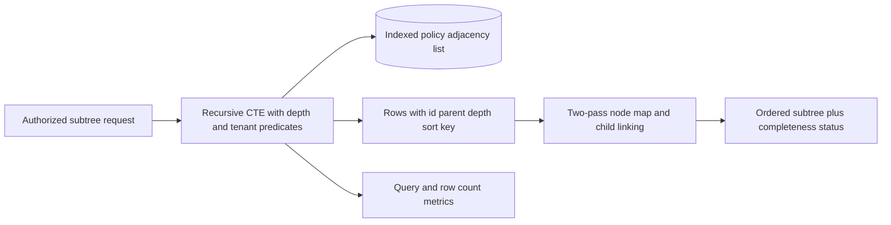

# Case: a policy hierarchy turns one request into hundreds of queries

## Source and prompt

A policy hierarchy API recursively accesses each node's lazy-loaded children. The source notes describe 341 database round trips for a roughly 340-node hierarchy, p99 of 12.4 seconds, and a proposed recursive CTE with application-side assembly. They report a lower post-fix latency, but those numbers are scenario claims rather than independently verified benchmarks. See [incident OCR, images 016–020](../../../../Case_studies_DSA/Production_DSA_Incidents/Production_DSA_Incidents_SUPPLEMENTAL_IMAGE_OCR.md) and [20260823_011005.jpg](../../../../Case_studies_DSA/Production_DSA_Incidents/20260823_011005.jpg).

**Interview task:** return an authorized subtree with predictable database round trips, bounded resources, stable order and correct parent-child structure.

## Requirements and assumptions

* Illustrative contract: given a tenant and root ID, return descendants to a maximum allowed depth, including each node's ID, parent ID, display fields and ordered children. A missing or unauthorized root returns the same not-found response to avoid revealing its existence.
* Assume a relational adjacency list `policy(id, tenant_id, parent_id, sort_order, ...)`, a tree under normal data constraints, and an index on `(tenant_id, parent_id)`. Enforce tenant and authorization constraints on every recursive step, not only the root.
* A response-size and node limit are required; return explicit truncation if the contract permits partial output, or a controlled error otherwise. Do not assume every hierarchy fits in application memory.

## Algorithm and design

The root anchor selects the requested authorized row. The recursive member joins each current node to children on `child.parent_id = parent.id`, restricting tenant, authorization and depth. Carry enough information to detect cycles, using a path or the database's cycle-detection feature. Use a statement deadline and resource controls; an outer `LIMIT` alone may not cap all work inside a recursive CTE. If the database cannot safely bound recursion, use batched level-order queries with bounded pages instead.

Materialize at most the allowed number of rows. First construct a map from each ID to an output node, **retaining `parent_id`** in the intermediate record; second attach every non-root node to its parent's children. Reject duplicate IDs, an unexpected second root or missing parent instead of silently attaching an orphan as the root. Sort siblings by `(sort_order, id)` if SQL does not supply a guaranteed order. The photographed pseudocode constructs a map without carrying `parent_id` and then attempts to read it: do not copy that omission.

For N returned nodes, application assembly costs O(N) average hash-map operations and O(N) memory, plus O(sum of sibling sort costs) if sorting in process. A recursive CTE is one client/server round trip, not necessarily O(1) database work: it still traverses nodes and may spill or scan without a suitable index. A database snapshot makes the assembled hierarchy consistent for the query; define consistency across pages if a response must be paginated.

## Alternatives and operations

* ORM prefetch per level can reduce queries to O(depth) and is portable but still performs multiple round trips. A closure table accelerates arbitrary ancestor/descendant queries at the cost of additional storage and difficult subtree moves. Materialized paths simplify prefix lookups but require updates when ancestors move.
* Monitor queries/request, rows scanned and returned, CTE duration, DB CPU, connection-pool waits, response bytes, truncation and p99 by subtree size. One huge query can shift the bottleneck from network latency to database memory; it is not automatically safe merely because query count dropped.
* Test a root-only tree, wide and deep trees, concurrent subtree moves, unauthorized descendants, an accidental cycle and oversized subtrees. Compare outputs to a small reference traversal and verify ordering and authorization. Canary against the old path and compare query counts and canonicalized responses; account for data changes between shadow reads.
* If the DB times out, stop work and return a documented error; do not return a silently incomplete policy tree for decisions that require complete evidence. A cached tree is only acceptable under an explicit freshness and authorization policy.

## Interview practice

**Why can a single query still be slow?** A round trip is only one cost. Recursive joins, missing child indexes, large rows, sorting and large result serialization all grow with the subtree. Examine the query plan and row/byte counts.

**What prevents infinite recursion in corrupt data?** Enforce tree constraints on writes where possible and detect cycles in the query or traversal. Depth limits and deadlines bound damage but should also surface corruption, not make a cycle appear to be a valid tree.

**How do we preserve authorization?** Filter each child in the recursive step and define whether a hidden parent hides its descendants. Authorizing just the root can leak records from another tenant or from protected branches.

**What if a subtree is too large?** Make the API's partial/error semantics explicit and paginate or switch to an asynchronous export with a consistent snapshot. Returning the first N arbitrary rows is not an exhaustive answer.
