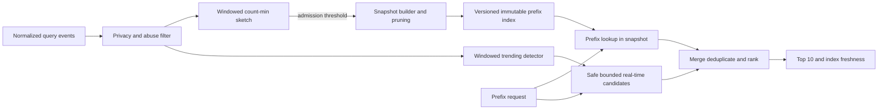

# Case: autocomplete grows until it OOMs, then misses breaking news

## Context and sources

The system-design notes describe an autocomplete trie that inserted one-off queries and grew until processes were OOM-killed. A separate stale-index incident describes a slow batch rebuild and CDN cache delaying a breaking-news suggestion. Treat the events and figures as source scenario claims, not independently established production facts. See [OCR, images 006–009, 017–020 and 042–044](../../../../Case_studies_DSA/Sys_Des_DSA/Sys_Des_DSA_SUPPLEMENTAL_IMAGE_OCR.md), [20260823_012315.jpg](../../../../Case_studies_DSA/Sys_Des_DSA/20260823_012315.jpg) and [20260823_012347.jpg](../../../../Case_studies_DSA/Sys_Des_DSA/20260823_012347.jpg).

**Interview task:** serve ranked prefix suggestions under a hard memory budget without letting rare or malicious inputs fill the index, while still surfacing safe newly trending terms.

## Requirements and illustrative assumptions

* Return up to 10 normalized global suggestions for a prefix, ordered by score and deterministic ID tie-break. Illustrative p99 target: under 50 ms for the serving path, with explicit error and freshness indicators.
* Example admission threshold from the notes: three observations over 24 hours; promotion may lag a novel term. Privacy, abuse and content-policy filtering apply to both indexed and real-time suggestions. Do not store raw queries or per-user sensitive prefixes in long-lived logs.
* Fixed memory budgets include current and next index, build buffers and replica overhead. Input normalization and locale must match at ingestion and serving.

## Algorithm and design

Use a trie or compressed radix tree with top-K candidates per prefix. For prefix length P, navigating a trie is O(P) assuming efficient child lookup; returning a precomputed list costs O(K), at the cost of duplicated candidate lists across prefix nodes. If ranking needs personalized signals, retrieving only global top 10 may omit a user's best candidate; fetch a larger candidate pool or use a separately specified personalized source before reranking. A compressed trie reduces pointer overhead but costs more complex updates and serialization.

Estimate frequency in a count-min sketch of width w and depth d: increment each row's hashed counter and query the minimum. Memory is O(wd), and updates are O(d). With nonnegative increments and no overflow or decay artifacts, collisions overestimate, never underestimate, so a rare term may be admitted early; it is not proof of exactly three occurrences. The photographed page labels the same sketch both 4 MB and 40 KB and implies overcount misses entries. For the stated 2,000 × 5 × 4-byte counters the raw counter array is 40,000 bytes, excluding overhead; neither error nor memory should be copied without checking workload, window design and implementation.

Use time-bucketed sketches with expiration or another specified windowing scheme; rotating buckets creates boundary/approximation error. Size and test the sketch for event volume and skew, rather than treating a reported 0.05% as a per-key probability. Record candidate terms outside the sketch because it cannot enumerate keys. Cap that candidate store and require policy checks before publication. Build immutable snapshots off-path, enforce node/byte limits, prune leaves bottom-up without removing shared prefixes needed by retained terms, then atomically switch readers to the validated version. Keep the old version until in-flight requests finish, and budget the two-generation peak.

For breaking news, maintain a separate bounded sliding-window top-candidate path with rate and abuse controls. Merge safe real-time and snapshot candidates, deduplicate, rank with a shared scoring definition, and expose freshness. CDN keys must include locale and index/version as appropriate; never cache user-specific results as global responses. A trending bypass reduces batch lag but introduces event-pipeline and serving dependencies.

## Evaluation and operations

* Measure resident memory, nodes, build peak, candidate rejections and sketch saturation; compute recall@10 and latency by prefix length, language, new-term age and long-tail cohort. Compare approximations to an exact sampled counting baseline, including collision-induced admissions and expired-window behavior.
* Monitor event lag, snapshot age/version, CDN cache age, trending path availability and filtered/blocked suggestions. Apply lower-cardinality metrics; avoid logging sensitive full queries. On pipeline lag, show a known-good snapshot with an age indicator if policy allows; fail closed for suggestions whose policy status is unknown.
* Test highly unique traffic, abusive coordinated queries, counter saturation, Unicode normalization, shared trie prefixes, empty prefix, concurrent snapshot swap and cache purge failure. Canary snapshot changes, compare quality and RSS, and retain the previous validated snapshot for rollback.

## Interview practice

**Why does the sketch admit unpopular terms?** Collisions increase counters for other keys. Taking the minimum reduces but does not eliminate this overcount; an exact second-stage counter can confirm candidates if strict frequency admission is required.

**Why not prune all low-frequency trie nodes independently?** A low-frequency prefix may still be an ancestor needed by a retained completion. Determine which terminal terms survive, then remove only unneeded nodes bottom-up and recompute prefix top-K lists.

**How can the service be fresh when the CDN is stale?** Route trending or versioned requests to the real-time path, and invalidate or version global snapshots. Both routes must share content safety and ranking rules; a fast path is not permission to expose unreviewed queries.

**What limits a snapshot swap?** Publishing a pointer may be atomic, but building the next generation and retaining the previous one temporarily uses much more memory. Include buffers, caches and in-flight readers in peak-memory accounting.
