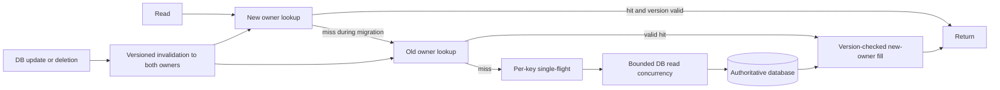

# Case: cache restart and scale-out overload the database

## Source and challenge

The photographed notes describe two separate cache failures: a fleet restart emptied local caches and produced duplicate database fetches, and adding four nodes to a 16-node consistent-hash ring produced a temporary miss spike. These are source scenario claims rather than verified performance measurements; they illustrate related cold-cache problems, not necessarily one incident. See [system-design OCR, images 001–005, 021–024 and 054–057](../../../../Case_studies_DSA/Sys_Des_DSA/Sys_Des_DSA_SUPPLEMENTAL_IMAGE_OCR.md), [20260823_012252.jpg](../../../../Case_studies_DSA/Sys_Des_DSA/20260823_012252.jpg) and [20260823_012354.jpg](../../../../Case_studies_DSA/Sys_Des_DSA/20260823_012354.jpg).

**Interview task:** design cache-aside reads and planned rebalancing so that a cache restart or ring change does not turn a hot key into a database outage. Show how writes and deletions remain correct during migration.

## Contract and illustrative assumptions

* Cache holds derived profile values; the database is authoritative. Normal reads may accept explicitly bounded staleness, but deletion and authorization-sensitive fields cannot be served stale under this exercise's contract.
* Illustrative deployment: 16 old nodes add four new nodes. With uniformly distributed independent ring positions, roughly 4/20 of keys move in expectation; traffic share can differ sharply because keys are not equally popular.
* Each request has a deadline; database fill concurrency and queues are bounded. If no safe value is available when capacity is exhausted, return a controlled failure rather than stampeding the primary.

## Algorithm and invariants

Use cache-aside: read cache, on miss coalesce requests for the same key in a process-local single-flight map, then recheck the cache after becoming leader before fetching from the database. Followers wait only until their deadline; where policy permits, they may receive stale-while-revalidate data inside a hard freshness window. Local coalescing yields **one fetch per process**, not one per fleet. If cross-process fan-in remains too large, use a distributed lease with bounded expiry and fencing/version checks, or a shared fill service; lease expiry can still allow duplicate reads, so database admission control remains necessary. Remove completed and timed-out flight entries to prevent a memory leak.

Spread synchronized expiry with random TTL jitter; optionally use probabilistic early refresh and warm a limited set of hot keys, with a global refresh budget. The source's OCR gives an early-refresh expression whose beta direction is internally inconsistent; implement and test a formulation where increasing refresh aggressiveness actually increases early refresh, rather than copying it uncritically. Neither jitter nor early refresh warms a completely restarted fleet on its own.

For ring routing, sort V virtual-node positions and binary-search the first clockwise successor in O(log V), wrapping at the end. More virtual nodes reduce statistical ownership imbalance but do not fix hot keys or eliminate expected movement. Publish versioned old/new ring maps consistently. For a moved interval, migrate gradually: check the new owner first, fall back to the old owner during a bounded grace period, and promote only if the value's version is still current. Dual-write or invalidate both owners until all readers use the new epoch. A late asynchronous old-value fill must not overwrite a newer update or resurrect a deleted profile: use monotonically ordered versions/tombstones and conditional writes; retain tombstones and old-ring routing through all fill/TTL and lag windows. If update events can be lost, use durable delivery and replay/reconciliation, or refuse to claim bounded consistency.

## Tradeoffs and failure response

* Extra virtual nodes consume ring metadata; two-owner migration doubles some traffic and temporarily requires old nodes. Fall back to the database only within budget if an old node fails. If invalidation is not confirmed for sensitive data, bypass cache to an authoritative check or fail closed.
* Stale reads improve availability but risk obsolete values; document allowed fields, max age and behavior on source failure. Do not use stale data for deletion or authorization just because a TTL remains.
* Cache eviction, a DB timeout, a leader crash, stale lease holder, partial invalidation, a hot shard and a full fleet restart must each have a bounded path. Avoid lock maps or asynchronous fill queues growing without limit.
* Observe tier hit rate, request coalescing ratio, DB fetches and concurrent fills, wait time, stale age, ring ownership/load, invalidation lag, stale-fill rejection and per-node p99. Rehearse fleet restarts and canary ring changes using production-like skew; compare miss amplification and database saturation to the baseline. Verify write/delete races against a versioned reference history and roll back ring publication only while both epochs remain supported.

## Interview practice

**Why doesn't single-flight completely prevent a stampede?** It coalesces only inside its scope; 100 app processes can still generate 100 leaders for one key, and many different keys can miss together. Fleet-level controls and a global DB concurrency budget are needed.

**Why can't we simply read the old owner and asynchronously copy the result?** An update or delete can happen between that read and the write to the new owner. A conditional version fence and a durable invalidation/tombstone protocol prevent stale resurrection.

**Does adding four of 20 nodes imply exactly 20% of requests miss?** No. About 20% of keys move only in expectation under ideal placement. Hot-key traffic and virtual-node variance alter the actual request share, and an old-owner fallback can turn many potential misses into cache hits.

**When is stale-while-revalidate unacceptable?** When freshness is a correctness or safety requirement, such as authorization revocation or erasure. Use an authoritative verification or fail closed rather than extending staleness for availability.
