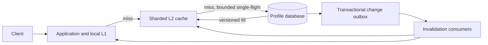
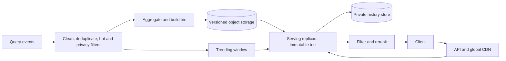
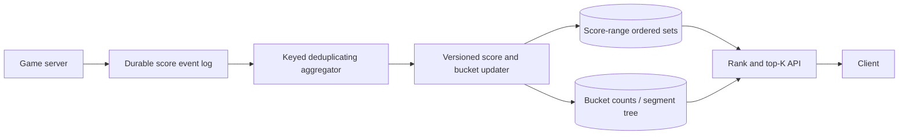
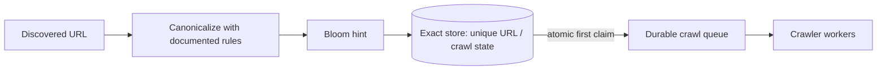

# System design interview case studies

**Source images and OCR:** [Sys_Des_DSA](../../../Case_studies_DSA/Sys_Des_DSA/).

## Source inventory and reading guide

The source consists of 234 photographs and their supplemental OCR. The photographs show overlapping pages, sometimes from different proposed designs rather than one consistent deployment. The OCR contains damaged characters, cut-off text and inconsistent figures. Treat numbers below as **claims or illustrative targets in those photographed notes**, not independently verified production facts; do not infer that these incidents actually occurred. The examples and architectures marked **Practice design** are invented for interview use. Where source versions conflict, the cases say so rather than silently merging them.

| Distinct source topic | Design or incident evidence (image filenames) | Covered in |
|---|---|---|
| Distributed profile cache; multi-tier HLD, LRU/LFU, admission, consistency, sharding, capacity, hot keys and privacy | `20260823_012423.jpg`, `20260823_012430.jpg`, `20260823_012457.jpg`, `20260823_012520.jpg`, `20260823_012525.jpg`, `20260823_012556.jpg`, `20260823_012558.jpg`, `20260823_012619.jpg`, `20260823_012623.jpg`, `20260823_012648.jpg` | 1 |
| Cache stampede; LFU minimum-frequency bug; ring rebalance; allocator fragmentation | `20260823_012252.jpg`, `20260823_012256.jpg`, `20260823_012259.jpg`, `20260823_012339.jpg`, `20260823_012342.jpg`, `20260823_012351.jpg`, `20260823_012354.jpg`, `20260823_012356.jpg`, `20260823_012402.jpg`, `20260823_012403.jpg` | 1 |
| Typeahead trie, offline and real-time ranking, deployment, personalization, privacy, safety and evaluation | `20260823_012432.jpg`, `20260823_012436.jpg`, `20260823_012448.jpg`, `20260823_012705.jpg`, `20260823_012711.jpg`, `20260823_012724.jpg`, `20260823_012727.jpg`, `20260823_012737.jpg`, `20260823_012750.jpg`, `20260823_012757.jpg`, `20260823_012824.jpg` | 2 |
| Typeahead trie memory exhaustion and stale breaking-news index | `20260823_012304.jpg`, `20260823_012315.jpg`, `20260823_012318.jpg`, `20260823_012343.jpg`, `20260823_012346.jpg`, `20260823_012347.jpg`, `20260823_012349.jpg` | 2 |
| Real-time leaderboard, sorted sets, skip lists, segment trees, event pipelines, rank, time windows, sharding and resets | `20260823_012439.jpg`, `20260823_012440.jpg`, `20260823_012454.jpg`, `20260823_012847.jpg`, `20260823_012856.jpg`, `20260823_012906.jpg`, `20260823_012910.jpg`, `20260823_012918.jpg`, `20260823_012935.jpg`, `20260823_012938.jpg` | 3 |
| Sorted-set rank slowdown and bucket-summary consistency | `20260823_012323.jpg`, `20260823_012327.jpg`, `20260823_012330.jpg`, `20260823_012332.jpg` | 3 |
| Crawler URL deduplication and saturated Bloom filter | `20260823_012408.jpg`, `20260823_012410.jpg`, `20260823_012411.jpg`, `20260823_012412.jpg`, `20260823_012414.jpg` | 4 |

The HLD/LLD images also discuss Redis cluster slots, serialization, key schemas, object overhead, operations and memory formulas (`20260823_012443.jpg`, `20260823_012447.jpg`, `20260823_012451.jpg`, `20260823_012504.jpg`, `20260823_012507.jpg`, `20260823_012510.jpg`, `20260823_012515.jpg`). These are incorporated into the relevant cases. The source's precise incident figures and benchmark/cost assertions are not universal sizing guidance.

---

## 1. Social profile cache and incident response

**Source images:** `20260823_012252.jpg`, `20260823_012259.jpg`, `20260823_012339.jpg`, `20260823_012342.jpg`, `20260823_012351.jpg`, `20260823_012356.jpg`, `20260823_012402.jpg`, `20260823_012423.jpg`, `20260823_012457.jpg`, `20260823_012520.jpg`, `20260823_012525.jpg`, `20260823_012556.jpg`, `20260823_012558.jpg`, `20260823_012619.jpg`, `20260823_012623.jpg`, `20260823_012648.jpg`.

### Context and requirements

The source poses a social-network profile cache with `get`/`put`, LRU or LFU eviction, an application-local L1, distributed L2, a backing database, and hot-key handling. Its worked scenario mentions 500 million registered users, 2 million operations/second, >90% hit rate, and a 500 microsecond P99 target. Treat these as scenario targets, not guaranteed benchmarks. In particular a miss that requires a database read may exceed 500 microseconds: clarify whether the SLO applies only to cache hits, and specify how misses and unavailable responses count. The source includes different TTLs and serialization formats in different views; choose one explicit contract rather than assuming they all describe the same deployment.

**Practice design assumptions:** one region; profile reads dominate writes; cache entries include a monotonically increasing database version; 5-minute maximum ordinary-profile staleness is acceptable, but deletion requires an explicit revocation path. Database remains authoritative. No cross-region consistency is claimed.

### Architecture and example



Practice workload: 2M requests/s with a combined 90% hit rate leaves 200K misses/s, before retries and coalescing. At 1 KiB payload, 50M cached profiles require about 47.7 GiB of payload alone; allocator overhead, keys, indexes, replicas, and headroom must be added. A 20% node failure, bursts and network throughput must be included before choosing a node count. If each app has an independent L1, summing L1 capacities overstates the number of unique profiles.

On a read, check L1 then L2 then the database. On a database write, atomically record an outbox event with the new version, then invalidate or replace both tiers. Do not let an older in-flight database read repopulate a newer cache entry: use version fencing/tombstones and conditional fills. For deletion, authorize against a durable deletion state or equivalent revocation mechanism; an asynchronous invalidation or a TTL alone cannot promise immediate erasure. Invalidation consumer lag and retained copies, including hot-key replicas and backups, belong in the erasure policy.

### Algorithms and invariants

```text
get(key):
  if valid L1 entry: return it
  if valid L2 entry: populate L1; return it
  join bounded single-flight for key; leader rechecks L2
  leader reads DB subject to concurrency limit and deadline
  fill only if DB version >= cache version fence
  return result or explicit unavailable/stale response under policy
```

Single-flight per process does not prevent a fleet-wide stampede: combine it with shared coordination or bounded DB admission. Lock leases need fencing if expired holders can still write. A stale response is permitted only inside an explicitly defined window and never for revoked profiles.

Exact LRU uses a hash map to doubly linked nodes, moving each access to the most-recent end and evicting the least-recent end. Exact LFU maintains key→value/frequency, frequency→ordered keys and `min_freq`; promotion removes the key from frequency f and inserts at f+1. If its old bucket becomes empty and f was the minimum, advance `min_freq` **under the same lock**; a newly inserted item sets it to 1. Break ties by recency. The `012339`/`012342` incident concerns a stale minimum bucket; avoid assuming a min can always be advanced by one for arbitrary deletions or decays—maintain an ordered nonempty-frequency structure if those operations can create gaps. Capacity zero returns without insertion.

Invariants: each live key occurs in exactly one frequency bucket; the minimum names a nonempty bucket whenever the cache is nonempty; map and list contain identical live keys; a cache version never moves backward. Exact LRU/LFU hash-map operations are expected O(1) and space O(n), assuming constant-time list operations; synchronization, value serialization and network costs are additional. Approximate LFU with decay or W-TinyLFU admission tolerates shifts in popularity and avoids maintaining exact global order, at the cost of approximation.

### Routing, incidents and tradeoffs

Consistent hashing places virtual nodes in sorted ring order and assigns a key to its clockwise successor: O(log V) lookup and O(V) ring storage. Adding a node moves only intervals newly owned by its virtual nodes, but actual imbalance depends on hashing and key skew. Gradual warm-up, old-owner fallback, and bounded migration reduce cold misses; source notes discuss virtual-node increases and a migration window. During dual reads, version fences and deletion propagation must cover both owners. Redis Cluster's CRC16 slot routing is a distinct mechanism, not the same as an application-managed ring; hash tags co-locate keys at the risk of hot slots.

The source's stampede incident proposes TTL jitter, probabilistic early refresh, request coalescing and stale-while-revalidate. Jitter spreads independent key expiry but does not alone prevent multiple refreshes of one hot key. A cache fleet restart still needs prewarming, DB admission controls, timeouts and degraded responses. For a celebrity key, replicate read-only copies and distribute reads, then invalidate every replica on changes. Monitor skew; fan-out adds write/invalidation work.

The fragmentation incident distinguishes logical object bytes from resident memory. Mixed sizes and allocator fragmentation can make RSS much larger than the live cache; compare allocator telemetry, size classes and workload replay, then consider an appropriate allocator or slabs. Slabs improve reuse for common sizes but strand capacity across classes. LRU misses, memory fragmentation and ring remapping have different root causes even if they all raise DB load.

### Validation and interview questions

Test concurrent promotions, eviction on empty/one-element caches, aging, stale fills after writes/deletes, leader timeout, restart storms, hot replicas and ring changes with a reference model. Load-test realistic key skew and failure of a shard; measure hit rates by tier, p50/p99, DB concurrency, stale reads, invalidation lag, eviction rate, RSS versus live bytes, and deletion completion. Canary a policy change and compare cohorts, not only global hit rate.

1. What guarantee remains if invalidation is delayed or a replica misses an event? How would you enforce immediate deletion?
2. Why is LFU vulnerable to historical popularity and LRU to scans? What does admission control change?
3. How do you limit a fleet-wide thundering herd if each server has its own single-flight group?
4. How would you estimate migration load and recover if the old ring owner disappears early?

---

## 2. Search typeahead and safe index refresh

**Source images:** `20260823_012304.jpg`, `20260823_012315.jpg`, `20260823_012318.jpg`, `20260823_012343.jpg`, `20260823_012347.jpg`, `20260823_012432.jpg`, `20260823_012436.jpg`, `20260823_012448.jpg`, `20260823_012705.jpg`, `20260823_012711.jpg`, `20260823_012724.jpg`, `20260823_012727.jpg`, `20260823_012737.jpg`, `20260823_012750.jpg`, `20260823_012757.jpg`, `20260823_012824.jpg`, `20260823_012835.jpg`.

### Context and requirements

The source asks for ranked completions from partial search input, citing a 100K prefix-QPS scenario and <50 ms P99, with personalization and freshness requirements. One set of notes describes a six-hour batch and another an hourly index, while an incident proposes a faster rebuild plus a trending path. These are alternative configurations, not a single coherent measured timeline. The OCR of the stale-index incident contains a visibly self-corrected timeline; its exact time and CDN state are uncertain.

**Practice design assumptions:** return up to 10 allowed results; global rankings may be six hours old except for trending overlay; user history is optional and private; client debounces and cancels obsolete requests. An empty prefix returns no suggestions. Explicitly define Unicode normalization, locale, minimum/maximum prefix lengths and allowed content with product owners. Ranking must not leak private history through a shared CDN.

### Design and worked example



For practice, normalized terms `cat:100`, `car:80`, `cab:20` put `[cat, car, cab]` at trie node `ca`; lookup `ca` returns them in that order before private reranking. If `cab` suddenly trends, merge it with batch candidates using a defined score; filtering after a fixed top-10 may leave fewer than 10, so retrieve more candidates or replenish. A global top-10 alone cannot guarantee a personalized top-10 when a personalized item lies outside it; retrieve history candidates separately or use a larger bounded candidate pool. Apply blocklist after all merges, including trending and personalization.

The offline pipeline cleans and aggregates query events, strips sensitive content, filters bots, expands prefixes, builds per-prefix ranked candidate lists, serializes a versioned snapshot and checksum, and publishes only after quality gates. Servers download and validate into a second buffer, atomically swap references, and retain the prior snapshot for rollback; capacity must accommodate both old and new versions. Detect skewed prefixes and replicate or split hot shards. Cache only public global candidates at a shared edge; merge per-user data after the cache and enforce history retention and deletion.

### Algorithm, correctness and complexity

```text
suggest(prefix, user):
  p = normalize_and_validate(prefix)
  node = trie.walk(p); global = node.candidates if node else []
  trending = trending_index.lookup(p)
  history = authorized_history_candidates(user, p) or []
  merged = deduplicate(global + trending + history)
  safe = filter_blocked_and_sensitive(merged)
  return first K sorted by documented score and stable tie-break
```

A node's precomputed global candidates must be precisely the best candidates under the snapshot's global ranking and normalization, not under a later personalized ranking. Immutable version swaps ensure a request sees one complete version, rather than a partially built trie. The overlay needs event-time windows, deduplication, expiration, abuse controls and an explicit staleness bound. Use a timeout to fall back to global results if personalization is unavailable.

A trie walk takes expected O(m) child-map lookups for prefix length m, plus O(c log c) to sort c merged candidates (or O(c log K) with a bounded heap); output costs O(K). Storage is O(nodes + stored candidate references), up to O(nodes × K) for fixed K. Building expands each term's prefixes, so total work depends on total input characters and per-node top-K maintenance; a naive subtree scan can be proportional to the entire subtree. Compressed tries/DAFSAs reduce repeated structure but make mutable updates and per-prefix metadata more complex. Redis sorted sets offer incremental updates; a search engine supports richer matching and typo tolerance, generally with different latency and operational costs. Aho–Corasick solves multi-pattern matching within text, not a replacement for prefix top-K.

### Incidents and validation

The notes describe a trie growing under long-tail query insertion, with OOM symptoms (`012304`), and propose frequency admission, count-min sketch and LFU sweeping (`012315`, `012318`). A sketch overestimates counts because of collisions; it gates likely popularity but cannot prove exact occurrence thresholds. Track memory per node, counter saturation, false admissions and new-term delay; decay counts or use bounded time windows. Avoid aggressive pruning of legitimate new terms without evaluating recall.

For breaking news, scheduled snapshots and CDN caching can lag reality. The notes propose more frequent rebuilds, CDN purge and a trending fast path (`012343`–`012349`). Purges can fail or propagate slowly; the real-time path must bypass stale shared entries or change cache keys/version, and its independent age must be measured. More builds cost CPU and increase deployment risk.

Test normalized Unicode, prefix bounds, duplicate events, privacy filtering, blocked suggestions after merge, empty trie, hot prefixes, malformed snapshots, checksum failure, rollout/rollback, old-client responses and event-time skew. Evaluate completion/acceptance rate, precision on a labeled set, latency and errors, index age, missing trending terms, blocked-content false positives, and memory. Randomized experiments must account for guardrails and selection bias; a click alone is not ground-truth relevance. Defend against query poisoning with bot filtering, rate limits and anomalous-trend review, and restrict access to user histories.

### Interview questions

1. Why does storing only 10 global candidates per prefix fail for personalized top-10?
2. How can a safe trending term bypass an old CDN snapshot without exposing personalized results?
3. What happens if a trie build succeeds but only half the shards load the new version?
4. How do you trade memory, freshness, recall and safety when pruning rare queries?

---

## 3. Distributed real-time leaderboard

**Source images:** `20260823_012323.jpg`, `20260823_012327.jpg`, `20260823_012330.jpg`, `20260823_012332.jpg`, `20260823_012439.jpg`, `20260823_012440.jpg`, `20260823_012454.jpg`, `20260823_012847.jpg`, `20260823_012856.jpg`, `20260823_012906.jpg`, `20260823_012910.jpg`, `20260823_012918.jpg`, `20260823_012935.jpg`, `20260823_012938.jpg`.

### Context and requirements

The source describes score events, stream aggregation, Redis sorted sets and a segment tree for distributed rankings; it also discusses weekly resets and score-range sharding. The `012323` incident describes slow rank at a very large sorted-set size and proposes score buckets (`012327`–`012332`), with stale bucket summaries as an acknowledged tradeoff. Treat source measurements as scenario claims, not intrinsic Redis behavior: O(log n) alone does not predict latency without hardware, memory, network and workload.

**Practice design assumptions:** scores are integer totals in [0, 9999]; updates are signed deltas with unique event IDs and a season ID. Return deterministic ordinal rank ordered by score descending, then user ID ascending. Ranking can lag events by 500 ms under normal operation; a read is explicitly labeled with its applied version/watermark. Awarding prizes requires a separate consistent finalized snapshot, not the eventually consistent live view.

### Design and example



Example: A=90, B=90, C=75, D=20. With the declared tie-break, A/B/C/D have ordinal ranks 1/2/3/4. A count tree gives `count(score > 75)=2`; within score 75, C is first, so rank is 2+1=3. Competition rank instead assigns A/B rank 1 and C rank 3; dense rank assigns C rank 2. Choose explicitly: a sorted-set ordinal index is not automatically competition or dense rank.

Keep per-user authoritative score/version in the keyed processor. On a valid new event, compute new total, move the member from old score bucket to new bucket, and update count summaries. Event IDs plus durable deduplication and an atomic/checkpointed state transition are necessary: atomic increment by itself prevents lost concurrent increments but does **not** prevent duplicate delivery. Validate season, identity, permitted score changes and out-of-order policies. A stateful stream processor's checkpoint alone does not make an external sink exactly-once unless the sink protocol participates.

### Algorithm, consistency and complexity

```text
apply(event):
  verify event and season; reject if event_id already committed
  old = user_score[event.user]; new = checked_add(old, event.delta)
  atomically commit event_id, new score and durable change record
  materialize old->new idempotently using user version

rank(user, snapshot_version):
  score = score_at(user, snapshot_version)
  above = count_of_members_with_score_greater_than(score, snapshot_version)
  within = 1 + number_with_equal_score_and_smaller_user_id(snapshot_version)
  return above + within
```

The tree invariant is that each leaf is the count for its score and each internal node is the sum of its children. Every player belongs to exactly one score bucket; total tree count equals the number of active players. Updates that cross shards cannot generally atomically update every Redis key; use a single-writer ordered materializer plus versioned snapshots, or explicitly expose temporary inconsistency and reconcile from durable authoritative state. Do not claim an exact global rank when the score, bucket counts, and tie ordering come from different versions. At season reset, route events by season ID/event-time policy, close the old season at a watermark, archive a finalized snapshot and create a new namespace. A key rename alone does not solve late or duplicate events.

For S possible scores, point updates and count-above queries in a segment tree are O(log S), with O(S) tree space; per-score ordered sets also need O(n) member storage and O(log n_s) insert/rank for n_s members. In a Redis skip-list representation, sorted-set operations are typically expected O(log n), and fetching K adjacent results costs O(log n + K); encodings and command specifics matter. If score buckets cover ranges, their summary yields only the offset from strictly higher buckets; local rank must still compare score and tie-break inside the target bucket. A bucket-size array alone cannot supply all offsets in O(1) while also updating arbitrary counts in O(1); use a prefix-sum structure or pay recomputation cost.

### Alternatives, failure modes and validation

One sorted set is simple and produces a coherent local order, but may hit memory, throughput or hot-key limits. Hash-sharding by user distributes updates but global rank requires a fan-out or an additional ordered summary. Score-range sharding enables offsets and localized top-K, but skew and frequent cross-boundary moves require rebalancing; replicated/materialized summaries trade freshness for latency. Segment trees require a bounded score domain or coordinate compression; an order-statistic tree handles dynamic score domains at higher implementation cost. Floating-point score packing for tie-breaks risks precision loss: store explicit secondary order instead of assuming arbitrary large integers are exactly representable in float64.

Test duplicate/reordered events, negative deltas, ties, maximum score, bucket boundary moves, concurrent updates, failover during materialization, summary drift and late reset events. Compare randomized event sequences to a reference sorted list, reconcile tree totals with actual membership, and load-test skew and node loss. Monitor event-to-visible rank lag, dedup rate, update errors, per-bucket distribution, cross-shard moves, summary drift, memory and P99. For prize allocation, freeze writes at a defined watermark and independently verify the final snapshot.

### Interview questions

1. How do ordinal, competition and dense ranks differ for tied scores?
2. Why does an atomic `ZINCRBY` not ensure exactly-once processing?
3. What invariant is broken during a cross-shard move, and what can a reader honestly promise?
4. When does a segment tree help more than one sorted set or user-hash sharding?

---

## 4. Crawler URL deduplication with Bloom filters

**Source images:** `20260823_012408.jpg`, `20260823_012410.jpg`, `20260823_012411.jpg`, `20260823_012412.jpg`, `20260823_012414.jpg`, `20260823_012415.jpg`.

### Context and requirements

The source describes a crawler Bloom filter becoming saturated and proposes resizing/rebuilding or scalable subfilters. It also associates increasing false positives with duplicate crawls. That consequence is **not implied** by a correctly used Bloom filter: if a positive means “skip,” false positives cause missed new URLs; if positives are verified against an exact store, they increase exact-store traffic. Duplicate crawls instead require an additional race, expiry, lost state, incorrect use or other cause. The OCR alone does not establish that cause. Avoid presenting the apparent causal claim as fact.

**Practice design assumptions:** canonical URL identity is established before deduplication; all accepted URLs are retained in an exact durable store for the crawl horizon. A false positive must never suppress a truly new URL, and two concurrent discoveries must schedule at most one active crawl for the same canonical URL. Bloom filter is only a performance hint, not the authority.

### Design and example



Suppose `a` is inserted, while new URL `b` collides in all Bloom bit positions. The filter reports “maybe present” for `b`; an exact-store conditional insert shows it is new, so it is still enqueued. Two workers discovering `b` concurrently both consult the store; its unique constraint admits one claim. Persist the claim and queue intent atomically using a transactional outbox, or reconcile claims not yet queued. If duplicates become eligible for a later recrawl, model a crawl generation/window in the unique claim; permanent dedup and scheduled recrawl are different contracts.

### Algorithm and correctness

```text
on_discovery(url, generation):
  key = canonicalize(url) + generation
  hint = bloom.maybe_contains(key)  // routing/observability only
  transaction:
    if insert_unique_claim(key) succeeds:
      insert_outbox(crawl(key))
  if newly_claimed: bloom.add(key)
```

A correctly maintained Bloom filter has no false negatives for inserted keys, barring lost bits, mismatched hashing, concurrency bugs or rotation gaps; it can have false positives. With the strict contract above every discovery still needs an atomic exact-store claim, so Bloom membership cannot safely eliminate that operation; use it only as a hint for batching/cache strategy or relax the contract explicitly. A filter alone cannot enforce a uniqueness race. If the canonical store supports atomic transactions, claiming and outbox insertion avoid a crash between claiming and enqueueing. Workers still need idempotent processing because queues may redeliver.

For n inserted keys, m bits and k independent uniform hashes, approximate false-positive probability is `(1 - exp(-kn/m))^k`; optimal k is approximately `(m/n) ln 2`, and the required m for target p is `-n ln(p)/(ln 2)^2`. Practice example: for 1 million keys and target 1%, m≈9.59 million bits (1.14 MiB), k≈7. At twice the planned occupancy, with the same m and k, the estimated rate rises to about 15.7%. Each lookup/insert costs O(k) hashes and O(m) bits total storage; exact claims additionally require the store's indexing and transaction costs. Hash independence and empirical skew affect the estimate.

### Rebuild, alternatives and validation

Rebuild a larger filter from an authoritative snapshot while capturing concurrent inserts in a durable change stream. Replay through a watermark, dual-write during cutover or synchronize the barrier, then atomically publish the new filter; only retire the old one after all readers switch. A pointer swap without handling writes concurrent with the scan can introduce false negatives. If using scalable Bloom subfilters, check every active subfilter and insert into the current one; allocate per-filter error budgets whose sum is within the global target, since the union's false-positive rate grows with filter count. Filter rotation must preserve the entire dedup horizon.

Exact hash sets provide exact membership but consume more memory; counting Bloom filters support deletions but require counter sizing and correct decrement semantics; Cuckoo filters offer another space/deletion tradeoff and can fail on high occupancy. A database uniqueness constraint is simpler when throughput and cost permit. Monitor occupancy/bit-set fraction, estimated and sampled empirical false-positive rate, exact-store load, claim-to-queue delay, duplicate active crawls and missed discoveries.

Test adversarial collisions, saturation, canonicalization variants, concurrent claims, duplicate delivery, crash after claim, restart, rebuild with concurrent writes, rotating filter boundaries, and store outages. Compare against a reference exact set and verify every accepted claim has exactly one durable queue intent; independently test idempotent worker behavior.

### Interview questions

1. What user-visible error does a Bloom false positive cause under each possible lookup policy?
2. Why can't a Bloom filter enforce at-most-one crawl under concurrency?
3. How do you rebuild without losing insertions that arrive during the scan?
4. What happens to the aggregate error probability when many subfilters are queried?
