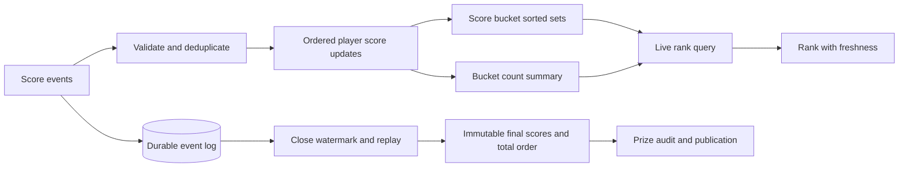

# Case: a large leaderboard needs fast rank and fair prizes

## Source and interview prompt

The source notes discuss slow rank queries on a very large Redis sorted set and propose splitting it into score buckets with cached bucket sizes. They acknowledge that a size summary can be stale during score changes. They also discuss leaderboard event processing and ranking structures. These are scenario claims, not proof that a particular Redis complexity necessarily causes a latency incident. See [system-design OCR, images 010–014, 045–046 and 200 onward](../../../../Case_studies_DSA/Sys_Des_DSA/Sys_Des_DSA_SUPPLEMENTAL_IMAGE_OCR.md), [20260823_012327.jpg](../../../../Case_studies_DSA/Sys_Des_DSA/20260823_012327.jpg), and [20260823_012330.jpg](../../../../Case_studies_DSA/Sys_Des_DSA/20260823_012330.jpg).

**Interview task:** maintain a live leaderboard under frequent score updates. Return a low-latency approximate display rank, and a reproducible exact result when a competition closes.

## Requirements and assumptions

* Illustrative input event: `(event_id, competition_id, player_id, delta, event_time)`. Duplicate delivery is possible; deltas can be positive or negative. The authoritative event log is durable and has a defined closing watermark and late-event policy.
* Display ranking is ordinal, 1-based: descending score, then ascending player ID. Every player has a unique ordinal position. Competition rank or dense rank would require different counting semantics for ties.
* The live API may display an explicitly stale rank and snapshot timestamp. Prize calculation must use a finalized coherent snapshot and the published tie rule, not a sum of independently stale counters.

## Algorithm and consistency

Partition by a fixed score interval: `bucket = floor(score / width)`, including correct floor behavior for negative scores. Each bucket orders `(score descending, player_id ascending)`; don't assume the default tie ordering of a storage engine matches the contract. Keep a bucket-count summary in a Fenwick tree or segment tree over a bounded/compressed bucket domain. Query a player using its score and bucket, compute the number of entries in buckets strictly above it, then add its zero-based position within its own bucket and 1. For counts `[bucket 2: 4, bucket 1: 6]`, a player at zero-based position 2 in bucket 1 has rank `4 + 2 + 1 = 7`.

With B buckets and nb players in the player's bucket, a balanced ordered structure gives local ordinal lookup O(log nb), and a Fenwick/segment tree gives O(log B) prefix or suffix counts; implementation, network and synchronization costs remain. Retrieve top K by walking buckets in descending order and fetching pages until K entries are gathered. Bucket skew can still create a hot or oversized bucket; repartitioning a range needs a versioned routing and summary migration protocol.

A score update reads the player's previous score, removes its old entry, inserts the new entry and adjusts counts only if the bucket changes. Deduplicate and order events per player so retries do not apply a delta twice and concurrent writers do not lose updates. A single-node atomic script or transaction can preserve these invariants when all relevant keys are colocated; cross-shard moves cannot be made atomic merely by using a local script. Choose a coordinator/transactional store or use a durable update log and versioned, eventually consistent materialization with reconciliation. During cross-shard movement, a live query can observe temporarily duplicated/missing membership or an older summary; return an as-of timestamp and don't claim an exact bound unless the protocol proves one.

For prizes, establish a close watermark, define which late events count, replay unique eligible events to a consistent materialized snapshot, validate membership/count invariants, sort by the total-order rule and publish an immutable result version. A distributed scan of mutable buckets is not an exact point-in-time ranking. Correcting an eligible late event after finalization needs an explicit audited correction policy.

## Alternatives, operations and evaluation

* One sorted set is simpler and offers a coherent local view until its capacity or throughput is inadequate. Hash-sharding players distributes writes but exact global rank needs fan-out or an ordered aggregate. Score buckets speed ordered range aggregation but can hotspot near popular scores and complicate cross-bucket moves.
* Monitor event-to-view lag, dedup rate, failed or pending bucket moves, count discrepancies, bucket skew, top-K and rank p99, and finalization watermark progress. Recompute counts and sample live ranks against a consistent reference snapshot; do not infer correctness from latency alone.
* Exercise duplicate and out-of-order events, ties, negative scores, boundary-crossing updates, a worker crash between move steps, delayed summary updates, a bucket split, close-time events and late arrivals. Check that each player appears once, count summaries match bucket cardinality after convergence and final results are reproducible from the log. Canary rebucketing and retain the old routing version until readers and writers switch.
* If the event stream or summary is delayed, show last-known rank with age or temporarily disable it. If finalization cannot establish a consistent watermark or reconcile discrepancies, delay prize publication rather than presenting a provisional rank as final.

## Interview practice

**Why is atomic increment not exactly-once event processing?** Replaying the same event executes another atomic increment. Idempotency needs durable event-ID deduplication or an equivalent transactional sequence/offset protocol coupled to the score update.

**What if many players share a score?** The comparator must implement the agreed tie semantics. Ordinal rank uses an explicit unique tie-break; competition rank counts only players with strictly higher score, and dense rank counts distinct higher scores, not player count.

**Why is summing bucket counts not automatically exact?** A cross-bucket update may modify membership and counts at different times or on different shards. A live answer can combine states from different moments; exact prize results require a coherent snapshot or transaction spanning the relevant state.

**What does a segment tree buy us?** It reduces a sum over B bucket counts to O(log B) updates and range queries, but uses O(B) summary space and introduces another materialized state to keep consistent. It does not by itself distribute a hot bucket.
