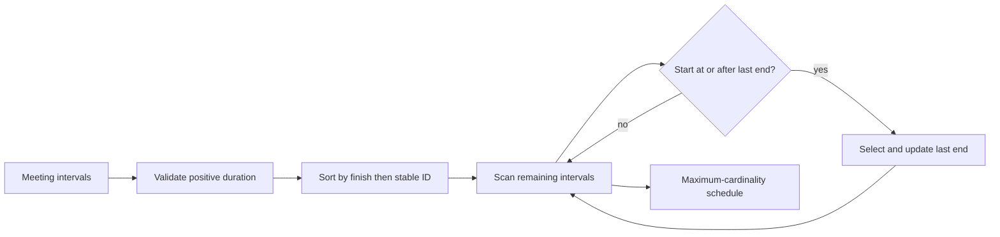

# Interview case: Selecting the most meetings for one room

## Problem and assumptions
The source framework lists activity selection as an exchange-argument application and distinguishes greedy choice from dynamic programming. See [source OCR, images 010–013](../../../../Case_studies_DSA/index_basics/index_basics_SUPPLEMENTAL_IMAGE_OCR.md) and [20260823_005423.jpg](../../../../Case_studies_DSA/index_basics/20260823_005423.jpg). The meeting scenario and examples are **illustrative**.

Given n requested meetings, select a maximum-cardinality subset for one room. Each has a fixed, positive-duration half-open interval `[start,end)`; a meeting beginning exactly when another ends is compatible. All meetings have equal value, and cancellations or setup buffers are not part of the initial contract. Return meeting IDs in schedule order; deterministic tie-breaking by ID is useful but not required for optimality.

## Algorithm and proof
Sort by nondecreasing finish time. Select the first meeting, then each subsequent meeting whose start is at least the finish of the last selected meeting. A simple implementation initializes the last finish to negative infinity, avoiding assumptions about timestamp sign.

**Exchange argument:** let g be the earliest-finishing interval and let an optimal solution start with o. Since `end(g) <= end(o)`, replacing o by g cannot overlap any later interval of that optimal solution. The replacement remains feasible and has the same cardinality. Therefore an optimal solution exists that starts with g; apply the same argument to the remaining intervals compatible with g. This proves greedy optimality by induction. Tie order among equal finishes does not alter the maximum count, though deterministic ties stabilize output.

**Example:** intervals A=[0,6), B=[1,3), C=[3,5), D=[5,7). Choosing the earliest start A allows only one meeting among these, whereas earliest finish chooses B, C, D for three. Empty input returns an empty schedule. Equal endpoints are compatible under the half-open contract; zero-duration requests are rejected to keep the contract unambiguous.

Sorting costs O(n log n) time and O(n) auxiliary space if making a separate sorted copy; an in-place sort can use less depending on implementation. The scan is O(n). If input is already sorted by end, a streaming scan is O(n) time and O(1) working state excluding output.

## Alternatives, evaluation and operations
This greedy result does not extend to unequal meeting values: e.g., short meetings [0,1), [1,2) worth 1 each versus [0,2) worth 10. Weighted interval scheduling sorts by finish, binary-searches the last compatible predecessor `p(i)`, and computes `dp[i]=max(dp[i-1], value[i]+dp[p(i)])`, in O(n log n) time and O(n) space; keep decisions for reconstruction. Multiple rooms are a different resource-allocation problem. Setup times can sometimes be incorporated into intervals, but only when their semantics permit it.

Evaluate against exhaustive subset enumeration for small n, checking feasibility and optimal count; test unsorted data, same finish, nesting, adjacent boundaries, negative times and invalid intervals. Normalize time zones to instants before comparing; daylight-saving ambiguity or inconsistent endpoint conventions can invalidate a correct algorithm. In a live booking system, run selection on a versioned snapshot and commit with conflict detection, since newly booked meetings can invalidate the computed schedule. Track conflicts and recomputation latency.

## Interview practice
1. **Why earliest finish rather than earliest start?** Earliest finish leaves at least as much room for all subsequent intervals, enabling the exchange proof; earliest start can consume the entire schedule.
2. **Why is the proof local choice sufficient globally?** Any optimum can exchange its first choice for the greedy interval without reducing cardinality; induction applies to the compatible suffix.
3. **What changes with weights?** Cardinality is no longer the objective and the exchange can reduce value. Use weighted interval dynamic programming with predecessor lookup.
4. **What if touching endpoints conflict?** Use closed intervals and change compatibility from `start >= last_end` to `start > last_end`, consistently in both scheduling and validation.
