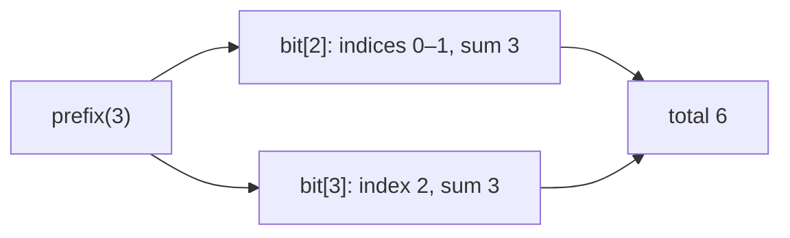
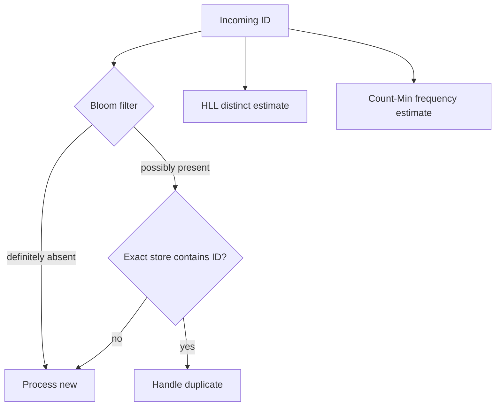
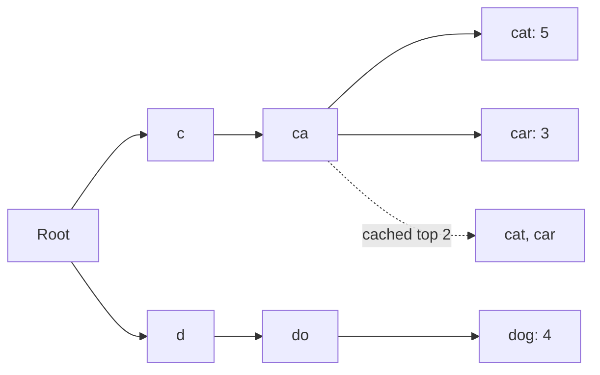
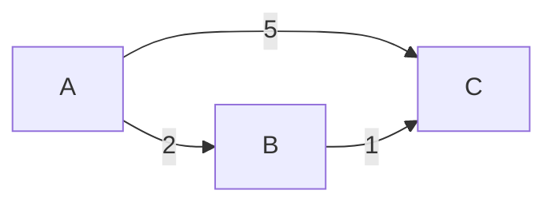
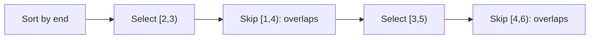
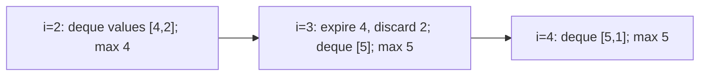
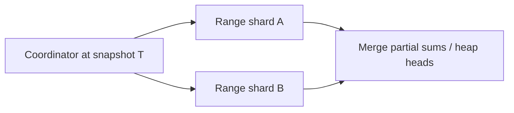

# Index basics: choosing data structures and algorithms in context

**Source images and OCR:** [index_basics](../../../Case_studies_DSA/index_basics/).

These cases turn the module's cross-cutting reference into interview exercises. **Every scenario, requirement, input, and numerical example below is invented for practice**, not a reported incident or a source benchmark. Image citations identify the reference concepts, not evidence that the scenarios happened. OCR is noisy, especially table columns, quantities, and filenames; where a source value is unclear, no numerical value is asserted. Complexity claims below state their own assumptions rather than relying on garbled table cells. Runtime and memory break-even points must be measured for the actual platform.

Use the source's five planes in order: **classify the operation → choose structures → prove the algorithm and cost → implement safely → scale**. During an incident, inspect those planes in reverse before replacing the algorithm. Start by asking about input size, rates, latency, exactness, order, updates, memory, concurrency, and consistency. A keyword is a hypothesis, not a proof.

## Case 1 — A catalog cache under changing access patterns

**Source images:** `20260823_005330.jpg`, `20260823_005348.jpg`, `20260823_005352.jpg`, `20260823_005402.jpg`, `index_basics.jpg`, `20260823_005431.jpg`, `20260823_005433.jpg`, `20260823_005502.jpg`.

### Problem, requirements, and assumptions
A service repeatedly reads product descriptions by ID. Choose an eviction policy for an in-process cache with capacity two. Assume `get` refreshes recency, `put` replaces an existing value and refreshes recency, and a miss returns absent; the authoritative store is separate. The capacity counts entries, not bytes. Exact LRU is requested; no TTL or cross-process consistency is implied.

### Design and worked example
Use a hash map from key to node plus a doubly linked list ordered most- to least-recently used. On `put(A,1), put(B,2), get(A), put(C,3)`, the list evolves `[A]`, `[B,A]`, `[A,B]`, `[C,A]`; B is evicted.


### Algorithm and invariant
```
get(k):
  if k absent: return MISS
  unlink node[k]; link node[k] at head
  return node[k].value
put(k, v):
  if capacity == 0: return
  if k exists: update value; move node to head; return
  if size == capacity: remove tail from list and map
  create node(k,v); link at head; map[k] = node
```
The map and list contain exactly the same keys once each. Their order equals descending time of last successful access; induction over operations shows the tail is the correct victim. With a conventional hash table, operations are **expected** O(1), not guaranteed worst-case O(1); space O(capacity). Collision attacks, resize work, and locking change observed latency.

### Alternatives, failures, and validation
LFU with frequency buckets and recency ties can achieve expected O(1) operations but needs a clear aging and tie policy; heap-based LFU is typically O(log capacity). LRU can be polluted by scans; adaptive replacement policies such as ARC balance recency and frequency using resident and ghost histories at greater complexity. A concurrent map alone does not make the map/list transaction atomic: guard both under one lock or use a proven concurrent cache. Cache fills need a defined staleness/invalidation policy; eviction must not be mistaken for deletion from the store. Measure hit rate, eviction rate, resize latency, allocation/GC, and tail latency; test capacity zero/one, repeated updates, tail/head moves, and concurrent operations against a locked reference model.

**Interview questions:** Why is a list alone insufficient for O(1) lookup? What does frequency aging change? How would you distinguish a cache miss during re-sharding from lost authoritative data?

## Case 2 — Mutable measurements, ordered searches, and ranks

**Source images:** `index_basics.jpg`, `20260823_005355.jpg`, `20260823_005410.jpg`, `20260823_005416.jpg`, `20260823_005433.jpg`, `20260823_005504.jpg`, `20260823_005530.jpg`.

### Problem, requirements, and assumptions
An analytics service stores a fixed-length array of signed counts. Support point additions and exact sums on half-open intervals `[l,r)`. Assume updates and queries are sequential, indices are valid, and sums fit a sufficiently wide integer. Classification is mutable range aggregation, not mere lookup.

### Design and worked example
Use a 1-indexed Fenwick tree: cell `i` stores the sum of the last `lowbit(i)` elements ending at i. For `[2,1,3,4]`, `prefix(3)=6`, `prefix(1)=2`, so `sum(1,3)=4`. Add 2 to index 1: the array becomes `[2,3,3,4]` and that range sums to 6.



```
add(index, delta):
  i = index + 1
  while i <= n: bit[i] += delta; i += i & -i
prefix(end):                     # sum [0,end)
  total = 0; i = end
  while i > 0: total += bit[i]; i -= i & -i
  return total
range(l, r): return prefix(r) - prefix(l)
```

### Correctness and cost
Each update visits exactly the stored blocks containing its position; prefix repeatedly removes the low bit and partitions `[0,end)` into disjoint stored blocks. Subtracting prefixes gives the desired range. Each operation is O(log n); space O(n). A linear-time build is possible. Atomicity across multiple cells requires a lock, snapshot, or other explicit protocol under concurrency.

### Alternatives, failures, and validation
A segment tree supports associative range minimum, sum, and richer aggregates in O(log n), using O(n) space; lazy propagation supports range updates only when its composition and aggregate semantics are correctly defined. Before partial descent, push pending tags to children or carry them consistently; test whole and partial overlaps. Prefix subtraction does not support general range minimum. A sorted array plus binary search is attractive for mostly-read ordered data (O(log n) search, O(n) insertion); balanced trees/skip lists support dynamic order, and an order-statistics tree augments subtree sizes for rank/select. B-trees exploit page locality for storage. For endpoint bugs compare every random operation with a simple array, including empty intervals, `range(0,n)`, negative deltas and overflow limits. Use `l+(r-l)/2` when midpoint overflow is possible.

**Interview questions:** Why does subtraction work for sums but not minima? When is lazy propagation worth its complexity? How do rank and percentile queries change the index?

## Case 3 — Deduplication and approximate streaming analytics

**Source images:** `20260823_005410.jpg`, `20260823_005413.jpg`, `20260823_005433.jpg`, `20260823_005449.jpg`, `20260823_005502.jpg`, `20260823_005524.jpg`.

### Problem, requirements, and assumptions
An ingestion pipeline wants to avoid expensive reads for IDs definitely never seen; a separate dashboard wants approximate unique IDs and frequent IDs. IDs may be arbitrary strings. Invented assumption: dashboard approximation is acceptable, but dropping a new event as a duplicate is not.

### Design and worked example
A Bloom filter is a negative prefilter in front of an authoritative exact store: a negative skips the lookup; a positive checks the store. After inserting `A`, a query for `B` whose k positions are not all set is definitely new relative to the complete filter; if all are set, B may still be new. Insert B only after processing it. A HyperLogLog (HLL) independently estimates cardinality, and a Count-Min sketch (CMS) estimates per-key frequencies; none is an exact deduplication set.



```
for event with id x:
  if bloom.definitely_absent(x): process_new(x)
  else if exact_store.contains(x): handle_duplicate(x)
  else: process_new(x)
  ensure exact_store records x and bloom records x under the chosen commit protocol
  hll.add(x); cms.add(x, 1); update candidate tracker for x
```

### Correctness and cost
A completed, correctly synchronized Bloom insertion sets all k hashed bits. Thus an unset bit proves nonmembership in its inserted set; positives may be false. For n inserted distinct IDs, m bits, and k independent-ish hashes, approximate false-positive probability is `(1-exp(-kn/m))^k`; choose k near `(m/n) ln 2`. Lookup/insertion costs O(k), space m bits. A CMS with nonnegative increments returns the minimum of d counters, overestimating rather than underestimating true count absent overflow, with O(d) update/query and O(wd) counters. HLL stores m registers with relative standard error roughly `1.04/sqrt(m)` under its hashing assumptions; update is O(1), estimate typically O(m). Replays affect CMS frequency unless independently deduplicated; HLL naturally estimates distinct identities.

### Alternatives, failures, and validation
Exact hash sets cost O(number of distinct keys), with expected O(1) operations; a bitset is compact for bounded dense integer IDs. A CMS plus candidate heap alone does not guarantee true top-K unless candidate admission and stale estimates are handled; specify an approximate heavy-hitter algorithm and its guarantees, or maintain exact counts when feasible. Bloom saturation raises false positives; deletion needs a suitable counting structure or rebuild. Never use a positive as proof for security or irreversible deduplication. A crash after an exact-store commit but before updating the filter, or concurrent unsynchronized bit updates, can create dangerous apparent negatives: rebuild from the authoritative snapshot plus change log and gate negatives until caught up, or design a transactionally safe publication protocol. Test crashes at each step, compare against exact reference data, and measure false-positive rate, HLL error, sketch overestimation, saturation, and event replay.

**Interview questions:** Which of these structures can identify the actual distinct IDs? Why does OR-merging Bloom filters require identical sizes, hash functions and seeds? Can a CMS recover a key it has never retained?

## Case 4 — Prefix search, text search, and nearest neighbors

**Source images:** `20260823_005352.jpg`, `20260823_005413.jpg`, `20260823_005416.jpg`, `20260823_005457.jpg`, `20260823_005519.jpg`, `20260823_005530.jpg`, `20260823_005531.jpg`, `20260823_005539.jpg`.

### Problem, requirements, and assumptions
A tool catalog needs exact prefix completion ranked by frequency; users also request typo tolerance and semantic similarity. Assume normalized strings, static vocabulary during a query, and deterministic rank ties by lexicographic order. These are three different query types, not interchangeable meanings of search.

### Design and worked example
Use a trie for prefixes. Store exact terminal frequencies and, for each node, an exact cached top-K list if K is fixed and the update budget permits. With `cat:5, car:3, dog:4`, query `ca`, K=2 returns `[cat, car]`. A prefix ending at a terminal node includes that term as well as descendants.



```
complete(prefix, K):
  node = trie root
  for character in prefix:
    if child missing: return []
    node = child
  return node.cached_top_K  # sorted by (-frequency, term), if K is configured
```

### Correctness and cost
Every descendant of the prefix node has exactly that prefix, and every indexed matching term is its descendant. If updates recompute the cache along every affected path from all relevant child candidates and terminal values, the stored list is the true top-K. Lookup costs O(p+K) for prefix length p and returned K, assuming constant-time child lookup; space includes trie edges and O(K) cached entries per node. Frequency decreases and deletions require recomputation, not merely promoting an updated candidate.

### Alternatives, failures, and validation
Without cached lists, enumerate M descendants and maintain a size-K heap: O(p + M log K) plus traversal and output. A radix trie compresses unary paths; sorted strings plus binary-search range are simpler for mostly static data. Hash maps/direct-address arrays are better for exact frequencies without prefix requirements. For documents, an inverted index maps terms to posting lists; AND/OR/NOT operations can use sorted lists or compressed/Roaring bitmaps, and BM25 ranks candidates rather than finding literal prefixes. KMP searches a pattern in text in O(n+m); Rabin–Karp uses rolling hashes and must verify matches to avoid collision errors. A BK-tree can prune edit-distance searches when its metric assumptions hold. For nearest neighbors, use sorted values and binary search in one dimension, consider k-d trees in low dimensions, or evaluate LSH/HNSW for approximate high-dimensional retrieval; compare recall with brute force. Geographic cells (e.g. S2 or geohash) are candidate indexes, followed by correct spherical distance and neighbor-cell checks, especially near boundaries and the antimeridian. Normalize Unicode consistently; monitor memory, cache freshness, ranking ties and ANN recall. Test empty prefix, deleted last term, duplicates, typo distance boundaries, spatial boundaries, and brute-force search equivalence.

**Interview questions:** Why can a prefix cache become wrong after a count decreases? What must a typo index preserve for its pruning to be sound? Why is approximate vector retrieval not equivalent to an inverted index?

## Case 5 — Routing, connectivity, and dependency graphs

**Source images:** `20260823_005352.jpg`, `20260823_005355.jpg`, `20260823_005420.jpg`, `20260823_005455.jpg`, `20260823_005457.jpg`, `20260823_005459.jpg`, `20260823_005522.jpg`, `20260823_005527.jpg`.

### Problem, requirements, and assumptions
Find the cheapest route between stops in a directed graph of nonnegative travel times. Assume a stable graph snapshot, no time-dependent edges, and return no route if the target is unreachable. Classify as weighted shortest path, not minimum spanning tree.

### Design and worked example
For edges `A→B=2`, `A→C=5`, `B→C=1`, Dijkstra finalizes A at 0, B at 2, then C at 3; the path is A–B–C. Keep distances and predecessors, with a min-heap of tentative distances.



```
dist[*] = infinity; dist[source] = 0; push (0, source)
while heap not empty:
  (d,u) = pop minimum
  if d != dist[u]: continue     # stale entry
  if u == target: break
  for (v,w) in outgoing[u]:
    if d+w < dist[v]:
      dist[v] = d+w; parent[v] = u; push (dist[v],v)
return dist[target] and reconstructed parent path, or unreachable
```

### Correctness and cost
When a minimum-distance nonstale entry is removed, no unsettled path can improve it: nonnegative edges cannot reduce a path after its first unsettled vertex. Relaxation preserves the best discovered path; induction establishes the result. With lazy duplicate heap entries, time O((V+E) log(V+E)), space O(V+E), including graph and heap. An indexed binary heap gives O((V+E) log V), O(V) auxiliary space; Fibonacci heaps improve asymptotic decrease-key bounds but are often less practical.

### Alternatives, failures, and validation
BFS gives O(V+E) shortest paths for equal edge costs; bidirectional BFS can reduce exploration in suitable unweighted graphs. DFS is useful for reachability, flood fill/islands, cycle detection and topological sorting, but not generally shortest path. Bellman–Ford handles negative edges in O(VE) and detects reachable negative cycles; a reachable negative cycle that can reach the destination makes its shortest walk undefined. Floyd–Warshall handles all-pairs distances in O(V³) time and O(V²) space. A* can focus search with an admissible heuristic; for graph-search implementations that never reopen nodes require consistency, otherwise allow reopening. Kruskal plus union-find or Prim solves a different objective: minimum spanning forest on undirected graphs. Union-find with union by rank/size and path compression supports incremental connectivity in amortized O(α(V)); it does not support arbitrary edge deletions. For strict memory, iterative deepening DFS trades repeated work for O(depth) traversal-stack space when the branching model permits, but it does not generally retain BFS's global visited-set behavior. Bound frontier and visited memory; graph snapshots, negative weights, overflow, unreachable targets and comparator consistency need tests. Compare small random graphs against Bellman–Ford; validate returned path edges and sum.

**Interview questions:** Why is a spanning tree not a route? When does stopping A* at the goal require reopening? How would you reject or report a relevant negative cycle?

## Case 6 — Scheduling: greedy proof versus dynamic programming

**Source images:** `20260823_005355.jpg`, `20260823_005420.jpg`, `20260823_005423.jpg`, `20260823_005426.jpg`, `20260823_005428.jpg`, `20260823_005449.jpg`.

### Problem, requirements, and assumptions
Schedule as many non-overlapping meetings as possible in one room. Assume half-open intervals `[start,end)`, positive durations, equal value per meeting, and no setup time. Maximize count, not total value.

### Worked example and algorithm
For `[1,4), [2,3), [3,5), [4,6)`, choose `[2,3)` then `[3,5)`, yielding two meetings. Sort by ascending end, tie deterministically; repeatedly select the next meeting whose start is at least the last selected end.



```
last_end = -infinity; chosen = []
for interval in intervals sorted by end:
  if interval.start >= last_end:
    chosen.append(interval); last_end = interval.end
return chosen
```

### Correctness and cost
Exchange argument: replace the first meeting of an optimal schedule with the earliest-finishing meeting. It finishes no later, so all later meetings in that schedule remain feasible and the count does not decrease. Repeat on the remaining suffix. Sorting costs O(n log n), scan O(n), and auxiliary sorting space depends on implementation (plus O(n) output).

### Alternatives, failures, and validation
If values differ, the exchange argument no longer applies: weighted interval scheduling sorts by end and uses `dp[i]=max(dp[i-1], value[i]+dp[p(i)])`, where p(i) is the last compatible earlier interval; binary search gives O(n log n) time and O(n) space. Overlap/resource count instead uses a sweep or heap and an explicit tie policy. Other source technique choices include: linear DP for maximum subarray/Kadane; 2-sequence DP for edit distance/LCS; interval DP for matrix-chain order; bitmask DP for assignment/TSP; capacity DP for 0/1 knapsack; tree DP for independent sets; digit DP for bounded digit constraints. Define state, base cases, transition and dependencies, then count states × transition cost; rolling rows save memory only when the needed predecessors remain available. Greedy works for fractional, not generally 0/1, knapsack; backtracking enumerates small decision spaces and divide-and-conquer applies when subproblems split suitably. Cooldown scheduling requires its own task-duration and idle assumptions. Test identical endpoints, empty input, weighted counterexamples and brute-force optimum on small random instances.

**Interview questions:** What specific condition makes the exchange safe? How does adding meeting values invalidate it? When can a DP table be reduced to rolling storage without losing reconstruction?

## Case 7 — Online windows, selection, sorting, and trees

**Source images:** `20260823_005355.jpg`, `20260823_005416.jpg`, `20260823_005449.jpg`, `20260823_005452.jpg`, `20260823_005455.jpg`, `20260823_005504.jpg`.

### Problem, requirements, and assumptions
For each complete window of k sensor readings, return its maximum. Assume an array, `1 ≤ k ≤ n`, and exact results, including negative values and duplicates. This is a sliding-window ordering problem, not a reason to sort every window.

### Worked example and algorithm
For `[4,2,2,5,1]`, k=3, the answers are `[4,5,5]`. Maintain a deque of indices in decreasing value order, with newer equal values replacing older ones.



```
for i in 0..n-1:
  while deque not empty and deque.front <= i-k: pop_front
  while deque not empty and a[deque.back] <= a[i]: pop_back
  push_back(i)
  if i >= k-1: emit a[deque.front]
```

### Correctness and cost
Indices are increasing, unexpired, and values strictly decreasing. A removed smaller or equal value cannot become a maximum before the newer, at-least-as-large value expires. The front is therefore the maximum. Each index enters and leaves once: O(n) time, O(k) auxiliary space. With `<` instead of `<=`, equal values coexist and the invariant is non-increasing instead.

### Alternatives, failures, and validation
A heap with explicit expiration handling costs up to O(n log n) time and O(n) space with lazy deletion; a carefully managed bounded heap costs O(n log k). For sorted two-sum, two pointers run O(n); trapping rain water admits two pointers with maintained left/right maxima. Minimum covering substring uses frequency deficits and a variable window; its contraction condition differs from fixed maxima. A timestamped circular bucket array can count last-five-minute hits only with defined timestamp resolution, window boundaries, and late/out-of-order event policy; token buckets and sliding-window rate limits have different burst semantics. For kth largest, quickselect is expected O(n), worst O(n²) with poor pivots; a size-k heap is O(n log k), full sort O(n log n). Duplicate detection can use an expected O(n) hash set. Merge K sorted streams using a heap of heads in O(N log K), O(K) space. Validate BSTs using ancestor bounds, not only child comparisons; preorder serialization requires explicit null markers; Floyd's slow/fast pointers detect linked-list cycles in O(n) time and O(1) space.

Sorting choice depends on input and guarantees: stable mergesort O(n log n) time/O(n) array auxiliary space; heapsort O(n log n) time/O(1) auxiliary but unstable; comparison quicksort expected O(n log n), worst O(n²); insertion sort O(n²) worst but good for nearly sorted input; counting sort O(n+R) for a bounded range R; LSD radix sort depends on digit count and a stable per-digit pass. Bucket sort relies on distribution. Stability, stack space, key range and data locality matter. Test deque output against brute force, including k=1, k=n, monotonic arrays and duplicates; test sorting with adversarial order and integer limits.

**Interview questions:** Why can an expired non-front item be safely ignored? Why is a heap's size not automatically bounded by k? Which sorting guarantee changes if equal-key records must preserve input order?

## Case 8 — From local algorithm to distributed service

**Source images:** `20260823_005359.jpg`, `20260823_005431.jpg`, `20260823_005433.jpg`, `20260823_005436.jpg`, `20260823_005440.jpg`, `20260823_005442.jpg`, `20260823_005445.jpg`, `20260823_005447.jpg`, `20260823_005502.jpg`, `20260823_005504.jpg`, `20260823_005533.jpg`, `20260823_005535.jpg`, `20260823_005536.jpg`.

### Problem, requirements, and assumptions
An event analytics service outgrows one machine. It needs per-key lookup, exact range totals, and a global smallest pending timestamp. Assume each record has a stable unique ID and the service requires an explicitly chosen consistency level; a single-node complexity result is not a distributed correctness guarantee.

### Design and worked example
Partition ordered records by nonoverlapping key ranges. Each shard computes its local range sum; a coordinator sums the relevant responses. If ranges `[0,100)` and `[100,200)` contain query contributions 7 and 11, the total is 18 **for the same consistent snapshot**. For global minimum, query the head of each shard's local heap, then choose the smallest head; destructive extraction additionally needs an atomic ownership/claim protocol.



```
range_sum(l,r,T):
  shards = directory.covering(l,r)
  results = query every overlapping shard for its intersection at snapshot T
  if any required shard fails: return unavailable, not a partial exact total
  return sum(results)
```

### Correctness and cost
The shard intersections are disjoint and cover `[l,r)`, so summing exact local results counts every element once. This requires a consistent snapshot, stable partition ownership or versioned routing during migration, and failure handling; without these the sum can double-count, omit data, or combine incompatible times. For s relevant shards, network fan-out is O(s) requests and O(s) coordinator merge work; local cost depends on each shard's index. Global min from s heap heads costs O(s), or O(log s) per subsequent merge with a coordinator heap; global transactional dequeue is a separate distributed problem.

### Alternatives, failures, and validation
Hash sharding favors keyed access but scatters range queries; range sharding preserves scans but can hotspot monotonic keys. Directory, geographic and functional sharding offer flexible placement, locality or separation at the cost of directory availability, cross-region access or joins. Consistent hashing with virtual nodes reduces expected remapping compared with modulo on membership changes, but key skew and ring imbalance still require measurement; use versioned routing, draining/dual-read or another migration protocol to avoid omissions. Hot-key salting spreads writes but requires read aggregation and carefully defined atomic semantics. Prefix tries may shard by prefix; local heaps need a global merge; compatible Bloom filters can OR-merge but must be complete and identically parameterized.

For read-heavy workloads consider caching, replicas and indexes with explicit staleness; for write-heavy workloads consider batching, fewer secondary indexes and LSM-style WAL/memtable/compaction. B-trees and LSM trees exchange read, write and space amplification, not universal fixed ratios. Strong consistency is a requirement choice, not an automatic property of either structure. Protect composite operations, not just individual concurrent containers; in C++ memory reclamation for lock-free nodes must address use-after-free/ABA. Contiguous arrays often improve locality and reduce per-node allocations versus pointer-heavy structures, but profile rather than assume. Capacity-plan from measured object sizes, keys, load factor, temporary resize peaks, garbage collection, and fragmentation. Algorithmic estimates are feasibility filters, not hardware guarantees.

Validate against a single-node reference with randomized shard splits, migrations and failures; test snapshot consistency, duplicate ownership, late messages, unavailable shards, hot keys, overflow and comparator transitivity. Observe per-shard load, cache miss/eviction, memory, GC pauses, allocation rate, resize, p99 latency and queue depth; correlate metrics with traces before changing algorithms. Test actual memory and correctness under concurrency rather than treating an OCR performance threshold as a universal limit.

**Interview questions:** What breaks if shard responses use different snapshots? Why is a globally minimum peek easier than a globally atomic dequeue? When does salting a key change correctness?

## Rapid classification prompts

These short variants connect other reference topics to the cases above; all are invented prompts. For each, state the input invariants and output guarantee before selecting an algorithm.

| Prompt | First choice and critical qualification |
|---|---|
| Find a dependency cycle or build order | DFS colors or Kahn's topological sort, O(V+E); a cycle means no topological ordering. |
| Find anagrams or a minimum cover | Character frequency map and suitable sliding-window invariant; define alphabet and Unicode normalization. |
| Connect points with minimum total edge cost | MST, not shortest path; Kruskal with DSU or Prim; disconnected input gives a forest. |
| Find the outer boundary of 2-D points | Graham scan/monotone chain, O(n log n); define duplicate and collinear-point handling and use overflow-safe cross products. |
| Suggest results for an agent's tool catalog or retrieve documents for a model | Reuse prefix, inverted, or approximate-vector indexing from Case 4; hybrid ranking is a separate policy and requires recall/latency evaluation. |
| Select a production implementation | Classify workload first; benchmark representative sizes and distributions, including cache locality, contention, GC and storage I/O. Never take a single index screenshot's break-even or latency as a deployment guarantee. |

**Source context:** The module's index also points to cache, route, leaderboard, rate-limiting, search, collision and graph-exploration material; these exercises are self-contained and do not assert that OCR-recovered paths or quoted operational numbers are exact. The OCR presents some numerical table cells and thresholds ambiguously, so those details are deliberately not reconstructed as source facts. `20260823_005513.jpg`, `20260823_005516.jpg`, `20260823_005518.jpg`, `20260823_005519.jpg`, `20260823_005522.jpg`, `20260823_005524.jpg`, `20260823_005527.jpg`, `20260823_005530.jpg`, `20260823_005531.jpg`, `20260823_005533.jpg`, `20260823_005535.jpg`, `20260823_005536.jpg`, `20260823_005539.jpg`, `20260823_005540.jpg`, `20260823_005542.jpg`, `20260823_005543.jpg`, and `20260823_005545.jpg` describe the collection, reference tables, cross-references, or reading modes rather than independent incident evidence.
