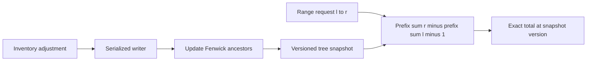

# Interview case: Live inventory range totals

## Scenario and requirements
The source framework advises classifying the operation before selecting a structure and identifies range sums with point updates as a Fenwick-tree use case. See [source OCR, images 002–007](../../../../Case_studies_DSA/index_basics/index_basics_SUPPLEMENTAL_IMAGE_OCR.md) and [20260823_005410.jpg](../../../../Case_studies_DSA/index_basics/20260823_005410.jpg). The inventory scenario, values and service constraints below are **illustrative**, not source incident data.

A warehouse has `n` ordered bins with integer quantities. Support `add(i, delta)` and exact inclusive `sum(l,r)` for 1 ≤ l ≤ r ≤ n, including negative deltas where inventory policy allows them. Assume a fixed bin ordering, a single logical writer, and integer arithmetic wide enough to avoid overflow; reject invalid indices. Queries should see an atomic snapshot, not half of an update.

## Algorithm
For one-based indices, `lowbit(i) = i & -i`. Tree entry `tree[i]` stores the sum over indices `i-lowbit(i)+1` through `i`. To add delta, update `tree[i]`, then repeatedly set `i += lowbit(i)` while `i <= n`. To compute prefix sum, accumulate `tree[i]` and set `i -= lowbit(i)` until zero. The inclusive interval result is `prefix(r)-prefix(l-1)`.

**Example:** quantities `[2,1,3,4]` yield `tree[1]=2`, `tree[2]=3`, `tree[3]=3`, `tree[4]=10`. `sum(2,4)=prefix(4)-prefix(1)=10-2=8`. After `add(3,-1)`, update entries 3 and 4; the same sum becomes 7. `prefix(0)=0`. Index 0 must never be used for updates because its lowbit is zero and the loop would not advance.

Each operation takes O(log n) time and O(n) storage; construct by n updates in O(n log n), or use a linear Fenwick build. A raw array gives O(1) update and O(n) range sum; a static prefix array gives O(1) query but O(n) update. A segment tree also supports O(log n) point update/range sum at a larger constant and naturally supports other associative aggregates. Standard prefix subtraction requires an invertible aggregate; it cannot directly answer arbitrary range minima.

## Operations and failure modes
Individual tree updates touch multiple cells: concurrent readers must use a lock, single-threaded event loop, or an actual immutable/versioned snapshot; atomic integer cells alone do not provide snapshot isolation. Persist the event log or authoritative bin values and checkpoint the tree so it can be rebuilt after a crash. Deduplicate adjustment IDs or make replay idempotent; do not apply the same event twice. Check overflow on both cell updates and prefix subtraction, and decide whether a decrement that makes a bin negative is rejected atomically.

Evaluate against a naive array oracle with randomized adjustments and all ranges for small n. Include n=1, l=r, full range, negative changes, zero values, invalid boundaries, integer extremes, and concurrent read/update schedules. Benchmark realistic update/query ratios and snapshot overhead, not just asymptotic operations. Monitor update lag, query latency, rejected adjustments and discrepancies with authoritative totals.

## Interview practice
1. **Why does the prefix loop terminate?** For positive i, subtracting its lowest set bit strictly decreases i; each step removes one set bit, reaching zero.
2. **Can this support assignment instead of addition?** Yes: keep the current value and add `new-old` atomically with the assignment. Without the old value, the required delta is unknown.
3. **What changes for range updates?** A difference-array Fenwick tree supports range add and point query; two trees support range add and range sum. Lazy segment trees offer a more general alternative.
4. **Why is a concurrent map of tree cells insufficient?** An update modifies several related cells; a query can observe a mixture of before and after values even if each cell access is individually atomic.
