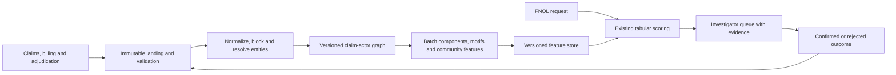
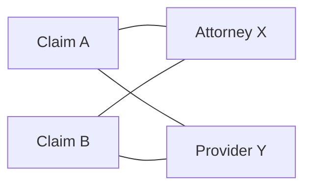

# Case study: Detect coordinated claims fraud with a graph

## Interview prompt

An insurer already scores individual claims against known-fraud actors. Investigators suspect that groups of claims share attorneys and providers, but no single claim is sufficiently suspicious. Design a system that discovers coordinated rings and enriches first-notice-of-loss (FNOL) triage without replacing the existing score.

**Sources:** [Graph fraud system design](../../../Graph_Rings/Graph_Fraud_System_Design.md) and [Practical graph ring analysis](../../../Graph_Rings/Graph_Ring_Detection_Practical_Analysis.md). These are reconstructed source notes; quantitative targets below are design assumptions unless explicitly attributed.

## 1. Context, objective, and scope

The current claim-centric star joins actors to reference lists and emits explainable individual-link scores. It does not retain cross-claim topology. An attorney appearing on two claims is not, by itself, evidence of fraud; common providers and shared legitimate businesses create large benign clusters.

**Objective:** surface investigator-actionable groups missed by individual scoring, while limiting unnecessary investigations and protecting legitimate claimants. The decision is a triage recommendation, not an automatic denial.

**Functional requirements**
- Ingest claims, participants, provider/billing data, and adjudicated fraud references; retain event time and provenance.
- Resolve entities conservatively; build typed claim–actor relationships and evidence-bearing paths.
- Compute cross-claim ring features and deliver a reasoned alert to investigators.
- Update outcomes and correct graph records when a match or adjudication changes.

**Non-functional assumptions:** FNOL decision within five seconds as in the source design; daily analytics refresh is acceptable initially, with a freshness indicator and micro-batches if needed. Investigation capacity and alert precision targets must be agreed with SIU; no unverified fraud-saving estimates are assumed.

## 2. Architecture and request path

The batch plane computes expensive graph statistics; the online plane looks up materialized features by resolved actor and graph version. If features are absent or stale, fall back to the existing claim-level score and flag degraded coverage rather than silently treating missing as zero. A case includes the actual edges, source records, timestamps, feature version and match confidence so investigators can challenge the signal.

## 3. Data model and detection

Model claims, claimants, attorneys, providers, hospitals and physicians as typed nodes. Edges such as `APPEARED_ON`, `REFERRED_BY` and `BILLED_THROUGH` carry source, effective time, ingestion time and confidence. Preserve the raw identifiers in a controlled registry; restrict PII access and audit lookups.

The four edges form a bipartite 4-cycle. It is a **candidate pattern**, not proof: a legitimate attorney and provider can appear together repeatedly. Add temporal concentration, relative frequency versus peers, community composition and adjudicated evidence. Keep claimants and actors distinct; do not infer an actor–actor relationship that is unsupported by a source record.

1. Normalize names, addresses and phones; generate blocking keys to limit comparison candidates.
2. Score matches on multiple attributes. Auto-merge only above a calibrated threshold; review ambiguous pairs and preserve lineage and reversibility. Transitive connected-component clustering can amplify one erroneous pair into an incorrect mega-entity, so constrain merges and monitor cluster growth.
3. Construct an incremental property graph and deduplicate edges idempotently using source identifiers and effective times.
4. Compute connected components in `O(V + E)` as broad candidate containers, not ring labels. Cap or downweight high-degree actors and evaluate Louvain-style communities and bounded 4-cycle/motif counts on eligible subgraphs. Large components, bridge actors and temporal bursts are signals to inspect, not independent fraud verdicts.
5. Materialize feature values with entity ID, graph snapshot, event cutoff and computation timestamp. Combine them with existing tabular features; keep the baseline model available for rollback.

## 4. Design decisions and tradeoffs

| Decision | Benefit | Risk and mitigation |
|---|---|---|
| Batch graph analytics plus online lookup | Predictable FNOL latency | Stale features: publish age, monitor lag and fall back to baseline |
| Conservative entity resolution | Fewer false joins and false accusations | Missed links: review borderline pairs and measure pairwise recall |
| Typed bipartite graph | Auditable source relationships | Hub explosion: degree limits, source-aware weighting, and sampled inspection |
| Explainable structural features first | Easier investigator review | May miss subtle patterns: compare a later GNN only after a trustworthy baseline exists |
| SIU confirmation feedback | Improves labels and references | Delayed, selective labels: evaluate with adjudication lag and random audits |

## 5. Evaluation and rollout

- **Offline:** construct point-in-time graph snapshots and temporal train/test splits; features must use only events and labels available before the decision. Compare baseline against baseline plus graph using precision at investigator capacity, recall on mature adjudications, calibration, and slice-level false positives. A random sample of low-risk cases helps estimate missed fraud despite selective review.
- **Shadow:** calculate features and explanations without changing decisions; validate entity matches, supernodes, feature freshness and end-to-end latency with investigators.
- **Controlled pilot:** route a capped treatment cohort, preserve a comparison group when ethically and operationally feasible, track incremental confirmed rings and investigation workload; adjudications require time to mature.
- **Operate:** monitor source lag, unresolved/merged entities, degree distribution, graph version, missing features, scoring latency, queue volume, override rate and appeal reversals. Alert on changes; retain a rollback to the existing score.

## 6. Failure scenarios

- **Shared hospital becomes a supernode:** bound expansion, weight by actor type and degree, and test recall impacts; do not discard the actor without audit.
- **Incorrect entity merge:** quarantine uncertain merges, keep source-level lineage and a reversible split workflow; invalidate affected features and re-evaluate cases.
- **Graph refresh fails:** mark features stale, serve baseline, alert operations and reconcile the missed window.
- **Feedback loop causes leakage or bias:** keep outcome timestamps, exclude future adjudications from historical features, and audit outcomes beyond the selected investigation queue.

## 7. Interview practice

**Q: Why is a connected component insufficient to call a fraud ring?** A: It establishes reachability, not coordinated behavior. A common provider can connect thousands of unrelated claims. Examine typed motifs, timing, peer baselines and adjudicated evidence; use components to bound candidate search.

**Q: Why not run a deep graph traversal during every FNOL request?** A: Latency and hub fanout are unpredictable. Precompute expensive features and use bounded lookups online; disclose freshness and fall back safely when unavailable.

**Q: How do you know the graph adds value?** A: Compare against the current model using temporally correct snapshots and precision at fixed SIU capacity, then measure incremental confirmed outcomes in a controlled pilot. Account for delayed labels and selective investigation.

**Q: How do you prevent bad matches from contaminating many cases?** A: Calibrate thresholds by entity type, preserve provenance and reversible clusters, review ambiguous links, monitor cluster size changes, and recompute features after corrections.
