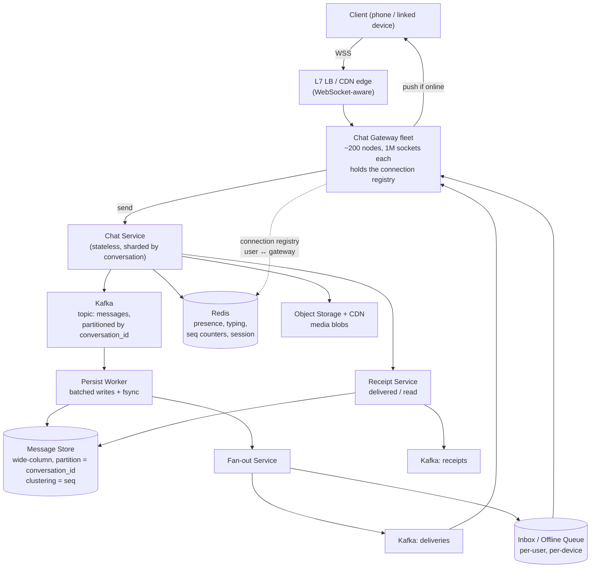

# WhatsApp — Chat System Design (Full Worked Case Study)

> **TL;DR** — WhatsApp looks like a messaging app and is actually a **reliability system with a real-time transport problem attached**. The single non-negotiable requirement is *never lose a message* — every other decision follows from it. That means persist before you acknowledge, use a monotonic per-conversation sequence number so ordering is decidable, keep a connection registry so you can push to a live socket, and an offline queue plus a fan-out-on-write inbox so a recipient who is not connected still gets the message when they return. The hard parts are group fan-out, multi-device sync (the same message must reach every device, and reads must sync), and the fact that fan-out on write for groups multiplies your writes by the group size.

> **60-second interview answer:** "I'd clarify first: is this 1:1 and group chat, do we need delivery and read receipts, do we need multi-device, and what's the group size limit — WhatsApp caps groups at 1,024. The requirement I'd call out above all is reliability: a message that's been acknowledged to the sender must never be lost. So my write path is persist-then-ack — the message is durably stored before the sender sees a single tick — and I'd use a per-conversation monotonic sequence number so ordering is decidable rather than dependent on clocks. Transport is a persistent WebSocket to a gateway, with a connection registry mapping user to gateway so I can route a push, and anything undeliverable goes to an offline queue plus a per-user inbox. Groups use fan-out on write with a per-recipient inbox row, because reads are far more frequent than writes. And I'd be explicit about the trade-off: I'm choosing consistency of the message log over availability of a single node, and I'd shard by conversation so a whole conversation lives on one shard and ordering is free."

---

## 1. Definition & mental model

**Plain English.** A chat system maintains, for every conversation, a totally ordered, append-only log of messages; delivers each new entry to every participant's devices as close to real time as the network allows; and guarantees that anything the sender was told was accepted is eventually delivered to every participant, even if they were offline for a week.

**The analogy: a group of friends and a shared notebook, plus a courier.**

- The **notebook** is the message log. Every message is written into it in order, with a number. Nobody argues about order because the numbers are on the page.
- The **courier** is the WebSocket connection. While you are home, the courier hands you each new page the moment it is written.
- The **mailbox** is the offline queue. If you are out, the courier leaves the pages in your mailbox and delivers them when you get back.
- The **read receipt** is you texting back "got it, read it" — which the courier must tell the sender about.
- **Multi-device** is you having a phone, a laptop and a tablet: every device needs its own copy of the page, and if you read it on the laptop, the phone must be told it is read.

**The insight:** the notebook is the system. The courier is an optimisation. If the courier fails, you lose latency; if the notebook fails, you lose messages. So the notebook is the part that must be reliable, and everything else is best-effort.

**The one-line version:** WhatsApp is an ordered, durable, per-conversation log plus a best-effort real-time delivery layer plus a guaranteed catch-up path.

---

## 2. Why it exists — the problem it solves

### Step 1 — Clarify the requirements

This is the first thing a candidate must do, and it is where most interviews are won or lost. Ask, then state your assumptions out loud.

**Functional requirements**

| # | Requirement | Decision |
|---|---|---|
| 1 | 1:1 messaging | Yes |
| 2 | Group messaging | Yes — cap group size at **1,024** (WhatsApp's real limit) |
| 3 | Message ordering | Per-conversation total order; no global order needed |
| 4 | Delivery receipts (one tick = sent, two ticks = delivered) | Yes |
| 5 | Read receipts (blue ticks) | Yes, with a per-user opt-out |
| 6 | Offline delivery | Yes — messages queue and are delivered on reconnect |
| 7 | Multi-device | Yes — up to 4 linked devices, plus the primary phone |
| 8 | Media (images, video, voice notes, documents) | Yes — via object storage, not through the message path |
| 9 | End-to-end encryption | Yes — the server routes ciphertext and cannot read content |
| 10 | Presence / last seen / typing indicators | Yes, best-effort and ephemeral |
| 11 | Message history on a new device | Yes — a synced history transfer, not a server-side archive |
| 12 | Group admin, add/remove members | Yes |
| 13 | Message deletion ("delete for everyone") | Yes, as a tombstone event |
| 14 | Voice/video calls | **Out of scope** — a separate real-time media system |
| 15 | Search across history | Client-side over the local store; server search is out of scope |

**Non-functional requirements — the ones that decide the architecture**

| Requirement | Target | Why it matters |
|---|---|---|
| **Reliability** | **A message acknowledged to the sender is never lost** | The single most important requirement; everything else yields to it |
| Latency | p99 < 100 ms within a region for delivery to an online recipient | Real-time feel |
| Availability | 99.99% for the send path | 26 seconds a month of unavailability |
| Ordering | Per-conversation total order, stable across devices | The user-visible property people notice |
| Durability | No acknowledged message lost, ever | Includes a datacenter failure |
| Consistency | Read-your-writes for the sender; eventual for other participants' receipts | Strong global consistency is unnecessary and expensive |
| Scale | 2 B+ users, 100 B+ messages/day | The capacity estimation below |
| Cost | Storage is the dominant cost; hot storage bounded | Retention and tiering matter |

**The explicit trade-off statement (say this out loud):** *"Reliability over latency, and consistency of the message log over availability of any single component. Given a choice between accepting a message slowly and losing it, I always choose slowly."*

---

## 3. Internal mechanics — the five-step worked design

### 3.2 Step 2 — Capacity estimation

Work the numbers out loud. The arithmetic is the point, not the exact answer.

**Assumptions:**
- 2 billion registered users, 500 million DAU
- 40 messages sent per active user per day
- Average message size 100 bytes of text (media is a pointer, ~200 bytes with metadata)
- Average group size for group messages: 10 participants
- 20% of messages are in groups
- Retention: hot storage 30 days, then tiered

**Write volume:**

```
Messages/day   = 500M DAU × 40 messages        = 20 B messages/day
Messages/sec   = 20 B / 86,400                 = ~231,000 msg/sec  (avg)
Peak (×3)                                      = ~700,000 msg/sec

Delivery writes (fan-out):
  1:1      → 1 recipient copy per message
  Group    → ~10 recipient copies, 20% of messages
  Effective multiplier = 0.8×1 + 0.2×10 = 2.8×
  Delivery writes/sec  = 231,000 × 2.8         = ~647,000 writes/sec (avg)
  Peak                                           = ~2 M writes/sec
```

**Storage:**

```
Per message stored row  ≈ 200 bytes (id, conversation, sender, seq, ts, status, body ptr)
  (encrypted text body ~100 B + ~100 B of metadata and indexes)

Daily:   20 B × 200 B = 4 TB/day of new message rows
          × 2.8 for per-recipient inbox rows = ~11 TB/day
30 days: ~340 TB hot
1 year:  ~4 PB
```

**Read volume:**

```
Message reads/sec:
  Each delivered message is read roughly once on delivery, plus history reads.
  Assume 1.5 reads per delivered message.
  Reads/sec ≈ 647,000 × 1.5 ≈ 1 M reads/sec (avg), ~3 M peak

Presence/typing: transient, ~10× the message rate at peak, held in memory only.
```

**Connection count — the number that drives the transport tier:**

```
Concurrent connections ≈ 500M DAU × 25% online concurrently = 125 M sockets
Per gateway node: ~1 M sockets with tuned kernel parameters (a realistic figure)
  → 125 M / 1M = ~125 gateway nodes minimum, plus headroom → 200 nodes
Memory per socket: ~10–50 KB with kernel buffers → 125 M × 25 KB ≈ 3 TB of RAM
  across the gateway fleet (in-memory registry state, not message data)
```

**The capacity takeaways to state:**
1. **Writes dominate reads at the delivery layer** (2.8× amplification) — this is the opposite of a social feed.
2. **Acknowledged writes must be durable**, so the write path pays an fsync; batching is essential to make 2 M writes/sec affordable.
3. **Socket count, not QPS, sizes the transport tier.** 125 M sockets is the hard engineering problem.
4. **Storage is 4 PB/year**, so retention and tiering are first-class design concerns, not afterthoughts.

### 3.3 Step 3 — API design

**Transport: WebSocket for everything real-time.** A single persistent bidirectional socket per device carries sends, receives, receipts, presence and typing indicators. REST is used only for history pagination, media upload, and account operations.

```
WS  wss://gw.chat.example/ws?v=<protocol>&token=<auth>

Frames (all protobuf-binary on the wire, JSON shown for readability):

  → { "t":"msg.send", "cid":"c_9f3a", "tmp_id":"tmp_7f2",
      "body":"<e2ee ciphertext>", "type":"text" }
  ← { "t":"msg.ack",  "tmp_id":"tmp_7f2", "cid":"c_9f3a",
      "seq": 1048576, "ts": 1758960000123 }        ← single tick

  ← { "t":"msg.new",  "cid":"c_9f3a", "seq":1048577,
      "from":"u_8812", "body":"<ciphertext>", "ts": ... }
  → { "t":"msg.delivered", "cid":"c_9f3a", "seq":1048577 }   ← two ticks
  → { "t":"msg.read",      "cid":"c_9f3a", "seq":1048577 }   ← blue ticks

  → { "t":"presence.sub", "users":["u_8812","u_9910"] }
  ← { "t":"presence",     "user":"u_8812", "state":"online" }
  → { "t":"typing",       "cid":"c_9f3a", "state":"start" }

  → { "t":"sync", "cursors": { "c_9f3a": 1048570, "c_1b02": 88 } }
  ← { "t":"sync.batch", "cid":"c_9f3a", "msgs":[ ... seq 1048571.. ] }
```

**The `tmp_id` / `seq` pair is the reliability mechanism.** The client generates a `tmp_id` for a message it has not yet had acknowledged. When the server's `msg.ack` returns with a real `seq`, the client replaces the pending bubble. If the client reconnects without an ack, it re-sends the same `tmp_id` and the server deduplicates on it. **This is idempotency in the client protocol, and it is what makes "never lose a message" achievable over an unreliable network.**

**REST endpoints:**

```http
POST /v1/media/upload-url
  → { "url": "https://blob.../presigned", "media_id": "m_77a1" }   # presigned, §3.3

GET /v1/conversations/{cid}/messages?before_seq=1048571&limit=50
  → { "messages": [ ... ], "has_more": true }

POST /v1/conversations                      # create a group
POST /v1/conversations/{cid}/members        # add/remove (admin only)
POST /v1/devices/link                       # multi-device linking (QR flow)
GET  /v1/conversations/{cid}/sync?since_seq=0   # history transfer to a new device
```

**Why media uses presigned URLs:** a 50 MB video never touches the chat servers. The client uploads directly to object storage, gets a `media_id`, and sends a message whose body is `{ "type":"media", "media_id":"m_77a1", "key":"<e2ee key>" }` — a few hundred bytes. The recipient downloads it from blob storage through a CDN ([see Blob Storage](../../HLD/04-data/04-blob-and-object-storage.md) §3.6).

**Why WebSocket and not the alternatives:**

| Transport | Fit | Verdict |
|---|---|---|
| **WebSocket** | Full duplex, low overhead per frame, server-initiated push | **Chosen** |
| Long polling | Every message costs an HTTP round trip; reconnect churn | Rejected — 10× the requests |
| SSE | Server→client only; sends would need a second channel | Rejected for a bidirectional protocol |
| MQTT | Purpose-built for this (used by WhatsApp historically) | Valid — a specialised pub/sub protocol with QoS levels; more operational surface |
| Raw TCP | Full control, no proxy friendliness | Rejected — WebSocket traverses proxies and CDNs |

### 3.4 Step 4 — High-level design



**Component by component, with the reason for each:**

| Component | Responsibility | Why it exists |
|---|---|---|
| **L7 load balancer** | Terminate TLS, route WebSocket upgrades, sticky-by-connection | WebSocket needs a long-lived connection; the LB must not idle-timeout it ([see Proxies](../../HLD/02-networking/03-forward-and-reverse-proxy.md) §3.6) |
| **Chat Gateway** | Hold sockets, maintain the user→gateway registry, push frames | The only stateful tier; sized by socket count, not QPS |
| **Chat Service** | Validate, assign a sequence number, publish to Kafka | Stateless and horizontally scalable |
| **Kafka (messages)** | Durable ordered log, partitioned by `conversation_id` | Ordering per conversation for free; replay for recovery |
| **Persist Worker** | Batch writes and fsync to the message store | Batches fsyncs so 2 M writes/sec is achievable; **this is the reliability point** |
| **Message Store** | The durable log — wide-column, partition `conversation_id`, cluster `seq` | Single-partition ordered reads ([see NoSQL](../../HLD/04-data/02-nosql-deep-dive.md) §3.4) |
| **Fan-out Service** | Write one inbox row per recipient device | Groups multiply writes; fan-out decouples it from the send path |
| **Inbox / Offline Queue** | Per-user, per-device pending deliveries with a cursor | Delivery to offline devices and to a reconnecting device |
| **Redis** | Presence, typing, seq counters, connection registry | Ephemeral, high-QPS, loss-tolerant |
| **Receipt Service** | Delivered/read state per recipient per message | Receipts are high-volume and must not block the message path |
| **Object storage + CDN** | Media blobs | Keeps large payloads off the message path |

**The end-to-end send flow, step by step:**

```
1. Client sends msg.send with tmp_id over its WebSocket to gateway G1
2. G1 forwards to the Chat Service for conversation c_9f3a
   (routing: hash(conversation_id) → a specific Chat Service shard)
3. Chat Service:
   a. validates membership and rate limits
   b. assigns seq = INCR conv_seq:{cid} in Redis      ← the ordering authority
   c. publishes {cid, seq, sender, body, ts} to Kafka, partitioned by cid
4. Persist Worker consumes, batches (e.g. 500 messages or 20 ms),
   writes to the message store, and fsyncs
5. Once the write is durable, the worker publishes a "committed" event
6. Gateway G1 sends msg.ack{tmp_id, seq} to the sender      ← THE SINGLE TICK
7. Fan-out Service resolves the recipient list, writes an inbox row
   per recipient device, and publishes a delivery event per device
8. For each recipient device:
     - if the registry shows it online on gateway Gx → push msg.new
       → the device returns msg.delivered → two ticks to the sender
     - if offline → the inbox row stays pending with the device's cursor
9. On reconnect, the device sends {sync, cursors} and the Inbox Service
   returns everything after each cursor in seq order
10. On read, the device sends msg.read; the Receipt Service records it and
    notifies the sender → blue ticks
```

**The critical ordering detail: `msg.ack` (step 6) is only sent after the fsync (step 4).** That is the entire "never lose a message" guarantee, expressed as one ordering constraint. A candidate who acks before persisting has designed a system that loses messages, and it is the most common mistake in this question.

**Why the sequence number is assigned at step 3b and not by the database:** it must be assigned before fan-out (so recipients can order) and it must be stable across retries. A Redis `INCR` on a per-conversation counter is O(1), atomic, and gives a total order within a conversation. The alternative — a timestamp — breaks with clock skew and with two messages arriving in the same millisecond ([see Sharding](../../HLD/03-scaling/05-sharding-replication-and-consistency.md) §6.7).

**Why Kafka sits between the service and the store:** it decouples the acknowledgement latency from the storage write path, gives replay for recovery, and provides the ordered stream that the fan-out service consumes. It is also the reason the persist step can batch.

### 3.5 Step 5 — Deep dive and trade-offs

#### Message delivery guarantees

| Guarantee | How it is achieved |
|---|---|
| **At-least-once delivery to the server** | Client retries with the same `tmp_id` until it receives `msg.ack` |
| **Exactly-once processing** | Server deduplicates on `(sender_id, tmp_id)` — a conditional insert into a dedupe table with a TTL; exactly-once is at-least-once plus idempotency ([see Sharding](../../HLD/03-scaling/05-sharding-replication-and-consistency.md) §3.11) |
| **No loss after ack** | Persist and fsync *before* sending `msg.ack` |
| **No loss of fan-out** | Fan-out is driven from the durable Kafka log, so a crashed fan-out worker resumes from its offset |
| **At-least-once delivery to the recipient** | Inbox rows are only deleted after the device confirms delivery; duplicates are deduplicated client-side by `seq` |

**The trade-off to state:** the recipient may receive a duplicate (at-least-once), and the design accepts that because deduplicating on a monotonic `seq` is trivial on the client, whereas losing a message is unacceptable.

#### Connection registry and presence

```
Registry: Redis hash  conn:{user_id}  →  { device_id: gateway_id, ... }
          conn:gw:{gateway_id}        →  set of user_ids (for cleanup on failure)

Presence: Redis key with a TTL, refreshed by a heartbeat every 30 s
          presence:{user_id} → "online"  EX 90    (3 missed heartbeats = offline)

Scale:    125M concurrent → ~125M registry entries (small hashes)
          ~200 gateway nodes × 1M sockets
```

**The failure mode that matters:** when a gateway node dies, its 1M sockets drop, and the registry still claims those users are online. Messages routed there are silently lost from the *delivery* path (not from the store — they are already durable).

**The fix, and it is a required part of the answer:**
1. **Heartbeats with a short TTL** (30 s heartbeat, 90 s TTL) so stale entries expire.
2. **Gateway registration with a lease** in Redis: the gateway renews `gw:{id}:alive` every 10 s; if it lapses, all its registry entries are considered invalid.
3. **A dead-letter path for push failures** — if a push to a gateway fails or times out, the message stays in the inbox and is delivered on reconnect.
4. **Never rely on push for correctness** — the inbox is the guarantee, the push is the optimisation. This single sentence is worth more than any other in this answer.

#### Message ordering

```
Per-conversation total order via a monotonic seq, assigned server-side.

Why not timestamps:
  - clock skew across servers produces non-monotonic order
  - two messages in the same millisecond are unordered
  - a client's clock is not trusted at all

Why not a global sequence:
  - a single global counter is a bottleneck and a SPOF
  - ordering is only user-visible within a conversation
  - and it would require a global consensus round per message

Client-side ordering rule:
  display by seq; a message with seq n is not shown until all seq < n
  have been received — or, better, show a placeholder and fill it in.
```

**The gap problem:** a client with seq 105 and 108 but not 106–107 has a hole. This happens when fan-out for one message lags. **Fix:** the client requests the missing range explicitly (`sync?since_seq=105`) rather than waiting, and shows the messages it has. A "filling the gap" request is the standard remedy and worth naming.

#### Group fan-out

| Strategy | Mechanism | Writes | Read cost | When |
|---|---|---|---|---|
| **Fan-out on write** | One inbox row per recipient device at send time | × group size (up to ×1,024) | Cheap — the recipient reads its own inbox | **Chosen** — reads dominate |
| **Fan-out on read** | Store the message once in the group log; each recipient reads the group's log | ×1 | Expensive — every read scans the group log and merges across groups | Large groups, or when writes are the bottleneck |
| **Hybrid** | Fan-out on write for small groups; fan-out on read above a threshold | Variable | Variable | **The practical answer** — threshold at a few hundred members |

**The numbers that justify the choice:** with a group of 1,024 and 20% of messages in groups, fan-out on write multiplies delivery writes by up to 205× in the worst case. That is why WhatsApp caps groups at 1,024 and why the practical design uses a hybrid: **fan-out on write for groups under ~256 members, fan-out on read for larger ones.**

**Removed members:** a fan-out-on-write design must handle a member removed mid-conversation. Their inbox rows for future messages must not be created, and their read access to the group log must be revoked — which is why the membership list is checked at fan-out time against an authoritative membership store, not against a cached copy that may be minutes stale.

#### Offline queueing and history sync

```
Per-device cursor:  cursor:{user_id}:{device_id} → last_seq_acked per conversation

Delivery on reconnect:
  1. Device connects, authenticates, sends its cursors
  2. Inbox Service returns everything after the cursor, in seq order,
     paginated (batches of ~100 messages)
  3. Device acks each batch, advancing the cursor
  4. Inbox rows are deleted once every device of that user has acked
     (or aged out by TTL)

Retention:
  Offline queue TTL: 30 days (WhatsApp's real offline window)
  After that, the message is not pushed; it is fetched from history on demand
```

**Why the cursor is per-device:** with multi-device, the phone may be online while the laptop is closed for a week. A single per-user cursor would let the phone's ack mark messages as delivered and then the laptop would never receive them. **This is the multi-device bug and naming it is a strong signal.**

#### Multi-device sync

```
Linked devices: 1 primary phone + up to 4 companion devices
Each device:    own cursor, own delivery state, own read state
Identity:       each device has its own key pair; the primary phone
                authorizes linking via QR, and a per-device session is established

Sync requirements:
  - Every message reaches every device of every participant
  - A read on one device marks it read on all of that user's devices
  - History transfer to a new linked device: encrypted, device-to-device

Design consequence: fan-out is per DEVICE, not per user.
  recipient_devices = Σ over participants of (number of their devices)
  With a 10-person group × 2.5 devices = 25 inbox rows per message
```

**The E2EE consequence, and the sentence to say:** *"Because the server cannot read the plaintext, it cannot encrypt per device — it routes a ciphertext and the recipient devices share the key material via the sender's per-device encrypted key envelope. The server's job is routing, ordering and durability, not content."* That means the server cannot do server-side search, server-side spam classification on content, or server-side media transcoding of encrypted content — all real product trade-offs that follow from the encryption requirement.

#### Delivery and read receipts

```
Delivered:  set by the recipient's device when it receives the message
            → stored per (message, recipient_device)
            → the sender sees two ticks when ALL devices of ALL recipients acked
Read:       set by the recipient's device when the conversation is opened
            → the sender sees blue ticks
            → a per-user opt-out disables sending them

Volume:     receipts are ~2× the message rate (delivered + read)
            → they must NOT be on the message path
            → batched, sent to a separate Kafka topic, updated asynchronously
```

**The scaling trap:** naively, every message write triggers a receipt write to every participant, and every receipt triggers a notification to the sender. That is O(participants²) traffic for a group. **Fix:** the receipt for a message in a group is a **bitmap or a set of acked device IDs**, not one row per recipient; and the sender's client is notified by a single aggregated "read up to seq N" event rather than per-message. Aggregating receipts by high-water mark is the key optimisation.

#### Delivery reliability — the full loss analysis

| Point of failure | What happens | Mitigation |
|---|---|---|
| Client sends, network drops | No `msg.ack` | Client retries with the same `tmp_id` |
| Server crashes after Redis `INCR`, before Kafka publish | Sequence number burnt, message lost | The client has no ack, so it **retries** — safe because a burnt seq is harmless |
| Server crashes after Kafka publish, before ack | Client retries; server dedupes on `tmp_id` | Idempotency |
| Persist worker crashes before fsync | Kafka offset not committed | On restart it replays from the committed offset; the message is written |
| Message store node fails | Replica promoted | Replication factor 3 with quorum writes |
| Gateway dies with 1M sockets | Push fails for those users | Inbox rows are still pending; delivered on reconnect |
| Fan-out worker crashes | Delivery events not published | Kafka offset replay |
| Recipient device offline for 40 days | Offline queue TTL expired | Message is still in the group log; fetched from history on demand |

**The statement that closes the loop:** *"Every failure mode either has the client retry, Kafka replay, or the inbox hold. The only loss window is a message that was never acknowledged to the sender — and a message the sender does not know was accepted is a message the sender will resend."*

#### Media pipeline

```
1. Client requests POST /v1/media/upload-url
2. Server verifies size/type limits and returns a presigned PUT URL
3. Client encrypts the media client-side with a random symmetric key
4. Client PUTs the ciphertext directly to object storage
5. Client sends a message whose body is { type:"media", media_id, key, sha256 }
   — a few hundred bytes, so the message path stays small
6. On receipt, the recipient's device fetches from the CDN using a signed URL,
   verifies the hash, decrypts locally
7. Media is never transcoded server-side (E2EE), except for the optional
   "blurred preview" thumbnail derived from a separate, deliberately
   low-resolution preview the sender uploads
```

**Why this matters architecturally:** media would otherwise be 99% of the bytes on the message path. Keeping it out means the message store holds small rows, the message path is fast, and the CDN absorbs the bandwidth ([see Blob Storage](../../HLD/04-data/04-blob-and-object-storage.md) §3.9).

#### Message ID generation

```
Two identifiers, two purposes:

  tmp_id (client-generated UUID)  → idempotency of the send
  seq    (server-assigned, per conversation, monotonic) → ordering + dedupe client-side

Why not a global Snowflake ID as the primary identifier:
  - it does not give per-conversation ordering without a comparison of timestamps
  - a per-conversation counter is simpler and cheaper (O(1) INCR)
  - but a global unique ID is still useful as a stable external reference for
    analytics and support, so store both

The hybrid: seq for ordering within a conversation, plus a global message_id
(UUIDv7 or Snowflake) for cross-system references, deduplication and analytics.
```

---

## 4. Variants & taxonomy

| Variant | Description | Trade-off |
|---|---|---|
| **Server-side plaintext** | The server can read messages | Enables server search, spam filtering, transcoding; unacceptable for a private messenger |
| **E2EE, server routes ciphertext** | The server is a router | No server-side content features; the design chosen here |
| **Push-based delivery** | Server pushes over a persistent socket | Low latency; requires the socket fleet and registry |
| **Poll-based delivery** | Client polls for new messages | Simpler; terrible latency and 10× the requests |
| **Fan-out on write** | One inbox row per recipient device | Cheap reads, ×N writes |
| **Fan-out on read** | One row per message; recipients read the log | Cheap writes, expensive reads and merging |
| **Hybrid fan-out** | Write for small groups, read for large | The practical answer |
| **Per-conversation sequence** | Monotonic counter per conversation | Ordering for free; a hot counter for very active groups |
| **Timestamp ordering** | Order by server timestamp | Simpler; breaks with skew and ties |
| **Per-device cursors** | Each device tracks its own position | Correct multi-device; more state |
| **Per-user cursor** | One position per user | Simpler; loses messages on a device that was offline |
| **Durable queue per user** | Inbox rows with TTL | Reliable catch-up; storage cost |
| **Client-side history only** | The server stores nothing after delivery | Cheapest; no multi-device, no history restore |
| **Server-side history with tiered storage** | Hot 30 days, archive beyond | Enables restore; storage cost and privacy implications |
| **MQTT transport** | Pub/sub protocol with QoS | Purpose-built for this; more operational surface than WebSocket |
| **UDP-based real-time** | Custom protocol over UDP | WhatsApp's actual early architecture; NAT traversal complexity |

---

## 5. Pros / Cons

| Decision | Pros | Cons |
|---|---|---|
| **Persist-then-ack** | No acknowledged message is ever lost | Higher send latency (fsync), lower throughput than ack-first |
| **WebSocket transport** | Bidirectional, low overhead, server push | 125 M long-lived sockets; LB and proxy tuning required |
| **Per-conversation seq** | Ordering for free, O(1) | A hot counter for a very active group |
| **Kafka in the write path** | Replay, decoupling, ordered per partition | A pipeline to operate; adds tens of ms to the ack |
| **Wide-column message store** | Single-partition time-ordered reads, huge write throughput | No ad-hoc queries; compaction and tombstone ops |
| **Fan-out on write** | Cheap reads, simple client | ×group-size write amplification |
| **Per-device inbox** | Correct multi-device delivery | ×device-count writes and storage |
| **Redis for presence/registry** | Fast, cheap, ephemeral | Not durable; must never be on the correctness path |
| **E2EE** | Privacy guarantee | No server search, no server spam filtering, no transcoding |
| **Offline queue with 30-day TTL** | Bounded storage | Beyond 30 days requires a history fetch |

---

## 6. Exceptions, edge cases & failure modes

### 6.1 Acking before persisting — the cardinal sin

If `msg.ack` is sent when the message is queued rather than when it is durable, a crash loses acknowledged messages. The user sees a single tick, the message never arrives, and the sender never resends because they were told it was accepted. **The fix is one ordering constraint:** ack only after the persist worker's fsync. Say this explicitly.

### 6.2 The gateway failure and the stale registry

Covered in §3.5. The specific sequence: a gateway dies, 1M sockets drop, the registry still says those users are online for up to the TTL, so push attempts fail. **If your design relies on push for correctness, messages are lost.** It does not, because the inbox is the guarantee — but the answer must say so, and must include heartbeat leases and a push-failure path back to the inbox.

### 6.3 Reconnect storms

A gateway restart drops 1M connections; all 1M clients reconnect simultaneously; each performs an auth handshake and a sync request for its cursors. The reconnect load is far higher than steady-state and it arrives in seconds.

**Mitigations:**
- **Jittered reconnect backoff** on the client (exponential with a random component), so the fleet does not synchronise.
- **Connect-then-sync**, not sync-then-connect: accept the socket first, then let the sync happen over the established connection with its own pacing.
- **Bound the sync batch size** (100 messages per page) so a client returning after a week does not request a million messages at once.
- **Reserve capacity** for reconnect: gateway nodes sized for 1.3× steady-state sockets.

### 6.4 Hot conversations and the per-conversation counter

A conversation with 100,000 members (a broadcast channel) makes `conv_seq:{cid}` a hot counter: every message does an `INCR` on the same Redis key, and the seq counter becomes a bottleneck at thousands of messages/sec.

**Fixes:** shard large channels into a fan-out-on-read model where the sequence is per-shard; or batch sequence allocation (claim a block of 100 seq numbers at once, so one `INCRBY 100` serves 100 messages); or use a store with a native per-partition sequence. **The block-allocation trick is the cleanest answer.**

### 6.5 Message ordering across a fan-out lag

The fan-out for message 106 is slow, so a client has 105 and 107 but not 106. If the client displays them in arrival order, the conversation reads out of order.

**Fix:** the client displays by `seq` and shows a gap indicator, then issues a targeted `sync?since_seq=105&until_seq=107` to fill the hole. Do not buffer 107 indefinitely waiting for 106 — a permanent fan-out failure would stall the conversation.

### 6.6 Duplicate messages after a retry

The client re-sends with the same `tmp_id` after a reconnect. Without deduplication, the recipient sees the message twice.

**Fix, two layers:** the server deduplicates on `(sender_id, tmp_id)` with a conditional write and a 24-hour TTL; the client deduplicates on `seq`, ignoring any message with a sequence number it has already stored. **Belt and braces, because a duplicate is annoying but a loss is unacceptable.**

### 6.7 Group membership changes mid-flight

A member is removed while a message is being fanned out. Depending on the timing, they may or may not receive it. And a new member added to a group should not receive history from before they joined — which in a fan-out-on-write design is naturally true, but must be stated.

**Fix:** check membership against the authoritative store at fan-out time; make the membership change itself a message in the log so all members agree on the ordering of "removed" relative to messages; and define explicit semantics for history visibility on join.

### 6.8 Multi-device cursor divergence

Covered in §3.5. The specific failure: a per-user cursor lets device A's ack advance the shared cursor, so device B never receives the messages. **Per-device cursors are mandatory**, and inbox rows can only be deleted when every device of that user has acked.

### 6.9 Clock skew

Using client or server timestamps for ordering produces non-monotonic order under skew. **Fix:** the server assigns the sequence number from a per-conversation counter; the timestamp is display metadata only. Use the cache server's clock where a time value is needed for expiry ([see Redis](../../HLD/03-scaling/03-redis-deep-dive.md) §6.11).

### 6.10 Media that never arrives

The client uploads the media to blob storage but crashes before sending the message. The blob is orphaned and costs money. Conversely, the message is sent but the recipient's download fails — the message shows a broken attachment.

**Fixes:** a reconciliation job that garbage-collects blobs with no referencing message after 24 hours; a retry with backoff on the recipient's download; and a `sha256` in the message so the recipient can verify integrity and detect corruption.

### 6.11 Storage growth and the retention decision

4 PB/year of messages is a governance problem. Options: a tiered store (hot 30 days, warm 1 year, archive beyond) with lifecycle rules; or a client-side history model where the server retains nothing and history lives only on devices plus an encrypted backup. WhatsApp's real answer is closer to the second — messages are not stored on the server after delivery, and history comes from the device or an encrypted backup ([see Blob Storage](../../HLD/04-data/04-blob-and-object-storage.md) §3.7).

### 6.12 Other failure modes worth naming

- **The 1,024-member group limit** exists because fan-out cost is linear in group size; removing it means changing the fan-out strategy.
- **Receipt storms in large groups** — O(participants²) unless receipts are aggregated by high-water mark.
- **Presence as a privacy leak** — "last seen" and "online" reveal behaviour; a per-user opt-out must be enforced server-side, not client-side.
- **A malicious client** sending 10,000 messages/sec — per-user and per-conversation rate limits, enforced at the gateway, not the service.
- **Replay attacks on a send** — a captured frame resent to duplicate a message; the `tmp_id` dedupe plus an authenticated, nonce-carrying session prevents it.
- **The offline queue for a device that never returns** — 30-day TTL, then garbage-collect; otherwise the inbox grows without bound.
- **Sequence number gaps on a burnt seq** — harmless, but any client logic that assumes contiguous sequences breaks. Clients must tolerate gaps.
- **A Kafka partition hot spot** — a very active conversation hashes to one partition, which becomes the throughput limit for that conversation. Mitigate by allowing a conversation to be split into sub-partitions for large channels.
- **Federated/datacenter failure** — the message store's replication factor 3 with quorum writes means the loss of one node in an AZ is transparent; a full-region failure requires the inbox and the log to be replicated cross-region, which adds write latency. State the trade-off.

---

## 7. When to use / When NOT to use

### This design is right when
- Delivery reliability is the top requirement and message loss is unacceptable.
- Messages are small and media is offloaded.
- Conversations are bounded in size (groups up to ~1,000).
- Real-time delivery to online users matters.
- Multi-device sync is required.
- Ordering within a conversation is user-visible and must be exact.

### This design is NOT what you want when
- **It is a broadcast channel with millions of subscribers** — that is a pub/sub or feed problem, fan-out on read, and a CDN for media ([see Instagram](04-instagram-news-feed.md)).
- **You need server-side search, moderation or analytics over content** — E2EE forbids it; you need a plaintext or a client-side model.
- **Messages are large documents** — that is file transfer with a notification, not a chat system.
- **You need a durable, replayable event log for other consumers** — that is Kafka, and chat is a specific application of it.
- **You need guaranteed global ordering across conversations** — you do not; if you think you do, re-examine the requirement.

### Design decision table

| Requirement | Decision |
|---|---|
| Never lose an acknowledged message | Persist and fsync before `msg.ack` |
| Real-time delivery | WebSocket per device, connection registry in Redis |
| Ordering | Per-conversation monotonic `seq`, assigned server-side |
| Idempotent send | Client `tmp_id`, server dedupe with a TTL |
| Offline delivery | Per-device cursor + per-device inbox rows |
| Multi-device | Fan out per device, per-device cursors, per-device read state |
| Group chat ≤ 256 members | Fan-out on write |
| Group chat > 256 members | Fan-out on read, or a hybrid threshold |
| Receipts for a large group | Aggregate by high-water mark, never per-recipient rows |
| Media | Presigned upload to object storage; the message carries a pointer |
| E2EE | The server routes ciphertext; no server-side content features |
| Presence | Redis with a heartbeat TTL; never correctness-critical |
| Gateway failure | Heartbeat leases, inbox fallback, jittered reconnect |
| History on a new device | Device-to-device encrypted transfer, or fetch from a tiered archive |
| Storage growth | Retention tiers; client-side history; encrypted backup |

---

## 8. Numbers, defaults & tuning

| Quantity | Value | Reasoning |
|---|---|---|
| Registered users | 2 B+ | Scale |
| DAU | 500 M | Active fraction |
| Messages/user/day | 40 | Typical |
| Messages/day | 20 B | 500 M × 40 |
| Average messages/sec | ~231,000 | ÷ 86,400 |
| Peak multiplier | ×3 | Diurnal |
| Fan-out multiplier | ×2.8 (0.8×1 + 0.2×10) | Groups amplify writes |
| Delivery writes/sec | ~647,000 avg, ~2 M peak | The real write load |
| Message row size | ~200 B | Metadata plus a media pointer |
| New storage/day | ~4 TB (rows) / ~11 TB (with inbox) | Retention drives cost |
| 30-day hot storage | ~340 TB | Hot tier sizing |
| Concurrent sockets | ~125 M (25% of DAU) | The transport scaling unit |
| Sockets per gateway | ~1 M | With tuned kernel limits |
| Gateway nodes | ~200 (125 + headroom) | Fleet sizing |
| Memory per socket | 10–50 KB | Kernel buffers plus app state |
| Gateway fleet RAM | ~3 TB total | Registry and socket state |
| Group size cap | **1,024** | Fan-out cost is linear |
| Hybrid fan-out threshold | 256 members | Above it, fan out on read |
| Devices per user | 4 linked + 1 primary | Multi-device |
| Group members × devices | 10 × 2.5 = 25 inbox rows/message | Per-device fan-out |
| Heartbeat interval | 30 s | Presence freshness |
| Presence TTL | 90 s | Three missed heartbeats |
| Gateway lease renewal | 10 s | Detects a dead gateway |
| Offline queue TTL | 30 days | Beyond that, fetch from history |
| Sync batch size | 100 messages | Bounds a reconnect burst |
| Reconnect backoff | Exponential with jitter, base 1 s, cap 60 s | Prevents reconnect storms |
| Reconnect headroom | 1.3× steady-state sockets | Burst capacity |
| Receipt volume | ~2× the message rate | Delivered + read |
| Dedupe TTL | 24 h | Covers a long offline retry |
| Kafka partitions (messages) | By `conversation_id` | Ordering per conversation |
| Message store replication | RF 3, quorum writes | Survives a node failure |
| Ack latency budget | p99 < 100 ms in-region | Excludes the fsync tail |
| Batch size in the persist worker | 500 messages or 20 ms | Amortises fsync |
| Sequence allocation block | 100 per `INCRBY` for hot channels | Removes the hot counter |
| Retention tiers | Hot 30 d, warm 1 y, archive beyond | 4 PB/year |

---

## 9. Interview Q&A

**Q1 (easy). How would you start this question?**
By clarifying the requirements and stating my assumptions. Is it 1:1 only or groups too, and what is the group size limit? Do we need delivery and read receipts? Multi-device? Is it end-to-end encrypted? What is the retention policy? Then I would name the non-functional requirement that drives everything, which for chat is reliability — a message acknowledged to the sender must never be lost. Latency and availability matter, but not as much. Everything else in the design is a consequence of that one requirement.

**Q2 (easy). Which protocol would you use and why?**
WebSocket. It is a persistent, full-duplex connection so the server can push a message the instant it exists, and the client can send on the same connection, with only a few bytes of framing per message. Long polling would cost an HTTP round trip per message and produce enormous reconnect churn at 125 million clients. Server-Sent Events is one-directional, so sends would need a separate channel. MQTT is actually a reasonable choice — it is designed for exactly this and has quality-of-service levels — but it adds operational surface, and WebSocket traverses proxies and CDNs more easily. The important detail is that a WebSocket through a load balancer needs a long idle timeout, or the LB will kill a healthy connection.

**Q3 (easy). How do you guarantee a message is not lost?**
By persisting it durably before acknowledging it to the sender. The client sends a message with a client-generated temporary ID, the server assigns a sequence number, publishes to Kafka, a persist worker batches and fsyncs it to the message store, and only after the fsync succeeds does the server send the acknowledgement. If the client does not receive an acknowledgement, it keeps retrying with the same temporary ID, and the server deduplicates on that ID. That gives at-least-once delivery to the server plus idempotent processing, which is what exactly-once actually means in practice. The single most important line in the design is that the ack comes after the fsync.

**Q4 (medium). How do you order messages?**
With a per-conversation monotonic sequence number assigned by the server. A `INCR` on a Redis key per conversation is O(1) and atomic, and it gives a total order within the conversation, which is the only ordering that is user-visible. I would not use timestamps because clock skew across servers produces non-monotonic order and two messages in the same millisecond are unordered, and I would not use a global counter because it is a bottleneck and would require consensus per message for no user-visible benefit. The client displays by sequence number, and if it has a gap — say 105 and 107 but not 106 — it shows a placeholder and requests the missing range rather than stalling the conversation.

**Q5 (medium). How do you handle a recipient who is offline?**
With a per-device inbox and a per-device cursor. When a message is sent, the fan-out service writes an inbox row for every recipient device, and if the connection registry says the device is online it also pushes the message over its socket. If it is offline, the row stays pending with the device's cursor. On reconnect, the device sends its cursors and the inbox service returns everything after each cursor in sequence order, in batches. The critical design point is that the cursor is per device, not per user — with a single per-user cursor, the phone's acknowledgement would advance the shared cursor and the laptop that was closed for a week would never receive those messages. And it also means the inbox, not the push, is the reliability guarantee: push is an optimisation, and if it fails the message is still delivered on reconnect.

**Q6 (medium). Walk me through the high-level architecture.**
A client holds a WebSocket to a load balancer that routes to a chat gateway. The gateway fleet is the only stateful tier — roughly 200 nodes at a million sockets each — and it maintains a connection registry in Redis mapping user and device to gateway. Sends go to a stateless chat service, sharded by conversation ID, which validates membership, assigns a sequence number from Redis, and publishes to a Kafka topic partitioned by conversation. A persist worker consumes that, batches writes, fsyncs to the message store, and then the gateway acknowledges to the sender. A fan-out service consumes the same stream, resolves recipients, writes per-device inbox rows, and publishes delivery events that the gateways push to online devices. Receipts go on their own Kafka topic and are updated asynchronously. Media goes to object storage via presigned URLs and never touches the message path.

**Q7 (medium). Why a wide-column store for messages?**
Because the dominant query is "the last N messages in this conversation, in order", which is a single-partition, time-ordered slice — partition by conversation ID, cluster by sequence number descending — and that is exactly what a wide-column store is built for. It also has the write throughput for two million delivery writes per second, which a single relational primary does not. The cost is that I cannot do ad-hoc queries against it, so anything analytical goes out through change data capture into a warehouse. At a smaller scale, Postgres partitioned by conversation would be perfectly reasonable, and I would say so rather than implying the wide-column store is always necessary.

**Q8 (hard, testing §6). A gateway node crashes with a million connections. What happens?**
First, those million sockets drop and all those clients reconnect with jittered backoff — and if the backoff is not jittered, they all reconnect simultaneously and the reconnect load dwarfs steady state, so I size the gateway fleet at about 1.3 times steady state and use exponential backoff with a random component. Second, and more dangerous, the connection registry still claims those users are online until the TTL expires, so push attempts to that gateway fail. That is only survivable because push is not the correctness path — the inbox rows are still pending and every message is delivered on reconnect. I would also add a gateway lease that renews every ten seconds, so a dead gateway's registry entries are invalidated quickly rather than waiting for the full presence TTL, and a push-failure path that immediately marks the delivery as pending rather than dropping it.

**Q9 (hard, testing §6). A group has 1,024 members. How does that change the design?**
Fan-out on write multiplies the delivery writes by the group size, so with a thousand members one message becomes a thousand inbox rows — and with multi-device, several thousand. At the scale in the estimation that is the difference between a feasible system and an impossible one, which is exactly why WhatsApp caps groups at 1,024 rather than 10,000. The practical answer is a hybrid: fan out on write for groups under about 256 members, because reads dominate and the amplification is affordable, and fan out on read above that, where the message is stored once in the group log and each member reads it — which makes writes cheap and reads expensive and requires merging across groups. And receipts in a large group are their own scaling trap: naively every receipt triggers a notification to the sender, which is quadratic in the group size, so I would aggregate receipts by high-water mark — "read up to sequence N" — rather than per message per recipient.

**Q10 (hard, testing §6). How do you handle multi-device sync?**
Fan out per device rather than per user, give every device its own cursor for each conversation, and track read state per device with the sender's display derived from the aggregate. The failure I would call out is using a single per-user cursor: the phone is online, acknowledges a message, the shared cursor advances, and the laptop that has been closed for a week never receives it. Read state has the same problem in reverse — a read on the laptop has to propagate to the phone, otherwise the phone shows unread badges for messages already read. On top of that, the fan-out multiplier changes: a ten-person group where each person has 2.5 devices is 25 inbox rows per message, not 10, so the device count belongs in the capacity estimate.

**Q11 (hard). How does end-to-end encryption change the architecture?**
It moves the server from being a content processor to being a router, and that has real product consequences. The server sees ciphertext, so it cannot do server-side search, cannot classify content for spam, cannot transcode media, and cannot generate link previews from the content. Multi-device becomes harder because the server cannot re-encrypt for each device — instead the sender encrypts a per-device key envelope, and the server stores and routes those envelopes. Fan-out is still per device, but the payload differs per device because of the key envelopes. And history transfer to a new linked device has to happen device-to-device, encrypted, rather than the server handing over a plaintext archive. The architectural trade is explicit: privacy in exchange for the whole class of server-side content features.

**Q12 (hard). How would you handle message search if the server cannot read messages?**
Client-side, over the local message store on the device. That works for a single device but not across a new device until the history is transferred, and not for very old messages that have been evicted from the local store. The honest answer is that this is a genuine limitation of E2EE and it is a product decision rather than a technical one. If server-side search were a hard requirement, the options are: client-side encrypted indexes that the server stores opaquely, per-user search indexes built on-device and uploaded encrypted, or dropping end-to-end encryption for searchable content. I would state the trade rather than pretending there is a free answer.

**Q13 (hard). How do you scale the per-conversation sequence counter?**
For most conversations it is a non-issue: one `INCR` per message on the conversation's key, and the conversation's own throughput is bounded anyway. The problem is a broadcast channel with a hundred thousand members and thousands of messages per second, where that single key becomes a hot counter. Three fixes, in order: allocate sequence numbers in blocks — `INCRBY 100` once and then hand out those hundred numbers locally, which turns a thousand increments into ten; split a very large channel into sub-partitions with their own counters, which is really moving to fan-out on read; and shard the counter key with a suffix and reconstruct the global order from a combination of the shard and the local sequence. I would also note that a burnt sequence number from a crash is harmless — it just leaves a gap, and clients must tolerate gaps.

**Q14 (hard). What are the trade-offs you would call out at the end?**
Four. Reliability over latency: I persist and fsync before acknowledging, which costs latency on every send in exchange for never losing an acknowledged message. Consistency of the log over availability of any single component: I use quorum writes on the message store, so a node failure is transparent, but I accept that a partition could make a shard unavailable rather than divergent. Fan-out on write for small groups and fan-out on read for large ones, with a threshold around 256 members, because write amplification and read amplification trade off directly against group size. And end-to-end encryption in exchange for all server-side content features. I would also mention the storage trade explicitly — four petabytes a year means retention is a design decision, and the real WhatsApp answer is that history lives on the device plus an encrypted backup, not on the server.

**Q15 (hard). What would you monitor in production?**
Reconnect rate per gateway, because a spike means sockets are churning and the fleet is under pressure. Ack latency at p50, p95 and p99, split by the fsync time, because the ack is the user-visible promise and the fsync tail is where it degrades. Kafka consumer lag on the persist and fan-out topics, because lag there means deliveries are delayed and the offline queue is growing. Inbox depth per shard, because an unbounded offline queue is a sign that a device is not reconnecting or fan-out is failing. Redis `INCR` latency on the sequence counters, to catch a hot conversation. The dedupe-table hit rate, which tells me how often clients are retrying and whether the network is unhealthy. Gateway socket count and memory per socket, since that is the capacity unit. And delivery-time distribution, from message committed to recipient device acknowledged, because that is the number the product actually cares about.

---

## 10. Common mistakes candidates make

1. **Acking before persisting.** The single most damaging error; it silently loses messages.
2. **Skipping requirement clarification** and assuming 1:1 only, or assuming no multi-device.
3. **Not naming the fan-out multiplier** in the capacity estimate.
4. **Forgetting media goes to object storage** and putting it on the message path.
5. **Using timestamps for ordering** instead of a per-conversation sequence.
6. **A per-user cursor instead of per-device** — the multi-device message-loss bug.
7. **Relying on push for correctness** rather than the inbox.
8. **No reconnect-storm mitigation** (jittered backoff, headroom, bounded sync).
9. **Ignoring the stale connection registry** after a gateway failure.
10. **Per-recipient receipt rows in a large group** — quadratic traffic.
11. **No deduplication**, so retries produce duplicate messages.
12. **Not stating the sequencing of ack relative to persistence** — the interview hinges on it.
13. **Forgetting that E2EE forbids server-side search and moderation.**
14. **No capacity numbers at all**, or numbers with no reasoning.
15. **No trade-offs section.** The interviewer is grading the trade-offs, not the diagram.

---

## 11. Cheat-sheet summary

| Concept | One-line truth |
|---|---|
| Top requirement | A message acknowledged to the sender is never lost |
| Transport | WebSocket, one per device, LB with a long idle timeout |
| Send path | tmp_id → seq → Kafka → batch+fsync → **then** ack |
| Idempotency | Server dedupes on `(sender_id, tmp_id)` with a 24 h TTL |
| Ordering | Per-conversation monotonic `seq` from Redis `INCR` |
| Why not timestamps | Clock skew and millisecond ties |
| Message store | Wide-column: partition `conversation_id`, cluster `seq` |
| Kafka partition key | `conversation_id` — ordering per conversation for free |
| Fan-out | On write ≤ 256 members; on read above; hybrid overall |
| Fan-out multiplier | 0.8×1 + 0.2×group_size |
| Group cap | 1,024 — because fan-out is linear in group size |
| Multi-device | Fan out per **device**; per-device cursors and read state |
| Offline queue | Per-device inbox rows + cursor, 30-day TTL |
| On reconnect | Client sends cursors; server pages messages in seq order |
| Receipts | Delivered and read, aggregated by high-water mark |
| Presence | Redis with a heartbeat TTL — never correctness-critical |
| Connection registry | Redis, user+device → gateway; gateway lease every 10 s |
| Gateway sizing | ~1M sockets/node; ~200 nodes for 125M sockets |
| Gateway failure | Push fails; the **inbox** is the guarantee |
| Reconnect storm | Jittered backoff, 1.3× headroom, bounded sync batches |
| Sequence gaps | Harmless; clients must tolerate them |
| Hot sequence counter | `INCRBY 100` block allocation for large channels |
| Media | Presigned upload to object storage; the message carries a pointer |
| E2EE | Server routes ciphertext; no search, no moderation, no transcoding |
| Storage | ~4 TB/day of rows; 4 PB/year → tiering and client-side history |
| The closing line | Reliability over latency; log consistency over node availability |

**"If the interviewer says X → answer Y"**

| Interviewer says | You say |
|---|---|
| "Design WhatsApp" | Clarify (groups, receipts, multi-device, E2EE) → reliability first → 5 steps |
| "Do you lose messages?" | "Never after an ack: persist and fsync before the ack, and the client retries until acked" |
| "How do you order?" | "Per-conversation seq from a Redis INCR — not timestamps" |
| "User is offline" | "Per-device inbox row plus a per-device cursor; sync in batches on reconnect" |
| "Multi-device" | "Fan out per device, per-device cursors and read state" |
| "1,000-member group" | "Hybrid fan-out; above ~256 members switch to fan-out on read" |
| "Gateway died" | "Push fails, inbox holds; heartbeat lease expires the registry" |
| "Read receipts at scale" | "Aggregate by high-water mark, never per-recipient rows" |
| "How do you encrypt?" | "E2EE means the server routes ciphertext — accept the loss of server-side search" |
| "Storage cost" | "4 PB/year — tiering, client-side history, encrypted backup" |
| "Trade-offs?" | "Reliability over latency, log consistency over node availability, fan-out shape by group size, privacy over server features" |

---

## 12. Cross-links

- [Notification System](03-notification-system.md) — the fan-out and retry machinery, shared with chat push
- [Instagram News Feed](04-instagram-news-feed.md) — the other fan-out shape, and why feeds fan out differently
- [BookMyShow Seat Booking](07-bookmyshow-seat-booking.md) — a contrasting reliability model built on locks
- [NoSQL Deep Dive](../../HLD/04-data/02-nosql-deep-dive.md) — the wide-column model used for the message log
- [Blob and Object Storage](../../HLD/04-data/04-blob-and-object-storage.md) — presigned uploads and the media pipeline
- [Sharding, Replication and Consistency](../../HLD/03-scaling/05-sharding-replication-and-consistency.md) — quorums, idempotency, sequence generation
- [Cache Invalidation and Consistency](../../HLD/03-scaling/04-cache-invalidation-and-consistency.md) — CDC and derived stores
- [Load Balancers](../../HLD/03-scaling/01-load-balancers.md) — WebSocket-aware balancing and connection draining
- [Forward and Reverse Proxies](../../HLD/02-networking/03-forward-and-reverse-proxy.md) — the WebSocket upgrade through a proxy
- [Scaling, Caching and DB Cheatsheet](../../Cheat-Sheets/03-scaling-caching-db-cheatsheet.md)
