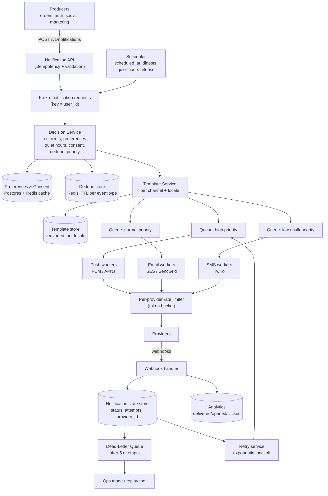

# Notification System — Full Worked Case Study

> **TL;DR** — A notification system is **fan-out plus a state machine per notification per channel**. It receives events from dozens of producers, decides which users should be told, renders a template per channel, and hands the result to a provider that may fail, rate-limit you, or accept the message and silently drop it. The parts that separate a good answer from a bad one are: the clarify questions (push, email, SMS — and how many of each), the fact that delivery is **at-least-once with deduplication**, the retry-with-backoff-plus-dead-letter-queue machinery, per-provider rate limiting, user preferences and quiet hours evaluated at *send* time rather than at *event* time, and priority queues so a password reset does not queue behind a marketing blast. The non-obvious trap: the provider accepting your request is not delivery, so tracking requires provider callbacks.

> **60-second interview answer:** "First I'd clarify: which channels — push, email, SMS, in-app — roughly how many notifications per day per channel, is delivery speed critical or is a few seconds' delay fine, do we need to track opens and clicks, and is this a new system or an addition to an existing one. I'd split it into three layers: an ingestion layer that accepts events, a decision layer that resolves recipients, preferences and quiet hours, and a delivery layer with a per-channel queue and a per-provider worker pool. Reliability comes from at-least-once delivery plus a deduplication key — the same event fanned out twice must not produce two emails — with exponential backoff and a dead-letter queue after N attempts. The key insight I'd call out is that 'the provider returned 200' is not 'the user received it', so anything beyond send-level tracking needs provider webhooks for delivered, opened and bounced. And I'd use separate priority queues, because a password reset queued behind a million marketing emails is a product failure."

---

## 1. Definition & mental model

**Plain English.** A notification system takes events ("order shipped", "someone liked your post", "your password was reset") from many producers, decides for each event which users should be notified on which channels, renders the content for each channel and locale, and delivers it through third-party providers — all while respecting per-user preferences, rate limits, and the fact that providers fail.

**The analogy: a postal sorting office with a strict house style.**

- **Producers** drop letters into the office at any time, in any format, sometimes the same letter twice.
- The **sorting desk** reads each letter, looks up the recipient's standing instructions ("no marketing on Sundays", "email only", "do not disturb after 10 pm"), and decides whether it goes out now, later, or into the bin.
- The **print room** renders the same content differently for a postcard (push), a letter (email) and a telegram (SMS) — and in the recipient's language.
- The **dispatch dock** has separate queues for first class and bulk mail, because a first-class letter must not sit behind a lorry of catalogues.
- The **courier** is the third-party provider. If they refuse the parcel, you retry; if they keep refusing, it goes into the **dead-letter room** for a human to look at.
- The **delivery confirmation** comes back separately, days later — the courier taking the parcel is not the same as it arriving.

**The insight:** notification systems look like a messaging problem and are actually a **policy engine plus a queue-management problem**. The interesting decisions are all "should this go out, in what shape, in what order" — not "how do I move bytes".

---

## 2. Why it exists — the problem it solves

### Step 1 — Clarify the requirements

Ask these questions. The Day-1 answer is graded on asking them.

| Question | Why it matters | Assumed answer |
|---|---|---|
| Which channels? Push, email, SMS, in-app, webhooks? | Each has a different provider, cost model, latency and reliability profile | **Push (FCM/APNs), email (SES/SendGrid), SMS (Twilio), in-app** |
| How many users, and how many notifications per day per channel? | Determines the queue and provider-limit design | 100 M users, 500 M push, 50 M email, 5 M SMS per day |
| Is delivery speed critical, or is a few seconds' delay acceptable? | Determines whether a synchronous path is needed at all | **A few seconds is fine — except for OTP/security** |
| Do we need to track opens and clicks? | Forces provider webhooks and an analytics store | Yes — delivered, opened, clicked, bounced |
| New system or existing? | Migration and dual-running change the design | New, with an event API for producers |
| Is it transactional or marketing? | Completely different consent, rate-limit and priority rules | **Both, separated by priority and consent** |
| Do users control preferences? | Requires a preferences store consulted at send time | Yes — per channel, per category, plus quiet hours |
| Multi-language / templated? | Requires a template service with locale variants | Yes |
| What is the retry policy? | Determines the DLQ design | Exponential backoff, DLQ after 5 attempts |
| Do we need deduplication? | At-least-once delivery means duplicates are possible | Yes — a dedupe key per (event, user, channel) |

**Functional requirements:** ingest events from producers; resolve recipients; apply preferences, quiet hours and consent; render per channel and locale; deliver via providers; retry with backoff; dead-letter after N attempts; track delivery and engagement; expose an API and a template management UI; support scheduling and batching (digest).

**Non-functional requirements:**

| Requirement | Target |
|---|---|
| Throughput | 500 M push / 50 M email / 5 M SMS per day; ~6,000/sec average, ~30,000/sec peak |
| Latency (transactional) | p99 < 5 s from event to provider handoff |
| Latency (bulk) | Within minutes; batching and digesting encouraged |
| Reliability | At-least-once; **no lost transactional notification**; duplicates acceptable if deduplicated |
| Availability | 99.99% for ingestion; degradation to queue-and-delay rather than drop |
| Isolation | A marketing blast must never delay a password reset |
| Respect | Never send to an unsubscribed user; honour quiet hours in the user's timezone |
| Cost | SMS is ~1,000× the cost of push — cost is a design constraint, not an afterthought |

**The non-functional requirement that shapes the architecture:** **isolation between priorities.** Almost every serious notification-system outage is "a marketing campaign starved the transactional queue". Say this early.

---

## 3. Internal mechanics — the five-step worked design

### 3.2 Step 2 — Capacity estimation

```
Users:            100 M registered, 30 M DAU
Notifications:    500 M push/day + 50 M email/day + 5 M SMS/day = 555 M/day

Average rate:     555 M / 86,400  = ~6,400 notifications/sec
Peak (×5):                        = ~32,000 notifications/sec
   (peaks come from campaigns and from scheduled digests, not from DAU diurnal)

Storage:
  Notification record: user, channel, template, status, attempts, provider_id, ts
    ≈ 500 bytes
  555 M × 500 B = ~280 GB/day
  With a 90-day retention: ~25 TB  (plus an archive tier beyond)

  Tracking events (delivered/opened/clicked): ~2× the notification count
  → ~1.1 B events/day → into the analytics store, not the operational DB

Queue sizing:
  A push provider accepts ~10,000 req/sec per connection pool
  Email provider: ~1,000/sec (typical SES/SendGrid sustained)
  SMS provider: ~100/sec without a pre-provisioned short code, higher with one
  → email and SMS are the constrained providers, not push
```

**The capacity takeaways:**
1. **Providers are the bottleneck, not the system.** SMS at ~100/sec means a 5 M-SMS campaign takes ~14 hours unless you negotiate throughput — which is a business conversation, not an engineering one.
2. **Cost is dominated by SMS.** At $0.0075 per SMS, 5 M SMS/day is ~$37,500/day, versus email at ~$0.0001 and push at effectively zero. SMS must be reserved for OTP and genuinely urgent messages.
3. **Duplicate suppression saves real money** — a deduplicated 2% duplicate rate on SMS alone is $750/day.
4. **Storage is modest** (280 GB/day) because the payload is a template reference, not a body.

### 3.3 Step 3 — API design

**Ingestion API (producer-facing):**

```http
POST /v1/notifications
Idempotency-Key: evt_9f3a2b        # required; makes producer retries safe
{
  "event_type": "order.shipped",
  "user_id": "u_8812",
  "channels": ["push", "email"],        # optional; default = user preferences
  "priority": "high",                   # high | normal | low
  "template": "order_shipped",
  "data": { "order_id": "o_1123", "eta": "2026-09-29" },
  "dedupe_key": "order.shipped:o_1123", # the semantic dedupe unit
  "scheduled_at": null,                 # null = now
  "locale": "en-IN"
}
→ 202 Accepted { "notification_id": "n_55c1", "status": "queued" }

# Batch: up to 1,000 recipients per call, for campaigns
POST /v1/notifications/batch
{ "event_type": "promo.weekend", "user_ids": [...], "priority": "low", ... }

# Status and management
GET  /v1/notifications/n_55c1                 → status per channel + attempts
POST /v1/notifications/n_55c1/cancel
GET  /v1/users/u_8812/preferences
PUT  /v1/users/u_8812/preferences
POST /v1/templates                            # create/version a template
POST /v1/devices                              # register a push token
DELETE /v1/devices/{token}                    # on logout / token invalidation
```

**Provider webhook (inbound, from the provider back to us):**

```http
POST /v1/webhooks/fcm           # or /apns, /ses, /twilio
{
  "provider_message_id": "0:1758960000123%abc",
  "status": "delivered",         # delivered | opened | clicked | bounced | failed
  "ts": 1758960005000,
  "reason": null                 # e.g. "invalid_token", "mailbox_full"
}
→ 200 OK                        # must be fast and idempotent
```

**The three API design points worth stating out loud:**
1. **`Idempotency-Key` is required, not optional.** Producers retry; without a key, a retry becomes a duplicate notification.
2. **`dedupe_key` is the semantic unit**, distinct from the idempotency key. Two *different* events that should produce one notification ("order.shipped" from two internal services) dedupe on `order.shipped:o_1123`, whereas the idempotency key only protects against the *same* request being replayed.
3. **`202 Accepted`, not `200 OK`.** The notification is queued, not sent. Returning 200 implies delivery, which is a lie and will confuse every producer integration.

### 3.4 Step 4 — High-level design



**Component by component:**

| Component | Responsibility | Why it exists |
|---|---|---|
| Notification API | Accept events, validate, enforce idempotency | Producers need a contract; the key makes retries safe |
| Kafka `notification.requests` | Durable buffer, keyed by `user_id` | Absorbs campaign bursts; ordering per user |
| Decision Service | Recipients, preferences, consent, quiet hours, dedupe, priority | **The policy engine — the hard part of the system** |
| Preferences store | Per-user, per-channel, per-category opt-in, quiet hours, timezone | Consulted at send time, not event time |
| Dedupe store | `(dedupe_key, user, channel)` with a TTL | At-least-once means duplicates; this is the fix |
| Template Service | Render per channel and locale with versioning | One event, many shapes |
| Priority queues | High / normal / low | **Isolation: transactional never queues behind bulk** |
| Channel workers | Per-provider integration, retry, rate-limit | Provider-specific behaviour isolated |
| Rate limiter | Token bucket per provider | Providers enforce limits; exceeding them gets you throttled or banned |
| Webhook handler | Record delivered/opened/clicked/bounced | Provider acceptance ≠ delivery |
| Notification state store | One row per notification per channel | Status, attempts, provider ID — the audit trail |
| DLQ | Terminal failures after N attempts | Nothing is silently dropped |
| Scheduler | `scheduled_at`, digests, quiet-hours release | Time-based sends |
| Analytics | Engagement events | Product metrics, and the feedback loop for reducing noise |

**The end-to-end flow, step by step:**

```
1. Producer POSTs an event with an Idempotency-Key
2. API validates, checks the idempotency key (Redis SETNX with a 24 h TTL);
   a duplicate key returns the original notification_id, not a new one
3. Publishes to Kafka notification.requests, keyed by user_id
   (keyed by user so all of a user's notifications are processed in order
    by one consumer — which also makes rate limiting per user trivial)
4. Decision Service consumes:
   a. resolves recipients (for a campaign: expand the audience)
   b. loads preferences + consent from the cache (Postgres on a miss)
   c. checks the dedupe key; if present, drops and records "deduplicated"
   d. checks quiet hours in the user's timezone → if inside, either
      drop (low priority) or defer to the end of the window (high priority)
   e. checks per-user rate limits (e.g. max 5 marketing/day)
   f. decides channels = requested ∩ allowed
   g. assigns priority
5. Template Service renders the payload per channel, per locale,
   versioned (the template version is recorded with the notification)
6. Enqueues one message per (notification, channel) into the priority queue
7. A channel worker picks it up, calls the provider through the rate limiter
8. On success: record provider_message_id, status = "sent"
   On retryable failure (429, 5xx, timeout): requeue with exponential backoff
   On permanent failure (invalid token, unsubscribed, malformed): status = "failed",
     do NOT retry — go straight to a terminal state
9. Provider calls back: delivered / opened / clicked / bounced → update state
10. Bounced and invalid tokens feed back into token hygiene: after N consecutive
    invalid-token responses, the device token is deleted
11. After 5 attempts with no success → DLQ, alert, and an ops replay tool
```

**The point to emphasise at step 8:** distinguishing **retryable** from **terminal** failures is what keeps a notification system from burning its provider quota on messages that can never succeed. An `invalid_token` from FCM will never become valid by retrying; a `429` will. Conflating them is a classic production bug.

### 3.5 Step 5 — Deep dive and trade-offs

#### Fan-out to providers

```
The fan-out shape depends on the event:

Transactional (1 user):     1 event → 1-3 notifications (one per channel)
Campaign (N users):         1 event → N recipients → N × channels notifications
Digest (N users, batched):  1 event → N recipients, batched into one send

Expansion is the danger:
  A campaign to 100 M users that expands eagerly into 100 M queue messages
  takes ~3 hours at 10k/sec just to enqueue, and can swamp the queue.

The fix: expand in pages. The scheduler emits "campaign_partition" events of
100,000 users each, so no single consumer holds the whole audience and the
expansion is itself parallel and resumable.
```

#### Push: FCM and APNs

| Aspect | FCM (Android, web) | APNs (iOS) |
|---|---|---|
| Endpoint | `POST /v1/projects/{id}/messages:send` | `POST /3/device/{token}` |
| Auth | OAuth2 service account, short-lived token | JWT signed with a `.p8` key (`ES256`), refreshed every ~40 min |
| Payload limit | 4 KB (2 KB for data-only historically) | 4 KB |
| Connection | HTTP/2, multiplexed, pooled | HTTP/2, **must be persistent and pooled** |
| Error semantics | `UNREGISTERED` = delete token; `UNAVAILABLE` = retry | `410 Unregistered` = delete token; `429`/`503` = retry |
| Feedback | Delivery receipts (Android), or via the app | APNs does **not** report delivery to the device by default |

**Two facts that separate strong from weak answers:**
1. **APNs requires a persistent HTTP/2 connection with multiplexing.** Opening a connection per notification is the classic APNs anti-pattern and will get you throttled. Pool them; one connection can carry thousands of concurrent streams.
2. **Neither FCM nor APNs guarantees the device received the push.** FCM delivery receipts exist but are approximate; APNs by default does not tell you. So "delivered" for push means "the provider accepted it", unless you have an app-level acknowledgement — which is why in-app notification centres exist.

#### Email: deliverability is a systems problem

```
Sending email is easy; landing in the inbox is the hard part.

The components that matter:
  SPF      — authorises sending IPs          (a DNS TXT record)
  DKIM     — cryptographic signature         (a DNS TXT record + a signing key)
  DMARC    — policy when SPF/DKIM fail       (a DNS TXT record + a report address)
  Bounce handling — hard bounces → suppress permanently; soft → retry
  Complaint handling — the feedback loop from ISPs; too many complaints → blocked
  Dedicated IP warming — a new IP must ramp: 50, 100, 500, 1,000, ... per day

The architectural consequence:
  A dedicated IP is a shared-reputation asset. A marketing campaign that
  spikes complaints degrades transactional email deliverability on the SAME IP.
  → Use SEPARATE IPs (and often separate subdomains) for transactional and
    marketing email, so a marketing complaint storm cannot break password resets.
```

**This is the email equivalent of the priority-queue insight, and it is the strongest single point available on the email channel.**

#### SMS: the cost and compliance channel

```
Cost:         ~$0.0075 per SMS (US), far more in some countries, e.g. ~$0.30 in Brazil
Throughput:   ~1/sec per long code; ~100/sec with a pre-provisioned short code;
              higher with a toll-free number or a negotiated route
Compliance:   opt-in records, STOP handling (an inbound "STOP" must suppress
              permanently and immediately), time-of-day restrictions,
              and country-specific sender-ID rules
Segmenting:   160 GSM-7 characters; 70 for UCS-2 (emoji or non-Latin script).
              Beyond that, concatenated SMS — and multi-part SMS is billed per part.

Design consequence: SMS must be gated behind an explicit allow-list of
event types (OTP, security alerts, delivery-of-critical-goods), never
available to a generic marketing path.
```

#### Deduplication

```
Three distinct dedupe problems, often conflated:

1. Producer retry: the same POST arrives twice
   → Idempotency-Key, Redis SETNX, 24 h TTL, returns the original id

2. Semantic duplicate: two different services emit "order.shipped" for o_1123
   → dedupe_key = "order.shipped:o_1123", scoped per (user, channel), TTL per
     event type (minutes for chat-like events, days for order events)

3. Provider-level duplicate: the same provider_message_id reported twice via
   webhook, or the same notification delivered twice because our retry raced
   → webhook handler is idempotent on provider_message_id; and the send itself
     carries an idempotency key to the provider where supported

The trade-off to state: aggressive dedupe risks suppressing a legitimate repeat
("your order shipped" for two different orders must not collapse). So the dedupe
key must include the entity identity — order_id — not just the event type.
```

#### Retries, backoff and the DLQ

```
Retry classification (the most important table in this design):

  Retryable (backoff and retry):
    429 Too Many Requests        → honour Retry-After if present
    500 / 502 / 503 / 504        → provider-side failure
    Network timeout, connection reset
    APNs 503, FCM UNAVAILABLE

  Terminal (never retry; record and stop):
    Invalid device token (FCM UNREGISTERED, APNs 410) → delete the token
    Unsubscribed / suppressed recipient
    Malformed payload (400), template not found
    Email hard bounce (mailbox does not exist)
    Phone number invalid

Backoff schedule (high priority):
  attempt 1: immediate
  attempt 2: +1 s   (±20% jitter)
  attempt 3: +5 s
  attempt 4: +30 s
  attempt 5: +5 min
  → then DLQ

Backoff schedule (low priority / bulk):
  +1 min, +5 min, +30 min, +2 h, +6 h → then DLQ
  (a marketing email retried in 1 second is pointless; the provider is rate limiting)

Jitter is mandatory: without it, thousands of workers retry at the same
instant after an outage, producing a synchronised second storm — the
thundering herd, aimed at a provider that is already struggling.
```

#### Priority queues and isolation

| Priority | Events | Queue | SLO |
|---|---|---|---|
| **High** | OTP, password reset, security alert, fraud | Dedicated queue + dedicated worker pool + reserved provider capacity | p99 < 5 s |
| **Normal** | Order updates, social interactions, delivery status | Shared queue | p99 < 60 s |
| **Low / bulk** | Marketing, digests, recommendations | Separate queue, throttled, batchable, droppable | Within hours; **droppable under pressure** |

**Why separate queues and not just a priority field:** a priority field inside one queue still means one worker pool, and a slow provider call for a bulk message occupies a worker that a transactional message needed. **Isolation must be at the worker-pool level, not the message level.** This is the same insight as bulkheads ([see Scaling](../../HLD/03-scaling/05-sharding-replication-and-consistency.md)) applied to queueing.

**The load-shedding rule to state:** under sustained overload, the low-priority queue is dropped or deferred; the high-priority queue is never dropped. A system that drops OTPs under load has failed at its primary job.

#### User preferences and quiet hours

```
Preference model (per user):
  global:     opt-out of all marketing (never of transactional)
  per channel: push on/off, email on/off, SMS on/off
  per category: e.g. "social" off, "orders" on, "promotions" off
  quiet hours: 22:00–08:00 in the user's timezone
  timezone:   IANA name, e.g. "Asia/Kolkata"

Evaluation happens at DECISION time, not at event time:
  - a campaign scheduled for 09:00 in each user's local timezone needs
    the timezone at send time, per user
  - a user changing a preference must affect notifications already queued

Quiet-hours policy by priority:
  - Low:      drop, or defer to the end of the window
  - Normal:   defer to the end of the window
  - High:     send anyway (a security alert at 3 am is correct behaviour)

The trap: quiet-hours evaluation requires a per-user timezone, and
"22:00 local" for 100 M users spread over 24 timezones means the release
is inherently a rolling wave, not a single event. Batch the release.
```

#### Delivery tracking — the honest version

| Level | Meaning | How you know |
|---|---|---|
| **Accepted** | The provider took the request | The API call returned 2xx |
| **Sent** | The provider forwarded it | Provider webhook / status API |
| **Delivered** | The device or inbox received it | Provider webhook (email: usually; push: partially) |
| **Opened** | The user opened it | Email: a tracking pixel or a link click; push: app-level ack |
| **Clicked** | The user acted | A wrapped link with a redirect |

**The line to say:** *"Provider acceptance is not delivery. For email I get real delivery and open events via webhooks and a tracking pixel; for push I get an approximate delivery receipt from FCM and none by default from APNs, so 'delivered' for push means the provider accepted it. Anything stronger requires an app-level acknowledgement, which is why in-app notification centres that sync on open are the honest way to show 'you have 3 unread'."*

#### Rate limiting per provider

```
Token bucket per (provider, channel):
  push:  capacity 50,000, refill 10,000/sec
  email: capacity 5,000,  refill 1,000/sec
  sms:   capacity 500,    refill 100/sec

Plus per-user limits (abuse and annoyance control):
  max 5 marketing notifications per user per day
  max 1 email per user per hour for non-transactional
  max 100 push per user per day

Behaviour on limit:
  Do NOT fail the notification — set it back with a delay.
  A token bucket that rejects loses the notification; one that delays
  preserves it and just adds latency. Delay is almost always the right
  choice for notifications, because the value does not expire quickly.

Exception: OTP has a hard validity window (typically 5-10 minutes).
  An OTP delayed past its window is worthless → for OTP, fail fast and
  reserve capacity rather than delaying.
```

---

## 4. Variants & taxonomy

| Variant | Description | Trade-off |
|---|---|---|
| **Synchronous send** | The producer's request blocks until the provider responds | Simplest; a provider slowdown becomes a producer outage |
| **Asynchronous queue** | Producer gets 202; a worker sends | **Chosen** — decouples producer health from provider health |
| **Direct-to-provider** | Producer calls FCM itself | No central policy, no dedupe, no preferences — unmanageable past one team |
| **Centralised notification service** | All notifications through one system | Consistent policy and tracking; a shared dependency and a potential SPOF |
| **Event-driven (Kafka)** | Producers emit domain events; the notification service subscribes | Loose coupling; the notification service must know every event schema |
| **Poll-based digest** | Batch a user's notifications and send on a schedule | Far less noise; adds latency |
| **Per-channel service** | Separate services for push, email, SMS | Independent scaling; fragmented policy and duplicated preference logic |
| **Unified with channel adapters** | One decision path, pluggable channel workers | **Chosen** — policy in one place, transport per channel |
| **Push-only via a single provider** | One vendor for everything | Simple vendor relationship; single point of failure and no cost leverage |
| **Multi-provider with failover** | Primary and secondary per channel | Higher availability and cost leverage; must handle divergence in semantics |
| **At-most-once** | Send and forget | Cheap; loses notifications, unacceptable for transactional |
| **At-least-once + dedupe** | Retry until acknowledged, deduplicate | **Chosen** — the standard trade |
| **In-app only** | A notification centre the app polls | No provider dependency; no reach when the app is closed |
| **Webhook / callback channel** | Deliver to the customer's own endpoint | Extends the same retry machinery to B2B integrations |

---

## 5. Pros / Cons

| Decision | Pros | Cons |
|---|---|---|
| **Centralised notification service** | One policy engine, one dedupe store, one tracking store | A shared dependency; schema coupling with every producer |
| **Kafka between producers and the send path** | Absorbs bursts, replay, ordering per user | Operational cost; adds a hop of latency |
| **Decision at send time** | Preferences and quiet hours are always current | Requires a fast preferences lookup; a cache miss adds latency |
| **Separate priority queues and worker pools** | Transactional never starves behind bulk | More infrastructure; capacity reserved for the high-priority pool idles at low load |
| **Per-provider token-bucket rate limiting** | Keeps you inside provider limits; delays instead of dropping | Added latency under load; requires per-provider tuning |
| **Distinguishing retryable from terminal failures** | Saves provider quota; cleans up bad tokens | Requires a per-provider error taxonomy that must be maintained |
| **Dedupe with a semantic key** | Prevents double-sends, saves SMS cost | A wrong key suppresses a legitimate notification |
| **Provider webhooks for tracking** | Real delivery and engagement data | Webhook endpoints must be fast, idempotent and public |
| **SMS gated behind an allow-list** | Cost control | Product friction when a team wants an SMS for something new |
| **Separate email IPs for transactional vs marketing** | Reputation isolation | More IPs to warm and monitor |
| **Batching and digests** | Fewer sends, less noise, lower cost | Added latency; needs a scheduler and a batch window |

---

## 6. Exceptions, edge cases & failure modes

### 6.1 The marketing blast starving transactional notifications

The canonical failure. A campaign enqueues 50 M messages; the shared worker pool is saturated; a password reset sits behind 50 M promotional emails and arrives 40 minutes later. **Fixes, in order of importance:** separate queues *and* separate worker pools for high priority; reserved provider capacity (a dedicated token bucket, since the provider limit itself is the shared resource); and the ability to pause or drain the bulk queue when the high-priority queue's depth crosses a threshold. State the last one — an operator-triggered "bulk hold" is the pragmatic safety valve.

### 6.2 The retry storm at the provider

An email provider has a 10-minute outage. A million queued messages fail; every worker retries with the same backoff schedule; when the provider recovers, the retry load arrives in a synchronised spike that knocks it over again — the thundering herd ([see Cache Invalidation](../../HLD/03-scaling/04-cache-invalidation-and-consistency.md) §6.5).

**Fixes:** jitter the backoff (±20% at minimum); a circuit breaker on the provider so failures fail fast instead of consuming workers for their full timeout; and a rate limiter that caps *retry* traffic separately from *new* traffic, so a recovery wave cannot exceed the provider's limit.

### 6.3 Duplicate notifications — the same OTP twice

The producer retries after a timeout; the first request actually succeeded. Without an idempotency key, the user gets two OTPs, and the second invalidates the first if your OTP store is last-write-wins. **The user then cannot log in.** This is a real, high-severity failure.

**Fixes:** the `Idempotency-Key` header is mandatory; the OTP store must be keyed so a duplicate request returns the **existing** code rather than generating a new one; and the send path dedupes on `(user, channel, template, dedupe_key)` with a short TTL.

### 6.4 Invalid device tokens

Users uninstall the app or reset the phone; the token in your store becomes invalid. Sending to it returns `UNREGISTERED` (FCM) or `410` (APNs). If you retry those, you burn quota on a message that can never arrive.

**Fix:** treat invalid-token errors as terminal, delete the token immediately, and maintain a token-hygiene job that prunes tokens not refreshed in 90 days. A healthy token-refresh rate is a useful signal — a dropping rate means users are uninstalling.

### 6.5 Quiet hours versus a security alert

A user sets quiet hours 22:00–08:00. At 03:00 a login from a new country is detected. Deferring the alert to 08:00 defeats its purpose.

**Fix:** quiet hours are evaluated **by priority**, not globally. High-priority security events bypass the window. But the bypass must be an explicit allow-list of event types, not a `priority` field the producer sets freely — otherwise every producer marks their notification high and quiet hours cease to exist. **This is the strongest possible follow-up answer on preferences.**

### 6.6 Timezone and DST bugs

Scheduling "09:00 local" for users worldwide, with daylight-saving transitions and users who travel, produces either double-sends or missed sends. Storing a fixed UTC offset instead of an IANA timezone name means a user in `Asia/Kolkata` is fine but a user in `America/New_York` is an hour wrong twice a year.

**Fix:** store the IANA timezone name; compute the offset at send time; and make the scheduler idempotent per (user, campaign, local date) so a DST overlap does not send twice.

### 6.7 The webhook is slow, so tracking stalls

The provider posts delivery events to your endpoint, which writes synchronously to the same database that serves the API. Under a large campaign, the webhook volume (2× the notification volume) saturates the database and the API degrades.

**Fix:** the webhook handler should do almost nothing — validate the signature, publish to Kafka, return 200 in under 100 ms. A separate consumer updates the state store and the analytics store. Providers give up on slow webhooks and may disable them, so a fast 200 is a correctness requirement, not an optimisation.

### 6.8 Provider outage and failover

The primary email provider is down. You fail over to the secondary. Now the two providers have divergent states: messages sent through the primary before the outage may still be delivered, so a naive failover double-sends.

**Fix:** failover carries the same dedupe key to the secondary provider (most support an idempotency key); the state store records which provider owns each notification; and after recovery, reconciliation compares the two providers' delivery reports rather than assuming a clean boundary.

### 6.9 The unbounded queue and the backlog cliff

A provider outage for 2 hours at 6,400/sec = 46 M queued messages. When it recovers, the drain rate is capped by the provider's limit, so the backlog takes ~13 hours to clear at 1,000/sec for email. Meanwhile new notifications queue behind it.

**Fixes:** separate queues mean only the affected channel backs up; a TTL per message so a stale marketing notification expires rather than being sent 13 hours late; and an explicit decision — for low-priority notifications, **drop rather than deliver late**, because a "flash sale ends today" email arriving tomorrow is worse than not arriving.

### 6.10 Preference change racing an in-flight notification

A user disables push while a notification is mid-flight. The notification still arrives. **This is unavoidable** — there is no distributed transaction between the preference store and the provider. **The honest answer:** acknowledge the race, keep the window small (evaluate preferences as late as possible, immediately before the provider call), and make the unsubscribe effective for everything after that point. Also: an unsubscribe from a marketing email link must be honoured within seconds, not hours, because in some jurisdictions it is a legal requirement.

### 6.11 Other failure modes worth naming

- **Template change breaking in-flight notifications** — version templates and record the version on the notification, so a render failure after a template edit is traceable.
- **A campaign with a bad audience query** — sending to 100 M users instead of 100,000. Guard with an audience-size sanity check and a staged rollout (1% → 10% → 100%).
- **PII in notification payloads** — push payloads transit third-party infrastructure; never put more than necessary in the payload, and never a full account number or a token.
- **Cost surprise from a retry loop** — SMS retried 5 times at $0.0075 on 5 M messages is $187,500 in one incident. Monitor cost per hour, not cost per day.
- **A stale push token belonging to a different user** — a device handed on or resold; on logout, delete the token binding server-side, and on token refresh, re-bind.
- **The `202` that never becomes anything** — a notification silently lost between the queue and the worker with no state row. Write the state row at decision time, before enqueueing, so every accepted notification is accounted for.
- **Clock skew across workers** breaking the backoff schedule — use `scheduled_at` as an absolute timestamp with a grace window rather than "now + 5 minutes" computed on each retry.
- **Unbounded fan-out memory** — expanding a 100 M-user campaign in a single consumer exhausts memory; page the expansion.

---

## 7. When to use / When NOT to use

### This design is right when
- Multiple producers need to notify users across multiple channels.
- Preferences, consent and quiet hours must be enforced consistently.
- Delivery must be tracked beyond "the provider said 200".
- Transactional and bulk notifications coexist and must be isolated.
- Provider rate limits and cost must be controlled centrally.

### This design is NOT what you want when
- **There is one producer and one channel** — a direct provider call plus a small retry wrapper is enough; a pipeline is over-engineering.
- **The message is part of a request/response contract** — that is an API call or a webhook, not a notification.
- **The user must see it while the app is open, in real time** — that is chat/in-app push ([see WhatsApp](02-whatsapp-chat-system.md)).
- **You need a guaranteed, ordered, exactly-once business event** — that is a message queue or an event bus with an outbox, not a notification system.
- **You need rich content delivery** — a feed or an email template system, not a notification.

### Design decision table

| Requirement | Decision |
|---|---|
| Don't lose transactional notifications | Kafka buffer + at-least-once + retry + DLQ; never a fire-and-forget path |
| Producer retries must be safe | Mandatory `Idempotency-Key` |
| No double-sends | Semantic `dedupe_key` per `(user, channel)` with a TTL |
| OTP must not be duplicated | Duplicate request returns the existing code, not a new one |
| Transactional must not starve | Separate queues **and** worker pools **and** provider token buckets |
| Provider fails temporarily | Exponential backoff **with jitter** + circuit breaker |
| Provider fails permanently | Classify terminal errors; do not retry them |
| Nothing is silently dropped | DLQ after 5 attempts + alerting + a replay tool |
| Respect user choices | Preferences evaluated at decision time, from a fast cache |
| Respect quiet hours | Per-user IANA timezone; defer by priority; high priority bypasses |
| Security alerts at 3 am | An explicit allow-list of bypass event types, not a producer-set flag |
| Track opens and clicks | Provider webhooks + tracking pixel + wrapped links |
| Push delivery truth | Accept that "sent" ≠ "delivered"; use an in-app centre for truth |
| Email must land in the inbox | SPF, DKIM, DMARC; separate IPs for transactional vs marketing |
| SMS cost control | Allow-list of event types; hard per-user and per-hour caps |
| Campaign burst | Page the audience expansion; stage 1% → 10% → 100% |
| Backlog during an outage | Per-channel queues; TTL; drop low-priority rather than deliver late |
| Multi-provider resilience | Failover carrying the same dedupe key; record the owning provider |

---

## 8. Numbers, defaults & tuning

| Quantity | Value | Reasoning |
|---|---|---|
| Users / DAU | 100 M / 30 M | Scale |
| Push / email / SMS per day | 500 M / 50 M / 5 M | Channel mix |
| Average rate | ~6,400/sec | 555 M ÷ 86,400 |
| Peak multiplier | ×5 | Campaigns and digest waves |
| Peak rate | ~32,000/sec | Sizing for the queue and workers |
| Notification record size | ~500 B | Metadata plus a template reference |
| Storage per day | ~280 GB | ×90-day retention = ~25 TB |
| Tracking events | ~2× notifications | Webhook volume, into analytics not OLTP |
| Push payload limit | 4 KB (FCM and APNs) | Provider hard limit |
| APNs JWT refresh | ~40 min (tokens valid up to 60 min) | APNs rejects older tokens |
| APNs/FCM connection | Persistent HTTP/2, multiplexed | Per-request connections get throttled |
| Email provider throughput | ~1,000/sec sustained | Typical SES/SendGrid |
| SMS provider throughput | ~100/sec with a short code, ~1/sec per long code | The real bottleneck |
| Push provider throughput | ~10,000/sec per pool | Not usually the constraint |
| SMS cost | ~$0.0075 each (US) | 5 M/day ≈ $37,500/day |
| Email cost | ~$0.0001 each | ~$5,000/day at 50 M |
| Push cost | ~$0 | Effectively free |
| SMS segment size | 160 GSM-7 / 70 UCS-2 chars | Billed per segment beyond |
| Idempotency key TTL | 24 h | Covers a long producer retry |
| Dedupe TTL | Minutes for chat-like events, days for order events | Matches the meaningful repeat window |
| Retry attempts | 5 | Then DLQ |
| High-priority backoff | 0 s, 1 s, 5 s, 30 s, 5 min | p99 < 5 s achievable on the first two |
| Bulk backoff | 1 min, 5 min, 30 min, 2 h, 6 h | The provider is rate limiting anyway |
| Jitter | ±20% minimum | Prevents a synchronised retry storm |
| Quiet hours default | 22:00–08:00 local | User-configurable |
| Per-user marketing cap | 5/day | Annoyance and abuse control |
| Per-user email cap | 1/hour non-transactional | Inbox-friendliness |
| OTP validity | 5–10 min | Hard window; fail fast rather than delay |
| Token hygiene | Delete after 90 days without a refresh, or on `UNREGISTERED`/`410` | Prevents wasted sends |
| Webhook response time | < 100 ms | Providers disable slow endpoints |
| Campaign page size | 100,000 recipients | Bounds memory during expansion |
| Campaign staging | 1% → 10% → 100% | Catches a bad audience before it is expensive |
| DLQ alert threshold | Any DLQ entry for a high-priority notification | Paged, not batched |
| IP warming ramp | 50, 100, 500, 1,000, 5,000, ... per day | Reputation building for a new sending IP |

---

## 9. Interview Q&A

**Q1 (easy). What questions do you ask first?**
Which channels — push, email, SMS, in-app. How many users and how many notifications per channel per day. Whether delivery speed is critical or a few seconds of delay is acceptable. Whether we need to track opens and clicks. Whether this is a new system or an addition to an existing one. And whether it is transactional, marketing, or both — because that answer determines the priority design, the consent rules and the cost model. I would also ask about user preferences and quiet hours, since those are the decisions that make a notification system pleasant rather than annoying.

**Q2 (easy). What is the overall architecture?**
Three layers. An ingestion layer — an API that accepts events from producers with an idempotency key and writes them to Kafka. A decision layer — a consumer that resolves recipients, reads preferences and consent, checks quiet hours in the user's timezone, deduplicates, assigns a priority, and hands it to a template service that renders the payload per channel and locale. And a delivery layer — per-channel priority queues with per-channel worker pools that call providers through a per-provider token-bucket rate limiter, with retries, a dead-letter queue, and webhooks coming back for delivery and engagement tracking. Everything is asynchronous; the producer gets a 202, not a 200.

**Q3 (easy). Why asynchronous rather than sending inline?**
Because it decouples producer health from provider health. If the producer calls FCM inline, a provider slowdown becomes a producer outage, and the provider's rate limits become the producer's rate limits. With a queue, the producer gets a 202 in milliseconds, and the notification system absorbs the burst, retries, rate-limits and the tracking all happen in one place. The one exception where I would want a synchronous path is nothing, actually — even OTP goes through the queue, just on the high-priority queue with reserved capacity. Synchronous send is a design smell here.

**Q4 (medium). How do you avoid sending the same notification twice?**
Three separate dedupe problems. First, the producer's own retry: a mandatory idempotency key, checked with a Redis set-if-not-exists with a 24-hour TTL, which returns the original notification ID rather than creating a second one. Second, the semantic duplicate, where two different internal services both emit "order shipped" for the same order: a dedupe key like `order.shipped:o_1123`, scoped per user and per channel, with a TTL that matches how long a repeat would be meaningful. Third, the provider reporting the same event twice, or our own retry racing a delivery — the webhook handler is idempotent on the provider's message ID. And the important detail is that the dedupe key has to include the entity identity, not just the event type, or a legitimate second notification for a different order would be suppressed.

**Q5 (medium). How do you handle a provider that is failing?**
First, classify the failure. A 429 or a 5xx or a timeout is retryable — retry with exponential backoff and jitter. A 410 or `UNREGISTERED` or a hard bounce is terminal — record it, stop, and delete the token or suppress the address. Conflating those is the classic bug: retrying an invalid token five times wastes provider quota on something that can never succeed. Second, put a circuit breaker in front of the provider so that when it is failing broadly, calls fail fast rather than occupying workers for the full timeout. Third, after five attempts, the notification goes to a dead-letter queue with an alert and a replay tool, so nothing is silently dropped. And jitter is mandatory — without it, every worker retries at the same instant when the provider recovers and knocks it over again.

**Q6 (medium). How do you make sure a password reset doesn't get stuck behind a marketing campaign?**
Separate queues, separate worker pools, and separate provider token buckets for high priority versus bulk. This is the most common serious failure in a notification system — a campaign enqueues tens of millions of messages, saturates the shared pool, and a password reset arrives forty minutes later. A priority field inside a single queue is not enough, because the slow bulk provider call still occupies a worker the transactional message needed. The isolation has to be at the pool level. And it has to extend to the provider rate limit, because that limit is a shared resource too — if the campaign consumes the entire email quota, no amount of queue separation helps. I would also add a manual hold: when the high-priority queue depth crosses a threshold, an operator can pause bulk sending.

**Q7 (medium). What does "delivered" mean for each channel?**
It means something different in each case, and being precise about that is important. For email, I get real signals: the provider tells me accepted, delivered, bounced, and — with a tracking pixel or a wrapped link — opened and clicked. For SMS, I get a delivery receipt from the carrier, which is reasonably reliable. For push, the provider accepting the request means it accepted it; FCM gives an approximate delivery receipt and APNs by default gives none. So for push, "sent" is not "delivered", and anything stronger requires an app-level acknowledgement. That is exactly why in-app notification centres that sync when the app opens are the honest way to show unread counts — they reflect what the app actually received.

**Q8 (hard, testing §6). A user sets quiet hours, but there's a security alert at 3 am. What do you do?**
Quiet hours are evaluated by priority, not globally, and high-priority security events bypass the window — a fraud alert at 3 am is correct behaviour, while a promotional email at 3 am is a bug. But the bypass must be an explicit allow-list of event types evaluated by the decision service, not a `priority` field that producers set freely. If producers can mark anything high, every team marks everything high and quiet hours stop existing — you get the same failure as the shared-worker-pool problem, just at the policy layer instead of the queue layer. So: the event type is on the allow-list, or it waits.

**Q9 (hard, testing §6). The email provider has a two-hour outage. What happens?**
At roughly 6,400 notifications a second, two hours is about 46 million queued messages. The provider's limit is around 1,000 a second, so the backlog takes about 13 hours to drain even at full rate, and new messages queue behind it. Three things make that survivable. First, per-channel queues mean only email backs up — push and SMS keep flowing. Second, a TTL per message: a "flash sale ends today" email delivered tomorrow is worse than not delivered, so low-priority messages expire rather than being sent stale. Third, jittered retries plus a circuit breaker plus a separate cap on retry traffic, so the recovery wave does not immediately knock the provider over again. And I would monitor queue age, not just queue depth — age is what tells you whether the backlog is being cleared.

**Q10 (hard). How do preferences and timezones work?**
Preferences are per user, per channel and per category, with an opt-out of all marketing but never of transactional, plus quiet hours and an IANA timezone. The important design decision is that they are evaluated at decision time — as late as possible before the provider call — not at the time the event was produced. That matters because a campaign scheduled for 9 am local is a rolling wave across 24 timezones, and because a user changing a preference must affect notifications that are already queued. The trap is storing a fixed UTC offset instead of an IANA timezone name: it is correct until a daylight-saving transition, and then a whole country's notifications are an hour wrong. And an unsubscribe has to take effect within seconds, because in some jurisdictions that is a legal requirement.

**Q11 (hard). How would you handle an SMS channel responsibly?**
SMS is the channel where cost and compliance dominate the engineering. It costs around $0.0075 per message in the US and far more in some countries — Brazil is around $0.30 — so at 5 million a day it is tens of thousands of dollars daily, versus email at roughly a hundredth of a cent and push at effectively zero. Throughput is also the real bottleneck: about one per second per long code, around a hundred per second with a pre-provisioned short code. So SMS goes behind an explicit allow-list of event types — OTP, security alerts, genuinely urgent delivery notifications — and never a generic marketing path. Plus opt-in records, immediate STOP handling, country-specific sender-ID rules, and segment counting, because 160 GSM-7 characters or 70 for non-Latin script, billed per segment beyond that.

**Q12 (hard). How do you track opens and clicks without hurting performance?**
The webhook handler does almost nothing — validate the signature, publish to Kafka, return 200 in under a hundred milliseconds — and a separate consumer writes the state and analytics. Providers give up on slow webhook endpoints and may disable them, so a fast acknowledgement is a correctness requirement, not an optimisation. And critically, the webhook volume is roughly twice the notification volume, so if it writes synchronously to the same database that serves the API, a large campaign degrades the API. Opens come from a tracking pixel or, more reliably, from a wrapped link click, since pixel blocking is common. All of that feeds an analytics store, not the operational database.

**Q13 (hard). How would you reduce notification volume?**
Several levers, and I would say the design should be built for them from the start. Batching and digests — a social notification digest once a day instead of twenty individual pushes. Per-user rate caps — five marketing notifications a day. Smart suppression — if the user is currently in the app, don't push at all, because an in-app badge is enough. Deduplication, which is already there. And engagement-based throttling: if a user has not opened a notification in 30 days, reduce frequency rather than continuing to send. That last one is both a user-experience improvement and, for email, a deliverability improvement, because low engagement signals train spam filters against you.

**Q14 (hard). What are the trade-offs you'd call out?**
Four. Asynchronous over synchronous, so notifications are eventual rather than immediate, in exchange for decoupling producer health from provider health. At-least-once with deduplication rather than exactly-once, because exactly-once is impossible across a third-party provider and dedupe is cheap. Reserved capacity for high priority, which means the high-priority worker pool idles at low load — that idle capacity is the price of never delaying a password reset. And centralisation: one notification service gives consistent policy, dedupe and tracking, at the cost of being a shared dependency that every team couples to. I would also mention the SMS cost trade: restricting SMS to an allow-list means product friction every time a team wants one.

**Q15 (hard). What would you monitor?**
Per-priority queue depth and, more importantly, queue age — a growing depth with a stable age means the drain rate is fine; a growing age means it is not. Provider error rate split by retryable and terminal, because a spike in terminal errors is usually a token or template problem, not an outage. Success rate per channel per provider, so a failover is visible. DLQ size, with a page for any high-priority entry. Send latency from event to provider handoff at p50, p95 and p99, split by priority. Cost per hour per channel, especially SMS, because a retry loop on SMS is expensive fast. Webhook lag from the provider's timestamp to our receipt. Token refresh rate, which is an early signal of uninstalls. And unsubscribe and complaint rates, which are the leading indicators of a deliverability problem.

---

## 10. Common mistakes candidates make

1. **Sending inline** and coupling the producer to provider latency and rate limits.
2. **No idempotency key**, so a producer retry becomes a duplicate notification.
3. **One queue for everything**, so bulk starves transactional.
4. **Retrying terminal failures** — burning quota on invalid tokens.
5. **No jitter in the backoff**, producing a synchronised retry storm.
6. **No dead-letter queue**, so failures vanish silently.
7. **Returning 200 instead of 202**, implying delivery that did not happen.
8. **Claiming push delivery is tracked** when neither FCM nor APNs guarantees it.
9. **Ignoring email deliverability** — SPF, DKIM, DMARC and IP reputation are part of the system.
10. **No cost analysis for SMS**, the channel where cost dominates.
11. **Evaluating preferences at event time** rather than at send time.
12. **Storing a UTC offset instead of an IANA timezone** — a DST bug that fires twice a year.
13. **A slow webhook handler** that gets the provider to disable your endpoint.
14. **No quiet hours**, or quiet hours with no priority bypass.
15. **No trade-offs section** — the interviewer is grading the trade-offs, not the boxes.

---

## 11. Cheat-sheet summary

| Concept | One-line truth |
|---|---|
| The core shape | Ingestion → decision → per-channel delivery, all asynchronous |
| Producer contract | `202 Accepted` plus a **mandatory** `Idempotency-Key` |
| Dedupe | A semantic `dedupe_key` per `(user, channel)`, TTL per event type |
| Delivery semantics | At-least-once + dedupe = effectively exactly-once |
| Reliability machinery | Exponential backoff **with jitter** → 5 attempts → DLQ + replay tool |
| Error classes | Retryable (429/5xx/timeout) vs terminal (410/UNREGISTERED/hard bounce) |
| Priority isolation | Separate queues, separate **worker pools**, separate provider token buckets |
| Load shedding | Never drop high priority; drop or defer low priority |
| Preferences | Evaluated at send time; per channel, per category, per user |
| Quiet hours | Per-user IANA timezone; defer by priority; explicit allow-list bypass |
| Templates | Versioned, per channel, per locale; the version is recorded on the notification |
| Push payload limit | 4 KB on both FCM and APNs |
| APNs connection | Persistent, pooled HTTP/2 — per-request connections get throttled |
| The push truth | Provider acceptance is not delivery; FCM receipts are rough, APNs has none |
| Email deliverability | SPF + DKIM + DMARC; **separate IPs** for transactional and marketing |
| SMS | The expensive, slow channel — allow-list it; ~$0.0075/msg; ~100/sec |
| Rate limiting | Token bucket per provider; **delay** rather than reject (except OTP) |
| Tracking | Provider webhooks, fast and idempotent; ~2× notification volume |
| Storage | ~280 GB/day of notification records; tracking goes to analytics |
| The bottleneck | Providers, not the system; SMS throughput and email deliverability first |
| Trade-offs | Async over sync, at-least-once over exactly-once, reserved capacity over utilisation, central policy over team autonomy |

**"If the interviewer says X → answer Y"**

| Interviewer says | You say |
|---|---|
| "Design a notification system" | Clarify (channels, volume, speed, tracking, transactional vs marketing) → 3 layers → 5 steps |
| "Which channels?" | Push, email, SMS, in-app — each with a different provider, cost and reliability profile |
| "Duplicate notifications?" | "Idempotency key for producer retries, semantic dedupe key for the same event from two services" |
| "Provider is down" | "Classify retryable vs terminal; backoff **with jitter**; circuit breaker; DLQ after 5 attempts" |
| "Password reset stuck?" | "Separate queues **and** worker pools **and** provider token buckets — isolation at the pool level" |
| "Is it delivered?" | "Provider acceptance is not delivery — email yes via webhooks, push no, unless the app acks" |
| "Email going to spam" | "SPF, DKIM, DMARC, dedicated IP warming, and separate IPs for transactional vs marketing" |
| "SMS cost" | "~$0.0075 each, ~100/sec — allow-list it for OTP and security only" |
| "Quiet hours at 3 am?" | "Evaluated by priority with an explicit allow-list; security bypasses, marketing does not" |
| "Backlog during an outage" | "Per-channel queues, TTL, drop low priority rather than deliver it late" |
| "Trade-offs?" | "Async over sync, at-least-once over exactly-once, reserved capacity, central policy" |

---

## 12. Cross-links

- [WhatsApp Chat System](02-whatsapp-chat-system.md) — the other fan-out shape, and in-app delivery
- [Instagram News Feed](04-instagram-news-feed.md) — generating the events that become notifications
- [YouTube Upload and Recommendation](05-youtube-upload-and-recommendation.md) — the same queue-and-worker pipeline pattern
- [BookMyShow Seat Booking](07-bookmyshow-seat-booking.md) — OTP and payment-confirmation notifications
- [API Gateway and Rate Limiting](../../HLD/02-networking/04-api-gateway-and-rate-limiting.md) — token buckets and per-user quotas
- [Sharding, Replication and Consistency](../../HLD/03-scaling/05-sharding-replication-and-consistency.md) — idempotency keys and the outbox pattern
- [Cache Invalidation and Consistency](../../HLD/03-scaling/04-cache-invalidation-and-consistency.md) — thundering herd and CDC
- [Blob and Object Storage](../../HLD/04-data/04-blob-and-object-storage.md) — attachment handling and event notifications
- [Choosing a Database](../../HLD/04-data/05-choosing-a-database-decision-guide.md) — the store behind the state table
- [Scaling, Caching and DB Cheatsheet](../../Cheat-Sheets/03-scaling-caching-db-cheatsheet.md)
