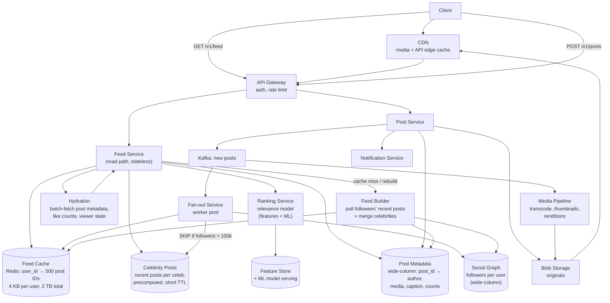

# Instagram News Feed — Full Worked Case Study

> **TL;DR** — A feed is a **precomputed, ranked, cached list per user**, and the entire design question is *when* you compute it. Fan-out on write pushes each post into every follower's precomputed feed at upload time — fast reads, catastrophic writes for a celebrity with 200 M followers. Fan-out on read builds the feed at request time by pulling from the people you follow — cheap writes, expensive reads. The real answer is **hybrid**: fan-out on write for normal users, fan-out on read for celebrities, merged at request time, with the merge result cached. Around that sit a media pipeline (upload → blob → transcode → CDN), a ranking model, cursor pagination, and a cache hierarchy. The consistent theme is that Instagram prioritises **performance and availability over freshness** — a feed that is 30 seconds stale is completely acceptable, and that single relaxation is what makes the whole design affordable.

> **60-second interview answer:** "I'd clarify: is this a feed of people you follow, is there a ranking algorithm or is it chronological, what's the read-to-write ratio, and what's the media mix. The core question is fan-out on write versus fan-out on read. Fan-out on write means when you post, I insert the post ID into every follower's feed list — reads become a single cache lookup, but one celebrity post becomes 200 million writes, which is impossible. Fan-out on read means I fetch from the people you follow at request time and merge — writes are free but every feed load is expensive. So I'd use a hybrid: fan-out on write for normal accounts, and exclude accounts above a follower threshold — say 100,000 — from fan-out, then merge their recent posts in at read time. The merged feed is cached with a short TTL, ranked, and paginated with a cursor. And I'd say explicitly that I'm trading freshness for performance: a feed that's slightly stale is fine, and that is what makes the numbers work."

---

## 1. Definition & mental model

**Plain English.** A news feed service answers one question — "what should this user see, in what order, right now" — by combining the recent posts of everyone they follow, filtering by visibility rules, ranking by a relevance model, and returning a page. The engineering problem is that the naive answer (compute it on every request) is too slow, and the obvious optimisation (precompute it for everyone on every post) is too expensive for popular accounts.

**The analogy: a newspaper delivered to your door, printed from a shared wire.**

- The **wire** is the stream of posts. Everyone publishes to the wire.
- A **personalised newspaper** is printed for you every morning containing articles from the columnists you follow, in the order you would most want to read them.
- If you follow 300 people, printing on demand means fetching 300 articles every morning — slow, and the same articles are fetched for millions of readers.
- So instead the **printing press pre-prints**: when a columnist publishes, their article is slotted into the pre-printed edition of every subscriber. That is fan-out on write.
- But one columnist has 200 million subscribers. Pre-printing 200 million copies for every one of their articles is not economical. So their articles go into a **special pull-out supplement**: everyone who follows them gets the pre-printed edition plus the most recent supplements, stapled together when the paper is handed over.
- The **stapling** is the read-time merge, and it is why the design is called hybrid.

**The insight:** the feed is not stored as a query; it is stored as a **materialised list of post IDs**, and the whole architecture is about deciding which lists to materialise.

**The one-line version:** a feed is a per-user materialised top-N list, plus a read-time merge for the accounts too popular to materialise.

---

## 2. Why it exists — the problem it solves

### Step 1 — Clarify the requirements

| # | Question | Assumed answer |
|---|---|---|
| 1 | Who appears in the feed? | Accounts you follow, plus ads and recommendations |
| 2 | Chronological or ranked? | **Ranked** by a relevance model, with recency as a strong feature |
| 3 | Read:write ratio? | Extremely read-heavy — roughly 100:1 or worse |
| 4 | Media mix | ~70% of posts carry an image or video; video is the growth vector |
| 5 | Are stories/reels in scope? | **Out of scope** — a separate ephemeral system with the same building blocks |
| 6 | Do we need infinite scroll? | Yes — cursor pagination |
| 7 | Editing and deletion? | Edit is out of scope; delete must remove the post from feeds within minutes |
| 8 | Privacy — private accounts, blocks, mutes? | Yes — visibility is evaluated at read time, not baked into fan-out |
| 9 | Feed size to keep per user? | Top ~500 post IDs, sufficient for several pages |
| 10 | Freshness requirement? | **Seconds to a minute is fine** — this is the key relaxation |
| 11 | Ads | Yes, inserted at read time by a separate system — out of scope for the core |
| 12 | Notifications | Out of scope — a separate service ([see Notification System](03-notification-system.md)) |
| 13 | Global or single region? | Global, with regional read replicas and CDN |
| 14 | Search and explore | Out of scope |

**Non-functional requirements:**

| Requirement | Target | Why |
|---|---|---|
| **Read latency** | p99 < 200 ms for a feed page | The scroll must feel instant |
| **Availability** | 99.99% for reads | A feed that will not load is a dead app |
| **Freshness** | 30 s–5 min acceptable | **The relaxation that makes the design cheap** |
| Write latency | p99 < 1 s from upload to "posted" | Perceived responsiveness |
| Scale | 2 B users, 500 M DAU, 100 M posts/day | Capacity below |
| Consistency | Eventual; read-your-writes for your own posts | You must see your own post immediately |
| Cost | Media storage and CDN egress dominate | Cost is a first-class constraint |
| Durability | Posts are never lost | Feeds are derived and rebuildable |

**The trade-off statement:** *"Performance and availability over freshness. A five-minute-stale feed is indistinguishable to a user, and relaxing freshness is what lets me precompute and cache instead of computing on every request."*

---

## 3. Internal mechanics — the five-step worked design

### 3.2 Step 2 — Capacity estimation

```
Users:              2 B registered, 500 M DAU
Posts:              100 M posts/day
Average followers:  200 (a heavy-tailed distribution: median ~150, p99 ~50,000,
                    max ~200 M+)
Average following:  300

WRITES
  Posts/sec = 100 M / 86,400         = ~1,160 posts/sec (avg)
  Peak (×3)                          = ~3,500 posts/sec

  Fan-out on write cost:
    Each post → insert into avg 200 followers' feed lists
    1,160 × 200                      = ~232,000 writes/sec  (avg)
    Peak                             = ~700,000 writes/sec

  But the distribution is heavy-tailed:
    A 200 M-follower post alone     = 200 M writes in one event
    At 700,000 writes/sec that is   = ~286 seconds ≈ 5 minutes
    → ONE post stalls fan-out for five minutes
    → A dozen such posts an hour and fan-out never catches up
    ⇒ Pure fan-out on write is IMPOSSIBLE at the tail.
      This single calculation is the reason the design is hybrid.

READS
  DAU × feed opens per day: 500 M × 10 = 5 B feed loads/day
  Feed loads/sec = 5 B / 86,400       = ~58,000/sec (avg)
  Peak (×3)                           = ~175,000/sec

  Read:write ratio = 5 B / 100 M      = 50:1 at the post level,
                                        but ~250:1 against fan-out writes

STORAGE
  Feed list: 500 post IDs × 8 bytes = 4 KB per user
    × 500 M active users             = 2 TB  (Redis, in-memory, hot)
  Post metadata: 100 M/day × 2 KB    = 200 GB/day
    × 365                            = ~73 TB/year (wide-column store)
  Media originals: 100 M × 2 MB      = 200 TB/day  ← THE DOMINANT COST
    (deduplicated, and only ~70% of posts have media)
    With 3 renditions and 30% growth for transcodes: ~250 TB/day of new bytes
  → Media storage and CDN egress dwarf everything else by two orders of magnitude.
```

**The capacity takeaways:**
1. **Fan-out on write fails at the tail, not the average.** The average is 232,000 writes/sec, which is survivable; a single celebrity post is 200 M writes, which is not. **Say this calculation out loud — it is the whole design.**
2. **Reads dominate by ~50:1**, so anything that makes reads cheap is worth paying for at write time.
3. **Media is 99% of the bytes and the cost.** The feed itself is tiny; images and video are the business.
4. **The hot tier (2 TB of feed lists in Redis) is affordable**; the cold tier (73 TB/year of post metadata) is fine; the media tier (90 PB/year) needs lifecycle management and a CDN.

### 3.3 Step 3 — API design

```http
# Feed
GET /v1/feed?cursor=<opaque>&limit=20
  → 200 {
      "items": [
        { "post_id":"p_991", "author":"u_42", "ts":..., "media":[ {...} ],
          "caption":"...", "likes":1200, "rank_score":0.87 },
        ...
      ],
      "next_cursor": "eyJ0Ijo...",       # opaque, encodes (timestamp, post_id, source)
      "has_more": true
    }

# Posting
POST /v1/media/upload-url            # presigned, direct to blob storage
  → { "upload_url":"https://...", "media_id":"m_77a" }
POST /v1/posts
{
  "media_ids": ["m_77a"],
  "caption": "…",
  "location": null,
  "visibility": "public"              # public | followers | close_friends
}
  → 201 { "post_id":"p_991", "status":"processing" }   # transcoding is async

# Engagement
POST   /v1/posts/p_991/like
DELETE /v1/posts/p_991/like
POST   /v1/posts/p_991/comments
DELETE /v1/posts/p_991
GET    /v1/users/u_42/posts?cursor=...
```

**API design points worth stating:**
1. **The cursor is opaque and encodes position as `(rank_score, post_id)` or `(ts, post_id)`** — never an offset. An offset-based feed breaks when new posts arrive between pages: page 2 shifts and the user sees duplicates or misses items, the classic offset-pagination bug ([see SQL](../../HLD/04-data/01-sql-deep-dive.md) §3.11). A cursor is stable against insertion.
2. **Upload is presigned and direct to blob storage** — media never passes through the API tier.
3. **Posting returns 201 with `status: processing`** — transcoding is asynchronous, and the post may appear in the author's own feed before its video renditions exist (with a placeholder).
4. **Likes and comments are separate endpoints** and are not on the feed read path — the feed carries a **count**, cached, not a live query.

### 3.4 Step 4 — High-level design



**Component by component:**

| Component | Responsibility | Why |
|---|---|---|
| **CDN** | Serve media and cache public API responses | Media is 99% of the bytes; the CDN is the only affordable way |
| **API Gateway** | Auth, rate limit, routing | One choke point for abuse control |
| **Feed Service** | Serve a page: read cached IDs, merge celebrities, rank, hydrate | Stateless and horizontally scalable |
| **Feed Cache (Redis)** | `user_id → list of ~500 post IDs` | **The precomputed feed.** 4 KB × 500 M = 2 TB |
| **Celebrity Posts** | Recent posts of high-follower accounts, precomputed | The pull-out supplement; short TTL |
| **Ranking Service** | Score candidates by relevance | Ranking is a model, not a sort |
| **Post Metadata** | `post_id → author, media refs, caption, counts` | Hydration; wide-column, `post_id` as the key |
| **Fan-out Service** | On a new post, insert its ID into followers' feed lists | The write amplification, deliberately bounded |
| **Social Graph** | `user_id → follower IDs`, and following lists | The source for both fan-out and rebuild |
| **Media Pipeline** | Transcode, thumbnail, generate renditions | Async, from a Kafka topic; never on the upload path |
| **Blob Storage + CDN** | Originals and renditions | Durability plus cheap egress |
| **Feature Store / ML serving** | Ranking features and the model | Ranking inputs must be low-latency |
| **Feed Builder** | Rebuild a feed from scratch on a cache miss | The fan-out-on-read path, also used for cold users |

**The end-to-end write flow:**

```
1. Client requests a presigned upload URL
2. Client uploads the original directly to blob storage
3. Client POSTs /v1/posts with media_ids
4. Post Service writes post metadata (post_id → author, media, caption)
5. Publishes {post_id, author_id, ts} to Kafka topic "new_posts"
6. Media Pipeline consumes: transcode to renditions, generate thumbnails,
   write to blob storage, update the post metadata with rendition URLs
   → NOT on the critical path; the post is visible immediately with a placeholder
7. Fan-out Service consumes the same topic:
   a. look up the author's follower count
   b. if followers ≤ 100,000 → fan out on write
   c. if followers > 100,000 → SKIP; the post is appended to the author's
      "celebrity recent posts" list instead
8. Fan-out, for each follower:
   a. LPUSH/INSERT the post_id with its timestamp into feed:{user_id}
   b. trim the list to 500 entries (LRANGE trim)
   c. invalidate or update the follower's merged-feed cache
9. Notification Service is triggered separately for a subset of followers
```

**The end-to-end read flow:**

```
1. GET /v1/feed?cursor=...
2. Feed Service reads feed:{user_id} from Redis → up to 500 post IDs (fast path)
   On a cache miss → Feed Builder reconstructs from the social graph:
     a. fetch the following list
     b. for each followee, fetch their recent posts (batched, parallel)
     c. merge, sort by time, trim to 500, write back to Redis with a TTL
3. Merge in celebrity posts: for each celebrity the user follows, fetch their
   recent posts from the celebrity cache (itself precomputed)
4. Merge, deduplicate, and take the top N candidates (say 500) for ranking
5. Ranking Service scores the candidates using features (recency, affinity,
   engagement prediction, media type, freshness) — returns an ordered list
6. Apply visibility filters: blocks, mutes, private accounts, deleted posts,
   already-seen (optional), age
7. Hydrate: batch-fetch post metadata for the top ~20 items in ONE round trip
   (a multi-get, not N queries — this is where N+1 would kill you)
8. Insert ads at fixed positions (a separate system)
9. Return the page plus an opaque cursor
```

**The point to emphasise at step 7:** hydration must be a **batch multi-get**, not a loop. Twenty posts hydrated with twenty separate lookups is the N+1 problem at 175,000 feed loads/sec, which is 3.5 M queries/sec instead of 175,000 ([see SQL](../../HLD/04-data/01-sql-deep-dive.md) §3.6).

**Why the celebrity threshold exists, restated as a rule:** fan-out cost is `followers × posts`, and it must stay bounded per post. Above the threshold, the post is stored once and merged at read time. The threshold is chosen so that the worst-case fan-out for a single post (~100,000 writes) completes in well under a second, while the read-time merge cost stays bounded because users follow only a handful of celebrities — the merge is over `(celebrities followed) × (recent posts each)`, typically under 200 items.

### 3.5 Step 5 — Deep dive and trade-offs

#### Fan-out on write vs read vs hybrid

| | Fan-out on write | Fan-out on read | Hybrid |
|---|---|---|---|
| **When computed** | At post time | At read time | Both |
| **Write cost** | × follower count | ×1 | × followers below threshold, ×1 above |
| **Read cost** | One cache read | Fetch from every followee and merge | One cache read + a bounded merge |
| **Latency (read)** | Very low | High, and grows with followee count | Low |
| **Celebrity problem** | Fatal | Handled naturally | Handled by the threshold |
| **Cold/inactive users** | Wasteful — you precompute for users who never log in | Free | Mitigated by lazy materialisation |
| **Freshness** | Immediate on fan-out | Immediate | Seconds |
| **Storage** | 4 KB × every user | None | 4 KB × active users |
| **Chosen?** | No | No | **Yes** |

**The lazy-materialisation refinement to state:** do not fan out to inactive users. If a user has not opened the app in 30 days, skip their feed list entirely and build it on demand from the graph when they return. That converts a large fraction of the 2 B registered users from "2 TB of precomputed feeds that are never read" into "a rebuild cost paid once, on return". At 500 M DAU out of 2 B registered, that is a 4× saving on the feed cache.

#### The celebrity problem, quantified

```
A 200 M-follower account posts:
  Pure fan-out on write: 200 M insert operations
  At a realistic 700,000 writes/sec: 286 seconds
  → During those 286 seconds fan-out for EVERY OTHER post is delayed
  → Fan-out lag grows without bound if celebrities post frequently
  → The feed becomes stale for everyone, not just for the celebrity's followers
```

**The three fixes, in order of preference:**
1. **Threshold + read-time merge** (chosen). Simple, and the merge is bounded.
2. **Push only to active followers, lazily materialise the rest.** Reduces the write cost by the inactive fraction.
3. **Tiered fan-out** — fan out to the first N followers immediately and merge the rest at read time. Useful when the threshold is fuzzy.

**The follow-up the interviewer may ask:** *"What if a user follows 50 celebrities?"* Then the read-time merge is 50 × their recent posts. Fix: cap the celebrity merge at the most recent K per celebrity (say 20), rely on the ranking model to surface the best, and precompute a per-user "celebrity digest" for users who follow unusually many — which is a cache keyed by the celebrity set, since many users follow the same set.

#### Ranking

```
Ranking is a two-stage process:

  Stage 1 — candidate generation: 500 post IDs from the feed cache + celebrity
    merge. Cheap, no model.

  Stage 2 — scoring: a model over features for each candidate:
    recency              (a strong, nonlinear decay — hours matter, days do not)
    affinity             (historical interaction with this author)
    engagement prediction (P(like), P(comment), P(share), P(dwell))
    media type           (video often gets a boost)
    author features      (is the author someone you message?)
    content diversity    (penalise 5 posts in a row from the same author)
    negative signals     (already seen, reported, muted)

  Final score = f(features); sort; apply diversity constraints.

Why ranking and not chronological:
  A chronological feed over 300 followees at 100 M posts/day means most
  posts are never seen. Ranking maximises the probability that the top 20
  are the 20 the user most wants.

Why the ranking model must not be on the critical path for everything:
  Scoring 500 candidates in a strict latency budget of ~100 ms means the
  features must come from a low-latency feature store, and the model must
  be small enough to serve inline. A heavy model requires a two-stage
  design: a cheap ranker for 500 → 50, then a heavy ranker for 50 → 20.
```

**The trade-off to name:** ranking improves engagement but reduces predictability for creators (a post can get no distribution), and it creates a feedback loop — the model learns from what it showed. Both are product decisions with engineering consequences, and naming them is a strong signal.

#### The media pipeline

```
Upload → Blob storage (original)
  → Kafka event
  → Transcode workers:
       - validate (is it really an image? a video? size, duration, codec)
       - strip EXIF (privacy — GPS coordinates in photos)
       - image: generate thumbnails (150px, 320px, 640px, 1080px) in WebP/AVIF
       - video: transcode to HLS renditions (360p, 720p, 1080p), 6 s segments,
         generate a poster frame and a thumbnail sprite
       - write renditions back to blob storage
       - update post metadata with the rendition URLs
  → CDN invalidates/pre-warms the new renditions
  → Client fetches a manifest and streams via the CDN

Latency target: image renditions within ~2 s; video renditions within ~30 s
  → a video post appears immediately with its poster frame and becomes
    playable as renditions complete
```

**Two failure modes to name:** (1) **an infinite transcoding loop** if the pipeline's output write triggers the same "new object" notification that starts the pipeline — scope the trigger to the originals prefix, or tag outputs ([see Blob Storage](../../HLD/04-data/04-blob-and-object-storage.md) §6.5); (2) **transcoding cost** — video transcoding is compute-heavy, so it runs on a queue with autoscaling, and the queue depth is a first-class metric.

#### Cache layers

```
L1 — client:        the app caches the last feed page and media in a local disk cache
L2 — CDN:           media renditions and public API responses, long TTL (immutable URLs)
L3 — feed cache:    Redis, user_id → 500 post IDs, TTL 24 h, refreshed by fan-out
L4 — post metadata: Redis for hot posts (a celebrity post read by millions),
                    wide-column store as the durable source
L5 — counts:        like/comment counts cached with a short TTL (5-60 s) and
                    updated asynchronously, never a live COUNT query
L6 — ranking feats: feature store, precomputed, refreshed periodically

The rule: counts are eventually consistent and cached. A live COUNT(*) on
likes at 175,000 feed loads/sec is a guaranteed outage.
```

#### Pagination and cursors

```
Opaque cursor encoding (base64 of a small JSON):
  { "score": 0.87, "post_id": "p_991", "ts": 1758960000, "src": "feed" }

Read: return items with (score, post_id) strictly less than the cursor's,
      ordered by score desc, post_id desc — a keyset pagination.

Why not offset:
  With offset=20, if 5 new posts enter the feed between page 1 and page 2,
  the user sees 5 items twice. With offset pagination over a feed that
  changes constantly, duplicates and gaps are guaranteed, not occasional.

Stability:
  The cached ID list is snapshotted at the start of a scroll session so
  the pages are consistent with each other; new posts are shown via a
  "new posts" pill at the top rather than shifting the scroll position.
  This is a UX decision with an architectural cause.
```

#### Consistency: read-your-writes for your own post

```
Problem: you post a photo; fan-out is asynchronous; you refresh your feed
and your own post is not there. That reads as a bug.

Fix: read-your-writes for the author only.
  - the Post Service writes the author's OWN feed list synchronously as part
    of the post request (one write, cheap — the author always fans out to
    themselves first)
  - the async fan-out handles everyone else
  - or: the Feed Service merges "your own recent posts" into the candidate
    set at read time until fan-out confirms

This is bounded staleness with a targeted exception, and it is worth naming
explicitly as a consistency decision rather than pretending the system is
uniformly eventual.
```

#### Deletes and visibility

```
Delete a post:
  - mark the post metadata as deleted (tombstone)
  - do NOT attempt to remove the ID from 200 M feed lists (impossible)
  - filter at read time: a deleted post is dropped during hydration
  - the feed cache entries age out naturally within the TTL

Visibility (blocks, mutes, private accounts):
  - evaluated at READ time, never baked into fan-out
  - reasons: a block must take effect instantly, and the relationship can
    change after the post was fanned out
  - the filter runs after ranking and before hydration, so blocked content
    never costs a metadata fetch

This is an important architectural principle: anything mutable and
user-controlled belongs on the read path, not the write path.
```

---

## 4. Variants & taxonomy

| Variant | Description | Trade-off |
|---|---|---|
| **Chronological feed** | Strict reverse-chronological | Predictable for creators; low engagement; simple |
| **Ranked feed** | A relevance model orders candidates | **Chosen** — engagement; opacity and feedback loops |
| **Fan-out on write** | Materialise every follower's feed at post time | Fast reads; celebrity-fatal |
| **Fan-out on read** | Merge at request time | Cheap writes; slow reads |
| **Hybrid with a threshold** | Write below, read above | **Chosen** — the standard answer |
| **Tiered fan-out** | Immediate to some followers, lazy for the rest | Smooth degradation; more complex |
| **Lazy materialisation** | Only precompute for active users | 4× cache saving; a rebuild cost on return |
| **Precomputed ranking** | Rank at fan-out time | Cheaper reads; stale ranking |
| **Read-time ranking** | Rank per request | **Chosen** — fresher; needs a latency budget |
| **Two-stage ranking** | Cheap ranker then a heavy ranker | Cost control; added complexity |
| **Pull-only for everything** | No precomputation at all | Simple; too slow at this scale |
| **Push-only for everything** | No read-time merge | Simplest reads; impossible at the tail |
| **Edge-computed feed** | Rank at the CDN edge | Lowest latency; limited model complexity |
| **Per-feed-type caches** | Separate lists for "following" and "for you" | Different freshness and ranking; more caches |
| **Graph-based feed** | Traverse the social graph per request | Flexible; too slow at scale without materialisation |

---

## 5. Pros / Cons

| Decision | Pros | Cons |
|---|---|---|
| **Hybrid fan-out** | Fast reads, bounded write cost | Two code paths; a merge at read time |
| **Precomputed ID lists in Redis** | Feed load is one cache read | 2 TB of memory; invalidation on unfollow/block |
| **Lazy materialisation** | Large memory saving for inactive users | A slow first load when a dormant user returns |
| **Ranking at read time** | Fresh and personalised | A latency budget and a feature store to operate |
| **Short-TTL count caching** | Removes COUNT queries from the read path | Counts are wrong for seconds to minutes |
| **Read-time visibility filtering** | Blocks and deletes take effect instantly | Every read pays the filter cost |
| **Async media transcoding** | Upload is fast | A window where the post exists without renditions |
| **Opaque cursors** | Stable pagination | Cannot jump to a page number |
| **Snapshot-per-scroll-session** | Consistent pages | New posts need a separate UI affordance |
| **Read-your-writes for the author** | Your own post always appears | A special case in the codebase |
| **CDN for media** | Affordable egress and low latency | Cache invalidation on delete is imperfect |

---

## 6. Exceptions, edge cases & failure modes

### 6.1 The celebrity post that stalls fan-out

Covered in §3.2 and §3.5. The specific failure: a single post with 200 M followers takes ~286 seconds of fan-out at 700,000 writes/sec, during which everyone else's fan-out is delayed. **The fix is the threshold plus read-time merge**, and the *reason* the threshold is not optional is this arithmetic — not a preference. Add tiered fan-out if the interviewer pushes on the boundary case.

### 6.2 The fan-out lag and unbounded staleness

If posts arrive faster than fan-out can process them, the lag grows without bound and feeds become progressively staler. **Fixes:** monitor **fan-out lag** (the age of the oldest unfanned-out post) not just queue depth; autoscale the fan-out worker pool on lag; shed load by fanning out only to active users under pressure; and **fall back to fan-out on read for every account** when lag exceeds a threshold — degrading to slower reads rather than stale feeds.

### 6.3 The cache stampede on a celebrity feed rebuild

A celebrity post is published. Millions of followers' feed caches are invalidated simultaneously. Every one of them misses and triggers a rebuild. **Fixes:** the celebrity post is served from the **celebrity cache**, which is one precomputed entry, so a million readers share one cache entry rather than a million rebuilds; single-flight on the rebuild key so one request rebuilds and the rest wait ([see Cache Invalidation](../../HLD/03-scaling/04-cache-invalidation-and-consistency.md) §6.5); and jittered TTLs on feed caches so they do not all expire together.

### 6.4 Hot keys

A single celebrity post's metadata, like count and comment thread is read by millions of users at once. On a Redis cluster, that is one key on one shard — a hot key that can saturate a single core.

**Fixes:** replicate the hot key across N shards with a random suffix (`post:p_991:{0..9}`) and read a random one; add a short-TTL local in-process cache in the Feed Service so a single instance serves thousands of requests from memory; put the CDN in front of any public read of the post; and use read replicas for the metadata store. **Naming the local in-process cache is the strongest answer**, because it removes the network hop entirely for the hottest keys.

### 6.5 The follow/unfollow race

You unfollow someone, but their posts are already in your precomputed feed list. Removing them from a 500-entry list on every unfollow is work, and it may race with fan-out inserting new posts.

**Fix:** do not remove on unfollow. **Filter at read time** against the current following set, which is cheap (a set lookup) and correct. The stale entries age out of the list within the TTL. This is the same principle as delete: mutable relationships belong on the read path.

### 6.6 The dormant user returning

A user has not opened the app in six months. Their feed cache expired or was never materialised. They open the app and the Feed Builder must reconstruct from the graph: fetch 300 followees' recent posts and merge. If done naively that is 300 sequential queries and a multi-second load.

**Fixes:** parallel batched fetches with a bounded concurrency; a hard timeout with a partial result ("showing recent posts" while the rest loads); and pre-warming — when a push notification is sent to a dormant user, speculatively rebuild their feed, since the notification predicts an app open. That last one is a nice touch.

### 6.7 The N+1 hydration bug

Twenty posts hydrated with twenty lookups instead of one multi-get. At 175,000 feed loads/sec that is 3.5 M queries/sec. **Fix:** always batch. The feed service should have exactly one metadata round trip per page, and it should be visible in the metrics as "metadata RPCs per page = 1".

### 6.8 Deleted posts lingering in feeds

Delete cannot remove an ID from 200 M feed lists. If the filter is only in the feed service and some other path (a notification, a share, a deep link) reads the post directly, the deleted post is still visible. **Fix:** the tombstone lives with the post, and **every** read path checks it — not just the feed. Enforcement belongs at the post-metadata layer, not at the feed layer, so the rule holds everywhere.

### 6.9 Offset pagination producing duplicates

Covered in §3.5. A user scrolling a fast-moving feed sees the same post twice. **Fix:** keyset cursors, plus a snapshot of the ID list per scroll session. Worth naming because it is a real, visible bug.

### 6.10 The media pipeline backlog

A viral video, or a batch of uploads, floods the transcode queue. Posts exist with a placeholder and never become playable. **Fixes:** priority queues (a post from a large account transcode first, since it will be viewed sooner); a per-post timeout after which it is marked failed with a retry; and autoscaling on queue depth with a cap. Also worth naming: transcoding is expensive, so a runaway queue is a cost incident, not just a latency one.

### 6.11 Other failure modes

- **Celebrity threshold churn** — a user crosses 100,000 followers, and their old posts are in millions of feed lists while their new posts are not fanned out. Fix: on crossing, keep the existing fanned-out entries and let them age out; do not attempt a backfill.
- **A mass-follow event** (a giveaway or a bot) inflating follower counts and fan-out cost — rate-limit follows per account and per IP.
- **Feed cache memory pressure** — 2 TB of Redis at 4 KB per user; if the eviction policy is wrong, active users get evicted. Set `maxmemory-policy` to favour no-eviction or LRU with a large enough instance, and monitor hit rate.
- **Redis cluster resharding** moving a hot user's feed list — a brief latency spike; single-flight the reads during migration.
- **The "new posts" pill race** — a snapshot per scroll session means new posts are not shown until the user taps the pill; if the snapshot is never refreshed, the user sees a feed frozen for hours.
- **Like-count write amplification** — a viral post gets 1 M likes/sec; do not write each one to the database. Buffer and aggregate: increment a Redis counter and flush to the store every few seconds ([see Redis](../../HLD/03-scaling/03-redis-deep-dive.md) §6.10).
- **A private account's post fanned out before the account was made private** — visibility is read-time, so this is handled correctly by design, but the reverse (a public post made private) must invalidate any CDN-cached copy via the media URLs being signed or short-lived.
- **The ranking model degrading silently** — model quality is not visible in latency metrics; monitor engagement rate as a first-class SLI, with the ability to fall back to chronological.
- **Ad load** — inserting ads at read time can double the hydration cost; ads must come from their own cache with their own latency budget, and the feed must degrade gracefully (fewer or no ads) rather than fail.

---

## 7. When to use / When NOT to use

### This design is right when
- Reads vastly outnumber writes and reads must be fast.
- The content set per user is large and changing.
- Freshness of seconds to minutes is acceptable.
- There is a heavy-tailed popularity distribution (celebrities, viral content).
- Ranking, not chronology, is the product goal.
- Media is a large fraction of the payload.

### This design is NOT what you want when
- **The feed must be strictly chronological and complete** — precomputation plus ranking will hide posts, and users (or regulators) may object.
- **Freshness must be immediate** — a trading blotter or a chat stream cannot be five minutes stale ([see WhatsApp](02-whatsapp-chat-system.md)).
- **The content set is small and static** — no feed cache needed; query directly.
- **Engagement is not the goal** — a chronological list with no ranking model may be the right product.
- **You need exactly-once, ordered delivery of events** — that is a message queue, not a feed.
- **The feed is for one user only** — a per-user timeline with no fan-out is a simple query.

### Design decision table

| Requirement | Decision |
|---|---|
| Fast reads | Precompute feed ID lists in Redis |
| A celebrity with 200 M followers | Exclude from fan-out; merge at read time |
| Inactive users | Lazy materialisation — do not precompute |
| Ranking | Read-time, two-stage (cheap → heavy) |
| Media | Presigned upload → blob → async transcode → CDN |
| Pagination | Opaque keyset cursor, never offset |
| Consistent pages within a scroll | Snapshot the ID list per session |
| Your own post must appear instantly | Synchronous self-fan-out / read-your-writes |
| Deletes | Tombstone + read-time filter everywhere |
| Blocks and mutes | Read-time filter; never baked into fan-out |
| Hot key (viral post) | Key replication with a random suffix + in-process local cache |
| Like counts at scale | Redis counter + periodic flush; never COUNT(*) live |
| Fan-out lag growing | Monitor lag, autoscale, degrade to fan-out on read |
| Cache stampede on rebuild | Single-flight + jittered TTLs |
| Dormant user returns | Parallel batched rebuild + a timeout with a partial result |
| Media pipeline backlog | Priority queues + timeouts + autoscaling with a cap |

---

## 8. Numbers, defaults & tuning

| Quantity | Value | Reasoning |
|---|---|---|
| Users / DAU | 2 B / 500 M | Scale |
| Posts/day | 100 M | ~1,160/sec average |
| Peak post rate | ~3,500/sec | ×3 diurnal |
| Average followers | 200 (heavy-tailed) | Drives fan-out cost |
| Average following | 300 | Drives the read-time rebuild |
| Fan-out writes/sec | ~232,000 avg, ~700,000 peak | The write load |
| **Celebrity threshold** | **100,000 followers** | Above it, read-time merge; chosen so worst-case fan-out < 1 s |
| Single celebrity post | 200 M writes → ~286 s | Why the threshold is mandatory |
| Feed loads/day | 5 B (500 M × 10) | Read volume |
| Feed loads/sec | ~58,000 avg, ~175,000 peak | The read load |
| Read:write ratio | ~50:1 at the post level | Why you pay at write time |
| Feed list size | 500 post IDs | Several pages of scroll |
| Feed ID size | 8 B | 64-bit post ID |
| Feed cache per user | ~4 KB | 500 × 8 B |
| Feed cache total | ~2 TB (active users only) | The Redis hot tier |
| Feed cache TTL | 24 h | Bounded staleness |
| Feed cache trim | 500 entries per insert | Bounded memory per user |
| Celebrity cache TTL | 5–15 min | Fresher than the feed cache because it is shared |
| Post metadata size | ~2 KB | Caption, media refs, counts |
| Post metadata growth | ~73 TB/year | The cold store |
| Media per post | ~2 MB average | Originals |
| Media growth | ~250 TB/day | **The dominant cost** |
| Image renditions | 150 / 320 / 640 / 1080 px, WebP + AVIF | 4 sizes, 2 formats |
| Video renditions | 360p / 720p / 1080p, HLS, 6 s segments | ABR ladder |
| Image transcode target | < 2 s | Perceived immediacy |
| Video transcode target | < 30 s | Placeholder until then |
| Metadata RPCs per page | **exactly 1** | The N+1 guardrail |
| Candidate set for ranking | 500 → 50 (cheap) → 20 (heavy) | Two-stage |
| Ranking latency budget | ~100 ms | Inside a 200 ms p99 |
| Count cache TTL | 5–60 s | Eventually consistent counts |
| Like-count flush interval | 1–5 s | Aggregate before writing |
| Cursor encoding | base64 of (score, post_id, ts, src) | Keyset pagination |
| Page size | 20 items | Scroll UX and hydration cost |
| Fan-out worker concurrency | Autoscaled on **lag**, not depth | Lag is what users feel |
| Lazy materialisation cut-off | 30 days inactive | 4× cache saving |
| Local in-process hot cache | 1,000 entries, 10 s TTL | Removes the network hop for viral posts |
| Hot key replication | 10 shards, random suffix | Spreads a viral read |
| Rebuild timeout | 2 s, then partial results | A dormant user must not wait |
| Fan-out lag alert | p99 lag > 60 s | Before it becomes user-visible |

---

## 9. Interview Q&A

**Q1 (easy). What do you clarify first?**
Whether the feed is chronological or ranked, whether it is only from accounts you follow or includes recommendations and ads, the read-to-write ratio, the media mix, and — most importantly — the freshness requirement. If the feed can be a minute stale, I can precompute and cache, which makes the design cheap. If it must be immediate, this becomes a completely different system. I would also ask about private accounts, blocks and mutes, because those determine whether visibility is filtered at read time or write time, and about deletion.

**Q2 (easy). What is the core architectural decision?**
Fan-out on write versus fan-out on read. Fan-out on write means when someone posts, I insert that post ID into the precomputed feed list of every follower — reads become a single cache lookup, but one post from an account with 200 million followers is 200 million writes. Fan-out on read means I fetch recent posts from everyone you follow at request time and merge — writes are free, but every feed load is expensive. The answer at scale is a hybrid: fan out on write for accounts under a follower threshold, and exclude large accounts from fan-out and merge their recent posts in at read time. The threshold is around 100,000 followers.

**Q3 (easy). Why is the feed precomputed rather than queried?**
Because the read volume is roughly fifty times the write volume. At 175,000 feed loads a second at peak, computing a feed means fetching from 300 followees and merging for every single load — that is tens of millions of queries a second. Precomputing moves that work to the write path, which is fifty times smaller, and turns a read into one Redis lookup. The cost is storage — about four kilobytes per active user, so around two terabytes of Redis — and staleness, which I have already decided is acceptable.

**Q4 (medium). Walk me through the fan-out on write path.**
A post is created, its metadata is written, and a message goes to a Kafka topic. A fan-out worker consumes it and looks up the author's follower count. If it is under the threshold, it fetches the follower list and for each follower inserts the post ID and timestamp into their feed list in Redis, trimming the list to 500 entries to bound memory. If the count is over the threshold, the worker skips fan-out entirely and instead appends the post to that author's celebrity cache. The read path then merges the precomputed list with the celebrity caches of the celebrities that user follows.

**Q5 (medium). How do you do pagination?**
With an opaque cursor that encodes the position as a score and a post ID — essentially a keyset cursor — and the read returns items strictly after that position. Not an offset. With offset pagination over a feed that is constantly changing, page two shifts when new posts arrive and the user sees duplicates or misses items; it is guaranteed, not occasional. I would also snapshot the ID list per scroll session so the pages are internally consistent, and surface new posts with a "new posts" affordance at the top rather than shifting the scroll position, which is a UX decision that has an architectural cause.

**Q6 (medium). How are likes and comments counted?**
They are not counted on the read path. A live count for a viral post at 175,000 feed loads a second is a guaranteed outage. Instead, the count is maintained as a Redis counter incremented on each like, and flushed to the durable store every few seconds, and the feed reads a cached count with a short TTL of maybe five to sixty seconds. That means the count the user sees can be slightly wrong, and that is a completely acceptable trade — nobody notices a like count that is three seconds old, and the alternative does not scale.

**Q7 (medium). What does the read path actually do?**
Five steps. Read the precomputed list of up to 500 post IDs from Redis — one lookup, or a rebuild from the social graph on a miss. Merge in the recent posts of any celebrities the user follows. Run the ranking model over the candidate set to produce an order. Apply visibility filters for blocks, mutes, private accounts and deleted posts. Then hydrate — batch-fetch the metadata for the top twenty items in one round trip, insert ads at fixed positions, and return the page with a cursor.

**Q8 (hard, testing §6). A celebrity with 200 million followers posts. What happens?**
If I were doing pure fan-out on write, that is 200 million insert operations. At a realistic 700,000 writes a second, that is 286 seconds — nearly five minutes during which fan-out for every other post is delayed, so everyone's feed goes stale, not just that celebrity's followers. That calculation is exactly why the design is hybrid. With the threshold, that post is not fanned out at all; it goes into the celebrity cache as a single entry, and every follower merges it at read time. Because it is one shared cache entry rather than millions of per-user entries, a million people reading it at once is a single key being read a million times, which is a hot key — so I would also replicate that key across several shards with a random read suffix and add a short-lived in-process cache in the feed service so the hottest reads never leave the machine.

**Q9 (hard, testing §6). Fan-out falls behind. How do you detect and fix it?**
I would monitor fan-out **lag** — the age of the oldest post that has not been fanned out — not queue depth. Depth can be stable while lag grows, because the processing rate is lower than the arrival rate, and lag is what the user experiences. Alerts at a p99 lag of around sixty seconds, before it is visible. To fix it: autoscale the worker pool on lag; under pressure, shed load by fanning out only to active users and letting the rest be lazily materialised; and if lag crosses a hard threshold, degrade to fan-out on read for everyone — reads get slower, but the feed stays fresh, which is the right direction to fail in.

**Q10 (hard, testing §6). Cache stampede on a feed rebuild.**
When a celebrity posts, millions of followers' feed caches can be invalidated at once and all miss simultaneously. But because the celebrity post lives in the shared celebrity cache rather than in each user's list, that is one entry rather than millions of rebuilds — which is the primary defence. On top of that: single-flight on the rebuild key, so one request does the rebuild and the others wait for the result rather than all doing it; jittered TTLs on the feed caches so they do not expire together; and a stale-while-revalidate policy so a slightly stale feed is served while the rebuild happens in the background rather than the user waiting.

**Q11 (hard). How do you handle deletion and blocks?**
Neither is baked into the fan-out. Deletion writes a tombstone on the post and every read path checks it — the feed, notifications, shares, deep links — so the enforcement lives at the post-metadata layer rather than in the feed service, and it holds everywhere. Blocking and unfollowing are checked at read time against the current relationship, because a block has to take effect instantly and the relationship can change after a post was already fanned out. Removing someone from a 500-entry feed list on every unfollow is also work that could race with fan-out inserting new posts, and the stale entries age out within the TTL anyway. The general principle is that anything mutable and user-controlled belongs on the read path.

**Q12 (hard). How do you rank, and where does ranking happen?**
At read time, in two stages. Candidate generation is cheap — the 500 IDs from the feed cache plus the celebrity merge. Then a cheap ranker scores all 500 down to about 50, and a heavier model scores 50 down to 20. The features are recency with a nonlinear decay, affinity based on historical interaction with the author, predicted engagement, media type, content diversity to avoid five posts in a row from the same person, and negative signals like already-seen or reported. Ranking at read time gives fresher and more personalised results, but it costs latency and requires a low-latency feature store. The alternative — ranking at fan-out time — is cheaper to serve but stale, so I would only use it for the precomputation of a coarse order.

**Q13 (hard). What if a user follows fifty celebrities?**
Then the read-time merge is fifty celebrities times their recent posts, which could be a thousand extra candidates and a slow read. Three mitigations: cap the merge at the most recent K per celebrity, say twenty, and let the ranking model pick the best of those; treat the celebrity set as a cache key, since many users follow the same set of popular accounts, so the merged celebrity fragment is shared across users rather than recomputed per user; and for extreme cases, materialise a per-user celebrity digest on a schedule. The key insight is that the merge cost is bounded by celebrities-followed, not by followers, so a user who follows fifty celebrities is a different and rarer problem than a celebrity with 200 million followers.

**Q14 (hard). What are the trade-offs you would call out?**
Four. Fan-out on write versus on read, resolved by a hybrid threshold, trading implementation complexity for bounded write cost and fast reads. Freshness versus performance — I am explicitly accepting a feed that is seconds to minutes stale so that I can precompute and cache, and that single relaxation is what makes the whole design affordable. Ranking versus chronology — ranking improves engagement but reduces creator predictability and introduces a feedback loop, and that is a product decision with an engineering cost. And memory versus latency: two terabytes of Redis to make reads a single lookup, which is expensive but far cheaper than the alternative.

**Q15 (hard). What would you monitor?**
Fan-out lag at p50, p95 and p99, because it is the freshness SLI. Feed cache hit rate, since a drop means rebuilds are happening and reads are getting slow. Feed read latency at p99, split into the cache read, the ranking time and the hydration time, because each has a different fix. Metadata RPCs per page, which should be exactly one — anything higher is an N+1 regression. Media pipeline queue depth and age, because a backlog means posts are unplayable and transcoding cost is climbing. Ranking model quality, monitored through engagement rate rather than latency, with the ability to fall back to chronological. Redis memory and eviction rate on the feed cache, since evicting an active user's feed is a direct latency hit. And CDN cache hit ratio and egress cost, because media is where the money goes.

---

## 10. Common mistakes candidates make

1. **Choosing pure fan-out on write** without doing the celebrity arithmetic.
2. **Choosing pure fan-out on read** without acknowledging the read cost at 175,000 loads/sec.
3. **Not stating a follower threshold**, or stating one without justifying it.
4. **Offset-based pagination**, which duplicates and skips items in a live feed.
5. **Live `COUNT(*)` for likes and comments** on the read path.
6. **N+1 hydration** — fetching metadata per post instead of one multi-get.
7. **Putting media through the API tier** instead of presigned upload to blob storage.
8. **Baking visibility into fan-out**, so blocks and deletes do not take effect.
9. **Ignoring read-your-writes** for the author's own post.
10. **No fan-out lag monitoring** — watching depth instead of lag.
11. **No cache-stampede defence** for a celebrity post.
12. **Ignoring the hot key** on a viral post.
13. **Forgetting that media is 99% of the cost** and not mentioning a CDN or lifecycle tiering.
14. **No capacity numbers**, or numbers with no reasoning.
15. **No trade-offs section.** The interviewer is grading the trade-offs, not the diagram.

---

## 11. Cheat-sheet summary

| Concept | One-line truth |
|---|---|
| Core question | Fan out on write, on read, or hybrid |
| The answer | **Hybrid** with a follower threshold (~100,000) |
| Why the threshold exists | 200 M followers × 1 post = 200 M writes ≈ 286 s of stalled fan-out |
| Read:write ratio | ~50:1 at the post level — pay at write time |
| Feed representation | `user_id → 500 post IDs` in Redis, ~4 KB each |
| Feed cache total | ~2 TB for active users |
| Lazy materialisation | Do not precompute for users inactive 30+ days |
| Read path | cache read → celebrity merge → rank → filter → hydrate (one batch) → ads |
| Ranking | Two-stage, read-time: 500 → 50 → 20 |
| Pagination | Opaque keyset cursor, snapshot per scroll session |
| Counts | Cached, eventually consistent, Redis counter + periodic flush |
| Media | Presigned upload → blob → async transcode → CDN |
| Media cost | ~250 TB/day of new bytes — the dominant cost |
| Deletes | Tombstone + read-time filter on **every** path |
| Blocks/mutes | Read-time filter, never baked into fan-out |
| Read-your-writes | The author always fans out to themselves synchronously |
| Hot key | Replicate across shards with a random suffix + in-process cache |
| Stampede | Shared celebrity cache + single-flight + jittered TTLs |
| Fan-out health | Monitor **lag**, not depth; degrade to fan-out on read |
| Trade-offs | Freshness for performance; hybrid for bounded fan-out; ranking for engagement; memory for latency |

**"If the interviewer says X → answer Y"**

| Interviewer says | You say |
|---|---|
| "Design Instagram's feed" | Clarify (ranked?, follow-only?, media, freshness) → hybrid fan-out → 5 steps |
| "Fan-out on write or read?" | "Hybrid — threshold at ~100k followers; the celebrity calculation forces it" |
| "Celebrity posts" | "200 M writes ≈ 286 s of stalled fan-out; exclude above the threshold and merge at read time" |
| "Pagination" | "Opaque keyset cursor, never offset — offsets duplicate and skip in a live feed" |
| "Like counts at scale?" | "Cached with a short TTL, Redis counter flushed every few seconds, never live COUNT" |
| "Delete a post?" | "Tombstone plus a read-time filter on every path; never remove from 200 M feed lists" |
| "Blocked user?" | "Read-time filter — mutable relationships never belong in fan-out" |
| "Fan-out falls behind?" | "Monitor lag, not depth; autoscale; degrade to fan-out on read" |
| "Viral post hot key?" | "Shard-replicate the key, add an in-process cache, and let the CDN absorb public reads" |
| "Your own post missing?" | "Synchronous self-fan-out for read-your-writes" |
| "Trade-offs?" | "Freshness for performance, hybrid for bounded writes, ranking for engagement, memory for latency" |

---

## 12. Cross-links

- [WhatsApp Chat System](02-whatsapp-chat-system.md) — the fan-out shape when correctness, not speed, dominates
- [Notification System](03-notification-system.md) — the events a feed generates
- [YouTube Upload and Recommendation](05-youtube-upload-and-recommendation.md) — the media pipeline at its largest
- [BookMyShow Seat Booking](07-bookmyshow-seat-booking.md) — the opposite consistency model
- [Caching Strategies and Layers](../../HLD/03-scaling/02-caching-strategies-and-layers.md) — the cache hierarchy used here
- [Cache Invalidation and Consistency](../../HLD/03-scaling/04-cache-invalidation-and-consistency.md) — stampede, single-flight, TTL jitter
- [Redis Deep Dive](../../HLD/03-scaling/03-redis-deep-dive.md) — hot keys and counter aggregation
- [Blob and Object Storage](../../HLD/04-data/04-blob-and-object-storage.md) — presigned uploads and the media pipeline
- [NoSQL Deep Dive](../../HLD/04-data/02-nosql-deep-dive.md) — the wide-column store behind post metadata
- [CDN Deep Dive](../../HLD/02-networking/02-cdn-deep-dive.md) — media delivery and cache invalidation
- [Scaling, Caching and DB Cheatsheet](../../Cheat-Sheets/03-scaling-caching-db-cheatsheet.md)
