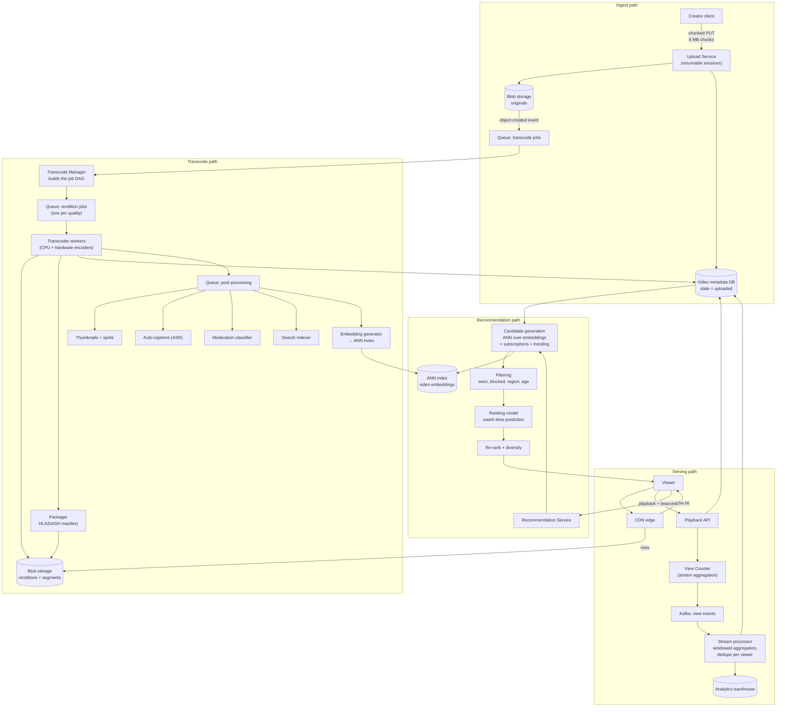

# YouTube — Upload and Recommendation — Full Worked Case Study

> **TL;DR** — YouTube's upload path is a **CI/CD pipeline for media**: a resumable upload writes the original to blob storage, an event triggers a fan-out of transcode jobs, worker pools produce a ladder of renditions plus a manifest, the manifest and renditions are pushed to a CDN, and the video becomes playable progressively as renditions complete. The two things that make this question interesting are (1) **view counting must not be a synchronous database write** — at millions of views per second you aggregate in a stream processor and flush periodically, never `UPDATE videos SET views = views + 1`; and (2) **the recommendation path is a separate, much larger read system**: candidate generation over billions of videos, filtering, then ranking, served from precomputed embeddings in an ANN index, not from a live query. The theme is that the *write* path is a pipeline with a queue at every hop, and the *read* path is a retrieval funnel.

> **60-second interview answer:** "I'd clarify: are uploads from creators only or also live streams, what resolutions and formats, how long can a video be, and what's the view-count accuracy requirement. The upload path is a pipeline. I'd chunk the upload so it's resumable — the client uploads 5 to 10 MB chunks and the server records the offset, so a dropped connection resumes rather than restarting a 4 GB upload. The original lands in blob storage, which fires an event, which queues a transcode job. Worker pools transcode to a ladder — 360p, 480p, 720p, 1080p, plus HLS segments and a manifest — and write renditions back to blob storage for the CDN to serve. The video is playable as soon as the first rendition and manifest exist, so transcoding is progressive, not blocking. View counting I would never do as a synchronous increment; I'd publish a view event to Kafka and aggregate in a stream processor with a window, then flush counts periodically. And for recommendations, the path is a funnel: candidate generation from an ANN index over embeddings down to hundreds, then ranking down to tens."

---

## 1. Definition & mental model

**Plain English.** A video platform has two almost-independent systems sharing one asset store. The **ingest path** turns a single uploaded file into a set of streamable renditions plus the metadata needed to play them. The **serving path** streams those renditions to viewers and decides *which* videos a viewer should be offered next.

**The analogy: a film studio with a distribution arm.**

- A director delivers a **master reel** (the upload) to the studio gate.
- The **lab** (transcoding) makes prints in every format: 35 mm, 16 mm, VHS, digital — because cinemas, TVs and phones all need different formats. Prints are made in parallel by many lab technicians.
- The **warehouse** (blob storage) holds the master and the prints.
- The **delivery vans** (CDN) carry prints to local depots near every cinema, so the film does not travel from the studio for every showing.
- The **box office** (view counting) does not phone head office for every ticket sold. Each cinema counts locally and reports a total every few minutes.
- The **programmer** (recommendation) decides what to show next, based on what this audience has watched and what similar audiences watched — and they work from a shortlist prepared in advance, not from a fresh survey of the entire archive for every customer.

**The insight:** upload is a **fan-out pipeline with a queue at every stage**, and serving is a **two-sided retrieval funnel**. Conflating them is the most common mistake — they have completely different scaling profiles (writes are rare and huge; reads are constant and tiny).

---

## 2. Why it exists — the problem it solves

### Step 1 — Clarify the requirements

| # | Question | Assumed answer |
|---|---|---|
| 1 | Who uploads? | Creators, via web and mobile, plus API partners |
| 2 | Maximum video length / size | 12 hours / 256 GB (YouTube's real limit) |
| 3 | Resolutions | 144p → 4K, adaptive bitrate ladder |
| 4 | Formats in | MP4, MOV, AVI, WebM, MKV, and more |
| 5 | Formats out | HLS + DASH, fragmented MP4 segments |
| 6 | Live streaming | **Out of scope** — a separate low-latency pipeline |
| 7 | View-count accuracy | **Approximate, eventual, deduplicated** — not exact, not synchronous |
| 8 | Monetisation / ads | Ad insertion exists but is out of scope for the core path |
| 9 | Subtitles / captions | Yes — automatic ASR plus uploader-provided |
| 10 | Thumbnails | Yes — uploader-provided or auto-generated, several sizes |
| 11 | Content moderation | Yes — a pipeline stage before wide availability |
| 12 | Search | Yes — full-text over title, description, transcript, tags |
| 13 | Recommendations | Yes — the home feed and the "up next" sidebar |
| 14 | Private / unlisted videos | Yes — an access-control decision at serving time |
| 15 | Global serving | Yes — multi-region CDN |

**Non-functional requirements:**

| Requirement | Target |
|---|---|
| Upload reliability | **Resumable** — a dropped connection must not restart a 4 GB upload |
| Upload throughput | 500 hours of video uploaded per minute (a real YouTube figure) |
| Transcode latency | First rendition playable within ~1 minute of upload completing |
| Playback start | p99 < 1 s to first frame, globally |
| Availability (playback) | 99.99% — playback must never be down |
| Availability (upload) | 99.9% — an upload outage is annoying but survivable |
| View count | Eventually consistent within seconds; deduplicated per viewer |
| Durability | The original master must never be lost |
| Cost | Storage and egress dominate; transcoding is the second cost |
| Scale | 2 B+ users, 500 hours uploaded/minute, billions of views/day |

**The trade-offs to state:** *"Playback availability over upload availability — I would rather a creator wait than a viewer get an error. Approximate view counts over exact ones, because exact counts do not scale. And progressive availability over a blocking transcode — the video is playable before all renditions exist."*

---

## 3. Internal mechanics — the five-step worked design

### 3.2 Step 2 — Capacity estimation

```
UPLOAD
  500 hours of video uploaded per minute
  = 500 × 60 = 30,000 minutes of video per minute
  = 500 hours/min × 60 × 24 = 720,000 hours/day of video ingested

  Assume an average bitrate of 8 Mbps for a 1080p source:
    bytes/hour = 8 Mbit/s × 3,600 s / 8 = 3.6 GB per hour of video
    ingest/day = 720,000 h × 3.6 GB = ~2.6 PB/day of ORIGINALS
    ingest/sec = 2.6 PB / 86,400 = ~30 GB/sec of upload bandwidth
  This is a bandwidth problem more than a storage problem:
    30 GB/sec is ~240 Gbps sustained inbound, peaking much higher.

TRANSCODING — the compute estimate
  A ladder of ~8 renditions, total output ≈ 1.2× the source bytes
    (higher renditions are big, lower ones small; aggregated ~1.2×)
  Transcode compute: roughly real-time × 1 on a modern CPU core per rendition
    → 720,000 hours/day × 8 renditions = 5.76 M core-hours/day
    → 5.76 M / 24 = 240,000 cores running continuously
    With hardware encoders, this drops by 5–20×, to ~15,000–50,000 units
  ⇒ Transcoding is the single largest compute cost in the platform.
    Say this number out loud — it justifies the hardware-encoder and
    "transcode only what is watched" optimisations.

VIEWS
  Assume 5 B video views/day
  Peak (×3 diurnal): 175,000 views/sec
  A naive "UPDATE views" per view = 175,000 writes/sec on a single hot row
    → completely impossible (a single row supports maybe 1,000 writes/sec)
  ⇒ View counting MUST be aggregated. This is the canonical point of the question.

STORAGE
  Originals: 2.6 PB/day → ~950 PB/year  (must be tiered; most is never re-read)
  Renditions: ~1.2× → ~1.1 EB/year of output
  Hot/warm on the CDN: the popular fraction (~10% of videos get 90% of views)
  Cold archive: cheap object storage; the long tail is rarely streamed
  ⇒ Lifecycle tiering is not an optimisation here, it is the only way the
    storage bill is payable.

METADATA
  720,000 hours/day ÷ assume 8 minutes average video = ~5.4 M videos/day
  Metadata row ~10 KB (title, description, tags, transcript, chapters, refs)
  5.4 M × 10 KB = ~54 GB/day → ~20 TB/year  ← tiny, and yet it is the
  most-queried data in the system. Metadata is small; media is enormous.
```

**The capacity takeaways:**
1. **Ingest is bandwidth-bound** (~240 Gbps sustained), not storage-bound.
2. **Transcoding is the dominant compute cost** — ~240,000 cores naive, ~15,000–50,000 with hardware encoders.
3. **View counting cannot be a row update** — 175,000 views/sec on one row is a guaranteed outage.
4. **Originals are ~950 PB/year and mostly never re-read** — tiering is mandatory.
5. **Metadata is 20 TB/year but is the hottest data** — a 5-order-of-magnitude size difference from media, which is why they live in different stores.

### 3.3 Step 3 — API design

```http
# ── Resumable upload ───────────────────────────────────────────────
POST /v1/upload/session
{
  "file_name": "lecture.mp4",
  "size_bytes": 4294967296,
  "content_type": "video/mp4",
  "title": "...", "description": "...", "visibility": "public"
}
→ 201 {
    "session_id": "s_9f3a",
    "upload_url": "https://upload.example/v1/upload/s_9f3a",
    "chunk_size": 8388608,               # 8 MB
    "expires_at": 1758963600             # 1 hour
  }

# Chunked PUT (or PATCH with Content-Range)
PUT /v1/upload/s_9f3a
Content-Range: bytes 0-8388607/4294967296
<8 MB of bytes>
→ 308 Resume Incomplete
   Range: bytes=0-8388607                # the server's acknowledged offset

PUT /v1/upload/s_9f3a
Content-Range: bytes 8388608-16777215/4294967296
→ 308 Resume Incomplete
   Range: bytes=0-16777215

# Resume after a disconnect — the client asks where to continue
PUT /v1/upload/s_9f3a
Content-Range: bytes */4294967296
→ 308 Resume Incomplete
   Range: bytes=0-16777215                # resume from 16777216

# Final chunk
PUT /v1/upload/s_9f3a
Content-Range: bytes 4294963200-4294967295/4294967296
→ 201 {
    "video_id": "v_77a1",
    "status": "processing",
    "watch_url": "https://example/watch?v_77a1"
  }

# ── Status and metadata ────────────────────────────────────────────
GET  /v1/videos/v_77a1/status
  → { "state":"processing", "renditions":[
        {"quality":"360p","state":"ready","url":"..."},
        {"quality":"1080p","state":"processing"} ],
      "progress": 0.62 }

PATCH /v1/videos/v_77a1            # edit title/description/visibility
POST  /v1/videos/v_77a1/thumbnail  # upload a thumbnail
GET   /v1/videos/v_77a1/manifest   # the HLS/DASH manifest (or via the CDN)

# ── Serving ────────────────────────────────────────────────────────
GET  https://cdn.example/v_77a1/master.m3u8      # HLS master playlist
GET  https://cdn.example/v_77a1/1080p/seg0042.m4s
POST /v1/videos/v_77a1/view                      # a view beacon (fire-and-forget)
GET  /v1/recommendations?context=home&cursor=... # the recommendation funnel
```

**The API design points worth stating:**
1. **`308 Resume Incomplete` with a `Range` header is the resumability contract.** The server is the authority on the acknowledged offset, so a client that loses its local state can ask with `bytes */size`.
2. **The upload URL is a separate host from the API.** Upload traffic is enormous and must not share capacity or a TLS termination tier with the API.
3. **A view is a fire-and-forget beacon**, not a transaction. It must be allowed to fail; the client retries later or the count is simply lower by one.
4. **The manifest is fetched from the CDN, not the API** — playback must not depend on the API tier being healthy.

### 3.4 Step 4 — High-level design



**Component by component:**

| Component | Responsibility | Why |
|---|---|---|
| **Upload Service** | Resumable sessions, chunk validation, offset tracking | Reliability of a multi-GB upload over a flaky network |
| **Blob storage (originals)** | Durable master | The one copy that must never be lost; tiered to cold after transcoding |
| **Transcode Manager** | Expands one upload into a DAG of rendition jobs | Parallelism and retry per rendition, not per video |
| **Transcoder workers** | Produce each rendition | The dominant compute cost; autoscaled on queue depth |
| **Packager** | Builds the HLS/DASH manifest from the segments | The manifest is what players actually fetch |
| **Post-processing queue** | Thumbnails, captions, moderation, search indexing, embeddings | All derivable, all async, all independently retryable |
| **CDN** | Serve segments and manifests | Egress is the largest cost; the CDN is the only way |
| **Playback API** | Playback tokens, metadata, view beacons | Small and hot; must not be on the media path |
| **View Counter + stream processor** | Aggregate views, deduplicate, flush | **The canonical scaling lesson of this question** |
| **Video metadata DB** | Video records, states, rendition lists | Small, hot, wide-column or relational with sharding by video ID |
| **ANN index** | Approximate nearest-neighbour search over video embeddings | Recommendation candidate generation |
| **Recommendation Service** | Candidate generation → filtering → ranking → re-ranking | A retrieval funnel, not a query |
| **Analytics warehouse** | Consumes the stream for reporting | Frees the operational store from analytical queries |

**The end-to-end upload flow:**

```
1. Client POSTs /v1/upload/session → gets an upload URL and a chunk size
2. Client PUTs chunk 0 (8 MB), receives 308 with Range: bytes=0-8388607
3. ... repeat for each chunk; on a network drop, the client PUTs
   Content-Range: bytes */total and resumes from the returned offset
4. Final chunk → 201 with a video_id; the metadata row is state = "uploaded"
5. Writing the original to blob storage fires an object-created event
6. Transcode Manager consumes it and builds the DAG:
     probe the file (duration, codec, resolution, audio tracks)
     → validate (is it really video? duration within limits? not corrupt?)
     → enqueue one rendition job per quality in the ladder
     → enqueue a packaging job (depends on all renditions)
     → enqueue post-processing (thumbnails, captions, moderation, index, embeddings)
7. Transcoder workers process rendition jobs in parallel. Each writes its
   segments to blob storage and updates the metadata row for that rendition.
8. As soon as the FIRST rendition plus a valid manifest exist, the video is
   marked playable → the creator gets a link and viewers can watch at that
   quality while the rest transcode.
9. The packager writes master.m3u8 listing every quality that is ready;
   as new renditions finish, the manifest is updated (and the CDN cache for
   the manifest is purged — the ONE file whose cache must be invalidated).
10. Post-processing completes: thumbnails, captions, moderation verdict,
    search index, video embedding into the ANN index.
11. The video becomes eligible for recommendation (usually gated on
    moderation passing).
```

**The end-to-end playback and view-count flow:**

```
1. Viewer opens the watch page → the Playback API returns metadata + a manifest URL
2. The player fetches master.m3u8 from the CDN, picks a rendition by measured
   bandwidth, fetches segments sequentially
3. Segments come from the CDN edge; a popular video is a near-100% cache hit
4. The player sends view beacons:
     - a "start" beacon when playback begins
     - heartbeats every ~30 s of watch time
     - a completion or abandonment beacon
5. The Playback API does NOT write a count. It publishes the beacon to Kafka.
6. The stream processor:
     - windows the events (e.g. 1-minute tumbling windows)
     - deduplicates per (viewer_id, video_id) within a session window
     - counts a "view" per the product definition (usually ≥30 s watched)
     - emits an aggregated delta per video per window
7. A writer applies the deltas to the video metadata row (one write per video
   per window, not one per view) and to the analytics warehouse
8. The watch page displays a cached count with a short TTL — it can lag by
   seconds to minutes, and nobody notices
```

**The single most important line in this design:** step 5 — *"the playback API does not write a count."* A candidate who says "increment the view counter" has failed the central test of this question.

### 3.5 Step 5 — Deep dive and trade-offs

#### Resumable upload in detail

```
Why chunking:
  A 4 GB upload over a mobile connection WILL drop. Restarting from zero
  means many creators simply cannot upload large files.

Chunk size trade-off:
  Too small (256 KB): 16,384 requests for a 4 GB file → request overhead,
    and a per-request cost that dominates
  Too large (64 MB): a lost chunk wastes 64 MB of upload, and the retry
    granularity is coarse
  → 5–10 MB is the sweet spot. YouTube's own API uses ~8 MB multiples.

Server-side state per session:
  session_id → { video_id, total_size, bytes_received, chunk_bitmap, expiry }
  Stored in Redis with a 24 h TTL (an upload paused overnight resumes),
  with a durable fallback so a Redis loss does not orphan a 4 GB upload.

Idempotency:
  A chunk PUT is idempotent by byte range. Re-sending a chunk that already
  arrived is harmless; the server simply re-acknowledges the offset.

Expiry:
  Sessions expire (1 h idle, 24 h absolute) and incomplete uploads are
  garbage-collected. Without this, abandoned sessions accumulate storage
  silently — an orphaned-multipart problem in a different costume.
```

#### The transcode ladder and cost control

| Rendition | Resolution | Typical bitrate | Relative cost |
|---|---|---|---|
| 144p | 256×144 | 100 kbps | 1× (baseline) |
| 240p | 426×240 | 300 kbps | 1.2× |
| 360p | 640×360 | 700 kbps | 1.5× |
| 480p | 854×480 | 1.2 Mbps | 2× |
| 720p | 1280×720 | 2.5 Mbps | 3× |
| 1080p | 1920×1080 | 5 Mbps | 5× |
| 1440p | 2560×1440 | 10 Mbps | 9× |
| 2160p (4K) | 3840×2160 | 20 Mbps | 18× |

**The cost-control levers, and they are the interesting part of this question:**
1. **Do not transcode the full ladder for every video.** Encode 360p and 720p immediately (they cover the majority of viewing), and encode the higher renditions lazily — only when a video crosses a view threshold, since a video nobody watches does not need a 4K rendition.
2. **Hardware encoders** (dedicated ASIC or GPU) reduce the cost by 5–20× versus general-purpose CPU for the same throughput. This is the single biggest lever.
3. **Per-title encoding** — analyse the source complexity and choose the bitrate ladder for *that* content rather than a fixed ladder. Animation compresses far better than a handheld action shot; a fixed ladder either wastes bits or loses quality.
4. **Codec choice** — newer codecs (AV1, VP9) give 30–50% better compression than H.264 at the cost of much more encode compute. Encode the popular long tail to AV1 lazily and serve AV1 only to clients that support it.

**The trade-off to name:** the ladder is a cost-versus-quality knob, and the right answer is almost always "encode what will be watched, lazily, using the cheapest encoder that meets the quality bar for that tier."

#### View counting — the canonical scaling lesson

```
The anti-pattern (never say this):
  UPDATE videos SET views = views + 1 WHERE id = 'v_77a1';
  → 175,000 writes/sec to a SINGLE ROW
  → every database row is a lock-and-write; the row becomes a serialisation point
  → row-level lock contention, and with an index update on a secondary index
    it is worse still
  → realistically this caps out in the low thousands of writes/sec
  ⇒ guaranteed outage on any viral video

The correct design:

  1. The client sends a beacon. The API publishes to Kafka and returns 202/204.
     The beacon NEVER touches the database.
        Kafka topic: view_events, partitioned by video_id
        (partitioning by video_id keeps per-video ordering and lets one
         consumer aggregate one video's events)

  2. A stream processor consumes with a windowed aggregation:
        - tumbling window of 60 s, allowed lateness 5 min (a late beacon
          must still be counted, because mobile clients batch beacons)
        - deduplicate per (viewer_id, video_id, session) with a
          stateful set or a Redis SETNX with a TTL
        - apply the product rule for what counts as a view (typically
          ≥30 s of watch time, or an explicit "start" event)

  3. Emit one aggregated delta per video per window:
        { video_id: "v_77a1", window_end: ..., delta: 84_213, unique: 61_004 }

  4. A writer applies the delta:
        UPDATE videos SET view_count = view_count + :delta WHERE id = :video_id
     → one write per video per 60 s instead of 175,000 per second.
       For a viral video that is a 10-million-fold reduction in write pressure.
     → and for the hottest videos, buffer further in Redis and flush every
       5 minutes, or keep the counter entirely in an OLAP store that supports
       upserts, with a periodic snapshot into the operational store.

  5. The displayed count comes from a cache with a 5–60 s TTL.
     It is approximate. Nobody notices. That is the trade.
```

**The follow-up to be ready for:** *"What about exact counts for monetisation?"* Different problem, different system: an auditable count requires per-view records (or a sample) written to an append-only store, deduplicated with the same logic, and reconciled in batch. Monetisation counts are audited and must be defensible; the public count is a display value. Keep them separate — that is a strong answer.

**The other follow-up:** *"How do you deduplicate a view?"* By `(viewer_id or device_id, video_id)` within a session window — refreshed after some interval (a viewer who watches the same video three times in a day may count once or three times depending on the product rule). For logged-out users, a device ID or a cookie; for TV apps, a device identifier. Deduplication state lives in the stream processor's state store or Redis, keyed by `dedupe:view:{video_id}:{viewer_id}` with a TTL, exactly the same mechanism as notification deduplication ([see Notification System](03-notification-system.md) §3.5).

#### Recommendation: a retrieval funnel

```
The funnel, and it must be described as a funnel:

  Corpus:            ~1 B videos
  Stage 1 candidates:  ~1,000   ← from several sources, merged
  Stage 2 filtering:   ~600     ← remove seen, blocked, irrelevant, ineligible
  Stage 3 ranking:     ~100     ← a heavy model, watch-time prediction
  Stage 4 re-ranking:  ~20      ← diversity, freshness, policy constraints
  Final page:           ~20

Candidate sources (generation is multi-source; a single source misses too much):
  - subscription feed         (videos from channels the user follows)
  - ANN over video embeddings (content similarity to recent watches)
  - co-watch graph            (users who watched X also watched Y)
  - trending / popularity     (regionally scoped, time-decayed)
  - recent-upload freshness   (new videos from subscribed channels)
  - ads / promoted            (a separate auction, inserted at fixed positions)

Why ANN over embeddings and not a SQL query:
  Finding the 1,000 most similar videos among a billion, per user, in
  milliseconds, is an approximate nearest-neighbour problem — HNSW or IVF-PQ
  over a vector index ([see Vector Databases](../../HLD/04-data/03-vector-databases.md)).
  An exact scan of a billion vectors is 1.5 s per query; at 175,000 queries/sec
  that is impossible. Approximate retrieval at recall@100 of ~0.9 in under
  20 ms is what makes it feasible.

The ranking objective — name it:
  Watch TIME, not clicks. A clickbait video that is abandoned after 3 seconds
  is a failure. So the model predicts expected watch time (P(click) × E[dwell]),
  which is why clickbait is penalised. This single design choice shapes
  the entire recommendation system and is the strongest thing to say here.

Serving the model:
  The ranker must run inline within the page-load budget, so it uses
  precomputed features (user embedding, video embedding, affinity) from a
  feature store, with only a small amount of real-time feature computation.
```

#### CDN and playback

```
Manifest and segments:
  master.m3u8                    ← lists all renditions
    1080p/index.m3u8 → seg00001.m4s, seg00002.m4s, ...
    720p/index.m3u8  → ...
  The player picks a rendition from the master based on measured throughput
  and switches mid-stream (ABR) as bandwidth changes.

Caching:
  Segments are immutable once written → CDN TTL = forever (or 1 year).
    An immutable URL means no invalidation is ever needed.
  The MANIFEST changes as new renditions are added → short TTL (seconds
    to minutes) + explicit purge when a rendition completes.
    This is the one object per video whose cache must be invalidated,
    and it is worth saying so.

Popularity skew:
  A tiny fraction of videos receive almost all views. Those are fully
  edge-cached; the long tail is a CDN miss that fetches from origin.
  Consequence: origin egress is small in aggregate even though the library
  is enormous — which is why egress cost is dominated by the popular set.

Access control:
  Private and unlisted videos need signed URLs or tokens. Signed URLs with
  a short TTL interact badly with CDN caching (each viewer gets a distinct
  URL → cache fragmentation). Fix: a token scoped to the video and a time
  window, so many viewers share the same cache key — or an edge authorisation
  function that validates a cookie and allows a shared cache key.
```

---

## 4. Variants & taxonomy

| Variant | Description | Trade-off |
|---|---|---|
| **Monolithic upload** (single PUT) | One request for the whole file | Simple; a dropped connection restarts everything |
| **Chunked resumable upload** | Offset-tracked chunks | **Chosen** — resilient; more server state |
| **Direct-to-blob upload** | Client uploads to object storage with a presigned URL | Scales infinitely; less server-side validation during upload |
| **Upload through the API** | The API proxies bytes | Full control and validation; the API becomes the bandwidth bottleneck |
| **Multipart/resumable via a protocol** (tus, S3 multipart) | A standard resumable protocol | Battle-tested; less custom code |
| **Fixed encoding ladder** | The same renditions for every video | Simple; wasteful for simple content |
| **Per-title encoding** | A ladder tuned per source complexity | Better quality per bit; more compute upfront |
| **Lazy high renditions** | Encode high qualities only when watched | Big compute saving; a delay for the first 4K viewer |
| **CPU transcoding** | General-purpose cores | Flexible; 5–20× more expensive |
| **Hardware transcoding** | ASIC/GPU encoders | Cheaper and faster; slightly lower quality per bit |
| **Progressive availability** | Playable as renditions finish | Fast time-to-playable; an inconsistent experience |
| **Blocking transcode** | Publish only when all renditions exist | Consistent; the creator waits |
| **Synchronous view count** | A row update per view | Cannot scale; never acceptable |
| **Stream-aggregated view count** | Windowed deltas | **Chosen** — the only workable design |
| **Exact auditable counts** | Per-view records for monetisation | Defensible; a separate, expensive system |
| **Single-source recommendation** | One candidate source | Simple; poor coverage |
| **Multi-source candidate generation** | Subscriptions + ANN + co-watch + trending | **Chosen** — coverage; more serving complexity |
| **Click-optimised ranking** | Maximises clicks | Fast feedback; encourages clickbait |
| **Watch-time-optimised ranking** | Maximises expected watch time | **Chosen** — discourages clickbait; slower to measure |

---

## 5. Pros / Cons

| Decision | Pros | Cons |
|---|---|---|
| **Chunked resumable upload** | Survives flaky networks; essential for multi-GB files | Session state to store and expire |
| **Progressive availability** | Playable in ~1 minute instead of after all renditions | A viewer on a slow connection may find 1080p unavailable initially |
| **A per-rendition job DAG** | Parallel, independently retryable | More queue traffic and orchestration |
| **Hardware encoders** | 5–20× cheaper transcode | Slightly worse quality per bit; specialised infrastructure |
| **Lazy high renditions** | Large compute saving | The first 4K viewer waits |
| **Stream-aggregated view counts** | Scales to 175,000 views/sec | Approximate; needs a windowed stream processor |
| **Cache with a short TTL for counts** | Removes reads from the database | A visibly stale count for seconds |
| **CDN for segments with an immutable TTL** | Near-zero origin egress for popular content | Long-tail misses hit origin |
| **Short TTL on the manifest** | New renditions appear quickly | The one object requiring invalidation |
| **ANN over embeddings** | Millisecond retrieval over a billion items | Approximate recall; index rebuild costs |
| **Multi-source candidate generation** | Coverage and diversity | More services to run and merge |
| **Watch-time objective** | Discourages clickbait; better long-term engagement | Harder to measure; slow feedback |
| **Tiered storage for originals** | Makes the storage bill payable | A retrieval delay for a re-transcode |

---

## 6. Exceptions, edge cases & failure modes

### 6.1 The synchronous view-count write

Covered in §3.5. 175,000 writes/sec to one row is the canonical failure. **Fix:** publish to Kafka, aggregate in a windowed stream processor, apply one delta per video per window. **The follow-up probe:** *"what if the stream processor dies?"* — Kafka retains the events, so it resumes from its committed offset; counts are delayed, not lost. And the state store for deduplication must be checkpointed, or a restart loses dedupe state and double-counts.

### 6.2 The infinite transcode loop

The transcoder writes renditions to the same bucket whose "object created" event triggers transcoding. Each output becomes a new input, and the pipeline never terminates — a genuinely expensive runaway.

**Fixes:** scope the trigger to the `originals/` prefix with a bucket-notification filter; tag outputs with `derived: true` and have the manager skip tagged objects; or use a separate bucket for renditions. **This is the same bug as the notification-loop in blob storage ([see Blob Storage](../../HLD/04-data/04-blob-and-object-storage.md) §6.5) and naming it is a strong signal.**

### 6.3 Transcode queue backlog and the unplayable upload

A batch of large uploads (or one very popular creator) floods the queue. Videos exist in `processing` state and never become playable. Meanwhile the creator believes the upload succeeded.

**Fixes:** priority by creator tier and by predicted demand; a hard timeout per rendition after which it is marked failed and retried with a cap; autoscaling on queue depth with a ceiling; and **progressive availability** so the low renditions (which are cheap and fast) are produced first and the video is playable regardless. Also: surface `progress` in the status API so the creator sees what is happening rather than assuming a failure.

### 6.4 The re-transcode storm after a codec change

You adopt AV1 and want to re-encode the back catalogue. Naively that is a full-library re-transcode — petabytes of reads and months of compute.

**Fixes:** re-encode lazily on access (when a video is next watched, enqueue it); re-encode only the popular head of the distribution, which covers most viewing; and never re-encode the cold tail. **Saying "lazily, and only the head" is the answer.**

### 6.5 Upload session leak

Abandoned resumable uploads leave partial data in blob storage and session state in Redis. Over a year, that is a silent storage leak.

**Fixes:** session TTL (1 h idle, 24 h absolute); an `AbortIncompleteMultipartUpload` lifecycle rule ([see Blob Storage](../../HLD/04-data/04-blob-and-object-storage.md) §3.5); and a reconciliation job that finds partial uploads with no referenced session.

### 6.6 The manifest cache and a new rendition

The manifest is the only mutable object per video. If it is cached with a long TTL, a newly added 4K rendition is invisible for hours and viewers on fast connections get a lower quality than necessary.

**Fix:** a short TTL on manifests (30–60 s) plus an explicit purge when a rendition completes. Accept the higher origin load for this one small file, because manifest fetches are a tiny fraction of segment fetches.

### 6.7 A viral video and origin egress

A video goes viral; the CDN absorbs it, unless the URLs are signed per viewer (cache fragmentation) or the video is geo-restricted with per-region tokens. **Fix:** design the token so the cache key is shared — scope it to `(video_id, quality, region, time-bucket)` rather than per viewer; use an edge function for authorisation with a shared cache key; and pre-warm the popular renditions at the edge.

### 6.8 The recommendation feedback loop

The ranker shows what it predicts the user will watch; the user watches what is shown; the model learns from that and becomes more confident about a narrowing set. Over time the feed collapses into a filter bubble and creators with no initial traction never get distribution.

**Fixes:** exploration — deliberately include a small fraction of non-optimal candidates (an epsilon-greedy or Thompson-sampling approach); diversity constraints in re-ranking, so consecutive items are not near-duplicates; freshness boosts for new creators; and monitoring of the content-diversity metric alongside engagement. **Naming the feedback loop and the exploration budget is the strongest answer on this part of the question.**

### 6.9 Cold-start for a new user or a new video

- **New user, no history** — no embedding, no watch history, so ANN has nothing to search with. Fall back to popularity-by-region, a short onboarding preference survey, and rapid adaptation in the first session.
- **New video, no views** — no engagement signal, so the ranker cannot score it. Give it a guaranteed exploration slot to a small cohort so it can accumulate signal, or it will never be shown and thus never get signal. This is the "cold start" trap and it is worth naming as a specific mechanism.

### 6.10 Moderation and the upload window

A video is playable before moderation completes. If moderation is on the post-processing queue behind transcoding, the window can be hours.

**Fixes:** run moderation on the **first few seconds of the low rendition** immediately (cheap and fast), gate wide recommendation eligibility on the verdict, and allow progressive publication with the ability to take a video down quickly. Also maintain the takedown path — the ability to purge the CDN and mark the video unavailable within minutes — because a viral policy violation is a legal exposure, not just a product issue.

### 6.11 Other failure modes worth naming

- **A corrupt or malformed upload** passing the "is it video" check — probe with a real decoder during processing, and fail the job rather than producing garbage renditions.
- **Audio-only or video-only source files** — the ladder must handle a missing audio track rather than generating a broken rendition.
- **HDR and non-square pixel sources** — the ladder must handle colour space and aspect ratio, or the output looks wrong.
- **Duplicate uploads** — the same file uploaded twice; content-hash the original and deduplicate storage, since the bytes are identical and storage is the dominant cost.
- **A creator deleting a video** — must purge the CDN, the manifest, the search index, the ANN embedding and the recommendation candidates, and it must be quick. Deletion is a fan-out problem in reverse.
- **Live viewer-count spikes** breaking the count aggregator — a live-stream viewer count is a different, real-time problem with no durable per-view event; use a separate ephemeral counter.
- **The upload bandwidth spike** saturating the ingress — separate the upload host from the API host, and rate-limit per session so one creator cannot consume the ingress.
- **Thumbnail abuse** — uploading a misleading or policy-violating thumbnail; run the same moderation over the thumbnail image.
- **A queue-depth metric that looks fine while age grows** — monitor age, as with fan-out ([see Instagram](04-instagram-news-feed.md) §6.2).
- **The transcode cost incident** — a runaway queue is a money incident, not just a latency one. Monitor cost per hour, and alert on a queue depth that will cost more than a threshold to drain.

---

## 7. When to use / When NOT to use

### This design is right when
- Uploads are large or long and connections are unreliable.
- Content must be delivered at multiple qualities and to heterogeneous devices.
- Viewing volume vastly exceeds upload volume.
- A recommendation feed is the primary discovery surface.
- Media storage and egress are the dominant costs.
- Processing is expensive and should be deferred or made lazy.

### This design is NOT what you want when
- **The media is small and short-lived** — a chat attachment or a story needs a much simpler path ([see WhatsApp](02-whatsapp-chat-system.md)).
- **You need real-time interactive latency** — that is WebRTC, a completely different pipeline.
- **View counts must be exact and auditable in real time** — that is a metering system, not a display counter.
- **There is one client and one format** — a single rendition and a direct download is enough.
- **Content is private and single-viewer** — no CDN, no ladder; just an authenticated download.
- **Processing is cheap** — the whole queue-and-worker structure is over-engineering if transcoding takes 200 ms.

### Design decision table

| Requirement | Decision |
|---|---|
| A 4 GB upload over a flaky network | Chunked resumable upload, 8 MB chunks, server-tracked offset |
| Client lost its local state | `Content-Range: bytes */size` to query the acknowledged offset |
| Many output qualities | A per-rendition job DAG, parallel, independently retryable |
| Reduce transcode cost | Hardware encoders + lazy high renditions + per-title encoding |
| Playable quickly | Progressive availability — publish when the first rendition exists |
| Views at 175,000/sec | Kafka → windowed aggregation → one delta per video per window |
| Deduplicate a view | `(viewer_id, video_id, session)` with a TTL in the dedupe store |
| Display a count | Cache with a 5–60 s TTL; approximate is fine |
| Monetisation-grade counts | A separate auditable pipeline with per-view records |
| Segment delivery | CDN, immutable URLs, effectively infinite TTL |
| A new rendition appears | Short TTL on the manifest + an explicit purge |
| Private video | A signed token scoped so the CDN cache key is shared |
| Recommendation candidates | ANN over embeddings + subscriptions + co-watch + trending |
| Ranking objective | Expected watch time, not clicks |
| Avoid a filter bubble | Exploration budget + diversity constraints in re-ranking |
| A brand-new video | A guaranteed exploration slot so it can accumulate signal |
| A brand-new user | Popularity by region + onboarding preferences + fast adaptation |
| Moderation | Early low-rendition scan, gating recommendation eligibility, fast takedown |
| Storage cost | Content-hash dedupe + lifecycle tiering; re-encode lazily, head only |

---

## 8. Numbers, defaults & tuning

| Quantity | Value | Reasoning |
|---|---|---|
| Uploaded per minute | ~500 hours | The real YouTube figure used here |
| Ingested per day | ~720,000 hours | 500 × 60 × 24 |
| Average source bitrate | ~8 Mbps (1080p) | Drives the byte estimate |
| Bytes per hour of video | ~3.6 GB | 8 Mbps × 3,600 ÷ 8 |
| Original ingest/day | ~2.6 PB | 720,000 h × 3.6 GB |
| Sustained ingest bandwidth | ~30 GB/s ≈ 240 Gbps | The real constraint |
| Max upload size | 256 GB / 12 hours | Platform limits |
| Chunk size | 5–10 MB (8 MB typical) | Retry granularity versus request overhead |
| Upload session TTL | 1 h idle, 24 h absolute | Resumability versus orphan cleanup |
| Rendition ladder | 144p → 2160p, ~8 renditions | Device coverage |
| Output-to-source ratio | ~1.2× | Aggregated across the ladder |
| Transcode compute (CPU) | ~240,000 cores continuous | 5.76 M core-hours/day |
| Transcode compute (hardware) | ~15,000–50,000 units | 5–20× reduction |
| Renditions encoded eagerly | 360p and 720p | Covers most viewing |
| High renditions | Encoded lazily on a view threshold | Cost control |
| Time to first playable | < 1 minute | Progressive availability |
| Image/video segment duration | 6 s (2 s for low latency) | ABR responsiveness |
| Views/day | ~5 B | Scale |
| Peak views/sec | ~175,000 | ×3 diurnal |
| View aggregation window | 60 s tumbling, 5 min allowed lateness | Balances freshness and volume |
| View write reduction | ~10,000,000× for a viral video | 175,000/sec → 1 per minute |
| Count cache TTL | 5–60 s | Approximate is acceptable |
| Dedupe TTL | The session window (~30 min) | Per-viewer per-video |
| "A view" threshold | ≥30 s watched | The product rule |
| Recommendation funnel | 1 B → 1,000 → 600 → 100 → 20 | Retrieval funnel |
| ANN retrieval latency | < 20 ms, recall@100 ≈ 0.9 | The feasibility requirement |
| Ranker latency budget | ~100 ms | Within a ~200 ms page load |
| Exploration fraction | 1–5% of slots | Anti-filter-bubble |
| CDN segment TTL | Effectively infinite (immutable) | No invalidation needed |
| CDN manifest TTL | 30–60 s + explicit purge | The one mutable object |
| Originals retention | Tiered: hot weeks, archive beyond | ~950 PB/year |
| Metadata row size | ~10 KB | Title, description, transcript, refs |
| Metadata growth | ~20 TB/year | Tiny relative to media |
| Content dedupe | SHA-256 of the original | Identical bytes uploaded twice |

---

## 9. Interview Q&A

**Q1 (easy). What do you clarify first?**
Whether uploads are creator videos only or also live streams — live is a completely different pipeline. The maximum length and size, because a 12-hour 4K upload needs resumability and a small clip does not. The output formats and resolutions. The view-count accuracy requirement, which decides whether I build an aggregation pipeline or something simpler. And whether recommendations are in scope, because that is a separate and much larger read system.

**Q2 (easy). How does the upload work?**
Chunked and resumable. The client creates an upload session, gets back an upload URL and a chunk size of about eight megabytes, and PUTs chunks one at a time. The server returns `308 Resume Incomplete` with a `Range` header telling the client the acknowledged offset. If the connection drops, the client either resumes from its local offset or asks with `Content-Range: bytes */total` and the server tells it where to continue. The final chunk returns 201 with a video ID. The reason for chunking is simple: a 4 GB upload over a mobile connection will drop, and restarting from zero would make large uploads impossible.

**Q3 (easy). What happens after the upload completes?**
The original lands in blob storage, which fires an object-created event. A transcode manager consumes that, probes the file for duration, codec and resolution, validates it, and builds a job graph — one job per rendition in the ladder, plus packaging, plus post-processing for thumbnails, captions, moderation, search indexing and embedding generation. Worker pools transcode the renditions in parallel and write the segments back to blob storage. As soon as the first rendition and a valid manifest exist, the video is marked playable, so it becomes watchable within about a minute rather than after the entire ladder completes.

**Q4 (medium). How do you count views?**
Not with a database write. At five billion views a day, peaking around 175,000 a second, a synchronous increment on a single row would be a guaranteed outage — a single row realistically supports low thousands of writes per second and every write takes a lock. Instead, the playback API publishes a view beacon to Kafka and does not touch the database at all. A stream processor consumes with a sixty-second tumbling window, deduplicates per viewer per video within a session, applies the product rule for what counts as a view, and emits one aggregated delta per video per window. A writer applies that delta, so a viral video gets one write per minute instead of 175,000 per second. The displayed count comes from a cache with a short TTL and can be slightly stale, which nobody notices.

**Q5 (medium). Why does the recommendation path need its own design?**
Because it is a different problem entirely. The upload path is a low-volume, high-cost pipeline; the serving path is a high-volume, low-latency retrieval problem. You cannot find the thousand most relevant videos out of a billion by querying a database per user in a page-load budget. So it is a funnel: candidate generation from several sources — the subscription feed, an approximate nearest-neighbour search over video embeddings, co-watch relationships, and regional trending — which gives about a thousand candidates; then filtering for already-seen, blocked or ineligible content, down to about six hundred; then a heavy ranking model down to about a hundred; then re-ranking for diversity and policy, down to twenty.

**Q6 (medium). What does the ranking model optimise?**
Expected watch time, not clicks. That is a deliberate and important choice: if you optimise clicks, you get clickbait — videos that get opened and abandoned after three seconds, which is a bad experience and eventually drives users away. Optimising for the product of click probability and expected dwell time means a video that holds attention outranks one that merely gets opened. It is harder to measure and the feedback is slower, but it aligns the model with the product's actual long-term interest.

**Q7 (hard, testing §6). The transcoder writes to the same bucket that triggers transcoding. What goes wrong?**
An infinite loop. The transcoder's output write fires the same object-created notification that started the job, so every output becomes a new input and the pipeline never terminates. It is a runaway that is genuinely expensive — each iteration is a full transcode. Three fixes, any of which works: scope the bucket notification to the `originals/` prefix so derived objects do not trigger it; tag derived objects and have the manager skip tagged inputs; or use a separate bucket for renditions. This is the same class of bug as a media pipeline that triggers itself in blob storage, and it is why the trigger scope is a design decision rather than a configuration detail.

**Q8 (hard, testing §6). What if the view-count stream processor dies?**
The events are in Kafka, so nothing is lost — it resumes from its last committed offset and reprocesses. The immediate symptom is that counts stall and then jump. The subtle issue is the deduplication state: if it lives only in memory, a restart forgets which viewers it has already counted and double-counts everything in the replay window. So the dedupe state has to be in a durable, checkpointed store — Redis with a TTL, or the stream processor's own state store with checkpointing. And the aggregation must be idempotent on replay, which means emitting deltas keyed by window so a replayed window replaces rather than adds.

**Q9 (hard, testing §6). A video goes viral. What breaks?**
Three things, and I would address them in order. First, origin egress — the CDN should absorb essentially all of it, but only if the URLs are cacheable. If I signed a distinct URL per viewer, the cache fragments and every request hits origin, which is the real disaster. So the token must be scoped to the video, quality and a time bucket so many viewers share a cache key, or authorisation must happen at the edge with a cookie and a shared cache key. Second, the view-count pipeline — already handled by aggregation, but the dedupe state for one video becomes a hot key, so Redis dedupe keys need a TTL and possibly sharding. Third, the metadata row for that video is read millions of times, so it needs a cached read with a short TTL and an in-process local cache, plus the comment and like counts must be cached rather than computed.

**Q10 (hard). How do you handle the recommendation feedback loop?**
I would treat it as a first-class design concern rather than an emergent property. The ranker shows what it predicts you will watch, you watch what is shown, and the model learns from that — so without intervention the distribution narrows and a new creator with no signal is never shown and therefore never accumulates signal. Three mitigations: an explicit exploration budget, so a small fraction of slots, one to five percent, are filled with non-optimal candidates so the model keeps learning; diversity constraints in re-ranking so consecutive items are not near-duplicates; and a freshness boost plus a guaranteed exploration slot for new videos, because a video with zero views has no engagement signal and cannot be ranked on merit at all. And I would monitor a content-diversity metric alongside engagement, so a collapse is visible rather than silent.

**Q11 (hard). How would you reduce transcoding cost?**
Four levers, in order of impact. Hardware encoders — dedicated ASIC or GPU transcoding is five to twenty times cheaper per stream than general-purpose CPU, and it is the single biggest lever. Lazy encoding of the high renditions: encode 360p and 720p immediately, which covers the majority of viewing, and encode 1440p and 4K only when a video crosses a view threshold, because a video nobody watches does not need a 4K rendition. Per-title encoding, so the bitrate ladder is chosen for that content's complexity rather than a fixed ladder — animation compresses far better than handheld action footage. And codec choice: AV1 or VP9 give thirty to fifty percent better compression than H.264 at several times the encode cost, so encode the popular head to the newer codec and leave the long tail on H.264.

**Q12 (hard). Walk me through what happens when a creator deletes a video.**
Deletion is a fan-out problem in reverse, and it has to be fast because it is often a legal requirement. I need to purge the CDN — which is the hard part, because segments are cached with effectively infinite TTLs at hundreds of edge locations — remove the manifest and segments from blob storage or mark them unavailable, tombstone the metadata row, remove it from the search index, remove or invalidate its embedding in the ANN index, and remove it from recommendation candidate pools and any cached feed fragments. The practical approach is a takedown flag that takes effect immediately at the serving layer — the manifest returns 410 — combined with asynchronous purge for the cached bytes, so the content becomes unreachable within seconds even though the physical purge takes longer.

**Q13 (hard). How do you handle a new user with no history?**
Cold start has two sides and they need different answers. For a new user there is no embedding and no watch history, so the ANN search has nothing to query with. I fall back to regionally scoped popularity and trending, an optional onboarding preference selection, and rapid adaptation within the first session — the first few videos watched are enough to build a provisional embedding. For a new video there is no engagement signal, so the ranker literally cannot score it. It gets a guaranteed small exploration allocation to a cohort, so it can accumulate the signal needed to be ranked on merit. Without that, a new video is never shown, so it never gets signal, so it is never shown — a stable dead state that only an explicit exploration mechanism breaks.

**Q14 (hard). What are the trade-offs you would call out?**
Four. Progressive availability over a consistent experience — the video is playable before all renditions exist, so an early viewer might be limited to 720p, in exchange for time-to-playable dropping from tens of minutes to about a minute. Approximate counts over exact ones — the displayed view count can be seconds or minutes stale, in exchange for not melting the database. Aggressive cost control over quality — lazy high renditions and hardware encoders trade a small quality and latency cost for a large compute saving. And exploration over short-term engagement — reserving a few percent of recommendation slots for non-optimal candidates lowers immediate engagement slightly in exchange for not collapsing into a filter bubble.

**Q15 (hard). What would you monitor?**
Upload success rate and resume rate, because a rising resume rate means client networks or the upload tier are degrading. Transcode queue depth **and age**, with age being the real signal, plus cost per hour since a backlog is a money incident. Time-to-first-playable at p50 and p99, which is the creator-facing SLI. Playback start time at p99 globally, plus rebuffer ratio and the ABR downgrade rate as quality indicators. CDN cache hit ratio and origin egress — a hit-ratio drop with a viral video means cache fragmentation from URL signing. View-event lag from the beacon to the applied delta, and the dedupe hit rate. Recommendation serving latency split by funnel stage, plus the exploration fraction actually delivered, so I can tell if the exploration budget is being honoured. And engagement and content-diversity metrics together, because engagement alone hides a filter-bubble collapse.

---

## 10. Common mistakes candidates make

1. **Incrementing a view count synchronously** — the central failure of this question.
2. **Forgetting resumability** and assuming an upload is a single request.
3. **Making transcoding block publication** instead of progressive availability.
4. **Transcoding the full ladder for every video**, ignoring cost.
5. **No queue between the upload and the transcoder**, so a spike backs up into the upload path.
6. **Not naming the infinite-loop trigger bug.**
7. **Treating recommendation as a database query** instead of a retrieval funnel.
8. **Optimising ranking for clicks** instead of watch time.
9. **No cold-start mechanism** for a new user or a new video.
10. **No discussion of the feedback loop** in recommendations.
11. **Ignoring CDN cache-key fragmentation** from per-viewer signed URLs.
12. **Forgetting manifest invalidation** when a new rendition completes.
13. **No capacity numbers**, or numbers with no reasoning. The transcode-core estimate in particular is impressive and cheap to state.
14. **Ignoring deletion** and takedown.
15. **No trade-offs section.** The interviewer is grading the trade-offs, not the diagram.

---

## 11. Cheat-sheet summary

| Concept | One-line truth |
|---|---|
| Upload | Chunked, resumable, ~8 MB chunks, `308` + `Range` |
| Resume query | `Content-Range: bytes */size` → the server returns the offset |
| After upload | Blob write → event → transcode job DAG |
| Transcode | One job per rendition, parallel, independently retryable |
| Ladder | 144p → 2160p, ~8 renditions; ~1.2× the source bytes |
| Cost | ~240,000 CPU cores naive; ~15,000–50,000 with hardware encoders |
| Cost levers | Hardware encoders, lazy high renditions, per-title encoding, modern codecs |
| Playable when? | As soon as the first rendition + manifest exist (~1 minute) |
| **View counting** | **Never a synchronous increment** — Kafka → windowed aggregation → one delta/min/video |
| View dedupe | `(viewer_id, video_id, session)` with a TTL |
| Displayed count | Cached, 5–60 s TTL, approximate, nobody notices |
| Monetisation counts | A separate auditable pipeline with per-view records |
| Segments | CDN, immutable, effectively infinite TTL |
| Manifest | The **one** mutable object → short TTL + explicit purge |
| Private video | A signed token scoped so the CDN cache key is shared |
| Recommendations | A funnel: 1 B → 1,000 → 600 → 100 → 20 |
| Candidates | Subscriptions + ANN + co-watch + trending |
| ANN | HNSW/IVF-PQ over embeddings, < 20 ms, recall@100 ≈ 0.9 |
| Ranking objective | Expected **watch time**, not clicks |
| Cold start | Exploration slots for new videos; popularity + onboarding for new users |
| Feedback loop | Reserve 1–5% of slots for exploration; monitor diversity |
| Deletion | Takedown flag at serving (410) + async purge everywhere |
| Cost centre | Media storage and egress — lifecycle tiering is mandatory |
| Trade-offs | Progressive over consistent, approximate over exact, cheap over perfect, exploration over short-term engagement |

**"If the interviewer says X → answer Y"**

| Interviewer says | You say |
|---|---|
| "Design YouTube" | Clarify (length, resolutions, view accuracy, recommendations) → ingest pipeline + serving funnel |
| "Large upload drops?" | "Chunked resumable, 8 MB chunks, `308` + `Range`, server is the offset authority" |
| "How do you count views?" | "Never synchronously — Kafka, a 60 s window, dedupe, one delta per video per minute" |
| "Why not `views = views + 1`?" | "175,000 writes/sec to one row; a single row supports low thousands" |
| "Transcode cost?" | "~240,000 cores naive; hardware encoders plus lazy high renditions cut it 5–20×" |
| "When is it playable?" | "Progressive — as soon as the first rendition and manifest exist, about a minute" |
| "Recommendations?" | "A retrieval funnel: multi-source candidates → filter → rank → re-rank" |
| "Rank by what?" | "Expected watch time, not clicks — click-optimisation produces clickbait" |
| "New video?" | "A guaranteed exploration slot so it can accumulate signal" |
| "Viral video?" | "CDN absorbs it if the cache key is shared; watch count aggregation and hot keys" |
| "Delete a video?" | "Immediate 410 takedown at serving + async purge of CDN, index, ANN and caches" |
| "Trade-offs?" | "Progressive over consistent, approximate over exact, cheaper transcode over quality, exploration over short-term engagement" |

---

## 12. Cross-links

- [Instagram News Feed](04-instagram-news-feed.md) — the other media and recommendation funnel, at a different scale
- [WhatsApp Chat System](02-whatsapp-chat-system.md) — small media, a simpler path
- [Notification System](03-notification-system.md) — the same queue-and-worker retry machinery
- [BookMyShow Seat Booking](07-bookmyshow-seat-booking.md) — the opposite consistency problem, and LRU/LFU caches
- [Blob and Object Storage](../../HLD/04-data/04-blob-and-object-storage.md) — multipart upload, lifecycle tiering, the media pipeline
- [Vector Databases](../../HLD/04-data/03-vector-databases.md) — ANN indexes, HNSW, IVF-PQ, recall
- [CDN Deep Dive](../../HLD/02-networking/02-cdn-deep-dive.md) — cache keys, invalidation, signed URLs
- [Caching Strategies and Layers](../../HLD/03-scaling/02-caching-strategies-and-layers.md) — the cache hierarchy
- [NoSQL Deep Dive](../../HLD/04-data/02-nosql-deep-dive.md) — counters and hot partitions
- [Choosing a Database](../../HLD/04-data/05-choosing-a-database-decision-guide.md) — metadata versus media versus analytics
- [Scaling, Caching and DB Cheatsheet](../../Cheat-Sheets/03-scaling-caching-db-cheatsheet.md)
