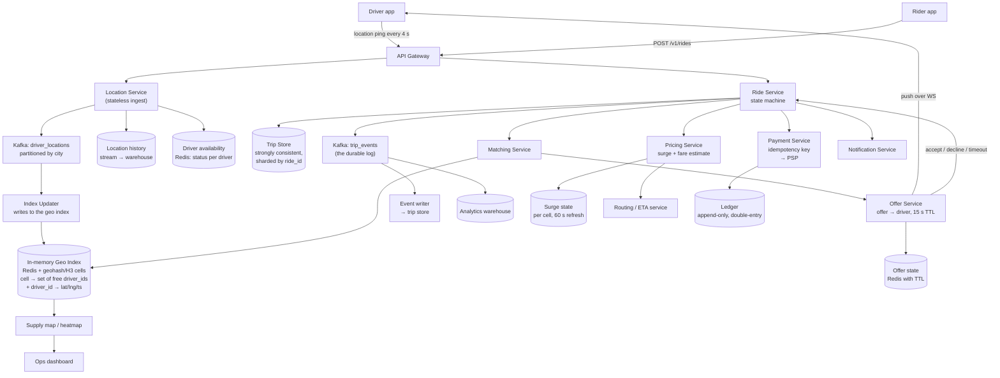

# Uber — Ride Hailing — Full Worked Case Study

> **TL;DR** — Ride hailing is **a geospatial index with a high-write ingest path, a matching algorithm, and a state machine that must not corrupt money**. Three things make it different from every other case study here. First, driver location updates are a firehose — hundreds of thousands of writes per second with a ~4-second useful lifetime, so they go to an in-memory geospatial index, not a durable database. Second, matching is a **supply-demand problem over a geohash/quadtree/S2/H3 cell**, not a nearest-neighbour query, because the constraint is that the driver is free and the ride is acceptable to both sides. Third, the trip is a **state machine with money attached**, so every transition needs idempotency keys, and payment must be exactly-once via an idempotency key at the payment provider — retrying a charge is how you double-charge a rider. The consistency trade to state: driver locations are eventually consistent and lossy (an update that never arrives is fine, it will be superseded in 4 seconds), but trip state and payment are strongly consistent.

> **60-second interview answer:** "I'd clarify: ride-hailing only, or also food delivery and pooling? Roughly how many cities, drivers and rides per day? Do we need to handle surge pricing and payments? The interesting part is that this system has three completely different consistency regimes in one product. Driver locations are a firehose — if I have 1 million active drivers pinging every 4 seconds, that's 250,000 writes per second, and the data is worthless after about 4 seconds, so it lives in an in-memory geospatial index like Redis with geohash or H3 cells, and dropping an update is fine. Trip state is a state machine — requested, matched, arriving, in-progress, completed, paid — and that must be strongly consistent, because two drivers cannot both be matched to one rider. And payment must be exactly-once, which means an idempotency key sent to the payment provider, because a retried charge is a double charge. For matching, I'd index free drivers by geohash cell and search the cell plus its neighbours, expanding rings until I find a candidate, then offer to the nearest with a timeout."

---

## 1. Definition & mental model

**Plain English.** A ride-hailing system continuously ingests the location of every active driver, maintains an index of which drivers are free and where, matches a rider's request to a nearby free driver, tracks the trip through a state machine from request to payment, and computes a price that responds to local supply and demand.

**The analogy: a taxi rank with a dispatcher and a chalk board.**

- Every driver **radios in their position** every few seconds. The dispatcher does not write these on paper — they are chalk on a board, and old chalk is wiped. A missed radio call does not matter, because the next one comes in four seconds.
- A rider calls. The dispatcher looks at the **board, divided into districts**, and finds a free cab in the rider's district — or if there is none, in an adjacent district, or the one next to that.
- The dispatcher **offers the fare to one driver at a time, with a countdown**. If the driver does not accept in 15 seconds, the offer goes to the next.
- Once accepted, the fare goes on the **ledger** — a permanent record in ink, not chalk, because money is involved. It is written once and never re-written, and every correction is a new entry.
- The **price** goes up when there are more riders than cabs in a district, which is the chalk board's density telling the dispatcher there is a shortage.

**The insight:** the system has **two storage regimes that must never be confused**. Locations are chalk: fast, lossy, ephemeral, high-volume. Trips and money are ink: durable, ordered, exactly-once, low-volume. Almost every mistake in this question comes from putting chalk in the ledger or ledger data on the chalk board.

---

## 2. Why it exists — the problem it solves

### Step 1 — Clarify the requirements

| # | Question | Assumed answer |
|---|---|---|
| 1 | Ride hailing only, or also food/pooling? | **Ride hailing only** — the others are separate products over the same core |
| 2 | Scale | 1 M active drivers, 20 M rides/day, ~100 cities |
| 3 | Matching | Nearest available driver, with acceptance timeouts and expansion |
| 4 | Surge pricing | Yes — a multiplier per geospatial cell, recomputed every few minutes |
| 5 | ETA | Yes — both time-to-pickup and trip duration |
| 6 | Payments | Yes — card, wallet, cash; must be exactly-once |
| 7 | Trip state | A strict state machine with cancellation at defined points |
| 8 | Driver app offline behaviour | Location updates stop; the driver is treated as unavailable after a timeout |
| 9 | Scheduled rides | Yes — book for later |
| 10 | Rider and driver ratings | Yes, but out of scope for the core design |
| 11 | Real-time chat/call between rider and driver | Out of scope — a masked-number telephony system |
| 12 | Mapping and routing | An external routing service; assume it exists |
| 13 | Multi-region | Yes — city-scoped, with regional isolation |

**Non-functional requirements:**

| Requirement | Target | Why |
|---|---|---|
| Location ingest | 250,000 writes/sec at peak, ~4 s freshness | The firehose |
| Location loss tolerance | **Lossy is acceptable** | Stale beats durable here |
| Matching latency | p99 < 2 s from request to first offer | The rider is waiting |
| Match correctness | **A driver is never double-assigned; a ride is never double-charged** | Money and trust |
| Trip state | Strongly consistent, ordered, idempotent transitions | The system of record |
| Payment | Exactly-once (at-least-once + idempotency) | Double-charging is unacceptable |
| Availability | 99.99% for the request path | A rider who cannot request fails immediately |
| Surge freshness | Recomputed every 1–5 minutes | Responsive but not jittery |
| ETA accuracy | ±20% at p90 | Trust in the product |
| Regional isolation | A failure in one city must not affect another | Blast-radius control |

**The trade-off statement:** *"Three consistency regimes in one system. Driver locations: eventually consistent, lossy, in-memory, high-volume — I would rather drop an update than delay it, because it is superseded in four seconds. Trip state: strongly consistent and ordered, because double-assignment is a correctness failure. Payment: exactly-once via an idempotency key at the provider, because money is not reversible by retry."*

---

## 3. Internal mechanics — the five-step worked design

### 3.2 Step 2 — Capacity estimation

```
DRIVER LOCATION INGEST — the firehose
  1 M active drivers
  Each pings every 4 seconds (a real Uber-like interval)
    updates/sec = 1,000,000 / 4            = 250,000 writes/sec (average)
    peak (×1.5 at commute times)           = ~375,000 writes/sec

  Payload: { driver_id, lat, lng, heading, speed, accuracy, ts } ≈ 100 bytes
    bandwidth = 250,000 × 100 B            = 25 MB/sec  (200 Mbps)
    → the bandwidth is modest; the WRITE RATE is the problem.

  Retention: the useful lifetime is ~4 seconds. Keeping 24 h of history:
    250,000 × 86,400 × 100 B               = ~2.2 TB/day for the full trace
    → valuable for analytics, but it must NOT be in the live serving path.
    → live locations live in memory; history goes to a stream/warehouse.

  Storage for the live index:
    1 M drivers × (100 B payload + ~50 B index overhead) ≈ 150 MB
    → IT FITS IN MEMORY. This is the key realisation: the hot dataset is tiny.

RIDES
  20 M rides/day = 20 M / 86,400           = ~231 rides/sec (avg)
  Peak (×4 at Friday evening)              = ~925 rides/sec
  Match attempts: assume 1.4 offers per match (some drivers decline)
    → ~1,300 match offers/sec at peak
  → Rides are a LOW-VOLUME workload compared with locations: 
     250,000 location writes/sec vs ~231 ride writes/sec
     a ratio of roughly 1,000:1
  ⇒ Sizing the system for rides and sizing it for locations are
    completely different exercises. Say this.

TRIP EVENTS
  A trip generates ~15 state transitions (requested, offered, accepted,
  arriving, arrived, started, ... completed, paid, rated)
  20 M × 15 = 300 M trip events/day = ~3,500 events/sec
  → low volume, high value, must be durable and ordered.

SURGE CELLS
  Divide a city into hexagons/cells: a large city might have ~10,000 cells
  Recompute every 60 s: 100 cities × 10,000 cells = 1 M cell computations
  /60 s = ~17,000 recomputations/sec — trivial.
  → Surge is cheap to compute and expensive to get wrong (it is the pricing
    surface users see).

STORAGE
  Trips (durable): 20 M/day × 2 KB          = 40 GB/day → ~15 TB/year
  Trip events (append-only): 300 M × 500 B  = 150 GB/day → ~55 TB/year
  Location history (stream/warehouse):      = ~2.2 TB/day
  Payments ledger: tiny, but the most audited data in the company.
  → The ride business is small-data. Driver locations are the only big number.
```

**The capacity takeaways:**
1. **Locations are 1,000× the write volume of rides** — and are worth almost nothing individually.
2. **The live location dataset fits in memory** (150 MB), which is why an in-memory geospatial index is the right answer and not a compromise.
3. **Trip events are low-volume and high-value** — the opposite profile, and they drive the durable design.
4. **Surge recomputation is trivially cheap**; the difficulty is the pricing policy and the cell definition, not the compute.

### 3.3 Step 3 — API design

```http
# ── Driver side: location ingest ───────────────────────────────────
POST /v1/drivers/location            # batched: up to 10 points per call
Authorization: Bearer <driver_token>
{
  "points": [
    { "lat": 12.9716, "lng": 77.5946, "heading": 45, "speed": 8.4,
      "accuracy": 6.0, "ts": 1758960000123 },
    ...
  ],
  "status": "available"              # available | on_trip | offline | break
}
→ 204 No Content                     # fire and forget; NEVER a durable write
   (a failed call is simply not retried aggressively — the next ping is 4 s away)

# ── Rider side: request a ride ─────────────────────────────────────
POST /v1/rides
Idempotency-Key: ride_req_9f3a2b      # REQUIRED — a double request must not
                                      # create two rides
{
  "pickup":  { "lat": 12.9716, "lng": 77.5946 },
  "dropoff": { "lat": 12.9352, "lng": 77.6245 },
  "product": "uberx",                 # product tier
  "payment_method": "pm_8812"
}
→ 202 {
    "ride_id": "r_55c1",
    "state": "matching",
    "quoted_fare": { "estimate": 245.00, "currency": "INR",
                     "surge": 1.4, "expires_at": 1758960120 },
    "eta_pickup_seconds": 240
  }

GET  /v1/rides/r_55c1                 # poll state (or subscribe over WS)
  → { "state":"matched", "driver": {...}, "vehicle": {...},
      "eta_seconds": 180, "surge": 1.4 }

POST /v1/rides/r_55c1/cancel
POST /v1/rides/r_55c1/rate
GET  /v1/rides/r_55c1/receipt

# ── Driver side: respond to an offer ───────────────────────────────
POST /v1/drivers/me/offers/o_77a1/accept     # ← must be idempotent + atomic
POST /v1/drivers/me/offers/o_77a1/decline
PUT  /v1/drivers/me/status { "status": "available" }

# ── Surge and pricing (internal/partner) ───────────────────────────
GET /v1/pricing/surge?cell=h3:8a2a1072b59ffff&at=1758960000
  → { "cell":"...", "multiplier": 1.4, "confidence": 0.9 }
```

**The API design points worth stating:**
1. **Location ingest returns `204` and is fire-and-forget.** It is never on a durable write path, and a lost update is meaningless.
2. **`Idempotency-Key` on ride creation is mandatory**, for exactly the same reason as in the notification system: the rider's client retries on a flaky network, and two rides for one request is a real, expensive bug ([see Notification System](03-notification-system.md) §3.5).
3. **Accepting an offer is the atomic moment.** It must be a conditional operation — "set the driver to `on_trip` only if the driver is currently `available` AND this offer is still valid" — expressed as a compare-and-set or a conditional write. **This is the single most important API design decision in the question.**
4. **The quote has an expiry.** A quoted fare with a surge multiplier is valid for a bounded window; otherwise a rider can hold a cheap quote through a surge change.

### 3.4 Step 4 — High-level design



**Component by component:**

| Component | Responsibility | Why |
|---|---|---|
| **Location Service** | Ingest pings, validate, publish | Stateless; the write rate is absorbed by Kafka |
| **Kafka `driver_locations`** | Buffer and partition by city | Absorbs 375,000 writes/sec without a database |
| **Index Updater** | Apply the latest position to the geo index | The only component writing to the hot index |
| **In-memory Geo Index** | `cell → free driver set`, `driver → position` | **Chalk board.** ~150 MB, lossy, fast |
| **Location history** | The full trace into a warehouse | Analytics; never in the serving path |
| **Ride Service** | The trip state machine | The system of record for a trip |
| **Trip Store** | Durable, strongly consistent, sharded by `ride_id` | Ink. Must not lose or reorder a transition |
| **Matching Service** | Given a pickup, find candidate drivers | The core algorithm |
| **Offer Service** | Offer to one driver at a time with a TTL | Serialised offering prevents double-assignment |
| **Pricing Service** | Surge multiplier and fare estimate | The pricing surface |
| **Routing / ETA** | Time-to-pickup and trip duration | External or internal routing |
| **Payment Service** | Charge with an idempotency key | Exactly-once money |
| **Ledger** | Append-only double-entry records | Auditability |

**The end-to-end location flow:**

```
1. Driver app sends a batch of points every ~4 s (batching reduces radio wakeups)
2. The Location Service validates (lat/lng in range, accuracy sane, ts not
   wildly future or past) and publishes to Kafka partitioned by city
3. Index Updater consumes and applies to the in-memory index:
     - REMOVE driver from their old cell's free set (if they moved cells)
     - ADD driver to the new cell's free set (only if status = available)
     - SET driver position + timestamp
   All in a Redis pipeline, so one driver update is 2-3 Redis ops
4. Kafka also feeds the history topic → the warehouse
5. A separate process expires drivers whose last update is older than
   ~30 s: they are removed from the free set, because a driver whose app
   died must not be offered rides
```

**The end-to-end match flow:**

```
1. Rider POSTs /v1/rides with an idempotency key
2. Ride Service creates the trip row: state = "requested", then "matching"
3. Matching Service is invoked with the pickup location and product tier
4. Candidate search:
     a. compute the pickup's cell at a chosen resolution (H3 res 8 ≈ 460 m
        edge, or geohash precision 6 ≈ 1.2 km × 0.6 km)
     b. fetch the free drivers in that cell and the ring of neighbours
     c. filter by product tier (an UberX request cannot be served by a
        vehicle that only does UberXL), and by any other eligibility
     d. sort by a score: distance, ETA (not distance — a driver across a
        river is close in metres and far in minutes), driver rating,
        time since last ride (fairness), and acceptance probability
5. Offer to the top candidate:
     - write an offer record with a 15 s TTL
     - set the driver's status to "offered" (so they are not offered twice)
     - push over WebSocket to the driver
6. Outcomes:
     a. ACCEPT → a conditional transition: driver status "offered" → "on_trip"
        and trip state "matching" → "matched", both as compare-and-set ops.
        If either CAS fails (the driver accepted two offers, or the trip
        was cancelled), abort and re-match.
     b. DECLINE → mark the driver as "declined this ride", offer to the next
     c. TIMEOUT (15 s) → release the driver back to "available", offer to
        the next candidate
7. If the candidate pool is exhausted:
     - expand the search radius to the next ring
     - if still empty after N rings, either keep the rider waiting with
       a "searching" state that re-runs periodically, or fail the request
       with a clear message
8. On match, notify both parties, start the trip state machine, and begin
   ETA tracking
```

**The point to emphasise at step 6a:** the accept is a **two-key compare-and-set** — the driver's status and the trip's state — and if either fails, the match is abandoned rather than forced. This is the mechanism that makes double-assignment impossible, and it is the strongest single answer in this question.

### 3.5 Step 5 — Deep dive and trade-offs

#### Geospatial indexing: geohash vs quadtree vs S2 vs H3 vs PostGIS

| Technique | How it works | Strengths | Weaknesses |
|---|---|---|---|
| **Geohash** | Interleaved lat/lng bits, base32 string; a prefix is a containing cell | Simple, string keys, prefix search = neighbour search, works in any KV store | Rectangular cells; poles and the antimeridian are awkward; cell sizes are fixed per precision; **neighbour lookup via prefix is not exact** |
| **Quadtree** | Recursively subdivide a square into 4; dense areas subdivide deeper | Adaptive resolution — fine where drivers are dense | In-memory tree; rebalancing; harder to shard; a mutable tree is a concurrency problem |
| **S2 (Google)** | Project the sphere onto a cube, then a Hilbert curve; hierarchical cells | Excellent coverage, low distortion, fast region coverings, mature library | Less intuitive; Hilbert-curve neighbours are non-obvious |
| **H3 (Uber)** | Hexagonal hierarchical grid; 15 resolutions | **Hexagons have uniform distance to all 6 neighbours** — no corner bias; excellent for ring expansion and for surge/ETA smoothing | Non-hierarchical exactly (a res-8 cell is not an exact union of res-9 cells); newer library |
| **PostGIS / geospatial RDBMS** | A spatial index (R-tree/GiST) in the database | Transactional, queryable, joins with other tables | **Cannot absorb 375,000 writes/sec**; index maintenance on every update is prohibitive |
| **Redis GEO (geohash-based)** | `GEOADD` / `GEOSEARCH` inside Redis | Simple, in-memory, fast | Fixed precision, no custom scoring, limited to a single key's dataset unless sharded |

**The chosen design:** **H3 (or geohash) cells as the index key, stored in Redis, with an in-memory ring expansion.**

```
Why hexagons (H3) over squares (geohash) for this workload:
  - All six neighbours of a hexagon are equidistant; the four diagonal
    neighbours of a square are 1.41× further, so a square ring is
    non-uniform and a driver at a corner is effectively in a different
    distance band than one at an edge
  - Ring expansion (k-ring) is a clean uniform-radius search
  - Surge and ETA smoothing over a cell's neighbours is not biased
  - Hexagons tile a sphere without the degenerate cases squares have

Why not PostGIS for the live index:
  375,000 updates/sec with an R-tree index to maintain is not feasible;
  the index write cost is on top of the row write, and a database page
  is far too coarse a unit for a 100-byte value with a 4-second lifetime.
  PostGIS is the right tool for the ANALYTICAL query ("how many trips
  started in this polygon last month"), not for the live index.

Why the index is not durable:
  Losing the index means losing at most ~4 seconds of driver positions.
  Rebuilding it takes ~4 seconds of ingest. That is an acceptable rebuild
  cost, and it is why durability here is a liability, not a feature.
```

**The ring-expansion algorithm, in detail:**

```python
def find_candidates(pickup_lat, pickup_lng, product, k_min=1, k_max=5):
    cell = h3.latlng_to_cell(pickup_lat, pickup_lng, res=8)   # ~460 m edge
    for k in range(k_min, k_max + 1):
        cells = h3.grid_disk(cell, k)                # the cell + k rings
        drivers = redis.sunion([f"cell:{c}:free" for c in cells])
        # hydrate positions in ONE pipeline (never N round trips)
        positions = redis.pipeline_get([f"drv:{d}" for d in drivers])
        eligible = [
            d for d in drivers
            if product in positions[d]["products"]
            and now() - positions[d]["ts"] < 30          # not stale
            and positions[d]["status"] == "available"
        ]
        if len(eligible) >= MIN_CANDIDATES:              # e.g. 10
            return rank(eligible, pickup_lat, pickup_lng)
    return rank(eligible, pickup_lat, pickup_lng)        # best effort at k_max
```

**Why `k_max = 5` and not unbounded:** a rider in a genuinely empty area should not wait for a scan of the whole city. Cap the expansion, then either hold the request and retry periodically as drivers move into range, or fail with an honest message. Unbounded expansion turns one rider's request into a city-wide scan at 925 requests/sec.

**Why candidates are ranked by ETA and not distance:** a driver 300 m away across a river with no bridge is 20 minutes away; a driver 1.5 km away on the same road is 4 minutes away. Ranking by straight-line distance produces visibly bad matches and is a classic mistake. ETA requires a routing call, so the flow is: cheap distance filter (a bounding radius) → ETA for the top ~10 candidates only → rank.

#### Matching, offers, and the double-assignment problem

```
The failure to prevent:
  Two riders request a ride simultaneously. Both match the same driver.
  Both riders see "driver on the way". One driver arrives at one pickup.
  → One rider is stranded and both lose trust.

Prevention, three layers:

  Layer 1 — the offer sets the driver to "offered":
    An offer writes drv:{id}.status = "offered" and is the ONLY way a
    driver leaves the free set for a specific ride. Because the free set
    (cell:{c}:free) is a Redis set, removing the driver from it happens in
    the same pipeline as the status write → they are not offered twice.

  Layer 2 — the accept is a compare-and-set on BOTH keys:
    WATCH drv:{id} and trip:{rid}
    if drv.status == "offered" AND offer is still valid AND trip.state == "matching":
        MULTI
          SET drv.status = "on_trip"
          SET trip.state = "matched", trip.driver = id
        EXEC
    else:
        abort and re-match
    → Redis MULTI/EXEC with WATCH is optimistic concurrency. The alternative
      is a Lua script, which is atomic by construction and simpler to reason
      about. Either works; a Lua script is the cleaner answer.

  Layer 3 — the durable trip store has a uniqueness constraint:
    A conditional insert / unique index on (ride_id, driver_id) in the
    matched state, or a version column with an optimistic-concurrency check.
    The Redis CAS is the fast path; the database constraint is the backstop
    that makes correctness independent of the cache being correct.

The timeout must be enforced server-side:
  A client-side 15 s timer is not authoritative. The offer record has a TTL
  in Redis, and a sweeper (or Redis key-expiry notification) releases the
  driver if no accept arrived. Otherwise a driver whose app crashed holds
  the offer forever and is invisible to matching.
```

#### Trip state machine

```
States:
  requested → matching → matched → driver_arriving → driver_arrived
    → in_progress → completed → payment_pending → paid → closed
                         ↘ cancelled (from several states)
                         ↘ no_drivers_found
                         ↘ payment_failed → retry / collect later

Transition rules that matter:
  - every transition is idempotent: applying "matched" twice is a no-op
  - every transition carries the previous state as a precondition
    (compare-and-set on the state column), so out-of-order transitions fail
  - every transition is appended to the trip_events log AND applied to the
    trip row — the log is the truth, the row is the projection
  - cancellation is allowed in specific states only, and the fee depends
    on the state (a cancellation after the driver arrived incurs a fee)

Why a state machine and not a status flag:
  A status flag lets the system reach impossible states — "completed" then
  "in_progress" — and there is no way to express "a driver can only accept
  while matching". The state machine makes illegal transitions unrepresentable.
```

#### Payments and idempotency

```
The rule: a charge must be exactly-once. Retrying a charge is a double charge.

Mechanism:
  1. The Payment Service generates an idempotency key per (ride_id, attempt):
        idem = "ride:{ride_id}:charge:{fare_version}"
     Note the fare_version: a re-priced ride is a DIFFERENT charge and needs
     a different key, otherwise a legitimate re-charge is suppressed.
  2. The key is sent to the payment provider (Stripe, Adyen, etc.), which
     guarantees that a repeated call with the same key returns the ORIGINAL
     result rather than charging twice. This is the provider's contract and
     is why you use it.
  3. The charge result is stored locally keyed by the same idempotency key,
     so an internal retry never even reaches the provider.
  4. The provider may still complete a charge whose response we never saw
     (a timeout after the charge succeeded). On retry, the same key returns
     the original success → no double charge.
  5. The ledger is append-only and double-entry: every charge has a
     corresponding entry, and corrections are new entries, never edits.
  6. Reconciliation: a daily job compares the provider's settlement report
     against our ledger and flags any mismatch. This is non-negotiable —
     it is the only way to catch failures the API contract did not cover.

Authorization vs capture:
  Authorize at match time (to confirm the card is valid and the funds exist),
  capture at trip completion for the final amount. A hold that is never
  captured must be released — an abandoned authorization is a real customer
  complaint and is a lifecycle job, not an afterthought.
```

#### Surge pricing

```
Surge is computed per geospatial cell:

  For each cell, over a recent window (e.g. last 5 minutes):
    demand = ride requests in the cell
    supply = available drivers in the cell (weighted by their ETA into the cell)
    ratio  = demand / max(supply, 1)
    multiplier = f(ratio)  — a smoothed, capped, monotone function of the ratio

Why the cell, and why hexagons:
  Surge must be locally meaningful — a busy airport is not the same market
  as a quiet suburb. Hexagons give uniform neighbour distance, which makes
  the smoothing over adjacent cells unbiased.

Why smoothing and damping:
  Raw per-cell ratios are noisy at small numbers (3 requests, 1 driver = 3×).
  Without damping, surge would flicker wildly minute to minute, which is
  both a bad experience and a fairness problem. Apply a minimum sample size,
  temporal smoothing (an EWMA over windows), a cap (e.g. 3×), and a
  rate-of-change limit.

Why surge has a supply effect that must be measured:
  Higher prices attract drivers from adjacent cells, which increases supply
  and reduces the ratio — a negative feedback loop. If the multiplier is
  recomputed naively, it oscillates. Measure driver inflow and damp.

The engineering consequence:
  Surge state is a small key-value map (cell → multiplier), refreshed every
  60 s, read on every quote. It is cached aggressively and it is a
  read-mostly hot key per city, so it lives in memory per region.
```

#### Consistency regimes, stated plainly

| Data | Consistency | Store | Why |
|---|---|---|---|
| Driver location | **Eventual, lossy** | In-memory (Redis) | Superseded in 4 s; a dropped update is harmless |
| Driver availability | Eventual but fast | In-memory + a durable mirror | Matching needs it fresh; a restart must not lose it entirely |
| Offers | Strong within the offer's lifetime | Redis with TTL + a conditional write | Must not double-offer |
| Trip state | **Strong, ordered** | Durable, sharded by `ride_id`, CAS transitions | Double-assignment and impossible states are correctness failures |
| Payment | **Exactly-once** | Ledger + provider idempotency | Money |
| Surge | Eventual, tolerant | In-memory per region | Approximate pricing is acceptable; jitter is not |
| Location history | Eventual | Stream → warehouse | Analytics; never user-visible |

**The line to say:** *"Different data in the same product needs different consistency, and the discipline is to know which is which before choosing a store. Putting locations in a strongly consistent database would make the system impossible; putting trip state in an eventually consistent store would make it wrong."*

---

## 4. Variants & taxonomy

| Variant | Description | Trade-off |
|---|---|---|
| **Geohash cells** | Rectangular cells, string keys | Simple; corner bias in ring expansion |
| **H3 hexagons** | Uniform neighbour distance | **Chosen** — clean ring expansion and unbiased smoothing |
| **S2 cells** | Cube projection + Hilbert curve | Excellent coverage; less intuitive |
| **Quadtree** | Adaptive density | Fine-grained in dense areas; mutable tree complexity |
| **PostGIS** | Spatial index in the database | Transactional; cannot take the write rate |
| **Redis GEO** | Built-in geo commands | Simple; fixed precision, limited scoring |
| **Push matching** | Offer to one driver at a time | Prevents double-assignment; slower if many decline |
| **Broadcast matching** | Offer to many, first accept wins | Fast fill; race conditions and unfairness |
| **Ring expansion** | Search outward in rings | **Chosen** — bounded and predictable |
| **Global nearest-neighbour** | Search the whole city | Simplest; unbounded cost per request |
| **ETA-ranked** | Rank by driving time | **Chosen** — better matches; needs routing calls |
| **Distance-ranked** | Rank by straight-line distance | Cheap; visibly bad across rivers and one-ways |
| **Surge per cell** | Hex/geohash cell multiplier | **Chosen** — locally meaningful |
| **Surge per city** | One multiplier for the city | Simple; unfair and ineffective |
| **Authorize-and-capture** | Auth at match, capture at completion | **Chosen** — protects against fraud; needs hold release |
| **Charge at completion** | Single charge at the end | Simpler; no fraud protection |
| **Cash / wallet** | Off-platform settlement | No idempotency key available; needs a different reconciliation |
| **Strongly consistent trip store** | Sharded RDBMS with CAS | **Chosen** — correctness |
| **Event-sourced trips** | The log is the truth, the row is a projection | Cleaner audit; more machinery |

---

## 5. Pros / Cons

| Decision | Choices | Pros | Cons |
|---|---|---|---|
| **In-memory geo index** | Redis + H3 | 375,000 writes/sec, ~150 MB, sub-ms reads | Not durable; a restart needs a ~4 s rebuild and an in-flight match may miss a driver |
| **Fire-and-forget location ingest** | `204`, no retry | Absorbs the firehose; keeps the ingest path thin | A driver may be briefly invisible if several updates are lost |
| **Offer-to-one matching** | Sequential offers | No double-assignment; fair | Slower when many drivers decline |
| **15 s offer timeout** | Server-side TTL | Frees stuck drivers | Adds latency to a match when drivers are slow to respond |
| **ETA-based ranking** | Routing calls | Good matches | Cost and latency per match |
| **Strongly consistent trip store** | CAS transitions | No impossible states, no double-assignment | A shard outage makes those rides unavailable (choosing C over A) |
| **Idempotent payments** | Provider key + local key | Exactly-once money | Requires a provider that supports keys; more state |
| **Authorize-and-capture** | Two-step payment | Fraud protection, tips, and price adjustment | Must release abandoned holds |
| **Per-cell surge with damping** | Smoothed multiplier | Fair, stable pricing | Slower to respond to a genuine spike |
| **Regional isolation** | City-scoped shards and Kafka partitions | Blast-radius control | Cross-region trips and reporting are harder |

---

## 6. Exceptions, edge cases & failure modes

### 6.1 Double-assignment of a driver

Covered in §3.5. Two riders, one driver, both told a driver is coming. **The fix is three-layered:** the offer removes the driver from the free set in the same Redis pipeline as the status change; the accept is a compare-and-set on both the driver's status and the trip's state (a Lua script or `WATCH`/`MULTI`/`EXEC`); and the durable trip store has a uniqueness constraint as the backstop. **The interviewer will usually push here** — "what if the driver's app double-taps accept?" A double-tap sends two accepts; both read the same precondition; one CAS succeeds and the second sees the state already changed and fails cleanly. The idempotency of the accept endpoint (keyed by offer ID) makes the second a no-op that returns the first result rather than an error.

### 6.2 Stale drivers in the index

A driver's phone dies, or loses signal. Their last position stays in the free set and matching keeps offering them rides they cannot accept. **Fix:** every driver record carries a timestamp and a heartbeat; a sweeper removes drivers whose last update is older than ~30 s; and the free set carries a TTL so a stalled updater does not leave a permanent ghost. **The metric to watch is the ghost rate** — offers sent to drivers who never respond.

### 6.3 Thundering herd on the location index

The Index Updater restarts and reprocesses a Kafka backlog; or a network partition recovers and 1 M drivers reconnect at once. The index is flooded. **Fixes:** only the **latest** position per driver matters, so the updater can collapse a backlog — process the last update per driver and discard the rest, which is a legitimate and important optimisation; rate-limit the ingest recovery; and jitter client reconnect ([see WhatsApp](02-whatsapp-chat-system.md) §6.3).

### 6.4 The empty-market request

A rider in a genuinely empty area. Ring expansion finds nothing at `k = 5`. Naive behaviour is an infinite search. **Fix:** cap the expansion, hold the request in a `searching` state with a periodic re-match as drivers move in, show an honest message and an ETA confidence, and allow the rider to cancel without a fee. Do not silently fail — the rider is staring at the screen.

### 6.5 The lost Kafka partition and a city going dark

A Kafka partition for one city is unavailable. Location updates for that city stop reaching the index. Drivers are still driving but the index goes stale within 30 s and the sweeper removes them all — the city appears to have zero supply. **Fixes:** partition by city but replicate and prefer availability for the location topic (a short outage loses nothing); have the sweeper use a longer threshold under a known-partition-degraded signal rather than treating "no updates" as "no drivers"; and alert on a supply-count cliff, which is a leading indicator of this failure. **The subtle point: a supply drop can mean the drivers left OR that the pipeline broke, and the system must distinguish them.**

### 6.6 Pricing and fare disputes

The quoted fare and the charged fare differ (traffic, a route change, waiting time). The rider disputes it. **Fixes:** record the quote with its surge multiplier and expiry on the trip; record the actual route and duration; record the fare breakdown as an immutable ledger entry; and give support a single view of quote versus charge versus provider settlement. This is a data-model requirement, not a support-tool requirement — if the quote was not stored at request time, it cannot be reconstructed later.

### 6.7 Payment retries and double-charging

Covered in §3.5. **The specific scenario worth naming:** the charge succeeds at the provider but the response times out; the service retries; without an idempotency key the rider is charged twice. With the key, the retry returns the original charge. **And the follow-up:** *"what if the provider does not support idempotency keys?"* Then you must record the attempt with a local key, never retry automatically without checking the provider's state, and reconcile in batch — and you should choose a provider that does support them.

### 6.8 Split brain in matching

A network partition splits the matching cluster. Both sides believe they own a city's matching. Both offer the same driver. **Fix:** **fencing** — matching ownership per city is a lease held in a strongly consistent store (etcd/Consul/ZooKeeper) with a monotonically increasing fencing token, and every write to the shared state carries the token so a stale leader's writes are rejected. This is the standard split-brain answer ([see Sharding](../../HLD/03-scaling/05-sharding-replication-and-consistency.md) §6.6). Alternative: make the accept CAS the arbiter, so even a split-brain matching layer cannot double-assign, because the compare-and-set is the single point of truth. **That second framing is the stronger answer for this specific problem** — the correctness does not depend on there being one matcher.

### 6.9 Surge oscillation

Surge rises, attracts drivers, supply increases, surge falls, drivers leave, surge rises. **Fixes:** damping (an EWMA and a rate-of-change limit), a minimum window before recomputation, and hysteresis — a higher threshold to raise surge than to lower it.

### 6.10 Clock skew across drivers

A driver's device clock is wrong, so their position timestamp is in the future or far in the past, and the staleness check either keeps a ghost driver forever or discards a fresh one. **Fix:** never trust the client clock for staleness. The server stamps receipt time and uses that for expiry; the client's timestamp is retained only for analytics. **This is the same principle as sequence numbers in chat** ([see WhatsApp](02-whatsapp-chat-system.md) §6.9).

### 6.11 Other failure modes worth naming

- **GPS drift in dense cities** — a driver appears inside a building or on the wrong street; use the reported accuracy radius, reject updates with accuracy worse than ~50 m, and snap to the road network where available.
- **A driver accepting while offline** — the accept must reach the server; a client-side optimistic accept that never lands leaves the rider waiting. Always confirm server-side and show the driver "confirming".
- **Cross-cell boundary churn** — a driver oscillating across a cell boundary causes repeated add/remove operations. Fix: only remove from the old cell if the new cell differs, and consider a small hysteresis band.
- **The hot cell** — a stadium or an airport at event time has thousands of drivers in one cell, making that key a hot spot. Shard the cell's free set into sub-keys by a hash suffix, or use smaller cells at high density.
- **Ride cancellation after a driver is en route** — must free the driver, unwind the trip state, release any payment authorization, and possibly charge a cancellation fee. A saga, not a single write.
- **A scheduled ride competing with live demand** — it must enter the matching pool before its pickup time, with a lookahead, or it will always lose to immediate requests.
- **Analytics writing to the operational store** — location history at 2.2 TB/day must never touch the serving database; keep the stream-to-warehouse path separate.
- **A regional outage taking out a city's matching** — since supply and demand are regional, a city outage should be isolated; if matching for Bengaluru is down, Chennai must be unaffected. City-scoped shards and Kafka partitions make this true.
- **Regulatory/geo constraints** — some cities restrict vehicle types, driver hours or pricing; these must be evaluated during matching, or a match is made that cannot legally complete.

---

## 7. When to use / When NOT to use

### This design is right when
- Entities move continuously and their position is queried by proximity.
- Location updates vastly outnumber transactional operations.
- There is an assignment/matching decision with a mutual-acceptance protocol.
- A trip or job has a lifecycle with money attached.
- Supply and demand are geographically local.
- Loss of a location update is acceptable; loss of a transaction is not.

### This design is NOT what you want when
- **You only need "find things near me", rarely updated** — a spatial index in a database (PostGIS) is far simpler.
- **The entities are static** — a restaurant directory needs no firehose.
- **Updates are transactional and must never be lost** — a telematics/insurance application needs durability and ordering, not a lossy chalk board.
- **Matching is trivial** — a queue with a worker is enough when there is no geospatial constraint.
- **Scale is small** — a single Postgres with PostGIS handles a few thousand concurrent drivers comfortably; the whole firehose design is over-engineering below roughly 10,000 drivers.
- **You need historical analysis, not live lookup** — that is a warehouse problem.

### Design decision table

| Requirement | Decision |
|---|---|
| 250,000 location writes/sec | Kafka buffer + in-memory index; never a durable per-update write |
| A lost location update | Accept it; the next ping is 4 s away |
| A durable location | Only into a stream/warehouse, never the serving path |
| Proximity query | H3/geohash cells in Redis, ring expansion |
| Uniform neighbour distance | Hexagons (H3) over squares (geohash) |
| Rank candidates | By ETA, not distance; distance as a cheap pre-filter |
| Empty market | Cap `k`, hold in `searching`, re-match periodically, honest message |
| No double-assignment | Offer removes from the free set; accept is a CAS on driver + trip; a DB constraint as backstop |
| Driver app crash mid-offer | Server-side offer TTL + sweeper |
| Ghost drivers | Timestamp + heartbeat; drop after ~30 s |
| Trip correctness | A state machine with precondition-checked CAS transitions |
| Trip auditability | An append-only event log; the row is a projection |
| Payment exactly-once | An idempotency key at the provider AND locally; a double-entry ledger; reconciliation |
| Fraud protection | Authorize at match, capture at completion; release abandoned holds |
| Local pricing | Per-cell surge with damping, smoothing and a cap |
| Clock skew | Server-stamped receipt time for staleness |
| Hot cell | Shard the cell's free set by a hash suffix; smaller cells when dense |
| Split brain | Fencing tokens, or make the accept CAS the arbiter so correctness does not depend on a single matcher |
| Regional blast radius | City-scoped shards, partitions and matching ownership |

---

## 8. Numbers, defaults & tuning

| Quantity | Value | Reasoning |
|---|---|---|
| Active drivers | ~1 M | Scale |
| Location ping interval | 4 s | Freshness versus battery and bandwidth |
| Location writes/sec | ~250,000 avg, ~375,000 peak | 1 M ÷ 4 s |
| Location payload | ~100 B | Small; the rate is the problem, not the size |
| Live index memory | ~150 MB | 1 M × 150 B — fits in memory easily |
| Location history | ~2.2 TB/day | Stream → warehouse, never the serving path |
| Staleness threshold | 30 s | ~7 missed pings before a driver is a ghost |
| GPS accuracy rejection | > 50 m rejected | GPS drift in dense cities |
| Rides/day | 20 M | ~231/sec average |
| Peak rides/sec | ~925 | ×4 on a Friday evening |
| Offers per match | ~1.4 | Accounts for declines |
| Location-to-ride write ratio | ~1,000:1 | Why they are separate systems |
| Trip events/day | ~300 M (15 per trip) | ~3,500/sec |
| Trip store durability | Strong, sharded by `ride_id` | Correctness |
| H3 resolution | Res 8 ≈ 460 m cell edge | City-scale matching granularity |
| Geohash precision (alternative) | 6 ≈ 1.2 km × 0.6 km | Comparable granularity |
| Ring expansion | `k` = 1 → 5 | Bounded search |
| Minimum candidate pool | ~10 | Enough for ETA ranking to be meaningful |
| Offer timeout | 15 s | Responsiveness versus driver fairness |
| Time to first offer | p99 < 2 s | The rider-facing SLO |
| ETA ranking candidates | Top ~10 get a routing call | Cost control |
| Surge recompute window | 60 s | Responsive but stable |
| Surge smoothing | EWMA + rate-of-change limit | Prevents oscillation |
| Surge cap | ~3× | Policy and fairness |
| Surge minimum sample | ~10 requests per window | Prevents small-sample spikes |
| Payment idempotency key | `ride:{id}:charge:{fare_version}` | Exactly-once; a re-price is a new charge |
| Authorization hold release | Within 24 h | An abandoned hold is a customer complaint |
| Ledger | Append-only, double-entry | Auditability |
| Reconciliation | Daily against the provider's settlement report | Catches contract gaps |
| Location topic retention | 24–72 h + archive | Replay without unbounded cost |
| City partitions | One or more per city | Regional isolation |
| Driver status states | offline, available, offered, on_trip, break | The offer state is what prevents double-assignment |

---

## 9. Interview Q&A

**Q1 (easy). What do you clarify first?**
Whether it is ride hailing only or also food delivery and pooling — those reuse the core but add different matching objectives. How many cities, drivers and rides per day. Whether surge pricing and payments are in scope, because payments bring a completely different consistency requirement. And how fresh driver locations need to be, because that single number decides whether the index is in memory or on disk. I would also ask about scheduled rides and about regional isolation.

**Q2 (easy). What is the hardest part of this system?**
The mismatch between the three consistency regimes. Driver locations are 250,000 writes a second and worth almost nothing individually — they are obsolete in four seconds — so they belong in a lossy in-memory index. Trip state is a few hundred writes a second and must never be wrong, because two drivers cannot be assigned to one rider. And payments must be exactly-once, because retrying a charge double-charges someone. If you use one storage approach for all three, the system is either impossible to run or incorrect. Recognising that they need different treatment is the core of the answer.

**Q3 (easy). How do you store driver locations?**
In an in-memory geospatial index in Redis, keyed by a geospatial cell — H3 hexagons, or geohash — with two mappings: cell to the set of free drivers in it, and driver to their latest position and timestamp. The whole live dataset is about 150 megabytes for a million drivers, so it fits comfortably in memory. The updates come in through Kafka so the ingest path can absorb 375,000 writes a second without a database. And critically, it is not durable, deliberately — losing the index means losing at most four seconds of positions, and rebuilding it takes four seconds of ingest, which is far cheaper than paying for durability on every one of those writes.

**Q4 (medium). How does matching work?**
It is a bounded radial search with ETA ranking. I compute the pickup's cell at a resolution of roughly 460 metres, fetch the free drivers in that cell and its immediate neighbours, filter by product tier and eligibility, and rank. If there are not enough candidates, I expand to the next ring, up to about five rings, then stop. Ranking is by ETA, not straight-line distance, because a driver 300 metres away across a river with no bridge is twenty minutes away while a driver 1.5 kilometres away on the same road is four minutes away. Distance is a cheap pre-filter; only the top ten or so candidates get a routing call for ETA, which controls the cost.

**Q5 (medium). How do you prevent two riders being matched to the same driver?**
Three layers. First, an offer removes the driver from the free set and sets their status to `offered` in the same Redis pipeline, so they cannot be offered to anyone else as long as the offer is live. Second, the accept is a compare-and-set on both the driver's status and the trip's state — as a Lua script or a `WATCH`/`MULTI`/`EXEC` — so the driver only transitions to `on_trip` if they were `offered` and the trip was still `matching`. If either check fails the match is abandoned and re-run. Third, the durable trip store has a uniqueness constraint as a backstop, so correctness does not depend on the cache being correct. And the offer has a server-side TTL, so a driver whose app crashed is released rather than holding the offer forever.

**Q6 (medium). Why is the trip a state machine?**
Because a status flag allows impossible states. If the only state is a string, nothing prevents "completed" followed by "in_progress", or a driver accepting a ride that was already cancelled. A state machine makes the legal transitions explicit — requested, matching, matched, arriving, arrived, in progress, completed, payment pending, paid, closed — and every transition carries its precondition, so it is applied as a compare-and-set on the current state. Any transition that does not match the expected pre-state fails cleanly. That also makes every transition safe to retry, which matters because the trip store is the system of record and retries are inevitable.

**Q7 (hard, testing §6). What happens if a driver's app loses connection mid-trip?**
Several things, and the answer depends on where in the trip it happens. If it is before acceptance, the offer times out server-side and the driver is released — the rider never notices, because the matching just moves to the next candidate. If it is after acceptance but before pickup, the driver is in an `on_trip` state, so they are not offered other rides, and the rider sees a stale ETA. I would have the app keep a local state and reconcile on reconnect, and I would alert the rider if the driver's location has not updated for some threshold so they are not left staring at a frozen map. If it is during the trip, the trip must be able to complete on the driver's next connection — the completion event is queued client-side and sent when the connection returns, which means the completion handler must be idempotent.

**Q8 (hard, testing §6). The Kafka partition for one city becomes unavailable. What happens?**
Location updates for that city stop reaching the index. Within thirty seconds the staleness sweeper removes every driver in that city from the free set, so the city appears to have zero supply and every ride request fails with "no drivers found" — even though the drivers are all still driving. Two fixes. First, distinguish "no updates" from "no drivers": when the ingest pipeline itself is known to be degraded, the sweeper should use a much longer staleness threshold rather than concluding the supply has vanished, because a supply cliff is far more likely to mean the pipeline broke. Second, alert on the supply-count metric per city, because a cliff is the leading indicator. And prefer availability for the location topic — losing location updates briefly costs nothing, so there is no reason to become unavailable for them.

**Q9 (hard, testing §6). How do you avoid double-charging a rider?**
With an idempotency key, on both sides. The Payment Service computes a key from the ride ID, the attempt and a fare version — note the fare version, because a legitimately re-priced ride is a different charge and must not be suppressed by a reused key. That key is stored locally so an internal retry never reaches the provider twice, and it is sent to the payment provider, which guarantees that a repeated call with the same key returns the original result rather than charging again. That handles the dangerous case: the charge succeeded but the response timed out, so we retry — the same key returns the original success rather than a second charge. And I would add a daily reconciliation job against the provider's settlement report, because the API contract does not cover every failure and reconciliation is the only way to catch what it misses.

**Q10 (hard). How does surge pricing work?**
It is computed per geospatial cell over a recent window, from the ratio of ride requests to available drivers in that cell, mapped through a smoothed capped function. Hexagons are the right cell because all six neighbours are equidistant, so the smoothing over adjacent cells is unbiased, whereas squares have a corner bias. The engineering difficulty is stability rather than compute — raw per-cell ratios are extremely noisy at small sample sizes, three requests and one driver is a 3× multiplier — so I would apply a minimum sample size, temporal smoothing with an EWMA, a cap, and a rate-of-change limit. And there is a feedback loop to watch: higher prices pull drivers in from adjacent cells, which raises supply and lowers the ratio, which lowers surge, which pushes them out again. That oscillates if you recompute naively, so the damping has to account for driver inflow.

**Q11 (hard). How would you choose between geohash, quadtree, S2 and H3?**
It depends on the workload. Geohash is the simplest — string keys, prefix search as a coarse neighbour search, works in any key-value store — but cells are rectangular so a diagonal neighbour is further than an edge neighbour, and the corners make ring expansion non-uniform. A quadtree adapts to density, which is attractive because cities are dense and suburbs are not, but a mutable tree is a concurrency problem and it does not shard well. S2 has excellent coverage and low distortion and mature region-covering algorithms, at the cost of being less intuitive. H3 gives hexagons, where all six neighbours are equidistant, which makes ring expansion and neighbour smoothing clean and unbiased — and since both matching and surge smoothing are ring-based, that is the property I actually want. So H3 for this workload, with geohash as a perfectly reasonable simpler choice if the team already has it.

**Q12 (hard). What about the operational side — ghost drivers and GPS drift?**
Ghost drivers are the more damaging of the two. A driver whose phone died stays in the free set and keeps being offered rides they cannot accept, which wastes matching cycles and delays riders. Every driver record carries a timestamp from the server's receipt time — never the client's clock, because device clocks are wrong — and a sweeper removes drivers whose last update is older than about thirty seconds. I would monitor the ghost rate as the fraction of offers that never get a response, because it is a direct measure of index quality. GPS drift is handled by using the reported accuracy radius: reject updates with accuracy worse than about fifty metres, and where a road network is available, snap the position to the nearest road so a driver does not appear inside a building.

**Q13 (hard). How would you handle a split-brain in the matching layer?**
Two approaches, and I would prefer the second. The standard one is fencing: matching ownership per city is a lease held in a strongly consistent store like etcd or ZooKeeper, and every write carries a monotonically increasing fencing token so a stale leader's writes are rejected and it cannot act. But for this specific problem there is a better answer — make the correctness independent of there being a single matcher. The accept is already a compare-and-set on the driver's status and the trip's state, so if two matchers both offer the same driver, only one accept can succeed and the other fails cleanly. The CAS is the arbiter, not the matcher's ownership. That is more robust, because it holds even during the window before a lease expires. I would still fence matching ownership to avoid wasted work, but correctness would not depend on it.

**Q14 (hard). What are the trade-offs you would call out?**
Four. Lossy over durable for locations — dropping a location update costs nothing because it is superseded in four seconds, and making it durable would make the write rate unaffordable. Strong consistency over availability for trip state — a shard outage makes those rides temporarily unavailable rather than risking double-assignment, which is a choice of C over A under partition. Sequential offers over broadcast — one driver at a time is slower to fill when drivers decline, but it is the only clean way to avoid double-assignment and it is fairer. And exactly-once payments over a simpler charge path — idempotency keys, a double-entry ledger and daily reconciliation are real engineering cost, paid because money is not reversible by retry.

**Q15 (hard). What would you monitor?**
Location ingest rate per city, because a drop is the earliest signal of the city-going-dark failure. Index freshness — the age of the newest update per cell — and the ghost rate, the fraction of drivers whose last update is stale. Match latency from request to first offer at p50 and p99, and the offer acceptance rate, since a falling acceptance rate means the ranking or the driver experience is degrading. Match failure rate by reason: no candidates, all declined, timed out. Supply and demand per cell, which is both the surge input and the ops dashboard. Payment success rate, the idempotency-key replay rate, and the daily reconciliation mismatch count, which should be zero. Trip state transition failures, especially CAS failures, since they indicate a race. And the offer timeout rate, which is a direct measure of driver app health.

---

## 10. Common mistakes candidates make

1. **Storing driver locations in a durable database** — the firehose makes this impossible.
2. **Doing a `COUNT` or a query per match** rather than using an in-memory index.
3. **Ranking candidates by straight-line distance** instead of ETA.
4. **No offer timeout**, so a crashed driver blocks matching forever.
5. **No compare-and-set on accept**, so double-assignment is possible.
6. **Treating the trip as a status flag** rather than a state machine.
7. **No idempotency key on the charge** — the classic double-charge bug.
8. **Unbounded ring expansion**, turning one request into a city-wide scan.
9. **Trusting the client's clock** for location staleness.
10. **No ghost-driver sweeper**, so the index fills with dead drivers.
11. **Ignoring the feedback loop in surge pricing**, so it oscillates.
12. **Using one consistency model for everything.**
13. **No capacity numbers**, or numbers with no reasoning — the location-versus-ride write ratio is the impressive one to state.
14. **Forgetting that a city outage must not affect other cities.**
15. **No trade-offs section.** The interviewer is grading the trade-offs, not the diagram.

---

## 11. Cheat-sheet summary

| Concept | One-line truth |
|---|---|
| The core tension | Locations are chalk (lossy, in-memory); trips and money are ink (durable, exact) |
| Location write rate | ~250,000/sec avg, ~375,000 peak — 1,000× the ride write rate |
| Live index size | ~150 MB — it fits in memory, which is why in-memory is right |
| Location ingest | Kafka → in-memory index; `204`, fire-and-forget, never durable |
| Staleness | Drop a driver after ~30 s; sweep ghosts continuously |
| Geo cells | H3 hexagons — uniform neighbour distance for ring expansion and surge |
| Why not PostGIS | Cannot absorb 375,000 updates/sec; R-tree maintenance is prohibitive |
| Ring expansion | `k` = 1 → 5, stop at enough candidates; never unbounded |
| Ranking | **ETA**, not distance; distance is only a pre-filter |
| Offer timeout | 15 s, enforced server-side with a TTL + sweeper |
| No double-assignment | Offer removes from the free set; accept is a CAS on driver + trip; a DB constraint backstops |
| Trip model | A state machine with precondition-checked, idempotent CAS transitions |
| Trip truth | An append-only event log; the row is a projection |
| Payment | Idempotency key at the provider **and** locally, double-entry ledger, daily reconciliation |
| Fare version in the key | A re-price is a new charge and needs a new key |
| Authorize vs capture | Auth at match for fraud protection, capture at completion; release abandoned holds |
| Surge | Per-cell, smoothed, capped, rate-limited; watch the driver-inflow feedback loop |
| Clock skew | Server-stamped receipt time for staleness; never the client clock |
| Hot cell | Shard the cell's free set with a hash suffix |
| Split brain | Fencing tokens, but make the accept CAS the real arbiter |
| Regional isolation | City-scoped shards, Kafka partitions and matching ownership |
| Trade-offs | Lossy over durable, C over A for trips, sequential over broadcast offers, exactly-once over simplicity |

**"If the interviewer says X → answer Y"**

| Interviewer says | You say |
|---|---|
| "Design Uber" | Clarify (scope, scale, surge, payments) → three consistency regimes → 5 steps |
| "Store driver locations how?" | "In-memory H3/geohash index in Redis — 150 MB, lossy, ~4 s rebuild; never a durable write" |
| "Why not a database?" | "375,000 updates/sec with a 4-second lifetime; durability there is a liability" |
| "How do you match?" | "Ring expansion over cells, filter, rank by **ETA** not distance, offer to one at a time" |
| "Two riders, one driver?" | "The offer removes them from the free set and the accept is a CAS on driver + trip" |
| "Driver's app dies?" | "The offer TTL expires and a sweeper releases them; ghost rate is the metric" |
| "Double charging?" | "An idempotency key at the provider and locally, plus a double-entry ledger and reconciliation" |
| "Surge?" | "Per hex cell with smoothing, a cap and a rate limit — watch the driver-inflow feedback loop" |
| "A city goes dark?" | "Ingest cliff → the sweeper would drop all drivers; distinguish a pipeline break from no supply" |
| "Split brain?" | "Fencing tokens for ownership, but the accept CAS is the real arbiter" |
| "Trade-offs?" | "Lossy locations over durable, C over A for trips, sequential offers, exactly-once payments" |

---

## 12. Cross-links

- [Instagram News Feed](04-instagram-news-feed.md) — the other high-write fan-out, with a different loss tolerance
- [YouTube Upload and Recommendation](05-youtube-upload-and-recommendation.md) — pipelines, queues and lazy computation
- [WhatsApp Chat System](02-whatsapp-chat-system.md) — WebSocket push, presence and sequence ordering
- [Notification System](03-notification-system.md) — trip notifications and idempotency machinery
- [BookMyShow Seat Booking](07-bookmyshow-seat-booking.md) — the other "two users, one resource" problem, and locks
- [Sharding, Replication and Consistency](../../HLD/03-scaling/05-sharding-replication-and-consistency.md) — quorums, split brain, fencing tokens, idempotency keys
- [Redis Deep Dive](../../HLD/03-scaling/03-redis-deep-dive.md) — in-memory data structures, TTLs, Lua scripting
- [Cache Invalidation and Consistency](../../HLD/03-scaling/04-cache-invalidation-and-consistency.md) — thundering herd and cache stampede
- [Choosing a Database](../../HLD/04-data/05-choosing-a-database-decision-guide.md) — matching the store to the access pattern
- [NoSQL Deep Dive](../../HLD/04-data/02-nosql-deep-dive.md) — wide-column trip storage and hot partitions
- [Scaling, Caching and DB Cheatsheet](../../Cheat-Sheets/03-scaling-caching-db-cheatsheet.md)
