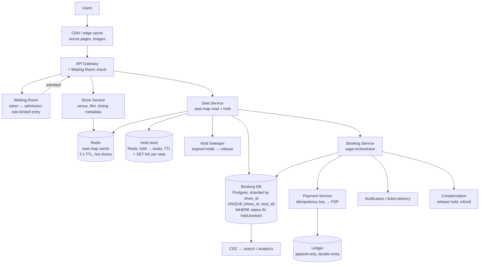

# BookMyShow — Seat Booking — Full Worked Case Study

> **TL;DR** — Seat booking is **the double-booking problem**: many users competing for a finite set of numbered resources, with money attached, where the same seat must never be sold twice. The core mechanism is a **temporary hold** — a short-lived, explicitly-expiring reservation of specific seats by a specific user — followed by a payment step that converts the hold into a confirmed booking. Every design decision follows from that: the hold must be atomic (conditional write / unique constraint / Redis `SET NX`), it must expire automatically (a TTL, plus a sweeper for correctness), and the two-step hold-then-pay must be a **saga with compensation**, because the payment may take longer than the hold and the user may abandon it. Around that sit the read-heavy browsing path (a cache for show and seat-availability reads), a **waiting room** to cap concurrency at the moment tickets go on sale, and — in the LLD part of this question — the design of an **LRU or LFU cache** from scratch, which usually means hashmap plus doubly linked list for LRU and a frequency-bucket structure for LFU.

> **60-second interview answer:** "I'd clarify: how many seats per booking, how long a user gets to pay, and whether we're selling a whole venue or a specific show. The critical requirement is no double-booking — a seat is sold at most once, ever. So the design is a two-phase hold: the user selects seats and the system creates a hold with a TTL of, say, ten minutes, which is written as an atomic conditional insert — a unique constraint on `(show_id, seat_id)` where status is held or booked, so the second concurrent request fails cleanly rather than racing. Then payment converts the hold into a booking. Because payment can take longer than the hold and users abandon, that's a saga with compensation: if payment fails or times out, the hold is released. And for the availability read path I'd cache the seat map, because browsing is read-heavy. The other half of this question is usually a cache design — for LRU it's a hashmap plus a doubly linked list so both lookup and eviction are O(1)."

---

## 1. Definition & mental model

**Plain English.** A ticketing system lets many users browse the same inventory simultaneously, reserve specific numbered items for a short period, pay for them, and be guaranteed that no two users can hold or buy the same item. It is a **contention-and-timeout** problem: the resource is finite, the contention is bursty, and the reservation is inherently temporary.

**The analogy: a hotel with a hold on your room.**

- You are browsing rooms (browsing is free, unlimited, and cached).
- You say "I'll take room 412 for these dates" and the front desk **puts a hold on it for 15 minutes**. The room is not yours yet, but nobody else can take it.
- You go to the payment desk. If you pay within 15 minutes, it becomes your booking. If you walk away, the hold **expires by itself** and the room returns to the pool.
- The front desk writes the hold in a book with a rule: **you cannot hold or book a room that is already held or booked.** Two clerks cannot both hold room 412, because the second one sees the first one's entry — and if they somehow write at the same instant, the ledger's rule rejects the second entry rather than overwriting.
- On a sale day with 100,000 people at the door, the hotel hands out **numbered queue tokens** and lets in 500 people at a time, because the front desk can only serve so many at once.

**The insight:** the whole system is **an atomic conditional write plus a timer plus a compensation path**. Everything else — the cache, the queue, the CDN — is about surviving the read traffic and the burst.

**The one-line version:** a seat hold is a row with a TTL and a uniqueness constraint, and the payment is a saga that either commits or compensates it.

---

## 2. Why it exists — the problem it solves

### Step 1 — Clarify the requirements

| # | Question | Assumed answer |
|---|---|---|
| 1 | What is being booked? | Seats for a specific show (venue + film + time) |
| 2 | Seats per booking | 1–10 |
| 3 | Hold duration | 10 minutes from selection to payment |
| 4 | Payment | Card, UPI, wallet; must be exactly-once |
| 5 | Cancellation | Allowed up to N hours before; may incur a fee |
| 6 | Seat classes / pricing tiers | Yes — recliner, premium, balcony at different prices |
| 7 | Show-level or seat-level inventory | Seat-level — individual seats are assigned |
| 8 | Waiting room | Yes — needed for high-demand releases |
| 9 | Browsing | Read-heavy; availability changes as holds are created and expire |
| 10 | Multiple concurrent users per booking | Yes — a group selecting together |
| 11 | Refunds | Yes, asynchronous |
| 12 | Resale / transfer | Out of scope |
| 13 | Scale | 10 M users, 1 M bookings/day, a hot release can be 100,000 users in 60 seconds |

**Non-functional requirements:**

| Requirement | Target | Why |
|---|---|---|
| **Correctness** | **A seat is sold at most once — ever** | The non-negotiable requirement |
| Hold latency | p99 < 300 ms | The user is watching a spinner |
| Availability read latency | p99 < 100 ms | Browsing must feel instant |
| Availability | 99.99% for browsing, 99.9% for booking | Browsing failing is more visible than booking failing |
| Race window | Zero — no "both users succeeded" outcome | Correctness |
| Hold expiry | Automatic and exact | A stuck hold is lost inventory |
| Payment | Exactly-once | Money |
| Burst handling | 100,000 concurrent users at a release | The waiting room |
| Consistency | **Strong for holds and bookings; eventual for availability display** | Different data, different rules |

**The trade-off statement:** *"Correctness over availability for the booking path — if the booking store is degraded I would rather reject a booking than risk selling a seat twice. Eventual consistency for the availability display — the seat map a user is looking at can be a second or two stale, as long as the hold itself is atomic, because the hold is what actually enforces correctness."*

**That last sentence is the key to the whole question:** the display can be stale; the hold cannot.

---

## 3. Internal mechanics — the five-step worked design

### 3.2 Step 2 — Capacity estimation

```
USERS AND TRAFFIC
  10 M users, 1 M bookings/day
  Booking writes: 1 M / 86,400 = ~12 bookings/sec (average) — tiny
  Peak burst: a blockbuster release
    → 100,000 users online in the first 60 seconds
    → ~1,600 requests/sec of seat-hold attempts
    → 20,000 requests/sec of seat-map reads (each user refreshes repeatedly)
  ⇒ The burst is 100× the average, and it arrives in seconds.
    This is why a waiting room exists: to convert a spike into a queue.

READS
  Browsing: 10 M users × 20 page views/day = 200 M reads/day = ~2,300/sec avg
  Peak: the seat-map read at 20,000/sec for a hot show
  Availability read:write ratio ≈ 1,000:1  (holds are rare; views are constant)

SEAT INVENTORY
  A venue: 500–2,000 seats. A multiplex with 8 screens: ~8,000 seats.
  Shows per day per screen: ~5. A city with 200 screens: 1,000 shows/day.
  Seats per show: ~300 average
  Total seat-rows per day: 1,000 shows × 300 = 300,000 seat rows/day
  A year: ~110 M seat rows — SMALL DATA.
  ⇒ Seat inventory is tiny and hot. It fits in memory for the current day.
  Every hot show's seat map can be fully cached.

HOLDS
  Active holds at any instant: assume 5% of concurrent users
    → at peak, 100,000 × 5% = 5,000 concurrent holds
    → each hold is 1–10 seat rows → ~20,000 held seat records at peak
  Hold TTL: 10 min → holds created per second at peak ~1,600,
    each living 600 s → ~960,000 concurrent holds in the worst case if
    everyone holds. Realistically far less, but the TTL bounds it.
  ⇒ Hold state is small; the CHURN is the problem, not the size.

PAYMENTS
  1 M bookings/day = ~12/sec average, ~100/sec at peak
  Payment is the slow external call: 2–10 s typical
  A payment thread blocked for 10 s at 1,600 attempts/sec = 16,000
    concurrent payment operations → needs a queue and async confirmation

STORAGE
  Bookings: 1 M/day × 1 KB = 1 GB/day → ~365 GB/year
  Seat rows: ~110 M/year × 100 B = ~11 GB/year
  Payment records: 1 M/day × 500 B = 500 MB/day
  ⇒ Everything is small except the request rate. This is a
    CONCURRENCY problem, not a data-volume problem.
```

**The capacity takeaways:**
1. **The data is tiny** — 11 GB/year of seat rows. This is emphatically not a big-data problem.
2. **The burst is the entire difficulty** — 100× the average, arriving in a minute.
3. **Reads outnumber writes 1,000:1**, so the seat map must be cached.
4. **Payment is the slow part** (2–10 s), so it must be asynchronous relative to the hold, which forces the saga.
5. **Hold churn, not hold size, is the risk** — 1,600 holds/sec each living 10 minutes.

### 3.3 Step 3 — API design

```http
# ── Browse (read-heavy, cacheable) ─────────────────────────────────
GET /v1/shows/{show_id}/seatmap
  → 200 {
      "show_id":"s_991", "venue":"PVR Koramangala", "screen":3,
      "rows": [
        { "row":"A", "class":"recliner", "price":45000,
          "seats":[ {"id":"A1","status":"available"},
                    {"id":"A2","status":"held"},       # held by SOMEONE else
                    {"id":"A3","status":"booked"} ] }
      ],
      "version": 8412                          # for optimistic refresh
    }
  Cache-Control: public, max-age=2             # 2 s — acceptable staleness

# ── Hold (the atomic operation) ────────────────────────────────────
POST /v1/shows/{show_id}/holds
Idempotency-Key: hold_9f3a2b                   # REQUIRED
{
  "seat_ids": ["A1","A2"],
  "session_id": "sess_77a1"                    # the browsing session
}
→ 201 {
    "hold_id": "h_55c1",
    "seat_ids": ["A1","A2"],
    "expires_at": 1758960600,                  # now + 600 s
    "amount": { "total": 90000, "currency": "INR" }
  }
→ 409 Conflict {
    "error": "seats_unavailable",
    "unavailable": ["A2"],                     # which seats failed, so the
    "alternatives": ["A3","A4"]                # UI can recover gracefully
  }

DELETE /v1/holds/h_55c1                        # explicit release (user navigates away)
GET    /v1/holds/h_55c1                        # check remaining TTL

# ── Book (converts the hold, triggers payment) ─────────────────────
POST /v1/bookings
Idempotency-Key: booking_9f3a2b                # REQUIRED
{
  "hold_id": "h_55c1",
  "payment_method": "pm_8812",
  "contact": { "email":"...", "phone":"..." }
}
→ 202 {                                        # ASYNC: payment is slow
    "booking_id": "b_1123",
    "state": "payment_pending",
    "poll_url": "/v1/bookings/b_1123"
  }

GET /v1/bookings/b_1123
  → { "state":"confirmed", "seats":["A1","A2"], "tickets":[ {...} ] }
  → { "state":"failed", "reason":"payment_declined", "hold_released": true }

POST /v1/bookings/b_1123/cancel
GET  /v1/bookings/b_1123/tickets               # QR codes / PDF

# ── Waiting room ───────────────────────────────────────────────────
POST /v1/queue/join   { "show_id":"s_991" }
  → 200 { "token":"q_abc", "position": 8420, "eta_seconds": 240 }
GET  /v1/queue/q_abc
  → { "state":"admitted", "admission_token":"adm_xyz", "expires_at": ... }
```

**The API design points worth stating:**
1. **The hold endpoint returns `409 Conflict` with the specific unavailable seats.** Not a generic error — the UI must be able to re-render and let the user pick again without re-selecting everything.
2. **`Idempotency-Key` on both hold and booking.** A double-tap on "pay" must not create two bookings.
3. **Booking returns `202`, not `201`.** Payment is a 2–10 s external call; blocking the HTTP request on it burns a connection per user and makes the burst far worse.
4. **Holds are explicitly releasable.** A user who navigates away should release the hold rather than making everyone wait 10 minutes — a UX and inventory-efficiency win.
5. **`version` on the seat map** so the client can detect staleness and refresh, and so a cached response can be validated.

### 3.4 Step 4 — High-level design



**Component by component:**

| Component | Responsibility | Why |
|---|---|---|
| **CDN / edge cache** | Venue and movie images, static pages | Absorbs the browsing traffic before it reaches the API |
| **API Gateway** | Auth, rate limit, waiting-room enforcement | One choke point for the burst |
| **Waiting Room** | Admit N users at a time, hold the rest | Converts a 100× spike into a bounded queue |
| **Show Service** | Show metadata | Read-mostly, heavily cached |
| **Seat Service** | The seat map read and the hold operation | **The correctness-critical component** |
| **Seat map cache** | `show_id → seat statuses`, 2 s TTL | Removes the read load from the database |
| **Hold store (Redis)** | `hold_id → seats + TTL`, `seat → hold_id` with `SET NX` | The fast atomic hold; the first line of defence |
| **Booking DB (Postgres)** | The durable record, with a partial unique index | **The authority.** If Redis is wrong, the DB constraint still prevents double-booking |
| **Hold Sweeper** | Release expired holds | Correctness — a TTL alone can be missed |
| **Booking Service** | The hold→payment→confirm saga | Orchestrates the two-phase flow and compensates |
| **Payment Service** | Charge with an idempotency key | Exactly-once money |
| **Ledger** | Append-only double-entry | Auditability |
| **Compensation** | Release hold, refund, notify | The "undo" path of the saga |

**The end-to-end hold flow — the atomic moment:**

```
1. User taps "select seats A1, A2" → POST /v1/shows/{show_id}/holds
2. Idempotency check: has hold_9f3a2b been seen? If yes, return the ORIGINAL
   hold_id and its remaining TTL. (A retry must not create a second hold.)
3. Attempt the hold in TWO layers:

   Layer 1 — Redis, fast path (SET NX per seat):
     For each seat, atomically claim it:
        SET seat:{show_id}:{seat_id} = {hold_id} NX EX 600
     If any returns nil (already taken), release the ones we did claim
     (a compensating action within the same request) and return 409 with
     the specific unavailable seats.
     → This is atomic per seat, but across seats it is not a transaction,
       which is exactly why the compensation is needed.

   Layer 2 — Postgres, the authority:
     INSERT INTO seat_holds (show_id, seat_id, hold_id, user_id, expires_at)
     VALUES (...), (...)
     ON CONFLICT (show_id, seat_id) DO NOTHING;      -- partial unique index on
                                                     -- (show_id, seat_id) WHERE
                                                     -- status IN ('held','booked')
     If the number of inserted rows < the number of seats → another holder
     won the race → roll back this transaction, release the Redis claims,
     and return 409.

4. The booking DB is authoritative. Redis is the fast path that absorbs
   ~99% of collisions without touching the database; the DB constraint is
   what makes the guarantee absolute even if Redis is wrong, restarted,
   or split-brained.
5. Return 201 with hold_id and expires_at.
```

**Why two layers and not one — the reasoning to state:**
- **Redis alone is not safe.** A Redis failover can lose writes (with async replication), and then a seat that was held reappears as free. At 1,600 holds/sec, an unguarded failover can double-book thousands of seats.
- **Postgres alone is correct but slow-ish** and becomes the bottleneck under the burst — though at 1,600 holds/sec it is actually fine, which is worth saying: *"for this scale Postgres alone would work; Redis is a throughput and latency optimisation, and a large part of its value is absorbing the read traffic, not just the writes."*
- **Therefore: Redis for speed, Postgres for truth.** This is the same "cache is not the source of truth" principle as everywhere else in this repo, applied to a correctness-critical path where it is most tempting to break it ([see Cache Invalidation](../../HLD/03-scaling/04-cache-invalidation-and-consistency.md) §6.9).

**The end-to-end booking saga:**

```
1. User pays → POST /v1/bookings with hold_id
2. Idempotency check on booking_9f3a2b (a double-tap returns the same booking)
3. Extend or verify the hold: if the hold has expired, fail early with a
   clear message ("your seats were released") rather than taking money
4. Record booking row: state = "payment_pending"
5. Call the payment provider with idempotency key
      idem = "booking:{booking_id}:charge"
   → This is the SLOW step (2–10 s). It happens asynchronously.
6. On success:
     a. Transition seat status held → booked (a conditional UPDATE)
     b. state = "confirmed"
     c. Generate tickets, send the confirmation, release the Redis hold key
        (but keep the DB row — it is now a booking, not a hold)
7. On failure (declined, timeout, error):
     a. state = "failed"
     b. COMPENSATE: release the seats (delete the hold rows, delete the
        Redis keys) so other users can buy them
     c. Notify the user with a clear reason and an option to retry
8. On timeout (unknown outcome):
     a. Do NOT release the seats immediately — the payment may have succeeded
     b. Query the provider by idempotency key to determine the true outcome
     c. If confirmed → complete the booking; if not → compensate
     d. This is the hardest case and the one worth naming: an unknown
        payment outcome must never be resolved by guessing.
```

**The point to emphasise at step 8:** an unknown payment outcome is resolved by **asking the provider with the same idempotency key**, never by assuming. Assuming success loses money; assuming failure double-books the seat or double-charges the user.

### 3.5 Step 5 — Deep dive and trade-offs

#### Concurrency control: the four options

| Approach | Mechanism | Correctness | Throughput | Verdict |
|---|---|---|---|---|
| **Pessimistic DB lock** | `SELECT … FOR UPDATE` on the seat rows, then update | Correct | Holds a row lock for the whole transaction; under a burst, lock waits cascade | Workable; simplest correct answer at small scale |
| **Optimistic concurrency** | A `version` column; `UPDATE … WHERE version = :v`; retry on conflict | Correct | Retries under contention; at 1,600/sec for the SAME seats, retries explode | Good when contention is low; bad for a hot show |
| **Unique constraint** | `UNIQUE (show_id, seat_id) WHERE status IN ('held','booked')` | **Correct, enforced by the database** | No lock waits — a conflicting insert simply fails | **Best.** The database is the arbiter and it never lies |
| **Redis distributed lock** | `SET seat NX EX` per seat, or Redlock for a set | Correct **only if** Redis is reliable | Very fast | Excellent as a fast path; **never as the sole authority** |
| **Serializable isolation** | `SERIALIZABLE` transactions | Correct | Serialisation failures under contention; retries | Heavy; unnecessary when a unique index suffices |

**The chosen design: a unique constraint as the authority, Redis `SET NX` as the fast path.** `SELECT … FOR UPDATE` is a perfectly defensible simpler answer, and the reasoning to give is: *"a unique index means the loser of a race gets a clean constraint violation instead of waiting on a lock, so there is no lock queue to cascade under a burst."*

**Redlock and why it is not the whole answer:** Redlock (acquiring a majority of independent Redis nodes) is a distributed lock algorithm, and its correctness under clock skew and pause-based process suspension is genuinely contested. **The important architectural point is that you should not need it** — if the database constraint is the authority, the lock is only an optimisation, and an optimisation that occasionally fails is harmless. Say this; it is a strong senior signal.

#### Hold expiry: TTL plus sweeper

```
Why a TTL alone is not enough:
  - Redis keys with a TTL expire, but the POSTGRES row does not
  - the seat map cache may still show the seat as held
  - a sweeper must reconcile: find hold rows with expires_at < now(),
    mark them released, delete the Redis key, and invalidate the seat map

Why a sweeper alone is not enough:
  - it is a periodic job; between runs, expired holds block sales
  - so Redis TTL handles the hot path and the sweeper handles correctness

The exact sequence:
  1. Redis key expires automatically at T (the fast, approximate release)
  2. A sweeper runs every 30 s, finds DB hold rows past expiry, and
     transitions them to 'released' inside a transaction
  3. The seat map cache for that show is invalidated so the display is correct
  4. A user whose hold expired while they were paying gets a clear error
     and the seats are freed for others

The failure to avoid:
  A hold that is expired in Redis but still 'held' in Postgres.
  The seat is unsellable (Postgres says held) but the seat map shows it
  free (Redis says gone) — the worst of both worlds. Hence the sweeper.
```

#### Waiting room / virtual queue

```
The problem: 100,000 users hit "Book" for a hot release at the same second.
  100,000 concurrent holds on maybe 300 seats — 99.7% will fail.
  The failures are not the issue; the CONCURRENCY is:
    it consumes connections, threads, database locks and payment capacity
    to serve a request that cannot succeed.

The waiting room:
  1. On "Book", the user is issued a queue token (a monotonically increasing
     number per show, from Redis INCR)
  2. The user is admitted only when their token is within the admitted window
     → admission rate is a configurable knob, e.g. 200 users/sec
  3. Admitted users get a short-lived admission token (e.g. 5 min) that the
     API gateway enforces on hold requests
  4. The queue position is exposed so the UI can show "8,420 ahead of you,
     ~4 minutes"

Design details that matter:
  - the token must be cheap to issue (a Redis INCR, no database)
  - the queue must be fair (FIFO by token) or the release is a lottery
  - an abandoned queue entry must not hold a slot: the admission token expires
  - the queue must degrade gracefully if it fails — fall back to
    rate limiting per user rather than blocking all sales
  - bots: the queue plus per-account limits plus device fingerprinting
    is the first line of defence against scalping
```

#### Seat map caching and its staleness

```
Cache: show_id → { seat_id: status }, TTL 2 s (very short, deliberately)
  Why 2 s: the display can be 2 s stale and the user experience is unaffected,
  while the actual hold is always atomic. The display is advisory; the hold
  is the truth. This is the single most important sentence about the cache.

Why not longer: a 30 s TTL means a user sees seats as free, selects them,
and gets a 409. Annoying. 2 s keeps the miss rate low while keeping the
false-available rate low.

Invalidation: on any hold, release or booking for a show, invalidate that
show's seat map key. Shows are small (300 seats), so the whole map is the
cache entry — no partial invalidation needed.

Hot shows: precompute the seat map into the cache before the release, so
  the first thousand requests are hits rather than a stampede.
  Also single-flight the rebuild ([see Cache Invalidation](../../HLD/03-scaling/04-cache-invalidation-and-consistency.md) §6.5).
```

#### The LLD half: designing an LRU cache

This is frequently the follow-up, and it must be answered precisely.

```
LRU = evict the least recently used entry when at capacity.

Requirements:
  get(key)      → O(1)
  put(key, val) → O(1), evicting the LRU when full

Data structures:
  - a hashmap: key → node          (O(1) lookup)
  - a doubly linked list: nodes in recency order, MRU at the head,
    LRU at the tail                (O(1) move-to-front and evict-from-tail)

Why a doubly linked list and not a singly linked one:
  removing an arbitrary node in O(1) requires access to its PREDECESSOR.
  A singly linked list would need a traversal to find it, making removal O(n).
  The doubly linked list gives each node a `prev` pointer, so unlinking is O(1).
  THIS is the reason the combination works, and it is the answer to
  "why not just a list?".

ASCII structure:

  map:  { A → ▢, B → ▢, C → ▢ }
                      │
  head (MRU) ⇄ [C] ⇄ [B] ⇄ [A] ⇄ tail (LRU)
                              ↑
                        evict from here

get(key):
  if key not in map: return -1
  node = map[key]
  move node to the head            # it is now most recently used
  return node.value

put(key, value):
  if key in map:
    update node.value
    move node to the head
  else:
    if size == capacity:
      lru = tail
      remove lru from the list
      delete map[lru.key]          # MUST delete from the map too,
                                   # or the map leaks
    node = new Node(key, value)
    map[key] = node
    insert node at the head


Implementation sketch (Python, with sentinel nodes):

class Node:
    __slots__ = ("k","v","prev","nxt")
    def __init__(self, k=None, v=None):
        self.k, self.v, self.prev, self.nxt = k, v, None, None

class LRUCache:
    def __init__(self, capacity):
        self.cap = capacity
        self.map = {}
        self.head = Node()          # sentinel: head.nxt is the MRU
        self.tail = Node()          # sentinel: tail.prev is the LRU
        self.head.nxt = self.tail
        self.tail.prev = self.head

    def _unlink(self, n):
        n.prev.nxt, n.nxt.prev = n.nxt, n.prev

    def _push_front(self, n):
        n.nxt = self.head.nxt
        n.prev = self.head
        self.head.nxt.prev = n
        self.head.nxt = n

    def get(self, k):
        n = self.map.get(k)
        if n is None:
            return -1
        self._unlink(n); self._push_front(n)
        return n.v

    def put(self, k, v):
        n = self.map.get(k)
        if n is not None:
            n.v = v
            self._unlink(n); self._push_front(n)
            return
        if len(self.map) >= self.cap:
            lru = self.tail.prev           # sentinel makes this branch-free
            self._unlink(lru)
            del self.map[lru.k]
        n = Node(k, v)
        self.map[k] = n
        self._push_front(n)

Complexity:  get O(1), put O(1), space O(capacity)
Sentinel head/tail nodes remove all the null-checking edge cases
(empty list, single element, removing the last element) — a detail
that separates a clean implementation from a buggy one.

Thread safety (the follow-up):
  A plain LRU is not thread-safe. Options:
    - a single global mutex: correct, but serialises ALL access, and at
      high read rates this is the bottleneck
    - a read-write lock: reads are NOT read-only in an LRU, because get()
      mutates the recency order → an RW lock gives no benefit
    - shard the cache: N independent LRU shards, each with its own lock,
      keyed by hash(key) % N → this is what real caches do
      (Guava, Caffeine, and most production caches shard for exactly this
      reason). It trades a small amount of LRU accuracy for a large
      amount of throughput.
  ⇒ "Shard it" is the strong answer; "add a mutex" is the acceptable one.
```

#### The LLD half: designing an LFU cache

```
LFU = evict the least FREQUENTLY used entry; ties broken by LRU.

Why LFU instead of LRU:
  A scan of 10,000 one-time keys evicts the entire LRU cache, even though
  the evicted entries were hot. LFU protects the frequently-used set.
  (This is exactly the cache-pollution problem, and it is the reason
  real systems use W-TinyLFU: a frequency sketch plus an LRU admission
  window — see below.)

Requirements: get O(1), put O(1)

Data structures:
  - key → node map                     (O(1) lookup)
  - freq → doubly linked list of nodes with that frequency
    (each list in LRU order, so ties are resolved by recency)
  - a pointer to the MINIMUM frequency  (so eviction is O(1))

ASCII structure:

  freq_map = { 1: [C ⇄ A], 2: [B], 5: [D] }      min_freq = 1
                 ↑ evict from the tail of the list at min_freq

get(key):
  node = map[key]; if absent, return -1
  freq = node.freq
  unlink node from freq_map[freq]
  if freq_map[freq] is empty:
      delete freq_map[freq]
      if min_freq == freq: min_freq += 1        # only ever increases on get
  node.freq += 1
  push node to the FRONT of freq_map[node.freq]
  return node.value

put(key, value):
  if capacity == 0: return
  if key in map:
      map[key].value = value
      get(key)                                   # promotes the frequency
      return
  if size == capacity:
      evict = freq_map[min_freq].tail            # the LRU among the least frequent
      unlink it; del map[evict.key]; size -= 1
  node = new Node(key, value, freq=1)
  map[key] = node
  push_front into freq_map[1]
  min_freq = 1                                   # a new key is always freq 1

Complexity: get O(1), put O(1), space O(capacity + distinct frequencies)

The subtle bug to mention: min_freq must be maintained correctly.
  - on insert of a new key: min_freq = 1
  - on get: min_freq increases ONLY when the list at min_freq became empty
  - on eviction: min_freq is unchanged (we evict exactly at min_freq)
  Getting this wrong means evicting from an empty list or from the wrong
  frequency — the classic LFU implementation bug.

LRU vs LFU comparison:
  LRU: simple, O(1), adapts fast to changing hot sets, vulnerable to scans
  LFU: O(1) with the bucket structure, resists scans, but stale — an item
       that was hot an hour ago keeps its high frequency and never leaves.
       Fix: ageing — halve all frequencies periodically, or use a decayed
       count (a "TinyLFU" count-min sketch with periodic halving).

Production reality (worth naming):
  Real caches (Caffeine, for example) use W-TinyLFU: a small LRU admission
  window plus a frequency sketch to decide admission, which gets the scan
  resistance of LFU and the recency adaptation of LRU. Naming this shows
  you know the theory AND the practice.
```

#### Seat locking vs the alternatives, restated as a decision table

| Requirement | Mechanism |
|---|---|
| Never double-book | A unique constraint on `(show_id, seat_id)` where status is held or booked |
| Low-latency holds under a burst | Redis `SET NX EX` per seat as a fast path, with DB as the authority |
| Automatic release of abandoned holds | Redis TTL for the fast path + a sweeper for correctness |
| The user must know what failed | `409` with the specific unavailable seat IDs |
| A group booking many seats atomically | All-or-nothing: claim each seat, and on any failure release the ones already claimed |
| Fairness under extreme demand | A waiting room with FIFO tokens and a bounded admission rate |
| Bots and scalpers | Per-account purchase limits, device fingerprinting, the queue, CAPTCHA |
| A stale display | A 2 s cache TTL, with the hold itself always atomic |

---

## 4. Variants & taxonomy

| Variant | Description | Trade-off |
|---|---|---|
| **General admission (no seats)** | Inventory = a count, not numbered seats | Simple — a single atomic decrement (Redis `DECR`); no seat map |
| **Assigned seats** | Numbered resources | **Chosen** — requires the hold and the constraint |
| **Optimistic hold** | No hold; the user pays and the seat is claimed at payment | No hold expiry problem; a payment for an unavailable seat must be refunded |
| **Pessimistic hold** | Seats held before payment | **Chosen** — no refund needed, better UX |
| **DB row lock** | `SELECT … FOR UPDATE` | Correct; lock waits under contention |
| **Unique constraint** | A partial unique index | **Chosen** — no lock waits, the DB is the arbiter |
| **Redis distributed lock** | `SET NX` per seat | Fast; not authoritative |
| **Redlock** | A majority of Redis nodes | Contested correctness; unnecessary if the DB is authoritative |
| **Serializable transactions** | `SERIALIZABLE` isolation | Correct; serialisation failures and retries under contention |
| **Synchronous payment** | The request blocks on the PSP | Simple; burns connections during the burst |
| **Asynchronous payment** | `202` + polling/webhook | **Chosen** — survives the burst |
| **No queue** | All users hit the API | Simple; the burst overwhelms everything |
| **Waiting room** | Token-based admission | **Chosen** — converts a spike into a bounded queue |
| **Lottery** | Random allocation among the interested | Fair in a different sense; frustrating UX |
| **Seat-level or section-level inventory** | Hold a section rather than a seat | Coarser; less contention; worse UX |
| **LRU cache** | Evict the least recently used | Simple and O(1); vulnerable to scans |
| **LFU cache** | Evict the least frequently used | Scan-resistant; stale hot items need ageing |
| **W-TinyLFU** | An admission window plus a frequency sketch | Best of both; more complex |

---

## 5. Pros / Cons

| Decision | Pros | Cons |
|---|---|---|
| **Explicit hold with a TTL** | No refund needed; matches user expectations; inventory returns automatically | Holds block other users for 10 minutes; needs a sweeper |
| **Unique constraint as authority** | Absolute correctness, independent of any cache | Requires the right partial index and status modelling |
| **Redis as a fast path** | Absorbs collisions without touching the DB | Must never be the sole authority; adds a component to reason about |
| **All-or-nothing group holds** | No partial bookings | Requires compensation within the request |
| **Async payment** | Survives the burst; no blocked connections | The user must poll or be pushed a result; more state |
| **Waiting room** | Bounded concurrency; fairness; bot resistance | Adds latency and complexity; must degrade gracefully |
| **2 s seat-map cache TTL** | Removes the read load; the hold is still atomic | A user can see a seat as free and get a 409 |
| **Sweeper** | Correctness when a TTL is missed | A periodic job to operate; a window of incorrect state |
| **Idempotency keys** | Retries are safe; no double booking or double charge | More state; keys must be scoped correctly |
| **LRU cache** | O(1), simple, adapts to changing hotspots | Scan pollution |
| **LFU cache** | Scan-resistant | Stale hot entries; needs ageing |

---

## 6. Exceptions, edge cases & failure modes

### 6.1 The double-booking race

The failure this whole system exists to prevent. Two users select seat A2 at the same instant. **The mechanism that prevents it:** the partial unique index. Both transactions attempt an insert; the database serialises them; one succeeds and the other gets a constraint violation and returns `409`. **The follow-up the interviewer will ask:** *"what if both go through Redis first?"* Both attempt `SET seat:...:A2 NX`; only one gets the key; the loser is rejected before ever reaching the database. And if Redis is unavailable or has failed over, the database constraint still holds — which is why the fast path is safe to lose.

### 6.2 The Redis failover that loses a hold

Redis with asynchronous replication fails over to a replica that has not received the most recent `SET NX` writes. Seats that were held appear free. Users hold them again. **Without the database constraint, this double-books.** With it, the second hold attempt fails at the database layer — the Redis claim succeeds but the insert conflicts, and the request is rejected.

**The lesson to state:** *"a cache failover must never be able to break a correctness guarantee, which is why the authority is the database and Redis only absorbs load."* This is the deepest point available in this question.

### 6.3 The abandoned hold

A user selects seats, gets a hold, and closes the browser. The seats are held for the full 10 minutes and cannot be sold. At 1,600 holds/sec with 5% abandonment, that is a meaningful inventory loss.

**Fixes:** an explicit release when the page is unloaded (`navigator.sendBeacon` to `DELETE /v1/holds/{id}` — the right browser primitive, because a normal XHR on unload is unreliable); a TTL as the backstop; and a *shorter* TTL for the hold while the user is still browsing (say 2 minutes) extended when they begin payment, so an idle hold costs less. **The extend-on-payment idea is a good one to raise.**

### 6.4 The hold expiring mid-payment

A user starts payment at minute 9:55 of a 10-minute hold. The hold expires at 10:00 while the PSP is still processing. If the seats are released and resold, and then the payment succeeds, you have sold the seat twice.

**Fixes:** extend the hold when payment begins (create a payment-window hold of a few minutes); and if the hold has already expired when the payment result arrives **successfully**, do not silently confirm — either find equivalent seats or refund. **Do not release a hold on expiry while a payment is in flight against it** — the hold row should track that state. This is the hardest case in the design and naming it clearly is the strongest possible answer on the saga.

### 6.5 The unknown payment outcome

The PSP call times out. The charge may or may not have succeeded. **Never guess.** Query the provider with the same idempotency key to determine the true state; the key is what makes the query meaningful. Handling: if confirmed → complete the booking; if declined or not found → compensate (release the seats, tell the user). **The failure to avoid:** releasing the seats immediately on timeout, then discovering the charge succeeded — you now owe a refund and have lost the sale, or worse, you double-sell if the seats went to someone else.

### 6.6 The thundering herd at release time

100,000 users refresh the seat map at the same second. Without a cache and a queue, every refresh is a database query and the database falls over. **Fixes:** the waiting room bounds admission; the seat map is cached with a 2 s TTL so the vast majority of refreshes are cache hits; precompute the seat map before the release so the first requests are hits; single-flight any rebuild; and serve the seat map from the CDN where possible (it is a public-ish GET with a short TTL).

### 6.7 Partial group hold failure

A user selects 6 seats; 5 are available and 1 is not. If the system holds the 5 and fails, the user has a partial hold they did not want and the seats are locked. **Fix:** all-or-nothing within the request — claim each seat, and on any failure, release everything already claimed in the same request before returning `409`. **This in-request compensation is a micro-saga and it must be explicit.** And return which seats failed so the UI can offer alternatives.

### 6.8 The hot show and the single-row bottleneck

A show's seat map is a hot cache key and its seat rows are hot database rows. Sharding by `show_id` puts all 300 seats of the hottest show on one shard — which is fine, because 300 rows and 1,600 holds/sec is manageable, but it means the hottest show is the ceiling for that shard.

**Fix:** shard by `show_id` (correct for locality) and accept the hot shard, since the working set is tiny; if a single show genuinely saturates, split its seats across sub-shards by row block, which preserves the constraint by making it per sub-shard. **Note also that the contention is not actually on the rows — the unique index is — and index contention on a small index is far cheaper than row lock waits.**

### 6.9 Scalping and bots

A hot release is a target for automated buying. **Fixes:** the waiting room (bots still need tokens), per-account purchase limits enforced server-side, device fingerprinting, CAPTCHA at admission, requiring verified payment methods, and anomaly detection on purchase velocity. **Note that none of these is an engineering-only solution** — it is an adversarial problem, and the honest answer says so.

### 6.10 Payment succeeds but the confirmation is lost

The payment succeeds; the response is lost; the client never learns. **Fix:** the booking is in `payment_pending` with a known idempotency key, so a reconciliation job (or the provider's webhook) can complete it. Never rely on the client to tell you a payment succeeded — the provider's webhook or a query is the source of truth.

### 6.11 Other failure modes worth naming

- **The seat map cache serving a pre-hold map** for the full 2 s TTL after a hold — a user sees a held seat as free and gets a 409. Acceptable at 2 s; unacceptable at 30 s.
- **Time-of-sale clock skew** across database and application servers making `expires_at` comparisons inconsistent — use a single clock source (the database's `now()`) for expiry decisions.
- **A sweeper that crashes** — expired holds never release; alert on sweeper runs, not just on its errors.
- **Refunds for a cancelled booking** — asynchronous, idempotent, and reconciled; a refund is a payment operation with all the same guarantees.
- **A show cancelled by the venue** — a mass refund and notification, which is a bulk operation with the same fan-out properties as a campaign ([see Notification System](03-notification-system.md) §3.5).
- **The waiting room itself failing** — must degrade to per-user rate limiting rather than blocking all sales. A failed queue that blocks everything is worse than no queue.
- **Users sharing a hold ID** — a hold is bound to a user and a session; the booking must verify ownership, not just possession of the ID.
- **Overbooking by design** (airlines do this; cinemas generally do not) — if it were required, it would be an explicit inventory-policy layer, not an accident of the concurrency design.
- **A database failover during the burst** — the connection thundering herd on reconnect ([see Sharding](../../HLD/03-scaling/05-sharding-replication-and-consistency.md) §6.11); pool carefully and retry with jitter.

---

## 7. When to use / When NOT to use

### This design is right when
- Inventory is finite and individually identified.
- The same item must never be sold to two people.
- Contention is bursty and concentrated on a few popular items.
- A reservation must be temporary and expire automatically.
- Payment is a slow external step that can fail or be abandoned.
- Browsing vastly outnumbers buying.

### This design is NOT what you want when
- **Inventory is fungible** (general admission, a hotel room type) — a simple atomic decrement suffices; no seat map.
- **There is no payment step** — the hold can be shorter and simpler.
- **Contention is low** — a plain transaction with a `SELECT … FOR UPDATE` is enough; the queue and cache are over-engineering.
- **The resource is reusable and non-exclusive** — this whole model is about exclusivity.
- **The user expects immediate confirmation with no wait** — that is a different product (a purchase, not a booking).
- **Holds would be long-lived** (days) — that is a reservation system with different economics; a TTL of 10 minutes and one of 10 days are different designs.

### Design decision table

| Requirement | Decision |
|---|---|
| A seat sold at most once | A partial unique index on `(show_id, seat_id)` for held/booked |
| Low hold latency at 1,600/sec | Redis `SET NX EX` as a fast path, DB as the authority |
| Automatic release | Redis TTL + a sweeper reconciling the DB |
| All-or-nothing group hold | In-request compensation for partially claimed seats |
| Tell the user what failed | `409` with the specific unavailable seat IDs |
| Survive a 100× burst | A waiting room with FIFO tokens and a bounded admission rate |
| Remove read load | A 2 s seat-map cache + CDN + precomputation before the release |
| Idempotent retries | An idempotency key on hold and booking |
| Payment exactly-once | An idempotency key at the PSP, plus reconciliation |
| Slow payment | `202` + async confirmation by webhook or polling |
| Unknown payment outcome | Query the provider by idempotency key; never guess |
| Hold expiring mid-payment | Extend on payment start; never release while a payment is in flight |
| Abandoned hold | `sendBeacon` release + a short initial TTL extended on payment |
| Cache design (LRU) | A hashmap + a doubly linked list, sentinels, O(1) |
| Cache design (LFU) | Frequency buckets + a min-frequency pointer, O(1) |
| Cache thread safety | Shard the cache; a global mutex serialises everything |
| Bot resistance | Limits + fingerprints + CAPTCHA + the queue; an adversarial problem |

---

## 8. Numbers, defaults & tuning

| Quantity | Value | Reasoning |
|---|---|---|
| Users | 10 M | Scale |
| Bookings/day | 1 M | ~12/sec average |
| Release burst | 100,000 users in 60 s | ~1,600 hold attempts/sec |
| Seat-map reads at peak | ~20,000/sec | Each user refreshes repeatedly |
| Read:write ratio | ~1,000:1 | Why the seat map must be cached |
| Seats per show | ~300 (500–2,000 per venue) | Small working set |
| Seat rows/year | ~110 M ≈ 11 GB | The data is tiny |
| Concurrent holds at peak | ~5,000 | 5% of concurrent users |
| Holds created at peak | ~1,600/sec | Burst |
| Hold TTL | 600 s (10 min) | Long enough to pay, short enough to recycle |
| Browse-phase hold TTL | ~120 s, extended on payment | Reduces idle hold cost |
| Payment window extension | +180 s | Prevents expiry mid-payment |
| Sweeper interval | 30 s | Correctness backstop for TTLs |
| Seat-map cache TTL | **2 s** | Display staleness versus stale-availability complaints |
| Seat-map cache size | ~1 KB per show × active shows | Trivial |
| Waiting room admission rate | ~200 users/sec per show | Tunable to the downstream capacity |
| Admission token TTL | 5 min | Bounds queue-slot hoarding |
| Queue position updates | Every 5–10 s | Enough for a progress UI |
| Database sharding | By `show_id` | Locality; a show's seats on one shard |
| Constraint | `UNIQUE (show_id, seat_id) WHERE status IN ('held','booked')` | The authority |
| Redis hold key | `seat:{show_id}:{seat_id}` → hold_id, `NX EX 600` | The fast path |
| Idempotency key TTL | 24 h | Covers client retries |
| Payment latency | 2–10 s typical | Why booking is asynchronous |
| Payment idempotency key | `booking:{booking_id}:charge` | Exactly-once |
| Reconciliation | Daily against the PSP settlement report | Catches contract gaps |
| LRU | get O(1), put O(1), space O(capacity) | Hashmap + doubly linked list |
| LFU | get O(1), put O(1) | Frequency buckets + min-freq pointer |
| Cache sharding | 16–64 shards | Contention versus LRU accuracy |
| Per-account purchase limit | Enforced server-side | Anti-scalping |
| Cancellation window | Up to N hours before the show | Policy |

---

## 9. Interview Q&A

**Q1 (easy). What do you clarify first?**
How many seats a single user can book, how long they get to pay, and whether the inventory is numbered seats or general admission — general admission changes everything, because it is a single atomic counter decrement and needs none of this machinery. Then whether there is a payment step, because that is what forces the two-phase hold. And how bursty the demand is, because a blockbuster release is a completely different engineering problem from steady-state booking.

**Q2 (easy). What is the core requirement?**
That a seat is sold at most once, ever. Everything else is secondary. That single requirement dictates the design: the seat claim must be atomic, and it must be enforced by something that cannot be wrong — a database constraint — not merely by a cache, because a cache can fail over and lose writes. Latency, availability and the browsing experience all matter, but if the system double-books, it has failed at its only job.

**Q3 (easy). How does the hold work?**
The user selects seats and the system creates a hold with a TTL of ten minutes. The hold is written atomically: in Redis a `SET NX` per seat claims it, and in Postgres a row is inserted with a unique constraint on show and seat where the status is held or booked. If any seat in the selection is already held or booked, the whole request fails with a 409 that names the specific unavailable seats, and any seats already claimed in that request are released. The user then pays within the ten minutes, and payment converts the hold into a booking.

**Q4 (medium). Why the database constraint rather than just Redis?**
Because Redis is a cache, and a cache can fail over and lose recent writes. Redis with asynchronous replication can fail over to a replica that never received the last few `SET NX` commands, and then a seat that was held appears free again — and under a burst that can double-book thousands of seats in seconds. So Redis is the fast path that absorbs the collisions without touching the database, and the unique index in Postgres is the authority. If the cache is wrong, the database rejects the second claim and the request fails cleanly. A cache failover must never be able to break a correctness guarantee, and this is the place where that principle matters most.

**Q5 (medium). Why is booking asynchronous?**
Because payment is a slow external call, typically two to ten seconds, and at peak there are around 1,600 hold attempts a second. Blocking an HTTP request on the payment provider for ten seconds means holding thousands of connections and threads open, which makes the burst far worse. So the booking request returns a `202` with a booking ID in a `payment_pending` state, and the client polls or receives a push when it completes. The provider's webhook is the authoritative signal, not the client, because the client can disappear.

**Q6 (medium). What is the saga and what compensates what?**
The booking flow is a two-phase process across two systems that cannot share a transaction. Phase one is the hold; phase two is the payment. The steps are: verify the hold is still valid, record the booking as pending, charge with an idempotency key, then convert the held seats to booked. If the charge fails, the compensation is to release the seats and mark the booking failed. If the charge times out with an unknown outcome, the compensation is not to release — instead, query the provider with the same idempotency key to find out what actually happened, and then either complete or compensate. That last step is the important one, because guessing either way loses money or double-sells a seat.

**Q7 (hard, testing §6). The hold expires while the payment is in flight. What happens?**
This is the hardest case in the design. If the sweep releases the seats at expiry and another user buys them, and then the payment succeeds, the seat is sold twice. So: extend the hold when payment begins — create a payment-window hold of a few minutes on top of the original — and, more importantly, never release a hold that has a payment in flight against it. The hold row should carry a state indicating a payment is underway, and the sweeper should skip those. If it does expire and the payment then succeeds, the honest resolution is to refund or to offer equivalent seats; silently confirming is not acceptable.

**Q8 (hard, testing §6). Redis fails over mid-release and loses holds. What happens?**
On its own, it double-books. With the design as described, it does not: the seat claims in Redis are lost, so a second user's `SET NX` succeeds, but then the insert into Postgres conflicts with the existing hold row and the partial unique index rejects it. The second user gets a 409 and can pick other seats. The cost is that some requests that would have failed fast at the Redis layer now reach the database and fail there, which is slower but still correct. That is exactly the trade I want — a cache failure costs latency, never correctness.

**Q9 (hard, testing §6). How do you handle 100,000 people hitting a release at once?**
With a waiting room. On tapping "Book" the user gets a queue token from a Redis `INCR` — cheap, no database — and they are admitted only when their token falls inside the admitted window, at a rate I control, say 200 users a second. Admitted users get a short-lived admission token that the gateway enforces on hold requests. The queue position is exposed so the UI can show progress. The reasons this matters are that the failure rate is not the problem — 99.7% of those 100,000 users cannot get a seat anyway — the concurrency is: serving them all consumes connections, threads, database locks and payment capacity for requests that cannot succeed. And the queue must degrade gracefully; if it fails, fall back to per-user rate limiting rather than blocking all sales, because a broken queue that blocks everything is worse than no queue at all.

**Q10 (hard). How do you cache the seat map without lying to users?**
The cache has a deliberately short TTL of about two seconds, and it is invalidated on every hold, release and booking for that show. The principle is that the display is advisory and the hold is authoritative — the seat map can be two seconds stale and the user experience is fine, but the hold itself is always atomic, so the worst case is that a user sees a seat as free, taps it, and gets a 409 naming that seat. That is why I keep the TTL short rather than thirty seconds: it limits how often that happens. For a hot show I would precompute the seat map into the cache before the release so the first requests are hits, and I would single-flight any rebuild so a miss does not become a stampede.

**Q11 (hard). Design an LRU cache.**
A hashmap plus a doubly linked list. The hashmap gives O(1) lookup from key to node; the doubly linked list maintains recency order with the most recently used at the head and the least recently used at the tail. On `get`, look up the node and move it to the head — O(1) because you have the node directly. On `put` of a new key when at capacity, unlink the tail node, delete its key from the map, and insert the new node at the head. The reason it must be a doubly linked list rather than a singly linked one is that removing an arbitrary node in O(1) needs its predecessor, and a singly linked list would require a traversal. I would use sentinel head and tail nodes so there are no null checks for the empty, single-element or last-element cases. And for thread safety, a global mutex is correct but serialises everything, and a read-write lock gives no benefit because `get` mutates the recency order — so the real answer is to shard the cache into N independent LRU instances with their own locks, which is what production caches do.

**Q12 (hard). Now design an LFU cache.**
The extra structure is a map from frequency to a doubly linked list of nodes at that frequency, kept in LRU order within each frequency, plus a pointer to the current minimum frequency so eviction is O(1). On `get`, unlink the node from its frequency list, increment its frequency, and push it to the front of the new frequency list; if the old frequency list became empty and it was the minimum, increment the minimum. On `put` of a new key, evict the tail of the minimum-frequency list and insert the new node at frequency one, resetting the minimum to one. The subtle bug is maintaining the minimum frequency: it only ever increases on a `get` when the old list emptied, and it is reset to one on any insert. Getting that wrong means evicting from an empty list or from the wrong frequency.

**Q13 (hard). LRU or LFU — which would you use here?**
For the seat map, LRU is the right default because the hot set changes with what is on sale today, and LRU adapts immediately. LFU's advantage is resisting scans — a one-time sweep of ten thousand cold keys would evict the entire LRU cache, whereas LFU would keep the genuinely hot entries because their frequencies are high. But LFU is stale by construction: an entry that was hot an hour ago keeps its high count and never leaves, so it needs ageing, halving frequencies periodically or using a decayed count. In practice, the answer is neither pure: production caches like Caffeine use W-TinyLFU, which is a small LRU admission window plus a frequency sketch that decides whether a new entry is allowed in. That gets the scan resistance of LFU with the recency adaptation of LRU, and it is what I would actually deploy.

**Q14 (hard). What are the trade-offs you would call out?**
Four. Correctness over availability on the booking path — if the booking store is degraded, I reject the booking rather than risk a double sale, which is a choice of consistency over availability. A pessimistic hold over an optimistic one — holding seats before payment means the user never gets charged for a seat they cannot have, at the cost of blocking inventory for ten minutes, which is why the TTL and the sweeper matter. Async payment over synchronous — it survives the burst but adds a state machine and requires the provider webhook to be authoritative. And a waiting room over open access — it is fair and bounds the load, at the cost of latency and complexity, and it must degrade gracefully rather than blocking everything if it fails.

**Q15 (hard). What would you monitor?**
Hold success rate and the 409 rate, because a rising conflict rate means contention is up or the cache is stale. Hold-to-booking conversion, which is the business metric and also tells you whether the TTL is too short — a lot of holds expiring unbooked means users need more time. Expired-hold count and the sweeper's runs, since a broken sweeper silently strands inventory. Payment success rate, timeout rate and the idempotency replay rate. The reconciliation mismatch count against the provider, which should be zero. Seat-map cache hit rate and the stale-available complaint rate — the fraction of holds that fail because the display said a seat was free. Queue length and wait time. And the database constraint-violation rate on the seat insert, because a spike there is the clearest possible signal that something upstream — the Redis fast path, most likely — has stopped working.

---

## 10. Common mistakes candidates make

1. **Relying on Redis alone** for the seat claim, with no database constraint.
2. **Using a check-then-act pattern** — read the seat, see it is free, then write — which is a race with no atomicity.
3. **No hold TTL**, so abandoned holds block inventory forever.
4. **No sweeper**, so an expired TTL in Redis leaves the DB row held forever.
5. **Releasing seats on a payment timeout without checking the provider** — losing money or double-selling.
6. **Synchronous payment**, blocking a connection for the whole PSP call during a burst.
7. **No idempotency key**, so a double-tap creates two bookings.
8. **Offset/pagination-style partial holds** — holding 5 of 6 seats and leaving the user stuck.
9. **No waiting room**, so a release overwhelms everything.
10. **A long seat-map cache TTL**, producing constant 409s.
11. **No compensation for partially claimed seat sets** within a request.
12. **Assuming a cache cannot be wrong** — the central error this question tests.
13. **Implementing LRU with a singly linked list**, which makes removal O(n) — and not knowing why.
14. **An LFU implementation that mishandles `min_freq`** — the classic bug.
15. **No trade-offs section.** The interviewer is grading the trade-offs, not the diagram.

---

## 11. Cheat-sheet summary

| Concept | One-line truth |
|---|---|
| The core requirement | A seat is sold at most once, ever |
| The mechanism | A TTL hold + a partial unique index + a saga |
| Authority | Postgres `UNIQUE (show_id, seat_id) WHERE status IN ('held','booked')` |
| Fast path | Redis `SET NX EX 600` per seat — absorbs collisions, never authoritative |
| Why both | A cache failover must not be able to break a correctness guarantee |
| Group hold | All-or-nothing with in-request compensation for partial claims |
| Conflict response | `409` with the specific unavailable seat IDs |
| Hold TTL | 10 min; shorter while browsing, extended on payment |
| Expiry | Redis TTL for speed + a 30 s sweeper for correctness |
| Booking flow | A saga: hold → pending → charge (idempotent) → confirm; compensate on failure |
| Unknown payment | Query the provider by idempotency key; never guess |
| Expiry mid-payment | Never release while a payment is in flight |
| Payment API | `202` + async confirmation; the provider webhook is authoritative |
| Seat-map cache | 2 s TTL, invalidated on any change; display is advisory, the hold is truth |
| The burst | 100,000 users / 1,600 holds per second at a release |
| Waiting room | A Redis `INCR` token, bounded admission (~200/sec), a 5 min admission token |
| Queue failure | Degrade to rate limiting; never block all sales |
| Sharding | By `show_id` — a show's seats on one shard |
| LRU | Hashmap + doubly linked list; why doubly = O(1) removal |
| LRU sentinels | Head/tail sentinels remove all edge-case branching |
| LRU thread safety | Shard it; get() mutates so an RW lock does not help |
| LFU | Frequency buckets + a min-frequency pointer; a new key is always freq 1 |
| LFU bug | Maintaining `min_freq` correctly on get, put and evict |
| Production cache | W-TinyLFU: an LRU window + a frequency sketch |
| Trade-offs | C over A for booking, pessimistic holds, async payment, a waiting room |

**"If the interviewer says X → answer Y"**

| Interviewer says | You say |
|---|---|
| "Design BookMyShow" | Clarify (seats per booking, hold duration, burst) → hold + constraint + saga → 5 steps |
| "Prevent double-booking?" | "A partial unique index is the authority; Redis `SET NX` is only the fast path" |
| "Why not Redis alone?" | "A failover can lose writes and double-book; a cache must never break correctness" |
| "User abandons?" | "Redis TTL plus a sweeper, and an explicit release on unload via `sendBeacon`" |
| "Two users, one seat?" | "One `SET NX` wins; the DB insert conflicts for the other, which gets a 409" |
| "Payment takes 10 s?" | "Async — `202` plus a webhook; blocking would hold thousands of connections" |
| "Payment times out?" | "Never guess — query the provider by the same idempotency key" |
| "Hold expires mid-payment?" | "Extend on payment start and never release while a payment is in flight" |
| "100,000 at release?" | "A waiting room: Redis `INCR` tokens, bounded admission, degrade to rate limiting" |
| "Seat map consistency?" | "2 s TTL — the display is advisory, the hold is atomic" |
| "Design an LRU cache" | "Hashmap + doubly linked list, sentinels, O(1) — doubly because removal needs `prev`" |
| "LRU thread safety?" | "Shard it; an RW lock gives no benefit because get() mutates" |
| "LRU vs LFU?" | "LFU resists scans but is stale; production uses W-TinyLFU's window + sketch" |
| "Trade-offs?" | "C over A for booking, pessimistic holds, async payment, a waiting room over open access" |

---

## 12. Cross-links

- [Uber Ride Hailing](06-uber-ride-hailing.md) — the other "two users, one resource" problem, solved with a different atomicity mechanism
- [WhatsApp Chat System](02-whatsapp-chat-system.md) — idempotency and sequence ordering
- [Notification System](03-notification-system.md) — ticket delivery, reminders and mass refunds
- [Instagram News Feed](04-instagram-news-feed.md) — cache hierarchy and stampede defence
- [YouTube Upload and Recommendation](05-youtube-upload-and-recommendation.md) — queues, workers and idempotency
- [Sharding, Replication and Consistency](../../HLD/03-scaling/05-sharding-replication-and-consistency.md) — idempotency, sagas, 2PC, fencing
- [Cache Invalidation and Consistency](../../HLD/03-scaling/04-cache-invalidation-and-consistency.md) — the cache-is-not-the-truth principle
- [Caching Strategies and Layers](../../HLD/03-scaling/02-caching-strategies-and-layers.md) — LRU, LFU, W-TinyLFU and eviction policy
- [Redis Deep Dive](../../HLD/03-scaling/03-redis-deep-dive.md) — `SET NX`, TTLs, Lua scripting for atomic claim-and-compensate
- [SQL Deep Dive](../../HLD/04-data/01-sql-deep-dive.md) — partial indexes, isolation levels, deadlocks, `SELECT FOR UPDATE`
- [Scaling, Caching and DB Cheatsheet](../../Cheat-Sheets/03-scaling-caching-db-cheatsheet.md)
