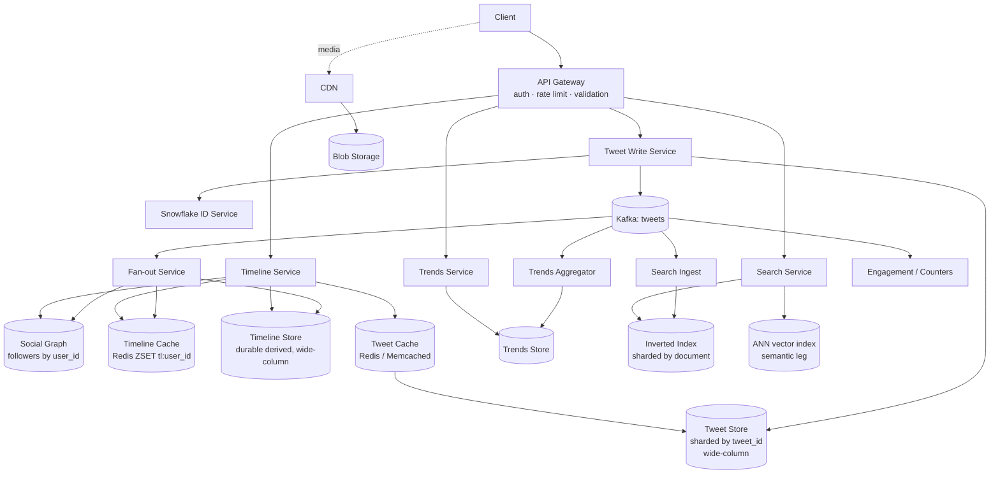

# Case Study: Twitter / X — Feed, Trends and Search

> **TL;DR** — Twitter is the canonical **fan-out** problem, and its answer is a hybrid. The arithmetic: ~500 M tweets/day is only ~5,800 writes/sec, but the average account has ~200 followers, so pushing every tweet into every follower's timeline costs **1.16 M timeline writes/sec on average — a 200× write amplification**, and a single tweet from a 100 M-follower account would occupy that entire pipeline for **~86 seconds**. So: push for ordinary accounts, pull on read for the rare accounts above a follower threshold, and make the timeline a *derived, disposable* read model rather than a source of truth. Trends and search are separate subsystems with separate stores, because neither is a query the primary tweet store can answer.

> **60-second interview answer:** "500 M tweets/day is 5,800 writes/sec — trivial. The problem is the read side and the fan-out. The average account has ~200 followers, so pushing each tweet to every follower's timeline is 1.16 M writes/sec average and ~3.5 M at peak — a 200× amplification. That is affordable in aggregate but impossible at the tail: one tweet from a 100 M-follower account is 100 M timeline writes, which is 86 seconds of my entire fan-out fleet even if nothing else were happening — and plenty else is happening. So I use a hybrid: fan-out on write for ordinary accounts, and pull-on-read for accounts above a follower threshold, which keeps the pull cost to a handful of extra merges per timeline read. Timelines live in Redis sorted sets capped at a few hundred entries because reads are shallow, backed by a durable derived store, and the whole thing is rebuildable from the follow graph plus the tweet store. Trends use windowed approximate heavy-hitter counting because exact counts are neither affordable nor necessary. Search is a separate inverted-index subsystem with its own pipeline. Everything is eventual except what the author themselves must see, which is read-your-writes."

---

## 1. Definition and mental model

### 1.1 The plain-English definition

Twitter is a system where a small number of writers each produce short text events, and a very large number of readers each need a *personalised, ordered, recent* subset of those events. The core engineering problem is not storing the tweets — 500 M rows/day is unremarkable — it is **deciding, for every (tweet, reader) pair, whether to do the work at write time or at read time.**

### 1.2 The analogy: a newspaper with 200 million personalised editions

Imagine a newspaper where every subscriber gets a *different* front page, assembled from the columnists they subscribe to.

- **Fan-out on write** is the printing press that, the moment a columnist files a story, reprints the front page of every subscriber who follows them and mails it. Wonderful for the reader — the paper is already on the doormat and reading it takes no work. Terrible for the press: one columnist with 100 million subscribers means 100 million reprints per story, and the press is still printing yesterday's stories.
- **Fan-out on read** is the opposite: nothing is pre-printed. When a reader opens the paper, a clerk runs around the newsroom collecting the latest story from each of the 200 columnists they follow and assembles the page on the spot. Wonderful for the press — one filing, one print. Terrible for popular readers: the assembly cost grows with how many columnists you follow, and every reader pays it on every read.
- **The hybrid** is what an actual newspaper does: pre-print the pages for the ordinary columnists (cheap, because few subscribers each), and for the handful of columnists with millions of subscribers, keep a single "latest from this columnist" board in the lobby and have the clerk staple a copy onto each reader's page as it is assembled. Two boards, two code paths, one deliverable.

Twitter's followers are the subscribers, the timeline is the front page, and the threshold is the line between "pre-print" and "check the board."

### 1.3 The one-sentence mental model

**Fan-out on write buys read latency with write amplification, and fan-out on read buys write simplicity with read amplification — so you apply each to the part of the follower distribution where it is cheap.**

### 1.4 Scope and assumptions (state these out loud)

Everything numeric below is **derived arithmetic from stated assumptions**, not quoted telemetry. The assumptions are:

| Assumption | Value | Why |
|---|---|---|
| Tweets posted per day | 500 M | The stated scale for this exercise |
| Monthly active users | 500 M | Implied by the tweet volume |
| Daily active users (DAU) | 200 M | 40% DAU/MAU, typical for a mature social product |
| Average followers per account | 200 | The load-bearing assumption for the entire fan-out argument |
| Average following (accounts you follow) | 200 | Same value, deliberately: the read path and write path are symmetric on average |
| Average timeline opens per DAU per day | 6 | A plausible session count |
| Pages per open | 2 | Users mostly read the first page |
| Tweets per page | 20 | The pagination unit |
| Serialised tweet size | ~1 KB | 280 chars of text (~300 B typical, ~1.1 KB worst case with 4-byte UTF-8) + IDs, timestamps, counters, flags, media refs |
| Timeline entry size | 16 B logical (8 B tweet ID + 8 B score) | The timeline stores *references*, not tweets |
| Follow distribution | Power law | The whole reason for the hybrid |

**The power law is the design.** The average is 200, but the distribution is not: a vanishingly small number of accounts hold a very large share of all follow edges. Every architectural decision in this file comes from that single fact.

---

## 2. Why it exists — the problem it solves

### 2.1 Step 1 of the framework: clarify requirements

| # | Question | Answer for this design |
|---|---|---|
| 1 | Core actions? | Post a tweet; follow/unfollow; read the home timeline; read a user's profile timeline; like/retweet/reply/quote; delete; search; see trends |
| 2 | Tweets per day? | 500 M |
| 3 | Read volume? | 200 M DAU × 6 opens × 2 pages × 20 tweets |
| 4 | Follower distribution? | Average 200, extreme tail at 100 M+ |
| 5 | Freshness expectation? | A normal account's tweet appears in followers' timelines within seconds |
| 6 | Must the author see their own tweet instantly? | **Yes — read-your-writes is a hard requirement** |
| 7 | Is eventual consistency acceptable elsewhere? | Yes — timelines, trends, counts, search |
| 8 | Retention? | Effectively permanent for the tweet; shallow for the timeline |
| 9 | Ranking or reverse-chronological? | Both — `recent` and `ranked` modes |
| 10 | Consistency of safety features (blocks, mutes, private accounts)? | **Strong on the read path** — never show content the reader may not see |
| 11 | Search corpus? | All public tweets, searchable within seconds |
| 12 | Trends? | Per-region, near-real-time, approximate |
| 13 | Out of scope? | DMs (a separate ordering problem), ads, ML ranking internals, live audio, E2EE, media transcoding detail |

### 2.2 What breaks without a designed fan-out

- **Without a timeline cache at all**, every timeline read assembles from the follow graph: 200 author lookups per page, × 27,800 page requests/sec = **5.6 M lookups/sec** just to find *which* tweets to show, before hydrating any of them.
- **Without fan-out on write**, the read path is proportional to the follow count, so the heaviest readers (people who follow 5,000 accounts) are the most expensive users in the system — precisely the opposite of what you want.
- **Without a celebrity threshold**, one tweet stalls the entire write pipeline for over a minute, and the queue then grows without bound (the arrival rate equals the service rate, so it never drains).
- **Without a derived-and-disposable timeline**, you cannot use Redis for it at all, because Redis's asynchronous replication means a failover silently loses timelines — and if the timeline were a source of truth, that would be data loss rather than a cache miss.
- **Without a separate search subsystem**, "find tweets containing X" is a full scan of a petabyte.
- **Without approximate counting**, trending is a memory-exhaustion vector: a botnet minting millions of unique hashtags blows up the aggregator.
- **Without read-your-writes on the author's own tweet**, a user posts, sees nothing, and posts again — the single most-reported failure of a naive implementation.

---

## 3. Internal mechanics — how it actually works

### 3.1 Step 2: capacity estimation (shown arithmetically)

**Writes**

```
Tweets per second        = 500,000,000 / 86,400        = 5,787/sec   ≈ 5,800/sec
Peak (×3 diurnal)        = 5,800 × 3                   = 17,400/sec
```

**Tweet storage**

```
Tweet rows               = 500 M/day × 1 KB            = 500 GB/day
Per year                 = 500 GB × 365                = ~182 TB/year
× 3 replicas                                           = ~550 TB/year
+ search index (~same order as the text)               = ~1 PB/year all-in
5-year retention         → ~5 PB total, text only
Media: ~95%+ of bytes, in blob storage + CDN           (not in the tweet store)
```

The useful observation: **the text corpus is large but not frightening; the media is a different problem entirely** and belongs to [blob storage](../../HLD/04-data/04-blob-and-object-storage.md) and a CDN.

**Fan-out on write — the load-bearing calculation**

```
Fan-out writes/sec       = 5,800 tweets/sec × 200 followers
                         = 1,160,000 timeline writes/sec   (average)
Peak                     = 17,400 × 200 = 3,480,000/sec
Amplification            = 1,160,000 / 5,800 = 200×        (exactly the follower count)

Bytes/sec                = 1,160,000 × 16 B  = ~18.5 MB/sec
Peak bytes/sec           = 3,480,000 × 16 B  = ~55 MB/sec
```

**The insight this gives you:** fan-out on write is **QPS-bound, not bandwidth-bound**. 55 MB/sec is nothing for a storage system; 3.5 M individual write operations per second is a serious fleet. Every optimisation therefore targets *operation count*, not bytes — which is exactly why the timeline entry is a 16-byte reference and not a copy of the tweet.

**The celebrity cost**

```
One tweet, 100 M followers  = 100,000,000 fan-out writes
At the fleet's average rate = 100,000,000 / 1,160,000  = 86 seconds
Timeline rows created       = 100,000,000 × 16 B       = 1.6 GB   (for ONE tweet)
```

And the fatal part: **during those 86 seconds, ~500,000 more tweets arrive**, requiring their own ~100 M fan-out writes. Arrival rate equals service rate, so the queue does not drain — it grows without bound. Push-only is not "expensive at the tail"; it is *impossible* at the tail.

**Timeline storage**

```
Read amplification first:
Page requests/day        = 200 M DAU × 6 opens × 2 pages = 2.4 B/day
Page requests/sec        = 2.4 B / 86,400                 = 27,800/sec
Peak                     = 27,800 × 3                     = ~83,000/sec
Tweet renders/day        = 2.4 B pages × 20 tweets        = 48 B/day
Tweet renders/sec        = 48 B / 86,400                  = 556,000/sec
Peak                     = ~1,670,000/sec
Reads : writes           = 556,000 / 5,800                = ~96:1  ≈ 100:1

Timeline footprint (if every DAU had a materialised timeline):
200 M users × 800 entries × 16 B logical                = 2.56 TB
In Redis (member + score + skiplist overhead ≈ 48 B):
200 M × 800 × 48 B                                      = 7.7 TB
+ key and hashtable overhead (~30 B/key)                ≈ +5 TB
                                                        ≈ 12–16 TB with replication ×2
At ~25 GB usable per instance                           ≈ 500–1,000 Redis nodes
```

**Two conclusions fall straight out of that:**

1. **Hydration must be batched and cached.** 1.67 M tweet renders/sec cannot be 1.67 M database point reads. Batched at 20:1 it is still ~83,000 multi-gets/sec. So there must be a **tweet cache** in front of the tweet store — and because every render of the same popular tweet is identical, its hit ratio is very high.
2. **Do not cache every timeline.** 500–1,000 Redis nodes is a real bill. Most accounts are inactive. Materialising only for users active in the last 30 days, and lazily for the rest, cuts the footprint several-fold — the same lazy-materialisation trick as in [Instagram](04-instagram-news-feed.md).

### 3.2 Step 3: API design

```
POST /v1/tweets
  Authorization: Bearer <token>
  Idempotency-Key: <client UUID>
  { "text": "…", "media_ids": ["m_…"], "reply_to": "t_…", "quote_of": "t_…" }
  → 201 { "tweet_id": "t_18f3a9c2…", "created_at": "2026-09-27T10:14:02.113Z",
          "fanout": { "mode": "push" } }

DELETE /v1/tweets/{tweet_id}
  → 204   (tombstone is immediate; timeline removal is background)

GET /v1/timeline/home?limit=20&cursor=<opaque>&mode=ranked|recent
  → 200 { "items": [ <tweet>, … ], "next_cursor": "eyJzIjo…", "has_more": true }

GET /v1/users/{handle}/timeline?limit=20&cursor=<opaque>&exclude_replies=false
  → 200 { "items": [ … ], "next_cursor": "…" }

POST   /v1/tweets/{id}/like     → 204   (idempotent)
DELETE /v1/tweets/{id}/like     → 204

POST   /v1/tweets/{id}/retweet  → 204
DELETE /v1/tweets/{id}/retweet  → 204

GET /v1/trends?woeid=23424977&limit=20
  → 200 { "trends": [ { "rank": 1, "name": "#…", "kind": "hashtag",
                        "volume_band": "100k+", "started_at": "…" } ] }

GET /v1/search?q=<query>&type=top|latest|people&cursor=<opaque>
  → 200 { "items": [ … ], "next_cursor": "…", "count_kind": "approximate" }
```

**The API decisions that carry design weight:**

| Decision | Reason |
|---|---|
| `Idempotency-Key` mandatory on `POST /tweets` | A retry after a timeout must not produce two tweets. Dedupe on `(author_id, idempotency_key)` with a 24 h TTL |
| `201` on create, `204` on delete | Standard; `204` carries no body because there is nothing to say |
| **Cursor pagination, never offset** | An offset over a feed that is being inserted into duplicates and skips tweets. A keyset cursor is `(score, tweet_id)` and is stable |
| Cursor is **opaque** and encodes a snapshot | Decoding it lets clients construct invalid positions against a different ranking pass |
| `has_more` computed by fetching `limit + 1` | One extra row, no `COUNT(*)` |
| Trending returns a **`volume_band`, not a number** | The counter is approximate by design. This is the API honestly reflecting the implementation — a great detail to state |
| `type=top|latest|people` on search | Different rankers over the same index, not different endpoints |
| `mode=ranked|recent` on the timeline | `recent` is the raw keyset order; `ranked` runs the ranking pass over the candidate pool |
| Delete is `204` and returns immediately | The delete is authoritative in the tweet store at once; fan-out removal is asynchronous |

### 3.3 Step 4: high-level design



**Component responsibilities**

| Component | Role | Scaling axis |
|---|---|---|
| **API gateway** | Auth, rate limits, schema validation, idempotency-key handling | Horizontal, stateless |
| **Tweet write service** | Validate, assign a Snowflake ID, persist, emit `tweet.created` | Partitioned by `author_id` |
| **Snowflake ID service** | 64-bit monotonic IDs (41-bit ms timestamp + 10-bit machine + 12-bit sequence) | Per-datacenter; the ID is assigned once, at write time, by one authority |
| **Tweet store** | The authoritative tweet rows | Sharded by `tweet_id`; wide-column fits (see [NoSQL](../../HLD/04-data/02-nosql-deep-dive.md)) |
| **Social graph** | Follower and following lists | Sharded by `user_id`; heavily cached; read-mostly |
| **Fan-out service** | Consume `tweet.created`, resolve followers, write timelines | Partitioned by `author_id`; the throughput-critical path |
| **Timeline cache** | Redis ZSET `tl:{user_id}` → (tweet_id, score), capped | Sharded by `user_id` hash; ~500–1,000 nodes at full coverage |
| **Timeline store** | Durable derived timeline beyond the cache's cap | Sharded by `user_id` |
| **Tweet cache** | Hydrated tweet bodies | Sharded by `tweet_id`; very high hit ratio |
| **Trends aggregator** | Windowed approximate heavy-hitter counting | Sharded by region and by hashtag |
| **Search ingest** | Tokenise, index, rank-signal extraction | Partitioned by `tweet_id` |
| **Inverted index** | Term → postings | Sharded by document, replicated per shard |
| **ANN index** | Dense/semantic retrieval leg | Sharded; memory-bound |
| **Engagement service** | Like/retweet/reply counters as deltas | Sharded by `tweet_id`; never a synchronous `UPDATE` |

### 3.4 The write path, step by step

```
1. Client POSTs /v1/tweets with an Idempotency-Key.
2. Gateway authenticates, rate-limits per account, validates the payload.
3. Tweet Write Service checks the idempotency key:
     SETNX idem:{author_id}:{key} → if it exists, return the stored response.
4. Assign the tweet ID: Snowflake (64-bit, monotonic, assigned by ONE authority).
     ← this ID is the timeline score. Not a wall-clock timestamp. (See §6.9.)
5. Persist the tweet row to the Tweet Store (sharded by tweet_id).
6. Commit the idempotency record IN THE SAME logical step as the row,
     so a crash cannot produce a recorded key with no tweet, or vice versa.
7. Emit `tweet.created` to Kafka, partitioned by author_id
     (so all of one author's tweets are ordered within a partition).
8. Return 201 with the tweet_id.

   ── the request ends here. Everything below is asynchronous. ──

9. Fan-out Service consumes the event.
10. Ask the Social Graph for the author's follower count.
11. BRANCH:
      count ≤ THRESHOLD  → push: page the follower list and
                            ZADD tl:{follower_id} score tweet_id  for each
      count >  THRESHOLD → skip. Mark the author as a "pull" account.
                            Followers will merge this author's recent
                            tweets at read time.
12. Also write to the AUTHOR's own timeline entry set, or handle it on read (§6.1).
13. Emit to the Search Ingest and Trends Aggregators (they consume the
     same Kafka topic independently).
```

**The step that gives the design its latency:** the client's request returns at step 8, and the fan-out at steps 9–13 runs behind Kafka at its own rate. That is what decouples `p99` post latency from fan-out cost, and it is why push-only *seems* to work in a demo and fails at the tail — in a demo, the queue drains.

### 3.5 The read path, step by step

```
1. Client GETs /v1/timeline/home?limit=20&cursor=…
2. Timeline Service reads the candidate set:
     ZREVRANGEBYSCORE tl:{user_id} +inf (cursor_score LIMIT 0 100
     ← fetch ~5× the page size: this is the CANDIDATE POOL for ranking,
       not the answer.
3. Merge the PULL accounts: from the reader's follow list, take the subset
   flagged as "pull" (typically a handful), fetch each one's recent-tweets
   list — from a SHARED cache key, so all followers of that account
   hit the same entry — and merge by score.
4. Merge the reader's own recent tweets (read-your-writes, §6.1).
5. Filter on every path:
     - tombstoned / deleted tweets
     - blocked, muted, and non-followed-after-unfollow authors
     - protected-account tweets the reader may not see
     - duplicate retweets
6. Rank (if mode=ranked): a two-stage ranker over the candidate pool,
   e.g. 100 → 40 → 20, inside a ~100 ms budget.
7. Hydrate: ONE batched multi-get of the 20 tweet IDs against the Tweet Cache
   (falling through to the Tweet Store for the misses).
   ← NEVER 20 sequential point reads. This is the single biggest read-path win.
8. Return 20 items, a cursor encoding (last_score, last_tweet_id, snapshot_id),
   and has_more.
```

**The candidate-pool idea is worth stating explicitly:** the stored timeline is not the final answer, it is a **pool of recent candidates** that the ranker slices. That is why it can be capped at a few hundred entries without harming the product — the ranker only ever sees the top slice anyway.

### 3.6 The celebrity threshold — naming the knob

```
Choose THRESHOLD so that:
  (a) the worst-case single tweet's fan-out latency stays within the SLO:
        THRESHOLD / fanout_write_rate  ≤  fanout_latency_SLO
  (b) the pull-path cost per timeline read stays small:
        (fraction of pull accounts in an average follow list) ×
          timeline_read_rate  ≤  affordable extra lookups/sec
```

| Threshold | Worst-case single tweet | Fraction of follow edges that are "pull" | Extra merges per timeline read |
|---|---|---|---|
| 10 k followers | 10,000 / 1.16 M = 8.6 ms | Large — tens of percent | 20–50 → ~1 M extra lookups/sec. **Too low** |
| **500 k followers** | 500,000 / 1.16 M = **0.43 s** | Small — a few percent of follow edges | **~5** → ~140 k extra lookups/sec. **Sane** |
| 50 M followers | 50,000,000 / 1.16 M = **43 s** | Negligible | ~0 | The tail still stalls **Too high** |

**What happens either side of the line:**

- **Just below the threshold (push):** the tweet is written into every follower's materialised timeline within seconds. The follower's read is a pure cache read. Cost: up to 500 k write operations per tweet, which at 1.16 M/sec is sub-second.
- **Just above the threshold (pull):** the tweet is written once, to the author's own recent-tweets list. Every follower's read must merge it. Cost: one extra lookup per reading follower, and the author's recent-tweets list is a *single shared cache entry* — so 100 M followers hitting it is a hot-key scenario, not a 100 M-write scenario. That trade — 100 M writes at post time versus one shared cache read per timeline read — is the entire justification for the threshold.
- **The threshold is not free to change.** Moving it down means backfilling timelines for accounts that were previously pull; moving it up means those timelines go stale. It is a tuning knob with a migration attached, and saying so is a strong answer.

**The refined answer, if pushed:** use **tiered lanes**, not one threshold. Ordinary accounts (≤10 k) fan out immediately on the fast lane. Mid-tier accounts (10 k–500 k) fan out on a slower, lower-priority lane that is allowed to lag. Above 500 k, pull. This stops a single 400 k-follower account from competing for the same worker pool as a 20-follower account.

### 3.7 Timeline storage and serving

**What the timeline actually is**

```
tl:{user_id}  →  Redis ZSET
                 member = tweet_id       (8 bytes as a uint64)
                 score  = Snowflake ID   (monotonic, assigned at write time)
```

**Why the score is the ID and not a timestamp:** if the score were `now()` from the fan-out worker's clock, two workers with skewed clocks would insert in the wrong relative order, and the timeline would be subtly mis-sorted forever. A Snowflake ID is assigned **once**, by **one authority**, at write time — so it is monotonic, globally comparable, and independent of when the fan-out happened. This is the same "use a sequence, not a timestamp" lesson as in the [WhatsApp case study](02-whatsapp-chat-system.md). A useful corollary: **the fan-out write is idempotent**, because `ZADD` of the same member is a no-op — so a retried fan-out cannot duplicate a tweet in a timeline.

**Capping and retention**

```redis
ZADD     tl:{user_id} <score> <tweet_id>
ZREMRANGEBYRANK tl:{user_id} 0 -801     # keep the newest 800
EXPIRE   tl:{user_id} 172800            # 48 h; the timeline is regenerable
```

| Parameter | Value | Reasoning |
|---|---|---|
| Cap per timeline | **~800 entries** | Reads are shallow: a user scrolls maybe 100–200 tweets before leaving. Storing 10,000 is ~12× the memory for content nobody scrolls to. 800 covers several sessions and still gives the ranker a pool |
| Cache TTL | 24–48 h | The timeline is *derived*; expiry is a miss, not data loss |
| Durable store retention | 30–90 days in buckets | For a rebuild without recomputing from the graph |
| Rebuild path | Follow graph + per-author recent tweets | This is why losing the timeline is survivable |

**Why the timeline is a derived read model, not a source of truth**

This is the most important structural claim in the file:

| Property | Timeline | Tweet |
|---|---|---|
| Authoritative? | **No — derived** | **Yes — the source of truth** |
| Rebuildable from? | Follow graph + tweet store | Nothing; it *is* the original |
| Loss on failover? | A cache miss | Unacceptable |
| Can it be wrong? | Yes — stale, missing entries | No |
| Storage choice | Redis with async replication is fine | Must be a durable store |

Because the timeline is derived, Redis's asynchronous replication is *acceptable* for it — losing a timeline on failover costs a recompute, not data. The corollary: if a design ever makes the timeline authoritative (e.g. by storing something in it that exists nowhere else), that choice becomes unsafe, and you must say so.

**Pagination**

| Approach | Behaviour |
|---|---|
| Offset (`?page=3`) | Under concurrent insertion, page 3 shifts — users see duplicates and **skip** tweets. Broken |
| Keyset (`ZREVRANGEBYSCORE … (score`) | Stable and O(log N); the cursor is the last `(score, tweet_id)` |
| Snapshot cursor | The cursor also carries a `snapshot_id`, so a scroll session is pinned to one ranking pass — otherwise a re-rank mid-scroll reshuffles the list under the user's thumb |

**The read-shallow principle:** the whole design assumes users read the top of the timeline and stop. That is what justifies (a) the 800-entry cap, (b) the small candidate pool, (c) not materialising for inactive users, and (d) the ranked mode operating on a slice rather than the whole history.

### 3.8 Engagement counters

`POST /v1/tweets/{id}/like` must **never** be `UPDATE tweets SET likes = likes + 1 WHERE id = ?`. At peak, thousands of likes per second on a trending tweet hit a single row and serialize.

```
like event → Kafka (partitioned by tweet_id)
           → 60 s tumbling window aggregation
           → dedupe on (user_id, tweet_id)
           → ONE delta per tweet per window
           → read-modify-write against the counter store
Display count served from a cache with a 5–60 s TTL.
```

The reduction is the same order of magnitude as the view-counting example in the [YouTube case study](05-youtube-upload-and-recommendation.md): thousands of events collapse into one write per window per tweet. And the product can tolerate it — a like count that lags 30 seconds is indistinguishable from one that is exact.

For a *monetised* or audited count (ad impressions, verified view counts), run a **separate, exactly-once, auditable pipeline** — do not reuse the approximate display counter.

### 3.9 Trending topics

**The problem:** rank hashtags by their volume over a rolling window, per region, near-real-time.

**Why exact counting fails**

| Failure | Detail |
|---|---|
| Unbounded memory | The cardinality of distinct hashtags is attacker-controlled. A botnet minting millions of unique tags exhausts the aggregator |
| Ranking cost | Ranking over millions of distinct keys per window per region, every window |
| It is not even truthful | Bots make an exact count a precise measurement of a manipulated quantity |
| The product does not need it | Trending shows a **rank** and a **band**. The difference between 1,000,005 and 1,000,012 mentions changes nothing |

**The design**

```
tweets → Kafka
       → Trends Aggregator, sharded by (region, hashtag)
           · extract hashtags, mentions, and n-grams from each tweet
           · per-1-minute tumbling bucket: Count-Min Sketch per shard
             (fixed memory, over-counts only, never under-counts)
           · a Space-Saving / Misra-Gries structure per shard keeps
             the top-K heavy hitters with bounded error
           · sliding windows = sum the last N one-minute buckets
             (5 min = 5 buckets, 1 h = 60 buckets, 24 h = 1440)
       → regional merge: query each shard's top-K, merge, re-rank
       → Trends Store (short TTL, read-heavy)
       → API returns rank + volume BAND
```

**The signals, beyond raw volume:**

| Signal | Why |
|---|---|
| **Velocity, not absolute volume** | A hashtag with 1 M historical mentions is not trending. One that went 0 → 50,000 in 5 minutes is. The ranker uses the *rate of change* |
| **Unique authors, not mentions** | One bot posting 10,000 times must not outrank 10,000 humans posting once. Count distinct authors |
| **Anti-manipulation score** | Account age, follower/following ratio, and coordination signals from an abuse pipeline |
| **Minimum absolute volume** | Otherwise a 3-tweet hashtag tops the chart in a small region. Enforce a floor per region before anything can be ranked |
| **Diversity constraint** | Do not let one story occupy 8 of the top 10 slots |

**Per-region sharding:** the aggregator is sharded by region (WOEID-style). A tweet can trend in several regions, so it is either replicated to each region's aggregator or the aggregator is sharded by hashtag and the regional query fans out. Replication is preferred for correctness and simplicity; the cost is that a globally viral tweet is counted in many aggregators at once.

### 3.10 Search

**Why it is a separate subsystem, not a query**

| Reason | Detail |
|---|---|
| The primary store cannot answer it | A tweet store is optimised for point lookups by ID. "Tweets containing X" against it is a petabyte scan |
| Different data structure | An inverted index (term → postings) is not a row store and cannot live in one |
| Different scaling profile | Index writes are bulk and append-heavy; queries are scatter-gather over shards |
| Different failure profile | A lost index shard degrades *recall*; it must be rebuildable from the tweet store |
| Different lifecycle | An **analyser change requires a full reindex** — a multi-day operation, and the reason the index has its own pipeline and its own version |
| Ranking needs many signals | Engagement, author authority, recency, and personalisation come from services the primary store does not consult |

**The inverted index**

```
term  →  postings list: [ (tweet_id, field, position, term_frequency), … ]

Fields indexed separately:
  text        the tweet body
  hashtag     #foo → token "foo" AND field hashtag:"foo"
  mention     @bar → field mention:"bar"
  url         the expanded URL and its domain
  author      author_id, handle
  lang        detected language (a filter, not a ranker input)
```

**Tokenisation decisions that matter**

| Decision | Choice | Why |
|---|---|---|
| Normalisation | Lowercase, Unicode NFKC, diacritic folding configurable | Otherwise `Café` and `cafe` are different terms |
| CJK | Dictionary-based or n-gram segmentation | Whitespace tokenisation does not work for Chinese/Japanese/Korean |
| Hashtags | Index the tag body plus a `hashtag:` field | Enables both free-text and structured search |
| Mentions | Index as a `mention:` field | Enables `from:` / `to:` style filters |
| URLs | Index the expanded target and the domain | Link search, and dedupe of the same link |
| Stop words | Keep them, keep positions | They are needed for phrase queries. Removing them breaks `"to be or not to be"` |
| Stemming | Light (e.g. Porter-class) | Aggressive stemming hurts precision on short text |
| Emoji | Index as tokens with a text alias | Emoji are content, not punctuation |

**Ranking signals**

| Signal | Weight profile |
|---|---|
| Text relevance (BM25 or a learned ranker) | Highest for `top`; irrelevant for `latest` |
| Engagement (likes, retweets, replies, **normalised by age**) | High for `top` |
| Author authority (follower count, verification, historical engagement) | Medium; a strong anti-spam lever |
| **Recency** | Dominant for `latest`; a heavy decay term for `top` |
| Personalisation (social-graph proximity, language, region) | Light touch — search is more objective than the home feed |
| Safety (blocked/muted, spam score, sensitive-content flags) | A **filter**, not a weight — never a ranking input |

**Sharding the index, and what breaks**

| Strategy | How | Trade |
|---|---|---|
| **By document** (the practical choice) | Each shard holds a subset of tweets; a query fans out to all shards and merges | Every query touches every shard; **merging per-shard top-K is only a global top-K if each shard returns ≥ the global limit**; exhaustive counts are unavailable |
| By term | Each shard holds a subset of terms | A query touches only the shards holding its terms; but hot terms create hot shards, and a shard failure loses whole terms |

**The traps to name:**

1. **Per-shard top-K ≠ global top-K.** With 50 shards returning 20 each, you have 1,000 candidates and can take the true top 20 — fine. But "the most-liked tweet matching X" needs the global maximum, which requires either a much larger K or a different structure.
2. **Exhaustive counts are gone.** "About 1,240,000 results" is either a separate counting index or an approximation. Say so, and expose `count_kind` in the API.
3. **Ingestion lag.** A tweet is searchable in seconds, not instantly. The user-visible consequence: **searching for your own just-posted tweet may return nothing.** The fix is an author-scoped fallback to the tweet store, or explicit documentation.
4. **Deletes in the index.** A delete is a tombstone, and the document is removed at the next merge unless explicitly purged. This is a real compliance concern: a deletion request must drive an explicit index purge, not just a store delete.
5. **Analyser changes reindex everything.** Plan a dual-index cutover: build index v2, shadow-verify, switch reads, then delete v1.
6. **Shard loss degrades recall silently.** Results just get thinner. Monitor index coverage, not just query latency.

**The semantic leg.** Modern search adds dense retrieval: embed the tweet and the query, and retrieve by ANN over a vector index, then fuse the lexical and dense legs (reciprocal rank fusion is the simple, effective default). That leg is memory-bound — 768-dimensional float32 is ~3 KB per tweet, so a billion tweets is ~3 TB of vectors before the index, which is why quantisation and disk-based indexes exist. See [Vector Databases](../../HLD/04-data/03-vector-databases.md). The honest note: for short text with heavy hashtag and entity structure, the lexical leg still carries most of the quality; the dense leg earns its place for paraphrase and intent.

### 3.11 Step 5: trade-offs

| Decision | Buys | Costs |
|---|---|---|
| **Push (fan-out on write)** | O(1) timeline read — the reader's work is done in advance | 200× write amplification; breaks entirely at the tail |
| **Pull (fan-out on read)** | No write amplification; correct for celebrities | Read cost proportional to the follow count; the heaviest readers are the most expensive |
| **Hybrid + threshold** | O(1) for the common case, bounded pull cost for the tail. **This is the design** | Two code paths to build and test; the threshold is a tuning knob with a migration attached; the read path must merge two sources |
| **Precomputed timeline** | Fast first page; a simple, cacheable read path | Storage (~12–16 TB of Redis), staleness, and a derived artefact that must be rebuildable |
| **On-read assembly only** | Always fresh; zero storage | 200 lookups per page at 27,800 pages/sec; the read path becomes the bottleneck |
| **Redis timeline cache** | Sub-millisecond reads; absorbs the 96:1 read amplification | Real RAM cost; async replication means a failover loses timelines (acceptable — they are derived) |
| **Durable timeline store** | Survives cache loss; longer history | A second write path and more storage for data that is still derived |
| **Exact trend counts** | Truthful numbers | Unbounded memory, expensive ranking, adversarial cardinality |
| **Approximate heavy hitters** | Fixed memory, cheap ranking, adversarially robust | Over-counts, and the API must return a band rather than a number |
| **Synchronous fan-out** | The tweet is in every timeline when the write returns | Write latency = fan-out latency. Unshippable at the tail |
| **Asynchronous fan-out** | Post returns in <500 ms; the pipeline absorbs bursts | Fan-out lag is user-visible; needs lag monitoring, backpressure and a DLQ |
| **Separate search subsystem** | Real ranking, real scale, its own lifecycle | A second pipeline, a second store, ingestion lag, and a reindex operation |
| **Snowflake score, not timestamp** | Out-of-order fan-out is self-correcting; retries are idempotent | Needs machine-ID assignment and clock-skew handling |
| **Tombstones + read-time filtering** | Deletes are immediate and authoritative | Every read path must apply the filter — miss one and deleted content leaks |

---

## 4. Variants and taxonomy

### 4.1 Fan-out variants

| Variant | Mechanism | Right when |
|---|---|---|
| **Pure push** | Every tweet → every follower's timeline at write time | Small average follower counts, or a small user base |
| **Pure pull** | Assemble from the follow graph at read time | Very high average follower counts, or a very write-heavy, read-light workload |
| **Hybrid threshold** | Push below a follower count, pull above | **The default for social feeds** |
| **Tiered lanes** | Fast lane, slow lane, pull — by follower band | When a mid-tier account should not compete with a 20-follower account |
| **Lazy materialisation** | Only materialise for recently active users | When a large fraction of accounts is dormant |
| **Ranked-then-cached** | Cache the ranked page, not the raw timeline | When ranking is expensive and users re-open the app repeatedly |
| **Read-repair** | Fill gaps at read time from per-author timelines | After a fan-out outage, instead of a mass rebuild |

### 4.2 Search variants

| Variant | Mechanism | Trade |
|---|---|---|
| **Lexical only (BM25)** | Inverted index, term matching | Strong on exact terms, hashtags, entities; weak on paraphrase |
| **Dense only (ANN)** | Vector index over embeddings | Strong on intent; memory-bound; weak on rare exact terms and handles |
| **Hybrid + fusion** | Both legs, fused by reciprocal rank fusion | The practical default |
| **Two-phase retrieve-then-rerank** | Recall a large set cheaply, rerank a small set expensively | Better precision, bounded latency |
| **Index sharded by document** | Fan out and merge top-K | The standard; costs a full fan-out per query |
| **Index sharded by term** | Query only the shards holding its terms | Cheaper queries; hot-term shards and whole-term loss on shard failure |

---

## 5. Pros and cons of the hybrid design

| Pros | Cons |
|---|---|
| Timeline reads are O(1) for the ~99.99% of accounts below the threshold | Two code paths to build, test and monitor — the read path must merge two sources |
| Celebrity tweets cost one write instead of 100 M | The pull path creates a hot key: one cache entry read 100 M times |
| Post latency is decoupled from fan-out (a `201` returns before fan-out starts) | Fan-out lag is user-visible; "I posted and my friend cannot see it" |
| The timeline is derived, so Redis with async replication is acceptable for it | Any accidental dependency on the timeline as a source of truth silently becomes data loss |
| Capping and TTLs bound RAM to a predictable, provisionable number | Timeline memory is ~12–16 TB at full coverage; lazy materialisation adds complexity |
| Trends and search scale independently and cannot take down posting | Two more pipelines, two more stores, two more failure domains |
| Approximate trends are adversarially robust by construction | The API cannot return an exact volume, so the product must show a band |
| Snowflake scores make out-of-order fan-out self-correcting and retries idempotent | Machine-ID assignment and clock-skew handling become operational responsibilities |
| Tombstone + read-time filtering makes deletes immediate | Every read path must apply the filter — a new read path that forgets it leaks deleted content |

---

## 6. Exceptions, edge cases and failure modes

### 6.1 The author sees nothing — read-your-writes (the #1 bug)

**The trap:** the author's own tweet is fanned out to their followers. **The author does not follow themselves**, so their own materialised timeline does not contain it. The user posts, sees nothing, and posts again.

**The fixes, in order of quality:**

| Fix | How | Cost |
|---|---|---|
| **Self-merge on read** | Always merge the reader's own recent tweets into the candidate pool | One extra lookup per timeline read; needs a per-user recent-tweets cache |
| Write to the author's own timeline too | `ZADD tl:{author_id}` | Cheap and simple; but it is a special case inside the fan-out |
| Client-side overlay | The posting client keeps the tweet in a local "just posted" slot until the timeline catches up | Zero server cost; the tweet vanishes on refresh, which looks like a bug |
| Return the fan-out status in the `201` | Let the client know it is in flight | Honest, but the user still sees nothing |

**The same trap in a second place:** the tweet is in the tweet store immediately, but not in the **search index** for a few seconds — so "search for my own tweet" fails. Fix: an author-scoped fallback query against the tweet store, or document the lag.

### 6.2 The celebrity pull-path stampede

All 100 M followers open the app at once and each needs the celebrity's recent tweets. If each did an independent lookup, that is 100 M reads of the same data.

**Fix:** the celebrity's recent-tweets list is **one shared cache entry** with a short TTL (5–15 s). The first reader after expiry refreshes; the rest hit the cache. The short TTL is deliberate — it bounds staleness for a brand-new tweet while absorbing the stampede. This is the same anti-stampede structure as the celebrity cache in the [Instagram feed](04-instagram-news-feed.md). For a truly extreme account, replicate the cache entry across several keys with a random suffix so the read load spreads across shards.

### 6.3 Fan-out lag

**Symptom:** the user posts, and their followers do not see it for 30 seconds.

**Diagnosis:** monitor **fan-out lag** — the age of the oldest unconsumed `tweet.created` event — not queue depth. Queue depth grows and shrinks with traffic and tells you nothing; lag tells you how stale the newest timelines are. Alert on `p99` lag, and on the *rate of change* of lag, which is the leading indicator of an impending backlog.

**Causes:** a celebrity tweet consuming the pipeline; a slow social-graph lookup; a Redis slow operation blocking a shard; a fan-out worker restart storm; a partition rebalance.

**Defences:** tiered lanes so a big fan-out cannot starve small ones; a bounded per-tweet fan-out worker budget; backpressure that slows consumption rather than buffering without bound; and a DLQ for tweets that cannot be fanned out, with a replay tool.

### 6.4 The 200-follower average is a lie

The distribution is a power law. The mean is useless for capacity planning at the tail.

| Band | Followers | Lane | Cost |
|---|---|---|---|
| Ordinary | ≤10 k | Fast push | ≤10 k writes per tweet |
| Mid-tier | 10 k–500 k | Slow push, allowed to lag | Up to 500 k writes per tweet — **one such account, tweeting 10× a day, is 5 M writes/day** |
| Celebrity | >500 k | Pull | One write, plus a hot read key |

**The trap to name:** if you set the threshold at 500 k and the *fast* lane at "everyone else," a 400 k-follower account competes for the same workers as a 20-follower account. Thirty of those tweeting at once saturate the fast lane and every small account's timeline goes stale. **Tiered lanes are not a refinement; they are the fix.**

### 6.5 Fan-out retries and idempotency

If a fan-out worker fails mid-way through a 200 k-follower list and retries, it may re-write a subset. Because the timeline write is `ZADD` of a member, **the retry is naturally idempotent** — the same `(user_id, tweet_id)` pair lands once. This is a genuinely nice property of using a set rather than an append log, and it is worth stating. The residual cost is redundant work, so track a per-tweet progress marker (e.g. the last follower shard processed) to resume rather than restart.

### 6.6 Poison pills and corrupt follower lists

One tweet whose follower list is corrupt, or whose payload fails deserialisation, blocks its Kafka partition forever if the consumer retries without bound.

**Fix:** bounded attempts (3–5) with exponential backoff and jitter, then the **DLQ** with alerting and a replay tool. And a per-partition circuit breaker so one poison message cannot stall every tweet behind it in that partition.

### 6.7 Deletes

A delete must remove a tweet from up to 100 M materialised timelines. Doing it synchronously is the same impossible fan-out as the write.

```
1. Tombstone the tweet in the Tweet Store.        ← immediate, authoritative
2. Remove it from the author's own timeline.
3. Emit `tweet.deleted` → a background, best-effort
   removal from materialised timelines.
4. The READ PATH filters any tweet whose ID is tombstoned,
   on EVERY read path — timeline, search, trends, profile.
   ← this is what makes the delete correct even where
     the background removal has not reached yet.
```

**The rule:** a tombstone plus read-time filtering is the correctness mechanism; the background removal is only an optimisation to keep caches clean. If a read path forgets the filter, deleted content leaks — and a deleted tweet that keeps appearing in search results is a compliance problem, not a UX one.

**The user-visible consequence to name honestly:** the "ghost tweet" — a follower sees a tweet and then it vanishes because the author deleted it. That is *correct* under this model, not a bug.

### 6.8 The follow/unfollow race

Fan-out happened at post time using the follower list *at that moment*.

| Scenario | Effect | Fix |
|---|---|---|
| Follow after the tweet | The tweet is not in your timeline | Accept — you do not retroactively get old tweets |
| Unfollow after fan-out | The tweet remains in your materialised timeline | **Filter at read time** against the current follow set, or accept a bounded window |
| Block after fan-out | Their content remains | **Filter at read time, always.** Safety features are never write-time-only |
| Protected account | Only approved followers may see it | Filter at read time against the *current* approved set — approval revoked must take effect immediately |

**The rule:** visibility is decided **at read time** from the current relationship state; the materialised timeline is only a *candidate pool*, never an authority on who may see what.

### 6.9 The clock is the enemy

If the timeline score is a wall-clock timestamp taken by the fan-out worker, two workers with skewed clocks insert out of order, and a timeline can show a tweet from 10:00:05 above one from 10:00:03 forever.

**Fix:** the score is the **Snowflake ID**, assigned once, by one authority, at write time. It is monotonic and globally comparable. Note the residual risk: Snowflake itself breaks if a machine's clock jumps backwards. The standard mitigation is to refuse to issue IDs until the clock catches up, or to use a logical clock — and the same trap applies to any "timestamp as ordering" design (see the [WhatsApp sequence discussion](02-whatsapp-chat-system.md)).

### 6.10 Cache and store failures

| Failure | Effect | Defence |
|---|---|---|
| A timeline Redis shard dies | That shard's timelines are misses → rebuild from the durable store | Replicas per shard; consistent hashing; a rebuild path that does not hammer the tweet store |
| A hot timeline key | One shard saturated | Local in-process cache (1–10 s TTL); key replication with a suffix |
| Timeline store unavailable | Rebuild degrades to assembly from the graph | Circuit-break and serve a shorter timeline rather than failing the read |
| Tweet cache miss storm | Batched hydration hits the tweet store hard | Single-flight per tweet ID; a bounded wait then fall through |
| Social graph unavailable | Fan-out cannot resolve followers | Pause consumption and let Kafka buffer (lag grows, nothing is lost); alert on lag |
| Redis eviction under memory pressure | Hot timelines evicted → a rebuild storm | Pin the hot set; size with headroom; prefer `allkeys-lru` and monitor evictions, not just memory |
| Cluster resharding at peak | Latency spikes and slot errors | Reshard off-peak, a few slots at a time |

### 6.11 Trends failure modes

| Failure | Cause | Defence |
|---|---|---|
| Botnet hashtag spam | Millions of unique tags | Unique-author weighting, account-age signals, and a bounded candidate set (approximate structures are bounded by construction) |
| A tiny region trends a 3-tweet tag | No volume floor | A minimum absolute volume per region before anything is ranked |
| One story occupies the top 10 | No diversity constraint | Cap the slots per cluster/story |
| Stale trends | The aggregator lags | Short TTLs and a freshness timestamp on the response |
| A globally viral tag is counted N times | Per-region replication | Count it in each region honestly, or dedupe by a global ID and distribute the count |
| A window boundary artefact | Tumbling windows only | Overlapping 1-minute buckets summed for sliding windows |

### 6.12 Search failure modes

| Failure | Effect | Defence |
|---|---|---|
| Ingestion lag | New tweets unsearchable for seconds | Accept and document; author-scoped fallback for "my own tweet" |
| Index shard loss | **Silent recall degradation** — results get thinner with no error | Monitor index coverage and per-shard document counts, not just latency |
| Analyser change | Requires a full reindex | Dual-index build → shadow-verify → switch → delete |
| Deleted tweet still indexed | Compliance failure | Explicit index purge on delete; verify with a periodic audit |
| Hot query | One shard or one query pattern saturates | Query cache; per-query rate limits; query-cost-based limiting |
| Per-shard top-K merge error | An incorrect global ordering | Return ≥ the global limit per shard, or restructure the query |
| Reindex during a traffic peak | Latency spike | Throttle the indexing pipeline and schedule reindexes off-peak |
| A shard rebuild from the tweet store | Massive read load on the primary | Rebuild from a snapshot/replica, never from the serving primary |

### 6.13 Cold start and product-shaped gaps

- **A new user follows nobody** → an empty timeline. This is a *product* problem solved by recommendations and onboarding, not an engineering one. Say that rather than inventing a technical fix.
- **A new account's first tweet** has no engagement signal, so it ranks poorly in search and never trends. Some systems guarantee a small exploration slot — the same problem as new-video cold start in the [YouTube case study](05-youtube-upload-and-recommendation.md).
- **Account deletion** must remove 500 M tweets from the index and from timelines: a batch job with a legal deadline, not a synchronous operation. Plan it as a pipeline with an auditable completion record.

### 6.14 Split brain and the eventual-consistency question

The follower store is read-mostly and cached. A stale follower list means fan-out to a slightly wrong set — tolerable, because the whole path is eventual anyway. But two consequences follow:

1. **The read-time filter must not use the same stale cache as the write-time fan-out**, or a stale relationship could both fan out wrongly *and* filter wrongly. Use a slightly more authoritative source — or a shorter TTL — for the read-time visibility check.
2. **Safety-critical state — blocks, mutes, protected accounts — must never be eventually consistent on the read path.** That is the one place where strong-ish consistency is worth the latency, and it is the exception to the "everything is eventual" rule.

### 6.15 Where "just eventual" stops being acceptable

| Data | Guarantee | Why |
|---|---|---|
| Timeline contents | Eventual (seconds) | A follower seeing a tweet 3 s late is fine |
| Trends | Eventual (minutes) | The rank is inherently lagging |
| Engagement counts | Eventual, cached 5–60 s | Exactness is neither needed nor affordable |
| Search index | Eventual (seconds) | Accepted ingestion lag |
| **Author's own tweet** | **Read-your-writes** | Otherwise it looks like the post failed |
| **Author's own delete** | **Read-your-writes** | The author must not see their deleted tweet |
| **Follow / unfollow** | **Read-your-writes** | The user must see the effect of their own action |
| **Blocks / mutes / protected** | **Strong on the read path** | Never show content the reader may not see |
| Tweet existence and content | Strong (single-store) | The tweet store is the source of truth |

**The one-sentence summary:** eventual everywhere the user is an observer, read-your-writes everywhere the user is the actor, and strong wherever safety is involved.

---

## 7. When to use / when NOT to use

### 7.1 When this design applies

- **Fan-out on write (push)** when the average fan-out is small (hundreds) and the read volume is high — the write amplification is affordable and the read becomes O(1).
- **Fan-out on read (pull)** when the fan-out is enormous (millions), the read volume is comparatively low, or the data changes faster than you could push it.
- **The hybrid threshold** whenever the follower distribution is a power law — which is to say, always, for a social product.
- **A derived, disposable timeline** whenever the timeline can be rebuilt from other data. This is what unlocks an in-memory store with weak durability guarantees.
- **Approximate heavy hitters** whenever the counted cardinality is attacker-influenced, the ranking is what matters, or exactness is unaffordable.
- **A separate search subsystem** whenever the query is term-based rather than key-based, and ranking matters.

### 7.2 When NOT to use it

| Do not | Because |
|---|---|
| Push fan-out when the average follower count is in the millions | One tweet is minutes of fleet time |
| Pull-on-read for everything | The read cost scales with the follow count; the heaviest readers cost the most |
| Materialise a timeline for every account | ~12–16 TB of RAM for timelines most accounts never read |
| Store timelines indefinitely | Reads are shallow; the cost grows linearly with no product benefit |
| Cache a ranked page for a long TTL | Ranking inputs change constantly; the page goes stale in a way users notice |
| Use exact counters for trends or engagement | Unbounded memory and an adversarial cardinality vector |
| Query the primary store for search | A petabyte scan per query, with no ranking |
| Make the timeline authoritative | Any derived store that becomes a source of truth turns a failover into data loss |
| Use a wall-clock timestamp as the ordering key | Clock skew mis-sorts timelines permanently |
| Apply safety filters at write time only | A block must take effect immediately, and the fan-out already happened |
| Synchronous fan-out on the request path | Post latency becomes fan-out latency, which is unbounded at the tail |

### 7.3 Decision table

| Situation | Choose |
|---|---|
| Average followers in the hundreds | Push |
| Average followers in the millions | Pull |
| Power-law distribution (always) | Hybrid with a follower threshold, plus tiered lanes |
| A mid-tier account saturating the fast lane | Tiered lanes, not a threshold change |
| Many dormant accounts | Lazy materialisation for users active in the last 30 days |
| Reads >> writes with a shallow read pattern | Cap the timeline; rank over a small candidate pool |
| Term-based queries with ranking | A separate inverted-index subsystem |
| Similarity / intent queries | Add a dense ANN leg and fuse it |
| Counting anything an adversary can influence | Approximate, bounded-memory structures with unique-actor weighting |
| Anything the acting user must see immediately | Read-your-writes, explicitly designed |
| Anything safety-related | Strong on the read path |

---

## 8. Numbers, defaults and tuning

| Thing | Number | Reasoning / note |
|---|---|---|
| Tweets/day | 500 M | Stated scale |
| Average write rate | 5,800/sec | 500 M / 86,400 |
| Peak write rate | 17,400/sec | ×3 diurnal multiplier |
| Average followers | 200 | The load-bearing assumption |
| Fan-out writes/sec (average) | 1,160,000/sec | 5,800 × 200 |
| Fan-out writes/sec (peak) | 3,480,000/sec | 17,400 × 200 |
| **Write amplification** | **200×** | Exactly the follower count |
| Fan-out bytes/sec | ~18.5 MB/sec avg, ~55 MB/sec peak | 16 B per entry — **QPS-bound, not bandwidth-bound** |
| One 100 M-follower tweet | 100,000,000 writes = **86 s of the whole fleet** | And the queue never drains, because arrivals equal service |
| Timeline rows per celebrity tweet | 1.6 GB | 100 M × 16 B |
| Page requests/sec | 27,800 avg, ~83,000 peak | 200 M DAU × 6 opens × 2 pages |
| Tweet renders/sec | 556,000 avg, ~1,670,000 peak | ×20 tweets per page |
| Read : write ratio | ~96:1 ≈ **100:1** | Why the read path is where the design effort goes |
| Tweet size | ~1 KB | 280 chars + metadata |
| Tweet storage | ~500 GB/day, ~182 TB/year | Text only; media is separate |
| All-in storage with replicas + index | ~1 PB/year | ~5 PB at 5 years |
| Timeline entry | 16 B logical, ~48 B in Redis | Member + score + skiplist overhead |
| Timeline cap | **800 entries** | Reads are shallow; 10,000 would be ~12× the memory |
| Timeline cache TTL | 24–48 h | Derived data — expiry is a miss, not loss |
| Timeline RAM at full coverage | ~12–16 TB | 200 M × 800 entries + replica |
| Redis nodes at full coverage | ~500–1,000 | At ~25 GB usable each |
| Lazy materialisation saving | 3–4× | Only materialise for recently active users |
| **Celebrity threshold** | **~500,000 followers** | 0.43 s worst-case single-tweet fan-out; ~5 pull merges per timeline read |
| Fast lane | ≤10,000 followers | Immediate fan-out |
| Slow lane | 10,000–500,000 | Deferred, allowed to lag |
| Pull | >500,000 | Merged at read time |
| Candidate pool per page | ~100 for a 20-item page | 5× over-fetch to give the ranker room |
| Ranking budget | ~100 ms inside a 200 ms p99 page read | Two stages, e.g. 100 → 40 → 20 |
| Hydration | **One batch multi-get of 20 IDs** | Never 20 sequential reads |
| Deleted-tweet tombstone retention | ≥ the longest cache TTL anywhere | Or a deleted tweet reappears from a stale cache |
| Engagement window / cache TTL | 60 s tumbling / 5–60 s served | Thousands of events → one delta per tweet per window |
| Trend window buckets | 1-minute tumbling, summed for 5 min / 1 h / 24 h | Sliding windows without overlapping state |
| Trend minimum volume | Region-specific floor | Or a 3-tweet tag ranks first in a small region |
| Trend unique-author weight | ≥ the mention-count weight | One bot posting 10,000 times must not outrank 10,000 humans |
| Count-Min Sketch error | ε ≈ 0.1% of the stream, 5 hash functions, ~1–2 MB | Fixed memory regardless of cardinality |
| Search ingestion lag | Seconds | Accepted; documented; author-scoped fallback |
| Index shards returning per-shard K | ≥ the global limit | Otherwise the merge is not a global top-K |
| Vector storage / ANN overhead | 768 dims × 4 B ≈ 3 KB/tweet; index ×1.5–2.0 | 1 B tweets ≈ 3 TB of raw vectors — memory is the constraint |
| Idempotency-key TTL | 24 h | Matches client retry windows |
| Fan-out DLQ + lag alert | 3–5 attempts then replan; alert on p99 lag > 5 s | Monitor **lag**, not queue depth |
| Snowflake ID | 41-bit ms + 10-bit machine + 12-bit sequence | ~4 M IDs/sec/machine; refuse to issue on clock skew |
| SLOs | Post p99 < 500 ms; timeline read p99 < 200 ms | Fan-out happens after the post response |

---

## 9. Interview Q&A

### Q1. Design Twitter. Give me the shape in 30 seconds. — E

**A:** A tweet write service assigns a Snowflake ID, persists the tweet, and emits an event to Kafka. A fan-out service consumes that event and, for ordinary accounts, writes the tweet ID into each follower's timeline — a Redis sorted set scored by the Snowflake ID. For accounts above a follower threshold, it skips the fan-out and followers merge that author's recent tweets at read time; that is the hybrid. The read path pulls the candidate pool, merges the pull accounts and the reader's own tweets, filters on visibility, ranks, and hydrates in one batched multi-get. Trends and search are separate subsystems consuming the same Kafka topic.

### Q2. Why do you keep saying the write rate is trivial? — E

**A:** Because 500 M/day is 5,800 writes/sec, and a single well-provisioned store handles hundreds of thousands of simple inserts per second. The write *volume* is not the problem. The problem is that each tweet fans out to an average of 200 followers, so the real write load is 1.16 M timeline writes/sec on average — a 200× amplification. And it is not a bandwidth problem either: 1.16 M × 16 bytes is only 18.5 MB/sec. It is a **QPS** problem, which is why the timeline entry is a 16-byte reference and not a copy of the tweet, and why the entire design targets operation count.

### Q3. Fan-out on write versus fan-out on read. — M

**A:** Push does the work at write time: the reader's timeline is precomputed and the read is O(1). It costs write amplification equal to the follower count. Pull does the work at read time: the tweet is stored once, and the reader's page is assembled from the follow graph. It costs a read proportional to the follow count, which makes the heaviest readers the most expensive users. The correct answer is not one or the other — it is push where the follower count is small, pull where it is huge, and a threshold between them. With a power-law distribution, push covers the overwhelming majority of (tweet, reader) pairs cheaply and pull handles only the tail, where push is impossible.

**Probe: what is the threshold, and why?** Around 500,000 followers. It is set so the worst-case single tweet's fan-out — 500,000 writes at 1.16 M/sec — completes in about 0.43 seconds, keeping it well inside the fan-out latency SLO; and so that the number of pull accounts in an average 200-account follow list is around five, adding only ~140,000 extra lookups/sec to a fan-out-free 27,800 reads/sec. Too low a threshold puts too much load on the read path; too high and the tail still stalls.

### Q4. What does one tweet from a 100 M-follower account cost? — H

**A:** 100 million timeline insertions. At the fleet's average fan-out throughput of 1.16 M writes/sec, that is **86 seconds** — and that is if the fleet were doing nothing else. It is not: in those 86 seconds about 500,000 more tweets arrive, requiring their own ~100 M fan-out writes. So the arrival rate equals the service rate and the queue grows without bound — the celebrity tweet never drains. It also creates 1.6 GB of timeline rows for content most of those 100 M followers will never scroll to. Push-only is not expensive at the tail; it is impossible, and it takes the rest of the system down with it.

### Q5. Why is the timeline a derived read model? — M

**A:** Because it can be rebuilt from the follow graph plus the tweet store, and that changes what storage guarantees you need. A derived artefact can live in Redis with asynchronous replication, because a failover that loses timelines costs a recompute — not data. It can be capped, expired and lazily materialised, because losing entries is a cache event. And it can be filtered on read, because it is a candidate pool rather than an authority. The corollary is a warning: the moment something is stored *only* in the timeline, the design becomes unsafe, so that must never happen.

### Q6. Why cap the timeline at 800 entries? — M

**A:** Because reads are shallow. A user scrolls maybe 100–200 tweets before leaving, so storing 10,000 entries per timeline is roughly 12× the memory for content nobody sees. The measured constraint is that timelines at full coverage cost 12–16 TB of Redis across 500–1,000 nodes; capping at 800 plus lazily materialising only for recently active users keeps that affordable. The cap also does not hurt ranking, because the ranker works over a ~100-entry candidate pool sliced off the top — it never sees the deep history anyway.

### Q7. Redis or a durable store for timelines? — M

**A:** Both, with Redis in front. Redis gives sub-millisecond reads and absorbs the ~96:1 read amplification. The durable derived store behind it holds a longer history so a cache miss can be served without recomputing from the graph and the per-author timelines. The split matters because the tier behind Redis must be able to survive a full Redis loss without falling back to the most expensive rebuild path.

**Probe: what happens when a Redis shard dies?** 1/N of timelines become misses. With 500–1,000 nodes that is a manageable fraction, and consistent hashing means only that shard's keys move. The risk is not the volume — it is that the rebuild storm hits the tier behind it all at once, so I would single-flight the rebuilds and rate-limit them.

### Q8. How do you handle a delete? — H

**A:** A delete must remove the tweet from up to 100 M materialised timelines, which is the same impossible fan-out as the write — so it cannot be synchronous. Tombstone the tweet in the authoritative tweet store immediately and filter it out on **every** read path. Then do a best-effort background removal from materialised timelines and from the search index as an optimisation. The tombstone plus the read filter is the correctness mechanism; the background removal just keeps caches clean. If a read path forgets the filter, deleted content leaks, and in search that is a compliance failure rather than a UX one.

**Probe: what does the user see?** The "ghost tweet" — a follower sees a tweet and then it disappears. That is correct behaviour under this model, and it is worth saying out loud rather than treating as a bug.

### Q9. How do you compute trending topics? — M

**A:** Streaming aggregation over windowed counts, per region. Tweets go into Kafka; a trends aggregator sharded by (region, hashtag) extracts hashtags and maintains two structures per shard: a Count-Min Sketch over a one-minute tumbling bucket, which gives fixed-memory frequency estimation that only ever over-counts, and a Space-Saving or Misra-Gries structure that keeps the top-K heavy hitters with bounded error. Sliding windows are sums of the last N one-minute buckets. The regional query fetches each shard's top-K, merges, and re-ranks using velocity, unique-author count and an anti-manipulation score.

### Q10. Why not count exactly? — M

**A:** Three reasons. First, memory: the cardinality of distinct hashtags is attacker-controlled, so a botnet minting millions of unique tags can exhaust the aggregator — approximate structures are bounded by construction. Second, cost: ranking over millions of distinct keys per window per region is expensive for no product benefit. Third, it is not even truthful: bots make an exact count a precise measurement of a manipulated quantity. And the product does not need it — trending shows a rank and a volume band, so the API returns `volume_band: "100k+"` rather than a number. That is the interface honestly reflecting the implementation.

### Q11. Why is search a separate subsystem? — H

**A:** Because the primary store cannot answer the query. A tweet store is optimised for point lookups by ID; "tweets containing X" against it is a petabyte scan with no ranking. Search needs an inverted index, which is a different data structure that must live in a different store; it has a different write shape, a different scaling profile, a different failure profile — a lost index shard degrades recall silently rather than erroring — and a different lifecycle, since an analyser change requires a full reindex. On top of all that, ranking needs signals from services the primary store never consults: engagement, author authority, recency and personalisation.

### Q12. How do you shard the search index? — H

**A:** By document, in practice: each shard holds a subset of the tweets and every query fans out to all shards, each returning its top-K, which is merged. The alternative — sharding by term — makes queries cheaper because you only touch the shards holding your terms, but it creates hot shards for hot terms and a shard failure loses whole terms outright.

**Probe: what breaks with document sharding?** Two things. Merging per-shard top-K is only a global top-K if each shard returns at least the global limit — with 50 shards returning 20 each I have 1,000 candidates for a top-20, which is fine, but "the single most-liked tweet matching X" needs much more. And exhaustive counts are unavailable, so "about 1.2 M results" is either a separate counting index or an approximation, and the API should say which.

### Q13. **Pushback:** "Forget the threshold — just do everything on read. It's simpler and there's no write amplification." — P

**A:** It is simpler, and it is right for celebrities. It is wrong for everyone else, and the arithmetic says so. The average user follows 200 accounts. If every timeline read assembles from the follow graph, that is 200 author lookups per page, times 27,800 page requests per second — about 5.6 million lookups per second just to determine *which* tweets to show, before hydrating any of them. And the cost scales with the follow count, so the heaviest readers — the people who follow 5,000 accounts — become the most expensive users in the system. Push converts that into 1.16 M timeline writes per second, which is affordable, and keeps the read O(1). The hybrid exists because each approach is right for one end of the follower distribution.

### Q14. **Pushback:** "Your timeline is three seconds stale. That is a correctness bug." — P

**A:** It is a deliberate consistency choice, not a bug, and the way I would defend it is by separating the data. Timelines, trends, engagement counts and the search index are all eventual, because in each case the user is an *observer* of someone else's action and a few seconds of lag is imperceptible. What is *not* eventual is anything where the user is the *actor*: the author must see their own tweet immediately — read-your-writes — and must not see their own deleted tweet; follow and unfollow must take effect for them immediately. And safety state — blocks, mutes, protected accounts — is strong on the read path, because there lag is a harm rather than an inconvenience. So: eventual where the user observes, read-your-writes where the user acts, strong where safety is involved.

### Q15. **Pushback:** "200× write amplification is wasteful. You're writing the same tweet a million times." — P

**A:** I am writing a 16-byte *reference* a million times, which is the important distinction — 1.16 M writes/sec is 18.5 MB/sec of actual bytes. The amplification is in operation count, not data volume, and the timeline entry is deliberately a pointer rather than a copy precisely so that is true. And it is buying something concrete: an O(1) read path against a ~100:1 read amplification. If I pushed the whole tweet instead of the ID, I would be at gigabytes per second and the criticism would be right. Also worth noting: the fan-out write is idempotent, because `ZADD` of the same member is a no-op — so retries are free of duplicates.

### Q16. A user posts a tweet and sees nothing in their own timeline. Diagnose it. — H

**A:** Their own tweet was fanned out to their followers, and they do not follow themselves, so their materialised timeline does not contain it. The fixes, best first: merge the reader's own recent tweets into the candidate pool on every read — one extra lookup against a per-user recent-tweets cache. Or write to the author's own timeline as a special case in the fan-out. Or a client-side overlay, which is worst because the tweet vanishes on refresh and looks like a bug. There is a second instance of the same trap: the tweet is in the store but not yet in the search index, so searching for your own tweet returns nothing for a few seconds — fix that with an author-scoped fallback query or document the lag.

### Q17. Can you do `UPDATE tweets SET likes = likes + 1`? — M

**A:** No. A trending tweet can take thousands of likes per second, and all of them serialise on a single row. Instead, the like event goes to Kafka partitioned by tweet ID, a 60-second tumbling window aggregates and dedupes on `(user_id, tweet_id)`, and one delta per tweet per window is applied to the counter store. The display count is served from a cache with a 5–60 second TTL. The reduction is enormous — thousands of events collapse to one write — and a count that lags 30 seconds is indistinguishable from an exact one. For a monetised or audited count, run a separate exactly-once pipeline rather than reusing the display counter.

### Q18. How do you monitor this system? — H

**A:** Three signals on a wall. **Fan-out lag** — the age of the oldest unconsumed tweet event — because that determines whether a follower sees a tweet, and queue depth tells me nothing since it moves with traffic; plus **its rate of change**, the leading indicator of a backlog forming. **Timeline cache eviction rate**, because evictions under memory pressure are a rebuild-storm precursor. **Search index coverage per shard**, because a lost shard degrades recall silently with no error anywhere. On the read path I would break p99 page latency into the candidate fetch, the ranking pass and the hydration, since hydration is where the batched multi-get either works or does not.

### Q19. **Pushback:** "Twitter is basically Instagram. Same design, right?" — P

**A:** The fan-out skeleton is the same and the celebrity arithmetic is identical, but three things differ enough to change the design. First, **text is small**: a timeline entry is a 16-byte reference and the tweet itself is ~1 KB, so Twitter's problem is QPS-bound while Instagram's is bandwidth- and storage-bound, with the photo living entirely outside the store. Second, **trends do not exist in the same way** — Instagram has no globally ranked, near-real-time, per-region heavy-hitter chart, which here brings in approximate counting, adversarial manipulation and an entire streaming aggregation subsystem. Third, **search is first-class here**: Twitter is a public text corpus with hashtags, mentions and entities, so an inverted index with real ranking is core, whereas on Instagram search is a minor surface. The shared insight is the fan-out threshold; the divergence is everything downstream of it.

### Q20. What would this cost, and what would you cut first? — H

**A:** The dominant costs are the timeline cache — 12–16 TB of Redis across 500–1,000 nodes at full coverage — and search indexing and storage, which roughly doubles the text storage. The cheapest large win is **lazy materialisation**: only precompute timelines for users active in the last 30 days, cutting the footprint three to four times for a negligible product cost, since a dormant user's timeline can be assembled on their first return. The second is the **timeline cap** — 800 entries instead of 10,000 is ~12× the memory for content nobody scrolls to. The third is **retention**: the tweet text is effectively permanent but the timeline is not, so a 48-hour cache TTL plus a 30–90 day durable store avoids paying for deep history. What I would *not* cut is the batched hydration or the tombstone filtering — those are correctness and load-bearing latency, not optimisations.

---

## 10. Common mistakes candidates make

| Mistake | Why it is wrong | Say this instead |
|---|---|---|
| "500 M/day is a lot of writes" | It is 5,800/sec — trivial. The fan-out is the problem | "5,800 writes/sec, amplified 200× by fan-out to 1.16 M timeline writes/sec" |
| Pushing every tweet to every follower | One celebrity tweet is 86 s of the entire fleet | "Hybrid with a follower threshold around 500 k, plus tiered lanes" |
| Pushing to nobody and pulling for all | 5.6 M lookups/sec before hydration, and the cost scales with the follow count | "Push for the common case; pull only for the tail" |
| One threshold, no lanes | A 400 k-follower account starves every 20-follower account | "Fast lane, slow lane, pull — three bands, not two" |
| Saying "Redis" and nothing else about timelines | Redis with async replication is only safe if the timeline is derived | "Redis in front, a durable derived store behind, and the timeline is rebuildable from the graph plus the tweet store" |
| Storing full tweets in the timeline | The amplification becomes bandwidth-bound instead of QPS-bound | "The timeline stores a 16-byte reference; hydration is a separate batched step" |
| Offset pagination | Users see duplicates and skipped tweets as the feed is inserted into | "Keyset cursor on `(score, tweet_id)`, plus a snapshot ID for a scroll session" |
| A wall-clock timestamp as the score | Fan-out workers' clock skew mis-sorts the timeline permanently | "The Snowflake ID, assigned once by one authority at write time" |
| Forgetting the author's own timeline | The user posts, sees nothing, posts again | "Self-merge on read, or write to the author's own timeline" |
| Exact hashtag counts | Unbounded memory and an adversary controls the cardinality | "Count-Min Sketch plus a heavy-hitter structure, and return a volume band" |
| Trends ranked by absolute volume | A permanently popular tag outranks a genuinely breaking one | "Velocity, unique authors, and an anti-manipulation score" |
| Searching the primary store | A petabyte scan per query, with no ranking | "A separate inverted-index subsystem with its own pipeline and lifecycle" |
| Ignoring deletes | A synchronous delete fan-out is as impossible as the write | "Tombstone plus read-time filtering; the background removal is an optimisation" |
| Filtering safety state at write time | A block must take effect immediately, and the fan-out already happened | "Visibility is decided at read time from the current relationship state" |
| "It is all eventually consistent" | The author's own tweet, their delete, and safety state are not | "Eventual where the user observes; read-your-writes where they act; strong for safety" |
| No fan-out lag metric | Queue depth looks fine while timelines are minutes stale | "Monitor fan-out lag, and its rate of change" |
| Not saying the numbers | Every claim in this design is arithmetic | "1.16 M fan-out writes/sec average, 3.48 M peak, 86 s for one celebrity tweet" |

---

## 11. Cheat-sheet summary

| Topic | One-line truth |
|---|---|
| Scale | 500 M tweets/day = 5,800 writes/sec; the writes are not the problem |
| Fan-out amplification | 5,800 × 200 followers = **1.16 M timeline writes/sec** (200×) |
| Bytes vs ops | 16 B per entry → 18.5 MB/sec. **QPS-bound, not bandwidth-bound** |
| Celebrity cost | 100 M writes = 86 s of the whole fleet, and the queue never drains |
| The design | **Hybrid**: push below ~500 k followers, pull above, plus tiered lanes |
| Why the threshold works | Worst-case fan-out stays sub-second; ~5 pull merges per timeline read |
| Timeline storage | Redis ZSET `tl:{user_id}` → (tweet_id, **Snowflake score**) |
| Why the ID as score | Monotonic, assigned once, immune to fan-out clock skew, and makes retries idempotent |
| Timeline cap | ~800 entries — reads are shallow; 10,000 would be ~12× the memory |
| Timeline is derived | Rebuildable from the graph + tweet store → Redis with async replication is fine |
| Read amplification | ~100:1 → hydration must be **one batched multi-get**, never 20 point reads |
| The candidate pool | Fetch ~100 for a 20-item page; the stored timeline is a pool, not the answer |
| Pagination | Keyset cursor on `(score, tweet_id)` + a snapshot ID. Never offset |
| Ranking | Two stages, ~100 → 40 → 20, inside a ~100 ms budget of a 200 ms p99 |
| Read-your-writes | The author must see their own tweet — self-merge on read (the #1 bug) |
| Deletes | Tombstone + **read-time filtering on every path**; background removal is an optimisation |
| Safety state | Blocks, mutes, protected accounts — **strong on the read path** |
| Engagement counts | Kafka → 60 s window → one delta per tweet. Never `UPDATE … + 1` |
| Trends | Windowed approximate heavy hitters; velocity + unique authors, not raw volume |
| Why approximate trends | Attacker-controlled cardinality, unbounded memory, and exactness is not truth |
| Trend windows | 1-minute tumbling buckets summed for 5 min / 1 h / 24 h |
| Search | A separate subsystem: inverted index, sharded **by document**, merged top-K |
| Search traps | Per-shard K ≥ global limit; no exhaustive counts; ingestion lag; reindex on analyser change |
| Snowflake ID | 41-bit ms + 10-bit machine + 12-bit sequence; refuse to issue on clock skew |
| Fan-out monitoring | **Lag** and its rate of change, not queue depth |
| Consistency rule | Eventual where the user observes, read-your-writes where they act, strong for safety |

**"If the interviewer says X → answer Y"**

| Interviewer says | You say |
|---|---|
| "500 M writes a day — how do you handle that?" | "5,800/sec, which is easy. The 200× fan-out to 1.16 M timeline writes/sec is the real number" |
| "How do you build the timeline?" | "Hybrid: push below ~500 k followers, pull above, with tiered lanes in between" |
| "Just fan out to everyone" | "One 100 M-follower tweet is 86 seconds of the entire fan-out fleet, and the queue never drains" |
| "Just do it all on read" | "5.6 M lookups/sec before hydration, and cost proportional to the follow count — the heaviest readers cost the most" |
| "Where's the threshold?" | "~500 k, derived from the worst-case fan-out latency SLO and the pull merges per read" |
| "Store the tweets in the timeline" | "16-byte references, not copies — otherwise it becomes bandwidth-bound instead of QPS-bound" |
| "How do you paginate?" | "Keyset cursor on score and ID, plus a snapshot per scroll session — offsets duplicate and skip" |
| "What's the timeline's sort key?" | "The Snowflake ID, assigned once at write time — a wall-clock score mis-sorts under clock skew" |
| "Redis for timelines?" | "Yes, because the timeline is derived and rebuildable — but with a durable store behind it" |
| "A Redis shard died" | "1/N of timelines miss; rebuild from the derived store with single-flighting so it is not a storm" |
| "How big is a timeline?" | "~800 entries, because reads are shallow — and it is a ranker candidate pool, not the answer" |
| "User deletes a tweet" | "Tombstone and filter on every read path; the removal from 100 M timelines is background" |
| "User posts and sees nothing" | "They don't follow themselves — self-merge on read" |
| "Trending topics?" | "Windowed approximate heavy hitters, Count-Min Sketch plus Space-Saving, per region" |
| "Why not exact counts?" | "Attacker-controlled cardinality, unbounded memory, and bots make exactness meaningless" |
| "Why did your trend rank change?" | "Velocity and unique-author weighting, not absolute volume — a bot posting 10,000 times must not win" |
| "Add search" | "A separate subsystem: inverted index sharded by document, merged top-K, and its own reindex lifecycle" |
| "Search my own tweet" | "Ingestion lag — the fix is an author-scoped fallback to the tweet store" |
| "Consistency?" | "Eventual for timelines, trends, counts and search; read-your-writes for the author; strong for safety" |
| "Is this just Instagram?" | "Same fan-out skeleton, different problem: text is QPS-bound, and trends plus search are subsystems Instagram does not have" |
| "How do you monitor it?" | "Fan-out lag and its rate of change, cache eviction rate, and search index coverage per shard" |
| "Trade-offs?" | "Read latency, write amplification, memory, staleness, and operational surface — name which one this choice spends" |

---

## 12. Cross-links

- [Instagram News Feed](04-instagram-news-feed.md) — **read this one alongside this file.** Both solve the same fan-out arithmetic with the same hybrid threshold, but they diverge immediately afterwards: Instagram is a **photo** feed, so it is bandwidth- and storage-bound with media living entirely behind a CDN, and it has no equivalent of a ranked trending chart or a public text-search corpus. This file is **text + trends + search**: text is tiny, so the problem is QPS-bound rather than byte-bound; trends bring in streaming approximate heavy-hitter counting, adversarial manipulation and per-region windows, none of which Instagram has; and search here is a first-class inverted-index subsystem rather than a minor product surface. The shared insight is the threshold; the subsystems downstream of it are different.
- [WhatsApp Chat System](02-whatsapp-chat-system.md) — the same "sequence, not timestamp" ordering lesson, arrived at from a different direction
- [YouTube Upload and Recommendation](05-youtube-upload-and-recommendation.md) — the same "never count synchronously" pattern for view counts, and the same cold-start problem for new items
- [BookMyShow Seat Booking](07-bookmyshow-seat-booking.md) — the opposite end of the consistency spectrum: strong consistency as the authority, in-memory as the fast path
- [Caching Strategies and Layers](../../HLD/03-scaling/02-caching-strategies-and-layers.md) — cache-aside, the stampede defences, and the hot-key playbook that the celebrity pull path depends on
- [Sharding, Replication and Consistency](../../HLD/03-scaling/05-sharding-replication-and-consistency.md) — shard-key selection for the tweet store, the social graph and the index; the consistency ladder behind §6.15
- [NoSQL Deep Dive](../../HLD/04-data/02-nosql-deep-dive.md) — why a wide-column store fits both the tweet store and the durable timeline store
- [Vector Databases](../../HLD/04-data/03-vector-databases.md) — the dense retrieval leg of hybrid search, and why it is memory-bound
- [Cache Invalidation and Consistency](../../HLD/03-scaling/04-cache-invalidation-and-consistency.md) — the tombstone-and-read-filter pattern, and why deletes are never a synchronous fan-out
- [Redis Deep Dive](../../HLD/03-scaling/03-redis-deep-dive.md) — sorted sets, `ZREMRANGEBYRANK` capping, cluster resharding, and the async-replication caveat that the derived-timeline argument rests on
- [Blob and Object Storage](../../HLD/04-data/04-blob-and-object-storage.md) — where the media actually lives
- [Capacity Estimation Playbook](../../HLD/01-foundations/05-capacity-estimation-playbook.md) — the estimation method used throughout §3.1; every number here is derived, not cited
- [Scaling, Caching and DB Interview Questions](../../Interview-Questions/03-scaling-caching-db-questions.md)
- [Scaling, Caching and DB Cheatsheet](../../Cheat-Sheets/03-scaling-caching-db-cheatsheet.md)

> **A note on sourcing:** the scale figures (500 M tweets/day, the 200-follower average, the ~500 k celebrity threshold) are **assumptions taken for this exercise**, and every other number in this file is arithmetic derived from them — the 200× amplification, the 1.16 M fan-out writes/sec, the 86-second celebrity fan-out, the 12–16 TB timeline footprint, the 100:1 read amplification. None of it is quoted telemetry. Where a figure is a conventional engineering default rather than a derivation — the Snowflake bit allocation, Count-Min Sketch parameters, the 800-entry timeline cap — it is presented as a reasoned starting point, not as a measured production value. Say the assumptions out loud in an interview; a derived number with a stated assumption is far more convincing than a remembered one.
