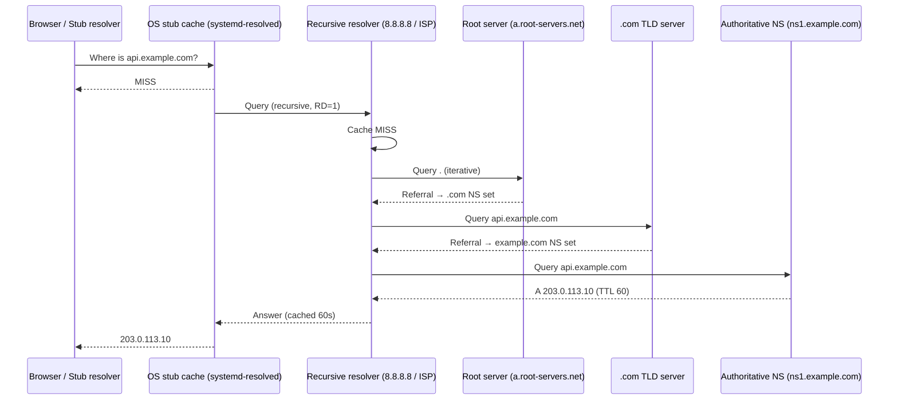
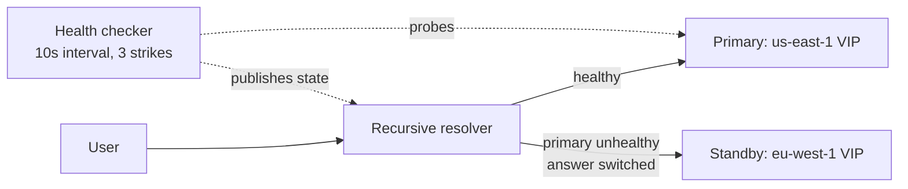

# DNS Deep Dive — Resolution, Records, TTL, Geo-Routing and Failover

> **TL;DR** — DNS is the internet's distributed, hierarchical, eventually-consistent key-value store that maps human names (`api.example.com`) to machine addresses (`A` → IPv4, `AAAA` → IPv6) and to other indirection (`CNAME`, `MX`, `TXT`, `SRV`). Every request in every system design you will ever draw begins here, so a wrong DNS decision (bad TTL, single A record, cross-region CNAME) silently becomes an outage you cannot fix quickly — because you cannot fix it faster than the TTL you set months ago.

> **60-second interview answer:** "DNS is a hierarchy — root, TLD, authoritative — and resolution walks that tree through a recursive resolver that caches at every hop. The three things an architect controls are the record type, the TTL, and which resolver answers. I use short TTLs (30–60s) on records that participate in failover so I can drain a bad region in under a minute, and long TTLs (1h–24h) for stable static assets to cut query volume. I use latency-based or geolocation routing for multi-region entry points, health-checked failover records for DR, and I always keep in mind that DNS is not a load balancer — it is a coarse, cached, per-resolver traffic director, and its negative answers are cached too."

---

## 1. Definition & mental model

**Plain English.** The Domain Name System is a globally distributed, hierarchical, cached database whose primary job is to translate a *name* into *records* — most commonly an IP address — and whose secondary job is to say *where else to look* if it does not know the answer. It runs on UDP/TCP port 53 (and DoT/DoH on 853/443).

**The analogy.** Think of DNS as a **national library catalogue system**. You walk into your neighbourhood library (your **browser cache**) and ask for a book. Not there → the librarian phones the **city branch (your ISP's recursive resolver)**, which has a shelf of frequently-requested answers. If the city branch does not have it, it does not search randomly — it asks the **national catalogue (root server)**, "who owns `.com`?" The root says "ask the `.com` registry." The `.com` registry says "ask the publisher `example.com`'s own office." The publisher's office (**authoritative nameserver**) is the only one that *actually knows* the answer, and it hands over the address. The city branch then photocopies that answer and files it — for exactly as long as the publisher says it may (**TTL**).

The crucial mental model: **only the authoritative server is the source of truth; everything else is a cache with an expiry date.** This is why DNS propagations are "slow" — you are not waiting for the internet to update, you are waiting for stale copies to expire.



---

## 2. Why it exists — the problem it solves

Without DNS you would have to:

1. **Memorise and hardcode IPs.** Every service-to-service call, every browser bookmark, every TLS certificate SAN would reference `203.0.113.10`. Moving a service to a new host would mean a global, coordinated redeploy of every client — impossible.
2. **Lose all indirection.** A `CNAME` lets `api.example.com` point at `prod-lb-7.us-east-1.elb.amazonaws.com`; AWS can then change the underlying IPs without you touching your zone.
3. **Have no geographic routing.** A user in Sydney hitting a server in Mumbai pays roughly 120–250 ms round-trip. DNS-level geo-routing returns the Sydney PoP and drops that to single-digit milliseconds (the transcript's "Australia → India" example; the URL-shortener walkthrough repeats it).
4. **Have no failover primitive at the edge.** Health-checked DNS failover is the crudest but most universal high-availability lever: it works for *any* protocol, not just HTTP, because it happens before the connection exists.
5. **Have no email routing.** `MX` records are how mail finds a domain, and `TXT` (SPF/DKIM/DMARC) is how it avoids being spoofed.

In the video's end-to-end request flow — **user → ISP/router → DNS → CDN → reverse proxy → API gateway → backend → cache/DB** — DNS is hop 3 and it is the only hop that happens *before* a TCP connection exists. That is precisely why it is so powerful and so dangerous: you can redirect traffic without touching a single server, and equally, you can accidentally point the whole world at a decommissioned host and be unable to recall it for hours.

---

## 3. Internal mechanics — how it actually works

### 3.1 The namespace tree

```
.                      ← root (13 logical server identities, hundreds of anycast instances)
├── com                ← TLD (registry: Verisign)
│   ├── example.com    ← zone, delegated to ns1/ns2.example.com
│   │   ├── api.example.com
│   │   ├── www.example.com
│   │   └── _sip._tcp.example.com
│   └── google.com
├── in                 ← ccTLD
├── org
└── arpa               ← reverse DNS (in-addr.arpa for PTR)
```

Every node in the tree is a **label**; a full name is a **FQDN** and, in wire format, ends with an implicit root label. Each **zone** is an administrative cut: the parent zone holds `NS` records delegating authority to the child zone's nameservers, *and that is all it holds* about the child.

### 3.2 Recursive vs iterative resolution

| Mode | Who does the walking | Signal | Typical user |
|---|---|---|---|
| **Recursive** | The resolver does all the work and returns a final answer | `RD=1` (Recursion Desired) in the query | Stub resolver → recursive resolver |
| **Iterative** | The server returns the best referral it has; the asker continues | `RA=0` on some servers, referral answers with no `ANSWER` section, only `AUTHORITY` | Recursive resolver → root/TLD/authoritative |

A **stub resolver** (your laptop) sets `RD=1` and expects a complete answer. A **recursive resolver** (8.8.8.8, 1.1.1.1, your ISP, or CoreDNS inside Kubernetes) is the one that does the iterative walk and *caches aggressively*. Some resolvers are **forwarders**: they set `RD=1` upward to another resolver rather than walking the tree themselves (very common in corporate and Kubernetes environments, and a classic cause of "why did my TTL change? — the forwarder re-cached it with a different TTL").

### 3.3 The five-step resolution path (video version, formalised)

| Step | Component | What it knows | Cache? |
|---|---|---|---|
| 1 | Browser cache | Recently resolved names for this browser profile | Yes — Chrome ~60s ceiling, Firefox ~60s |
| 2 | OS stub cache | systemd-resolved / `nscd` / Windows DNS Client | Yes — honours record TTL |
| 3 | Recursive resolver | A large shared cache, per-resolver | Yes — honours record TTL, min-clamped by operators |
| 4 | Root server | Only where each TLD lives | Effectively static; no per-name caching |
| 5 | TLD server | Which nameservers are authoritative for the second-level zone | Minimal caching |
| 6 | Authoritative server | The **actual** records; the source of truth | No cache — it *is* the data |

Note the asymmetry: steps 1–3 cache, steps 4–6 are consulted only on a cold path. In steady state, ~95%+ of user lookups are answered by the resolver cache, which is exactly why DNS query volume is nothing like request volume.

### 3.4 Wire format essentials

A DNS message has a header (`ID`, flags: `QR`, `OPCODE`, `AA`, `TC`, `RD`, `RA`, `RCODE`), a **question** section, and **answer / authority / additional** sections. Two flags matter most in production:

- **`TC` (truncated)** — the answer did not fit in 512 bytes (or the EDNS-negotiated buffer). The client must retry over TCP. Large `TXT` records (DKIM keys, long SPF) and big `NS` sets trip this constantly.
- **`AA` (authoritative answer)** — set only by an authoritative server. If you query your "authoritative" server and it answers without `AA`, you are actually talking to a cache.

`dig` is the tool of record:

```bash
dig +norecurse api.example.com A          # ask authoritatively, see referrals
dig api.example.com A +short              # just the addresses
dig @8.8.8.8 example.com CNAME            # ask a specific resolver
dig +tcp +bufsize=4096 example.com TXT    # force TCP, larger buffer
dig +trace api.example.com                # walk root → TLD → auth yourself
dig -x 203.0.113.10 PTR                   # reverse lookup
dig +dnssec example.com A                 # see RRSIG / AD flag
```

### 3.5 Record types (the ones that matter)

| Type | Purpose | Value example | Notes / gotchas |
|---|---|---|---|
| `A` | Name → IPv4 | `api.example.com. 60 IN A 203.0.113.10` | Multiple `A` records = round-robin *by resolver*, not per request |
| `AAAA` | Name → IPv6 | `2001:db8::1` | A host with a broken IPv6 path but a working v6 address will appear "slow" not "down" |
| `CNAME` | Alias to another name | `www CNAME example.com.` | **Cannot coexist with other record types at the same name.** Illegal at a zone apex (workaround: provider-specific `ALIAS`/`ANAME`/flattening) |
| `MX` | Mail exchanger | `10 inbound.example.com.` | Prefixed with a preference number, lowest wins |
| `TXT` | Arbitrary text | SPF, DKIM, DMARC, `google-site-verification=…` | Truncation-prone; keep under ~450 chars per string |
| `NS` | Delegation to a child zone's nameservers | `example.com. NS ns1.example.net.` | The glue that makes the tree work; changing these is the highest-risk operation in DNS |
| `SOA` | Zone authority metadata | Serial, refresh, retry, expire, **minimum TTL** | `minimum` is the traditional **negative-cache TTL** |
| `SRV` | Service location | `_https._tcp.example.com. 10 5 443 target.` | Used heavily by gRPC, SIP, Active Directory, some service discovery |
| `CAA` | Which CAs may issue certs | `0 issue "letsencrypt.org"` | Guards against rogue issuance; misconfiguring this breaks renewal |
| `PTR` | Reverse (IP → name) | in `in-addr.arpa` | Mail reputation depends on it; do not confuse with forward |
| `DS` / `DNSKEY` / `RRSIG` | DNSSEC chain of trust | — | See §3.8 |

### 3.6 Caching layers and TTL arithmetic

Caching happens at: **browser → OS → recursive resolver → (sometimes) forwarder → nothing above**. Each layer stores the record for `min(record TTL, its own cap)`.

Recursive resolvers apply **TTL clamping**: many public resolvers enforce a floor (commonly 5–60s) and a ceiling (e.g. 24h) regardless of what your zone says. So:

- Setting TTL `1` does **not** give you instant propagation. Some resolvers will floor it at 30s or more.
- Setting TTL `86400` does **not** guarantee 24h — most resolvers will cap it lower if they want to.

**Per-record answers carry their own TTL.** A `CNAME` chain's effective cache life is the *minimum* of all TTLs in the chain. If `api.example.com CNAME lb.example.net` (TTL 3600) → `lb.example.net A 203.0.113.10` (TTL 60), you can change the IP in 60s but you cannot change the *target name* for an hour.

**SOA `minimum` and negative caching.** When a name does not exist, the authoritative server answers `NXDOMAIN` (RCODE 3) and the SOA in the authority section supplies the negative TTL. Resolvers cache that negative answer, so a typo in a new subdomain or a deleted record can be "still not working" for hours after you add it back. Set SOA `minimum` deliberately (300–3600s is normal) — do not leave it at the historic `86400` default.

### 3.7 GeoDNS, latency-based routing and anycast

There are two fundamentally different ways to send users to the nearest copy:

**(a) Anycast.** You advertise the *same* IP prefix from many locations. BGP decides which instance a given client reaches, based on network topology. Used by root servers, 1.1.1.1, 8.8.8.8, and by Cloudflare/Fastly for their whole edge. The client cannot tell which PoP answered, and there is no per-user decision — it is a routing-layer decision that changes only when BGP does.

**(b) GeoDNS / latency-based DNS.** The authoritative server (Route 53, NS1, Cloudflare's traffic-steering, Azure Traffic Manager) returns *different answers depending on who asks*. It can key on:

| Strategy | Signal | Best for |
|---|---|---|
| Geolocation | Resolver's country/continent (from an EDNS Client Subnet hint or a GeoIP of the resolver IP) | Data-residency, licensing, language |
| Latency-based | Measured RTT from AWS regions to the resolver's network | Global web/API traffic |
| Weighted | Static percentages | Canary deploys, gradual migrations, A/B |
| Failover (primary/secondary) | Health check state | Active-passive DR |
| Multivalue answer | Returns several healthy IPs, rotated | Poor-man's HA without a load balancer |

**The classic trap: EDNS Client Subnet (ECS).** Without ECS the resolver sees your *resolver's* IP, not the user's. A user in Bangalore using 8.8.8.8 may be answered based on Google's resolver location, which could be Singapore or Mumbai. ECS lets the resolver forward a truncated client-subnet hint so the authoritative server can answer more accurately — but it costs privacy and increases cache fragmentation (more cache keys = lower hit rate). Many privacy-first resolvers strip ECS.

### 3.8 DNS as a load-balancing mechanism — and its limits

Yes, you can put ten `A` records on a name and call it load balancing. Understand exactly what you get:

1. **No health awareness** (unless you add health-checked failover records, which most providers support).
2. **No connection awareness** — DNS has no idea how many open connections each target holds.
3. **Caching destroys balance.** One resolver caches one ordering and serves it to thousands of users. A university NAT with 50,000 users behind one resolver will all land on **one** of your ten servers. This is called **resolver-level hot-spotting** and it is the single most common reason "we added DNS records but load did not spread."
4. **No graceful drain.** You cannot remove a server from DNS and have its existing TCP connections finish — you must drain at the LB.
5. **Order is not guaranteed.** Some resolvers rotate, some preserve order, some use the lowest-latency answer.

**Correct architecture:** DNS points at a **small, stable set of load balancer VIPs** (or a provider anycast address); the load balancer does the real balancing. DNS provides *coarse region selection and DR*, not fine-grained balancing.

### 3.9 DNS failover

Two flavours:

- **Active-passive.** A health-checked record set: while the primary health check passes, DNS answers with the primary; when it fails, DNS answers with the standby. Provider health checks are typically HTTP(S)/TCP on a 10–30s interval with a 3-failure threshold, meaning **detection takes 30–90s** and then you still wait out the TTL on every cached copy. Realistic worst case: **~2–5 minutes** for a full cut-over on a 60s TTL.
- **Active-active multivalue.** All healthy targets are returned; the client picks. Faster failover (a failed target is simply removed from the answer set within one TTL) but clients may still try dead IPs from their own cache.



**What DNS failover cannot do:** it cannot move an *established* connection, cannot fail over in under one TTL, cannot distinguish "region is down" from "this one endpoint is slow," and gives you no control over clients that ignore TTLs (some Java resolvers historically cached for the JVM lifetime unless `networkaddress.cache.ttl` was set — a notorious production incident pattern).

### 3.10 DNSSEC, EDNS, DoH/DoT

**DNSSEC** adds origin authentication and integrity (not confidentiality) via a chain of trust: the root zone's `DNSKEY` is trusted out-of-band, each zone signs its records with `RRSIG`, and the parent publishes a `DS` hash of the child's key. A validating resolver sets `AD=1` when the chain validates. `NSEC`/`NSEC3` records provide authenticated denial of existence (proving a name really does not exist).

Practical notes: DNSSEC does **not** hide names (that is what DoH/DoT are for), it does **not** prevent DDoS, and a misconfigured key rollover **breaks your entire domain** for validating resolvers. Turn it on deliberately, monitor signature expiry, and understand that a 4096-bit `DNSKEY` plus `RRSIG` will blow past the 512-byte UDP limit and force TCP.

**EDNS(0)** is the extension mechanism: it advertises a larger UDP buffer (typically 1232 bytes is now the recommended safe value post-`fragmentation`-attacks), carries the `DO` (DNSSEC OK) bit, and carries ECS. If a middlebox drops EDNS, clients must fall back to 512-byte UDP with TCP retries — a real latency cliff.

**DoH / DoT / DoQ**: DNS-over-HTTPS (port 443), DNS-over-TLS (853), DNS-over-QUIC. They encrypt the query path, defeating on-path snooping and some ISP-level hijacking — but they *centralise* resolution into a handful of providers and can bypass enterprise split-horizon DNS, which is why browsers ship DoH with enterprise-policy opt-outs. In a system-design answer, mention DoH when the requirement is "hide metadata / resist censorship / mobile network tampering."

### 3.11 DNS-based DDoS

Three distinct attacks:

| Attack | Mechanism | Mitigation |
|---|---|---|
| **Volumetric / reflection-amplification** | Spoof the victim's IP as the source of a small query (`ANY`, or a large `TXT`) to millions of open resolvers; each sends a big response to the victim. Amplification factors of 50–100x are documented for `ANY` and DNSSEC-signed responses | Disable open recursion, rate-limit responses (`RRL`), drop `ANY`, keep responses small, use anycast to absorb |
| **Water-torture / random-subdomain** | Flood the authoritative server with queries for random names (`a1.example.com`, `a2.example.com`, …) so every query is a cache miss and every answer is `NXDOMAIN` | Anycast, response rate limiting, negative-answer caching, provider-side scrubbing |
| **Domain hijack / registrar attack** | Take over the registrar account, rewrite `NS` records, point the domain at attacker infrastructure | Registrar lock, MFA, `CAA`, monitoring the zone for unexpected changes |

**Defensive DNS architecture:** run authoritative DNS on a provider with anycast and a large capacity footprint (Route 53, Cloudflare, NS1, UltraDNS), never self-host your primary authoritative service on a single box, keep the zone small, and monitor query-per-second anomalies.

---

## 4. Variants & taxonomy

| Variant | What it is | When it is the right choice |
|---|---|---|
| Recursive (walking) resolver | Resolver does the full iterative walk | Public resolvers, ISP resolvers |
| Forwarding resolver | Resolver defers to an upstream resolver | Corporate networks, Kubernetes CoreDNS |
| Authoritative-only | Serves a zone; refuses recursion | Your own zone hosting |
| Split-horizon / split-brain DNS | Different answers for internal vs external clients | Internal service discovery, private endpoints |
| Private hosted zone | Records visible only inside a VPC | AWS Route 53 private zones; `*.internal` |
| Anycast DNS | Same IP, many locations, BGP-decided | Root servers, big public resolvers, CDN |
| GeoDNS / latency / weighted / failover | Policy-driven answers | Multi-region entry, canary, DR |
| Service discovery DNS (`SRV`, headless) | Records for individual pods/instances | gRPC clients, Kubernetes headless services |
| DoH / DoT / DoQ | Encrypted transport | Privacy, hostile networks |
| Multicast DNS (mDNS) / `.local` | Link-local name resolution, no server | Consumer devices, printers — *never* for prod infra |
| DNS over a mesh (Consul, Istio) | Local agent answers for the mesh | Datacenter service-to-service |

---

## 5. Pros / Cons

| Pros | Cons |
|---|---|
| Universal — every client speaks it, works for any protocol | **Cached and therefore slow to change**; you can never undo a bad record faster than the TTL |
| Massive scale for near-zero marginal cost | No health awareness by default; needs provider health checks |
| Enables geo/latency/weighted/failover policy with no client change | Resolver-level hot-spotting breaks naive round-robin balancing |
| Provides indirection — change infrastructure without changing client config | `CNAME` cannot sit at a zone apex (needs `ALIAS`/flattening) |
| Free/cheap failover lever for DR | Health-check detection + TTL means minutes, not seconds, to fail over |
| DNSSEC gives cryptographic origin authentication | DNSSEC misconfiguration can take down a whole domain |
| Decouples deployment from addressing | A single DNS provider is a single point of failure — and a popular outage blast radius (the 2016 Dyn attack, the 2021 Facebook BGP/BIND incident) |
| DoH/DoT protect query privacy | DoH centralises and can bypass enterprise split-horizon policy |

---

## 6. Exceptions, edge cases & failure modes

This is where DNS interviews are actually won.

### 6.1 TTL pitfalls — the four classic mistakes

1. **TTL set at migration time, not before.** You decide to move to a new LB on Friday, change the `A` record, and discover half the world is still cached for 24h. **Rule: lower the TTL to 60s at least 2× the current TTL *before* a migration, make the change, then raise it back.**
2. **TTL set too low everywhere.** TTL 5 on every record means every user, every request, potentially re-queries. You have turned your authoritative DNS into a hot path; you now pay query costs and expose yourself to random-subdomain DDoS. Use 30–60s only for failover-critical records.
3. **Not accounting for resolver floors/caps.** Your TTL 1 is served as TTL 30 by a public resolver. Your "instant" change is 30s minimum.
4. **Forgetting negative caching.** You delete a record, re-add it 10 minutes later, and it is still `NXDOMAIN` for everyone. The SOA `minimum` governs the fix time; set it to 300s in environments where you create/delete records often.

### 6.2 The stale-IP black hole

A DNS answer changes while a long-lived connection is still open. Existing TCP connections keep flowing to the old target — good for draining, terrible if the old target is *gone*. Result: some clients see intermittent failures for the lifetime of their connection. **Fix:** drain at the load balancer (connection draining, §03-scaling/01) rather than relying on DNS to cut traffic.

### 6.3 Resolver-level hot-spotting (DNS is not a load balancer)

As covered in §3.8: thousands of clients behind one caching resolver all get the same answer. If you rely on DNS round-robin for balancing, you will see one server pinned at 100% while the others idle. **Fix:** DNS → LB VIP(s); balance at L4/L7.

### 6.4 Zone apex `CNAME` impossibility

You cannot do `example.com CNAME my-lb.elb.amazonaws.com` — the apex already has `NS` and `SOA` records, and `CNAME` must be alone at its name. Providers solve this with **`ALIAS`/`ANAME`/CNAME flattening**: at answer time the provider resolves the target and returns `A`/`AAAA` records as if they were yours. Know that this breaks a strict DNSSEC/`CNAME` mental model and that TTL behaviour becomes the provider's, not the target's.

### 6.5 DNS-based DDoS and the provider as SPOF

Your DNS provider is a hard dependency with a catastrophic blast radius: if it is down, *nothing* resolves for your domain, including your status page. **Mitigations:** use a provider with anycast + DDoS scrubbing; run **secondary DNS with a different provider** (a second set of `NS` records in the parent zone — but note the provider must support zone transfer or API-based mirroring); host your status page on a *different domain* entirely.

### 6.6 Propagation myths and the "it works for me" trap

Different resolvers cache for different durations, so after a change different users genuinely see different answers for a window. Never debug propagation with your own laptop (you will hit your own resolver's cache). Query the authoritative server directly:

```bash
dig @ns1.example.com api.example.com A +norecurse   # what the source of truth says
dig @1.1.1.1 api.example.com A                       # what a public resolver says
dig @8.8.8.8 api.example.com A                       # what another public resolver says
```

### 6.7 Health-check false positives

A DNS health check that probes `/health` on the public endpoint will mark a region unhealthy during a partial degradation (e.g. the LB is up but the app is failing). If your check is too shallow you fail over for nothing; too deep and you fail over due to a noisy single-endpoint failure. Standard practice: check a **dedicated, cheap, dependency-light health endpoint**, require **3 consecutive failures**, and set a **longer recovery threshold than failure threshold** (hysteresis) to avoid flapping. Flapping DNS is worse than a stable outage.

### 6.8 Split-horizon and private-zone leakage

Internal names (`db.internal`, `payments.prod.internal`) must not resolve publicly. Failure modes: a private zone accidentally attached to a public resolver; a `CNAME` from public `api.example.com` to an internal name that leaks the internal topology; or `TXT`/`SPF` records that enumerate infrastructure. Audit with a public resolver from outside the network.

### 6.9 Other traps worth naming

- **`CNAME` chains that are too long** add a round trip per hop and multiply the failure surface. Keep chains ≤ 2.
- **Wildcard `*` records** swallow typo'd subdomains, which is great for multi-tenant SaaS (`*.tenant.com`) and catastrophic for security (a wildcard that also matches an internal name).
- **Case sensitivity in some resolvers** and 0x20 encoding; treat names as case-insensitive but never rely on mixed case for security.
- **UDP truncation + blocked TCP 53**: some firewalls drop TCP/53, so a large `TXT` answer simply never arrives. Always ensure TCP/53 egress is permitted.
- **TTL 0 / TTL 1 as a "no-cache" hack** — creates query floods and is floored by resolvers anyway.
- **Clock skew on `RRSIG` validity windows** — a validating resolver with a skewed clock rejects your DNSSEC answers.
- **IPv6 fast-path failures**: an `AAAA` record pointing at a host with a broken v6 path makes clients slow (they wait for the v6 connect to time out and then fall back to v4). Prefer Happy Eyeballs-aware clients and validate v6 paths before publishing `AAAA`.
- **Registrar/zone drift**: someone edits the zone console by hand during an incident and forgets to commit to Terraform, so the next `terraform apply` reverts it mid-incident. Keep zones in IaC.

---

## 7. When to use / When NOT to use

### Use DNS for
- **Name → address indirection** for every public service. Always.
- **Regional entry-point selection** (latency/geo routing) where "nearest region" is the requirement.
- **Coarse DR failover** between regions or providers, where a 1–5 minute RTO is acceptable.
- **Canary / weighted rollout** at the 1–10% granularity.
- **Service discovery inside a datacenter/mesh** (`SRV`, headless services, Consul).
- **Verification and mail policy** (`TXT`, `CAA`, `MX`, `DMARC`).

### Do NOT use DNS for
- **Per-request load balancing.** Caching makes it wrong. Use a real LB.
- **Fast failover (< 30s).** Use anycast + BGP, an anycast LB, or client-side retry with a service registry.
- **Fine-grained canary at 0.1%.** Resolver caching quantises you to whole resolvers.
- **Session affinity.** IP hash at an LB is the tool; DNS gives you resolver affinity, not user affinity.
- **Anything latency-critical in the query path.** A cold DNS lookup can cost 20–120 ms; cache it (browser/OS/`dnsmasq`/resolver) and use connection reuse.
- **Secret material.** `TXT` records are public. Never put credentials there.

### Decision table

| Requirement | Right tool |
|---|---|
| Send EU users to EU region | GeoDNS / latency-based routing |
| Survive a whole-region failure in < 1 min | Anycast LB + BGP withdrawal (DNS failover as backup) |
| Distribute 100k QPS across 50 app servers | L7 load balancer; DNS points at the VIP |
| Spread traffic 5% to a new cluster | Weighted DNS *or* LB-level weighting (LB is smoother) |
| Find a service instance inside a mesh | `SRV` / mesh DNS / service registry |
| Zero-downtime migration to a new LB | Lower TTL 2× TTL in advance → change → drain old at LB → restore TTL |
| Failover in a non-HTTP protocol (SMTP, custom TCP) | DNS failover (only universal option) |

---

## 8. Numbers, defaults & tuning

| Quantity | Typical / recommended | Reasoning |
|---|---|---|
| Record TTL, static assets / apex | 3600–86400 s | Stable; minimises query volume and cost |
| Record TTL, failover-critical LB | **30–60 s** | Bounds the failover window; below ~30 s resolvers floor you anyway |
| Record TTL, canary/migration | 60 s during the change, restore after | The 2×-TTL rule gives full drain before cut-over |
| SOA `minimum` (negative caching) | **300–3600 s** | Lower in dev/rapid-create environments; higher in stable prod |
| SOA refresh / retry / expire | 3600 / 600 / 604800 s | Standard secondary-refresh cadence |
| Recursive resolver cache floor | 5–60 s (provider-dependent) | Why TTL 1 does not do what you think |
| Recursive resolver cache cap | 86400 s (common) | Why TTL 604800 effectively becomes 1 day |
| DNS query timeout (client) | 5 s per server, 2–5 servers | With `ndots`/`timeout`/`attempts` in `/etc/resolv.conf`: `options timeout:2 attempts:3` |
| Typical UDP DNS response | < 512 bytes classic; **≤ 1232 bytes with EDNS** | Avoid fragmentation; 1232 is the current safe MTU-derived value |
| `dig`-observed resolution time, cache hit | 0.2–2 ms | Local resolver cache |
| Cache miss, full recursive walk | 20–120 ms | 4 round trips minimum, cross-region |
| Cold path via mobile network | 100–500 ms | Radio wake-up + carrier resolver |
| Health check interval / threshold | 10–30 s interval, 3 failures, 2 successes to recover | Detects in 30–90 s; hysteresis prevents flapping |
| DNS failover total RTO | ~1–5 min realistic | Detection + TTL + client behaviour |
| Root server identities | 13 logical (a–m), hundreds of anycast instances | Protocol/`512`-byte historic limit, solved by anycast |
| Max UDP payload without EDNS | 512 bytes | Forces TCP fallback |
| Common public resolvers | 8.8.8.8 / 8.8.4.4 (Google), 1.1.1.1 / 1.0.0.1 (Cloudflare), 9.9.9.9 (Quad9), 208.67.222.222 (OpenDNS) | Transcript names 8.8.8.8 specifically |
| Kubernetes CoreDNS default | `ndots:5`, cache 30 s, forward to node resolver | The `ndots:5` default causes extra lookups for external names — a real latency bug |
| `networkaddress.cache.ttl` (JVM) | Default was "cache forever"; set `-1`→forever, `0`→never, or a positive value | The classic "Java app never picks up DNS change" incident |

### The TTL-vs-availability tradeoff in one formula

```
Expected time to fully propagate a change ≈  max(TTL_current, resolver_floor)  + resolver_processing
Expected DNS query load (QPS)            ≈  (unique_clients × lookups_per_client) / TTL
```

Long TTL → cheap and fast steady state, slow incident response. Short TTL → responsive incidents, more queries, more DDoS surface. Pick per record, not per zone.

---

## 9. Interview Q&A

**Q1 (easy). What is DNS and what does it do?**
DNS is a hierarchical, distributed, cached database that maps names to records — most commonly names to IP addresses. A stub resolver asks a recursive resolver; if the resolver has no cached answer it walks the tree iteratively: root → TLD → authoritative. Only the authoritative server holds the truth; every other layer is a cache with a TTL. It exists so that clients can reference stable names while infrastructure addresses change freely underneath.

**Q2 (easy). Walk me through resolving `www.example.com` from a cold browser.**
Browser cache miss → OS stub cache miss → recursive resolver miss → root server returns a referral to the `.com` nameservers → `.com` TLD returns a referral to `example.com`'s authoritative nameservers → authoritative returns the `A` record with a TTL → the resolver caches it, returns it to the stub, which caches it and hands it to the browser. Total 4 network round trips on a cold path, typically 20–120 ms; subsequent lookups are sub-millisecond from cache until the TTL expires.

**Q3 (easy). What is a TTL and what TTL would you pick?**
TTL is the number of seconds a resolver may cache the record. It is the knob that trades DNS query cost against how fast you can change the answer. I would use 24h for stable static hostnames, 1h for general API hostnames, and 30–60 s for records that participate in failover, with the caveat that public resolvers floor very low TTLs at 5–60 s so I never assume instant propagation.

**Q4 (medium). Why can you not use DNS round-robin as your load balancer?**
Because DNS answers are cached per *resolver*, not per *client*. Ten thousand users behind one corporate NAT or one ISP resolver all receive the same answer and all land on the same backend — resolver-level hot-spotting. DNS also has no health awareness by default, no connection awareness, and no ability to drain. And the client may re-use an established connection for minutes or hours while ignoring new answers. So DNS should point at a small stable set of load-balancer VIPs, and the LB does the balancing.

**Q5 (medium). How does DNS failover work and how long does it take?**
Two models. Active-passive: a health-checked record set returns the primary while healthy and the standby when it fails — detection is 30–90 s with a 10–30 s interval and 3-strike threshold, then you wait for TTLs to expire on every cache. Active-active multivalue: all healthy IPs are returned and unhealthy ones are removed, so a client that re-resolves gets a good target within one TTL. Realistic end-to-end RTO is 1–5 minutes. If you need sub-30-second failover you do not use DNS — you use anycast with BGP withdrawal or an anycast load balancer, and you keep DNS as the backup mechanism.

**Q6 (medium). What is EDNS Client Subnet and why does it matter?**
Without ECS, a geo-aware authoritative server sees the *resolver's* IP, not the user's. A user in Bangalore on 8.8.8.8 can be routed based on where Google's resolver sits. ECS forwards a truncated client-subnet prefix so the authoritative server can answer geographically. The costs: privacy exposure of the client subnet, and cache fragmentation — each distinct subnet is a distinct cache key, which lowers resolver hit rates. Privacy-focused resolvers strip ECS entirely, so geo-routing can never be assumed to be accurate.

**Q7 (medium). What is the difference between a CNAME and an A record, and why can't you put a CNAME at the apex?**
An `A` record maps a name directly to an IPv4 address. A `CNAME` says "this name is an alias for that other name; go resolve that one." The apex already must carry `NS` and `SOA` records, and the DNS specification forbids a `CNAME` from coexisting with any other record type at the same name — otherwise the `NS` record would itself be ambiguous. Providers work around it with `ALIAS`/`ANAME`/CNAME flattening, which resolves the target at answer time and returns `A`/`AAAA` records instead of a `CNAME`.

**Q8 (hard). What is negative caching and how has it burned you?**
When a name does not exist, the authoritative server returns `NXDOMAIN` and includes its `SOA` record, whose `minimum` field supplies the negative-cache TTL. Resolvers cache that "this name does not exist" answer. So if you delete a record and re-create it, users can still get `NXDOMAIN` for up to the SOA minimum. I have seen this during a rollback where a record was deleted and immediately re-added — the fix was setting SOA `minimum` to 300 s for zones with frequent record churn, and pre-creating records with placeholder values rather than deleting them.

**Q9 (hard). Your company is migrating a high-traffic API from an old load balancer to a new one. Walk me through the DNS part.**
First, well before the migration — at least two current-TTL periods — I lower the `A`/`ALIAS` record TTL to 60 s. I verify the change is visible at the authoritative server with `dig +norecurse @ns1`, and I watch query logs to confirm the fraction of clients on the new TTL is rising. Then I bring up the new LB, add it to a weighted record set at a small weight (say 5%), and monitor error rates and latency by target. I ramp 5 → 25 → 50 → 100%. Once all traffic is on the new LB, **I do not delete the old answer from DNS immediately** — I keep both records and drain connections at the old LB with connection draining until its open-connection count is zero. Only then do I remove the record, and finally I restore the TTL to 3600. The two things people get wrong are lowering the TTL at the same moment as the change, and removing the old record while long-lived connections are still alive.

**Q10 (hard). How would you defend against a DNS-based DDoS on your authoritative server?**
First, do not self-host the primary authoritative service — use a provider with anycast across many PoPs and a large scrubbing capacity. Second, disable open recursion so you are not a reflector, drop `ANY` queries, enable response rate limiting so an attacker cannot use you to amplify at a victim, and keep answers small so there is no amplification factor. Third, enable negative-answer caching at the resolver layer so random-subdomain floods produce fewer upstream lookups, and use a zone structure that does not require a lookup per random name (avoid wildcards if you can also avoid the load, and never use them for `TXT`). Fourth, run secondary DNS at a *different* provider so an attack or an outage at one does not take the domain fully dark. Fifth — and this is the one people forget — host your status page and your incident communications on a different domain and preferably a different provider, so you can actually talk to customers while DNS is broken.

**Q11 (hard, interviewer pushes back). "You said use a 60-second TTL for failover, but our SRE team says 60 seconds means 60 seconds of stale answers. That's unacceptable — use TTL 1."**
I would push back with the physics. TTL 1 does not give you one-second failover; public resolvers apply a floor — commonly 5 s, often 30 s — and many clients have their own caching policy on top, most infamously the JVM's `networkaddress.cache.ttl`. So TTL 1 buys you negligible speed and costs you a dramatic increase in query volume, which raises cost and widens the DDoS surface; a random-subdomain flood against a TTL-1 zone is far more damaging. The real fix for "we need faster failover than 60 seconds" is not DNS at all: use anycast anycast-advertised VIPs so a failed PoP is withdrawn at the BGP layer in seconds, or run active-active with an L4/L7 health-checked LB per region and let the *client* fail over using retries and timeouts. DNS then plays the role it is good at — coarse regional steering and last-resort DR — and I can keep a sane 60 s TTL there.

**Q12 (hard, testing §6). What happens if you have an `AAAA` record pointing at a broken IPv6 path?**
The client will attempt the IPv6 connection first and hang until the connect timeout (often 20–30 s, sometimes longer on some stacks), then fall back to IPv4. So the symptom is not "site is down" but "site is randomly slow for users on networks with partial IPv6" — which is maddening to debug because it correlates with the user's network, not with your metric dashboards. Mitigations: validate the v6 path before publishing `AAAA`; ensure clients implement Happy Eyeballs (RFC 8305) so they race v4 and v6 with a ~250 ms head start for v6; and if you cannot validate, prefer publishing only `A` records. This is a great example of why "add an AAAA record" is an infrastructure change, not a config change.

**Q13 (hard, testing §6). A teammate edited a record in the provider console during an incident, and now the next `terraform apply` would revert the fix. What do you do?**
Three things. Immediately: capture the current live zone (`dig AXFR` if permitted, otherwise export from the provider API) and diff it against the IaC state so I know exactly what is live versus what the repository says. Reconcile deliberately — import the manual change into the IaC state (e.g. `terraform import` with a corrected resource), then `plan` to confirm zero diff, then `apply` — rather than letting an unattended pipeline revert an active mitigation. Structurally: block console edits with read-only or break-glass IAM roles so that any manual change requires an audited, time-boxed elevation, and make the zone file the only writable path. The general lesson is that DNS is infrastructure with a slow undo button, so the change path must be as controlled as a database migration.

**Q14 (hard, testing §6). Your internal service discovery uses a private zone, and a public resolver outside the VPC resolves one of the internal names. What has gone wrong?**
That is a split-horizon leak, and it is a security incident, not a bug. The usual causes: the private zone was attached to a public resolver by mistake; a public `CNAME` points at an internal name and leaks the internal naming scheme; or an internal name exists in a public zone too and was never deleted. The consequence is that internal topology — service names, sometimes IPs — is enumerable by an attacker, which is reconnaissance gold. Fix: audit both views with `dig @public-resolver` for every internal name; ensure public zones contain no `CNAME` targets that are internal; ensure private zones are scoped to the VPC and never attached to a public resolver; and add a CI check that fails the build if any internal name resolves publicly.

---

## 10. Common mistakes candidates make

1. **Saying "DNS is a load balancer."** It is not. Say "DNS is a coarse, cached traffic director; the load balancer does the balancing."
2. **Saying "DNS propagates in an hour."** It does not propagate — caches expire. Use the word *expire*, and reference the TTL and the resolver floor.
3. **Ignoring the resolver in the diagram.** The video's diagram is *browser cache → resolver → root → TLD → authoritative*. Candidates who skip the resolver miss the caching layer that makes the system work.
4. **Forgetting `CNAME` at the apex is illegal.** If you propose `example.com CNAME <lb-hostname>`, an interviewer will pounce.
5. **Proposing DNS failover for a sub-30-second RTO.** State the realistic RTO (1–5 min) and offer anycast as the faster path.
6. **Not mentioning negative caching** when the design involves creating records on demand (multi-tenant subdomains, dynamic short links, per-tenant vanity domains).
7. **Forgetting that health checks need hysteresis** and that flapping DNS is worse than a clean outage.
8. **Treating TTL as a per-zone value** rather than per-record. Per-record tuning is the whole point.
9. **Skipping `AAAA`/IPv6** entirely, or adding it without acknowledging the broken-v6 latency failure mode.
10. **Never mentioning DNSSEC, DoH, or `CAA`** in a design that handles payments or auth, where origin authentication and certificate-issuance control are clearly relevant.
11. **Putting the status page on the same domain.** Instant credibility loss with an interviewer who has lived through a DNS outage.
12. **Assuming GeoDNS is exact** without acknowledging ECS, privacy resolvers, and cache fragmentation.

---

## 11. Cheat-sheet summary

| Concept | One-line truth |
|---|---|
| DNS | Hierarchical, cached name→record database; UDP/TCP 53 |
| Resolution order | Browser → OS → resolver → root → TLD → authoritative |
| Recursive vs iterative | Resolver walks the tree; root/TLD return referrals |
| Source of truth | Only the authoritative server; everything else is a cache |
| `A` / `AAAA` | IPv4 / IPv6 address |
| `CNAME` | Alias; cannot coexist with other records; illegal at apex |
| `MX` / `TXT` / `SRV` / `CAA` | Mail, policy text, service location, CA authorisation |
| `NS` / `SOA` | Delegation; zone metadata + negative-cache TTL |
| TTL | Seconds a cache may keep the answer; per-record |
| Resolver floor | 5–60 s — why TTL 1 ≠ instant |
| Negative caching | `NXDOMAIN` cached for SOA `minimum` |
| GeoDNS | Different answers per resolver location/latency/weight/health |
| ECS | Client-subnet hint; better geo, worse privacy and hit rate |
| Anycast | Same IP everywhere; BGP picks the PoP; not per-user |
| DNS load balancing | Broken by resolver caching (hot-spotting) |
| DNS failover RTO | Realistically 1–5 min (detection + TTL) |
| Health check | 10–30 s interval, 3 strikes, hysteresis on recovery |
| DNSSEC | Origin auth via `DNSKEY`/`DS`/`RRSIG`; not confidentiality |
| DoH / DoT | Encrypted resolution on 443 / 853 |
| DNS DDoS | Reflection/amplification, random subdomain, registrar hijack |
| TTL strategy | 30–60 s for failover records; 1 h–24 h for stable assets |
| Migration rule | Lower TTL 2× before the change; drain at the LB; restore after |
| Debug commands | `dig +trace`, `dig +norecurse @ns1`, `dig @1.1.1.1` |

**"If the interviewer says X → answer Y"**

| Interviewer says | You say |
|---|---|
| "Route users to the nearest region" | "Latency-based or geolocation DNS on the authoritative server, with the ECS caveat" |
| "We need instant failover" | "Not DNS — anycast/LB-level failover; DNS failover is 1–5 min" |
| "Spread load across 50 servers" | "DNS points at LB VIPs; the LB balances" |
| "Zero-downtime migration" | "Lower TTL 2× TTL in advance, ramp weights, drain at the LB, restore TTL" |
| "Global user base" | "Anycast DNS + CDN + regional entry points" |
| "Support custom vanity domains" | "Per-tenant records, automated provisioning, and negative-cache TTL tuning" |
| "Reduce cost" | "Raise TTLs on stable records; use a provider with flat/anycast query pricing" |

---

## 12. Cross-links

- [CDN Deep Dive](02-cdn-deep-dive.md) — DNS is what points a user *at* the CDN edge; GeoDNS and CDN anycast overlap heavily
- [Forward and Reverse Proxy](03-forward-and-reverse-proxy.md) — TLS/SNI, health checks, and what actually terminates the connection after DNS resolves
- [API Gateway and Rate Limiting](04-api-gateway-and-rate-limiting.md) — the hop after DNS in the video's request flow
- [Load Balancers](../03-scaling/01-load-balancers.md) — why DNS is not one, and GSLB as the hybrid
- [Caching Strategies and Layers](../03-scaling/02-caching-strategies-and-layers.md) — DNS is a cache layer too; TTL is cache expiry
- [Cache Invalidation and Consistency](../03-scaling/04-cache-invalidation-and-consistency.md) — the same "stale copy" problem, one layer down
- [Sharding, Replication and Consistency](../03-scaling/05-sharding-replication-and-consistency.md) — eventual consistency applied to the namespace
- [Blob and Object Storage](../04-data/04-blob-and-object-storage.md) — `CNAME`-style custom domains and CDN-fronted buckets
- [Networking Cheatsheet](../../Cheat-Sheets/02-networking-cheatsheet.md)
