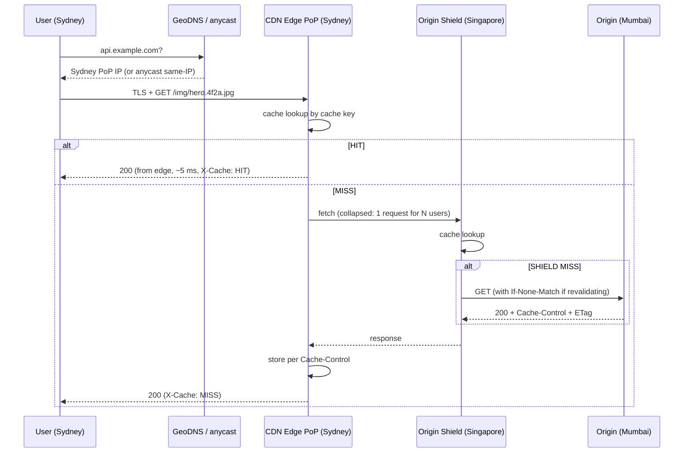

# CDN Deep Dive — Edge Caching, Push vs Pull, Invalidation and Cost

> **TL;DR** — A Content Delivery Network is a globally distributed set of reverse-proxy caches that terminate user connections close to the user, serve what they can from local storage (a **cache HIT**), and fetch from your **origin** only on a **MISS**. It buys you three things at once: physics-defying latency (single-digit ms instead of 120–250 ms cross-continent), origin offload (your origin sees 1–5% of requests, not 100%), and a DDoS/TLS shield. It costs you three things: money in egress and request fees, a new class of bug called *stale content*, and an operational discipline you cannot skip — cache keys, purge, and versioned URLs.

> **60-second interview answer:** "A CDN is a globally distributed reverse-proxy cache. The user's DNS points at an edge PoP near them; the PoP terminates TLS and checks its local cache. On a HIT it serves locally in single-digit milliseconds; on a MISS it fetches from origin, caches the response according to `Cache-Control`, and serves it. I get latency, origin offload and DDoS absorption. The design decisions are: what is cacheable (immutable assets with hashed filenames get `max-age=31536000, immutable`; HTML gets a short TTL or `no-cache` with revalidation), how I invalidate (versioned URLs by default, purge by tag or path as the exception), and how I protect the origin from a thundering herd — that is origin shield, request collapsing, and `stale-while-revalidate`."

---

## 1. Definition & mental model

**Plain English.** A CDN is a network of hundreds of cache servers ("edge nodes" / "PoPs" — Points of Presence) placed inside the same networks as the users. Content is copied to whichever edge is closest to the requester, so most requests never travel to the origin at all.

**The analogy.** Think of a **chain of convenience stores versus one central warehouse**. Your warehouse (origin) in Mumbai holds everything. A customer in New York needs milk. Without stores, every customer makes an 11,000 km round trip for every carton — the warehouse is overwhelmed and the customer waits. With a CDN, you open a small store in every city. The first time someone in New York wants a particular brand, the store does not have it, so it orders one case from Mumbai and puts the rest on the shelf (**cache MISS → populate**). Everyone after that gets it instantly (**cache HIT**) — until the carton passes its sell-by date (**TTL expiry**), at which point the store checks with the warehouse whether the product changed (**revalidation**) rather than re-ordering blindly.

The critical mental model: **the CDN is a cache, and caches are always a correctness compromise.** Every CDN problem in production is either "we cached something we should not have," "we did not cache something we should have," "we cached it for too long," or "everyone missed at once and hammered the origin."

The transcript's version is the Australia→India example: a user in Australia hitting a Mumbai origin pays the full intercontinental RTT on every request; with a CDN the Australian edge answers in ~5 ms and only the first miss pays the long haul.

---

## 2. Why it exists — the problem it solves

### The physics

Light in fibre travels at roughly 200,000 km/s (about ⅔ c). Mumbai → New York is ~12,500 km of great-circle distance, but real fibre paths are 1.3–1.5× longer. So:

```
One-way  ≈ 12,500 km × 1.4 / 200,000 km/s  ≈  87 ms
RTT      ≈ 175 ms   (plus router/queueing → 200–250 ms real)
TCP handshake (1 RTT) + TLS 1.3 (1 RTT) + request/response (1 RTT) ≈ 3 RTT ≈ 600 ms
```

Before a single byte of content moves, the user has paid ~600 ms. Add a chain of API calls and you are over a second. With an edge PoP 20 km away, that becomes:

```
20 km one-way ≈ 0.15 ms; RTT ≈ 0.3 ms; 3 RTT ≈ ~1 ms of propagation
```

The remaining latency is TLS + TTFB, dominated by compute, not distance.

### The four things a CDN actually gives you

| Benefit | Mechanism | Magnitude |
|---|---|---|
| **Latency** | Serve from a nearby PoP; persistent warm connections back to origin | 10–100× lower RTT for cached content (the transcript's "5 ms at the edge") |
| **Origin offload** | Only misses reach origin | Typical CDN hit ratio 85–98% for static, 40–80% for API/HTML with revalidation |
| **Scalability / burst absorption** | The CDN fleet, not your origin, absorbs the spike | A viral post hits the edge, not your database |
| **Security** | TLS termination at the edge, DDoS scrubbing, WAF, origin IP hiding, bot mitigation | Turns a 500 Gbps flood into a null problem |

### What breaks without it

1. **Global users see slow responses.** The transcript's Day-1 goals list names exactly this: *"user in different countries sees slow responses."*
2. **Origin becomes a bottleneck and then a crash.** Without a CDN, 10,000 concurrent users requesting the same image means 10,000 origin requests; the origin's compute, bandwidth and connection table saturate, and the video's own framing applies — "the server crashes."
3. **Bandwidth cost explodes.** Origin egress from a cloud region is typically $0.05–$0.12/GB; CDN egress is typically $0.01–$0.085/GB with committed-volume discounts, and it also *displaces* origin egress entirely for hits.
4. **You have no DDoS absorption.** A CDN's anycast fleet is a distributed scrubber by construction.
5. **TLS is slow for far-away users**, because the handshake round trips are paid at intercontinental RTT.

---

## 3. Internal mechanics — how it actually works

### 3.1 The request path



### 3.2 Cache key — the single most important concept

The **cache key** is what the edge hashes to look up a stored object. Everything not in the key is invisible to caching; everything in the key multiplies the number of stored variants.

Typical default key: `scheme + host + path + query-string (sometimes normalised)`.

| Key component | Included by default? | Notes |
|---|---|---|
| Host / SNI | Yes | Different hostname = different object |
| Path | Yes | Case-sensitive in most CDNs |
| Query string | Usually yes, unsorted | `?b=2&a=1` and `?a=1&b=2` may be two objects unless the CDN normalises |
| `Accept-Encoding` | Implicitly | gzip/br/identity variants stored separately |
| `Vary` headers | If origin sets `Vary` | See §3.5 |
| Cookies | **No** by default | If you forward cookies, most CDNs bypass cache entirely |
| `Authorization` header | No (cache bypass) | Protected content is uncacheable unless you configure token auth |
| Device type / `User-Agent` | No | Explicit opt-in via `Vary: User-Agent` — dangerous, explodes variants |
| Geo / country | No | Available via edge logic (Cloudflare Workers, Lambda@Edge) |
| Custom headers | No | Must be explicitly added to the key |

**The most common CDN bug in production** is an unnecessary query parameter or header in the key. A tracking parameter (`?utm_source=…`, `?fbclid=…`) that is not excluded from the key silently gives you a 0% hit ratio while your dashboards show "the CDN is working."

**Key normalisation** techniques: strip known-ignorable query params, sort remaining params, lowercase the path, drop the trailing `index.html`, and ignore `X-Forwarded-For`.

### 3.3 Cache states

| State | Meaning | Client sees | Notes |
|---|---|---|---|
| **HIT** | Object in edge cache, fresh | `X-Cache: Hit from cloudfront` | Fastest path; this is the goal |
| **MISS** | Not in edge cache | `X-Cache: Miss from cloudfront` | Full fetch to shield/origin |
| **EXPIRED** | Present but past `max-age` | `X-Cache: RefreshHit` (some CDNs) | Requires revalidation or refetch |
| **REVALIDATED** | Origin returned `304 Not Modified` | `X-Cache: Hit` after revalidation | Saves bandwidth, costs one RTT to origin |
| **STALE** | Served past expiry under `stale-while-revalidate` | `X-Cache: Hit` + `Age` past max-age | Best of both: instant + background refresh |
| **BYPASS** | CDN deliberately not caching (cookie, auth, `no-store`) | `X-Cache: Miss`, `X-Cache-Status: BYPASS` | Every request hits origin |
| **DYNAMIC** | Configured as uncacheable route | — | Full origin cost |
| **TCP_HIT / TCP_MISS** (Squid-style) | Same, older naming | `X-Cache: TCP_HIT` | Terminology varies by CDN |

Diagnostic headers to look for: `X-Cache`, `X-Cache-Status`, `CF-Cache-Status` (HIT/MISS/EXPIRED/REVALIDATED/STALE/DYNAMIC/BYPASS), `X-Served-By` (which PoP), `Age` (seconds since the object was fetched from origin), `Via`, `X-Amz-Cf-Pop`.

### 3.4 `Cache-Control` — the directives that matter

| Directive | Meaning | Practical use |
|---|---|---|
| `max-age=N` | Fresh for N seconds (shared caches use `s-maxage` if present, which overrides for CDNs) | `max-age=31536000` for immutable assets |
| `s-maxage=N` | Overrides `max-age` for **shared** caches (CDN, proxy) while browsers use `max-age` | Serve longer from CDN than from browser |
| `public` | Any cache may store | Default for static |
| `private` | Only browser may cache; **CDN must not** | User-specific HTML |
| `no-cache` | May store, but must revalidate before every use | HTML you want fresh but cheap to validate |
| `no-store` | Must not store at all | Secrets, auth responses, medical/financial pages |
| `must-revalidate` | Once stale, must revalidate; cannot serve stale | Strong freshness guarantee |
| `immutable` | Will never change; skip revalidation entirely on reload | Hashed filenames: `app.9f3c1a.js` |
| `stale-while-revalidate=N` | Serve stale for up to N s while refreshing in background | Best-in-class for HTML/API: zero-latency freshness |
| `stale-if-error=N` | Serve stale if origin returns 5xx or times out | Survival during origin outages |
| `no-transform` | Do not rewrite (no image recompression, no minification) | When exact bytes matter |
| `proxy-revalidate` | Like `must-revalidate`, shared caches only | Rare |

**A recommended default set:**

```http
# Hashed immutable static asset (CSS, JS, fonts, images with content hash)
Cache-Control: public, max-age=31536000, immutable

# HTML entry point (must be fresh, but cheap)
Cache-Control: public, max-age=0, s-maxage=60, stale-while-revalidate=86400, stale-if-error=86400

# Public API GET with a stable response for a minute
Cache-Control: public, max-age=30, s-maxage=300, stale-while-revalidate=600

# User-specific JSON
Cache-Control: private, no-store

# Image/thumbnail service output
Cache-Control: public, max-age=604800, stale-while-revalidate=86400
```

**The `max-age=0, s-maxage=60` pattern is the single most useful trick in CDN work.** `max-age=0` forces browsers to revalidate every time (so a deploy is picked up immediately), while `s-maxage=60` lets the CDN serve the same HTML to thousands of users for a minute without touching origin. Add `stale-while-revalidate` and the CDN never makes a user wait for the revalidation.

### 3.5 `ETag`, `Last-Modified`, `Vary` and revalidation

**Revalidation flow:**

```http
# Edge → Origin
GET /api/feed HTTP/1.1
If-None-Match: "a1b2c3"
If-Modified-Since: Tue, 15 Sep 2026 10:00:00 GMT

# Origin → Edge (unchanged)
HTTP/1.1 304 Not Modified
ETag: "a1b2c3"
Cache-Control: public, s-maxage=60
```

A `304` has no body, so it costs one RTT but almost no bandwidth. For large objects (a 2 MB hero image) revalidation is a huge win; for tiny ones it is not worth it.

`ETag` variants: **strong** (`"a1b2c3"`) must be byte-identical; **weak** (`W/"a1b2c3"`) means semantically equivalent (e.g. same content after whitespace normalisation). Many load balancers and app servers generate per-node ETags from inode/mtime, which means the same object gets a different ETag from each of 20 app servers — and revalidation then always returns `200`, defeating the purpose. Fix: generate a content hash.

`Vary` tells shared caches that the response depends on a request header:

```http
Vary: Accept-Encoding          ← correct and normal
Vary: Accept-Language          ← explodes variants per language
Vary: User-Agent               ← catastrophic; thousands of distinct UAs
Vary: *                        ← makes the response uncacheable
```

**Rule: `Vary: Accept-Encoding` only, unless you can enumerate the variant space.** The classic disaster is `Vary: User-Agent` on a device-specific site: tens of thousands of distinct UAs, each producing its own object, each with a low hit ratio, and the CDN's storage fills with single-use copies.

### 3.6 Push vs pull CDN

| | **Pull (origin pull)** | **Push (origin push)** |
|---|---|---|
| Who populates the cache | The edge, on first request | You, proactively uploading |
| Setup | Point DNS/CNAME at CDN; nothing else | Upload each object via API/SDK |
| Freshness | TTL-driven; automatic | Manual |
| Storage efficiency | Only popular objects are cached (**demand-driven**) | Everything is replicated, wanted or not |
| Best for | Most web content, media libraries, API responses | Large one-off events (a new game patch, a live-stream VOD premiere, a firmware rollout to millions at once) |
| Cost model | Cheaper storage, more origin fetches on cold start | Higher storage/transfer, zero cold-start penalty |
| Failure mode | Origin stampede on a cold cache or a purge | Wasted storage; a push that fails silently leaves the edge empty |

**The standard choice is pull.** Push only when you know a specific object will be requested by a very large number of users within a very short window, and you can tolerate the upfront distribution cost. Many teams use a hybrid: pull for everything, plus a "pre-warm" API call (an automated push) for the top-N objects right after a deploy.

### 3.7 Edge architecture: edge → shield → origin

```
User ──▶ Edge PoP (Sydney)  ──▶ Mid-tier / Origin Shield (Singapore) ──▶ Origin (Mumbai)
         hundreds of these        ~10s of these                          your infra
```

**Why a mid-tier / origin shield exists:** without it, an object that is cold in 200 PoPs triggers 200 origin fetches simultaneously when a popular item expires. With a shield, only the shield fetches; the 200 PoPs all pull from the shield. **Origin request count drops from O(PoPs) to O(1) per object per refresh cycle.**

Shield placement matters: put it *near the origin* if the goal is protecting the origin, and *near the users* if the goal is reducing cross-region fetches. Most providers place it logically adjacent to the origin region (CloudFront Origin Shield, Fastly shielding, Cloudflare Tiered Cache).

### 3.8 Cache hierarchy and the "tiered cache" ratio

```
Browser cache (private)
   ↓ miss
Edge PoP (L1)          — 85–95% of traffic ends here
   ↓ miss (~5–15%)
Mid-tier / shield (L2) — absorbs 80–95% of remaining
   ↓ miss (~0.5–3% of original)
Origin                 — sees 1–5% of total requests
```

Being able to state this funnel in an interview — "my origin sees 2% of the traffic for cacheable content" — is what separates a real answer from a hand-wave.

### 3.9 Dynamic content acceleration

You cannot cache a personalised feed, but you can still make the *transport* much faster. CDN dynamic acceleration uses:

| Technique | What it does |
|---|---|
| **Persistent, pre-warmed TCP connections** from edge to origin | Skips handshake and slow-start (TCP congestion window starts small; a warm connection is already wide) |
| **Optimal route selection** | The CDN's backbone is better-peered than the public internet; routes around BGP pathologies. 30–60% RTT reduction is common |
| **TLS session resumption / connection reuse** | One TLS handshake per edge, not per user |
| **HTTP/2 or HTTP/3 multiplexing** to the client | Many requests over one connection, no head-of-line blocking with QUIC |
| **Request collapsing** | N concurrent identical misses become 1 origin fetch |
| **Compression at the edge** | Brotli, applied close to the user |
| **Early hints / 103** | Start the client's connection warm-up sooner |

The transcript's Instagram example is exactly this split: **static content (profile pictures, CSS, JS) from the edge at ~5 ms**, and **dynamic feed requests forwarded through the CDN to the load balancer and app servers** with Redis in front of the DB.

### 3.10 Signed URLs and signed cookies

To serve private content through a shared cache without caching it publicly, you use signed access:

```
https://cdn.example.com/video/lesson1.mp4
  ?Expires=1790000000
  &Signature=base64url(HMAC-SHA256(url+expires, secret))
  &Key-Pair-Id=K2ABCDEF
```

| | Signed URL | Signed cookie |
|---|---|---|
| Granularity | One object per URL | All objects under a path/domain |
| Use case | A single downloadable asset, a one-time link | HLS/DASH segments (a player fetches hundreds of URLs) |
| Notes | The signature must generally be excluded from the cache key so the video can still be cached; the *authorisation* is per-request, the *bytes* are shared | Cookie must be set on the CDN domain; keep expiry short |

**Key design point:** with signed URLs you get the best of both worlds — the segment is cached at the edge and served to thousands of authorised viewers, while an unauthorised viewer cannot construct a valid URL. This is how every video platform works.

### 3.11 Invalidation / purge

| Method | Mechanism | Latency | Cost |
|---|---|---|---|
| **Versioned URL** (hashed filename) | New deploy → new filename → new cache key | **Instant, zero purge needed** | Requires build-time hashing for assets |
| **Query-string versioning** | `?v=42` | Instant | Some CDNs normalise query strings, defeating it; hurts hit ratio if you bump it often |
| **Path purge** | `POST /purge` with a path or wildcard | 1–30 s to propagate to all PoPs | Per-request pricing; often free up to a monthly allotment |
| **Tag / surrogate-key purge** | Tag responses (`Surrogate-Key: product-42`) and purge by tag | 1–30 s | **The best option for content-driven cache** — one purge invalidates every page containing that product |
| **Full purge** | Purge everything | Minutes; destroys hit ratio | Emergency only — expect an origin stampede |
| **Soft purge** | Mark stale; serve stale until refreshed | Instant user experience | Requires `stale-while-revalidate` support |

**The architectural rule: purge is an exception handler, not a strategy.** Design your URLs so that content changes create a new key (content-hashed assets, versioned API paths, `?v=` on rarely-changing resources). Use purge for the genuinely unpredictable cases: a content takedown, an urgent data correction, or a bad deploy.

**Wildcard purge limits.** Most CDNs cap wildcard purges per request (e.g. 15 wildcards per call) and charge per path purged. Purging `/*` on a large site can take minutes and produce a massive origin stampede. Warn the interviewer that a full purge is effectively a self-inflicted cold start.

### 3.12 CDN for AI / LLM assets

This is the modern twist an AI-focused system design answer should include:

| Asset | Caching strategy | Why |
|---|---|---|
| Model weights / checkpoints (multi-GB) | `Cache-Control: public, max-age=31536000, immutable`, content-addressed path like `/models/llama-3-8b/rev-a1b2/shard-0001.bin` | Immutable, huge, downloaded by every inference node. A CDN turns a 30 GB regional pull into edge-served chunks |
| Tokenizer / config files | Same, smaller | Must be versioned with the weights |
| Static frontend of an AI app | Hashed assets + short-TTL HTML | Standard |
| Embedding snapshots / dataset shards | Immutable, content-addressed | Reproducibility; the hash *is* the version |
| RAG source documents, PDFs | `public, max-age=3600, stale-while-revalidate=86400`, often signed | Serve the same PDF to many users; signed to gate access |
| **LLM API responses** | Almost never cacheable — non-deterministic, personalised, and often containing private context | Exception: semantic caching *behind* the CDN, in your own Redis (`Redis as semantic cache`, §03-scaling/03) |
| Streaming completions (SSE) | **Must not be cached or buffered** | `Cache-Control: no-store` + `X-Accel-Buffering: no`; CDNs that buffer would destroy token streaming |
| GPU firmware / CUDA images | Immutable, content-addressed | Boot-storm on a fleet scale-up — exactly the push-CDN use case |

**Critical detail for streaming:** CDNs handle SSE and HTTP chunked responses, but you must ensure the edge does not buffer. On Nginx the header is `X-Accel-Buffering: no`; on CloudFront you must disable compression on the streaming path and use a cache policy that disables caching for it. Many "our streaming is chunky in production" bugs are edge buffering.

### 3.13 Cost model

CDN pricing has three axes, and they interact:

```
Monthly cost ≈  (egress_GB × $/GB)                      ← dominant
              + (requests / 10,000 × $/10k requests)   ← matters for small objects
              + (purge requests × $/path)               ← matters if you purge often
              + (optional: WAF, bot mitigation, image optimisation, log streaming)
```

| Component | Typical list price | Notes |
|---|---|---|
| Egress (first 10 TB) | $0.085/GB (CloudFront US/EU) | Drops to ~$0.02–0.05/GB at high commit |
| Egress (Asia/SA) | $0.11–0.15/GB | Geography matters a lot |
| HTTPS requests | ~$0.01 per 10,000 | For 1 KB objects, request cost can exceed egress cost |
| Origin egress | $0.05–0.12/GB (cloud) | **Displaced entirely on a HIT** — this is the hidden saving |
| Origin Shield requests | Small per-request fee | Buy it; it almost always costs less than the origin capacity it saves |
| Purge | Often free up to a limit, then per-path | Wildcard purges may be priced differently |
| Log delivery | Per GB of logs | Real money at high traffic; sample or aggregate |

**The insight that wins points:** compare *CDN egress + CDN requests* against *origin egress + the origin compute you would need to serve those requests*. For static content with a 95% hit ratio, the CDN is usually cheaper than origin egress alone — because you move 95% of the bytes off expensive origin egress onto cheaper CDN egress, and you shrink the origin fleet.

**Cost traps:**
- **Low hit ratio with high request count** — you pay CDN request fees *and* full origin cost. A 10% hit ratio on 1 KB objects can be more expensive than no CDN.
- **Cache-busting query params** producing near-zero hit ratios (see §3.2).
- **Egress double-charging**: origin → shield → edge are sometimes all billed.
- **Uncompressed assets** — serving a 300 KB JS file uncompressed costs 3× the bytes.
- **Not using a request-collapsing/origin-shield feature** and paying for origin capacity you do not need.

---

## 4. Variants & taxonomy

| Variant | Description | Best for |
|---|---|---|
| **Traditional pull CDN** | Cache-on-first-request, TTL-driven | Web assets, media libraries, APIs |
| **Push CDN** | Proactive upload to all PoPs | Launches, firmware, model weights, live events |
| **Multi-CDN** | Two or more CDN vendors, traffic split by DNS or a load balancer | Resilience, price leverage, regional performance |
| **Anycast CDN** | One IP announced from every PoP; BGP picks | DDoS absorption, TCP/TLS performance, fast failover |
| **Private / dedicated CDN** | Your own cache nodes inside ISPs (Netflix Open Connect, Google Global Cache) | Very large media platforms; huge cost saving at scale |
| **Edge compute CDN** | Run code at the edge (Cloudflare Workers, Lambda@Edge, Fastly Compute) | A/B tests, auth at the edge, personalisation, geo logic |
| **Dynamic site acceleration (DSA)** | Route optimisation + persistent connections, no caching | Personalised APIs, dashboards, trading UIs |
| **Video streaming CDN** | HLS/DASH segment caching, per-title encoding, live packaging | YouTube-like, OTT |
| **Image/video optimisation CDN** | On-the-fly resize, WebP/AVIF conversion, quality tuning | E-commerce, social feeds |
| **API/GraphQL CDN** | Normalised caching of API responses, persisted queries | Public APIs with high read volume |
| **Serverless/KV edge store** | Edge key-value with short TTL | Feature flags, config, edge session |
| **Object-storage front door** | CDN directly in front of S3/GCS/Azure Blob | Static sites, downloads, signed media |
| **AI asset CDN** | Immutable, content-addressed, very large objects | Model weights, datasets, embedding snapshots |

---

## 5. Pros / Cons

| Pros | Cons |
|---|---|
| 10–100× lower latency for cacheable content | **Stale content** is now a bug class you own |
| Origin offload: origin sees 1–5% of requests | Cache-key mistakes silently zero your hit ratio |
| Absorbs traffic spikes and DDoS at the edge | Adds a vendor dependency and a new failure domain |
| Terminates TLS close to the user, saving handshake RTT | TLS/cert management complexity (edge certs, SNI, ACME at scale) |
| Cuts origin egress cost, often net-cheaper overall | Egress + request + purge fees; cost can *rise* at low hit ratios |
| Global reach without deploying to every region | Cache poisoning and header-injection risks if the key is wrong |
| Edge compute enables auth/A-B/personalisation close to users | Debugging is harder: request now flows through layers you do not own |
| Signed URLs let you cache private content | Signed-URL/cookie key management and clock skew |
| Image/format optimisation for free-ish | Purge is slow, priced, and never as instant as you want |
| Provides a stable public IP to hide origin | Origin IP leakage (via DNS history, `Censys`, old records) undoes the shielding |

---

## 6. Exceptions, edge cases & failure modes

### 6.1 Origin stampede / thundering herd

**What it is.** A popular object expires (or is purged) at the edge, and thousands of concurrent requests all miss simultaneously. If nothing collapses them, every one becomes an origin fetch. Multiply by 200 PoPs and you have a self-inflicted DDoS on your own origin.

**Three triggers:** (a) TTL expiry on a hot object, (b) an explicit purge, (c) a cold cache after a CDN config change or a new PoP.

**Fixes, in order of preference:**

1. **Request collapsing / coalescing** — the edge holds one upstream fetch and fans the result to all waiters. CloudFront, Fastly (request collapsing), Cloudflare (Tiered Cache + request coalescing) support this. Verify it is enabled for your content types.
2. **Origin shield** — reduces the fan-out from O(PoPs) to O(1).
3. **`stale-while-revalidate`** — nobody waits; one background fetch refreshes.
4. **`stale-if-error`** — if the origin is down, keep serving the last good copy.
5. **Jittered TTLs** — do not let 10,000 objects with a 1-hour TTL all expire in the same second. Add ±10% jitter at generation time.
6. **Lock/mutex at the origin or app cache** — the single-flight pattern (§03-scaling/04).
7. **Negative-result caching** — if the origin 404s or a backend is down, cache that for a short time rather than letting every request retry into a broken dependency.

### 6.2 Cache poisoning

**Host-header poisoning.** The origin builds absolute URLs or sets cookies based on the `Host`/`X-Forwarded-Host` header. An attacker sends a request with `Host: evil.com`; the CDN caches the response keyed on the path *without* the host, and now every user gets a page pointing at `evil.com`.

**Unkeyed-header poisoning.** The CDN ignores some headers when computing the key but *forwards* them to the origin, and the origin reflects them into the response. Classic vectors: `X-Forwarded-Host`, `X-Forwarded-Scheme`, `X-Original-URL`, `X-Rewrite-URL`. If the origin trusts any of these, an attacker can poison the cache for everyone.

**Cookie/`Vary` confusion.** If the origin personalises based on a cookie but the CDN's key does not include the cookie and the response does not say `private`, you cache one user's personalised page and serve it to everyone. This is a **data-leak incident**, not a performance bug.

**Defences:**
- Make the origin emit absolute URLs from a **configured base URL**, never from request headers.
- Include the `Host` in the cache key (most CDNs do by default on custom domains — verify).
- Never trust `X-Forwarded-*` for security decisions at the origin; strip client-supplied ones at the edge.
- Set `Cache-Control: private, no-store` on anything personalised, and add `Vary: Cookie` only if you truly need per-cookie caching.
- Add a regression test that requests a page with a spoofed `Host` and asserts the response does not contain it.

### 6.3 Stale content / cache-not-cleared bugs

The classic sequence: a designer updates the logo, the file is uploaded to the same URL (`/logo.png`), and users see the old logo for hours. Then someone purges, and it appears — for users whose *browser* had it cached, it still does not. Three layers of staleness, and each has a different fix:

| Layer | Fix |
|---|---|
| Browser cache | Hashed filename, or `max-age=0, must-revalidate` on HTML |
| CDN edge | Purge, or version the URL |
| Service worker / app cache | Version the SW, force `skipWaiting` |

### 6.4 Cache-busting parameters destroying the hit ratio

`?utm_source=newsletter&fbclid=abc123` on every shared link means one distinct cache entry per share. A URL with a per-user `?session=…` means **zero** hit ratio while still paying CDN request fees. Fix: normalise the key at the edge (strip `utm_*`, `fbclid`, `gclid`, `ref`), and never put volatile user identifiers in cacheable URLs.

### 6.5 Purging everything

A full purge after a bad deploy converts your warm cache into a cold one and points the entire user base at your origin at once. If the origin cannot absorb the full request rate, you turn a cosmetic bug into an outage. **Mitigations:** purge by tag or path subset, ramp with `stale-while-revalidate`, pre-warm the top-N objects immediately after the purge, and make sure origin autoscaling can handle the cold-start burst (or accept degraded latency for one TTL period).

### 6.6 TLS certificate problems at the edge

- **Expired edge certificate** takes down the entire site instantly (users see a browser interstitial, not your error page).
- **SNI mismatch** when the CDN serves a certificate not covering the requested hostname — common when adding a new subdomain or a custom vanity domain for a tenant.
- **ACME/HTTP-01 challenge blocked** because the CDN intercepts `/.well-known/acme-challenge/` — use DNS-01 challenges instead.
- **Mixed content** after moving to HTTPS-only, from hardcoded `http://` origins.
- **HSTS lock-out**: if you send `Strict-Transport-Security` with a long `max-age` and a broken cert, users cannot click through for months. Start with a short `max-age`, add `preload` only when you are certain.

### 6.7 Origin IP leakage

The whole point of a CDN shield collapses if an attacker learns your origin IP. Leak vectors: historical DNS records (SecurityTrails, Censys), a subdomain that was never put behind the CDN, `SPF`/`MX` records pointing at the origin, an `AAAA` record left over, or an origin that answers to any `Host` header. **Defences:** firewall the origin to accept traffic only from the CDN's published IP ranges (or use authenticated origin pull with a shared secret header), never leave a direct subdomain pointing at the origin, and monitor certificate transparency logs for newly issued certs mentioning your domain.

### 6.8 Cache-hit-ratio collapse after a deploy

You deploy a new build and hit ratio drops from 94% to 12%. Causes: the HTML changed and it has a 1-hour TTL, so it refetches; the asset filenames changed so every asset is a new key (expected and fine — that is the point); or a new header (`Vary: Accept-Language`) or a new query param crept into the key. Watch hit ratio as a first-class metric on every deploy.

### 6.9 Personalisation and caching

The tension: personalisation requires per-user responses; caching requires shared responses. The resolution is almost always **edge-includes / ESI or client-side composition**: cache the shell (HTML skeleton, navigation, product data) at the edge and inject per-user fragments (cart count, username) either with a small uncached API call or with edge compute. Never cache a whole page that embeds user data.

### 6.10 Other failure modes worth naming

- **CDN provider outage.** Even the largest providers have had global config-push outages (the June 2021 Fastly incident took down a large fraction of the web for ~50 minutes; the 2020 Cloudflare BGP/config incidents). Mitigation: multi-CDN with DNS-based or LB-based steering, and a documented "bypass the CDN" runbook.
- **Range requests.** Video and large-file downloads use `Range: bytes=…`. If the CDN does not cache partial content correctly you get either no caching or corrupted playback. Verify range support on your media paths.
- **Compression bombs / brotli bomb.** Serving a highly compressed object that the edge decompresses can exhaust edge memory. Use compression settings that bound the expansion ratio.
- **`Age` header confusion.** Users report "it's been 4 hours since the deploy" — check `Age` to see how long the CDN has had the object. `Age` larger than `s-maxage` means the object is stale and the origin is not letting it be replaced.
- **HTTP/3 downgrade paths** and clients on networks that block UDP/443 falling back to HTTP/2 — fine, but make sure you test both.
- **Cache key collisions across routes**: `/api/users/1` and `/api/users/2` are distinct, but `/api/users?id=1` with `id` stripped from the key is one object. Never strip semantically meaningful params.
- **Serving a cached error.** If the origin returns a `500` with `Cache-Control: public, max-age=300`, the CDN caches the failure and every user sees it for five minutes. Never cache error responses with a long TTL; use `stale-if-error` instead, which serves the *last good* copy.

---

## 7. When to use / When NOT to use

### Use a CDN when
- The user base is **geographically distributed** (the transcript's "global users" criterion).
- You serve **static assets, media, or large files** — images, JS, CSS, video, PDFs, model weights.
- You need **origin offload** to survive traffic spikes or to shrink your origin fleet.
- You need **DDoS absorption** or a **WAF** in front of your origin.
- You need to **hide your origin IP**.
- You need **edge TLS termination** for lower handshake latency.
- You serve **video at any scale** — HLS/DASH segment serving without a CDN is not a real option.
- You distribute **AI model weights / datasets** to many machines.

### Do NOT use a CDN (or use it very carefully) when
- The content is **highly personalised and uncacheable** *and* you do not need transport acceleration — then you are paying request fees for nothing.
- Your traffic is a **single-region internal API** — a private backbone or VPC peering is simpler.
- The content is **secret by policy and cannot be safely signed** — `no-store` through a CDN adds a hop without benefit.
- You have a **1 KB object at a very low hit ratio** — request pricing dominates; caching is worse than not caching.
- You are **streaming LLM tokens** and cannot guarantee no buffering at the edge — then route around the CDN or configure it explicitly.
- You need **per-request deterministic freshness** with no possibility of staleness (e.g. a seat-availability check in a booking flow) — do not cache that endpoint at all.

### Decision table

| Requirement | Right answer |
|---|---|
| Global users, static assets | Pull CDN + hashed filenames + long TTL |
| Global users, personalised feed | CDN for transport + `no-store` on the feed API + CDN-cached static shell |
| Survive a launch spike | CDN + push/pre-warm the top assets + origin shield + `stale-if-error` |
| Serve private video to subscribers | CDN + signed cookies + `public` caching of segments |
| Model weights to 500 GPU nodes at boot | CDN (or a regional object-store mirror) + content-addressed immutable paths |
| Cut origin egress cost | CDN with a high hit ratio (measure it first) |
| Need sub-50 ms API responses globally | CDN dynamic acceleration + regional read replicas |
| Content must be taken down in seconds | Short TTL + tag-based purge + a kill switch at the origin |

---

## 8. Numbers, defaults & tuning

| Quantity | Typical value | Reasoning |
|---|---|---|
| Immutable asset TTL | `max-age=31536000, immutable` | Content-hashed filename means it never changes |
| HTML TTL | `max-age=0, s-maxage=60, stale-while-revalidate=86400` | Fresh for users, cheap for the CDN |
| API GET TTL | `s-maxage=30–300` | Tune to how stale the business can tolerate |
| Image/thumbnail TTL | 7–30 days | Effectively immutable if keyed by transform params |
| Video segment TTL | 7–365 days | Segments are immutable once encoded |
| Negative cache (404) TTL | 10–60 s | Long enough to absorb a flood, short enough to recover from a typo |
| Purge propagation | 1–30 s globally | Verify with the provider's purge-status API |
| Full-purge propagation | 1–10 min | Do not do this casually |
| CDN hit ratio, static | 90–98% | The target |
| CDN hit ratio, HTML with revalidation | 60–90% | `s-maxage` drives this |
| CDN hit ratio, uncacheable API | 0% | Expected; use dynamic acceleration instead |
| Origin load reduction | Origin sees 1–5% of total requests for cacheable content | The number to quote |
| Edge TTFB, HIT | 1–20 ms | Depends on PoP proximity |
| Edge TTFB, MISS (shield hit) | 20–80 ms | Depends on shield distance |
| Cross-continent RTT | 120–250 ms (Mumbai ↔ New York ≈ 175–250 ms) | The physics the CDN beats |
| Edge TTFB with no CDN | 150–600 ms+ | 3 RTT (TCP + TLS + request) at intercontinental distance |
| TLS 1.3 handshake | 1 RTT (0-RTT possible) | vs 2 RTT for TLS 1.2 |
| HTTP/3 QUIC advantage | 0-RTT resumption, no HOL blocking; 5–15% better on lossy mobile | Worth enabling |
| Typical PoP count, major CDNs | 200–400 PoPs, 100+ countries | Cloudflare 300+, CloudFront 600+ PoPs/edge locations |
| Typical edge cache object size | Bytes to ~1 GB (provider-dependent) | Larger objects often not cached (e.g. > ~5 GB limits) |
| Request collapsing window | ~1–10 s | N identical misses in the window → 1 origin fetch |
| Origin shield reduction | 80–95% fewer origin fetches for cold objects | The reason to pay for it |
| Purge API limit | ~1,000 paths/call; ~15 wildcards/call | Varies; check your provider |
| CDN egress price | $0.02–0.15/GB depending on region and commit | Asia/SA highest |
| CDN request price | ~$0.01 per 10,000 HTTPS requests | Dominant for tiny objects |
| Origin cloud egress | $0.05–0.12/GB | The cost you displace on a HIT |
| `Age` sanity check | `Age < s-maxage` → fresh at the edge | First thing to check in a staleness bug |
| Jitter on TTLs | ±10% | Prevents synchronised expiry storms |

---

## 9. Interview Q&A

**Q1 (easy). What is a CDN and why would you use one?**
A CDN is a globally distributed set of reverse-proxy caches. Users are routed to a nearby edge PoP which terminates TLS and serves content from local cache. I use one for four reasons: latency (edge TTFB of single-digit milliseconds instead of a cross-continent 150–600 ms round trip), origin offload (the origin sees 1–5% of requests for cacheable content), burst and DDoS absorption, and cheaper egress. The cost is staleness as a new bug class and a new vendor dependency.

**Q2 (easy). Walk me through what happens on a CDN cache miss versus a hit.**
On a miss, the edge looks up its key, finds nothing, and fetches from the shield or origin — one request per object if request collapsing is on. It stores the response according to the `Cache-Control` the origin returned, then serves it. On a hit, the edge finds a fresh object and returns it directly with an `Age` header showing how long it has held it. If the object is present but expired, the edge revalidates with `If-None-Match`; a `304` means it can serve the stored copy with a refreshed TTL, and a `200` replaces it.

**Q3 (easy). What is the difference between push and pull CDN?**
Pull is demand-driven: the edge fetches on first request and caches by TTL. Push is supply-driven: you upload objects to the CDN proactively. Pull is the default and is more storage-efficient because only requested objects are cached. Push is right when you know a specific object will be hammered immediately by millions of users — a game patch, a live-stream premiere, or model weights that 500 GPU nodes will fetch at boot. In practice you use pull everywhere and add a pre-warm (an automated push) for the top-N objects after a deploy.

**Q4 (medium). How do you decide TTLs for different content types?**
By how bad staleness is and how expensive a miss is. Immutable content-hashed assets get a year with `immutable`, because the URL changes when the content does. HTML gets `max-age=0, s-maxage=60, stale-while-revalidate=86400` so browsers always revalidate but the CDN absorbs the traffic for a minute. Public API GETs get a TTL matched to the business tolerance — 30 seconds for a product listing, 300 seconds for a category tree. Anything personalised gets `private, no-store`. Errors get a short negative TTL or `stale-if-error` rather than being cached.

**Q5 (medium). How do you invalidate?**
Versioned URLs are the primary strategy: content-hashed filenames for assets and versioned paths for APIs, so a change produces a new cache key and no purge is required. For content that cannot be versioned — a takedown, an urgent correction — I purge by tag or surrogate key so that one purge invalidates every page containing that entity, rather than wildcard-purging everything. I treat a full purge as an emergency operation because it cold-starts the cache and points the whole user base at the origin at once.

**Q6 (medium). What is an origin shield and why does it exist?**
Without shielding, when a popular object expires, every one of hundreds of PoPs misses and fetches from origin at the same moment — origin request volume scales with the number of PoPs. An origin shield is a mid-tier cache between the edges and the origin; the edges fetch from the shield, and only the shield fetches from origin. That changes origin fan-out from O(PoPs) to O(1) per object per refresh, reducing origin fetches by 80–95% and absorbing the thundering herd. The cost is one extra hop of latency on a cold fetch, which is almost always worth it.

**Q7 (medium). What is `stale-while-revalidate` and why is it so useful?**
It tells the cache it may serve a stale copy for up to N seconds after expiry while it refreshes in the background. That means no user ever waits for a revalidation — the first user after expiry gets the stale copy instantly and the refresh happens behind them. Combined with `stale-if-error`, it also means an origin outage degrades to "slightly stale content" rather than "site down." For HTML and API responses it is the highest-value single directive in CDN tuning.

**Q8 (hard). How do you protect your origin from a cache stampede?**
Layered. First, request collapsing at the edge so N concurrent identical misses become one origin fetch. Second, an origin shield so misses across PoPs collapse to one. Third, `stale-while-revalidate` so the refresh is never on the critical path, plus `stale-if-error` so an origin failure does not cascade. Fourth, jitter TTLs by ±10% so I do not create synchronised expiry waves. Fifth, single-flight locking at the application cache layer. Sixth, negative caching so a broken dependency does not produce infinite retries. And critically, I measure the origin request rate on every purge and every deploy, because that is the moment the herd actually arrives.

**Q9 (hard). A user reports they have been seeing an old logo for four hours. Debug it.**
Three cache layers could be responsible and I check each in order. First, the CDN: `curl -I` the asset and read `Age` and `X-Cache`. If `Age` exceeds `s-maxage`, the CDN is holding a stale object — either the origin is not returning a new `ETag`, or the TTL is long. Second, the browser: `Age` will be absent or small but the browser is still showing the old image, which means a long `max-age` on a non-versioned URL. Third, a service worker or app-level cache. The fix in this particular case — same URL, long TTL — is to version the URL (`logo.9f3c1a.png`) and shorten the HTML TTL so the new reference is picked up quickly. I would also check whether the origin itself is serving an old file, because "the CDN is stale" is often really "the deploy did not reach every origin node."

**Q10 (hard). Explain cache poisoning. How do you defend against it?**
Cache poisoning is when an attacker causes a malicious response to be stored under a key legitimate users will request. The two main vectors are host-header poisoning — the origin reflects the `Host` or `X-Forwarded-Host` header into absolute URLs or a `Location` redirect, and the CDN caches that response keyed on the path — and unkeyed-header poisoning, where the CDN ignores a header when computing the key but forwards it, and the origin reflects it into the body or headers. Defences: make the origin generate absolute URLs from a configured canonical base rather than from request headers; never trust client-supplied `X-Forwarded-*`; include `Host` in the cache key; set `private, no-store` on personalised responses and be careful with `Vary`; and add a regression test that sends a spoofed `Host` and asserts the cached response contains only the canonical host.

**Q11 (hard). How would you design multi-CDN, and when is it worth it?**
Two or more CDN vendors, with traffic steered at the DNS layer (Route 53 latency/failover records, or a traffic-management provider) or at a small always-on load balancer layer. You need a consistent configuration across vendors — same cache keys, same headers, same purge semantics — which in practice means generating CDN config from one source of truth. It is worth it when the cost of a CDN outage exceeds the operational overhead: for a large consumer site or a platform whose SLA depends on the CDN, yes. For a small internal service, no. The trap is that steering is cached by resolvers, so failover is coarse and slow — the same DNS limitations as any DNS-based failover, which is why some teams put a thin LB in front instead.

**Q12 (hard, testing §6). Our origin just went down for two minutes and users saw a 502 page. How do we make that invisible?**
Set `stale-if-error` on the cacheable paths so the edge keeps serving the last good copy during the outage — that alone converts the incident into "nobody noticed for the HTML and static assets." Then make the origin's health check honest: if the app is degraded but the LB is up, the CDN will keep sending traffic; a health endpoint that actually reflects the dependency state (or a circuit breaker at the edge) lets the CDN fail fast to stale. Beyond that, cache more than you think: the "uncacheable" feed API usually has a cacheable shell, and the shell is what the error page replaces. Finally, make sure error responses are not themselves cached with a long TTL — otherwise a 30-second origin blip produces five minutes of cached 502s.

**Q13 (hard, testing §6). We moved our API behind a CDN and now every request hits the origin. What happened?**
Almost certainly the cache key is wrong or the response is marked uncacheable. I would check, in order: is the CDN forwarding `Authorization` or `Cookie` and therefore bypassing cache by default? Is the response coming back `private` or `no-store` — very common with frameworks that default session middleware to `private`? Is there a per-request query parameter such as a timestamp, `_t=`, or a signature in the URL that makes every key unique? Is `Vary` set to something huge like `User-Agent` or `*`? Is the request a `POST` where it should be a `GET`? I would confirm with `curl -I` on two identical requests and compare `X-Cache` and `Age`, then compare the cache key the CDN reports (most providers expose it in a debug header) against the URL I expect.

**Q14 (hard, testing §6). How would you cache personalised content safely?**
Never cache the personalised bytes in a shared cache. The architecture is composition: cache the shell at the edge with a public TTL, and obtain user-specific fragments either via a small uncached API call from the client (cart count, username) or via edge compute that assembles the page and caches only the shared parts. If you must cache per-user responses, they belong in a private cache — the browser, or a CDN's per-user cache feature — and must be keyed on an identity you control, with `private` set so no shared cache stores them. The failure mode I am avoiding is obvious and severe: caching one user's page and serving it to another is a data-leak incident, not a performance bug.

**Q15 (hard). What is the interaction between a CDN and LLM token streaming?**
Streaming completions use chunked transfer or SSE, and the CDN must not buffer them. That means: `Cache-Control: no-store` on the streaming endpoint so no shared cache stores a completion (it is non-deterministic, personalised, and often private); compression disabled on that route, because compressing a chunked stream forces buffering; and an explicit "do not buffer" signal to the origin's web server, for example `X-Accel-Buffering: no` for Nginx. The CDN is still valuable for the streaming path because of TLS termination, HTTP/3, and connection reuse — I just have to configure it as a pass-through. For non-streaming LLM responses, I do not cache at the CDN at all; I use my own Redis semantic cache, where I can control normalisation and similarity thresholds.

---

## 10. Common mistakes candidates make

1. **Saying "CDN caches everything."** It caches what the cache key and the directives allow, and only after the first request in pull mode.
2. **Forgetting the origin's role entirely.** A CDN is a cache in front of an origin; you still must design the origin, the database, the cache invalidation.
3. **Not mentioning the cache key.** It is the single most important CDN concept and the source of most production bugs.
4. **Proposing purge as the invalidation strategy.** Versioned URLs first; purge is the exception.
5. **Forgetting `Vary`.** `Vary: User-Agent` is a hit-ratio catastrophe; `Vary: *` makes responses uncacheable.
6. **Ignoring the thundering herd.** If you cannot say "origin shield + request collapsing + `stale-while-revalidate`," you have not operated a CDN.
7. **Saying "the CDN solves DDoS"** without explaining anycast and origin-IP hiding — and without noting that a leaked origin IP defeats it.
8. **Caching personalised content.** Instant fail on a security-sensitive question.
9. **Not quoting the hit-ratio funnel.** "The origin sees 1–5% of requests" is the number that shows you have run one.
10. **Ignoring cost.** Saying "CDN is cheap" without noting request pricing dominates for small objects and that a low hit ratio can be *more* expensive than no CDN.
11. **Forgetting streaming AI content.** An AI-flavoured design that does not address `no-store` and edge buffering for token streams is incomplete.
12. **Skipping TLS at the edge** and its failure modes: cert expiry, SNI, ACME challenge path, HSTS lock-out.
13. **Assuming purge is instant.** It is 1–30 s for a path purge, longer for wildcards, and longer still for the browser layer.

---

## 11. Cheat-sheet summary

| Concept | One-line truth |
|---|---|
| CDN | Globally distributed reverse-proxy cache in front of an origin |
| PoP / edge node | A cache location close to users, in many cases inside their ISP |
| Pull vs push | Demand-driven caching vs proactive upload |
| Cache key | scheme + host + path + (normalised) query + configured headers; everything else is invisible |
| HIT / MISS / EXPIRED / REVALIDATED / STALE | Cached-and-fresh / absent / past TTL / refreshed by `304` / served stale during refresh |
| `s-maxage` | `max-age` for shared caches only — the CDN-specific TTL |
| `max-age=0, s-maxage=60, stale-while-revalidate=86400` | The canonical HTML pattern |
| `immutable` + content-hashed filename | Never revalidate; never needs purging |
| `ETag` + `If-None-Match` | Cheap revalidation via `304`; must be a content hash, not per-node |
| `Vary` | `Accept-Encoding` only; anything else explodes the variant space |
| `stale-if-error` | Survive origin outages by serving the last good copy |
| Origin shield | Mid-tier cache that reduces origin fan-out from O(PoPs) to O(1) |
| Request collapsing | N concurrent identical misses → one origin fetch |
| Thundering herd | Simultaneous misses after expiry/purge; fix with collapsing + SWR + jitter |
| Cache poisoning | Attacker-controlled response cached for others; fix via canonical host + key discipline |
| Signed URL / cookie | Per-request authorisation with shared cached bytes |
| Purge | Path/tag/wildcard invalidation; 1–30 s; expensive; last resort |
| Surrogate key / cache tag | Tag responses and purge by entity — the best content-driven invalidation |
| Hit ratio target | 90–98% static, 60–90% HTML, 0% uncacheable API |
| Origin load after CDN | 1–5% of total requests for cacheable content |
| Dynamic acceleration | Route optimisation + persistent connections + multiplexing, no caching |
| CDN for AI assets | Immutable, content-addressed model weights/datasets; `no-store` for LLM streams |
| Cost axes | Egress/GB + requests/10k + purges; egress dominates, requests dominate for tiny objects |
| Biggest cost trap | Low hit ratio with high request count — pays CDN *and* origin |
| Biggest correctness trap | Caching a personalised response in a shared cache |

**"If the interviewer says X → answer Y"**

| Interviewer says | You say |
|---|---|
| "Global users, static assets" | "Pull CDN, content-hashed filenames, 1-year immutable TTL, origin shield" |
| "Personalised feed, fast globally" | "CDN for transport + static shell; `no-store` on the feed API; Redis behind it" |
| "How do you invalidate?" | "Versioned URLs first; tag-based purge for takedowns; never a full purge as policy" |
| "Origin keeps getting hammered" | "Request collapsing, origin shield, `stale-while-revalidate`, jittered TTLs, negative caching" |
| "We need to survive a viral spike" | "CDN + push/pre-warm top assets + `stale-if-error` + origin autoscaling headroom" |
| "Serve private video" | "Signed cookies for HLS segments; cache the segments publicly, authorise per request" |
| "Cut our CDN bill" | "Raise hit ratio first (normalise the cache key), then compression and commit pricing" |
| "Stream LLM tokens through the CDN" | "`no-store`, no compression, disable buffering — a pass-through, not a cache" |

---

## 12. Cross-links

- [DNS Deep Dive](01-dns-deep-dive.md) — GeoDNS and anycast are how users find the nearest edge
- [Forward and Reverse Proxy](03-forward-and-reverse-proxy.md) — a CDN edge *is* a reverse proxy; TLS termination and `X-Forwarded-For` live here
- [API Gateway and Rate Limiting](04-api-gateway-and-rate-limiting.md) — the hop after the CDN on a dynamic request
- [Caching Strategies and Layers](../03-scaling/02-caching-strategies-and-layers.md) — CDN is one layer in a multi-level cache hierarchy
- [Cache Invalidation and Consistency](../03-scaling/04-cache-invalidation-and-consistency.md) — stampede, stale-while-revalidate, tag-based invalidation in depth
- [Blob and Object Storage](../04-data/04-blob-and-object-storage.md) — the CDN's origin for media; presigned URLs and lifecycle policies
- [Load Balancers](../03-scaling/01-load-balancers.md) — origin-side balancing behind the CDN
- [Instagram News Feed Case Study](../../Case-Studies/HLD/04-instagram-news-feed.md) — the transcript's Instagram CDN + Redis example, extended
- [YouTube Upload and Recommendation Case Study](../../Case-Studies/HLD/05-youtube-upload-and-recommendation.md) — HLS/DASH segment serving at scale
- [Networking Cheatsheet](../../Cheat-Sheets/02-networking-cheatsheet.md)
