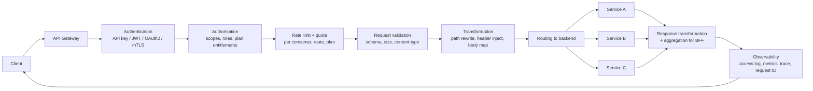
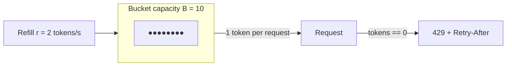

# API Gateway & Rate Limiting — Algorithms, 429 Semantics and Distributed Counters

> **TL;DR** — An **API gateway** is the single, policy-enforcing front door for an API surface: it routes, authenticates, authorises, transforms, aggregates, throttles, quotas, versions and observes every request so that no individual service has to. **Rate limiting** is its most examinable responsibility: you must know five algorithms (fixed window, sliding window log, sliding window counter, token bucket, leaky bucket), know that each trades memory against burst-accuracy against boundary precision, know how to run them *distributed* in Redis with atomic Lua, and know the HTTP contract — `429 Too Many Requests`, `Retry-After`, `RateLimit-*` headers — plus the fairness question of whether you key on user, IP, API key, or endpoint.

> **60-second interview answer:** "An API gateway is the single entry point for an API surface — routing to backends, authenticating and authorising, transforming requests and responses, optionally aggregating several backends into one response for a BFF, and enforcing rate limits, quotas and API-key plans. It differs from a reverse proxy by being API-aware: a proxy balances and terminates TLS, a gateway also knows about consumers, plans and versions; and it differs from a service mesh because it handles north-south traffic from the internet while a mesh handles east-west service-to-service traffic. For rate limiting I default to a token bucket in Redis with a Lua script for atomicity, keyed on the authenticated principal rather than IP, returning 429 with `Retry-After` and `RateLimit-*` headers. If Redis is unavailable I fail open or fall back to a conservative local limiter depending on whether the limit is protecting revenue or protecting availability."

---

## 1. Definition & mental model

**Plain English.** An API gateway is the component that every API call passes through, where you enforce policy you do not want to reimplement in thirty services: who is this, are they allowed, how many calls have they made, which version do they want, which backend serves that, and what shape should the response take.

**The analogy.** Think of an **international airport terminal**.

- The **check-in desk** verifies your identity and your ticket (authentication and authorisation).
- The **security lane** enforces policy uniformly, whatever airline you fly (WAF, request validation).
- The **departure board** routes you to the right gate (routing and versioning).
- The **immigration quota / landing slots** cap how many flights may arrive per hour (rate limiting and quotas).
- The **concierge** who combines your hotel, transfer and tour into one itinerary is a **BFF aggregation**.
- The **airline's own ground staff** moving bags between planes is a **service mesh** — inside the airport, invisible to passengers.

The transcript's layering is exactly this: user → DNS → CDN → **reverse proxy (Nginx)** → **API gateway** → backend services → cache/DB. The gateway is one hop in from the edge, and it is where "who are you and how much are you allowed" is decided.

**Gateway vs reverse proxy vs service mesh vs load balancer** — the distinction interviewers probe:

| | Load balancer | Reverse proxy | API gateway | Service mesh |
|---|---|---|---|---|
| Traffic direction | North-south | North-south | North-south | East-west |
| Primary job | Distribute connections | Terminate + forward + cache | Enforce API policy per consumer | Service-to-service policy |
| Knows about | Instances, health | Hosts, paths, TLS | Consumers, plans, quotas, versions, schemas | Services, identities (SPIFFE), retries |
| Auth | No (unless WAF) | Basic (mTLS, IP allow-list) | Yes — API keys, OAuth2/JWT, plans | mTLS between services, authz policy |
| Rate limiting | Sometimes (connection limits) | Sometimes (per-IP) | Yes — per consumer, per route, with plans | Rare (internal QoS) |
| Configuration unit | Target group | Server/location block | Route + policy + plan | Workload + policy |
| Examples | ALB, NLB, HAProxy | Nginx, Envoy, Squid | Kong, Apigee, AWS API Gateway, KrakenD, Tyk | Istio, Linkerd, Consul |

---

## 2. Why it exists — the problem it solves

Without a gateway, every service team reimplements the same eight things, badly and inconsistently:

1. **Auth is duplicated.** Service A validates JWTs correctly, Service B trusts a header, Service C has a bug. One inconsistent implementation is an authorisation bypass.
2. **No consistent rate limiting.** Each service has its own counter in its own memory, so a per-user limit of 100 req/min becomes 100 × N services, and the effective limit is meaningless.
3. **Versioning chaos.** Each service invents its own `/v2` scheme, so clients cannot tell which versioning convention applies where.
4. **No single place to observe.** No request ID propagation, no consistent access log, no RED metrics across the API surface.
5. **Client-specific shapes leak into services.** The mobile app needs three calls combined into one; without a gateway, the BFF logic ends up inside a domain service and pollutes it.
6. **No plan/tier enforcement.** You cannot sell a "1,000 requests/month free, 1M on Pro" product without a quota engine.
7. **No central place to break an abusive client.** You would have to push a config change to every service to block one API key.
8. **Schema drift.** No validation means malformed requests reach services and cause 500s instead of a clean 400 at the edge.

### What rate limiting specifically buys you

- **Protects availability** — one client cannot consume all capacity (the "noisy neighbour" / "one customer takes down the platform" scenario).
- **Protects cost** — critical for LLM APIs where a single request costs real money (a 100k-token completion is not free); rate limits are the primary financial control surface.
- **Protects downstreams** — a DB or a third-party provider with its own quota (email, SMS, payment gateway) must not be exceeded.
- **Enforces fairness** — in a multi-tenant system, everyone gets a share.
- **Prices the product** — the limit *is* the product tier.
- **Slows abuse** — credential stuffing, scraping, enumeration. (Not a *defence*, but it raises cost.)

---

## 3. Internal mechanics — how it actually works

### 3.1 Gateway responsibilities in detail



| Responsibility | Detail | Common implementation |
|---|---|---|
| **Routing** | Path/host/header/method matching, path rewriting, canary by weight or header | Kong `routes`, Apigee proxy rules, Envoy `RouteConfiguration` |
| **Authentication** | API key, JWT validation (JWKS), OAuth2 introspection, mTLS client certs, HMAC signatures | Plugins/filters; JWKS caching with a TTL |
| **Authorisation** | Scopes (`read:orders`), roles, plan entitlements, per-route ACLs | Policy engine (OPA/Cedar), plugin config |
| **Rate limiting / quotas** | Requests per second/minute/day, concurrent requests, token/byte quotas | Redis-backed counters |
| **Request validation** | JSON Schema/OpenAPI validation, max body size, content-type, required headers | Gateway-native validators |
| **Transformation** | Path rewrite (`/v1/x` → `/x`), header injection (request ID, tenant), body mapping, protocol translation (REST↔gRPC) | Templates/plugins |
| **Aggregation / BFF** | Fan out to N services, join, return one payload | GraphQL federation, gateway orchestration, or a dedicated BFF service |
| **Response caching** | Cache GET responses keyed on consumer or globally | Gateway cache; careful with per-user data |
| **Versioning** | `/v1`, `/v2`, header versioning, deprecation headers, sunset dates | Route config per version |
| **Observability** | Request ID propagation, structured access logs, RED metrics per route/consumer, distributed tracing | OpenTelemetry at the gateway |
| **Resilience** | Timeouts, retries, circuit breaking, bulkheads, fallbacks | Envoy/Resilience4j-style policies |
| **API lifecycle** | Developer portal, key issuance, plan changes, deprecation | Apigee/Kong/AWS API Gateway consoles |

### 3.2 Gateway landscape

| Gateway | Model | Strengths | Weaknesses |
|---|---|---|---|
| **AWS API Gateway** | Managed | Zero ops, IAM integration, usage plans, per-request pricing | Latency (historically ~10–30 ms overhead), cost at high volume, vendor lock-in, 29 s integration timeout |
| **Kong** | OSS + enterprise, Nginx/OpenResty-based | Huge plugin ecosystem, DB-less mode, declarative config | Lua plugin development; clustering complexity |
| **Apigee (Google)** | Managed enterprise | Best-in-class analytics, monetisation, developer portal, policy language | Expensive; heavy; slower to change |
| **Envoy / Envoy Gateway** | OSS, xDS-driven | Dynamic config, excellent observability, gRPC-native, used by Istio | Steep learning curve; no built-in developer portal or key management |
| **KrakenD** | OSS, Go | Pure aggregation/BFF focus, stateless, very fast | Narrower feature set |
| **Tyk** | OSS + cloud | Good OSS feature set, GraphQL support | Smaller ecosystem |
| **Nginx Plus / OpenResty** | Self-managed | Blazing fast, you control everything | You build auth, quotas and a portal yourself |
| **Traefik** | OSS, Go | Kubernetes-native, automatic service discovery, easy TLS | Fewer API-management features |
| **Cloudflare API Shield / Workers** | Edge | Runs at the edge, no origin hop, free-ish | Limited policy expressiveness for complex plans |

**Selection heuristics:** fully managed and low ops → AWS API Gateway or Apigee. Self-hosted with a plugin ecosystem → Kong. Kubernetes-native and dynamic → Envoy/Emissary/Traefik. Aggregation-first → KrakenD. Edge-first → Cloudflare.

### 3.3 Rate limiting algorithms

All five answer the same question — "has this key exceeded its allowance?" — and differ in memory, burst behaviour, and boundary accuracy. Assume a limit of **N requests per window W**.

#### (a) Fixed window counter

```
window_id = floor(now / W)
key = "rl:{user}:{window_id}"
count = INCR key
if count == 1: EXPIRE key W
if count > N: reject
```

- **Memory:** O(1) per key.
- **Accuracy:** poor at boundaries. **The double-burst problem:** with N=100 per minute, a client can send 100 at 00:00:59 and 100 at 00:01:00 — 200 requests in ~1 second, twice the intended rate.
- **Use when:** rough protection, low cost, and boundary bursts are tolerable.

```
Allowance: 100/min

00:00:00 ─────────────────────── 00:00:59 │ 00:01:00 ─────────── 00:01:59
        [ 100 requests ][ 100 requests ]
        200 requests in a ~1s span around the boundary
```

#### (b) Sliding window log

Store the timestamp of every request in a sorted set; count entries newer than `now - W`; reject if ≥ N.

```
ZREMRANGEBYSCORE key 0 (now-W)      # drop old
ZADD key now now                    # record this one
ZCARD key                           # count
if count > N: reject
EXPIRE key W
```

- **Memory:** O(N) per key — 100 timestamps per user. At 10M users that is 1B members; too much for Redis at scale.
- **Accuracy:** exact.
- **Use when:** precision matters and N is small (e.g. login attempts: 5 per hour).

#### (c) Sliding window counter (weighted / rolling)

Keep two fixed-window counters — current and previous — and interpolate:

```
estimate = prev_count × (1 - elapsed_frac) + curr_count
if estimate > N: reject
```

- **Memory:** O(1) per key (two integers).
- **Accuracy:** within ~1% of exact for typical traffic; smooths the boundary burst.
- **This is the best default for most APIs.** Cloudflare publishes this as its approach, reporting it reduced their "wrongly blocked" rate to about 0.003% while using a fraction of the memory of a sliding log.

```
Now = 00:01:15 (25% into the current window)
prev window count = 90
curr window count = 20

estimate = 90 × (1 - 0.25) + 20 = 67.5 + 20 = 87.5  < 100 → allow
```

#### (d) Token bucket

A bucket of capacity **B** refills at **r** tokens/second. Each request costs one token. Empty bucket → reject (or shape).

```
tokens = min(B, tokens + (now - last_refill) × r)
last_refill = now
if tokens >= 1: tokens -= 1; allow
else: reject (or wait)
```

- **Memory:** O(1) per key (tokens + last_refill timestamp).
- **Behaviour:** allows **bursts up to B** while enforcing an average rate of r. This is exactly what you want for real APIs: a client may burst after an idle period, but not exceed the long-run rate.
- **The industry default.** AWS API Gateway, Stripe, and most cloud APIs are token buckets.



#### (e) Leaky bucket

A queue of capacity **B** that drains at a fixed rate **r**. Requests are accepted into the queue and processed at exactly r; overflow is dropped.

- Enforces a **perfectly smooth output rate** — no bursts at all, ever.
- Use when the downstream needs constant pacing: a third-party API with a hard fixed throughput, a payment provider, an SMS gateway, a hardware device.
- Differs from token bucket in intent: token bucket *permits* bursts, leaky bucket *removes* them.

| Algorithm | Memory/key | Burst allowed | Boundary accuracy | Best for |
|---|---|---|---|---|
| Fixed window | 1 int | Up to 2N at boundary | Poor | Cheap coarse protection |
| Sliding log | O(N) | Exact limit only | Exact | Low-volume, high-precision (logins) |
| Sliding counter | 2 ints | Smoothed | ~exact (≈1% error) | **General API default** |
| Token bucket | 2 values | Yes, up to B | Good | **Public APIs; LLM token budgets** |
| Leaky bucket | Queue | No | Exact output rate | Pacing a fixed-rate downstream |

### 3.4 Distributed rate limiting with Redis + Lua

The naive implementation has a race:

```
GET key → 99          (both requests read 99)
both decide: ok       (both think they are under 100)
INCR key → 101
→ one client got through over the limit
```

Under concurrency this happens constantly — the read-decide-write sequence is not atomic. Two fixes:

**Fix 1 — atomic increment and check (single round trip):**

```
count = INCR key
if count == 1: EXPIRE key W
if count > N: reject
```

`INCR` is atomic in Redis, so the check is exact. This works for fixed-window.

**Fix 2 — Lua script for anything more complex.** Redis executes a Lua script atomically (single-threaded, no interleaving), so the read-decide-write is safe:

```lua
-- token bucket: KEYS[1]=bucket key, ARGV: rate, capacity, now_ms, cost
local key       = KEYS[1]
local rate      = tonumber(ARGV[1])   -- tokens per second
local capacity  = tonumber(ARGV[2])
local now       = tonumber(ARGV[3])   -- milliseconds
local cost      = tonumber(ARGV[4])

local data   = redis.call('HMGET', key, 'tokens', 'ts')
local tokens = tonumber(data[1])
local ts     = tonumber(data[2])

if tokens == nil then
  tokens = capacity
  ts     = now
end

-- refill
local delta = math.max(0, now - ts)
tokens = math.min(capacity, tokens + (delta / 1000) * rate)

local allowed = 0
if tokens >= cost then
  tokens = tokens - cost
  allowed = 1
end

redis.call('HMSET', key, 'tokens', tokens, 'ts', now)
-- keep the key alive only as long as it takes to refill an empty bucket
redis.call('PEXPIRE', key, math.ceil((capacity / rate) * 1000) + 1000)

if allowed == 1 then return {1, math.floor(tokens)} else return {0, math.floor(tokens)} end
```

**Why Lua and not `MULTI`/`EXEC`?** `MULTI`/`EXEC` queues commands but cannot *branch* — you cannot decide inside the transaction whether to decrement. `WATCH`/`EXEC` (optimistic locking) requires retries and burns round trips under contention. Lua gives you atomicity **and** conditional logic in one round trip.

**Why not `INCR` + `EXPIRE` as two calls?** Because if the process dies between them, the key never expires and that client is blocked forever. Use `SET key 1 EX W NX` first, then `INCR`, or put both in a Lua script (or use `INCR` then always `EXPIRE`, accepting a rare leak).

**Cluster mode caveat:** a script touching multiple keys must use hash tags so all keys map to the same slot: `rl:{user42}:tokens`. Otherwise Redis Cluster returns `CROSSSLOT`.

**Hot-key caveat:** a single key holding 100k increments/sec on one Redis node is a scaling ceiling. Mitigations: shard the counter across K keys and sum them (`rl:{user}:{shard}` for shard in 0..K-1), or use a local pre-check plus a periodic global sync ("approximate distributed limiting"), accepting slight over-admission.

### 3.5 The fail-open vs fail-closed decision

If Redis is unavailable, the limiter cannot make a decision. Two policies:

| Policy | Behaviour | Use when |
|---|---|---|
| **Fail open** | Allow all requests, log loudly | The limit protects against abuse, not correctness; availability of the API is more important than the limit |
| **Fail closed** | Reject all requests (or apply a conservative local limit) | The limit protects a scarce paid resource (LLM tokens) or a strictly quota'd downstream |
| **Local fallback** | Allow at a conservative fraction of the limit using an in-process limiter | **Usually the best answer** — preserves availability, degrades protection gracefully |

**Never silently fail open without an alert.** The failure mode is a client discovering that hammering during a Redis blip gets unlimited throughput, and then engineering around it.

### 3.6 HTTP semantics: 429, `Retry-After`, `RateLimit-*`

```http
HTTP/1.1 429 Too Many Requests
Retry-After: 30
RateLimit-Limit: 100
RateLimit-Remaining: 0
RateLimit-Reset: 30
Content-Type: application/json

{
  "error": "rate_limit_exceeded",
  "message": "Rate limit of 100 requests per minute exceeded.",
  "limit": 100,
  "window_seconds": 60,
  "retry_after_seconds": 30,
  "documentation_url": "https://api.example.com/docs/rate-limits"
}
```

| Header | Meaning | Notes |
|---|---|---|
| `Retry-After` | Seconds (or an HTTP date) until the client may retry | **Mandatory in practice** — without it clients guess, and often hammer immediately |
| `RateLimit-Limit` | The quota in the current window | IETF draft standard |
| `RateLimit-Remaining` | Requests left | Lets clients back off *before* being rejected |
| `RateLimit-Reset` | Seconds until the window resets | |
| `X-RateLimit-*` | The older de-facto spelling | Still what many clients expect |
| `Retry-After` on `503` | Also valid — use it during maintenance/degradation | |

**Design rules:**
- **Send limits on success too** (`x-ratelimit-remaining`), not just on 429. Good clients pace themselves.
- **Prefer 429 over 403** for rate limiting — 403 means "you may never do this", 429 means "not now".
- **Return `429` not `503`** when the cause is the client's own quota; `503` implies a server problem and triggers different retry logic in clients.
- **Include a machine-readable error code** so clients can distinguish quota exhaustion from other errors.
- **Document the limits publicly** and make them discoverable from a `/limits` endpoint or the headers themselves.
- **Do not use `429` for concurrency limits** without explanation — a distinct code (`concurrency_limit_exceeded`) is clearer.

### 3.7 Keying strategy — the fairness question

The choice of key determines who gets limited and how easily it can be evaded or gamed.

| Key | Pros | Cons | Use for |
|---|---|---|---|
| **IP address** | No auth needed; catches anonymous abuse | Shared NAT means an entire office is one key; mobile IPs rotate; trivially bypassed with proxies | Anonymous/unauth endpoints, WAF-style protection |
| **User ID** | Fair per person | Requires auth; one user on many devices | Authenticated product limits |
| **API key / client ID** | Business-meaningful; maps to a plan | Key can be shared across an org | Partner/public APIs |
| **Account / organisation** | Correct for B2B (the org pays) | One noisy project hurts the whole org — add a per-project sub-limit | B2B SaaS |
| **Endpoint / route** | Protects expensive paths differently | More keys to store | Expensive operations (`/search`, `/generate`) |
| **JWT `sub` + route** | Combines fairness with cost control | More state | General best practice |
| **Device ID / fingerprint** | Works pre-auth | Spoofable; privacy concerns | Anti-abuse heuristics |
| **Concurrency (in-flight)** | Protects against slow-loris-style resource hogging | Needs accurate release accounting | LLM inference, long-running jobs |

**The layered approach used in production:**

```
1. Global limit           — protect the platform       (e.g. 500k req/s total)
2. Per-principal limit    — fairness + product tier    (e.g. 1,000 req/min/user)
3. Per-route limit        — protect expensive paths    (e.g. 20 req/min to /generate)
4. Per-IP limit           — abuse defence              (e.g. 300 req/min/IP)
5. Concurrency limit      — protect scarce resources   (e.g. 5 in-flight LLM calls/user)
6. Cost/token quota       — the financial control      (e.g. 1M tokens/day)
```

The strictest applicable limit wins.

### 3.8 Quotas, plans and tiers

A **rate limit** is short-horizon (per second/minute) and protects availability. A **quota** is long-horizon (per day/month) and is a commercial instrument.

```yaml
plans:
  free:
    rate_limit:  { requests: 10,  window: 1m }
    quota:       { requests: 10_000, window: 30d }
    concurrency: 2
    burst: 20
  pro:
    rate_limit:  { requests: 500, window: 1m }
    quota:       { requests: 5_000_000, window: 30d }
    concurrency: 20
    burst: 1000
  enterprise:
    rate_limit:  { requests: 20_000, window: 1m }
    quota:       { requests: -1 }         # unlimited, contracted
    concurrency: 200
```

**Quota accounting details that matter:**
- **Quota counters must be durable**, not in a cache you are willing to lose. Losing a quota counter gives away free usage; the token-bucket limiter is fine to lose.
- **Quota resets need a defined timezone and billing anchor** (e.g. calendar month UTC). "Resets every 30 days from signup" is friendlier to the customer but harder to explain on an invoice.
- **Quota checks need to be atomic too** — same Lua-script pattern.
- **Soft vs hard quotas:** soft warns and overages bill; hard blocks. Most SaaS uses hard limits with an overage notification.
- **Report usage.** A `GET /usage` endpoint and periodic emails prevent the worst support ticket: "why did my service stop?"

### 3.9 LLM-specific gateway concerns

AI gateways (a gateway in front of model providers) add:

| Concern | Why it matters | Mechanism |
|---|---|---|
| **Token budgets, not request counts** | One request can cost $0.50; 100 requests can cost $0.01 | Token-bucket in *tokens*; reserve estimated max tokens, settle on actual usage from the provider response |
| **Streaming** | Responses are chunked/SSE; the gateway must not buffer | Pass-through config; no compression |
| **Long timeouts** | A generation can take 60–300 s | Read timeout ≫ 60 s default; separate route class |
| **Concurrency limits** | A GPU can serve only N concurrent sequences | Semaphore per model; queue with a deadline; `429` with `Retry-After` |
| **Model routing & fallback** | Provider outages, cost/quality routing | Route by model name, fall back to a secondary provider on 5xx/timeout |
| **Provider-level rate limits** | The upstream provider also limits you | Track provider quotas; queue/shed before hitting their 429 |
| **Semantic caching** | Repeated prompts are common | Cache by normalized prompt embedding; bypass on cache miss (see [Redis](../03-scaling/03-redis-deep-dive.md)) |
| **Per-tenant cost attribution** | Chargeback and abuse detection | Tag every call with tenant, count tokens in and out |
| **Prompt/response logging policy** | Privacy and compliance | Redaction, retention windows, opt-out |

**A concrete LLM rate-limit example:**

```yaml
# Per user
rate_limit:   { requests: 60, window: 1m }
token_budget: { tokens: 200_000, window: 1h }     # refilled by token bucket
concurrency:  4                                    # in-flight generations
max_context:  128_000
# Per model
gpt-class:    { concurrency: 200, queue_depth: 1000, queue_timeout: 30s }
```

The **reserve-then-settle** pattern for token budgets: on request admission, reserve the estimated max output tokens (e.g. `max_tokens` = 4,000); after the response, refund `reserved - actual`. Without reservation, a burst of 100 concurrent long generations can each individually pass a "200k tokens remaining" check and collectively blow the budget by 2×.

---

## 4. Variants & taxonomy

| Variant | Description | Best for |
|---|---|---|
| **Edge gateway** | Runs on CDN edge nodes (Cloudflare Workers, Lambda@Edge) | Auth and throttling with no origin hop |
| **Central gateway** | One or few clusters fronting everything | Uniform policy, simpler observability |
| **Sidecar gateway / mesh ingress** | Envoy as the mesh ingress gateway | Kubernetes-native, xDS dynamic config |
| **BFF (Backend for Frontend)** | A gateway per client type (web, iOS, Android) | Different payload shapes per client |
| **Federated GraphQL gateway** | Schema stitching across services | One graph over many services |
| **AI/LLM gateway** | Gateway plus model routing, token budgets, semantic cache | Multi-provider LLM apps |
| **Managed vs self-hosted** | Vendor-managed (Apigee, AWS) vs you run it (Kong, Envoy) | Ops capacity vs control |
| **DB-less / declarative** | Config in Git, no control-plane DB (Kong DB-less, Envoy xDS) | GitOps; no stateful control plane |
| **Service-mesh east-west gateway** | Handles internal service traffic | Zero-trust internal comms |
| **Protocol gateway** | REST↔gRPC, HTTP↔WebSocket, SOAP↔REST | Legacy integration |

### Rate limiter variants

| Variant | Description |
|---|---|
| **Local (in-process)** | Per-instance counters; fast, no network; limit multiplies by instance count |
| **Distributed (Redis)** | Shared counter; correct globally; adds a network round trip and a dependency |
| **Hybrid / approximate** | Local counter with periodic sync to a central store; over-admits slightly |
| **Sharded counter** | K Redis keys summed; avoids hot keys |
| **Adaptive** | Limit changes with system load (e.g. shrink when latency rises) — used in load shedding |
| **Concurrency limiter** | Caps in-flight requests, not requests per unit time |
| **Priority / weighted** | Different classes pay different costs (a bulk export costs 100 units) |
| **Cost-based** | Weight by work: CPU ms, tokens, bytes, DB rows scanned |

---

## 5. Pros / Cons

| Pros | Cons |
|---|---|
| One place for auth, quotas, versions and observability | Another hop: 1–30 ms added latency, and a new failure domain |
| Uniform policy means no inconsistent authorization bugs | The gateway becomes a single point of failure unless it is itself redundant |
| Rate limiting protects availability, cost and downstream quotas | Badly tuned limits break legitimate traffic and cause support load |
| Plan and quota enforcement is the product tier mechanism | Quota state must be durable and consistent — an operational burden |
| Decouples clients from service topology; enables refactors | Gateway config drift from reality if not in Git with CI validation |
| Enables BFF aggregation, reducing mobile round trips | Aggregation couples the gateway to service contracts and increases blast radius |
| Central place to block an abusive consumer instantly | A misconfigured gateway can take down the entire API surface at once |
| Developer portal and key management come free with enterprise products | Enterprise gateways are expensive and can lock you in |
| Protocol translation lets you modernise backends gradually | Transformation logic becomes a hidden, untested source of bugs |
| Excellent place for OpenTelemetry instrumentation | Access logs are high volume and can cost real money to ship |

---

## 6. Exceptions, edge cases & failure modes

### 6.1 The distributed counter race (and how it is really fixed)

Restated precisely because it is the most common interview probe. The non-atomic pattern is `GET` → compare → `SET`. Under N concurrent requests all reading the same value, all N pass. Fixes, in order of correctness:

1. **Single atomic command** — `INCR` then compare the returned value. Exact for fixed window.
2. **Lua script** — atomic read-modify-write with branching. Exact for token bucket / sliding window.
3. **Optimistic locking with `WATCH`** — correct but retries under contention, so throughput collapses exactly when you need it.
4. **`SET NX` lock around a critical section** — works, but adds two more round trips and a lock-expiry failure mode.
5. **Local counter + periodic reconciliation** — approximate by design.

**Also note:** even with atomic operations, the *decision* and the *request* are not atomic together. A client can pass the limiter and then the request can fail. Rate limiting is about admission control, not about guaranteeing a request count.

### 6.2 Thundering herd at the window boundary

With a fixed or sliding window, all clients that were blocked will retry at the moment the window resets, producing a synchronised spike. **Fixes:**
- Use token bucket (no synchronised reset — buckets refill continuously and independently).
- If you must use windows, **jitter the reset per key**: `reset = window_start + W + hash(key) % jitter_ms`.
- Return `Retry-After` with slight jitter so clients do not all return at the same second.
- Add `Retry-After` and expect clients to honour it; most do not, so the jitter on your side matters more.

### 6.3 `Retry-After` ignored → retry storms

Clients (and especially badly written SDKs) retry `429` immediately with no backoff. A service that is being rate limited then receives *more* traffic than before. **Defences:**
- Aggressive: temporarily *block* the key for a period rather than continuing to 429 each request (a "penalty box"). This drops total work from the client to near zero.
- Return `429` cheaply — do not do expensive work (auth DB lookups, logging to a slow sink) on the rejection path. The rejection path must be faster than the acceptance path.
- Consider a "soft block" where a persistent offender gets `403` for a cooldown.

### 6.4 Hot keys in the rate-limit store

A single key for a global limit (`rl:global`) at 500k ops/sec is a Redis single-node ceiling (roughly 100k–200k ops/sec per node on a single key, less with Lua). **Fixes:**
- Shard the counter: `rl:global:{0..9}`, increment one shard chosen by hash of the request ID, and periodically sum. Slight over-admission, big throughput gain.
- Approximate: each gateway node holds a local counter for the global limit updated by a gossip/stream every 100 ms; the global limit becomes approximate.
- For per-user keys, the hot-key risk is low unless one user dominates — but the "celebrity" problem applies to API keys too (a big customer's key is a hot key; shard it).

### 6.5 Limits that multiply by instance count

A local in-process limiter with limit 100 and 20 gateway instances gives an effective limit of 2,000. This is *the* classic distributed-rate-limiting bug. If you use local limiting you must either divide the limit by the instance count (which breaks with autoscaling) or accept the multiplication and document it, or use a hybrid with central reconciliation.

### 6.6 Clock skew across nodes

Distributed windows depend on time. Two gateway nodes with 2 seconds of clock skew can disagree about which window a request belongs to, producing either an over- or under-count. **Fixes:** rely on the *Redis server's* time inside the Lua script (`redis.call('TIME')`) rather than the caller's clock; keep NTP healthy; for token buckets, skew just means slightly different refill calculations, which is benign.

### 6.7 Fail-open becomes the exploit

If the gateway caches "Redis is down" for 60 seconds and fails open for that period, an attacker who can cause Redis pressure gets unlimited throughput. Rate-limit the fail-open window's *duration* and *volume* (e.g. allow a conservative local limit instead of truly unlimited), and alert.

### 6.8 Rate limiting the wrong thing

| Symptom | Root cause |
|---|---|
| A whole office is blocked | Limiting on IP where NAT is shared |
| Mobile users get random 429s | IP-based limiting with carrier NAT / CGNAT |
| One customer's batch job locks out their whole org | Limiting on account without a per-project sub-limit |
| Expensive endpoint is free | Per-user limit but no per-route cost weighting |
| Limit is meaningless | Per-service local counters summing to N × services |
| Legitimate retries are punished | Counting retries, health checks or webhook callbacks against the client's quota |

### 6.9 Rate limiting when you should be load shedding instead

Rate limiting is per-client admission control. When the *system* is overloaded regardless of client behaviour, the right tool is **load shedding**: drop the lowest-priority or oldest requests, return `503` with `Retry-After`, or shed at the queue. Rate limiting cannot fix a capacity problem — if the sum of all clients' legitimate limits exceeds your capacity, every client is within their limit and you are still down.

**Adaptive concurrency limits** (Netflix's concurrency-limits, based on Little's Law and TCP Vegas) are the standard answer: measure latency, and adjust the in-flight limit up or down automatically. Little's Law: `concurrency = throughput × latency`. If your service handles 1,000 rps at 50 ms, the sweet-spot concurrency is ~50; above that, latency inflates without throughput gain and you should reject.

### 6.10 Gateway-specific failure modes

- **Gateway timeout shorter than the backend's**: the gateway returns `504` while the backend continues working — wasted work and confusing metrics. Set the gateway timeout above the backend's, and both below the client's.
- **Auth cache staleness**: a revoked token remains valid until the JWKS/introspection cache expires. Trade-off: cache TTL vs revocation latency. For high-security actions, re-validate.
- **Aggregation blast radius**: a BFF that fans out to five services fails if any one is slow, unless each call has its own deadline and a partial-response fallback.
- **Config push outage**: a bad gateway config (a bad route, a bad plugin) takes down the whole API surface in one deploy. Validate config in CI, canary by percentage, and keep a fast rollback.
- **Payload limits**: default body size limits (often 10 MB) reject legitimate uploads. Route large uploads around the gateway or raise the limit per route.
- **WebSocket/SSE through the gateway**: must disable buffering and raise timeouts per route, exactly as with a reverse proxy.
- **`429` storms counting against your own metrics**: a limiter rejecting 40% of traffic produces an enormous volume of access logs. Sample the rejection path.

---

## 7. When to use / When NOT to use

### Use an API gateway when
- You expose a **public API** to partners or customers and need keys, plans and quotas.
- You have **more than ~3 services** and want uniform auth/observability.
- You need **rate limiting, quotas or monetisation** as a product feature.
- Different clients need **different response shapes** (BFF).
- You must **version an API** and deprecate old versions gracefully.
- You need **protocol translation** (REST↔gRPC, legacy SOAP).
- Compliance requires a **single audited ingress point**.

### Do NOT use an API gateway when
- You have **one service** — a reverse proxy or middleware in the app is enough.
- Your traffic is **purely internal** — use a service mesh or library policies.
- You need **absolute minimum latency** and cannot afford the hop — terminate policy in the service or at the edge.
- The gateway would become an **organisational bottleneck** — every route change requires a gateway team. (Prefer declarative, GitOps, self-service config.)
- You would be **paying per-request pricing** for traffic that never needed API-management features (e.g. static assets) — route those around it.
- The gateway vendor's limits (e.g. a 29 s integration timeout) conflict with your workload (long LLM generations).

### Rate limiting: use vs not

| Use rate limiting | Do NOT rely on rate limiting |
|---|---|
| Public API with tiers | Internal service-to-service calls (use timeouts, retries, concurrency limits) |
| Protecting a paid upstream (LLM, SMS) | The system is simply overloaded (use load shedding + autoscaling) |
| Abuse prevention (scraping, enumeration) | You need DDoS protection (that is an edge/network concern) |
| Multi-tenant fairness | You need authorisation (a 429 is not a security control) |
| Cost control | Correctness — a limiter is approximate by nature |

### Decision table

| Situation | Answer |
|---|---|
| Public API, tiers, keys | Managed gateway (AWS API Gateway, Apigee) + token bucket in Redis |
| Microservices, Kubernetes, uniform policy | Envoy/Kong gateway + declarative config in Git |
| Mobile app with many small calls | BFF aggregation at the gateway |
| Multi-provider LLM with cost control | AI gateway: token budgets, concurrency limits, provider fallback |
| Internal services, no external consumers | Service mesh, no gateway |
| One monolith | Reverse proxy + app middleware |
| Need <5 ms added latency | Terminate policy at the edge or in-process |
| Third-party provider with a hard quota | Leaky bucket / concurrency limit in front of the provider client |

---

## 8. Numbers, defaults & tuning

| Quantity | Typical | Reasoning |
|---|---|---|
| Gateway added latency | 1–10 ms self-hosted; 10–30 ms managed | Matters for chatty clients |
| Redis round trip | 0.2–1 ms in-region | The limiter's per-request cost |
| Redis single-node throughput | ~100k–200k ops/s (simple commands) | The hot-key ceiling |
| Redis Cluster slots | 16,384 | Hash tags keep multi-key scripts in one slot |
| Rate limit check budget | <1 ms p99 | Must never be the bottleneck |
| Fixed window default | 60 s | Simple, coarse |
| Token bucket burst capacity | 1.5–3× the per-second rate | Enough for real bursts without a bypass |
| Token bucket refill | `limit / window` per second | e.g. 100/min → 1.67/s |
| Sliding counter accuracy | ~1% error (Cloudflare's published figure) | The reason it is the default |
| 429 response budget | <1 ms | Rejection path must be cheaper than acceptance |
| `Retry-After` value | Ceiling of the wait, plus 0–20% jitter | Prevents synchronised retries |
| Default anonymous IP limit | 60–300 req/min | High enough for NAT, low enough to matter |
| Default authenticated per-user limit | 600–6,000 req/hour | Product-dependent |
| LLM per-user concurrency | 2–10 in-flight | GPUs serialise; concurrency is the real resource |
| LLM token budget granularity | 1 hour refill window | Matches human usage patterns |
| Token reservation | Reserve `max_tokens`, settle on actual | Prevents 2× budget overrun |
| Quota reset anchor | Calendar month UTC, or billing-cycle | Must be explainable on an invoice |
| Auth/JWKS cache TTL | 5–15 min | Revocation latency vs auth-server load |
| Gateway config deploy | Canary 1% → 10% → 100% | Config bugs are total outages |
| Access log sampling (rejections) | 1–10% | 429 storms produce huge log volume |
| Circuit breaker (gateway→backend) | failure_threshold 5, recovery_timeout 30 s, half-open 3 calls | Standard resilience defaults |
| Per-service rate limit vs global | Global ≈ 60–70% of measured capacity | Headroom for spikes and retries |
| Load shed threshold | Start shedding when p99 latency > 2× baseline | Adaptive concurrency (Little's Law) |

---

## 9. Interview Q&A

**Q1 (easy). What is an API gateway?**
It is the single entry point for an API surface. Every request passes through it, and it handles routing to backends, authentication and authorisation, request and response transformation, optional aggregation for a client, rate limiting and quotas, versioning, and observability — so those concerns are implemented once rather than in every service. In the canonical flow from the course it sits right behind the CDN and reverse proxy: user, DNS, CDN, Nginx, API gateway, services, cache, database.

**Q2 (easy). API gateway versus reverse proxy?**
A reverse proxy operates at the HTTP level and its job is to terminate connections, forward to a backend, cache, compress and balance. An API gateway is a reverse proxy that additionally understands *consumers*: it knows about API keys, plans, scopes, quotas and versions. Practically, Kong and Envoy are both — the distinction is which features you enable. If an interviewer asks for the dividing line, I say: a proxy knows about servers, a gateway knows about clients.

**Q3 (easy). Why rate limit at all?**
Four reasons: protect availability so one client cannot consume all capacity; protect cost, which is critical with LLM APIs where a single request can cost real money; protect downstreams with their own quotas, like an SMS or payment provider; and enforce fairness and product tiers in a multi-tenant system. It also raises the cost of abuse like credential stuffing and scraping, though it is not a security control in itself.

**Q4 (medium). Name the rate limiting algorithms and when you would use each.**
Fixed window is a counter per time bucket — cheapest, but allows a double burst at the boundary. Sliding window log stores every timestamp, exact but O(N) memory per key, so I use it for low-volume high-precision cases like login attempts. Sliding window counter interpolates between the current and previous window with two integers, about 1% error, and it is my general default. Token bucket refills at a steady rate but allows a burst up to the bucket capacity, which matches how real clients behave, and it is what most public APIs use. Leaky bucket smooths output to a fixed rate and is what I would put in front of a downstream that requires constant pacing.

**Q5 (medium). How do you implement distributed rate limiting correctly?**
A shared store, usually Redis, with the check done atomically. For a fixed window the atomic `INCR` plus a comparison is exact because `INCR` is atomic. For token bucket or sliding window I use a Lua script, because Redis runs a script atomically and Lua lets me branch — decide inside the same atomic unit whether to decrement. `MULTI`/`EXEC` does not work for this because it cannot branch, and `WATCH`/`EXEC` needs retries that collapse under contention. In Redis Cluster I use hash tags so all keys in the script land in the same slot, and I watch out for hot keys on global limits.

**Q6 (medium). What does a 429 response need to contain?**
The status `429 Too Many Requests`, a `Retry-After` header with seconds or a date, the `RateLimit-Limit`, `RateLimit-Remaining` and `RateLimit-Reset` headers, and a JSON body with a machine-readable error code, the limit, the window, and a link to documentation. I also send `RateLimit-Remaining` on successful responses so well-behaved clients pace themselves before they ever get a 429. And I make sure the rejection path is cheap — it must not do an auth database lookup or write to a slow log sink, because a 429 storm would then amplify the problem.

**Q7 (medium). How do you key a rate limiter?**
It depends on what fairness means for the product. For anonymous endpoints, IP — but knowing that NAT means a whole office is one key and mobile carriers use CGNAT, so IP limits must be generous. For authenticated APIs, the principal: user ID or API key, because that is who the contract is with. For B2B, the organisation, with a per-project sub-limit so one noisy project does not lock out the whole org. Then I layer: a global limit to protect the platform, a per-principal limit for fairness, a per-route limit for expensive endpoints, an IP limit for abuse, a concurrency limit for scarce resources, and a token or cost quota for financial control. The strictest applicable limit wins.

**Q8 (hard). Explain the token bucket algorithm and why it is the industry default.**
The bucket has a capacity B and refills at r tokens per second. Each request consumes one token; an empty bucket rejects. It is the default because it matches real client behaviour — a client that has been idle accumulates up to B tokens and may burst, while the long-run rate is still capped at r. That means you can absorb a page load firing ten parallel requests without penalising the user, while still preventing sustained abuse. The state is just two values, tokens and last-refill timestamp, so it is cheap to keep in Redis, and the refill computation is done lazily on each request rather than by a background job. AWS API Gateway and Stripe both work this way.

**Q9 (hard). We are behind a load balancer and our per-IP rate limit is not working under attack. Why?**
Two likely reasons. First, every request looks like it comes from the load balancer, so we are limiting one key — the balancer's IP — which means either everything is blocked or, if the limit is high, nothing is. That is fixed with `X-Forwarded-For` or the PROXY protocol, keying on the real client IP. Second, and worse, if we are reading `X-Forwarded-For` and the client can supply it, the attacker just varies it per request. The fix is to strip client-supplied forwarding headers at the outermost hop we control, set them ourselves, and read from the right with a configured trusted-hop count. I would also consider that under attack the right tool might be load shedding or edge DDoS protection rather than per-IP limiting.

**Q10 (hard). Rate limiting versus load shedding?**
Rate limiting is per-client admission control: this client has had their share. Load shedding is system-level: the system is over capacity regardless of who is asking, so we drop the lowest-value or oldest work and return `503` with `Retry-After`. Rate limiting cannot fix a capacity problem — if the sum of every client's legitimate limit exceeds your capacity, everyone is within their limit and you are still down. In practice I use both, and for load shedding I use adaptive concurrency: Little's Law says concurrency equals throughput times latency, so I measure latency and adjust the in-flight limit down when latency inflates, which is the signal that queueing has started and extra concurrency is now pure harm.

**Q11 (hard, testing §6). Redis goes down. What does your rate limiter do?**
It depends on what the limit is protecting. If it protects availability against abuse, I fail open with a conservative in-process fallback — allow traffic at, say, 20% of the normal limit locally per instance — so the API stays up and protection degrades rather than disappearing. If it protects a scarce paid resource like LLM tokens or a partner's hard quota, I fail closed or queue, because over-spending is worse than an outage. Either way I alert loudly, because the dangerous outcome is a client discovering that a Redis blip gives them unlimited throughput and engineering around it. The key design point is that "fallback" should not mean "unlimited".

**Q12 (hard, testing §6). Your fixed-window limiter allows double the intended rate. Explain and fix.**
That is the boundary burst. With a limit of 100 per minute, a client can spend its full 100 at the end of minute one and its full 100 at the start of minute two, so 200 requests land inside about a second while both windows individually look compliant. The fixes are, in order of preference: switch to a token bucket, which refills continuously and has no shared reset instant, so there is nothing to synchronise around; or use a sliding window counter that interpolates the previous window's count, which smooths the boundary; or if I must keep fixed windows, jitter each key's window boundary so not every client resets at the same instant.

**Q13 (hard, testing §6). A customer complains their batch job is being blocked. What do you check?**
First whether it is really rate limiting or something else — a `429` with `Retry-After` confirms it, a `403` means an authorisation problem. Then I look at the key. If we limit on IP and they run behind a corporate NAT, every employee shares one bucket, and one batch job blocks the whole office — the fix is to key on the authenticated principal. If we limit on organisation, one project starves the others, so I add a per-project sub-limit. Then I check whether the limit is appropriate for the operation: a bulk export costs far more than a single read, so I would want cost-based weighting or a dedicated higher limit for that route rather than one flat request count. And I check whether retries, health checks or webhook callbacks are being counted against their quota — that is a common and unfair bug.

**Q14 (hard). How does rate limiting differ for an LLM API?**
The unit of cost is tokens, not requests — one request can consume a hundred thousand tokens — so a request-count limiter is the wrong primitive. I use a token-bucket in tokens, and critically I reserve the estimated maximum output tokens at admission and settle on the actual usage from the provider's response, because otherwise a hundred concurrent long generations can each individually pass a "200k remaining" check and collectively blow the budget by 2×. Beyond that, GPUs serialise, so concurrency limits are the real resource control: I cap in-flight generations per user and per model, queue with a deadline, and return `429` with `Retry-After` when the queue is full. I also need long read timeouts because generation can take minutes, streaming must pass through without buffering, and I track provider-level quotas because the upstream provider rate limits me too.

**Q15 (hard). What breaks in a multi-region gateway deployment?**
Rate-limit state. If I run a gateway in three regions with a shared Redis in one, every rate-limit check is a cross-region round trip — tens to hundreds of milliseconds — which is unacceptable on the hot path. If I run Redis per region, each region has its own counter, so a client hitting two regions gets twice the limit, and a global limit becomes regional. The practical resolutions are: accept the multiplication and divide the limit by the region count; use a regional limiter with periodic cross-region reconciliation, accepting approximate enforcement; or for anything that must be exactly global — a monthly quota, a billing counter — make the write durable and asynchronous and treat it as eventually consistent, with the understanding that there is a small over-admission window. I would also be careful about clock skew, which is why I have the Lua script read Redis's own `TIME` rather than trusting the caller's clock.

---

## 10. Common mistakes candidates make

1. **Treating gateway, reverse proxy and load balancer as interchangeable.** State the distinguishing feature: consumer awareness.
2. **Listing gateway responsibilities without saying why** they belong there (implemented once, consistent, centrally changeable).
3. **Naming only one rate-limiting algorithm.** Know all five with their memory/accuracy trade-offs.
4. **Describing a non-atomic distributed limiter.** `GET`-then-`SET` is the classic bug; say `INCR` or Lua.
5. **Using `MULTI`/`EXEC` for token bucket.** It cannot branch inside a transaction.
6. **Forgetting `Retry-After`.** It is the header that makes 429 usable.
7. **Using `403` instead of `429`** for rate limits, or `503` for a client's own quota.
8. **Keying only on IP.** NAT, CGNAT, and spoofing all break it.
9. **Not mentioning fail-open vs fail-closed**, or defaulting to a silent fail-open.
10. **Ignoring hot keys** on global limits and per-customer counters.
11. **Confusing rate limiting with load shedding** and never mentioning adaptive concurrency.
12. **Forgetting quotas are durable and rate limits are disposable** — treating them the same leads to either free usage or lost limits.
13. **Overlooking LLM token budgets and concurrency** in an AI-flavoured system.
14. **Missing the gateway as a single point of failure** and the config-push blast radius.
15. **Not mentioning multi-region counter consistency** when the design is multi-region.

---

## 11. Cheat-sheet summary

| Concept | One-line truth |
|---|---|
| API gateway | Single entry point enforcing auth, quotas, routing, transformation, versioning |
| Gateway vs proxy | Proxy knows servers; gateway knows consumers |
| Gateway vs mesh | Gateway is north-south; mesh is east-west |
| BFF | A gateway per client type, aggregating backend calls into one payload |
| Fixed window | One counter per bucket; cheap; **double burst at the boundary** |
| Sliding window log | Timestamps in a sorted set; exact; O(N) memory |
| Sliding window counter | Two integers interpolated; ~1% error; **the general default** |
| Token bucket | Capacity B, refill r, allows bursts; **the public-API default** |
| Leaky bucket | Queue draining at a fixed rate; no bursts; pacing a fixed-rate downstream |
| Atomicity | `INCR` or a Lua script; never `GET`-then-`SET` |
| `MULTI`/`EXEC` | Cannot branch; wrong tool for token bucket |
| Redis Cluster | Use hash tags so a script's keys share a slot |
| Hot key | Shard the counter and sum; or approximate with local counters |
| Fail open | Availability first; abuse possible; **alert** |
| Fail closed | Cost/correctness first; outage instead of overspend |
| Local limiter | Limit multiplies by instance count — the classic bug |
| 429 | Too Many Requests; always with `Retry-After` |
| `RateLimit-*` | `Limit`, `Remaining`, `Reset`; send on success too |
| 403 vs 429 | 403 = never allowed; 429 = not now |
| Rejection path | Must be cheaper than the acceptance path |
| Keying | Layer: global, principal, route, IP, concurrency, cost |
| Concurrency limit | Caps in-flight work; the right control for GPUs and slow endpoints |
| Token budget | Reserve max, settle on actual; otherwise 2× overrun |
| Quota vs rate limit | Quota is durable and commercial; rate limit is short-horizon and disposable |
| Load shedding | System over capacity; drop lowest value; `503` + `Retry-After` |
| Adaptive concurrency | Little's Law: concurrency = throughput × latency; shrink when latency inflates |
| Config blast radius | Validate in CI, canary by percentage, fast rollback |

**"If the interviewer says X → answer Y"**

| Interviewer says | You say |
|---|---|
| "Design rate limiting" | "Token bucket in Redis via Lua, keyed on the principal, layered limits, 429 with `Retry-After` and `RateLimit-*`" |
| "Prevent the boundary burst" | "Token bucket (continuous refill), or sliding window counter, or jitter window boundaries per key" |
| "Is your limiter correct?" | "Yes — a single atomic `INCR` or an atomic Lua script; nothing is read-decide-write across round trips" |
| "Redis is down" | "Conservative local fallback plus a loud alert; fail closed if it protects a paid resource" |
| "We are multi-region" | "Regional counters with approximate enforcement; durable async reconciliation for quotas" |
| "Should we rate limit internal calls?" | "No — use timeouts, retries, circuit breakers and concurrency limits instead" |
| "The system is just overloaded" | "That is load shedding, not rate limiting — adaptive concurrency and priority shedding" |
| "Rate limit an LLM API" | "Token bucket in tokens with reserve-then-settle, plus per-user and per-model concurrency limits" |

---

## 12. Cross-links

- [DNS Deep Dive](01-dns-deep-dive.md) — the first hop in the request flow
- [CDN Deep Dive](02-cdn-deep-dive.md) — edge auth and throttling before the origin
- [Forward and Reverse Proxy](03-forward-and-reverse-proxy.md) — the layer beneath the gateway; TLS, buffering, 502/504
- [Load Balancers](../03-scaling/01-load-balancers.md) — L4 vs L7 and health checking behind the gateway
- [Caching Strategies and Layers](../03-scaling/02-caching-strategies-and-layers.md) — response caching at the gateway
- [Redis Deep Dive](../03-scaling/03-redis-deep-dive.md) — Lua scripts, atomic counters, hot keys, Cluster hash tags
- [Cache Invalidation and Consistency](../03-scaling/04-cache-invalidation-and-consistency.md) — stampede and single-flight patterns
- [Sharding, Replication and Consistency](../03-scaling/05-sharding-replication-and-consistency.md) — quota durability and multi-region consistency
- [WhatsApp Chat System](../../Case-Studies/HLD/02-whatsapp-chat-system.md) — per-user limits on messaging APIs
- [Notification System](../../Case-Studies/HLD/03-notification-system.md) — per-provider rate limits (FCM/APNs/SMS)
- [Networking and API Interview Questions](../../Interview-Questions/02-networking-and-api-questions.md)
- [Networking Cheatsheet](../../Cheat-Sheets/02-networking-cheatsheet.md)
