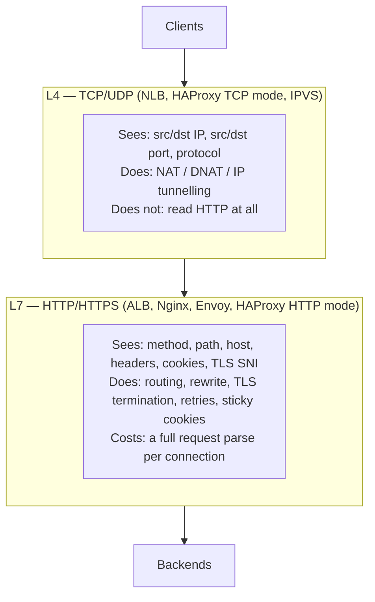

# Load Balancers — L4 vs L7, Algorithms, Health Checks and Draining

> **TL;DR** — A load balancer is the component that maps one logical service onto many physical instances. **L4** balances TCP/UDP connections by IP and port — blindingly fast, protocol-agnostic, but it cannot see HTTP paths, headers or cookies. **L7** terminates the request, reads it, and routes on path, header, method or cookie — which is what you need for microservices, canaries, gRPC and WebSocket-aware routing. The algorithm matters far more than most candidates think: round-robin assumes every request costs the same, which is spectacularly false for LLM inference (a 100-token chat vs a 100k-token summarisation), so for heterogeneous request cost you want least-connections, least-response-time, or explicit cost-aware routing. Health checks, session affinity and connection draining are the three operational details that decide whether deploys are invisible or are an outage.

> **60-second interview answer:** "A load balancer distributes traffic across instances. L4 works on TCP/UDP — it sees IP and port, is protocol-agnostic, and is extremely fast; AWS NLB is the archetype. L7 terminates HTTP and routes on path, host, header and cookie, which is what I need for microservices, canary deploys and gRPC per-request balancing; ALB and Nginx are the archetypes. For algorithms, round-robin and weighted round-robin are fine when requests are homogeneous, but requests are rarely homogeneous — for LLM inference a summarisation request might use 50× the GPU time of a chat reply, so round-robin creates a queue imbalance and I would use least-connections or least-response-time, or track in-flight token cost. And whatever the algorithm, the three things that actually cause outages are shallow health checks that keep routing to a broken instance, sticky sessions that break on deploy, and no connection draining so every rollout drops in-flight requests."

---

## 1. Definition & mental model

**Plain English.** A load balancer is a traffic cop in front of a group of identical(ish) servers. It accepts connections, picks a server according to a policy, and forwards. It also decides which servers are healthy enough to receive traffic, and it can pin a client to a server when needed.

**The analogy.** Think of a **supermarket with 12 checkout lanes and one queue-manager**. The queue-manager's job is to keep every lane busy without letting any lane's queue grow unboundedly.

- **Round-robin** = "send customer 1 to lane 1, customer 2 to lane 2, …". Fine if every customer has the same number of items. Disaster on a Saturday when customer 7 has three trolleys.
- **Least connections** = "send the next customer to whichever lane has the fewest people currently queuing". Much better with mixed basket sizes.
- **Weighted** = "lane 9 is a fast express lane, send it twice as many".
- **IP hash** = "customer 5 always goes to lane 3, because lane 3 has their loyalty card details". Sticky, and broken the day lane 3 closes.
- **Health check** = "if a cashier has gone home, stop sending people there — and check often, because the sign saying 'open' is not the same as a person being present."

The transcript's version is a McDonald's with 70M customers/day: multiple counters (load balancer), each with a queue, plus a backup supplier (redundancy) and a manager tracking everything (monitoring).

**The one-sentence distinction from everything adjacent:**

| Thing | Distinguishing feature |
|---|---|
| Load balancer | Chooses *which instance* of the same service |
| Reverse proxy | Terminates and forwards; may also balance |
| API gateway | Routes by *consumer*, enforces auth/quotas |
| Service mesh | Does all of the above for *service-to-service* traffic |
| DNS load balancing | Chooses which *datacenter/region*, very coarse |

---

## 2. Why it exists — the problem it solves

1. **One server cannot serve the traffic.** A single node has a ceiling — connections, CPU, memory, bandwidth, file descriptors. Horizontal scaling requires something to split the traffic.
2. **One server is a single point of failure.** If every request goes to one address with one instance, that instance's death is a full outage. A load balancer plus N instances means you tolerate N−1 failures.
3. **Deploys would be outages.** You cannot restart a server that is actively serving. A load balancer lets you take instances out of rotation, deploy, and put them back — one at a time or in waves.
4. **Zero-downtime scaling.** Add instances under load and drain them when traffic falls, without clients noticing.
5. **Heterogeneous capacity.** Not all instances are equal — different instance types, or a fleet mid-migration. Weighted balancing lets you direct proportional traffic.
6. **Heterogeneous request cost.** One endpoint is a 5 ms cache read, another is a 45-second LLM generation. Balancing on connection count alone starves the cheap path.
7. **Health and failure isolation.** Without active health checking, a partially broken instance (DB connection pool exhausted, disk full, GC-thrashing) keeps receiving its share of traffic and produces intermittent errors that are impossible to debug. A load balancer with real health checks removes it.
8. **TLS and protocol unification.** The load balancer terminates TLS (or handles HTTP/2/3 translation) so instances do not each manage certificates.

### What breaks without one

- Deploys become outages (or you deploy at 3 a.m. and still drop requests).
- One bad instance degrades the whole service rather than 1/N of it.
- You cannot autoscale meaningfully — new instances have nowhere to receive traffic.
- No single place for connection draining, mTLS, or WAF policy.
- Capacity planning becomes all-or-nothing instead of incremental.

---

## 3. Internal mechanics — how it actually works

### 3.1 Layer 4 vs Layer 7



| Property | L4 | L7 |
|---|---|---|
| OSI layer | Transport (4) | Application (7) |
| Unit of balancing | Connection (TCP flow) | Request |
| Information available | IP, port, protocol | method, path, host, headers, cookies, SNI, body |
| Protocol awareness | None — any TCP/UDP | HTTP/1.1, HTTP/2, HTTP/3, gRPC, WebSocket |
| TLS | Passthrough (or terminate, but blind) | Terminates and can read |
| Latency added | ~10–100 µs | ~0.5–5 ms |
| Throughput | Millions of concurrent connections | Hundreds of thousands of req/s per node |
| Balancing granularity | Per connection — **all requests on one connection go to one backend** | Per request |
| Sticky sessions | Implied (the connection is pinned) | Explicit (cookie or hash) |
| Health checks | TCP connect, or a scripted check | HTTP status/body match, gRPC health protocol |
| Retries | Cannot (no request semantics) | Yes, with method awareness |
| Client IP preservation | Native (or PROXY protocol) | `X-Forwarded-For` |
| Cost | Cheaper per connection | More CPU per request |
| Use for | Raw TCP, UDP (DNS, game servers, media), very high connection counts, non-HTTP protocols | HTTP APIs, microservices, canaries, gRPC, WebSocket routing |

**The crucial L4 trap:** because L4 balances connections and not requests, a client with a long-lived HTTP/2 or keep-alive connection sends **every request on that connection to the same backend**. With 1,000 clients holding one connection each and 10 backends, you get roughly 100 connections per backend — fine. But if the client uses a single connection aggressively (HTTP/2 multiplexing does exactly this), that backend absorbs *all* of that client's load. This is why **gRPC behind an L4 balancer is imbalanced by default** and why clients should use a client-side L7 balancer (round-robin across resolved endpoints) or the L4 LB should be replaced with L7.

**L4 modes:**
- **NAT / DNAT** — rewrite the destination address and forward; return traffic flows back through the LB (so the LB must be stateful and in-path). Standard for most L4 LBs.
- **Direct Server Return (DSR)** — the LB rewrites only the destination MAC; the backend replies directly to the client, bypassing the LB on the return path. Huge throughput win for asymmetric traffic (video), but requires the backend to have the VIP configured on a loopback and breaks with NAT'd clients.
- **IP tunnelling (IPIP)** — encapsulate and forward to the backend, which decapsulates; a form of DSR-friendly transport.
- **PROXY protocol** — prepend the original client and destination addresses so the next hop can see them. Needed whenever an L4 LB sits in front of an L7 proxy (§02-networking/03).

### 3.2 Balancing algorithms

Assume backends A, B, C.

#### Round robin
Request 1 → A, 2 → B, 3 → C, 4 → A, …

- Assumes **identical request cost and identical backend capacity**. True only for stateless, cache-hit, short requests.
- Fails badly with heterogeneous cost: the backend that gets three `POST /summarize` in a row is 30 seconds behind while the others idle.

#### Weighted round robin

The transcript's example: **server1 gets 60%, server2 gets 40%** (weights 3:2). Used for mixed instance sizes, canary deploys (give the new version 5%), or gradual ramp-up.

```
weights: A=3, B=2  →  A, A, B, A, B, A, A, B, ...
smooth WRR (nginx-style): A B A A B  — interleaved, not bursty
```

Nginx's "smooth" weighted round-robin interleaves rather than bursting, which matters at small request counts.

#### Least connections

"Send to the backend with the fewest active connections."

Transcript example: S1=10, S2=3, S3=7 active connections → the new request goes to **S2**.

- Requires the LB to track per-backend connection counts (stateful).
- Much better than RR for heterogeneous request durations.
- **Caveat:** connection count is a proxy for load, not load itself. A backend with 3 connections all doing a 100k-token LLM generation is far busier than one with 10 connections doing cache reads. This is the case for **least response time** or explicit cost tracking.

#### Least response time (least latency)

Pick the backend with the lowest recent latency (often combined with least connections as a tiebreaker).

- Adapts to instance health degradation (a GC-thrashing node gets fewer requests before it fails a health check).
- Risk: feedback oscillation — the fastest node receives more traffic, becomes slow, another becomes fastest, and traffic flaps. Smoothing (EWMA) and a connection-count tiebreaker mitigate it.

#### IP hash / source-IP affinity

`hash(client_ip) % N` — the same client always lands on the same backend.

- Gives session affinity without cookies, which is what you need for non-HTTP protocols.
- **Breaks badly as N changes**: adding or removing a backend remaps nearly every client (with `% N`, changing N from 3 to 4 remaps ~75% of keys).
- Load distribution is poor when traffic comes from few IPs (a corporate NAT is one key).
- Fix: **consistent hashing** (§3.3).

#### Consistent hashing

Place backends and keys on a ring; each key goes to the next backend clockwise.

```
        0 ─────── 90 ─────── 180 ─────── 270 ─────── 360
ring:        [A]          [B]           [C]
key "user17" hashes to 120 → B
add D at 150: only keys in (90,150] move from B to D → ~1/N of keys remapped
```

- **Removing or adding one node moves only ~1/N of keys**, versus ~(N−1)/N for `mod N`.
- **Virtual nodes (vnodes):** each physical backend is placed at 100–1,000 points on the ring so load is even and so a departing backend's share is spread across all survivors rather than dumping onto its single neighbour. With 3 nodes and no vnodes, one node can carry 60% of the ring by chance.
- Used by: Envoy (`ring_hash`), HAProxy (`balance hash`), Cassandra/DynamoDB partitioners, Redis Cluster (different mechanism — 16,384 slots, §03-scaling/03), and any cache fleet where key→node stability matters.

#### Random

Pick uniformly at random.

- Surprisingly good: avoids herding and synchronised bad behaviour, requires no state, and spreads load well at scale.
- Weak at small N (uneven by chance) and ignores backend capacity.

#### Power of two choices (P2C)

Pick **two backends at random** and route to the one with fewer outstanding requests.

- This is the best default for large fleets: it needs only two lookups, no global state, and it is **provably** far better than random — with N backends, random gives a max-load of about Θ(log N / log log N), P2C gives Θ(log log N). In practice it is within a few percent of optimal.
- Used by Envoy (`least_request` with `choice_count: 2`), Nginx Plus, and most modern L7 proxies. Default in many service meshes.
- The classic result: "The Power of Two Choices in Randomized Load Balancing" (Mitzenmacher, 1996-ish). Worth naming in an interview.

#### Least bandwidth / least load / CPU-based

Route by bytes transferred, CPU utilisation reported by a custom agent, or a custom score. Used where the bottleneck is not connections — e.g. a media-serving fleet where egress bandwidth is the scarce resource.

#### Hash by request attribute (L7)

- `hash(url)`, `hash(header)`, `hash(cookie)` — gives cache locality: the same object is requested from the same backend so its local cache is warm.
- **The cache-locality win is real**: with an in-process cache, routing by `hash(user_id)` can lift hit ratio from 1/N to near 1.
- **The hot-key problem is also real**: `hash(country)` sends all US traffic to one backend.

| Algorithm | State needed | Handles heterogeneous cost | Handles changing N | Good for |
|---|---|---|---|---|
| Round robin | None | No | Yes | Homogeneous, stateless requests |
| Weighted RR | Weights | Partially | Yes | Mixed capacity, canaries |
| Least connections | Connection counts | Yes | Yes | Long-lived mixed requests |
| Least response time | Latency EWMA | Yes | Yes | Degrading instances |
| IP hash | None | No | **No** | Non-HTTP session affinity |
| Consistent hashing | Ring | No | **Yes (~1/N)** | Cache locality, sticky routing |
| Random | None | No | Yes | Large fleets, simplicity |
| **P2C** | 2 lookups | Yes | Yes | **Best general default** |
| Least bandwidth | Byte counters | Yes | Yes | Bandwidth-bound fleets |

### 3.3 Health checks

**Active (proactive):** the LB periodically probes each backend.

```yaml
health_check:
  protocol: HTTP
  path: /healthz
  interval: 5s             # probe every 5 s
  timeout: 2s              # probe must answer in 2 s
  healthy_threshold: 2     # 2 consecutive successes to be marked healthy
  unhealthy_threshold: 3   # 3 consecutive failures to be removed
  matcher: { http_code: 200, body_contains: "ok" }
  port: 8080               # may differ from the traffic port
```

**Passive (reactive):** the LB observes real request outcomes and ejects a backend after N failures.

```yaml
outlier_detection:
  consecutive_5xx: 5
  consecutive_gateway_failure: 3
  interval: 10s
  base_ejection_time: 30s
  max_ejection_percent: 50     # never eject more than half the fleet
  enforcing_consecutive_5xx: 100
```

Envoy's `outlier_detection` is the canonical implementation; it ejects on 5xx rates, gateway failures, and even on unusually high latency via success-rate-based ejection.

**Deep vs shallow:**

| Type | Example | Pros | Cons |
|---|---|---|---|
| **Shallow / liveness** | `200 OK` if the process is running | Never false-positives; keeps the instance in rotation | Routes traffic into an instance that cannot serve (DB down) |
| **Deep / readiness (with dependencies)** | Check DB, Redis, downstream | Removes genuinely broken instances | **Cascading failure risk**: a brief DB blip ejects *every* instance at once, turning a degradation into an outage; also the health check itself adds load |

**The correct design:**
- **Shallow check for the LB's rotation decision** — the LB should remove an instance only when the instance itself is broken.
- **Dependency-aware behaviour inside the app** — return `503` for a request whose dependency is down, and let circuit breakers and retries handle it. Or expose a separate `/readyz` that a *readiness* gate (Kubernetes) uses to stop sending traffic, with hysteresis.
- **Hysteresis:** require more consecutive failures than successes to flip state (e.g. 3 failures to eject, 5 successes to re-admit), and add a "cold start" delay so a just-started instance is not immediately judged.
- **Never let the health check be expensive.** A `/healthz` that does a full DB query every 5 seconds × 100 instances = 20 QPS of synthetic load forever, and it will be the query that falls over first under pressure.
- **Separate ports for health and traffic** so the health endpoint is not exposed publicly and cannot be rate-limited by user traffic.

### 3.4 Session affinity / sticky sessions

Needed when a backend holds per-client state: an in-memory session, a WebSocket, a shopping cart, an in-progress multi-step upload.

| Method | Mechanism | Notes |
|---|---|---|
| **Source IP** | hash of client IP | Breaks with NAT (all users share one backend) and with mobile IP rotation |
| **Cookie (LB-inserted)** | LB sets `AWSALB`/`SERVERID` cookie | Standard for ALB; works through NAT; requires a cookie-aware LB |
| **Cookie (app-set)** | Hash on an existing session cookie | Same, but you must ensure the app cookie is stable |
| **URL parameter** | `?shard=3` | Visible, cacheable, ugly; sometimes used for media sharding |
| **Consistent hash on a header** | `hash(user_id)` | Best for cache locality; Envoy `ring_hash` |
| **Connection-level (L4)** | The connection is the affinity | Implicit and total |

**Why sticky sessions are usually a smell:** they concentrate failure (the backend holding 1,000 sockets dies, all those users lose state), break even load distribution, complicate deploys (draining a sticky backend affects its pinned users), and prevent autoscaling from rebalancing. **The better answer is almost always to externalise the state**: put sessions in Redis, use JWTs, or store the cart in a database. Then any backend can serve any request and you can use a stateless algorithm. Say this in an interview — "I would avoid sticky sessions by externalising session state into Redis" is a strong answer.

**When stickiness is genuinely required:** WebSocket connections (physical), long-polling, in-progress streaming uploads, and cache-locality optimisations where the hit-ratio win outweighs the imbalance cost.

### 3.5 Connection draining and graceful shutdown

The sequence for removing an instance with zero dropped requests:

```
1. Mark the instance "draining" in the LB (stop sending NEW requests)   ← deregistration
2. Keep existing connections alive and let in-flight requests complete   ← draining
3. Signal the app (SIGTERM): stop accepting new connections,
   finish in-flight work, then exit
4. Wait drain_timeout for in-flight requests to finish
5. Force-close anything remaining; remove from the registry
```

**The three numbers that must be consistent:**

| Setting | Typical | Meaning |
|---|---|---|
| LB deregistration delay / connection drain timeout | 30–300 s (ALB default **300 s**) | How long the LB keeps existing connections after deregistering |
| App `SIGTERM` → exit grace period | Kubernetes `terminationGracePeriodSeconds`, default **30 s** | How long before `SIGKILL` |
| Longest expected request | e.g. 300 s for an LLM generation, hours for WebSocket | Must be ≪ drain timeout for HTTP, or handled specially |

**The classic bugs:**
- **`terminationGracePeriodSeconds` (30 s) shorter than the drain timeout (300 s)** → Kubernetes `SIGKILL`s the pod while the LB still thinks it is draining; users get connection resets.
- **App exits immediately on `SIGTERM`** instead of waiting for in-flight requests → 502s during every deploy.
- **ALB deregistration delay left at 300 s** → deploys take 5 minutes longer than they need to. Lower it to 30–60 s once you know your longest request.
- **WebSockets and draining interact badly.** A drain timeout of 300 s cannot accommodate a 2-hour chat socket. Options: accept the disruption and reconnect clients quickly (with a reconnection storm budget), or drain WebSocket connections on a separate, longer schedule, or move WebSocket traffic to a separate target group with no draining.
- **In-flight request accounting must be correct.** A drain that waits on a counter which is never decremented (a leaked connection) hangs until the timeout.

**Client-side reconnection storms:** after a drain, thousands of clients reconnect at once. Jitter the client's reconnect backoff and use exponential backoff (1 s, 2 s, 4 s, …, cap 60 s, with ±50% jitter).

### 3.6 GSLB — global server load balancing

Choosing *which region* a user should reach.

| Method | Mechanism | Granularity | Failover speed |
|---|---|---|---|
| **DNS-based (GeoDNS / latency / weighted / failover records)** | Resolver returns a region-specific IP | Resolver-level, cached by TTL | TTL-bound (30 s – 5 min, plus resolver caching) |
| **Anycast** | One IP announced from many PoPs; BGP picks the nearest | Network-level, automatic | Seconds (BGP withdrawal) |
| **HTTP redirect** | `302` to a region hostname | Per request | Milliseconds, but adds a round trip |
| **Global LB appliance (F5 GTM, Citrix GSLB, Cloudflare, NS1)** | Health-aware authoritative DNS + steering | Resolver-level | TTL-bound, but health-aware |
| **Client-side / SDK steering** | The client picks the nearest region from a config endpoint | Per client | Client-dependent |

**GSLB failure modes:**
- **DNS TTL is the failover floor.** With TTL 300, a regional failure takes up to 5 minutes to route around, and longer if resolvers ignore TTLs (many do).
- **Resolver-level caching defeats fine-grained steering** — one resolver serving 10,000 users gets one answer, so "latency-based" routing can send a whole ISP to the wrong region.
- **Health checks must be regional and independent.** A GSLB health check from one location cannot see a region that is only degraded for a subset of users.
- **Active-active vs active-passive.** Active-active needs data replication (see [sharding/replication](05-sharding-replication-and-consistency.md)); active-passive means the standby's capacity must actually be able to take the full load — a common gap ("we have DR" that fails on first use).
- **Never rely on DNS failover alone.** Pair it with anycast or an LB, and test the failover deliberately.

### 3.7 Load balancing WebSocket, gRPC and LLM streaming

| Workload | LB requirement | Why |
|---|---|---|
| **WebSocket** | L7 with `Upgrade`-aware routing + **sticky by connection** + long idle timeouts (≥ 3600 s) + buffering off + connection-count-based capacity planning | A socket is a physical pinned connection; idle periods break default timeouts |
| **gRPC** | **L7 with HTTP/2 end-to-end**, per-request balancing, trailers forwarded, `grpc-timeout` respected, gRPC health protocol | L4 pins all RPCs from one client to one backend via the shared HTTP/2 connection; HTTP/1.1 translation breaks trailers |
| **Server-sent events / LLM streaming** | L7 with buffering off, idle timeout > longest token gap, compression off, `no-store` | Any buffering destroys the streaming UX; the default 60 s idle timeout kills long generations |
| **Long-running jobs / batch** | Least-connections or queue-depth-aware routing; explicit concurrency caps per backend | A worker with 4 busy slots is full regardless of "connections" |

**The LLM heterogeneity problem, quantified.** Suppose the fleet is 4 GPUs, each able to run 8 concurrent generations, and the workload mixes:

- 90% chat: 300 output tokens, ~1.5 s per request
- 10% summarisation: 8,000 output tokens, ~40 s per request, occupying one slot for 40 s = the equivalent of ~27 chat requests

Round-robin over 40 requests: three GPUs get a mix, one GPU gets three summarisations in a row and is now ~120 s behind. Users on that GPU see 40-second waits for 1.5-second jobs. With least-connections (slot-based), the long jobs are spread because a GPU running a summarisation has one fewer free slot. **The correct model is a slot/credit-based balancer**: each backend reports free slots, and the LB routes to the backend with the most free *cost-weighted* slots, where cost is `predicted_output_tokens`. This is why LLM serving systems (vLLM's router, KServe, Ray Serve) implement their own load-aware routers rather than using a generic L4/L7 LB.

Additional LLM-specific concerns:
- **Prefix-cache locality**: routing a shared system prompt to the same backend improves prefix-cache hit rate and can cut TTFT substantially. That conflicts with even load distribution — a real trade-off worth naming.
- **Queueing and admission**: with a slot limit, you need a queue with a deadline, `429` + `Retry-After` on overflow, and per-tenant fairness.
- **KV-cache memory as the true limit**: on a GPU running PagedAttention, the constraint is KV-cache blocks, not "connections." A balancer that cannot see KV-cache occupancy is guessing.

### 3.8 Load balancer in front of a load balancer

Multi-tier LB architecture, as used in production:

```
Anycast / DNS (GSLB)                    region selection
        │
Regional LB (ALB / NLB)                 TLS, WAF, cross-AZ
        │
Ingress / API gateway (Envoy, Nginx)    routing, auth, quotas
        │
Service mesh sidecars / service LB      per-request, per-service
        │
Pods / instances
```

Each tier has a distinct job. The failure to avoid is **double counting**: setting a connection limit at two tiers that multiply, or a timeout that increases outward (§02-networking/03 §6.2).

### 3.9 Cloud LB specifics

| | **AWS ALB** | **AWS NLB** | **GCP LB** | **Azure LB** |
|---|---|---|---|---|
| Layer | L7 | L4 | Global L7 + regional L4 | L4 |
| Protocol | HTTP/HTTPS, HTTP/2, gRPC, WebSocket | TCP, UDP, TLS | HTTP(S), TCP/SSL proxy | TCP, UDP |
| Sticky sessions | Cookie-based | Source IP (flow hash) | Cookie / IP | Source IP / 5-tuple |
| Idle timeout | **60 s** (configurable up to 4,000 s) | **350 s** (TCP), 120 s (UDP) | Configurable (default 600 s) | 4 min default |
| Cross-zone balancing | On by default | Off by default (cross-zone LB is opt-in) | Global by default | Zone-redundant option |
| Static IP | No | **Yes (EIP per AZ)** | Global anycast IP | Yes |
| Client IP | `X-Forwarded-For` | Preserved natively (or PROXY protocol v2) | `X-Forwarded-For` | Preserved |
| Best for | HTTP APIs, microservices, gRPC, canary | Extreme connections, static IPs, non-HTTP, low latency | Global HTTP with anycast | Basic L4 |

**Cross-zone balancing gotcha (AWS NLB):** with cross-zone off, if you have equal instances in 3 AZs and only 2 AZs enabled on the LB, those two carry all traffic. With cross-zone on, traffic is even but incurs cross-AZ data charges (about $0.01/GB each direction).

### 3.10 Hardware vs software

| | **F5 / Citrix / A10 (hardware/appliance)** | **Nginx / HAProxy (software)** | **Cloud LB (ALB/NLB/Cloudflare)** |
|---|---|---|---|
| Throughput | Very high, purpose-built ASICs/FPGA | Very high on commodity hardware | Effectively unbounded (managed fleet) |
| Features | Deep L7, SSL offload, iRules scripting, GSLB | Rich, scriptable (Lua), config-file driven | Good and improving, fewer knobs |
| Cost | Expensive (six figures + support) | Free/OSS + your ops time | Pay-per-hour + LCU/processing charges |
| Ops | Vendor support, hardware refresh cycles | You operate it | Zero ops, vendor-dependent |
| When | Regulated, on-prem, extreme feature needs | Self-hosted, full control, cost-sensitive at scale | Cloud-native default |
| Failure mode | Hardware failure = capacity loss; licensing | Config error = outage; you debug it | Vendor outage; less visibility |

**The industry has largely moved to software and managed.** F5 remains in large enterprises and on-prem environments. Nginx and HAProxy dominate self-hosted. Envoy dominates Kubernetes and meshes.

---

## 4. Variants & taxonomy

| Variant | Description |
|---|---|
| **L4 (TCP/UDP)** | Connection-level; protocol-agnostic; NLB, IPVS, HAProxy TCP mode |
| **L7 (HTTP)** | Request-level; path/header routing; ALB, Nginx, Envoy, HAProxy HTTP |
| **Global (GSLB)** | Region selection via DNS, anycast, or redirect |
| **Client-side LB** | The caller balances across resolved endpoints (gRPC, Envoy sidecar, Ribbon) |
| **Server-side LB** | A proxy in front (the default model) |
| **Proxy vs DSR vs IP tunnelling** | How the packet is delivered to the backend |
| **Hardware appliance** | F5, Citrix, A10 |
| **Software LB** | Nginx, HAProxy, Envoy, Traefik, IPVS |
| **Managed cloud LB** | ALB, NLB, GLB, Azure LB |
| **Anycast LB** | One IP, many locations, BGP decides |
| **DNS round robin** | Multiple A records; crude, no health awareness (unless the provider health-checks) |
| **Health-checked DNS** | Authoritative DNS that removes unhealthy IPs (Route 53 health checks) |
| **Mesh sidecar LB** | Per-pod Envoy handling east-west balancing |
| **Ingress controller** | Kubernetes-native L7 LB driven by Ingress/Gateway API resources |
| **GPU/model-aware LB** | Slot, KV-cache, or token-cost aware routing for inference fleets |
| **Sticky LB** | Session affinity by cookie, IP, or hash |

---

## 5. Pros / Cons

| Pros | Cons |
|---|---|
| Horizontal scalability without clients knowing | Becomes a single point of failure unless itself redundant |
| Fault isolation — one bad instance costs 1/N of capacity | Health checks can cause cascading ejection (deep checks) |
| Zero-downtime deploys via draining | Draining is only graceful if timeouts are consistent across layers |
| TLS termination and certificate centralisation | A config change can take down the entire fleet at once |
| Enables autoscaling to actually help | L4 cannot see the request, so it cannot do canary or path routing |
| L7 enables canary, A/B, path routing, gRPC | L7 adds latency (~0.5–5 ms) and CPU per request |
| Health checking removes broken instances invisibly | Sticky sessions concentrate failure and complicate scaling |
| Least-connections/P2C handle heterogeneous workloads | Algorithm choice is often ignored — round-robin on heterogeneous cost creates queues |
| Central observability: per-backend latency and error rates | Another hop to debug; access logs are high volume |
| Connection draining makes rollouts invisible | WebSocket and long-lived streams interact badly with drain timeouts |

---

## 6. Exceptions, edge cases & failure modes

### 6.1 The load balancer as a single point of failure

If every request traverses one LB node and that node dies, everything dies. Mitigations, in order:

1. **Multiple LB nodes** behind DNS round-robin, anycast, or a floating VIP (keepalived/VRRP).
2. **Anycast** so BGP withdraws a failed node's route automatically.
3. **Active-active across AZs** — with health-checked DNS or an anycast VIP.
4. **Client-side fallback**: clients retry the next A record on connection failure. Requires the client to handle multiple IPs (many do, via Happy Eyeballs / `getaddrinfo` iteration).
5. **Health-check the LB itself** and alert on 5xx rate rather than only on process liveness.

### 6.2 Thundering herd on LB failover

When the primary LB fails and the standby takes over, every client reconnects simultaneously — a TCP SYN flood against the new LB, plus TLS handshakes (which are CPU-expensive). With 500k connections, the new LB may fail under the reconnection load itself. **Mitigations:** warm the standby, keep connections state-synced where the vendor supports it, stagger client reconnect with jitter, and size the LB for simultaneous reconnect (which is far above steady state).

### 6.3 Health-check false positives and hysteresis

A health check that runs at exactly the moment of a GC pause removes a healthy instance. Repeated at scale, instances flap in and out of rotation, producing a slow, confusing oscillation in error rates.

**Fix:**
- `unhealthy_threshold: 3` (three consecutive failures, not one).
- `healthy_threshold: 5` and a `slow_start` / ramp period on re-admission (Envoy has `slow_start` window; Nginx has `slow_start`).
- Timeout generous enough to survive a normal GC pause (2 s is often too tight for a JVM with a 1.5 s GC; use 3–5 s or make the endpoint allocation-free).
- Make `/healthz` never touch the database or a downstream, so a dependency blip cannot eject the fleet.
- Alert on **churn** (instances entering/leaving rotation) as a first-class metric.

### 6.4 Cascading failure from dependency-aware health checks

The anti-pattern: `/healthz` returns 503 when Redis is down. One Redis blip → every instance fails its health check → the LB removes all backends → **total outage from a partial degradation**. The correct design distinguishes *liveness* (is this process broken?) from *readiness* (should it receive traffic?) and, critically, applies hysteresis and a `max_ejection_percent` cap so you can never eject the whole fleet. Envoy's `max_ejection_percent: 50` exists precisely for this.

### 6.5 Uneven load from uneven connection reuse

With L4 + keep-alive clients: a client with one long-lived connection sends all its requests to one backend. Ten clients with ten connections across three backends will land roughly 4/3/3 by chance, not 3.33 each. With a single heavy client, one backend takes 100% of that client's load. **Symptom:** backend CPU is wildly uneven while the LB reports "even connection counts." **Fix:** L7 balancing, or ensure clients open more connections, or use client-side round-robin across endpoints (gRPC's default `round_robin` resolver).

### 6.6 The slow-start problem

A newly started instance has a cold cache, an unwarmed connection pool, an uninitialised JIT, and possibly a cold filesystem page cache. If it immediately receives its full 1/N share, it is slow, may fail health checks, and gets ejected — then re-admitted, cycled forever. **Fix:** `slow_start` (ramp traffic over 30–300 s) or weighted ramp; warm the cache before marking ready; and set the health check's healthy threshold to require several successful probes plus a settle time.

### 6.7 Sticky sessions and deploy-time breakage

With cookie stickiness, draining a backend affects only the clients pinned to it — but those clients lose their in-memory state and must re-authenticate or lose their cart. Users experience a random logout during a deploy. **Fix:** externalise session state. If you cannot, drain sticky backends slowly and set the app's session cookie to survive the drain.

### 6.8 Cross-zone / cross-AZ surprises

- **AWS NLB cross-zone off (the default):** each AZ's LB node sends only to instances in its own AZ. If you enable only 2 of 3 AZs on the LB, those two absorb everything. Turn cross-zone on, and accept cross-AZ transfer charges.
- **ALB cross-zone is on by default** — different default from NLB, a common source of confusion.
- **Zone-imbalance on failover:** if one AZ loses all instances, cross-zone balancing spreads the load, but the remaining AZs now carry 1.5× each and may saturate. Capacity planning must be `N+1 AZ`, not `N`.

### 6.9 Timeouts and retries layered badly

The LB's timeout must sit between the client's and the backend's. If the LB's read timeout is 60 s but the client gives up at 10 s, the LB keeps the request alive for 50 s of useless work. If the LB retries a `POST` at the same time the app also retries, the effective retry count multiplies (`1 × 2 × 3 = 6`). **Rule: retries at exactly one layer**, and the layer that owns idempotency.

### 6.10 Algorithm pathologies

| Algorithm | Pathology |
|---|---|
| Round robin | Queue imbalance with heterogeneous request cost (LLM inference) |
| Weighted RR | Static weights drift from real capacity as instances degrade |
| IP hash | `mod N` remapping on scale events; NAT concentration |
| Consistent hashing | Hot keys (a celebrity user lands on one node) |
| Least connections | Connection ≠ load; a few heavy connections look light |
| Least response time | Oscillation and traffic flapping |
| Random | Uneven at small N |
| P2C | Needs at least 2 choices; with `choice_count: 2` on a 2-node fleet it degenerates to random |
| Any hash-by-attribute | Key skew → a hot backend → the exact problem you were solving |

### 6.11 Other failure modes worth naming

- **LB connection limits** — `max_connections` per backend; once reached, requests queue or are rejected with 503. Monitor queue depth, not just utilisation.
- **Ephemeral port exhaustion** on the LB when it acts as a client to backends (see §02-networking/03).
- **Backend DNS staleness** — the LB caches resolved backend IPs; in Kubernetes a rolling update changes pod IPs. Nginx without a `resolver` directive is the classic offender.
- **MTU/PMTU black holes** — small requests work, large ones hang; often introduced by IP tunnelling between LB and backend.
- **TLS session ticket key rotation** across a fleet — if each LB node generates its own key, session resumption breaks for clients that land on a different node. Share ticket keys across the fleet.
- **WebSocket connection limits** — each socket consumes a connection slot for hours; a 1M-user chat needs the LB's connection ceiling planned in the millions, not tens of thousands.
- **Canary by weight on a stateful backend** — if the canary holds different data, weighted routing creates inconsistent reads. Only canary stateless services with shared state.
- **The "healthy but wrong" instance** — a backend running the wrong config version passes its health check. Health checks verify liveness, not correctness; use post-deploy canaries and smoke tests.

---

## 7. When to use / When NOT to use

### Use a load balancer when
- You run **more than one instance** of a service.
- You need **zero-downtime deploys**.
- You need **autoscaling** to be meaningful.
- You need **fault tolerance** (N−1 instances).
- You need **sticky routing, canary, or path-based routing** (L7).
- You need **TLS termination** and certificate centralisation.
- You need to **preserve client IP** or terminate a non-HTTP protocol.

### Do NOT use (or choose carefully) when
- You have exactly **one instance** and no plans to scale — you still want a proxy for TLS, but "balancing" is moot.
- You need **sub-millisecond internal RPC** — a client-side balancer with a pre-resolved endpoint list avoids the extra hop.
- You need **per-request balancing for gRPC** but only have an L4 LB — you will get imbalance; use L7 or client-side LB.
- The workload is **stateful with strong affinity** (a leader-elected singleton, a stateful stream processor) — the LB cannot fix that; you need partitioning, not balancing.
- The connection is **long-lived and stateful** (WebSocket) and you cannot tolerate drain interruptions — plan carefully rather than assuming the default behaviour is fine.
- You would be **adding a hop for no reason** — a single-instance internal API gains nothing but 1–3 ms and a new failure domain.

### Decision table

| Situation | Answer |
|---|---|
| HTTP API, microservices, needs canary | L7: ALB / Envoy / Nginx |
| Raw TCP, extreme connections, static IP needed | L4: NLB / IPVS / HAProxy TCP |
| gRPC microservices | L7 with HTTP/2 end-to-end, per-request balancing |
| WebSocket chat | L7 with long idle timeout, sticky by connection, connection registry |
| LLM inference fleet | Slot/KV-cache-aware L7 routing, least-load, prefix-cache affinity |
| Multi-region | GSLB (DNS latency/failover) + regional LBs, or anycast |
| Self-hosted, full control | Nginx or HAProxy |
| Kubernetes | Ingress controller / Gateway API with Envoy or Nginx |
| Internal service-to-service | Client-side LB or mesh sidecar; L4 acceptable only for stateless short requests |
| Cache fleet needing locality | Consistent hashing / ring hash |
| Bandwidth-bound media fleet | Least-bandwidth algorithm |

---

## 8. Numbers, defaults & tuning

| Quantity | Typical | Reasoning |
|---|---|---|
| ALB idle timeout | **60 s** | Raise for streaming; it is idle, not total, timeout |
| NLB idle timeout | **350 s** TCP / 120 s UDP | Keep client keep-alive below it |
| GCP LB idle timeout | 600 s default | Configurable |
| ALB deregistration delay | **300 s** default | Lower to 30–60 s once the longest request is known |
| K8s `terminationGracePeriodSeconds` | 30 s default | **Must exceed the drain time and the longest request** |
| Health check interval | 5–10 s | Faster detects failure sooner but adds load |
| Health check timeout | 2–5 s | Too tight for a JVM with GC pauses |
| `unhealthy_threshold` | 3 consecutive | Prevents flapping on a single blip |
| `healthy_threshold` | 2–5 consecutive | Higher for expensive-to-warm instances |
| `slow_start` window | 30–300 s | Ramp a cold instance |
| `max_ejection_percent` (Envoy) | 50% | **Never let a health check eject the whole fleet** |
| Outlier detection base ejection | 30 s | Backoff on ejection time |
| P2C `choice_count` | 2 | Diminishing returns beyond 2; more lookups, little gain |
| Consistent hashing vnodes | 100–1,000 per node | Below ~100 the ring is uneven |
| `mod N` remap on scale | ~(N−1)/N of keys | 3→4 nodes remaps ~75% |
| Consistent hashing remap | ~1/N of keys | 3→4 nodes remaps ~25% |
| LB added latency | L4 ~10–100 µs; L7 ~0.5–5 ms | Matters for chatty clients |
| Nginx `worker_connections` | 512–1024 default | × workers = connection ceiling |
| Nginx `least_conn` / `keepalive` | per-worker pool | Pool = workers × keepalive |
| HAProxy `maxconn` | Default 2000 (often raised) | Per-process connection cap |
| AWS NLB LCU pricing | ~$0.006/LCU-hour + $0.0225/hr | LCU = new connections + active connections + bytes |
| AWS ALB pricing | ~$0.0225/hr + ~$0.008/LCU-hour | LCU = connections, rules, requests, bytes |
| Cross-AZ data transfer | ~$0.01/GB each way | The cost of cross-zone balancing |
| Connection drain for WebSocket | Hours, or accept reconnect | Cannot fit a 2 h socket in a 300 s drain |
| Client reconnect backoff | 1 s → 60 s, ±50% jitter | Prevents a reconnection storm |
| gRPC L4 imbalance | ~100% of a client's RPCs to 1 backend | HTTP/2 connection pinning |
| LLM slot count per GPU | 8–256 concurrent sequences | Depends on model, quantisation, KV budget |
| Fleet capacity target | ≤ 60–70% steady-state utilisation | Headroom for spikes and N−1 failures |
| Health-check synthetic load | interval × instances | 5 s × 500 instances = 100 QPS of probes |

---

## 9. Interview Q&A

**Q1 (easy). What is a load balancer and why do you need one?**
It distributes incoming traffic across multiple instances of a service. You need it for scalability — one machine has a hard ceiling on connections, CPU and bandwidth; for fault tolerance — with N instances you tolerate N−1 failures; and for zero-downtime operations — you can take an instance out of rotation, deploy it, and put it back without dropping requests. It is also the natural place for TLS termination and for autoscaling to actually take effect, because a new instance needs somewhere to receive traffic from.

**Q2 (easy). What is the difference between L4 and L7 load balancing?**
L4 balances at the transport layer: it sees source and destination IP and port and forwards the TCP or UDP connection without reading it. It is protocol-agnostic, extremely fast, and cheap per connection, but it cannot route on URL, header or cookie. L7 terminates the request and reads HTTP, so it can route by path, host, header, cookie, do canary by weight, handle gRPC, and retry intelligently — at the cost of a full parse per request and roughly 0.5 to 5 milliseconds of added latency. NLB is the L4 archetype; ALB, Nginx and Envoy are L7.

**Q3 (easy). What is a health check?**
A probe the load balancer sends periodically to decide whether an instance should receive traffic. Active checks are the LB polling a `/healthz` endpoint every few seconds and requiring N consecutive successes or failures to flip state; passive checks observe real request outcomes and eject a backend after a run of 5xxs or gateway failures, which is Envoy's outlier detection. The important design point is that the check should be shallow — it should test whether *this instance* is broken, not whether a shared dependency is down, because a deep check on Redis means a Redis blip ejects your entire fleet.

**Q4 (medium). Which load balancing algorithm would you choose and why?**
It depends on whether requests are homogeneous. If every request costs about the same — static file serving, a cache-hit read path — round robin is fine and needs no state. If request durations vary, least connections is much better because it accounts for what is actually in flight; the transcript's example is exactly this, sending the next request to the server with 3 active connections rather than 10 or 7. For a large fleet I would use power of two choices: pick two backends at random and route to the one with fewer outstanding requests — no global state, two lookups, and provably near-optimal load distribution. If I need cache locality, consistent hashing with a few hundred virtual nodes per backend, so scaling moves only about 1/N of the keys instead of most of them.

**Q5 (medium). Explain consistent hashing and why it matters.**
With naive `hash(key) % N`, changing N remaps almost every key — going from 3 to 4 backends moves about 75% of keys, which is a cache-wide cold start and a thundering herd on the database. Consistent hashing puts both keys and backends on a ring and assigns each key to the next backend clockwise. Adding or removing a backend then moves only the keys that belonged to it, which is about 1/N. Virtual nodes — placing each physical backend at a hundred or more points on the ring — fix the unevenness you get with few nodes and ensure that a departing node's load spreads across all survivors rather than dumping onto its single clockwise neighbour.

**Q6 (medium). What are sticky sessions and do you want them?**
Sticky sessions pin a client to the same backend using a source IP hash, an LB-inserted cookie, or a hash of a session identifier. You want them when the backend holds per-client state: an in-memory session, a WebSocket, an in-progress upload. But I treat them as a smell, because they concentrate failure — the backend holding a thousand pinned users dies and they all lose state — they break even load distribution, they complicate deploys, and they block effective autoscaling. My default answer is to externalise the state into Redis or a database, or use stateless JWTs, so any backend can serve any request. The exception is genuinely physical state: a WebSocket connection, which is pinned no matter what you do.

**Q7 (medium). What is connection draining and how do you configure it?**
Draining is the process of removing an instance without dropping requests: the load balancer stops sending it new requests but keeps existing connections alive while in-flight requests complete, and the application is signalled to stop accepting, finish its work, and exit. The configuration that matters is the relationship between three numbers — the LB's deregistration delay, the application's SIGTERM grace period, and the longest expected request. The classic bug is Kubernetes' 30-second termination grace period being shorter than the ALB's 300-second deregistration delay, so the pod is killed while the LB still thinks it is draining, and users get connection resets on every deploy. I also lower the deregistration delay from its 300-second default to 30 or 60 seconds once I know my longest request, or deploys take five minutes longer than they need to.

**Q8 (hard). How would you load balance an LLM inference fleet?**
Not with round robin. LLM requests are wildly heterogeneous — a chat reply is 300 output tokens and about a second and a half, a summarisation is 8,000 tokens and forty seconds, so one summarisation occupies a slot for as long as roughly twenty-seven chat requests. With round robin, three long jobs land on one GPU and it is two minutes behind while the others idle. The right model is slot-based: each backend reports free concurrency slots and, ideally, its KV-cache headroom, and the balancer routes to the backend with the most free cost-weighted slots where cost is predicted output tokens. I would add a queue with a deadline and return 429 with Retry-After on overflow. There is also a real tension with prefix caching: routing the same system prompt to the same backend improves cache hit rate and cuts time-to-first-token, but conflicts with even distribution — so I would weight affinity for short prompts and spread for long ones.

**Q9 (hard). What is power of two choices and why is it better than random?**
Pick two backends at random, then route to whichever has fewer outstanding requests. It costs two lookups and no shared state, and it is dramatically better than pure random: the theoretical maximum load with random is on the order of log N over log log N, and with two choices it drops to about log log N. In practice it is within a few percent of the optimal assignment for large fleets. Envoy's `least_request` policy with `choice_count: 2` implements exactly this, and it is a common default in service meshes. It is my go-to for large stateless fleets because it gets almost all the benefit of global least-connections without the coordination cost.

**Q10 (hard). Explain GSLB and its failure modes.**
GSLB is choosing which region or datacenter a user's traffic should reach. The mechanisms are DNS-based steering — latency-based, geolocation, weighted, or failover records, ideally with health checks — anycast, where one IP is announced from many locations and BGP picks the nearest, HTTP redirects, or client-side SDK steering. The failure modes are the interesting part. DNS failover speed is bounded by TTL, so with a 300-second TTL a regional failure takes up to five minutes to route around, and longer because many resolvers ignore short TTLs. Resolver-level caching means latency-based routing is decided per resolver, not per user, so an entire ISP can be sent to one region. And active-passive DR is frequently untested: the standby's capacity is often not actually able to take the full production load, which you discover during the incident.

**Q11 (hard, testing §6). Health checks are flapping and instances keep entering and leaving rotation. What do you do?**
First I would look for the cause of transient failures — most often a health check timeout that is too tight relative to a JVM garbage collection pause, or a check that touches a shared dependency. Then I would add hysteresis: require more consecutive failures to eject than a single blip, and require several consecutive successes plus a slow-start ramp before re-admitting, because a cold instance with an empty cache and a cold JIT will fail again if it is immediately given full traffic. I would make the health endpoint cheap and dependency-free so a Redis blip cannot eject the fleet, cap ejection with something like max_ejection_percent at 50 so I can never remove everything, and I would alert on rotation churn as a first-class metric, because churn is the signal that something is wrong upstream.

**Q12 (hard, testing §6). Our gRPC services are badly imbalanced behind an L4 load balancer. Why?**
Because gRPC runs over HTTP/2, and HTTP/2 multiplexes all of a client's RPCs over a single long-lived TCP connection. An L4 balancer assigns connections, not requests, so every RPC from that client goes to the one backend its connection landed on. With a few chatty clients you get severe imbalance even though the LB reports even connection counts. The fixes are to use an L7 balancer that understands HTTP/2 and balances per request — Envoy, ALB, or Nginx with `grpc_pass` — or to do client-side balancing, where the client resolves the endpoint list and round-robins across them, which is what gRPC's `round_robin` resolver does. I would also make sure the balancer forwards trailers and honours `grpc-timeout`, because a proxy that translates to HTTP/1.1 breaks gRPC entirely.

**Q13 (hard, testing §6). A deploy caused a spike of 502s. Walk me through the diagnosis.**
Two candidates dominate. First, draining configured wrong: the LB stopped sending new requests but the app exited immediately on SIGTERM instead of finishing in-flight work, so requests that were mid-flight got connection resets. Second, the LB's deregistration delay is fine, but the Kubernetes termination grace period is shorter, so the pod was SIGKILLed while the LB still considered it draining. I would check the timeline against the deploy, compare the grace period to the drain timeout and to the p99 request duration, and verify the app handles SIGTERM by stopping acceptance and waiting. I would also check whether the health check is deep — if it fails while the app is still serving, the LB ejects it early. The fix is to make the three numbers consistent: grace period greater than drain timeout greater than the longest request.

**Q14 (hard). When would you not use a load balancer?**
When it adds a hop without adding value. For a single-instance internal service, a client-side balancer with a resolved endpoint list avoids the extra network hop and the extra failure domain. For very low-latency internal RPC, a mesh sidecar's 1–3 milliseconds may not be worth it. And critically, a load balancer cannot fix a stateful problem: if you have a leader-elected singleton or a stateful stream processor with partition ownership, the answer is partitioning and coordination, not balancing. I would also avoid sticky sessions as a design crutch — if the only reason I need affinity is that state lives in process memory, the correct fix is to move the state out.

**Q15 (hard). How do you capacity-plan a load balancer fleet?**
I size for two things: steady state and simultaneous reconnect. Steady state I plan at no more than about 60–70% utilisation so there is headroom for spikes and for losing an availability zone — the target is N+1, not N. Then I plan the failure case: when an LB node fails, every client on it reconnects at once, and each reconnection is a TCP handshake plus, if it is TLS, a handshake that costs real CPU — a few thousand per core per second. That simultaneous load is far above steady state and is the number that determines whether the failover is graceful or becomes a second outage. I would also keep connections state-synced where the vendor supports it, jitter client reconnect backoff, and rehearse the failover rather than assuming it works.

---

## 10. Common mistakes candidates make

1. **Describing round robin as the default answer.** It assumes homogeneous request cost, which is rarely true.
2. **Not knowing what L4 actually sees.** "L4 routes by IP and port" is the whole point; it cannot read the request.
3. **Missing the HTTP/2-per-connection trap** for gRPC behind L4.
4. **Forgetting health checks entirely**, or describing a deep dependency-aware check without noting the cascading-ejection risk.
5. **Recommending sticky sessions** without saying that externalising state is better.
6. **Not mentioning connection draining** when discussing deploys — it is the difference between invisible rollouts and a 502 spike.
7. **Ignoring the three-number relationship** (drain timeout, grace period, longest request).
8. **Treating the LB as free.** It is a hop, a failure domain, and a config surface that can take everything down.
9. **Forgetting the LB is itself a SPOF** unless made redundant.
10. **Not knowing any algorithm beyond round robin and least connections** — P2C and consistent hashing are the differentiators.
11. **Confusing DNS load balancing with a real LB.** DNS has no health awareness unless the provider adds it, and TTL bounds failover.
12. **Forgetting slow start** so cold instances flap.
13. **Saying "just add more instances"** without addressing the LB's own connection ceiling (`worker_connections`, `maxconn`).
14. **Ignoring LLM/inference heterogeneity** by using a generic web LB for a GPU fleet.
15. **Not mentioning cross-zone defaults** (ALB on, NLB off) when the design is multi-AZ on AWS.

---

## 11. Cheat-sheet summary

| Concept | One-line truth |
|---|---|
| L4 | Balances connections by IP/port; fast; protocol-blind; cannot route by path |
| L7 | Terminates HTTP; routes by path/host/header/cookie; gRPC, canary, WebSocket-aware |
| Round robin | Even turns; assumes equal request cost — wrong for LLM inference |
| Weighted RR | Proportional by capacity, canary (e.g. 60/40, or 95/5 for a canary) |
| Least connections | Route to the fewest in-flight; the transcript's S1=10, S2=3, S3=7 → S2 |
| Least response time | Lowest recent latency; adapts to degradation but can oscillate |
| IP hash | Session affinity; `mod N` remaps ~75% of clients when N changes |
| Consistent hashing | Ring + virtual nodes; only ~1/N of keys move when N changes |
| Power of two choices | Two random picks, take the less loaded; near-optimal with no global state |
| Random | Simple, no state; uneven at small N |
| Health check (active) | Periodic probe with thresholds; keep it shallow and cheap |
| Health check (passive) | Outlier detection on real 5xx/latency; cap ejection (`max_ejection_percent`) |
| Slow start | Ramp a cold instance over 30–300 s |
| Sticky sessions | Affinity by IP/cookie/hash; **externalise state instead** |
| Connection draining | Stop new, finish old; ALB deregistration delay default 300 s |
| Grace period | K8s `terminationGracePeriodSeconds` default 30 s — must exceed drain and longest request |
| GSLB | Region selection; DNS TTL is the failover floor; use anycast for speed |
| ALB idle timeout | 60 s — raise for streaming |
| NLB idle timeout | 350 s TCP |
| Cross-zone | ALB on by default, NLB **off** by default |
| gRPC + L4 | All of a client's RPCs pinned to one backend; use L7 or client-side LB |
| WebSocket | L7 + sticky by connection + 3600 s idle timeout + connection registry |
| LLM fleet | Slot/KV-cache-aware routing, not round robin; queue with deadline; 429 + Retry-After |
| LB as SPOF | Redundant nodes, anycast or VRRP, healthy-DNS, tested failover |
| Capacity target | ≤ 60–70% steady utilization; plan for N+1 AZ and simultaneous reconnect |

**"If the interviewer says X → answer Y"**

| Interviewer says | You say |
|---|---|
| "Which algorithm?" | "Homogeneous → round robin; mixed durations → least connections; large fleet → P2C; cache locality → consistent hashing" |
| "gRPC behind a load balancer" | "L7 with HTTP/2 end-to-end and per-request balancing, plus client-side round-robin" |
| "Deploys drop requests" | "Connection draining: stop new, finish in-flight, grace period > drain timeout > longest request" |
| "Users get logged out on deploy" | "Sticky sessions with in-memory state — externalise sessions into Redis" |
| "Instances keep flapping" | "Health check too tight or too deep; add hysteresis, slow start, `max_ejection_percent`" |
| "One AZ down" | "Cross-zone balancing on, capacity planned at N+1, failover rehearsed" |
| "Global users" | "GSLB by latency or anycast; remember DNS TTL bounds failover" |
| "LLM inference fleet" | "Slot and KV-cache-aware routing with cost weighting; never round robin" |

---

## 12. Cross-links

- [DNS Deep Dive](../02-networking/01-dns-deep-dive.md) — DNS-based load balancing and its TTL-bounded failover
- [CDN Deep Dive](../02-networking/02-cdn-deep-dive.md) — the edge cache layer above the LB
- [Forward and Reverse Proxy](../02-networking/03-forward-and-reverse-proxy.md) — the L7 mechanics an LB inherits; 502/504; timeout ladders
- [API Gateway and Rate Limiting](../02-networking/04-api-gateway-and-rate-limiting.md) — the policy layer above the LB
- [Caching Strategies and Layers](02-caching-strategies-and-layers.md) — why consistent hashing matters to a cache fleet
- [Redis Deep Dive](03-redis-deep-dive.md) — Redis Cluster's 16,384 slots as an alternative partitioning scheme
- [Cache Invalidation and Consistency](04-cache-invalidation-and-consistency.md) — hot keys and stampede
- [Sharding, Replication and Consistency](05-sharding-replication-and-consistency.md) — when balancing is not enough and you need partitioning
- [WhatsApp Chat System](../../Case-Studies/HLD/02-whatsapp-chat-system.md) — WebSocket LB and the connection registry
- [Uber Ride-Hailing](../../Case-Studies/HLD/06-uber-ride-hailing.md) — high-write-QPS location ingest behind an LB
- [Scaling, Caching and DB Cheatsheet](../../Cheat-Sheets/03-scaling-caching-db-cheatsheet.md)
