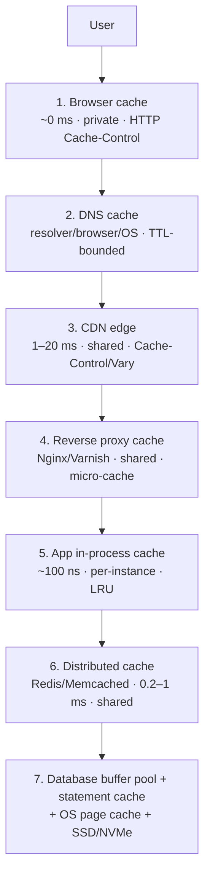
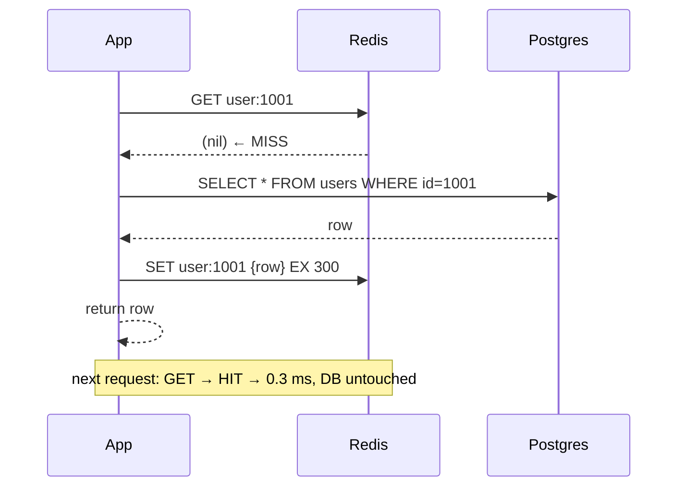

# Caching Strategies and Layers — Cache-Aside, Write-Through, Write-Back and Eviction

> **TL;DR** — A cache is a small, fast, lossy copy of data that is authoritative somewhere else. There are **seven layers** between a user's tap and a database page read — browser, DNS, CDN, reverse proxy, application in-process, distributed (Redis), and the database's own buffer pool plus the OS page cache — and a good design uses several at once, each solving a different problem. The four write/read strategies (cache-aside, read-through, write-through, write-back) differ in *who* populates the cache and *when* the durable store is updated, which determines your consistency, latency, and data-loss risk. Eviction policy decides what you throw away when full, and the hit-ratio arithmetic — "read QPS is 50,000, a single DB handles 5,000, so the cache must absorb 90%" — is the justification you should be able to produce on a whiteboard before you draw a single box.

> **60-second interview answer:** "Caching is the highest-leverage move in system design because the read:write ratio of most products is somewhere between 10:1 and 1000:1, so a cache turns an expensive durable read into a memory read. My default is cache-aside, because it is simple, resilient — the cache can die and the system keeps working from the database — and it is the right fit for read-heavy workloads. If consistency matters more than write latency I use write-through; if write throughput matters and I can tolerate losing recent writes on a crash, write-back. I layer caches: browser and CDN for static content, Redis for shared hot data, an in-process cache for ultra-hot read-mostly config, and the database buffer pool underneath. The number I care about is the hit ratio, because it is what determines the load the database actually sees — if reads are 50,000 QPS and one database handles 5,000, I need the cache to absorb 90% of reads."

---

## 1. Definition & mental model

**Plain English.** A cache stores the result of an expensive operation close to where it is needed, so the next request for that result is cheap. It is always a *copy* — the source of truth lives elsewhere — which is exactly why caching is safe to get wrong in performance terms and dangerous to get wrong in correctness terms.

**The analogy.** McDonald's. This is the transcript's own framing, and it is a good one.

Cooking a burger to order takes four minutes. At 70 million customers a day, nobody waits four minutes. So the kitchen **pre-prepares patties** and holds them under a heat lamp in a small number of trays. When an order comes in, the counter staff grab a pre-made patty (**cache HIT**) and hand it over in seconds. If the tray is empty — a rush, or a flavour nobody ordered yet — the kitchen cooks one fresh (**cache MISS**), and while they are at it they cook a few extra for the tray (**populate the cache**). The tray has a limited size, so when it is full and a new flavour arrives, something has to be thrown away (**eviction policy**). And patties cannot sit forever or they are a health hazard, so each batch has a **sell-by time** (**TTL**) after which it is discarded even if nobody asked for it.

The whole of caching is in that picture: precompute on miss, serve on hit, bound by size and time, and accept that some fraction of requests always pays the full price.

**The two questions that define any caching design:**
1. **Where does the copy live?** (Which layer — browser, CDN, app memory, Redis, DB buffer pool.)
2. **When is the copy refreshed or thrown away?** (Strategy + TTL + invalidation.)

---

## 2. Why it exists — the problem it solves

### The arithmetic that makes caching non-optional

```
Product page: 50,000 reads/sec, 500 writes/sec   → 100:1 read:write
A single Postgres instance on decent hardware: ~5,000–20,000 simple reads/sec
A single Redis instance: ~100,000–200,000 ops/sec, sub-millisecond

Without a cache:  50,000 QPS against a 5,000 QPS database → 10× over capacity → collapse
With a 90% hit ratio: the database sees 5,000 QPS → exactly at capacity
With a 95% hit ratio: the database sees 2,500 QPS → comfortable headroom
```

This is the justification pattern from Day 1: **name the read QPS, name the database's capacity, compute the hit ratio you need, and only then choose the cache.** Candidates who say "we'll add Redis" without that arithmetic are guessing.

### What breaks without caching

1. **The database becomes the bottleneck and then the outage.** A single hot query at 50k QPS saturates connection pools, then CPU, then the disk. Everything fails, including the writes.
2. **Latency.** A DB read is 1–20 ms; a Redis read is 0.2–1 ms; an in-process read is ~100 ns. At p99 the gap is larger still, because the database is where contention and lock waits live.
3. **Cost.** Read replicas scale reads linearly but at linear cost; a cache scales reads by an order of magnitude for a fraction.
4. **Availability coupling.** Without a cache, a database blip is a full outage. With a cache and `stale-if-error`-style fallbacks, a database blip degrades to "slightly stale".
5. **You cannot absorb a spike.** A viral post multiplies read traffic instantly; a database cannot multiply its capacity instantly, but a CDN and Redis can absorb it.
6. **Cross-region latency is unsolvable with a database.** You cannot put a single primary in every region; you *can* put a cache in every region.

### The six conflicting goals applied to caching

Caching trades **consistency** for **performance, scalability, cost, and availability**. In the six-goal framing from Day 1: Instagram chooses a slightly stale like-count because *performance* dominates; a stock exchange cannot cache an order book because *consistency* dominates. State which goal wins before you propose a cache.

---

## 3. Internal mechanics — how it actually works

### 3.1 Every cache layer



| # | Layer | Typical latency | Scope | TTL / invalidation | What it buys |
|---|---|---|---|---|---|
| 1 | **Browser** | ~0 ms | One user | `Cache-Control`, `ETag` | Zero network entirely |
| 2 | **DNS** | ~0 ms cached | Resolver / OS | TTL | Avoids a resolver round trip |
| 3 | **CDN edge** | 1–20 ms | Many users, per region | `Cache-Control`, purge | Global latency, origin offload |
| 4 | **Reverse proxy / micro-cache** | 0.5–5 ms | All users of one service | `proxy_cache`, 1–60 s TTL | Offloads the app tier for hot, short-TTL responses |
| 5 | **Application in-process** | ~50–500 ns | One instance | TTL + explicit invalidation | Removes even a Redis round trip; ultra-hot config, feature flags, reference data |
| 6 | **Distributed cache (Redis/Memcached)** | 0.2–1 ms | All instances | TTL + explicit invalidation | Shared, consistent-ish, the workhorse |
| 7 | **Database buffer pool / OS page cache** | 0.1–1 ms | One DB node | LRU by the DB itself | Makes an "uncached" read still memory-speed |
| — | **Client-side (mobile app) cache** | ~0 ms | One user | Custom TTL | Offline-tolerant apps |

**The layering rule:** each layer should have a *different* TTL and a *different* reason to exist. Two adjacent cache layers with the same TTL and the same key are just one cache with extra hops.

### 3.2 In-process cache specifics

An in-process cache (`Guava Cache`, `Caffeine`, Python `functools.lru_cache`, Node `lru-cache`, Go `ristretto`) holds data in the application's own heap.

| Property | Detail |
|---|---|
| Latency | ~50–500 ns — no network, no serialisation |
| Consistency | **None across instances.** With 20 instances you have 20 divergent copies |
| Size bound | Must be bounded (`maximumSize`, `maxWeight`) or you OOM; `Caffeine` defaults to unbounded |
| Eviction | W-TinyLFU in Caffeine; LRU elsewhere |
| Best for | Read-mostly, slowly changing, small data: feature flags, country lists, pricing tiers, config, model routing tables |
| Worst for | Anything user-specific (multiplied memory), anything that changes often (staleness), anything large (heap pressure and GC pauses) |

**The 20-instance staleness problem:** with a 60 s TTL and 20 instances, an update takes up to 60 s to reach every instance, and during the window different users see different values — a genuinely confusing bug report ("the price changes when I refresh"). **Mitigations:** short TTL (5–30 s) for tolerant data, a pub/sub invalidation channel (Redis pub/sub or a Kafka topic), or a version counter that the cache validates cheaply.

**JVM-specific:** an in-process cache competes with the rest of the heap and can cause GC pauses; use a size-bounded cache with weights and monitor its heap share. A cache that fills the old generation is a latency incident waiting to happen.

### 3.3 The four caching strategies

#### (a) Cache-aside (lazy loading) — the default

```
READ:
  value = cache.get(key)
  if value is None:                  # MISS
      value = db.query(key)
      cache.set(key, value, ttl)
  return value

WRITE:
  db.write(key, value)
  cache.delete(key)                  # or cache.set(key, value) — see §4.4 of invalidation
```

- **Who populates:** the application.
- **The application knows about both the cache and the database.**
- **Resilience:** if the cache is down, the app falls back to the DB and the system still works (slower).
- **Only requested data is cached** — no memory wasted on cold rows.
- **Default choice for read-heavy workloads** — the transcript's explicit conclusion.



#### (b) Read-through

```
READ:
  value = cache.get(key)       # the cache itself loads from the DB on a miss
  return value
```

- **Who populates:** the cache (or a cache library/provider with a loader function).
- **The application only talks to the cache** — a cleaner interface and less duplicated loading logic.
- Usually implemented with a library (`@Cacheable` in Spring, a loader in a caching client), not with Redis alone; Redis itself has no read-through.
- Practically similar to cache-aside but the *loader* lives in one place instead of at every call site. The failure modes are the same.

#### (c) Write-through

```
WRITE:
  cache.set(key, value)          # synchronously
  db.write(key, value)           # synchronously, in the same request
  return
```

- Both are updated **in the same request**, so the cache is never behind the DB for data that was written through it.
- **Pro: consistency** — a read immediately after a write sees the new value (for a single-key, single-writer workload).
- **Con: writes are slower** — two writes instead of one, one of them over the network, and both on the critical path.
- **Con: write amplification** — every write touches the cache even for data that will never be read (a write-through cache of write-once data is pure waste).
- Good for: config, small reference data, anything where "read-your-write" matters more than write throughput.

#### (d) Write-back / write-behind

```
WRITE:
  cache.set(key, value)          # return immediately
  # ... asynchronously, batched, later:
  db.write(key, value)
```

- **Pro: very fast writes** — the client waits only for the memory write.
- **Pro: batching** — 1,000 writes can become one bulk DB write, which is a huge throughput multiplier for counters and metrics.
- **Con: data loss on crash** — if the cache dies before flushing, those writes are gone. **This is the real cost, and it is a business decision, not a technical one.**
- **Con: read-after-write anomalies** — a reader hitting a different cache node (or the DB directly) may see the old value.
- Best for: **logging and analytics**, view counters, like counters, metrics, high-frequency sensor ingest — anything where losing the last few seconds of writes is acceptable.

#### Comparison

| | Cache-aside | Read-through | Write-through | Write-back |
|---|---|---|---|---|
| Who loads on miss | Application | Cache | Cache | Cache |
| App talks to | Cache + DB | Cache only | Cache + DB | Cache only |
| Write latency | DB write + cache delete | DB write | Cache + DB (sync) | Cache only |
| Consistency after write | Eventual (delete → next read repopulates) | Eventual | Strong-ish | Weak; eventual after flush |
| Data-loss risk | None (nothing pending) | None | None | **Yes — pending writes** |
| Complexity | Low | Low | Medium | High |
| Best for | Read-heavy (default) | Read-heavy with a unified interface | Consistency-sensitive small data | High write throughput, loss-tolerant |
| Used by | Most web apps | ORM/cache frameworks | Config stores, feature flags | Counters, analytics, logging |

**The interviewer's expected answer (from the transcript):** *cache-aside for read-heavy work, write-through for consistency, write-back for speed.* Say that, then add *why* and one failure mode for each.

### 3.4 The read-through/write-through confusion to avoid

Many teams say "read-through" but describe cache-aside, because in both cases a miss results in a database read and a cache fill. The **only** difference is who performs the load — the application code or the cache layer. If asked, say precisely that. It looks sloppy to conflate them.

### 3.5 Refresh-ahead

A variant where the cache **proactively refreshes** an entry shortly before it expires, so a hot key never causes a miss.

```
ttl = 300 s, refresh_ahead = 0.8
at t=240 s (80% of TTL), asynchronously reload the value and reset the TTL
```

- Eliminates misses on predictable hot keys (the top 1% of keys may be 30–50% of traffic).
- Costs a background reload even if the value is never requested again.
- **It is the natural anti-stampede mechanism** for known-hot keys; for unknown hot keys, use single-flight (see [cache invalidation](04-cache-invalidation-and-consistency.md)).

### 3.6 TTL design

TTL is the simplest invalidation strategy: **every value is correct within a bounded staleness window**, and you never need an invalidation channel.

| Data type | Typical TTL | Reasoning |
|---|---|---|
| Static asset (hashed) | 1 year, `immutable` | The URL changes when content changes |
| HTML shell | `s-maxage=60` + `stale-while-revalidate=86400` | Fresh enough, no misses visible |
| User profile | 300–3,600 s | Changes rarely; a minute of staleness is invisible |
| Product catalogue / pricing | 30–300 s | Staleness costs money; keep it short |
| Inventory count | 1–10 s (or do not cache; use a reservation) | Staleness causes overselling |
| Session | 900–3,600 s (sliding) | Security vs convenience |
| Feature flags / config | 5–60 s in-process, no TTL in Redis | Changes must propagate fast |
| Computed aggregates (counts) | 60–600 s | Recompute is expensive, small staleness is fine |
| Negative result (`nil`, 404) | 10–60 s | Prevents cache penetration without blocking legitimate creation |
| Rate-limit counter | window length | Self-expiring by design |
| Permission / authz decision | 30–300 s | Revocation latency vs auth-provider load |
| Embedding / semantic-cache entry | 1–24 h | Deterministic for the same model version |

**Rules of thumb:**
- **Add jitter: `ttl ± 10%`.** Without it, 10,000 keys written in the same second all expire in the same second, causing a synchronised stampede. This is the cheapest anti-stampede measure that exists.
- **Shorter TTL where staleness costs money; longer TTL where it costs nothing.**
- **TTL is a safety net, not the primary mechanism**, for anything that must update immediately.
- **Never a TTL of 0 or infinite** without knowing what it means in your cache client (0 often means "no expiry," not "expire immediately").

### 3.7 Eviction policies

A cache is finite. When full, something must go.

| Policy | How it works | Pros | Cons |
|---|---|---|---|
| **LRU** (Least Recently Used) | Evict the entry not accessed for the longest time | Good for temporal locality; the standard default | A single sequential scan evicts the entire working set (**scan pollution**); ignores frequency |
| **LFU** (Least Frequently Used) | Evict the entry with the fewest accesses | Retains long-term-popular items; immune to scan pollution | **Frequency is sticky** — a formerly-hot key never leaves; needs aging/decay; needs a counter per entry (memory) |
| **LIFO** | Evict the most recently inserted | Rarely useful | Ignores access patterns entirely |
| **FIFO** | Evict the oldest inserted, regardless of use | Trivial | Ignores access entirely; worse than LRU |
| **Random** | Evict a random entry | No bookkeeping at all; surprisingly OK under uniform access | Poor with skew |
| **LRU-K** | Evict by the time of the K-th most recent access | Resists scan pollution (K=2 filters one-hit wonders) | Needs K timestamps per entry |
| **2Q** | Two queues: a probationary FIFO and a protected LRU; promote on second access | Resists scan pollution with less memory than LRU-K | More complex |
| **SLRU** | Segmented LRU (probation + protected) | Similar benefits | Tuning segments |
| **W-TinyLFU** | Window LRU + frequency sketch (Count-Min) for admission | **Best hit ratio in practice**; used by Caffeine | Complex; approximate frequency |
| **TTL-only / no eviction** | Let entries expire; if full, error | Predictable | Redis returns OOM errors to writers when `maxmemory-policy noeviction` |

**Redis `maxmemory-policy` options (must-know names):**
`noeviction` (errors on write when full — the default for non-cache use), `allkeys-lru`, `volatile-lru`, `allkeys-lfu`, `volatile-lfu`, `allkeys-random`, `volatile-random`, `volatile-ttl`.

- `allkeys-lru` is the standard choice for a pure cache.
- `volatile-*` only consider keys with a TTL — dangerous if some keys have no TTL, because then *nothing* is evictable and Redis starts erroring with `OOM command not allowed`.
- `noeviction` is correct when Redis holds data you cannot lose (and then it is not a cache, it is a database — see [Redis](03-redis-deep-dive.md)).

**The critical property: eviction means a cache-aside read can miss even for a hot key.** Any design that assumes "if it is hot it is cached" is wrong under memory pressure. When you shrink `maxmemory`, hit ratio drops before any metric shows the cause.

### 3.8 Hit ratio mathematics

```
hit_ratio = hits / (hits + misses)
DB_load   = total_QPS × (1 − hit_ratio)

Need:  DB_load ≤ DB_capacity
→  hit_ratio ≥ 1 − (DB_capacity / total_QPS)
```

**Worked examples:**

| Total read QPS | DB capacity | Required hit ratio |
|---|---|---|
| 50,000 | 5,000 | 90.0% |
| 50,000 | 10,000 | 80.0% |
| 100,000 | 5,000 | 95.0% |
| 10,000 | 8,000 | 20.0% |
| 200,000 | 5,000 | 97.5% |

**Read amplification of a miss:** a miss costs *more* than an uncached read, because it is a cache lookup **plus** the DB read **plus** the cache write. At a very low hit ratio you can be slower than no cache at all — which is why "just add Redis" is not always right.

**Why hit ratio is never 100%:**
- **Compulsory misses** — the first request for any key (unavoidable).
- **Capacity misses** — the working set exceeds cache memory.
- **Conflict misses** — eviction due to policy, not true capacity.
- **Invalidation misses** — a write deleted the entry.
- **TTL misses** — the entry expired before reuse.
- **Cold start / deploy** — the cache is empty after a flush or a scaling event.

**Improving hit ratio, ranked by payoff:**
1. **Increase the working-set coverage** (more memory) — the direct fix for capacity misses.
2. **Normalise the cache key.** A missing or spurious key component (a `?utm_` param, a per-request ID, a timestamp) can hold you at 0%.
3. **Pick the right eviction policy** — W-TinyLFU/LFU over LRU where scan pollution exists.
4. **Cache the expensive *sub-results*, not just the final response** (a rendered fragment, a computed aggregate).
5. **Negative caching** for repeated lookups of things that do not exist.
6. **Warm the cache** after a deploy, flush, or scale-up.
7. **Refresh-ahead** for known hot keys.

### 3.9 Negative caching

Caching the *absence* of a value.

```
GET user:999999  → nil → query DB → not found → SET user:999999 "__NULL__" EX 30
next 1,000 requests → HIT on the null marker → no DB load
```

- **Prevents cache penetration** (see §6.2): repeated requests for non-existent keys that all miss and all hit the DB. An attacker enumerating IDs can generate 100% misses and take the database down without a single legitimate request.
- Must be **short-lived** (10–60 s) or a legitimate creation of that record will be hidden behind the negative entry.
- Must be **distinguishable** from a genuine miss — use a sentinel value (`"__NULL__"`) or a separate key space, not an empty string, or you will confuse a miss with a cached empty result.
- Applies at the CDN layer too: cache 404s briefly rather than letting every typo hit the origin.

### 3.10 Cache warming

Populating the cache **before** traffic arrives.

| Method | Mechanism |
|---|---|
| Pre-warm on deploy | A job that iterates the top-N keys and populates them |
| Lazy warm from logs | Replay the top 1,000 keys from yesterday's access log |
| Shadow/probabilistic warm | Read-through during low traffic; or warm on a schedule |
| Replication / snapshot | Load the cache from a snapshot of the previous instance before taking traffic |
| Continuous pre-compute | A background job that maintains derived values (leaderboards, counts) |

**Why it matters:** after a deploy or a cache restart, the cache is cold and the DB sees 100% of traffic. If the DB cannot survive 100% of traffic — and it usually cannot, because the cache's whole purpose was to absorb 90% — the cold start is an outage. **Never restart the whole cache fleet at once**, and never flush a cache in production without a warming plan.

### 3.11 Semantic caching (for RAG and LLM applications)

A normal cache keys on an exact string. A **semantic cache** keys on *meaning*: it embeds the query, searches for a previously answered query with cosine similarity above a threshold, and returns the stored answer.

```
User: "What is our refund policy?"
  → embed → [0.12, -0.44, ...]
  → vector search in the semantic cache
  → nearest cached query "what's the refund policy?" similarity 0.97 > 0.93 threshold
  → HIT → return the cached answer (no LLM call)

User: "What is our return policy for India?"
  → nearest similarity 0.81 < 0.93
  → MISS → call the LLM → store the new query+answer pair
```

| Design point | Guidance |
|---|---|
| Threshold | 0.90–0.95 cosine for factual Q&A; lower for conversational; **too low and you serve wrong answers confidently** |
| Storage | Redis with vector search (RediSearch), or the vector DB itself |
| TTL | 1–24 h; invalidate on document/corpus change |
| Key scope | **Must be per-tenant and per-permission-set.** A global semantic cache leaks one customer's data to another — a severe bug |
| Cost saving | Frequently 20–60% of LLM calls for support/FAQ workloads; the savings are in both latency and tokens |
| Failure mode | A near-miss threshold serves a plausible but wrong answer, and because it is cached it is wrong *consistently* |

Semantic caching is one of the highest-value AI-infrastructure patterns and belongs in any RAG design answer. Details in [Redis Deep Dive](03-redis-deep-dive.md) and [Vector Databases](../04-data/03-vector-databases.md).

### 3.12 Multi-level cache design (L1/L2)

```
App instance
  ├── L1: in-process Caffeine, 10k entries, TTL 10 s
  └── L2: Redis, 10M entries, TTL 300 s
        └── L3: database + buffer pool
```

| | L1 (in-process) | L2 (Redis) |
|---|---|---|
| TTL | Short (5–30 s) | Longer (60–600 s) |
| Content | Hot, small, read-mostly | Broad working set |
| Consistency | Weak — per-instance | Shared |
| Memory cost | Per instance (×N) | Shared |
| Invalidation | Pub/sub broadcast, or TTL | Direct delete + pub/sub for L1 |

**Design rules for multi-level:**
- **L1 TTL must be much shorter than L2 TTL**, or invalidation lag becomes user-visible.
- **Never cache the same data in L1 with a long TTL** — you have just multiplied your invalidation problem by the instance count.
- **Broadcast invalidation on write** if L1 TTL > a few seconds: publish an invalidation event that every instance consumes.
- **L1 is for read-mostly, not read-only-but-changing**: config, reference data, small derived values.

---

## 4. Variants & taxonomy

| Variant | Description |
|---|---|
| **Cache-aside** | App manages cache and DB; the default for read-heavy |
| **Read-through** | Cache loads on miss via a loader; app only talks to the cache |
| **Write-through** | Cache and DB written synchronously |
| **Write-back / write-behind** | Cache written first, DB asynchronously |
| **Refresh-ahead** | Proactive refresh before expiry |
| **Write-around** | Write directly to the DB, bypassing the cache (avoid polluting it with write-once data) |
| **Read-ahead / prefetch** | Fetch adjacent data speculatively (the next page of a feed) |
| **Negative cache** | Cache the absence of a value |
| **Semantic cache** | Keyed on embedding similarity |
| **Result cache** | Cache the computed response of a whole request |
| **Fragment cache** | Cache part of a page (an expensive widget) |
| **Object/document cache** | Cache a serialised domain object |
| **Local (L1) + distributed (L2)** | Two-tier |
| **CDN / edge cache** | Geographically distributed shared cache |
| **Micro-cache** | Very short reverse-proxy TTL (1–10 s) to absorb bursts on an "uncacheable" endpoint |
| **Read replica as a "cache"** | Not a cache, but the same read-offload function with strong-ish consistency |
| **Materialised view** | A precomputed, durable cache inside the database |
| **Denormalised counter** | A precomputed aggregate kept in the DB rather than computed per read |

---

## 5. Pros / Cons

| Pros | Cons |
|---|---|
| 10–100× lower read latency | **Staleness** — the fundamental cost; you must decide how much is acceptable |
| The database sees a fraction of the load | Invalidation is genuinely hard ([see file 4](04-cache-invalidation-and-consistency.md)) |
| Linear read scaling without linear DB cost | A new failure domain: the cache can be down, hot, or evicted at the worst moment |
| Absorbs spikes (viral traffic) | Cold start / stampede after a flush or deploy can be worse than no cache |
| Survives database blips with stale reads | Memory cost is real; a large working set is expensive |
| Enables latency-based SLOs globally | Consistency bugs are subtle and intermittent, making them hard to reproduce |
| Cuts egress and compute cost | Cache coherence across N instances is an unsolved problem in practice |
| Reduces the need for read replicas | Serialisation/deserialisation overhead can dominate for large objects |
| Semantic caching cuts LLM cost 20–60% | Semantic caching can serve confidently wrong answers if the threshold is loose |

---

## 6. Exceptions, edge cases & failure modes

### 6.1 Cache stampede / dogpile / thundering herd

**The single most important cache failure mode.** A hot key expires (or is invalidated) and *N* concurrent requests all miss simultaneously, all query the database, and all write back. With N = 5,000, the database receives 5,000 identical queries.

```
t=0    key "home:feed" TTL expires
t=0+ε  2,000 concurrent requests: GET → nil
t=0+ε  2,000 requests → DB query (identical)
       DB connection pool (say 100) saturates → queue → timeouts → 504s
t=1s   2,000 writes to Redis (identical value)
```

**Fixes** (full treatment in [cache invalidation](04-cache-invalidation-and-consistency.md)):

| Fix | Mechanism |
|---|---|
| **Single-flight / mutex** | One request recomputes; the rest wait on a promise/lock |
| **Probabilistic early expiration** | Each request recomputes with a small probability that rises as expiry nears (XFetch algorithm) |
| **Jittered TTL** | `ttl ± 10%` so keys do not expire together |
| **Refresh-ahead** | A background job refreshes before expiry |
| **`stale-while-revalidate`** | Serve stale immediately, refresh in the background |
| **Serve-stale-on-error** | If recompute fails, serve the old value |
| **Lock with a timeout and a fallback** | If the lock cannot be acquired within X ms, serve stale or compute anyway |
| **Lock the *recompute*, not the *read*** | Never block a read on a lock; that converts a stampede into a latency incident |

### 6.2 Cache penetration

Requests for keys that **do not exist**. Every one misses and hits the DB. An ID-enumeration attack (`/users/1`, `/users/2`, … `/users/999999999`) produces a 0% hit ratio and a fully-loaded database from a single attacker.

**Fixes:**
- **Negative caching** with a short TTL.
- **Bloom filter** in front: if the filter says "definitely not present," return 404 without touching the cache or DB. Cost: ~10 bits per key for a 1% false-positive rate; a false positive just means one wasted DB query.
- **Request validation** — reject obviously invalid IDs (non-numeric, out of range) at the edge.

### 6.3 Cache avalanche

A large fraction of the cache becomes invalid **at the same moment** — a full flush, a restart, a mass invalidation, or every key written with the same TTL during a batch job. The DB then receives close to 100% of traffic.

**Fixes:** jittered TTLs; warm the cache before serving traffic; roll restarts (never restart the fleet at once); use a warm-up job after any flush; and make the DB's autoscaling able to survive a temporary 2–5× read increase.

### 6.4 Hot key

One key receives a disproportionate share of traffic — a celebrity's profile, a viral post, a global config key, a rate-limit counter. A single Redis node can do roughly 100k–200k ops/sec, so one key at 500k QPS is a hard ceiling.

**Fixes:**
- **Local (L1) cache in each app instance** for the hot key, with a very short TTL — the single most effective fix.
- **Read replicas** in Redis and read from replicas for the hot key.
- **Key sharding**: `hotkey:{0..9}` with a random suffix, and the reader picks a random shard or sums them.
- **The "key + replica-suffix" technique** for counters: `views:post42:{0..N}` incremented across N keys, summed on read.
- **Detect hot keys** with `redis-cli --hotkeys` (requires an LFU policy) or by monitoring command stats.

### 6.5 Big keys

A single key holding a 500 MB value (a huge list, a giant hash, a serialized object) causes:
- Long blocking operations when it is read or deleted (Redis is single-threaded).
- `DEL` on a 10M-element set blocks the whole instance for hundreds of milliseconds — use `UNLINK` instead.
- Memory fragmentation and unpredictable eviction.
- Replication and persistence overhead (every snapshot carries it).

**Detection:** `redis-cli --bigkeys`, `MEMORY USAGE key`, or a scan over keys for large `STRLEN`/`HLEN`/`SCARD`.
**Fix:** split into chunks (`user:1001:posts:{page}`), cap collection sizes, and use `UNLINK` for deletion.

### 6.6 Cache coherence across instances

With N app instances each holding an L1 cache, and a Redis L2, an update must reach all N L1 caches or users see different values. There is no cheap general solution; there are only mitigations:

| Mitigation | Trade-off |
|---|---|
| Very short L1 TTL (5–15 s) | Bounded staleness; more L2 traffic |
| Pub/sub invalidation broadcast | Near-instant, but a message can be lost (Redis pub/sub is fire-and-forget); combine with a short TTL |
| Versioned keys | `config:v17` — an update bumps the version and all instances miss |
| A version counter checked cheaply | One extra tiny GET per read |
| Don't cache mutable data in L1 | The honest answer for correctness-critical data |

### 6.7 Read-replica race → stale repopulation

The nastiest correctness bug in cache-aside. The classic sequence:

```
t0  Writer: DB write (value = v2)      → primary
t1  Writer: cache DELETE key
t2  Reader: cache GET → MISS
t3  Reader: DB read → hits a REPLICA that has not yet replicated v2 → reads v1
t4  Reader: cache SET key = v1          ← stale value repopulated
     ...and it will sit there for the whole TTL, long after the replica caught up
```

**Fixes:**
- **Delete-after-write with a delay** (a "second delete" 500 ms later) — the standard mitigation in the absence of better tools.
- **Read-your-writes routing**: after a write, route that user's reads to the primary for a short window.
- **Versioned/stamped values**: store a version with the data and reject a write-back older than what is in the cache (compare-and-set).
- **CDC-based invalidation** rather than application-driven deletes — the invalidation happens after the write is durably committed and replicated.
- **Cache-aside where writes go to the primary, and the cache is only populated from the primary** for correctness-critical data.

### 6.8 Delete-on-write vs update-on-write

| | Delete on write | Update on write |
|---|---|---|
| Race risk | Lower — the next read repopulates correctly (except §6.7) | Higher — two concurrent updates can write out of order, leaving the cache with the older value permanently until TTL |
| Cost | One extra DB read on the next request (the "cache miss" penalty) | No extra read, but every write must serialise the full value |
| Write-heavy data | Better (writes that are never read cost nothing) | Worse (write amplification on the cache) |
| Recommended | **Yes — the default** | Only with versioning or a single-writer guarantee |

### 6.9 Cache poisoning / wrong-value bugs

- **Key collisions** from a poorly constructed key (`user:1` and `user:12` both reduced to a truncated hash).
- **Serialisation format changes** between deploys: the old cached objects are in a format the new code cannot read. Symptom: `500`s for one TTL period after every deploy. **Fix:** include a schema/version prefix in the key namespace (`v2:user:1001`) and let the old namespace expire.
- **Cross-tenant leakage** — the key omits the tenant, so one tenant reads another's data. This is a security incident. **Fix:** always include the tenant/permission scope in the key, and test it.
- **Locale/currency/unit in the key** — omitting them serves the US price to the EU customer.

### 6.10 The cache is not a database

Redis with `appendonly yes` and `maxmemory-policy noeviction` is a durable-ish store, but it is still not a database: it is single-threaded (one slow command blocks everything), memory-bound (a large dataset costs far more than on disk), and its persistence is not fsync-per-commit by default (you can lose the last second of writes). If the data cannot be lost and cannot be recomputed, it belongs in a database. The transcript's framing — "it is temporary storage" — is right for the default use case.

### 6.11 Other failure modes worth naming

- **`maxmemory` reached with `noeviction`** → Redis returns `OOM command not allowed when used memory > 'maxmemory'` for every write. The app's writes fail and the cache is read-only. Monitor memory continuously and alert at 80%.
- **Fork/COW latency spikes** — persistence or replica sync forks the process; copy-on-write can double memory and stall the event loop for tens to hundreds of milliseconds. See [Redis](03-redis-deep-dive.md).
- **Serialisation cost dominating** — a 1 MB JSON object takes longer to deserialise than the DB read it replaced. Cache smaller, or use a faster codec.
- **TTL of 0 or negative** — some clients treat `0` as "no expiry" and others as "already expired," so a bug in the TTL computation produces either a permanently cached object or a permanent miss.
- **Cache client connection exhaustion** — every app instance holds connections; a Redis failover with a thundering reconnect can exhaust the new primary. Use a pooling client with backoff and jitter.
- **Clock skew in TTL computation** — an app node with a fast clock sets entries that live longer than intended; a slow one sets entries that expire early.
- **Caching exceptions and errors** — a transient `500` cached for 300 s turns a blip into a 5-minute outage. Cache only successful responses, and never cache `5xx` with a long TTL.
- **The "we'll invalidate it" trap** — every cache you add is a new invalidation surface. Ask "how does this get stale, and who fixes it?" for every single cache you introduce.
- **Cache warming storm** — a warm-up job that reads 1M keys at once is itself a load spike against the DB. Rate-limit the warm-up.

---

## 7. When to use / When NOT to use

### Use a cache when
- Reads vastly outnumber writes (≥ 10:1, ideally ≥ 100:1).
- The same data is requested repeatedly (temporal locality).
- A read is expensive — a join across five tables, an aggregate, an external API call, an LLM call.
- Read latency is on an SLO path.
- The database is near capacity on reads.
- Data tolerates bounded staleness.
- Traffic is spiky and the DB cannot absorb peaks.
- You need cross-region read performance.

### Do NOT cache when
- **Reads are mostly unique** (no reuse) — the cache is pure overhead plus a miss penalty.
- **Data must be exact** — order books, inventory counts during a reservation, seat availability, a payment balance display, an authorisation decision you must not get wrong.
- **Write volume is comparable to read volume** — you pay invalidation cost with no benefit.
- **The item is cheap to compute** — a hash, a constant lookup, a memory-local computation. The cache lookup can be slower than recomputing.
- **Memory is more expensive than the saved compute** — a 6 KB embedding cached for one use is a bad trade.
- **The staleness window cannot be tolerated and invalidation cannot be reliable** — then you are just adding a bug.
- **You cannot answer "how does this get invalidated?"** — do not ship that cache.

### Decision table

| Requirement | Cache strategy |
|---|---|
| Read-heavy, simple, tolerant of staleness | Cache-aside + TTL + jitter |
| Read-your-write required immediately | Write-through, or write to primary and read from primary briefly |
| Extreme write throughput (counters, metrics) | Write-back with batching, accepting loss on crash |
| Small, hot, read-mostly config | In-process L1 with 5–30 s TTL + pub/sub invalidation |
| Global static content | CDN with hashed URLs + long immutable TTL |
| Bursty endpoint that "cannot be cached" | Reverse-proxy micro-cache, 1–10 s TTL |
| Repeated identical LLM questions | Semantic cache, per-tenant, threshold ≥ 0.93 |
| ID enumeration / misses for non-existent keys | Negative cache + Bloom filter |
| Known hot key | L1 local cache + Redis read replicas + key sharding |
| Expensive aggregate, small staleness OK | Refresh-ahead or a precompute job |
| Data that must be exact | Do not cache; optimise the query or add a read replica |

---

## 8. Numbers, defaults & tuning

| Quantity | Typical | Reasoning |
|---|---|---|
| Redis GET latency | 0.2–1 ms in-region | The per-hit cost |
| Redis throughput (one node) | ~100k–200k ops/sec | Single-threaded; one slow command affects all |
| In-process cache read | ~50–500 ns | No network, no serialisation |
| DB read (buffer-pool hit) | 0.1–1 ms | Already a cache |
| DB read (disk) | 5–20 ms | What you are avoiding |
| Hit-ratio target | 85–95% for a well-tuned cache | Below 70% usually means a key or capacity problem |
| Required hit ratio formula | `1 − DB_capacity / read_QPS` | The interview arithmetic |
| TTL jitter | ±10% | Prevents synchronised expiry |
| L1 (in-process) TTL | 5–30 s | Long enough to help, short enough to hide invalidation lag |
| L2 (Redis) TTL | 60–600 s | The workhorse window |
| Session TTL | 900–3,600 s sliding | Security/convenience balance |
| Negative cache TTL | 10–60 s | Absorbs floods, recovers quickly |
| Rate-limit counter TTL | = window length | Self-expiring |
| Semantic cache similarity threshold | 0.90–0.95 | Below ~0.9 you start serving wrong answers |
| Semantic cache TTL | 1–24 h | Recompute on corpus change |
| Redis `maxmemory` alert threshold | 80% | Above that, evictions start and hit ratio degrades |
| Eviction headroom | Keep 20–30% free | Eviction is not free; it costs hit ratio |
| `maxmemory-policy` for a pure cache | `allkeys-lru` | Or `allkeys-lfu` with hot keys |
| `maxmemory-policy` for non-cache data | `noeviction` | Errors rather than silently losing data |
| Connection pool per app instance | 10–50 to Redis | More is not better; Redis is single-threaded |
| Redis pipelining gain | 5–10× fewer round trips | For batch operations |
| Warm-up rate limit | ≤ 10% of DB capacity | Do not let warming become the outage |
| Cache flush risk | DB sees 100% of traffic | Never flush a whole production cache casually |
| Serialisation overhead | JSON ~50–200 MB/s; MessagePack ~2× JSON; protobuf faster still | Large objects can be dominated by (de)serialisation |
| Typical read:write ratio | 10:1 (write-heavy products) to 1000:1 (content) | Decides whether caching is worth it |
| Working-set size | The number that sets your memory bill | Measure it; do not guess |
| Bloom filter | ~10 bits/key for 1% false positives | Cheap protection against penetration |

---

## 9. Interview Q&A

**Q1 (easy). Why do we cache?**
Because most systems are read-heavy — commonly 10:1 and often 100:1 or more — and a memory read is one to three orders of magnitude faster than a durable read. Caching gives me lower latency, a database that sees a fraction of the load, the ability to absorb traffic spikes, and cost savings. It also reduces availability coupling: if the database has a blip, a cache with stale-tolerant reads keeps the product usable.

**Q2 (easy). Name the cache layers in a typical request.**
Browser cache, DNS cache, CDN edge, reverse-proxy cache, in-process application cache, distributed cache like Redis, and then the database's buffer pool and the OS page cache underneath. Each layer exists for a different reason: browser and CDN avoid the network, the reverse proxy absorbs bursts, the in-process cache avoids even a network hop, Redis shares state across all instances, and the database buffer pool is the cache you get for free.

**Q3 (easy). What is cache-aside and why is it the default?**
The application checks the cache, and on a miss it reads the database, writes the result into the cache with a TTL, and returns it. It is the default because it is simple, it only caches data that was actually requested, and it degrades gracefully — if Redis is down, the application falls back to the database and the system still works, just slower. It is the right fit for read-heavy workloads, which most workloads are.

**Q4 (medium). Compare the four caching strategies.**
Cache-aside: the application manages both, loads on miss, deletes on write — the default for read-heavy. Read-through: same behaviour, but the cache layer itself has a loader, so the application only talks to the cache, which is a cleaner interface. Write-through: cache and database are written synchronously in the same request, so consistency is good but writes are slower and every write populates the cache even if it is never read. Write-back: the cache is written first and the database is updated asynchronously in batches, which makes writes very fast and is ideal for logging, counters and analytics, but you lose the pending writes if the cache crashes before flushing — that is a business decision, not just a technical one.

**Q5 (medium). What is a cache stampede and how do you prevent it?**
It is when a hot key expires or is invalidated and many concurrent requests all miss at the same time, so they all hit the database with the same query. With thousands of concurrent readers the connection pool saturates and you get timeouts. I prevent it with single-flight — one request recomputes while the others wait on a shared promise or lock; with probabilistic early expiration, where each request has a small chance of recomputing that rises as the entry nears expiry; with jittered TTLs so keys do not expire together; with refresh-ahead for known hot keys; and with `stale-while-revalidate` so nobody waits. The critical rule is that I never block a read on a lock — I block the *recompute*, and serve stale or fall through if the lock cannot be acquired.

**Q6 (medium). How do you choose a TTL?**
By how much staleness the business can tolerate, and how expensive a miss is. Static content with a content-hashed URL gets a year and `immutable`. A user profile gets 5 to 60 minutes because it changes rarely. Pricing gets 30 to 300 seconds because staleness costs money. Inventory gets a few seconds, or is not cached at all and handled with reservations. Sessions get 15 to 60 minutes sliding. Negative results get 10 to 60 seconds. And I always add about 10% jitter, because otherwise anything written in a batch expires in a batch, which is the avalanche I am trying to avoid.

**Q7 (medium). Walk me through the hit-ratio arithmetic.**
Suppose read traffic is 50,000 QPS and one database instance can handle about 5,000 simple queries per second. Without a cache I am ten times over capacity. The hit ratio I need is one minus the ratio of database capacity to total traffic, so one minus 5,000 over 50,000, which is 90%. At 95% the database sees 2,500 QPS and I have comfortable headroom. That calculation is what justifies the cache and sets the memory sizing, because it tells me how much of the working set must fit in memory.

**Q8 (hard). Explain the read-replica race that leaves a stale value in the cache permanently.**
With cache-aside and a read replica, the sequence is: a writer updates the primary, then deletes the cache key. A reader then misses, and its database read goes to a replica that has not yet caught up, so it reads the *old* value and writes it back into the cache. That stale value then sits there for the entire TTL, long after the replica caught up, and no further write happens to invalidate it. I fix it with a delayed second delete — delete again a few hundred milliseconds later — which catches the race in practice; or by routing that user's reads to the primary for a short window after their write; or by storing a version with the value and refusing to write back a version older than what is cached; or best, by driving invalidation from the database's change-data-capture stream so the invalidation happens after the write is durably committed and replicated, rather than from the application.

**Q9 (hard). How would you cache a like-count on Instagram?**
This is the example from the course. The count is read on every feed render — thousands of times per second for a popular post — and written on every tap. If I write through to the database synchronously, every like costs a database write, and a viral post produces a write storm on one row, which means lock contention on that row and a serialised queue. Instead I treat the count as a write-back counter: increment in Redis, and have a background process flush deltas to the database in batches every few seconds. Reads come from Redis. The trade-off I am explicitly accepting is that the database is briefly behind, and I could lose the last few seconds of increments if Redis dies — which for a like count is acceptable, and I say that out loud. This is exactly the transcript's 100 → 101 case: a user taps like and reads the cache, which shows 101, while the database still shows 100.

**Q10 (hard). Redis is at 100% memory and hit ratio has collapsed. What happened and what do you do?**
At 100% memory the eviction policy starts discarding entries — with `allkeys-lru` it is throwing away keys to make room, and if the working set is larger than the cache, it is evicting keys faster than they are being reused, which is a condition called cache thrashing. Hit ratio collapses, the database takes the full load, and if the database cannot, everything degrades. In the short term I would scale memory up, or reduce what I am caching to the true hot set, or increase TTLs so entries survive longer. In the longer term I would measure the working-set size properly instead of guessing, set `maxmemory` with real headroom rather than at the machine limit, alert at 80%, and reconsider whether the eviction policy is right — LFU or W-TinyLFU resists thrashing better than LRU when there is a stable hot set among a lot of cold data.

**Q11 (hard, testing §6). How do you prevent an attacker enumerating IDs from taking down your database?**
That is cache penetration — every request is for a key that does not exist, so every request misses the cache and hits the database, giving a 0% hit ratio from a single attacker. I would use a Bloom filter in front of the cache so "definitely not present" returns 404 without touching Redis or the database; at roughly ten bits per key I get about a 1% false-positive rate, and a false positive just means one wasted database query. I would also add negative caching with a short TTL — 10 to 60 seconds — so repeats of the same non-existent key are absorbed, and validate IDs at the edge so malformed or out-of-range identifiers never reach the data layer.

**Q12 (hard, testing §6). After every deploy our API returns 500s for about five minutes. Why?**
The most likely cause is cached objects in an old serialisation format. The new code cannot deserialise what the previous version wrote, so every read of a pre-existing key throws. It lasts exactly one TTL period and then resolves itself, which is the signature. The fix is to namespace the cache by schema version — `v2:user:1001` rather than `user:1001` — so a new deploy reads a fresh namespace and the old one expires harmlessly. I would also check whether the deploy flushed the cache, because a cold cache after a deploy is a different problem: the database takes 100% of traffic, and if it cannot, that is an outage rather than a 500. And I would check whether the deploy changed the cache key format in a way that produces collisions.

**Q13 (hard, testing §6). How do you invalidate an in-process cache across twenty instances?**
Honestly, with bounded staleness rather than true coherence. My first choice is a very short TTL — 5 to 30 seconds — which caps how wrong anything can be, and for most read-mostly data that is enough. If I need faster propagation I publish an invalidation event on Redis pub/sub or a Kafka topic and every instance drops the key; I still keep a short TTL because pub/sub is fire-and-forget and a message can be lost during a reconnect. If the data must be exactly right I do not put it in an in-process cache at all — I keep it in Redis where there is one copy, or I version the key so an update produces a new key name and every instance misses naturally.

**Q14 (hard). What is a semantic cache and what is the danger?**
It is a cache for LLM or RAG responses keyed on meaning rather than exact text. You embed the incoming query, search for a previously answered query above a similarity threshold, and return the stored answer without calling the model. It can cut LLM calls by 20 to 60% for support and FAQ workloads, which is a large saving in both latency and tokens. The danger is the threshold: set it too low and you serve a plausible but wrong answer, and because it is cached it is wrong *consistently* for that phrasing. The other danger is scope — the cache must be per-tenant and per-permission-set, because a global semantic cache will happily return one customer's answer to another, which is a data-leak incident rather than a quality problem.

**Q15 (hard). Would you ever cache a stock price or a seat-availability count?**
No, not as the authoritative value. Those are exactly the cases where staleness has a direct financial or correctness cost: showing a stale seat as available leads to a double booking, and a stale price leads to a trade at the wrong number. What I *can* do is cache the surrounding data — the event metadata, the venue layout, the price tiers — and keep the contended value itself in a system with concurrency control: a database row with a conditional update, a Redis lock with a fencing token, or a reservation with a hold timer. If I want to show approximate availability for browsing, I can cache that as a *display-only* hint with a short TTL and revalidate at the moment of booking, and I would say explicitly that the cached number is never used for the authorisation decision.

---

## 10. Common mistakes candidates make

1. **Saying "add Redis" without the hit-ratio arithmetic.** The calculation is what proves you need it and how big it must be.
2. **Not naming which layer.** "Cache" is not an answer; browser, CDN, L1, L2 and buffer pool are.
3. **Treating write-through as the safe default.** It makes every write slower and caches data that may never be read.
4. **Recommending write-back without naming the data-loss risk.** That is the whole trade-off.
5. **Forgetting the stampede.** If you cannot describe single-flight and jittered TTL, you have not operated a cache.
6. **Saying "the TTL handles invalidation" for data that must be fresh.** TTL is a staleness bound, not an invalidation mechanism.
7. **Caching mutable, correctness-critical values** (inventory, balances, seat counts) without saying so.
8. **Not mentioning eviction at all** — a cache without an eviction policy is an OOM waiting to happen.
9. **Ignoring hot keys** and the single-Redis-node throughput ceiling.
10. **Conflating read-through with cache-aside.** The difference is who loads on a miss.
11. **Forgetting cold start.** A flushed cache means the database sees 100% of traffic; if it cannot, the flush is an outage.
12. **Caching a negative result permanently** (no TTL) so the record can never be created.
13. **Ignoring serialisation cost** for large objects — you can be slower than no cache.
14. **Missing the per-tenant scope in the key** — a data-leak bug, not a performance bug.
15. **Not connecting it to the goals.** Say which of the six goals wins: Instagram picks performance, a stock exchange picks consistency.

---

## 11. Cheat-sheet summary

| Concept | One-line truth |
|---|---|
| Cache | A small, fast, lossy copy; always bounded by size and time |
| Hit ratio need | `1 − DB_capacity / read_QPS`; 50k reads vs 5k DB → 90% |
| Cache-aside | App loads on miss, deletes on write; **the read-heavy default** |
| Read-through | Same as cache-aside, but the cache owns the loader |
| Write-through | Cache + DB synchronously; consistent, slower writes |
| Write-back | Cache first, DB async; fastest writes, **loses pending data on crash** |
| Write-around | Write to DB, skip the cache; avoids polluting it |
| Refresh-ahead | Refresh before expiry; kills misses on known hot keys |
| TTL | A staleness bound; always jitter ±10% |
| Eviction | LRU (default), LFU (frequency), W-TinyLFU (best ratio), FIFO, Random, 2Q, LRU-K |
| Redis `allkeys-lru` | The right policy for a pure cache |
| Redis `noeviction` | Data you cannot lose — but then it is not a cache |
| Negative cache | Cache the absence; 10–60 s; prevents cache penetration |
| Bloom filter | ~10 bits/key, 1% false positives; blocks enumeration attacks |
| Cache stampede | Hot key expires → N simultaneous DB queries; fix with single-flight + jitter + SWR |
| Cache avalanche | Mass expiry/flush → DB sees 100%; fix with jitter, rolling restarts, warming |
| Cache penetration | Requests for non-existent keys → 0% hit ratio; fix with negative cache + Bloom |
| Hot key | One key at 500k QPS exceeds one Redis node; fix with L1 + sharding |
| Big key | A 500 MB value blocks single-threaded Redis; use `UNLINK`, chunk it |
| Coherence | N instances means N copies; bounded by L1 TTL + pub/sub |
| Read-replica race | Stale replica read repopulates the cache; fix with delayed second delete or CDC |
| Delete vs update on write | Delete is safer; update risks out-of-order writes |
| Schema-versioned keys | `v2:user:1` — prevents post-deploy deserialisation 500s |
| L1/L2 | In-process (5–30 s) + Redis (60–600 s); L1 TTL must be much shorter |
| Semantic cache | Embedding-similarity keyed LLM cache; threshold ≥ 0.93; **per-tenant** |
| Warming | Never let traffic arrive at a cold cache; rate-limit the warm-up |
| Cold start | A full flush means the DB takes 100% — treat it as a planned outage |

**"If the interviewer says X → answer Y"**

| Interviewer says | You say |
|---|---|
| "Reads are 50k QPS, DB does 5k" | "I need a 90% hit ratio; that sets the memory sizing" |
| "Read-heavy API" | "Cache-aside with TTL + jitter, Redis as L2, short-TTL L1 for hot config" |
| "We must never read stale data" | "Then don't cache that value — optimise the query or add a read replica" |
| "Writes are very high volume" | "Write-back with batching for counters and analytics; accept the loss window" |
| "A popular post expires and the DB dies" | "Stampede — single-flight, probabilistic early expiry, jittered TTL, SWR, refresh-ahead" |
| "Attacker enumerating IDs" | "Cache penetration — Bloom filter plus negative caching plus edge validation" |
| "Redis memory is full" | "Eviction is thrashing the hit ratio; measure the working set and size `maxmemory` with 20–30% headroom" |
| "One celebrity user is a hot key" | "L1 in-process cache with a short TTL, Redis read replicas, and shard the key" |
| "Cache LLM answers" | "Semantic cache, per-tenant, cosine ≥ 0.93, TTL 1–24 h, invalidate on corpus change" |

---

## 12. Cross-links

- [Load Balancers](01-load-balancers.md) — consistent hashing for cache locality, and why session state belongs in a cache
- [Redis Deep Dive](03-redis-deep-dive.md) — data structures, persistence, eviction, hot keys, Lua, semantic caching
- [Cache Invalidation and Consistency](04-cache-invalidation-and-consistency.md) — the deep treatment of stampede, CDC and invalidation
- [Sharding, Replication and Consistency](05-sharding-replication-and-consistency.md) — read replicas, replication lag and the stale-repopulation race
- [DNS Deep Dive](../02-networking/01-dns-deep-dive.md) — the DNS caching layer
- [CDN Deep Dive](../02-networking/02-cdn-deep-dive.md) — the edge cache layer
- [Forward and Reverse Proxy](../02-networking/03-forward-and-reverse-proxy.md) — the reverse-proxy micro-cache layer
- [SQL Deep Dive](../04-data/01-sql-deep-dive.md) — buffer pool, materialised views, and when a cache is the wrong answer
- [Vector Databases](../04-data/03-vector-databases.md) — where a semantic cache stores its embeddings
- [Instagram News Feed](../../Case-Studies/HLD/04-instagram-news-feed.md) — the Redis + CDN layering worked through
- [BookMyShow Seat Booking](../../Case-Studies/HLD/07-bookmyshow-seat-booking.md) — LRU/LFU design, and why seat counts must not be cached as truth
- [Scaling, Caching and DB Cheatsheet](../../Cheat-Sheets/03-scaling-caching-db-cheatsheet.md)
